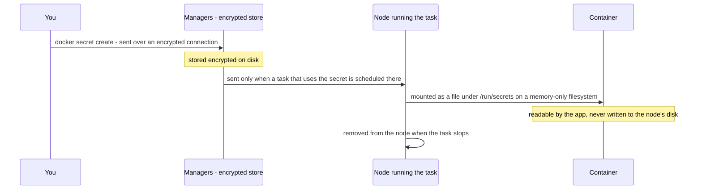
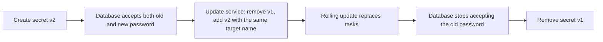

# Configs and secrets

## In plain words

An application needs two kinds of information from outside itself. Some of it is harmless: which port to listen on, how chatty the logs should be, the address of the database. Some of it is dangerous in the wrong hands: the database password, the key that signs login sessions, a payment provider's access token.

Think of a hotel. The breakfast times and the wifi name are printed on a card in every room; nobody minds who reads them. The master key that opens every door is kept in the safe, handed only to the staff who need it, and never photocopied. Mixing the two up, printing the master key code on the breakfast card, is how break-ins happen.

Docker gives each kind its own tool. A **config** is a file of ordinary settings that Docker delivers into a container. A **secret** is a file of sensitive data that Docker stores encrypted and delivers only to the containers that are entitled to it. Both keep settings **out of the image**, so that one image can run unchanged in testing and in production.

Why this matters for a job: leaked credentials are among the most common causes of security incidents, and "where do you keep secrets?" is asked in nearly every interview that touches deployment. The wrong answers ("in the image", "in the Git repository", "in an environment variable in the Compose file") are very common in real code.

> **Before this lesson:** you should know environment variables and Compose override files ([Environment, configuration and override files](#/lesson/docker/compose-environments)), volumes and bind mounts ([Volumes, bind mounts and tmpfs](#/lesson/docker/volumes-bind-mounts)) and Swarm services and stacks ([Orchestration with Docker Swarm](#/lesson/docker/swarm)).

## Where settings can live, from worst to best

Start with the simplest possible approach and see why each step up exists.

### 1. Written into the image

```dockerfile
FROM python:3.12-slim
ENV DB_PASSWORD=hunter2
COPY . /app
```

`ENV DB_PASSWORD=hunter2` stores the value inside the image. Everyone who can download the image can read it:

```bash
docker image inspect harbour/ledger:1 --format '{{.Config.Env}}'
```

```text
[PATH=/usr/local/bin:/usr/bin DB_PASSWORD=hunter2]
```

It also forces a different image per environment, which defeats the purpose of testing an image before releasing it. Never put secrets in an image. Copying a `.env` file into the image is the same mistake.

### 2. Environment variables at run time

```yaml
services:
  api:
    image: harbour/ledger:1
    environment:
      LOG_LEVEL: info
      DB_PASSWORD: hunter2
```

Better: the image is clean. For ordinary settings such as `LOG_LEVEL` this is perfectly good. For the password it has three weaknesses:

- It sits in a file that is usually committed to version control, readable by everyone with access to the repository, for ever (history keeps old versions).
- Anyone who can run `docker inspect` on the container sees it in plain text.
- Environment variables are inherited by every child process and are routinely dumped into crash reports and debug logs.

### 3. Files delivered at run time

The remaining option is to give the container a **file** containing the value, placed there when the container starts. Files can be restricted to one user, are not inherited by child processes and do not appear in `docker inspect`. This is what configs and secrets do.

## Secrets in a swarm

A secret is created once and stored by the swarm managers.

```bash
printf 'S3cure-Passw0rd' | docker secret create ledger_db_password -
```

- `printf '...'` prints the text without adding a line break at the end (a stray line break in a password is a classic bug).
- The `|` sends that text into the next command.
- `docker secret create NAME -` creates a secret; the `-` means "read the value from the text piped in".

```bash
docker secret ls
docker secret inspect ledger_db_password
```

```text
ID                          NAME                 CREATED
p3k9x2m7q1w4...             ledger_db_password   8 seconds ago
```

`inspect` shows the name and dates, never the value. There is no command that prints a secret back. That is deliberate: once stored, it can only be delivered to containers.

Now give it to a service:

```bash
docker service create --name api --secret ledger_db_password harbour/ledger:1
```

Inside every container of that service, the secret appears as a file:

```bash
docker exec $(docker ps -q -f name=api) cat /run/secrets/ledger_db_password
```

```text
S3cure-Passw0rd
```

### What protects a secret



| Protection | Meaning |
|---|---|
| Encrypted in transit | Travels between nodes over encrypted connections |
| Encrypted at rest | Stored encrypted in the managers' records |
| Least distribution | Sent only to nodes running a task that was granted it |
| Memory only | Mounted on a `tmpfs` (a filesystem that lives in memory), so it is not written to the node's disk |
| Not in `inspect` | Does not show up in container or service details |
| Per-service grant | A service sees only the secrets listed for it |

Granting each service only what it needs is an example of the principle of **least privilege**: give every part of a system the smallest set of permissions that lets it do its job.

## Configs in a swarm

A config works the same way for non-sensitive files, typically a whole configuration file.

```bash
docker config create ledger_settings ./settings.toml
docker service create --name api \
  --config source=ledger_settings,target=/etc/ledger/settings.toml \
  --secret ledger_db_password \
  harbour/ledger:1
```

- `docker config create NAME FILE` stores the file's contents in the swarm.
- `--config source=...,target=...` delivers it into the container at the given path.

| | Config | Secret |
|---|---|---|
| For | Ordinary settings files | Passwords, keys, tokens, certificates' private keys |
| Can be read back with `inspect` | Yes (`--pretty` shows the content) | No |
| Encrypted at rest | No | Yes |
| Default location in the container | `/<name>` | `/run/secrets/<name>` |
| Stored on the node's disk | Yes | No, memory only |
| Maximum size | 500 kB | 500 kB |
| Can be changed after creation | No | No |

## In a stack file

```yaml
services:
  api:
    image: harbour/ledger:1.8.0
    environment:
      LOG_LEVEL: info
      DB_HOST: db
      DB_PASSWORD_FILE: /run/secrets/db_password
    configs:
      - source: settings
        target: /etc/ledger/settings.toml
    secrets:
      - db_password
      - source: signing_key
        target: jwt.pem
        mode: 0400
        uid: "10001"

  db:
    image: postgres:16
    environment:
      POSTGRES_PASSWORD_FILE: /run/secrets/db_password
    secrets:
      - db_password

configs:
  settings:
    file: ./config/settings.toml

secrets:
  db_password:
    external: true
  signing_key:
    external: true
    name: ledger_signing_key_v2
```

Reading it:

- Under each service, `configs:` and `secrets:` list what that service may see. The short form (`- db_password`) uses default paths; the long form sets the file name (`target`), its permissions (`mode: 0400` means "readable by the owner only") and its owner (`uid`, the numeric user ID the app runs as).
- The top-level `configs:` and `secrets:` sections say where each one comes from. `file:` reads a local file when the stack is deployed. `external: true` means "this already exists in the swarm; do not create it". Secrets should normally be external, created by an administrator or a deployment pipeline, so that their values never sit in the repository.
- `DB_PASSWORD_FILE` is ordinary environment configuration: it holds a *path*, not the password.

### The `_FILE` convention

Many official images accept, for each sensitive setting `X`, a variable `X_FILE` naming a file to read the value from. `POSTGRES_PASSWORD_FILE` above is one. Supporting it in your own application takes a few lines:

```python
import os

def read_setting(name, default=None):
    """Prefer NAME_FILE (a path to a file) over NAME (the value itself)."""
    path = os.environ.get(name + "_FILE")
    if path:
        with open(path, encoding="utf-8") as handle:
            return handle.read().strip()
    return os.environ.get(name, default)

DB_PASSWORD = read_setting("DB_PASSWORD")
```

- `os.environ.get(...)` reads an environment variable, returning `None` if it is not set.
- If the `_FILE` variable exists, the file is opened and its content returned, with surrounding whitespace removed by `.strip()`.
- Otherwise the plain variable is used, which keeps local development convenient.

## Secrets with plain Compose (no swarm)

Compose supports the same `secrets:` syntax on a single machine, which lets development mirror production:

```yaml
services:
  api:
    image: harbour/ledger:dev
    environment:
      DB_PASSWORD_FILE: /run/secrets/db_password
    secrets:
      - db_password

secrets:
  db_password:
    file: ./secrets/dev_db_password.txt     # listed in .gitignore
```

The application reads `/run/secrets/db_password` in both environments. Be clear about the difference, though: without a swarm, this is a bind mount of a local file. There is no encryption and no managed store. It gives you the same *interface*, not the same *protection*.

## Changing a config or secret

Configs and secrets are **immutable**: once created, their content cannot be edited. This is a feature. If a service could silently receive new contents, you could not tell which version a running container has, and you could not roll back.

To change one, create a new object under a new name and update the service to use it. Updating the service triggers a rolling update (the previous lesson), so the change is applied gradually and can be rolled back.

```bash
printf 'N3w-Passw0rd' | docker secret create ledger_db_password_v2 -
docker service update \
  --secret-rm ledger_db_password \
  --secret-add source=ledger_db_password_v2,target=ledger_db_password \
  api
```

`target=ledger_db_password` keeps the file name inside the container the same, so the application does not need to change. Replacing a credential with a fresh one on a schedule, or after a suspected leak, is called **rotation**.



The order matters: for the length of the rolling update, some tasks hold the old password and some the new, so the database must accept both until the update has finished.

## Secrets needed while building

Sometimes the *build* needs a credential, for example to download a private package. `ARG` and `ENV` leave the value in the image's history. BuildKit (Docker's current build engine) provides a **build secret**: a file that exists only during one `RUN` instruction and is never stored in a layer.

```dockerfile
# syntax=docker/dockerfile:1
FROM python:3.12-slim
RUN --mount=type=secret,id=pip_token \
    PIP_INDEX_URL="https://build:$(cat /run/secrets/pip_token)@pkgs.harbourline.example/simple" \
    pip install --no-cache-dir private-ledger-core
```

```bash
docker build --secret id=pip_token,src=$HOME/.secrets/pip_token -t harbour/ledger:1.8.0 .
```

- `--mount=type=secret,id=pip_token` makes the secret available as `/run/secrets/pip_token` for this one instruction.
- `$(cat ...)` inserts the file's content into the command.
- `--secret id=...,src=...` on the build command says which local file supplies it.

Afterwards `docker history` shows the command text, and the token itself is nowhere in the image.

## An audit you can run in your head

When reviewing a Compose or stack file, ask four questions. The small checker below asks them automatically.

```python-run
import re

SENSITIVE = {"PASSWORD", "PASSWD", "SECRET", "TOKEN", "KEY", "CREDENTIALS"}

def sensitive(name):
    return any(part in SENSITIVE for part in re.split(r"[_.-]", name.upper()))

def audit(compose):
    findings, used = [], set()
    defined = compose.get("secrets", {})
    for service, spec in compose.get("services", {}).items():
        for var, value in spec.get("environment", {}).items():
            literal = isinstance(value, str) and value and "${" not in value
            if sensitive(var) and not var.endswith("_FILE") and literal:
                findings.append(f"{service}: {var} holds a literal secret in the environment")
        for cfg in spec.get("configs", []):
            if sensitive(cfg):
                findings.append(f"{service}: config '{cfg}' looks sensitive; use a secret")
        for sec in spec.get("secrets", []):
            used.add(sec)
            if sec not in defined:
                findings.append(f"{service}: secret '{sec}' is not defined")
    findings += [f"secret '{s}' is defined but never used" for s in defined if s not in used]
    return findings

stack = {
    "services": {
        "api": {"environment": {"LOG_LEVEL": "info", "API_TOKEN": "abc123", "DB_PASSWORD_FILE": "/run/secrets/db"},
                "configs": ["settings", "tls-private-key"], "secrets": ["db", "mailer"]},
        "db": {"environment": {"POSTGRES_PASSWORD": "${PG_PASSWORD}"}, "secrets": ["db"]},
    },
    "secrets": {"db": {}, "old_signing_key": {}},
}
print("\n".join(audit(stack)))
```

Four findings, four different mistakes: a literal token in the environment, a private key stored as a config, a secret that was never defined, and a forgotten secret that nothing uses.

## Beyond Docker's built-in store

Larger organisations often keep secrets in a dedicated system: HashiCorp Vault, or a cloud provider's secret manager. These add audit logs (a record of who read what and when), automatic rotation and short-lived credentials. The pattern for the application stays the same: the secret arrives as a file or is fetched at start-up, and it never lives in the image or the repository.

Kubernetes has matching objects, `ConfigMap` and `Secret`. Remember from the previous lesson that a Kubernetes Secret in a manifest is only base64-encoded (a reversible way of writing bytes as text), so it needs the same care about where the manifest is stored.

> [!WARNING]
> A secret inside the container is readable by anything running in that container, including an attacker who finds a flaw in your application. Secrets management narrows *who else* can see the value; it cannot protect a secret from the application that uses it. Grant each service only the secrets it needs, and rotate them.

> [!INTERVIEW]
> "How do you get a database password into a container?" Not in the image and not as a literal in a committed file. Use the platform's secret store (Swarm secrets, Kubernetes Secrets or an external vault), delivered as an in-memory file under `/run/secrets`, read through a `_FILE` setting. Mention least privilege, immutability, rotation by creating a new version, and build secrets for credentials needed at build time.

> [!TIP]
> Commit a `.env.example` with fake values and add the real `.env` and any `secrets/` folder to both `.gitignore` and `.dockerignore`. The first keeps secrets out of the repository; the second keeps them out of images.

## Pitfalls

- **Secrets baked into images** with `ENV`, `ARG` or `COPY`.
- **Literal secrets in Compose files** that are committed.
- **Believing a later `RUN rm` removes a secret** from an image. The earlier layer still holds it.
- **A trailing line break** from `echo` instead of `printf` when creating a secret, producing a password that never matches.
- **Trying to edit a secret.** Create a new one and update the service.
- **Rotating without overlap.** Old and new tasks coexist during the rolling update, so both credentials must work for a while.
- **Assuming Compose file-based secrets are encrypted.** They are plain files.
- **Logging the configuration at start-up,** secrets included.
- **Granting every secret to every service.**
- **File permissions.** A secret owned by root with mode 0400 cannot be read by an app running as another user; set `uid` and `mode`.

## Cheat sheet

| Task | Command or key |
|---|---|
| Create a secret from text | `printf 'value' \| docker secret create NAME -` |
| Create a secret from a file | `docker secret create NAME ./file` |
| Create a config | `docker config create NAME ./file` |
| List | `docker secret ls` / `docker config ls` |
| Grant to a service | `--secret NAME` / `--config source=NAME,target=/path` |
| Default paths | `/run/secrets/NAME` / `/NAME` |
| Rotate | `docker service update --secret-rm OLD --secret-add source=NEW,target=OLD SERVICE` |
| Stack: already exists | `secrets: {name: {external: true}}` |
| Stack: from a local file | `secrets: {name: {file: ./path}}` |
| Read in the app | `X_FILE` variable naming the path |
| Build-time secret | `RUN --mount=type=secret,id=ID ...` with `docker build --secret id=ID,src=FILE` |

## Summary

- Keep all environment-specific settings out of the image; keep sensitive ones out of the repository and out of environment variables too.
- A **config** delivers an ordinary settings file to a container; a **secret** delivers sensitive data, encrypted in storage and in transit, mounted in memory, and only to the services granted it.
- Applications read secrets from files, commonly through the `_FILE` convention.
- Configs and secrets are immutable. Change them by creating a new version and updating the service, which is a rolling update and can be rolled back; rotation needs a period where old and new both work.
- Plain Compose offers the same syntax as a convenience without the protection of a swarm.
- Build secrets give a build a credential without leaving it in any layer.

## Glossary

| Term | Meaning |
|---|---|
| Config | A non-sensitive settings file stored by the cluster and delivered into containers |
| Secret | Sensitive data stored encrypted by the cluster and delivered only to authorised containers |
| Credential | Something that proves identity, such as a password, key or token |
| Token | A string that grants access to a service, like a temporary password |
| Encrypted at rest / in transit | Protected by encryption while stored / while travelling over a network |
| tmpfs | A filesystem held in memory, never written to disk |
| Least privilege | Giving each component only the access it needs |
| Immutable | Cannot be changed after creation |
| Rotation | Replacing a credential with a new one |
| `_FILE` convention | A setting that names a file holding the value, instead of holding the value |
| External (in a stack file) | Already exists in the cluster; not created by this file |
| Build secret | A secret available only during a build step and not stored in the image |
| base64 | A reversible way to write bytes as text; not encryption |

## Check yourself

```quiz
[
  {"q": "Why is `ENV DB_PASSWORD=hunter2` in a Dockerfile a serious mistake?",
   "options": ["ENV cannot hold passwords", "The value is stored in the image and readable by anyone who can pull or inspect it", "It makes the build slower", "It only works on Linux"],
   "answer": 1,
   "explain": "ENV values are part of the image configuration. docker image inspect and docker history reveal them."},
  {"q": "Where does a Swarm secret named `api_key` appear inside a container by default?",
   "options": ["In the environment variable API_KEY", "As the file /run/secrets/api_key", "In /etc/secrets.conf", "In docker inspect output"],
   "answer": 1,
   "explain": "Secrets are mounted as files on an in-memory filesystem under /run/secrets, named after the secret unless a target is given."},
  {"q": "Which statement about configs versus secrets is true?",
   "options": ["Both are encrypted at rest", "Configs can be read back with inspect and are not encrypted at rest; secrets cannot be read back and are encrypted", "Secrets can be edited, configs cannot", "Configs are only for environment variables"],
   "answer": 1,
   "explain": "Configs are for non-sensitive files. Secrets get encryption and in-memory delivery, and their value is never shown again."},
  {"q": "How do you change the value of an existing secret?",
   "options": ["docker secret update", "Edit the file under /run/secrets", "Create a new secret and update the service to use it in place of the old one", "Restart the manager"],
   "answer": 2,
   "explain": "Secrets are immutable. A new object plus a service update triggers a rolling update and keeps a clear history."},
  {"q": "What does `POSTGRES_PASSWORD_FILE: /run/secrets/db_password` put in the environment?",
   "options": ["The password", "A path to a file that contains the password", "An encrypted password", "Nothing"],
   "answer": 1,
   "explain": "The _FILE convention passes a location. The image's start-up script reads the file, so the secret itself never appears in the environment."},
  {"q": "You use `secrets:` with `file: ./secret.txt` in plain Docker Compose (no swarm). What protection do you get?",
   "options": ["Encryption at rest and in transit", "The same interface as Swarm secrets, but it is a bind-mounted plain file with no encryption", "The file is deleted after start", "None; the feature does not work"],
   "answer": 1,
   "explain": "Compose mounts the local file at /run/secrets. It is convenient for matching production paths, not a secure store."},
  {"q": "During rotation of a database password by rolling update, why must the database accept both old and new passwords for a while?",
   "options": ["Swarm requires two secrets per service", "Old tasks with the old password and new tasks with the new one run at the same time", "Secrets take an hour to distribute", "The database caches passwords"],
   "answer": 1,
   "explain": "A rolling update replaces tasks gradually, so both credentials are in use until it completes."},
  {"q": "A build needs a token to download a private package. Which approach keeps the token out of the image?",
   "options": ["ARG TOKEN with --build-arg", "ENV TOKEN in the Dockerfile", "COPY token.txt then RUN rm token.txt", "RUN --mount=type=secret with docker build --secret"],
   "answer": 3,
   "explain": "A secret mount exists only for the duration of that RUN and is not written to a layer. The other three leave the value in image history or an earlier layer."}
]
```

> **Source:** Stoneman, *Learn Docker in a Month of Lunches*, ch. 13 and ch. 18 (topic coverage). Checked against <https://docs.docker.com/engine/swarm/secrets/>, <https://docs.docker.com/engine/swarm/configs/>, <https://docs.docker.com/compose/how-tos/use-secrets/> and <https://docs.docker.com/build/building/secrets/>. All wording and examples are original.
