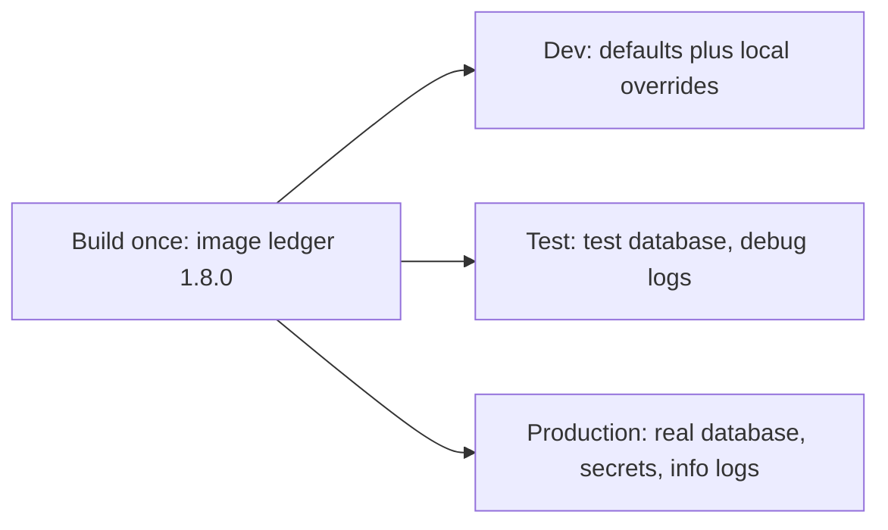
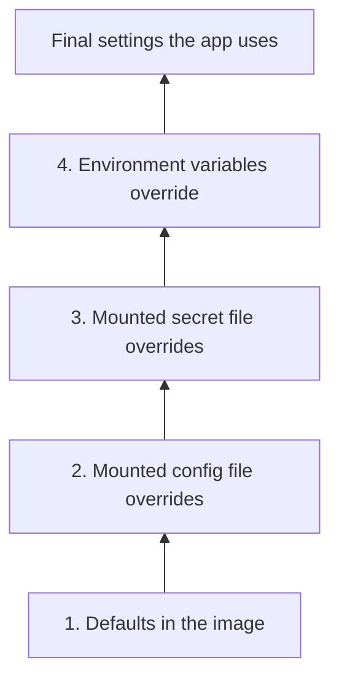

# Application configuration patterns for containers

## In plain words

The last lesson was about *delivering* settings to a container. This one is about the other side: how the application itself should be *written* so that those settings are easy and safe to supply.

Think of a new phone. It works the moment you switch it on, because the factory chose sensible defaults: a ringtone, a brightness level, a language. You then change the few things that matter to you. And if you put in a SIM card that the phone cannot read, it tells you at once instead of failing silently next week when you try to make a call.

A well-built containerised application behaves the same way. It ships with **defaults** that work for a developer on a laptop. Each environment (testing, production) **overrides** the few values that differ. And if a setting is missing or wrong, the application **refuses to start and says why**, instead of limping along.

Why this matters for a job: most failed deployments are not caused by bad code. They are caused by a wrong or missing setting. Applications that follow the patterns in this lesson are the ones that can be promoted from a laptop to production without rebuilding, which is the central promise of containers.

> **Before this lesson:** you need [Environment, configuration and override files](#/lesson/docker/compose-environments) and [Configs and secrets](#/lesson/docker/configs-secrets). A little Python reading ability helps for the examples; every line is explained.

## What counts as configuration

**Configuration** is everything that is likely to differ between the places an application runs. A quick test: could you publish the source code publicly right now without exposing anything private or environment-specific? If not, some configuration is hiding in the code.

| Is configuration | Is not configuration |
|---|---|
| Database address, user name, password | The list of database tables the code uses |
| Log level | The wording of log messages |
| Addresses of other services | How requests to them are built |
| Feature switches | The code of the feature |
| Port to listen on, number of worker processes | The routing of web addresses inside the app |

This idea comes from a well-known set of guidelines called the **twelve-factor app**, whose third factor reads "store config in the environment". "Environment" there means "outside the code", and is often taken to mean environment variables specifically.

The reward for separating the two is the **build once, run anywhere** rule: one image, built and tested once, then moved unchanged through every stage.



## Pattern 1: layered configuration

The simplest thing that could work is one source: read every setting from an environment variable. It breaks down as soon as there are fifty settings, because every environment must supply all fifty.

The standard answer is **layers**. Several sources are read in a fixed order, and a later source overrides an earlier one for any setting both define.

| Layer | Source | Typical content | Who controls it |
|---|---|---|---|
| 1 (lowest) | Defaults packaged in the image | Values that work on a developer machine | Developers |
| 2 | A config file mounted into the container | The environment's ordinary settings | Operations |
| 3 | A secret file mounted into the container | Passwords and keys | Operations, restricted |
| 4 (highest) | Environment variables | One-off overrides, such as a temporary log level | Whoever starts the container |



The simulation below merges four layers and reports where each final value came from. Knowing the *origin* of a value is what makes configuration problems quick to diagnose.

```python-run
def layered(*layers):
    """layers: (name, dict) pairs, lowest priority first. Returns {key: (value, source)}."""
    final = {}
    for name, values in layers:
        for key, value in values.items():
            final[key] = (value, name)
    return final

defaults    = {"port": 8000, "log_level": "debug", "db_host": "localhost", "db_name": "ledger", "export_enabled": False}
config_file = {"log_level": "info", "db_host": "db.internal", "export_enabled": True}
secret_file = {"db_password": "S3cure"}
environment = {"log_level": "warning"}

settings = layered(("defaults", defaults), ("config file", config_file),
                   ("secret file", secret_file), ("environment", environment))
for key in sorted(settings):
    value, source = settings[key]
    shown = "****" if "password" in key else value
    print(f"{key:15s} = {shown!s:12s} (from {source})")
```

`log_level` is defined in three places and the environment wins. The password is printed masked: a start-up summary of settings is very useful, as long as secrets are hidden.

## Pattern 2: sensible defaults in the image

Layer 1 deserves care. Good defaults mean that `docker run harbour/ledger:1.8.0` with no options does something useful for a developer.

Rules for choosing defaults:

- **Safe, not powerful.** Default to the least dangerous behaviour. A debug page that shows internals should be off unless switched on.
- **Local, not production.** A default database host of `localhost` or `db` is fine. The production address must never be a default, or a developer's laptop will one day connect to the production database.
- **No default for secrets.** A default password is a password that will reach production.
- **Document them in one place,** ideally the file that holds them.

```toml
# /app/config/defaults.toml  (copied into the image)
port = 8000
log_level = "info"
db_host = "db"
db_name = "ledger"
export_enabled = false
request_timeout_seconds = 10
```

This format is TOML, a plain `name = value` file format that is easy for people to read.

## Pattern 3: one conventional place for overrides

Layer 2 needs a home. Choose **one fixed folder** in the container where an override file may appear, and document it. Then every platform can supply the file in its own way without the application caring how:

```yaml
# plain Compose: a bind mount of a local file
services:
  api:
    image: harbour/ledger:1.8.0
    volumes:
      - ./config/test.toml:/app/config-override/settings.toml:ro
```

```yaml
# Swarm: a config object
services:
  api:
    image: harbour/ledger:1.8.0
    configs:
      - source: ledger_prod
        target: /app/config-override/settings.toml
```

In Kubernetes the same file would come from a ConfigMap mounted at the same path. The application code is identical in all three.

> [!WARNING]
> Mount the override into its **own folder**, not over the folder that holds the defaults. A mount hides everything the image had at that path (see the storage lessons), so mounting over `/app/config` would make `defaults.toml` disappear.

## Pattern 4: environment variables for the last word

Environment variables are the top layer because they are the easiest thing to change for one container without touching any file. To keep them tidy:

- **Use a prefix** for your application, such as `LEDGER_`, so that your settings cannot collide with variables the system or other tools define.
- **Map names mechanically.** `LEDGER_LOG_LEVEL` sets `log_level`; `LEDGER_DB_HOST` sets `db_host`. Then nobody needs a lookup table.
- **Convert types carefully.** Every environment variable is text. The text `"false"` is a non-empty string, which many languages treat as true. Convert explicitly.

```python
TRUE_WORDS = {"1", "true", "yes", "on"}
FALSE_WORDS = {"0", "false", "no", "off"}

def to_bool(text):
    word = text.strip().lower()
    if word in TRUE_WORDS:
        return True
    if word in FALSE_WORDS:
        return False
    raise ValueError(f"expected true or false, got {text!r}")
```

- `.strip().lower()` removes surrounding spaces and ignores capital letters, so `" True "` is accepted.
- Anything unrecognised raises an error with the offending text, instead of being guessed at.

## Pattern 5: validate at start-up and fail fast

The worst configuration bug is the one that appears at 2 a.m. when a rarely used feature finally reads the setting that was mistyped three weeks earlier. The cure is to read and check **every** setting when the application starts, before it accepts any work.

```python
import sys

REQUIRED = ["db_host", "db_name", "db_password"]
ALLOWED_LEVELS = {"debug", "info", "warning", "error"}

def validate(settings):
    problems = []
    for key in REQUIRED:
        if not settings.get(key):
            problems.append(f"{key} is required and has no value")
    if settings.get("log_level") not in ALLOWED_LEVELS:
        problems.append(f"log_level must be one of {sorted(ALLOWED_LEVELS)}")
    port = settings.get("port")
    if not isinstance(port, int) or not 1 <= port <= 65535:
        problems.append("port must be a whole number from 1 to 65535")
    return problems

problems = validate(settings)
if problems:
    for line in problems:
        print("configuration error:", line, file=sys.stderr)
    sys.exit(1)
```

Line by line:

- `REQUIRED` lists settings that have no acceptable default.
- `validate` collects **all** problems in a list instead of stopping at the first, so one failed start reports everything that needs fixing.
- `print(..., file=sys.stderr)` writes to the error stream, where Docker's log capture picks it up.
- `sys.exit(1)` ends the program with a non-zero exit code, which marks the container as failed.

This is called **failing fast**. It combines well with everything earlier in the track: the container exits, `docker logs` shows a clear reason, a rolling update sees the new task fail and stops or rolls back, and no user is served by a half-configured application.

```text
configuration error: db_password is required and has no value
configuration error: log_level must be one of ['debug', 'error', 'info', 'warning']
```

## Pattern 6: make the running configuration visible

When behaviour is surprising, the first question is "what settings does this container think it has?". Provide the answer deliberately:

- **Log a summary at start-up:** each setting, its value and its source, with secrets masked.
- **Record the version:** the image's version and source revision, so logs can be tied to a release.
- Optionally, **a diagnostics page** that shows the same summary. Protect it or switch it off in production: even without secrets, internal addresses help an attacker.

```text
ledger 1.8.0 (revision 4f2c9d1e) starting
  port            = 8000          (defaults)
  log_level       = warning       (environment)
  db_host         = db.internal   (config file)
  db_password     = ****          (secret file)
```

## Pattern 7: decide what can change without a restart

Most settings are read once at start-up. To change them you replace the container, which in an orchestrator is a rolling update: gradual, visible and reversible. This should be the default, because it gives every configuration change the same safety as a code change.

Some settings are worth changing at run time, such as a log level during an investigation or a **feature flag** (a switch that turns a piece of functionality on or off without a new release). Options, from simplest:

| Approach | How it works | Trade-off |
|---|---|---|
| Restart or redeploy | New containers read the new values | Simple and auditable; takes a rollout |
| Reload on a signal | The app re-reads its files when it receives a signal such as `SIGHUP`: `docker kill -s HUP api` | Fast; containers can end up with different settings |
| Watch the file | The app notices the mounted file changing | Only works where the platform updates mounted files in place |
| Ask a settings service | The app polls a central service | Most flexible; another system to run and trust |

Whichever you choose, make the choice explicit. Settings that change silently underneath a running application, without any record, are a major source of "nobody deployed anything, but it broke".

## Putting it together

```dockerfile
# syntax=docker/dockerfile:1
FROM python:3.12-slim
WORKDIR /app
ENV PYTHONUNBUFFERED=1 \
    LEDGER_CONFIG_DEFAULTS=/app/config/defaults.toml \
    LEDGER_CONFIG_OVERRIDE=/app/config-override/settings.toml
COPY requirements.txt .
RUN pip install --no-cache-dir -r requirements.txt
COPY config/defaults.toml /app/config/defaults.toml
COPY ledger/ ledger/
USER 10001
CMD ["python", "-m", "ledger"]
```

- The two `LEDGER_CONFIG_*` variables record the conventional paths, so that even the paths can be overridden if ever needed.
- `COPY config/defaults.toml ...` packages layer 1 into the image.
- Nothing environment-specific and nothing secret is in the image.

```yaml
services:
  api:
    image: harbour/ledger:1.8.0
    environment:
      LEDGER_LOG_LEVEL: warning
      LEDGER_DB_PASSWORD_FILE: /run/secrets/db_password
    configs:
      - source: ledger_prod
        target: /app/config-override/settings.toml
    secrets:
      - db_password
```

All four layers are present: defaults inside the image, the mounted config, the secret file, and one environment override.

> [!INTERVIEW]
> "How should a containerised application be configured?" One image for every environment; configuration supplied from outside in layers (packaged defaults, mounted config file, secrets as files, environment variables on top); validated at start-up so that a bad setting stops the container with a clear message; the effective configuration logged with secrets masked; changes rolled out as deployments. Mention twelve-factor for vocabulary.

> [!TIP]
> Give one-off tools the same configuration path as the main application. A database migration run with `docker compose run api python -m ledger migrate` should load settings through exactly the same code, or it will one day migrate the wrong database.

## Pitfalls

- **A different image per environment.** What you tested is not what you ship.
- **Production values as defaults.** Laptops then talk to production.
- **Mounting config over the defaults folder,** hiding the defaults.
- **Treating the text `"false"` as false without converting it.**
- **Lazy reading.** A setting read on first use fails long after start-up.
- **Stopping at the first error.** Report every configuration problem in one go.
- **Printing secrets** in the start-up summary or on a diagnostics page.
- **Unprefixed variable names** such as `PORT` or `DEBUG` that other tools also use.
- **Silent fallback.** Falling back to a default when a supplied value is invalid hides the mistake; reject it instead.
- **Undocumented settings.** If a setting is not in the defaults file or the README, it effectively does not exist for the next person.

## Cheat sheet

| Goal | Pattern |
|---|---|
| Same image everywhere | Keep all environment-specific values outside the image |
| Works with no options | Safe, local defaults packaged in the image |
| Per-environment settings | A config file mounted into a dedicated override folder |
| Sensitive values | Secret files, read through `NAME_FILE` settings |
| Quick one-off change | Prefixed environment variable, highest priority |
| Catch mistakes early | Validate everything at start-up; exit non-zero with all errors listed |
| Diagnose | Log each setting with its source, secrets masked |
| Change safely | Roll out a new deployment; reserve live reload for a few chosen settings |

## Summary

- Configuration is whatever differs between environments; keeping it outside the image gives you one tested image for every stage.
- Read settings in layers, lowest to highest: packaged defaults, mounted config file, mounted secret file, environment variables.
- Defaults should be safe and local, never production values and never secrets.
- Use one documented override location that any platform can populate, separate from the defaults.
- Convert and validate every setting at start-up and fail fast with a complete, readable error list.
- Make the effective configuration visible, with sources and with secrets masked.
- Prefer changing configuration through a rollout; allow live changes only where there is a clear need.

## Glossary

| Term | Meaning |
|---|---|
| Configuration | Settings that vary between the places an application runs |
| Environment | One place an application runs, such as development, test or production |
| Twelve-factor app | A widely cited list of practices for applications that run as services |
| Layered configuration | Reading settings from several sources where later ones override earlier ones |
| Default | The value used when nothing else supplies one |
| Override | A value from a higher layer that replaces a lower one |
| TOML | A plain-text settings format of `name = value` lines |
| Prefix | A common beginning for variable names, such as `LEDGER_`, to avoid clashes |
| Validation | Checking that settings are present and sensible |
| Fail fast | Stopping immediately with a clear error instead of continuing in a bad state |
| Feature flag | A setting that switches a feature on or off without a new release |
| Reload | Re-reading configuration without restarting the process |

## Check yourself

```quiz
[
  {"q": "What is the main benefit of keeping configuration outside the image?",
   "options": ["Smaller images", "The same tested image can run in every environment", "Faster start-up", "No need for health checks"],
   "answer": 1,
   "explain": "If settings are supplied at run time, the image that passed testing is byte for byte the image that reaches production."},
  {"q": "With layers read in the order defaults, config file, secret file, environment variables, which value wins when a setting appears in the config file and in an environment variable?",
   "options": ["The config file", "The environment variable", "The default", "It is an error"],
   "answer": 1,
   "explain": "Later layers override earlier ones, and environment variables are the top layer."},
  {"q": "Why should the production database address never be a packaged default?",
   "options": ["Defaults cannot contain addresses", "A container started without overrides, for example on a laptop, would connect to production", "It makes the image larger", "Production addresses change daily"],
   "answer": 1,
   "explain": "Defaults apply whenever nothing overrides them. They must be safe values suitable for local use."},
  {"q": "An environment variable is set to the text `false`. Code checks `if os.environ['EXPORT_ENABLED']:`. What happens?",
   "options": ["The branch is skipped", "The branch runs, because a non-empty string counts as true", "An error is raised", "The variable is ignored"],
   "answer": 1,
   "explain": "All environment variables are strings, and any non-empty string is truthy. Convert the text to a boolean explicitly."},
  {"q": "What does 'fail fast' mean for configuration?",
   "options": ["Retry until settings appear", "Check all settings at start-up and exit with a clear error if any are missing or invalid", "Use defaults silently when a value is invalid", "Start quickly and validate on first use"],
   "answer": 1,
   "explain": "A container that exits at once with a readable message is far easier to deal with than one that fails later in an obscure way."},
  {"q": "Why mount the override file into its own folder instead of the folder containing the defaults?",
   "options": ["Docker forbids mounting over image folders", "A mount hides the existing contents of the target folder, so the defaults file would disappear", "Override files must be read-only", "It is faster"],
   "answer": 1,
   "explain": "Mounting replaces what the image had at that path. A separate folder keeps both files visible."},
  {"q": "What should a start-up configuration summary do with secrets?",
   "options": ["Print them in full for debugging", "Mask them, while still showing that they are set and where they came from", "Leave them out entirely so nobody knows they exist", "Encrypt them and print the result"],
   "answer": 1,
   "explain": "Knowing a secret is present and its source helps diagnosis. Its value must never reach the logs."},
  {"q": "What is usually the safest way to apply a configuration change in a cluster?",
   "options": ["Edit files inside running containers", "Roll out new containers with the new configuration, so the change is gradual and reversible", "Restart every container at the same moment", "Change the image"],
   "answer": 1,
   "explain": "Treating configuration changes as deployments gives them health checks, gradual rollout and rollback."}
]
```

> **Source:** Stoneman, *Learn Docker in a Month of Lunches*, ch. 18 (topic coverage). Checked against <https://12factor.net/config>, <https://docs.docker.com/compose/how-tos/environment-variables/best-practices/> and <https://docs.docker.com/engine/swarm/configs/>. All wording and examples are original.
