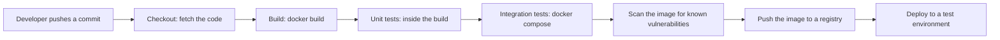

# Build infrastructure and CI pipelines with Docker

## In plain words

When one person writes a program, building it is easy: they press a button on their own computer. When a team of ten works on the same program, a problem appears. Each person's computer is set up slightly differently, so code that works for one fails for another, and nobody notices until the differences have piled up.

The fix is a neutral referee: a separate machine that, every time anyone changes the code, fetches the latest version, builds it from scratch and runs the tests. If anything fails, the team finds out within minutes. This practice is called **continuous integration**, shortened to **CI**. The sequence of steps the machine performs is a **pipeline**, in the sense of a factory conveyor belt: raw code goes in at one end and, station by station, becomes a tested product.

Docker makes that referee far simpler to run. The old way needed the build machine to have every compiler and tool installed at exactly the right version. With Docker, all those tools live inside the Dockerfile's build stages. The build machine needs one thing installed: Docker.

Why this matters for a job: nearly every team builds its images in a pipeline, not on a laptop. You will read, fix and write pipeline files early in any role involving containers, and "walk me through your CI pipeline" is a staple interview question.

> **Before this lesson:** you should know multi-stage builds ([Multi-stage builds](#/lesson/docker/multi-stage-builds)), the build cache ([Layers, the build cache, the context and .dockerignore](#/lesson/docker/layers-cache-context)), image tags and registries ([Registries, image references, tags and digests](#/lesson/docker/registries-tags-digests)) and Compose override files ([Environment, configuration and override files](#/lesson/docker/compose-environments)).

## The stages of a container pipeline



Each box is a **stage**. If one fails, the pipeline stops and later stages do not run, so a broken build can never be pushed. Some terms used below:

- A **commit** is one saved change to the code in a version-control system such as Git.
- A **runner** (or *agent*) is the machine that executes the pipeline.
- An **artifact** is something a pipeline produces. Here the artifact is the image.

## Step 1: a build that needs only Docker

Recall the multi-stage Dockerfile pattern. Here it is with a test stage for a Python service called `ledger`:

```dockerfile
# syntax=docker/dockerfile:1
FROM python:3.12-slim AS base
WORKDIR /srv/ledger
ENV PATH="/opt/venv/bin:$PATH"
RUN python -m venv /opt/venv
COPY requirements.txt .
RUN --mount=type=cache,target=/root/.cache/pip pip install -r requirements.txt

FROM base AS test
COPY requirements-dev.txt .
RUN --mount=type=cache,target=/root/.cache/pip pip install -r requirements-dev.txt
COPY . .
RUN ruff check . && pytest -q

FROM base AS prod
COPY ledger/ ledger/
USER 10001
CMD ["gunicorn", "--bind", "0.0.0.0:8000", "ledger.wsgi:app"]
```

- The `base` stage installs the application's dependencies.
- The `test` stage adds development tools, copies all the code, then runs a style checker (`ruff`) and the unit tests (`pytest`). **Unit tests** check small pieces of code in isolation. If either command fails, that `RUN` instruction fails, and so does the build.
- The `prod` stage is the image that will be shipped. It contains no test tools.

The simplest pipeline is then two commands that work the same on a laptop and on a runner:

```bash
docker build --target test -t ledger:test .
docker build --target prod -t ledger:candidate .
```

`--target` builds up to the named stage. The first command runs the tests; the second produces the shippable image, reusing the cached `base` layers.

```text
 => [test 4/4] RUN ruff check . && pytest -q                         9.4s
 => => # 41 passed in 6.82s
```

Because the tools are defined in the Dockerfile, upgrading Python or the test framework is a change to a file that is reviewed like any other, and it takes effect for every developer and the runner at the same moment.

## Step 2: integration tests with Compose

Unit tests do not prove that the application works with a real database. **Integration tests** run the application together with the things it depends on. Compose can start that whole environment on the runner, run the tests and tear it down.

```yaml
# compose.ci.yaml
services:
  db:
    image: postgres:16
    environment:
      POSTGRES_PASSWORD: ci-only
    tmpfs:
      - /var/lib/postgresql/data
    healthcheck:
      test: ["CMD-SHELL", "pg_isready -U postgres"]
      interval: 2s
      retries: 30

  api:
    image: ${IMAGE:-ledger:candidate}
    environment:
      DATABASE_URL: postgresql://postgres:ci-only@db/postgres
    depends_on:
      db:
        condition: service_healthy

  tests:
    image: ledger:test
    command: ["pytest", "-q", "tests/integration"]
    environment:
      API_URL: http://api:8000
    depends_on:
      api:
        condition: service_started
```

- `db` keeps its data in memory (`tmpfs`), which is fast and leaves nothing behind.
- `api` is the candidate image, the exact image that will be pushed if the tests pass. `${IMAGE:-ledger:candidate}` uses the `IMAGE` variable if the pipeline sets it and a default otherwise.
- `tests` is a container that plays the role of a client and calls the API over the network.

```bash
docker compose -f compose.ci.yaml -p ledger-ci-$BUILD_ID up \
  --abort-on-container-exit --exit-code-from tests
docker compose -f compose.ci.yaml -p ledger-ci-$BUILD_ID down -v
```

- `-p ledger-ci-$BUILD_ID` gives this run its own project name, so two pipelines on the same runner do not collide.
- `--abort-on-container-exit` stops everything as soon as any container finishes.
- `--exit-code-from tests` makes the whole command return the exit code of the `tests` container. Pipelines decide pass or fail from exit codes: 0 passes, anything else fails.
- `down -v` removes the containers, the network and the volumes, leaving the runner clean.

## Step 3: tag and push

Only an image that passed every earlier stage is pushed. It gets a tag that identifies exactly which commit it came from.

```bash
SHA=$(git rev-parse --short=8 HEAD)
IMAGE=registry.harbourline.example/payments/ledger
docker tag ledger:candidate $IMAGE:git-$SHA
docker push $IMAGE:git-$SHA
```

- `git rev-parse --short=8 HEAD` prints the first eight characters of the current commit's identifier.
- `docker tag` gives the image its registry name; `docker push` uploads it.

Later stages (deployment to test, then production) use that same tag or, better, the digest printed by the push. The image is **built once and promoted**, never rebuilt, as the lesson on versioning explained.

## A complete pipeline file

Every CI system has its own file format; the ideas are the same. Here is the pipeline for GitHub Actions, a widely used hosted CI service. The file lives in the repository at `.github/workflows/ci.yaml`.

```yaml
name: ci
on:
  push:
    branches: [main]
  pull_request:

jobs:
  build:
    runs-on: ubuntu-latest
    permissions:
      contents: read
      packages: write
    env:
      IMAGE: ghcr.io/harbourline/ledger
    steps:
      - uses: actions/checkout@v4

      - uses: docker/setup-buildx-action@v3

      - name: Unit tests
        uses: docker/build-push-action@v6
        with:
          context: .
          target: test
          cache-from: type=gha
          cache-to: type=gha,mode=max

      - name: Build candidate image
        uses: docker/build-push-action@v6
        with:
          context: .
          target: prod
          load: true
          tags: ledger:candidate
          cache-from: type=gha

      - name: Integration tests
        run: |
          docker compose -f compose.ci.yaml up --abort-on-container-exit --exit-code-from tests
          docker compose -f compose.ci.yaml down -v

      - name: Log in to the registry
        if: github.ref == 'refs/heads/main'
        uses: docker/login-action@v3
        with:
          registry: ghcr.io
          username: ${{ github.actor }}
          password: ${{ secrets.GITHUB_TOKEN }}

      - name: Push
        if: github.ref == 'refs/heads/main'
        run: |
          docker tag ledger:candidate $IMAGE:git-${GITHUB_SHA::8}
          docker push $IMAGE:git-${GITHUB_SHA::8}
```

Reading it from the top:

- `on:` says when to run: on every push to the `main` branch and on every **pull request** (a proposed change waiting for review).
- `runs-on: ubuntu-latest` asks for a fresh Linux runner with Docker already installed.
- `permissions` limits what the pipeline's own access token may do: read the code, write packages (images).
- `actions/checkout` fetches the repository. `docker/setup-buildx-action` prepares BuildKit, Docker's current build engine.
- The two `build-push-action` steps are `docker build --target test` and `--target prod`. `load: true` puts the built image into the runner's local Docker so that Compose can use it.
- `cache-from` and `cache-to` are explained in the next section.
- The last two steps run only on `main` (the `if:` lines), so a pull request is built and tested but never pushed.
- `${{ secrets.GITHUB_TOKEN }}` is a credential supplied by the CI system at run time. It is never written in the file.

## Making pipeline builds fast: the cache

A hosted runner starts as a blank machine every time, so the layer cache from the previous build is gone. Without help, every pipeline run reinstalls every dependency. There are three remedies.

| Technique | How | Effect |
|---|---|---|
| Good Dockerfile order | Copy dependency lists and install before copying source | Maximises what *can* be cached |
| External cache | `--cache-to` and `--cache-from` store and fetch layers from a registry or the CI system's cache | A fresh runner starts warm |
| Cache mounts | `RUN --mount=type=cache,...` keeps a package manager's download folder between builds | Faster even when a layer must rebuild (on runners that keep their disk) |

```bash
docker buildx build \
  --cache-from type=registry,ref=$IMAGE:buildcache \
  --cache-to type=registry,ref=$IMAGE:buildcache,mode=max \
  --target prod -t $IMAGE:git-$SHA --push .
```

`mode=max` stores the layers of every stage, including `base` and `test`, and not only those of the final image. With multi-stage builds that makes the difference between a mostly cached build and a mostly cold one.

The simulation below estimates build time over a week of commits for three setups, using the cache rules from the earlier lesson.

```python-run
STEPS = [("base image", 20), ("install dependencies", 90), ("copy source", 2), ("run tests", 30)]

def build_seconds(changed_step, warm):
    """warm: is a cache available? changed_step: index of the first step whose input changed."""
    if not warm:
        return sum(cost for _, cost in STEPS)
    return sum(cost for i, (_, cost) in enumerate(STEPS) if i >= changed_step)

commits = [2] * 18 + [1] * 2          # 18 source-only commits, 2 that change dependencies
plans = {
    "fresh runner, no cache":            lambda c: build_seconds(c, warm=False),
    "fresh runner, registry cache":      lambda c: build_seconds(c, warm=True) + 8,   # 8 s to fetch the cache
    "COPY . before install (bad order)": lambda c: build_seconds(1, warm=True) + 8,
}
for name, cost in plans.items():
    total = sum(cost(c) for c in commits)
    print(f"{name:36s} {total:5d} s for {len(commits)} builds  ({total / len(commits):5.1f} s each)")
```

The registry cache cuts the weekly total by more than half. The third line shows that a badly ordered Dockerfile throws most of that away, because every commit invalidates the dependency step.

## Where does the build run? Three models

| Model | How it works | Trade-off |
|---|---|---|
| Hosted runners | The CI service provides a fresh virtual machine with Docker | Nothing to maintain; cold caches |
| Your own runners | You run machines (or containers) that execute pipeline jobs | Warm caches and control; you maintain them |
| The whole CI system in containers | Git server, CI server and registry all run as containers you host | Fully under your control and portable; the most to operate |

When the runner is itself a container, how does it run `docker build`? There are two common answers.

**Mounting the Docker socket.** The runner container is given the host's control channel:

```bash
docker run -v /var/run/docker.sock:/var/run/docker.sock ci-runner
```

The **socket** is the file through which the `docker` command talks to the Docker Engine. With it, builds started inside the runner are in fact carried out by the host's engine. It is fast and shares the host's cache.

**Docker-in-Docker.** A complete second Docker Engine runs inside a privileged container. Jobs are isolated from the host's containers, at the cost of running with elevated privileges and having a separate cache.

> [!WARNING]
> Access to the Docker socket is equivalent to administrator access on the host: whoever can talk to it can start a container that mounts the host's entire disk. Give it only to runners that execute code you trust, never to builds of pull requests from strangers. Daemonless builders such as BuildKit's rootless mode or Kaniko exist for untrusted workloads.

## Secrets in pipelines

Pipelines handle registry passwords, deployment keys and package tokens. The rules follow the lesson on secrets:

- Store them in the CI system's secret store, never in the pipeline file or the repository.
- Hand build-time credentials to the build with `--secret`, never `--build-arg`, so they do not land in image layers or history.
- Use short-lived, narrowly scoped tokens. The automatic token in the example above expires when the job ends.
- Do not expose secrets to pipelines triggered by untrusted pull requests.

## Supply-chain steps worth adding

The **supply chain** is everything that goes into your image: base images, packages, and the pipeline itself. Three additions strengthen it.

```bash
docker scout cves $IMAGE:git-$SHA --exit-code --only-severity critical,high
docker buildx build --sbom=true --provenance=mode=max -t $IMAGE:git-$SHA --push .
```

- A **vulnerability scan** compares the packages in the image with public lists of known security flaws. `--exit-code` makes the command fail the pipeline when it finds flaws of the listed severities. (Trivy and Grype are popular alternative scanners.)
- An **SBOM**, a software bill of materials, is a list of everything inside the image. It lets you answer "are we affected?" in minutes when a new flaw is announced.
- **Provenance** is a signed record of how and from which commit the image was built.

## Continuous delivery in one paragraph

CI ends with a tested image in a registry. **Continuous delivery** (CD) continues the pipeline: deploy that same image to a test environment automatically, run checks, and promote it to production, either automatically or after a person approves. The deployment step is one of the commands you already know, `docker stack deploy` or `kubectl apply`, run by the pipeline with the new image tag. The upgrades lesson covered making that step safe.

> [!INTERVIEW]
> "Describe a CI pipeline for a containerised service." On every push: check out; build with a multi-stage Dockerfile so the runner needs only Docker; run unit tests in a test stage; start the candidate image with its dependencies using Compose and run integration tests; scan; tag with the commit identifier; push; deploy that exact image onward. Add how you keep it fast (layer order, registry cache with `mode=max`) and safe (secret mounts, least-privilege tokens, no socket for untrusted code).

> [!TIP]
> Make every pipeline step a command that also works on a laptop, such as `docker build --target test .`, perhaps wrapped in a small script. When the pipeline fails you can reproduce the failure locally instead of pushing commits to "see what CI says".

## Pitfalls

- **Tools installed on the runner instead of in the Dockerfile.** The runner and laptops drift apart.
- **Tests in a stage nothing depends on.** BuildKit skips unreachable stages, so a plain `docker build .` never runs them. Build the test target explicitly.
- **Testing one image and pushing another.** Rebuilding after the tests produces different bits. Push the image you tested.
- **A fixed project name in CI.** Parallel jobs on one runner collide. Include a build identifier.
- **Not cleaning up.** Leftover containers, networks and volumes fill the runner.
- **Cold cache on every run,** or exporting only the final stage's layers (missing `mode=max`).
- **Secrets as build arguments.** They are stored in the image's history.
- **Pushing from pull requests.** Unreviewed code ends up in the registry.
- **Using `latest` as the pipeline's output tag.** You cannot tell builds apart or roll back.

## Cheat sheet

| Stage | Command |
|---|---|
| Unit tests | `docker build --target test .` |
| Candidate image | `docker build --target prod -t app:candidate .` |
| Integration tests | `docker compose -f compose.ci.yaml -p ci-$ID up --abort-on-container-exit --exit-code-from tests` |
| Clean up | `docker compose -f compose.ci.yaml -p ci-$ID down -v` |
| Unique tag | `git-$(git rev-parse --short=8 HEAD)` |
| Push | `docker push REGISTRY/REPO:TAG` |
| Registry cache | `--cache-from type=registry,ref=R:buildcache --cache-to type=registry,ref=R:buildcache,mode=max` |
| Build secret | `docker build --secret id=tok,src=./tok` with `RUN --mount=type=secret,id=tok` |
| Scan | `docker scout cves IMAGE --exit-code --only-severity critical,high` |
| Plain log output for CI | `docker build --progress=plain .` |

## Summary

- Continuous integration builds and tests every change on a neutral machine; a pipeline is the ordered list of stages that does it.
- With multi-stage Dockerfiles the toolchain lives in the repository, so a runner needs only Docker and builds are identical everywhere.
- Unit tests run inside a build stage; integration tests run the candidate image with real dependencies under Compose, and the pipeline takes its result from the test container's exit code.
- Tag the tested image with the commit identifier, push it once and promote that same image.
- Runners start cold, so order the Dockerfile well and import and export the layer cache.
- Treat the Docker socket as administrator access, keep credentials in the CI secret store and pass them to builds as secret mounts.
- Scanning, a bill of materials and provenance make the pipeline's output trustworthy.

## Glossary

| Term | Meaning |
|---|---|
| Continuous integration (CI) | Automatically building and testing every change to the code |
| Continuous delivery (CD) | Automatically carrying a tested build onward to deployment |
| Pipeline | The ordered steps a CI system runs for each change |
| Stage / job / step | Units of work in a pipeline, from larger to smaller |
| Commit | One saved change in version control |
| Pull request | A proposed change awaiting review before it joins the main branch |
| Runner (agent) | The machine that executes pipeline jobs |
| Artifact | Something a pipeline produces, such as an image |
| Unit test | A test of a small piece of code in isolation |
| Integration test | A test of the application working with its real dependencies |
| Candidate image | The image built by the pipeline that will be released if it passes |
| Docker socket | The file the `docker` command uses to talk to the Docker Engine |
| Docker-in-Docker | Running a second Docker Engine inside a container |
| Supply chain | Everything that goes into building the software |
| SBOM | Software bill of materials: a list of everything in an image |
| Provenance | A record of how and from what an image was built |

## Check yourself

```quiz
[
  {"q": "What is the main advantage of putting the build tools in a multi-stage Dockerfile instead of installing them on the CI runner?",
   "options": ["Builds use less memory", "The runner needs only Docker, and every machine builds with the same tool versions", "Images become smaller automatically", "Tests are no longer needed"],
   "answer": 1,
   "explain": "The toolchain becomes part of the versioned Dockerfile, so laptops and runners cannot drift apart."},
  {"q": "A Dockerfile has stages base, test and prod, where prod does not depend on test. You run `docker build -t app .`. Are the tests executed?",
   "options": ["Yes, every stage always runs", "No, BuildKit skips stages the target does not depend on", "Only if the cache is empty", "Only on Linux"],
   "answer": 1,
   "explain": "Unreachable stages are not built. The pipeline must build the test target explicitly."},
  {"q": "What does `--exit-code-from tests` do in `docker compose up`?",
   "options": ["Prints the tests' logs", "Makes the compose command return the exit code of the tests container, so the pipeline passes or fails with the tests", "Restarts the tests on failure", "Removes the containers afterwards"],
   "answer": 1,
   "explain": "CI systems judge a step by its exit code. This flag passes the test container's result out to the pipeline."},
  {"q": "Why give each CI run its own Compose project name?",
   "options": ["Compose requires unique names", "So that parallel runs on one runner do not share or clash over containers, networks and volumes", "To speed up the build", "To enable caching"],
   "answer": 1,
   "explain": "The project name prefixes every resource. Distinct names isolate concurrent pipelines."},
  {"q": "A hosted runner starts as a blank machine. What keeps Docker builds fast there?",
   "options": ["Nothing can", "Importing and exporting the layer cache with --cache-from and --cache-to", "Using the latest tag", "Disabling tests"],
   "answer": 1,
   "explain": "An external cache, in a registry or the CI system's store, lets a fresh runner reuse layers from earlier builds."},
  {"q": "Why is mounting /var/run/docker.sock into a CI runner container a security concern?",
   "options": ["It slows the host", "Whoever can use the socket controls the host's Docker Engine, which amounts to administrator access on the host", "It disables networking", "It deletes the build cache"],
   "answer": 1,
   "explain": "Through the socket one can start a privileged container that mounts the host's disk. Only trusted jobs should have it."},
  {"q": "The pipeline tests image A, then rebuilds from the same commit and pushes image B. What is wrong?",
   "options": ["Nothing; same commit means same image", "The pushed image is not the one that was tested; a rebuild can differ, for example through a newer base image", "Registries reject rebuilt images", "The tag will be wrong"],
   "answer": 1,
   "explain": "Build once and promote the same image. Only then do the test results apply to what is deployed."},
  {"q": "How should a token needed during `docker build` be supplied?",
   "options": ["--build-arg TOKEN=...", "ENV TOKEN in the Dockerfile", "A secret mount: RUN --mount=type=secret with docker build --secret", "COPY token.txt"],
   "answer": 2,
   "explain": "A secret mount exists only during that RUN instruction and is not stored in any layer or in the image history."}
]
```

> **Source:** Stoneman, *Learn Docker in a Month of Lunches*, ch. 11 and ch. 15 (topic coverage). Checked against <https://docs.docker.com/build/ci/>, <https://docs.docker.com/build/ci/github-actions/cache/>, <https://docs.docker.com/build/cache/backends/> and <https://docs.docker.com/engine/security/protect-access/>. All wording and examples are original.
