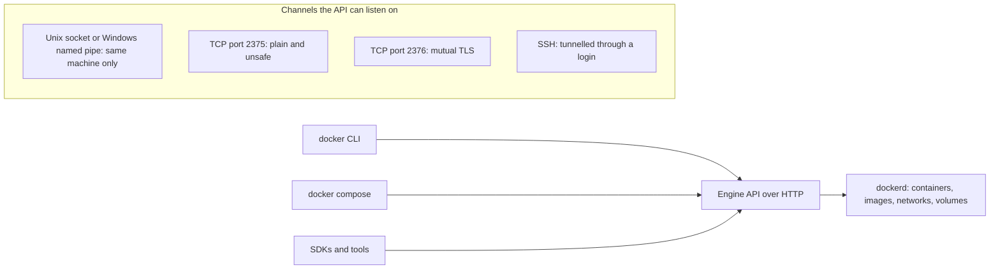
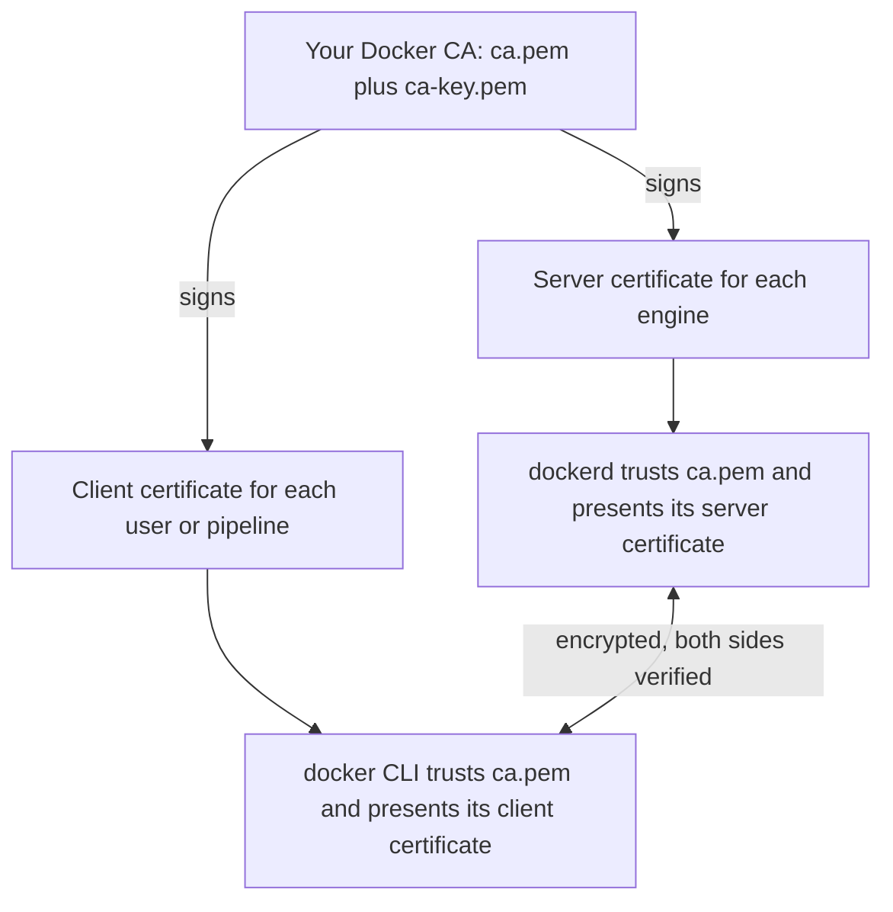
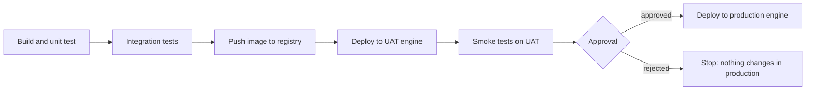

# Remote Docker engines, secure access and continuous deployment

## In plain words

Think of a television and its remote control. The remote does not show any programmes. It only sends signals, and the television does the real work. Normally the remote works only inside the same room. Now imagine you could make the television accept signals from anywhere in the world. That would be handy: you could switch it on from the office. It would also be alarming, because anyone holding a compatible remote could do the same, unless the television checked who was pressing the buttons.

Docker is built exactly like this. The `docker` command you type is the remote control. The **Docker Engine** (the background program that actually creates and runs containers) is the television. Out of the box, the engine listens only on a private channel that works on the same machine. You can open it to the network, so that you can manage a server from your laptop and, more importantly, so that a pipeline can deploy your application to test and production servers without anyone logging in by hand. Opening it safely means encrypting the connection and checking the identity of every caller.

This lesson covers what the Engine API is, why the local **Docker socket** is so powerful, how to expose the engine over TCP and SSH, how to lock it down with certificates, how `docker context` lets you switch between engines without mistakes, and how to add a **continuous deployment** stage to the pipeline from the previous lesson.

Why this matters for a job: every team that deploys containers has to answer "how does the pipeline reach the servers, and who else can?". Interviewers ask about the Docker socket, about exposing the daemon, and about separating who writes code from who deploys it, because getting these wrong hands an attacker the whole server.

> **Before this lesson:** you should know the CI pipeline from [Build infrastructure and CI pipelines with Docker](#/lesson/docker/ci-pipelines), Compose override files from [Environment, configuration and override files](#/lesson/docker/compose-environments), how secrets are handled from [Configs and secrets](#/lesson/docker/configs-secrets), and the least-privilege ideas in [Container security](#/lesson/docker/container-security). `docker stack deploy` appears once; it is explained in [Orchestration with Docker Swarm](#/lesson/docker/swarm).

## The CLI is only a client: the Docker Engine API

An **API** (application programming interface) is a published set of requests one program can send to another, with a defined shape for each answer. The Docker Engine offers a **REST API**: a style of API in which every request is an ordinary **HTTP** message (the same protocol web browsers use) sent to a path such as `/containers/json`, and every answer is usually **JSON** (a plain-text format for structured data).

The engine itself is a program called `dockerd`, a **daemon**, which means a program that runs in the background with no window, waiting for requests. When you type `docker ps`, the `docker` program builds an HTTP request asking for the list of containers, sends it to `dockerd`, receives JSON, and prints it as a neat table. It never touches a container directly.

You can see both halves with one command:

```bash
docker version
```

```text
Client:
 Version:           27.3.1
 API version:       1.47
 ...
Server: Docker Engine - Community
 Engine:
  Version:          27.3.1
  API version:      1.47 (minimum version 1.24)
```

The **Client** section describes the `docker` program; the **Server** section describes the engine it reached. Both report an **API version**. The engine accepts requests from older clients down to its minimum version, which is why a slightly older CLI still works against a newer engine. (Your numbers will differ; what matters is that there are two programs talking.)

Because the API is plain HTTP, you can call it without the CLI at all. On Linux the engine listens on a special file, so `curl` is told to send its request through that file:

```bash
curl --unix-socket /var/run/docker.sock http://localhost/v1.47/containers/json
```

```text
[{"Id":"8f1c2e...","Names":["/ledger"],"Image":"ghcr.io/harbourline/ledger:git-4be2a9c1",
  "State":"running","Status":"Up 3 hours", ...}]
```

- `--unix-socket /var/run/docker.sock` sends the request through the engine's local channel instead of the network.
- `http://localhost` is required by curl's syntax, but the host name is ignored here.
- `/v1.47/containers/json` names the API version and the resource: "list the running containers".

Many other tools are clients of the same API: Docker Compose, the Docker Desktop dashboard, CI plugins, monitoring agents and graphical management tools. There are official software libraries too. With the Docker SDK for Python, three lines list the containers:

```python
import docker
client = docker.from_env()            # connect the same way the CLI would
for c in client.containers.list():
    print(c.name, c.status)
```

This is the key idea of the lesson: **whatever can reach the API can do everything the CLI can do**. So the important question is always which channels the API listens on, and who can reach them.



## The local channel: the Docker socket

A **Unix socket** is a special file that two programs on the same machine use as a private telephone line. Nothing on the network can dial it; only processes on that machine that have permission to open the file. On Linux the engine's socket is `/var/run/docker.sock`. Windows uses the equivalent idea, a **named pipe**, at `npipe:////./pipe/docker_engine`.

```bash
ls -l /var/run/docker.sock
```

```text
srw-rw---- 1 root docker 0 Nov 21 09:12 /var/run/docker.sock
```

- The leading `s` marks a socket rather than an ordinary file.
- `rw-rw----` with owner `root` and group `docker` means only the root user and members of the `docker` group may use it.

Here is the uncomfortable part. The engine runs as root, and the API has no notion of "this caller may list containers but not start them". Anyone who can write to the socket can start a container like this:

```bash
docker run --rm -it -v /:/host alpine sh
```

`-v /:/host` mounts the host's entire disk into the container at `/host`, and the container's root user can read and change any file there: password files, SSH keys, other applications' data. That is why **membership of the `docker` group is equivalent to root access on the machine**, and why the official documentation says so plainly.

The same reasoning applies whenever a container is given the socket with `-v /var/run/docker.sock:/var/run/docker.sock`. CI runners, image inspection tools, some reverse proxies and some monitoring agents ask for it. You are handing that container the keys to the host. If the software inside it is ever compromised, the attacker owns the server.

> [!WARNING]
> Mounting the socket read-only, `-v /var/run/docker.sock:/var/run/docker.sock:ro`, does **not** make it safe. The `:ro` flag stops the container replacing or deleting the socket file, but sending API requests through it still works, including requests that start privileged containers.

Ways to reduce the risk:

- Do not mount the socket unless the tool truly needs to control Docker.
- Put a filtering **socket proxy** in between: a small service that forwards only the API paths you allow (for example, read-only container listing) and rejects the rest.
- Use **rootless mode**, in which the whole engine runs as an ordinary user, so control of the engine no longer means control of the machine.
- Keep the `docker` group small and treat adding someone to it like giving them the administrator password.

## Opening the engine to the network: TCP on ports 2375 and 2376

**TCP** is the standard way programs talk across a network; a **port** is a numbered door on a machine, so one machine can offer many services. By convention Docker uses **port 2375 for unencrypted access** and **port 2376 for TLS-secured access**.

The engine reads its settings from `/etc/docker/daemon.json` on Linux. The `hosts` setting lists every channel to listen on. Purely to understand the mechanics, on a throwaway machine, this keeps the local socket and adds plain TCP on the loopback address only:

```json
{
  "hosts": ["unix:///var/run/docker.sock", "tcp://127.0.0.1:2375"]
}
```

On most Linux distributions Docker is started by **systemd** (the service manager), and its service file already passes `-H fd://` on the command line. The engine refuses to start if the same setting arrives from both places, so you clear the command-line value with an override file and restart:

```text
# /etc/systemd/system/docker.service.d/override.conf
[Service]
ExecStart=
ExecStart=/usr/bin/dockerd
```

```bash
sudo systemctl daemon-reload
sudo systemctl restart docker
```

Any client can now point at the TCP channel, with the `-H` (`--host`) flag or the `DOCKER_HOST` environment variable:

```bash
docker -H tcp://127.0.0.1:2375 ps
DOCKER_HOST=tcp://127.0.0.1:2375 docker ps
curl http://127.0.0.1:2375/version
```

Now undo it. Plain TCP has **no encryption** (anyone on the network path can read the traffic) and **no authentication** (the engine never asks who you are). If the address were `0.0.0.0`, meaning every network interface, anyone who can reach the machine could run that `-v /:/host` container. Internet-wide scanners hunt for open port 2375 constantly, and a common outcome is a server quietly running someone else's cryptocurrency miner. Even bound to `127.0.0.1`, every program on your machine, including malware, gets root-equivalent access without asking. Recent Docker Engine releases print a prominent warning and deliberately delay start-up when TCP is enabled without TLS, a signal of how strongly the project discourages it.

One more surprise applies to every remote connection, secure or not. **Commands run in the context of the remote machine.** A bind mount such as `-v ./config:/config` refers to a folder on the *remote* server, not your laptop. Either the folder is missing there and the command fails, or a folder with that name exists and the container sees different files than you expect. `docker build` uploads your local build context to the remote engine, which can be slow over a long distance. Plan deployments around images in a registry, not files on your laptop.

## Securing remote access, option 1: mutual TLS

**TLS** (Transport Layer Security) is the encryption behind every `https://` web address. It relies on **certificates**: small files that state an identity ("I am uat-01.harbourline.example") and are digitally signed by a **certificate authority (CA)**, an issuer both sides trust, rather as a passport is trusted because a government issued it. Each certificate has a matching **private key**, a secret file that proves the holder really owns the certificate. The certificate can be shown to anyone; the key must never leave its owner.

On a normal website only the server shows a certificate. Docker uses **mutual TLS**: the engine proves its identity to the client, *and* the client proves its identity to the engine with its own certificate. The engine accepts only client certificates signed by the CA it was told to trust. This gives you encryption and authentication at once.



Large organisations often have a team that issues certificates. If you must create your own, the official documentation uses `openssl`, an encryption toolkit. A condensed version:

```bash
# 1. The certificate authority. Protect ca-key.pem above everything else.
openssl genrsa -aes256 -out ca-key.pem 4096
openssl req -new -x509 -days 365 -sha256 -key ca-key.pem -subj "/CN=Harbourline Docker CA" -out ca.pem

# 2. A server certificate for one engine, valid for its DNS name and IP address
openssl genrsa -out server-key.pem 4096
openssl req -new -sha256 -key server-key.pem -subj "/CN=uat-01.harbourline.example" -out server.csr
echo "subjectAltName = DNS:uat-01.harbourline.example,IP:10.20.0.11" > server-ext.cnf
echo "extendedKeyUsage = serverAuth" >> server-ext.cnf
openssl x509 -req -days 365 -sha256 -in server.csr -CA ca.pem -CAkey ca-key.pem \
  -CAcreateserial -extfile server-ext.cnf -out server-cert.pem

# 3. A client certificate for one caller, here the deployment pipeline
openssl genrsa -out key.pem 4096
openssl req -new -key key.pem -subj "/CN=ci-deployer" -out client.csr
echo "extendedKeyUsage = clientAuth" > client-ext.cnf
openssl x509 -req -days 30 -sha256 -in client.csr -CA ca.pem -CAkey ca-key.pem \
  -CAcreateserial -extfile client-ext.cnf -out cert.pem

chmod 0400 ca-key.pem server-key.pem key.pem
```

- `genrsa` creates a private key. The CA's key is protected with a passphrase (`-aes256`).
- `req -x509` makes the CA's own certificate. `req -new` makes a **certificate signing request** (`.csr`), an application form asking the CA to sign.
- `subjectAltName` lists the names and addresses the server certificate is valid for. If the client connects using a name not on this list, verification fails.
- `extendedKeyUsage` marks a certificate as usable by a server (`serverAuth`) or by a client (`clientAuth`), so a stolen server certificate cannot be used to log in as a client.
- `-days 30` gives the client certificate a short life. Short lives limit the damage if a key leaks, because revoking a single certificate is awkward in practice.

The engine is then configured to require verified clients:

```json
{
  "hosts": ["unix:///var/run/docker.sock", "tcp://0.0.0.0:2376"],
  "tlsverify": true,
  "tlscacert": "/etc/docker/tls/ca.pem",
  "tlscert": "/etc/docker/tls/server-cert.pem",
  "tlskey": "/etc/docker/tls/server-key.pem"
}
```

`tlsverify` is the important line: it means "use TLS **and** reject any client without a certificate signed by `tlscacert`". The weaker `"tls": true` on its own encrypts the traffic but lets any client connect, which defeats the purpose.

On the client side you can pass everything as flags:

```bash
docker --tlsverify --tlscacert ca.pem --tlscert cert.pem --tlskey key.pem \
  -H tcp://uat-01.harbourline.example:2376 ps
```

That is tiring to type, so three environment variables do the same job. `DOCKER_CERT_PATH` names a folder that must contain files called exactly `ca.pem`, `cert.pem` and `key.pem`:

```bash
export DOCKER_HOST=tcp://uat-01.harbourline.example:2376
export DOCKER_TLS_VERIFY=1
export DOCKER_CERT_PATH=$HOME/.docker/uat
docker ps
```

Try it without the client certificate and the TLS handshake fails with a certificate error before any Docker command is processed. Try it with a certificate signed by a different CA and it fails the same way.

The cost of mutual TLS is bookkeeping: one CA, one server certificate per engine, one client certificate per person or pipeline, all with expiry dates to track and renew. It can be automated, but someone must own it.

## Securing remote access, option 2: SSH

**SSH** (Secure Shell) is the standard encrypted way to log in to a remote Linux machine. Docker can tunnel its API through an SSH connection, and nothing changes on the engine: no TCP port, no daemon settings, no certificates.

```bash
DOCKER_HOST=ssh://deploy@prod-01.harbourline.example docker ps
docker -H ssh://deploy@prod-01.harbourline.example compose ps
```

Behind the scenes the CLI opens an SSH login as `deploy`, runs a small `docker` helper command on the server, and passes API traffic back and forth through that tunnel to the server's local socket. For this to work:

- The server runs an SSH server, and the `docker` command is installed on it.
- The `deploy` user can log in, ideally with an **SSH key** (a key pair where the private half stays with the client and the public half is placed on the server) rather than a password.
- The `deploy` user may use the Docker socket, normally by being in the `docker` group. Remember what that means: root-equivalent on that server.
- Each Docker command opens a new SSH connection, so heavy use is slow. SSH's connection-sharing options (`ControlMaster` and `ControlPersist` in `~/.ssh/config`) keep one connection open and reuse it.

| | Mutual TLS | SSH |
|---|---|---|
| Engine changes | `daemon.json` with certificates, open port 2376 | None |
| Identity | Client certificates from your CA | SSH users and keys |
| What a user also gets | Only the Docker API | A login shell on the server, unless restricted |
| Overhead | Issuing, renewing and distributing certificates | Managing users and keys, which Linux teams already do |
| Good fit | Many engines, Windows servers, API-only access | Small fleets run by a team fluent in SSH |

Both options give **encryption** and **authentication**. Neither gives **authorization** (rules about what an authenticated caller may do) or an **audit trail** (a record of who did what). Keep that in mind; it returns in the access-control section.

## docker context: named connections you can switch between

Typing hosts and certificate paths is error-prone. A **Docker context** is a named, saved bundle of connection details for one engine. You create it once and refer to it by name afterwards.

```bash
docker context create uat \
  --description "UAT engine over mutual TLS" \
  --docker "host=tcp://uat-01.harbourline.example:2376,ca=$HOME/.docker/uat/ca.pem,cert=$HOME/.docker/uat/cert.pem,key=$HOME/.docker/uat/key.pem"

docker context create prod \
  --description "Production over SSH" \
  --docker "host=ssh://deploy@prod-01.harbourline.example"

docker context ls
```

```text
NAME        DESCRIPTION                               DOCKER ENDPOINT
default *   Current DOCKER_HOST based configuration   unix:///var/run/docker.sock
prod        Production over SSH                       ssh://deploy@prod-01.harbourline.example
uat         UAT engine over mutual TLS                tcp://uat-01.harbourline.example:2376
```

- The `--docker` value lists the endpoint (`host=`) and, for TLS, the three certificate files. Docker copies the certificate material into its own store under `~/.docker/contexts`.
- `default` always exists and means "the local engine, or whatever `DOCKER_HOST` says". The asterisk marks the context currently selected.

There are three ways to use a context, and the difference matters:

```bash
docker --context uat ps          # this one command only
export DOCKER_CONTEXT=uat        # every command in this terminal session
docker context use uat           # saved in ~/.docker/config.json: every new terminal and script
```

When several are set at once, the CLI decides in this order:

1. A `--context` or `--host` flag on the command (giving both is an error).
2. The `DOCKER_HOST` environment variable.
3. The `DOCKER_CONTEXT` environment variable.
4. The context saved by `docker context use`.

That ordering produces a classic mistake. You set `DOCKER_CONTEXT=uat` this morning, then later run `docker context use default` believing you are back on your laptop. The variable still wins, so your next clean-up command deletes containers on the UAT server. The demo below applies the rules to several situations.

```python-run
CONTEXTS = {
    "default": "unix:///var/run/docker.sock (your laptop)",
    "uat": "tcp://uat-01.harbourline.example:2376",
    "prod": "ssh://deploy@prod-01.harbourline.example",
}

def target(flags, env, saved):
    """Which engine will a docker command talk to? Follows the CLI's order of precedence."""
    if "--context" in flags and "--host" in flags:
        return "ERROR: give either --host or --context, not both"
    if "--context" in flags:
        name, why = flags["--context"], "the --context flag"
    elif "--host" in flags:
        return flags["--host"] + "   <- the --host flag"
    elif env.get("DOCKER_HOST"):
        return env["DOCKER_HOST"] + "   <- DOCKER_HOST"
    elif env.get("DOCKER_CONTEXT"):
        name, why = env["DOCKER_CONTEXT"], "DOCKER_CONTEXT"
    else:
        name, why = saved, "docker context use"
    return CONTEXTS[name] + "   <- context '" + name + "' from " + why

cases = [
    ("fresh install",                          {}, {}, "default"),
    ("after: docker context use uat",          {}, {}, "uat"),
    ("DOCKER_CONTEXT=uat, then use default",   {}, {"DOCKER_CONTEXT": "uat"}, "default"),
    ("one-off: docker --context prod ps",      {"--context": "prod"}, {"DOCKER_CONTEXT": "uat"}, "default"),
    ("DOCKER_HOST left over from a script",    {}, {"DOCKER_HOST": "tcp://10.20.0.11:2376", "DOCKER_CONTEXT": "uat"}, "default"),
    ("both flags at once",                     {"--context": "uat", "--host": "tcp://x:2376"}, {}, "default"),
]
for label, flags, env, saved in cases:
    print(f"{label:40s} -> {target(flags, env, saved)}")
```

The third line is the trap. A safe habit: leave the saved context as `default` (your own machine) for good, and reach remote engines only with `--context` on a single command or with `DOCKER_CONTEXT` in a terminal you close afterwards. Many shell prompts can show the active context, which is worth switching on.

Compose and Swarm commands follow the context too, because they are clients of the same API:

```bash
docker --context uat compose -p ledger-uat -f compose.yaml -f compose.uat.yaml up -d
docker --context prod stack deploy -c compose.yaml -c compose.prod.yaml --with-registry-auth ledger
```

## Continuous deployment: the stage after the registry

The previous lesson's pipeline ended with a tested image pushed to a registry. **Continuous deployment** carries that same image onward automatically: first to a test environment, often called **UAT** (user acceptance testing, a production-like copy where people check the release), then to production. When a person must approve the final step, the practice is usually called **continuous delivery**; when nothing stops it, continuous deployment. The mechanics are identical; only the gate differs.



One distinction shapes the design. The CI stages use the runner's **own local engine** to build and test. The CD stages talk to **remote engines**, so they need credentials for those engines, and those credentials are far more sensitive than anything the build needs. Three rules follow:

- **Credentials live in the CI system's secret store, never in the repository.** The people who may change code are not automatically the people who may change production.
- **Each environment has its own credentials.** A leaked UAT certificate must not open production.
- **The pipeline organises; plain scripts do the work.** Put the actual Docker commands in a script you can run by hand. Then moving from one CI product to another changes the pipeline file, not the deployment.

The deployment script needs nothing but the Docker CLI and environment variables:

```bash
#!/usr/bin/env sh
# deploy/deploy.sh  usage: deploy.sh uat|prod
# Expects DOCKER_HOST, DOCKER_TLS_VERIFY, DOCKER_CERT_PATH and IMAGE_TAG in the environment.
set -eu
ENVIRONMENT="$1"
FILES="-f compose.yaml -f compose.$ENVIRONMENT.yaml"

docker compose -p "ledger-$ENVIRONMENT" $FILES pull
docker compose -p "ledger-$ENVIRONMENT" $FILES up -d --remove-orphans
docker compose -p "ledger-$ENVIRONMENT" $FILES ps
```

- `set -eu` stops the script at the first failing command or undefined variable, so a failed pull never leads to a half-finished deployment.
- `compose.yaml` refers to `image: ghcr.io/harbourline/ledger:${IMAGE_TAG}`. Compose fills in variables on the **client** side, from the runner's environment, before sending anything to the remote engine.
- `pull` makes the remote engine download the new image from the registry. The remote engine must be able to reach that registry; the CLI sends the runner's registry login along with the request, so the runner logs in first.
- `up -d --remove-orphans` replaces the running containers and removes any belonging to services that were deleted from the files.
- For a Swarm cluster, the middle lines become one `docker stack deploy`, which performs a rolling update.

Here are the deployment jobs added to the GitHub Actions workflow from the previous lesson:

```yaml
  deploy-uat:
    needs: build
    if: github.ref == 'refs/heads/main'
    runs-on: ubuntu-latest
    environment: uat
    steps:
      - uses: actions/checkout@v4
      - name: Install engine certificates
        env:
          CA: ${{ secrets.DOCKER_CA }}
          CERT: ${{ secrets.DOCKER_CERT }}
          KEY: ${{ secrets.DOCKER_KEY }}
        run: |
          mkdir -p "$RUNNER_TEMP/certs"
          printf '%s' "$CA" > "$RUNNER_TEMP/certs/ca.pem"
          printf '%s' "$CERT" > "$RUNNER_TEMP/certs/cert.pem"
          printf '%s' "$KEY" > "$RUNNER_TEMP/certs/key.pem"
          chmod 600 "$RUNNER_TEMP/certs/key.pem"
      - uses: docker/login-action@v3
        with:
          registry: ghcr.io
          username: ${{ github.actor }}
          password: ${{ secrets.GITHUB_TOKEN }}
      - name: Deploy
        env:
          DOCKER_HOST: ${{ vars.DOCKER_ENGINE }}
          DOCKER_TLS_VERIFY: "1"
          DOCKER_CERT_PATH: ${{ runner.temp }}/certs
        run: IMAGE_TAG=git-${GITHUB_SHA::8} ./deploy/deploy.sh uat

  deploy-prod:
    needs: deploy-uat
    runs-on: ubuntu-latest
    environment: production
    steps:
      # the same steps as deploy-uat, ending with ./deploy/deploy.sh prod
```

- `needs:` chains the jobs: UAT waits for a successful build, production waits for a successful UAT deployment.
- `environment: uat` and `environment: production` refer to **environments** configured in the repository settings. Each can hold its own secrets and variables, so `secrets.DOCKER_CA` resolves to the UAT certificate in one job and the production certificate in the other, and a job only sees the secrets of the environment it names.
- An environment can have **protection rules**, such as required reviewers. With reviewers set on `production`, the pipeline pauses before `deploy-prod` until a named person approves. That is the manual gate from the diagram.
- `vars.DOCKER_ENGINE` is a non-secret variable holding the engine address, for example `tcp://uat-01.harbourline.example:2376`.
- The certificates are written to the runner's temporary folder, which is discarded when the job ends.
- The `IMAGE_TAG` is the same `git-` plus eight characters tag the build job pushed, so the image deployed is exactly the image tested.

Using SSH instead, the certificate step becomes a step that installs a private key and the server's known host key, and `DOCKER_HOST` becomes `ssh://deploy@prod-01.harbourline.example`. The deployment script does not change at all.

> [!TIP]
> Finish each deployment job with a short automatic check, such as calling the service's health endpoint, and fail the job if it does not answer. A pipeline that reports "deployed" for an application that crashed on start-up is worse than no pipeline.

## Who may deploy? Access control around the engine

The Docker Engine's access model is all or nothing. Mutual TLS or SSH decides whether a caller may connect. Once connected, the caller may do anything: list, start, stop, delete, mount the host's disk. Out of the box there is no "read-only" user and no log of which person issued which command. (The engine can load third-party **authorization plugins** that inspect each request, but they are uncommon and add their own complexity.)

So access control is built around the engine rather than inside it:

| Control | What it achieves |
|---|---|
| Only the pipeline's account holds production credentials | Day-to-day human access to production engines disappears; people change production by merging reviewed code |
| Separate certificates or keys per environment | A leak in UAT does not open production |
| Short-lived client certificates, renewed automatically | A stolen key stops working soon |
| Network limits: engines on a private network, port 2376 reachable only from runners or a VPN | Credentials alone are not enough; the caller must also be in the right place |
| Branch protection and required reviews on the repository | No single person can push code straight to production |
| Environment protection rules and approvals | A named person signs off each production release |
| The pipeline's own logs | The audit trail the engine does not keep: who merged, who approved, which image went out |
| Emergency break-glass credentials, stored offline | Humans can still intervene in an incident, deliberately and visibly |

Beyond plain Docker there are two common next steps. **Kubernetes** has **role-based access control (RBAC)**: rules such as "this account may update deployments in the `ledger` namespace and nothing else". **GitOps** turns the flow around: an agent running inside the cluster watches a Git repository holding the desired configuration and applies changes itself. Because the cluster pulls, no pipeline needs inbound credentials to it, and Git's history becomes the audit trail. You do not need either to start; the pipeline in this lesson is a sound first step that can evolve towards them.

> [!INTERVIEW]
> "How would your pipeline deploy to production, and who can access the servers?" Build and test once, push to a registry, then a deployment stage connects to the remote engine over mutual TLS (or SSH) using credentials kept in the CI secret store, scoped per environment. The deploy is a plain script running `docker compose up` or `docker stack deploy` with the tested tag. Production waits for an approval. Mention that the Docker API is all or nothing once connected, so only the pipeline account holds production credentials, the engine port is reachable only from the runners, certificates are short-lived, and the pipeline logs provide the audit trail. Bonus points: never expose port 2375, never mount the socket into untrusted containers, and name RBAC or GitOps as the next level.

## Pitfalls

- **Exposing port 2375.** Unencrypted and unauthenticated; the server will be found and abused.
- **`"tls": true` without `tlsverify`.** Traffic is encrypted, but any client may connect.
- **Assuming `:ro` makes a mounted socket safe.** API calls still go through.
- **Adding people to the `docker` group casually.** It is root on that machine.
- **Mixing `docker context use` and `DOCKER_CONTEXT`.** The variable wins, and commands go somewhere you did not intend. A leftover `DOCKER_HOST` overrides both.
- **Bind-mounting laptop paths on a remote engine.** The path is resolved on the server.
- **Deployment credentials in the repository** or shared between environments.
- **Rebuilding in the deployment stage.** Deploy the tag that was tested.
- **The remote engine cannot reach the registry,** or the runner never logged in, so the pull fails.
- **Long-lived client certificates that nobody tracks,** including ones belonging to people who have left.
- **No health check after deploying,** so a broken release is reported as a success.

## Cheat sheet

| Task | Command or setting |
|---|---|
| See client and engine versions | `docker version` |
| Call the API directly | `curl --unix-socket /var/run/docker.sock http://localhost/v1.47/containers/json` |
| Listen on extra channels | `"hosts": [...]` in `/etc/docker/daemon.json` |
| Require client certificates | `"tlsverify": true` plus `tlscacert`, `tlscert`, `tlskey` |
| One-off remote command | `docker -H tcp://HOST:2376 --tlsverify ... ps` or `docker -H ssh://user@HOST ps` |
| Remote by environment variables | `DOCKER_HOST`, `DOCKER_TLS_VERIFY=1`, `DOCKER_CERT_PATH` |
| Create a context | `docker context create NAME --docker "host=...,ca=...,cert=...,key=..."` |
| List contexts | `docker context ls` |
| Use a context once | `docker --context NAME ...` |
| Use a context in this terminal | `export DOCKER_CONTEXT=NAME` |
| Change the saved context | `docker context use NAME` |
| Remove a context | `docker context rm NAME` |
| Deploy with Compose | `docker compose -p app-ENV -f compose.yaml -f compose.ENV.yaml up -d` |
| Deploy to Swarm | `docker stack deploy -c compose.yaml --with-registry-auth app` |

## Summary

- The `docker` CLI is one client of the Engine's HTTP API; Compose, SDKs and many tools are others. Whatever reaches the API controls the engine.
- The local Unix socket or named pipe is safe from the network, but anyone who can use it, including any container it is mounted into, effectively has root on the host.
- The engine can also listen on TCP: port 2375 is plain and must never be used for real; port 2376 is the TLS convention.
- Mutual TLS gives encryption and authentication: one CA, a server certificate per engine and a client certificate per caller, with `tlsverify` on the engine.
- SSH needs no engine changes and reuses existing logins and keys, at the cost of giving users a login on the server.
- Contexts save connection details by name. `--context` or `--host` beats `DOCKER_HOST`, which beats `DOCKER_CONTEXT`, which beats `docker context use`.
- Continuous deployment adds stages that point the same Docker commands at remote engines, with credentials kept in the CI secret store per environment and an approval before production.
- The engine's access is all or nothing, so control who holds credentials, where the engine can be reached from, and how releases are approved; RBAC and GitOps are the next steps.

## Glossary

| Term | Meaning |
|---|---|
| Docker Engine (`dockerd`) | The background program that builds images and runs containers |
| Daemon | A program that runs in the background waiting for requests |
| API | A published set of requests one program can make of another |
| REST API | An API made of HTTP requests to paths, usually answered in JSON |
| Docker socket | The Unix socket file, `/var/run/docker.sock`, through which local clients reach the engine |
| Named pipe | The Windows equivalent of a Unix socket |
| `docker` group | The Linux group allowed to use the socket; membership is root-equivalent |
| Socket proxy | A filter that forwards only approved API requests to the socket |
| Rootless mode | Running the whole engine as an ordinary user instead of root |
| TCP port | A numbered network door on a machine; Docker uses 2375 (plain) and 2376 (TLS) |
| TLS | Transport Layer Security, the encryption used by HTTPS |
| Certificate | A signed file stating an identity |
| Certificate authority (CA) | The trusted issuer that signs certificates |
| Private key | The secret file proving ownership of a certificate |
| Mutual TLS | TLS in which both server and client present certificates |
| SSH | Secure Shell, the standard encrypted remote login |
| `DOCKER_HOST` | Environment variable naming the engine endpoint to use |
| Docker context | A saved, named set of connection details for an engine |
| Continuous deployment | Automatically deploying every tested build onward |
| Continuous delivery | The same, with a human approval before production |
| UAT | User acceptance testing: a production-like environment for checking a release |
| Environment (CI) | A named deployment target in the CI system with its own secrets and protection rules |
| Authorization | Rules about what an authenticated caller may do |
| Audit trail | A record of who did what, and when |
| RBAC | Role-based access control, as offered by Kubernetes |
| GitOps | Deployment in which the cluster pulls its desired state from Git |

## Check yourself

```quiz
[
  {"q": "What does the docker CLI actually do when you run `docker ps`?",
   "options": ["It reads container files from disk", "It sends an HTTP request to the Docker Engine API and formats the JSON reply", "It starts a new daemon", "It asks the registry"],
   "answer": 1,
   "explain": "The CLI is only a client. The engine, dockerd, does the work and answers over its API."},
  {"q": "A monitoring container is started with `-v /var/run/docker.sock:/var/run/docker.sock:ro`. Is the host protected by `:ro`?",
   "options": ["Yes, the container can only read", "No: `:ro` only protects the socket file itself; API requests, including starting privileged containers, still work", "Yes, Docker rejects write requests from read-only mounts", "Only on Windows"],
   "answer": 1,
   "explain": "Talking to a socket is not writing to a file. Access to the socket is full control of the engine whatever the mount flag."},
  {"q": "What do ports 2375 and 2376 conventionally mean for the Docker Engine?",
   "options": ["Registry and engine", "2375 is unencrypted, unauthenticated TCP; 2376 is TCP secured with TLS", "IPv4 and IPv6", "Swarm manager and worker"],
   "answer": 1,
   "explain": "2375 should never be exposed. 2376 with tlsverify requires client certificates signed by the trusted CA."},
  {"q": "With `\"tlsverify\": true`, which clients does the engine accept?",
   "options": ["Any client using HTTPS", "Clients presenting a certificate signed by the CA named in tlscacert", "Clients on the same subnet", "Clients that know the server's private key"],
   "answer": 1,
   "explain": "That is the mutual part of mutual TLS: the engine verifies the client's certificate against its trusted CA."},
  {"q": "You ran `export DOCKER_CONTEXT=uat` earlier, then `docker context use default`. You now force-remove every running container. Which engine receives the command?",
   "options": ["Your laptop, because context use was most recent", "The UAT engine, because DOCKER_CONTEXT takes precedence over the saved context", "Both engines", "Neither; Docker reports a conflict"],
   "answer": 1,
   "explain": "The environment variable beats the saved setting. Keep the saved context as default and use --context or a short-lived variable for remote work."},
  {"q": "While connected to a remote engine you run `docker run -v ./config:/config app`. Whose ./config folder is mounted?",
   "options": ["The one on your laptop", "A folder on the remote server, because the engine resolves paths on its own machine", "Docker uploads it automatically", "None; bind mounts are disabled remotely"],
   "answer": 1,
   "explain": "Commands run in the context of the engine's machine. Deploy from images in a registry, not local files."},
  {"q": "What is a drawback of securing remote Docker access with SSH?",
   "options": ["It is not encrypted", "Users need a login on the server and access to the socket, which may be more power than they need", "It requires port 2375", "It cannot be used from CI"],
   "answer": 1,
   "explain": "SSH reuses system accounts. Socket access is root-equivalent on that server, so every SSH deployer is effectively an administrator there."},
  {"q": "Once a client has connected to a TLS-secured engine, what can it do?",
   "options": ["Only what its certificate's role allows", "Everything: the engine's access model is all or nothing", "Only read-only commands", "Only deploy stacks"],
   "answer": 1,
   "explain": "TLS and SSH give encryption and authentication, not authorization. Restrict who holds credentials and where the engine can be reached from."},
  {"q": "Where should a pipeline's production engine certificates be kept?",
   "options": ["In the repository, encrypted with a password in the README", "In the CI system's secret store, scoped to the production environment", "On every developer's laptop", "Baked into the application image"],
   "answer": 1,
   "explain": "Code access and production access are different permissions. Environment-scoped secrets reach only the jobs that deploy there."}
]
```

> **Source:** Stoneman, *Learn Docker in a Month of Lunches*, ch. 15 (topic coverage). Checked against <https://docs.docker.com/engine/security/protect-access/>, <https://docs.docker.com/engine/daemon/remote-access/>, <https://docs.docker.com/engine/manage-resources/contexts/>, <https://docs.docker.com/engine/security/#docker-daemon-attack-surface> and <https://docs.github.com/en/actions/deployment/targeting-different-environments/using-environments-for-deployment>. All wording and examples are original.
