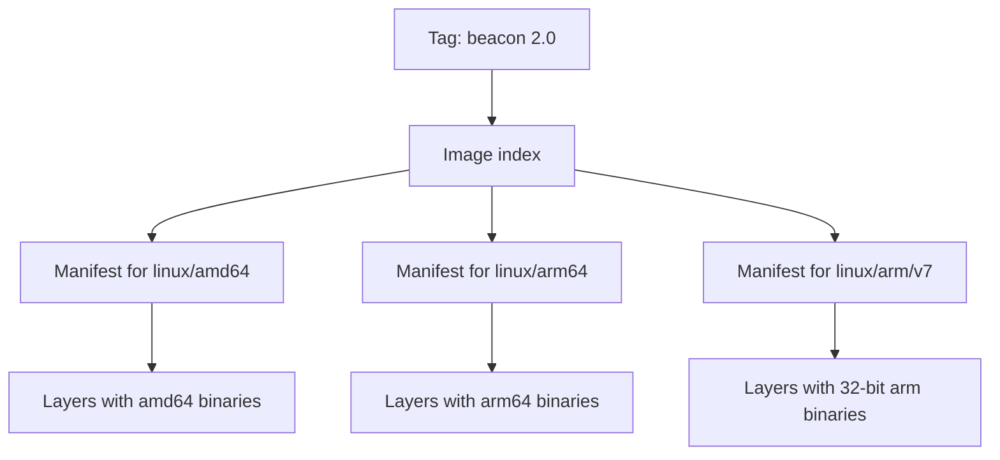
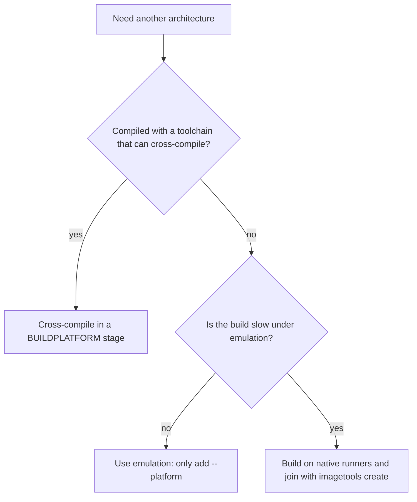

# Multi-architecture images

## In plain words

A petrol car and a diesel car both get you to work, but you cannot pour diesel into a petrol engine. Computer processors are similar. There are different families of processor, and a program prepared for one family will not run on another. The family is called the processor's **architecture**.

Two architectures matter most today. **amd64** (also written x86_64) is the Intel and AMD family found in most servers and older laptops. **arm64** (also written aarch64) is the Arm family found in phones, Raspberry Pi boards, Apple laptops made since late 2020, and a growing share of cloud servers, where it is often cheaper to rent.

A container image holds programs, so an image built for one architecture does not run on the other. A **multi-architecture image** solves this neatly: one image name that quietly contains a separate version for each architecture. When someone pulls it, Docker picks the version that matches their machine. It works like a film on a streaming service: one title, and the service sends the right format for your device.

Why this matters for a job: teams now routinely develop on Arm laptops and deploy to Intel servers, or the reverse. The error `exec format error` is among the most searched Docker problems, and knowing how to publish images for both architectures is expected.

> **Before this lesson:** you should understand image references, manifests and digests ([Registries, image references, tags and digests](#/lesson/docker/registries-tags-digests)), multi-stage builds ([Multi-stage builds](#/lesson/docker/multi-stage-builds)) and pipelines ([Build infrastructure and CI pipelines with Docker](#/lesson/docker/ci-pipelines)).

## Why architecture matters to a container

When source code is **compiled**, it is translated into machine instructions, the numeric commands a processor understands. Each architecture has its own instruction set, so the translated program, called a **binary**, is tied to one architecture.

Recall from the first lesson that a container shares the host's kernel and runs its programs directly on the host's processor. There is no translation layer. So the binaries in the image must match the processor underneath.

An image is identified by a **platform**, written as `os/architecture` with an optional variant:

| Platform | Where you meet it |
|---|---|
| `linux/amd64` | Most cloud servers, Intel and AMD PCs |
| `linux/arm64` | Apple silicon Macs (inside Docker Desktop's Linux virtual machine), AWS Graviton servers, Raspberry Pi 4 and 5 with a 64-bit system |
| `linux/arm/v7` | Older 32-bit Raspberry Pi boards |
| `windows/amd64` | Windows containers |

Check your own machine:

```bash
docker version --format '{{.Server.Os}}/{{.Server.Arch}}'
```

```text
linux/arm64
```

`docker version` prints version details; the `--format` text selects the operating system and architecture of the Docker Engine.

## What goes wrong with a single-architecture image

Build an image on an Arm laptop the ordinary way, push it, and run it on an Intel server:

```bash
docker run registry.harbourline.example/tools/beacon:2.0
```

```text
WARNING: The requested image's platform (linux/arm64) does not match the detected host platform (linux/amd64) and no specific platform was requested
exec /beacon: exec format error
```

`exec format error` is the kernel saying "this file is not a program for my processor". The image is intact; it is for a different architecture.

## How one name holds several images

The lesson on registries introduced the **manifest**: a small document listing the layers of one image. A multi-architecture image adds one level above it, an **image index** (also called a manifest list): a list of manifests, each labelled with its platform.



Look at one without downloading it:

```bash
docker buildx imagetools inspect python:3.12-slim
```

```text
Name:      docker.io/library/python:3.12-slim
MediaType: application/vnd.oci.image.index.v1+json
Digest:    sha256:5f0a...

Manifests:
  Name:      docker.io/library/python:3.12-slim@sha256:1b2c...
  Platform:  linux/amd64

  Name:      docker.io/library/python:3.12-slim@sha256:9e8d...
  Platform:  linux/arm64

  Name:      docker.io/library/python:3.12-slim@sha256:77aa...
  Platform:  linux/arm/v7
```

- `MediaType ... image.index` confirms that the tag points to an index.
- Each entry under `Manifests` has its own digest (content fingerprint) and platform.

When you run `docker pull python:3.12-slim`, the client downloads the index, finds the entry for its own platform and pulls only that one. You never see the others.

The function below is a simplified version of that selection, including two real-world details: alternative names for the same architecture, and the fact that a newer 32-bit Arm processor can run code built for an older one.

```python-run
ALIASES = {"x86_64": "amd64", "aarch64": "arm64"}

def pick(index, host):
    """index: list of (platform, digest). host: 'os/arch' or 'os/arch/variant'."""
    def parse(platform):
        parts = platform.split("/")
        arch = ALIASES.get(parts[1], parts[1])
        variant = parts[2] if len(parts) > 2 else {"arm": "v7", "arm64": "v8"}.get(arch, "")
        return parts[0], arch, variant
    host_os, host_arch, host_variant = parse(host)
    best = None
    for platform, digest in index:
        os_name, arch, variant = parse(platform)
        if (os_name, arch) != (host_os, host_arch):
            continue
        if arch == "arm" and int(variant[1:]) > int(host_variant[1:]):
            continue                                   # built for a newer processor than we have
        rank = int(variant[1:]) if arch == "arm" else 0
        if best is None or rank > best[0]:
            best = (rank, digest, platform)
    return best[1:] if best else "no matching manifest: the pull fails"

index = [("linux/amd64", "sha256:1b2c"), ("linux/arm64", "sha256:9e8d"),
         ("linux/arm/v6", "sha256:55cc"), ("linux/arm/v7", "sha256:77aa")]
for host in ["linux/x86_64", "linux/aarch64", "linux/arm/v7", "linux/arm/v6", "windows/amd64"]:
    print(f"{host:15s} -> {pick(index, host)}")
```

## Three ways to build for another architecture

Docker's extended build command, `docker buildx build`, takes a `--platform` option. How it produces binaries for a processor it is not running on depends on the method.

### Method 1: emulation

**Emulation** means software pretending to be a different processor, translating each instruction as it goes. The emulator used is called QEMU. Docker Desktop includes it; on a Linux server you install it once:

```bash
docker run --privileged --rm tonistiigi/binfmt --install all
```

This registers QEMU with the kernel so that it is called automatically whenever a binary for a foreign architecture is started. (`--privileged` is needed because it changes a kernel setting.)

Now the same Dockerfile can be built for several platforms in one command:

```bash
docker buildx build --platform linux/amd64,linux/arm64 \
  -t registry.harbourline.example/tools/beacon:2.0 --push .
```

- `--platform linux/amd64,linux/arm64` lists the targets. BuildKit runs the whole Dockerfile once per platform.
- `--push` uploads the results and creates the index that ties them together.

```text
 => [linux/amd64 build 4/4] RUN go build -o /out/beacon ./cmd/beacon     18.3s
 => [linux/arm64 build 4/4] RUN go build -o /out/beacon ./cmd/beacon    214.7s
 => pushing manifest for registry.harbourline.example/tools/beacon:2.0
```

Emulation needs no changes to the Dockerfile, and that is its appeal. Its cost is in the timings above: on this Intel machine the emulated Arm compile took more than ten times as long. For a small script-based image that is tolerable. For heavy compilation it is painful.

### Method 2: cross-compilation

**Cross-compilation** means the compiler runs natively on your machine and *outputs* a binary for a different architecture. No emulation is involved, so it runs at full speed. It needs a compiler that supports it; Go and Rust do so well.

BuildKit provides automatic build arguments describing both sides:

| Argument | Meaning | Example |
|---|---|---|
| `BUILDPLATFORM` | The platform doing the building | `linux/amd64` |
| `TARGETPLATFORM` | The platform being built for | `linux/arm64` |
| `TARGETOS`, `TARGETARCH` | The parts of the target | `linux`, `arm64` |

```dockerfile
# syntax=docker/dockerfile:1
FROM --platform=$BUILDPLATFORM golang:1.23 AS build
ARG TARGETOS TARGETARCH
WORKDIR /src
COPY go.mod go.sum ./
RUN go mod download
COPY . .
RUN CGO_ENABLED=0 GOOS=$TARGETOS GOARCH=$TARGETARCH go build -o /out/beacon ./cmd/beacon

FROM gcr.io/distroless/static-debian12:nonroot
COPY --from=build /out/beacon /beacon
ENTRYPOINT ["/beacon"]
```

Line by line, the new parts:

- `FROM --platform=$BUILDPLATFORM golang:1.23 AS build` says "always run this stage on the builder's own architecture", so the compiler itself is never emulated.
- `ARG TARGETOS TARGETARCH` makes the two automatic arguments available inside the stage.
- `GOOS=$TARGETOS GOARCH=$TARGETARCH go build` tells the Go compiler which operating system and architecture to produce a binary for.
- The final stage has no `--platform`, so it uses the *target* platform's version of the base image. The correctly built binary is copied into it.

```text
 => [linux/amd64->arm64 build 5/5] RUN CGO_ENABLED=0 GOOS=linux GOARCH=arm64 go build ...   19.1s
```

Nineteen seconds instead of 215. Languages that are not compiled ahead of time (Python, Node) have no compile step of their own, but any native extensions they install do, which is where emulation tends to hurt.

### Method 3: native builders

The third option is to build each architecture on a real machine of that architecture and then join the results. CI services increasingly offer Arm runners, which makes this practical.

```bash
# on an amd64 runner
docker buildx build -t $IMAGE:2.0-amd64 --push .
# on an arm64 runner
docker buildx build -t $IMAGE:2.0-arm64 --push .
# on any machine: create the index
docker buildx imagetools create -t $IMAGE:2.0 $IMAGE:2.0-amd64 $IMAGE:2.0-arm64
```

`imagetools create` writes a new index in the registry that points at the two existing images. Nothing is downloaded or rebuilt.

### Choosing a method

| | Emulation | Cross-compilation | Native builders |
|---|---|---|---|
| Changes to the Dockerfile | None | Some | None |
| Build speed | Slow for compiled code | Fast | Fast |
| Infrastructure needed | QEMU registered | A cross-capable compiler | A machine per architecture |
| Works for any language | Yes | Only with toolchain support | Yes |
| Typical use | Simple images, getting started | Go, Rust, .NET | Heavy builds, native test runs |



## The builder and the local image store

`docker buildx build` uses a **builder**, an instance of BuildKit. The default builder on older Docker installations cannot hold multi-platform results, which produces a confusing error. Create a builder that can:

```bash
docker buildx create --name multi --driver docker-container --use
docker buildx ls
```

```text
NAME/NODE    DRIVER/ENDPOINT    STATUS    PLATFORMS
multi *      docker-container   running   linux/amd64, linux/arm64, linux/arm/v7, ...
default      docker             running   linux/amd64
```

`--driver docker-container` runs BuildKit in its own container; `--use` makes it the default for later commands.

A related surprise: a multi-platform result is an index, and the classic local image store holds one platform at a time. So you either `--push` to a registry, or build one platform with `--load` to test locally:

```bash
docker buildx build --platform linux/arm64 -t beacon:arm-test --load .
```

Newer Docker versions with the "containerd image store" setting switched on can hold multi-platform images locally.

## Running and testing a specific platform

```bash
docker run --rm --platform linux/arm64 alpine:3.20 uname -m
docker run --rm --platform linux/amd64 alpine:3.20 uname -m
```

```text
aarch64
x86_64
```

`uname -m` prints the machine's architecture as the program sees it. With QEMU registered, `--platform` lets you run the other architecture's image for a quick test. It is slow and not a perfect imitation, so treat it as a smoke test and not a performance measurement.

In Compose, the same setting is a service key:

```yaml
services:
  legacy:
    image: vendor/old-tool:1
    platform: linux/amd64
```

That is the usual way to keep an amd64-only image working on an Arm laptop.

## Dockerfile habits that break on another architecture

**Downloading a prebuilt binary with the architecture written into the address:**

```dockerfile
RUN curl -fsSL https://example.com/tool-linux-amd64.tar.gz | tar xz -C /usr/local/bin
```

On arm64 this installs an amd64 binary, which fails at run time, not at build time. Use the automatic argument:

```dockerfile
ARG TARGETARCH
RUN curl -fsSL https://example.com/tool-linux-${TARGETARCH}.tar.gz | tar xz -C /usr/local/bin
```

Some projects name their downloads `x86_64` and `aarch64` instead of `amd64` and `arm64`, so a small mapping is sometimes needed.

**Base images that exist for one architecture only.** Check with `imagetools inspect` before depending on one.

**Python or Node packages without a prebuilt version for the platform.** The installer then compiles from source, which needs build tools in the image and takes a long time under emulation.

**Pinning a platform-specific digest.** `FROM python@sha256:...` using the digest of one platform's *manifest* locks the build to that architecture. Pin the digest of the *index* instead; `imagetools inspect` shows it at the top.

> [!WARNING]
> A build that succeeds for a platform does not prove the image works on it. A wrongly downloaded binary or a missing library shows up only when the container runs. Run at least a smoke test of each platform's image, natively if you can.

> [!INTERVIEW]
> "A colleague's image works on their Mac and fails on the server with `exec format error`. What happened and how do you fix it?" The image was built for arm64 and the server is amd64. Fix it by publishing a multi-architecture image with `docker buildx build --platform linux/amd64,linux/arm64 --push`, using cross-compilation where the build is heavy. A quick workaround is building with `--platform linux/amd64` alone.

> [!TIP]
> Multi-platform builds are worth their extra time for the released image, but not on every keystroke. Build only your own platform during development and all platforms in the pipeline.

## Pitfalls

- **Building on one architecture and deploying on another** without `--platform`.
- **Using the default builder** on an installation where it cannot produce multi-platform output.
- **Expecting `--load` to accept several platforms** with the classic image store. Push, or load one platform.
- **Compiling under emulation** when cross-compilation is available.
- **Forgetting `--platform=$BUILDPLATFORM`** on the build stage, which makes the compiler itself run emulated.
- **Hard-coded `amd64` in download addresses.**
- **Per-architecture tags left for users to choose** (`:2.0-arm64`). Publish one index tag; the client chooses.
- **Mixed cluster nodes without multi-architecture images.** The scheduler may place a container on a node whose processor cannot run it.
- **Emulated performance tests.** They measure the emulator.

## Cheat sheet

| Task | Command |
|---|---|
| Host platform | `docker version --format '{{.Server.Os}}/{{.Server.Arch}}'` |
| Platforms of a tag | `docker buildx imagetools inspect IMAGE` |
| Register emulators | `docker run --privileged --rm tonistiigi/binfmt --install all` |
| Create a capable builder | `docker buildx create --name multi --driver docker-container --use` |
| Build and push for several platforms | `docker buildx build --platform linux/amd64,linux/arm64 -t IMAGE --push .` |
| Build one platform into the local store | `docker buildx build --platform linux/arm64 -t IMAGE --load .` |
| Run as another platform | `docker run --platform linux/amd64 IMAGE` |
| Join existing images into one tag | `docker buildx imagetools create -t IMAGE:TAG IMAGE:TAG-amd64 IMAGE:TAG-arm64` |
| Native compiler stage | `FROM --platform=$BUILDPLATFORM image AS build` |
| Target in the Dockerfile | `ARG TARGETOS TARGETARCH` |

## Summary

- Binaries are tied to a processor architecture, and containers run directly on the host's processor, so an image must match its host's platform.
- A multi-architecture image is an index in the registry that lists one manifest per platform; the client pulls the one that matches.
- `docker buildx build --platform a,b --push` builds and publishes several platforms under one tag.
- Emulation needs no Dockerfile changes and is slow for compilation; cross-compilation in a `$BUILDPLATFORM` stage is fast where the toolchain supports it; native builders joined with `imagetools create` suit heavy builds.
- Use `TARGETARCH` instead of hard-coding architectures, check that base images and packages exist for every platform, and test each platform's image.

## Glossary

| Term | Meaning |
|---|---|
| Architecture | A family of processors that understand the same machine instructions |
| amd64 (x86_64) | The 64-bit Intel and AMD architecture |
| arm64 (aarch64) | The 64-bit Arm architecture |
| Platform | Operating system plus architecture, such as `linux/arm64` |
| Binary | A compiled program in machine instructions for one architecture |
| Compile | Translate source code into a binary |
| Image index (manifest list) | A registry object listing one manifest per platform under a single tag |
| Emulation | Software imitating a different processor |
| QEMU | The emulator Docker uses to run foreign-architecture programs |
| Cross-compilation | Compiling on one architecture to produce a binary for another |
| Builder | A BuildKit instance that carries out builds |
| buildx | The Docker command for extended builds, including multi-platform ones |
| Variant | A sub-version of an architecture, such as `v7` for 32-bit Arm |
| Smoke test | A quick test that the most basic function works |

## Check yourself

```quiz
[
  {"q": "A container fails immediately with `exec format error`. What is the most likely cause?",
   "options": ["The image is corrupted", "The image was built for a different processor architecture than the host's", "The container ran out of memory", "A port is already in use"],
   "answer": 1,
   "explain": "The kernel refuses to execute a binary that is not built for its processor. The image itself is intact."},
  {"q": "What does a multi-architecture tag point to in the registry?",
   "options": ["One manifest with all binaries mixed together", "An image index that lists a separate manifest per platform", "A compressed file containing every platform", "The amd64 image only"],
   "answer": 1,
   "explain": "The index maps platforms to manifests. Each platform has its own layers and its own digest."},
  {"q": "When you pull a multi-architecture image, what is downloaded?",
   "options": ["Every platform's layers", "Only the layers for the platform that matches your machine", "The largest variant", "Nothing until you run it"],
   "answer": 1,
   "explain": "The client reads the index, selects the matching manifest and pulls only that manifest's layers."},
  {"q": "Why is building compiled code for arm64 on an amd64 machine through emulation slow?",
   "options": ["The network is slower", "Every instruction of the compiler is translated by software pretending to be an Arm processor", "The image is larger", "Docker limits the processor to one core"],
   "answer": 1,
   "explain": "Under emulation the compiler itself runs as a foreign binary. Cross-compilation avoids that by running the compiler natively."},
  {"q": "What does `FROM --platform=$BUILDPLATFORM golang:1.23 AS build` achieve?",
   "options": ["It builds only for amd64", "The build stage runs natively on the builder's architecture, so the compiler is not emulated", "It disables caching", "It selects the smallest base image"],
   "answer": 1,
   "explain": "The stage uses the builder's own platform; the compiler is then told the target through TARGETOS and TARGETARCH."},
  {"q": "A Dockerfile downloads `tool-linux-amd64.tar.gz`. What happens in an arm64 build?",
   "options": ["The build fails immediately", "The build succeeds, and the tool fails when run because it is an amd64 binary", "Docker converts the binary", "The step is skipped"],
   "answer": 1,
   "explain": "Downloading and unpacking a file works on any architecture. The mismatch appears only when the binary is executed. Use TARGETARCH in the address."},
  {"q": "You built amd64 and arm64 images separately on native runners. How do you publish them under one tag?",
   "options": ["docker tag both to the same name", "docker buildx imagetools create with the two image references", "docker push twice", "It cannot be done"],
   "answer": 1,
   "explain": "imagetools create writes an index in the registry that refers to the existing per-platform images."},
  {"q": "Which command shows the platforms available for an image tag without pulling it?",
   "options": ["docker images", "docker buildx imagetools inspect IMAGE", "docker history IMAGE", "docker ps"],
   "answer": 1,
   "explain": "imagetools inspect reads the index from the registry and lists each manifest with its platform and digest."}
]
```

> **Source:** Stoneman, *Learn Docker in a Month of Lunches*, ch. 16 (topic coverage). Checked against <https://docs.docker.com/build/building/multi-platform/> and <https://docs.docker.com/reference/cli/docker/buildx/imagetools/create/>. All wording and examples are original.
