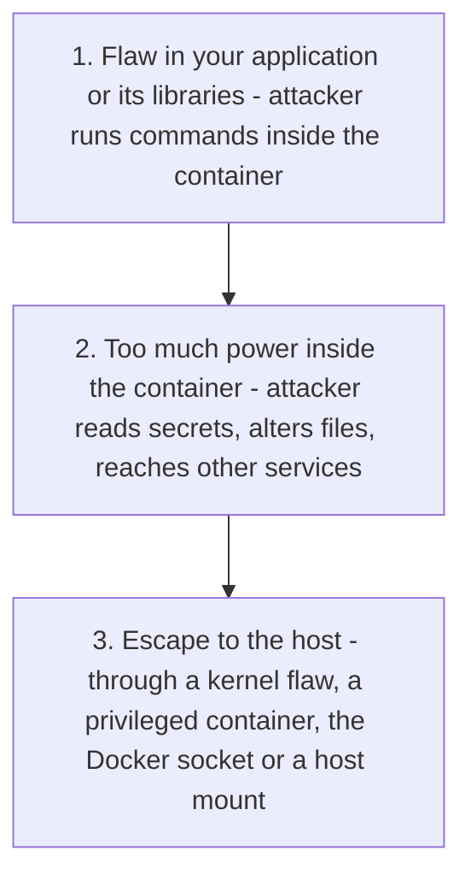

# Container security: least privilege in practice

## In plain words

When a hotel gives you a key card, it opens your room, the lift and the gym. It does not open the other guests' rooms, the kitchen or the safe. If you lose the card, the damage is limited to what that card could open.

Security people call this idea **least privilege**: give every person, and every program, the smallest set of permissions that still lets them do their job. Then a mistake or a break-in can only reach so far.

Containers are often run the opposite way, with far more power than the application needs. The default settings let the program inside act as the all-powerful administrator account, write anywhere in its filesystem, and use a list of special system permissions it will never need. Nothing goes wrong, until the day an attacker finds a flaw in the application. Then everything the container was *allowed* to do, the attacker can do.

This lesson is a practical checklist for taking those unnecessary permissions away, one at a time, and for knowing what is inside the images you ship.

Why this matters for a job: security reviews of Dockerfiles and deployment files are routine, many companies block images that run as the administrator or contain known serious flaws, and "how do you secure a container?" has a well-known list of expected answers. They are all here.

> **Before this lesson:** you should understand what a container is at the kernel level ([What a container is](#/lesson/docker/what-is-a-container)), Dockerfile instructions including `USER` ([Dockerfile instructions, one by one](#/lesson/docker/dockerfile-instructions)), multi-stage builds ([Multi-stage builds](#/lesson/docker/multi-stage-builds)) and volumes and bind mounts ([Volumes, bind mounts and tmpfs](#/lesson/docker/volumes-bind-mounts)).

## What you are defending against

A few words first. A **vulnerability** is a flaw that can be misused. An **attacker** misusing it is an **exploit**. The total set of things an attacker could try is the **attack surface**; a smaller surface means fewer ways in.

Remember what a container is: an ordinary process on the host, with a restricted view (namespaces) and a resource budget (cgroups), sharing the host's **kernel**, the core of the operating system. That gives three layers of risk:



You cannot guarantee that step 1 never happens. Everything in this lesson is about making steps 2 and 3 as hard as possible. Security people call this **defence in depth**: several independent barriers, so that one failure is not a disaster.

## Step 1: do not run as root

**Root** is the administrator account on Linux, with user ID (UID) 0. It may read and change any file and perform any system operation. Unless told otherwise, the process in a container runs as root.

See it with the simplest possible command:

```bash
docker run --rm alpine:3.20 id
```

`id` prints the current user. `--rm` removes the container afterwards.

```text
uid=0(root) gid=0(root) groups=0(root),1(bin),2(daemon)...
```

Root inside a container is restricted by the namespaces and other mechanisms below, but it is the *same* UID 0 the host uses. If anything else goes wrong (a mounted host folder, a kernel flaw), being root turns a small problem into a large one.

The fix belongs in the image:

```dockerfile
FROM python:3.12-slim
WORKDIR /app
COPY requirements.txt .
RUN pip install --no-cache-dir -r requirements.txt
RUN groupadd --system --gid 10001 app \
 && useradd --system --uid 10001 --gid app --no-create-home app
COPY --chown=10001:10001 . .
USER 10001:10001
CMD ["python", "server.py"]
```

- `groupadd` and `useradd` create an unprivileged group and user. `--system` marks it as a service account; `--no-create-home` skips a home folder it does not need. The fixed number 10001 is chosen to be well away from the IDs of real users on a host.
- `COPY --chown=10001:10001` makes the application files belong to that user.
- `USER 10001:10001` makes every later instruction, and the container's main process, run as that user. A number is better than a name here because platforms can then verify "not zero" without reading files inside the image.

```bash
docker run --rm harbour/quotes-api:1.5 id
```

```text
uid=10001(app) gid=10001(app) groups=10001(app)
```

Two practical consequences. An unprivileged user cannot listen on ports below 1024 by default, so make the app listen on a high port such as 8000 and publish it as `-p 80:8000`. And it cannot write to folders owned by root, so give it ownership of exactly the folders it must write to.

## Step 2: forbid gaining new privileges

Some programs on Linux carry a special flag (called *setuid*) that lets whoever runs them act as root for the duration. `sudo` is the best-known. An attacker inside a container looks for such programs to climb from an ordinary user to root, a move known as **privilege escalation**.

One option closes that door:

```bash
docker run --security-opt no-new-privileges:true harbour/quotes-api:1.5
```

`--security-opt no-new-privileges:true` tells the kernel that this process and anything it starts may never gain more privileges than it has now, whatever flags a program file carries. There is no downside for a normal application.

## Step 3: drop capabilities

Linux splits root's power into about forty separate permissions called **capabilities**. Examples:

| Capability | Allows |
|---|---|
| `CHOWN` | Changing the owner of any file |
| `NET_BIND_SERVICE` | Listening on ports below 1024 |
| `NET_RAW` | Crafting raw network packets (used by `ping`, and by some network attacks) |
| `SYS_ADMIN` | A very broad set of administrative operations, including mounting filesystems |
| `SYS_PTRACE` | Inspecting and controlling other processes |
| `SYS_TIME` | Changing the system clock |

Docker already withholds the most dangerous ones and grants a default set of about fourteen. A typical web application needs **none** of them. So remove them all and add back only what is proven necessary:

```bash
docker run --cap-drop ALL --cap-add NET_BIND_SERVICE harbour/web:3
```

- `--cap-drop ALL` removes every capability.
- `--cap-add NET_BIND_SERVICE` returns the single one this example needs to listen on port 80.

Demonstration with `ping`, which needs `NET_RAW`:

```bash
docker run --rm --cap-drop ALL alpine:3.20 ping -c 1 1.1.1.1
```

```text
ping: permission denied (are you root?)
```

Even as root, the program is refused, because the specific permission is gone.

> [!WARNING]
> `--privileged` does the opposite of everything in this lesson. It grants every capability, lifts the kernel's filters and gives access to the host's devices. A privileged container is root on the host in all but name. If a guide says "add `--privileged` and it will work", find out which single capability or device is really needed.

## Step 4: make the filesystem read-only

An attacker who gets in usually wants to write something: a downloaded tool, a changed script, a hidden file to come back to. If the container's filesystem cannot be written, most of that fails.

```bash
docker run --read-only --tmpfs /tmp:rw,noexec,nosuid,size=64m \
  -v quotes-data:/var/lib/quotes harbour/quotes-api:1.5
```

- `--read-only` makes the container's own filesystem unwritable.
- `--tmpfs /tmp:...` provides a small in-memory scratch folder. `noexec` means files there cannot be run as programs; `nosuid` disables the privilege flag from step 2; `size=64m` caps it.
- The named volume is the one place where real data may be written.

```bash
docker exec quotes sh -c 'echo x > /app/planted.sh'
```

```text
sh: can't create /app/planted.sh: Read-only file system
```

The storage lesson showed how to find out which paths an application writes to (`docker diff`). Each one becomes a deliberate decision: volume, tmpfs, or "it should not be writing there".

## Step 5: limit resources

A container without limits can exhaust the whole machine, by accident or because an attacker wants to disrupt the service (a **denial of service**).

```bash
docker run --memory 256m --cpus 0.5 --pids-limit 200 harbour/quotes-api:1.5
```

The first lesson explained these: a memory ceiling, a processor ceiling, and a cap on the number of processes, which stops a "fork bomb" (a program that copies itself endlessly).

## Step 6: keep the default kernel filters

Two more protections are on by default. You mostly need to know not to switch them off.

- **seccomp** (secure computing) is a filter on **system calls**, the requests a program makes to the kernel. Docker's default profile blocks around fifty rarely needed and risky ones.
- **AppArmor** or **SELinux**, depending on the Linux distribution, restrict which files and operations a program may touch, even as root.

`--security-opt seccomp=unconfined` turns the filter off. It appears in copied commands more often than it should.

## All of it in a Compose file

```yaml
services:
  api:
    image: harbour/quotes-api:1.5@sha256:9f2c4e...
    user: "10001:10001"
    read_only: true
    tmpfs:
      - /tmp:rw,noexec,nosuid,size=64m
    cap_drop:
      - ALL
    security_opt:
      - no-new-privileges:true
    pids_limit: 200
    deploy:
      resources:
        limits:
          memory: 256M
          cpus: "0.50"
    ports:
      - "127.0.0.1:8000:8000"
    networks:
      - back
    volumes:
      - quotes-data:/var/lib/quotes
```

Each key maps to a step above: `user` (1), `security_opt` (2), `cap_drop` (3), `read_only` and `tmpfs` (4), `pids_limit` and `resources` (5). The image is pinned by digest, the port is published only on the local machine, and the service joins only the network it needs.

The small scoring function below applies the same checklist to a container's settings. It is the kind of check an automated policy tool performs before a deployment is accepted.

```python-run
def review(c):
    findings = []
    user = str(c.get("user", "")).split(":")[0]
    if user in ("", "0", "root"):
        findings.append("runs as root: set a non-zero numeric user")
    if c.get("privileged"):
        findings.append("privileged: removes almost all isolation")
    if "ALL" not in c.get("cap_drop", []):
        findings.append("capabilities not dropped: add cap_drop ALL")
    if "SYS_ADMIN" in c.get("cap_add", []):
        findings.append("SYS_ADMIN added: close to full root")
    if not c.get("read_only"):
        findings.append("writable root filesystem: set read_only")
    if "no-new-privileges:true" not in c.get("security_opt", []):
        findings.append("privilege escalation allowed: add no-new-privileges")
    if not c.get("memory"):
        findings.append("no memory limit")
    if any("docker.sock" in v for v in c.get("volumes", [])):
        findings.append("Docker socket mounted: gives control of the host")
    if c.get("image", "").endswith(":latest") or ":" not in c.get("image", ""):
        findings.append("image not pinned to a version")
    return findings

default_style = {"image": "harbour/quotes-api", "volumes": ["/var/run/docker.sock:/var/run/docker.sock"]}
hardened = {"image": "harbour/quotes-api:1.5", "user": "10001:10001", "cap_drop": ["ALL"], "read_only": True,
            "security_opt": ["no-new-privileges:true"], "memory": "256m", "volumes": ["quotes-data:/var/lib/quotes"]}
for name, c in [("default-style", default_style), ("hardened", hardened)]:
    problems = review(c)
    print(f"{name}: {len(problems)} finding(s)")
    for p in problems:
        print("   -", p)
```

## What is inside the image

Run-time settings limit what an attacker can do. The image decides what is there to attack.

### Minimal base images

Every package in an image is code that might contain a flaw, and a tool an intruder might use. A shell, a package manager and a download tool are exactly what an attacker hopes to find.

| Base | Roughly contains | Size | Shell |
|---|---|---|---|
| `ubuntu:24.04`, `debian:bookworm` | A general-purpose system | 75 to 120 MB | Yes |
| `*-slim` variants | A trimmed Debian | 30 to 80 MB plus the language runtime | Yes |
| `alpine` | A very small system built on a different C library (musl) | About 8 MB | Yes, a minimal one |
| Distroless | Only the language runtime and its libraries | 2 to 50 MB | No |
| `scratch` | Nothing at all | 0 | No |

Multi-stage builds are what make the small bases practical: compilers and tools stay in the build stage, and only the result is copied into a minimal final stage.

### Scanning for known vulnerabilities

Publicly known flaws are listed in a catalogue called **CVE** (Common Vulnerabilities and Exposures); each has an identifier such as `CVE-2024-3094` and a severity. A **scanner** lists the packages in an image and looks each one up.

```bash
docker scout cves harbour/quotes-api:1.5
```

```text
  0C     2H     7M    12L  libexpat 2.5.0-1
    ✗ HIGH   CVE-2024-45491  fixed in 2.5.0-1+deb12u1
    ✗ HIGH   CVE-2024-45492  fixed in 2.5.0-1+deb12u1
  0C     0H     1M     0L  urllib3 2.0.4
    ✗ MEDIUM CVE-2024-37891  fixed in 2.2.2
```

The letters count findings by severity: Critical, High, Medium, Low. Other common scanners are Trivy and Grype. Reading the results sensibly:

- **Fixable first.** "Fixed in ..." means an update exists: rebuild on a newer base image or raise the dependency's version. This clears most findings.
- **Severity next.** Critical and High with a fix available should block a release.
- **Unfixable findings** are tracked, not ignored: can the package be removed, or the base changed?
- **Rescan regularly.** An image that was clean last month is not clean for ever, because new flaws are discovered in old software all the time. Rebuild images on a schedule even when your code has not changed.

### Trusting where images come from

- Prefer official images and verified publishers; read what a community image does before using it.
- Pin base images by digest so that the content cannot change underneath you.
- Sign your own images and verify signatures at deployment if your organisation requires it.
- Never bake secrets into layers (see the lesson on configs and secrets).

## Things that undo everything

| Setting | Why it is dangerous |
|---|---|
| `--privileged` | Removes nearly all isolation |
| `-v /var/run/docker.sock:/var/run/docker.sock` | The container can command the Docker Engine, and so start a container that mounts the entire host |
| `-v /:/host` or mounting system folders | Direct access to the host's files |
| `--pid=host`, `--network=host` | Shares the host's process list or network |
| `--cap-add SYS_ADMIN` | Close to full root |
| Membership of the `docker` group on the host | Equivalent to root on that host |

On hosts where containers run code you do not fully trust, two further measures are worth knowing by name. **Rootless mode** runs the Docker Engine itself as an ordinary user. **User namespace remapping** makes root inside a container correspond to an unprivileged user on the host. Both mean that even an escape lands the attacker in an account without power.

> [!INTERVIEW]
> "How would you harden a container?" Give the list in order: minimal base image through a multi-stage build; run as a non-root numeric user; `no-new-privileges`; drop all capabilities and add back only what is needed; read-only root filesystem with tmpfs and explicit volumes; memory, CPU and process limits; never `--privileged` or the Docker socket; scan images and rebuild regularly; pin by digest; keep secrets out of images. Then explain *why* with one sentence on the shared kernel.

> [!TIP]
> Apply the settings one at a time and run your tests after each. If the app breaks after `--read-only`, `docker diff` on an unrestricted run tells you which path it needed. If it breaks after `--cap-drop ALL`, the error message usually names the missing permission.

## Pitfalls

- **`USER` placed before steps that need root,** such as installing packages; they then fail. Switch user after them.
- **Files owned by root** that the unprivileged user must write. Use `COPY --chown` or create the folder with the right owner.
- **Listening on port 80 as non-root.** Use a high port and map it.
- **Mounted volumes with the wrong owner.** A bind-mounted host folder keeps its host ownership.
- **Treating a scan with zero findings as "secure".** Scanners know published flaws only, not mistakes in your own code or settings.
- **Ignoring every finding because there are hundreds.** Sort by fixable and severity; most disappear with a base image update.
- **Debug tools left in production images.**
- **Assuming a container is a strong security boundary.** It is a good one, weaker than a virtual machine, because the kernel is shared.

## Cheat sheet

| Goal | `docker run` | Compose |
|---|---|---|
| Non-root | `--user 10001:10001` (and `USER` in the image) | `user: "10001:10001"` |
| No privilege gain | `--security-opt no-new-privileges:true` | `security_opt: [no-new-privileges:true]` |
| Drop capabilities | `--cap-drop ALL --cap-add X` | `cap_drop: [ALL]`, `cap_add: [X]` |
| Read-only filesystem | `--read-only --tmpfs /tmp` | `read_only: true`, `tmpfs: [/tmp]` |
| Memory, CPU, processes | `--memory 256m --cpus 0.5 --pids-limit 200` | `deploy.resources.limits`, `pids_limit` |
| Local-only port | `-p 127.0.0.1:8000:8000` | `ports: ["127.0.0.1:8000:8000"]` |
| Scan | `docker scout cves IMAGE` | (run in the pipeline) |
| Who am I | `docker exec NAME id` | |
| Effective settings | `docker inspect NAME --format '{{json .HostConfig.CapDrop}}'` | |

## Summary

- Containers share the host's kernel, so limit what the process inside is allowed to do: assume the application can be compromised and make that as harmless as possible.
- Run as a non-root numeric user, forbid privilege escalation, drop all capabilities and add back only what is needed.
- Make the root filesystem read-only, with tmpfs for scratch and volumes for data; set memory, CPU and process limits.
- Leave seccomp and AppArmor or SELinux on; never use `--privileged` or mount the Docker socket without a very good reason.
- Use minimal base images through multi-stage builds, scan for known vulnerabilities, fix what is fixable, and rebuild on a schedule.
- Pin images by digest and keep secrets out of them.

## Glossary

| Term | Meaning |
|---|---|
| Least privilege | Granting only the permissions needed for the job |
| Root | The Linux administrator account, user ID 0 |
| UID / GID | Numeric user ID / group ID |
| Vulnerability | A flaw that can be misused |
| Exploit | A way of misusing a vulnerability |
| Attack surface | Everything an attacker could try to use |
| Defence in depth | Several independent protections, so that one failing is not fatal |
| Privilege escalation | Gaining more permissions than you started with |
| Capability | One of the separate permissions that together make up root's power |
| Kernel | The core of the operating system, shared by all containers on a host |
| System call | A request from a program to the kernel |
| seccomp | A kernel filter that blocks chosen system calls |
| AppArmor / SELinux | Kernel systems that restrict what programs may access |
| CVE | Common Vulnerabilities and Exposures: the public catalogue of known flaws |
| Scanner | A tool that lists the known vulnerabilities in an image's packages |
| Distroless | Base images containing only a runtime, with no shell or package manager |
| Denial of service | Making a service unavailable, for example by exhausting resources |
| Rootless mode | Running the Docker Engine as an ordinary user |

## Check yourself

```quiz
[
  {"q": "By default, which user does the main process in a container run as?",
   "options": ["A random unprivileged user", "root, user ID 0", "The user who typed docker run", "nobody"],
   "answer": 1,
   "explain": "Unless the image sets USER or you pass --user, the process runs as UID 0."},
  {"q": "Why is `USER 10001` preferred over `USER app` in a Dockerfile?",
   "options": ["Names are not allowed", "A numeric ID lets platforms verify the container is not root without reading files in the image", "Numbers make the image smaller", "It runs faster"],
   "answer": 1,
   "explain": "Policies such as 'must run as non-root' can check a number directly. A name would have to be resolved inside the image."},
  {"q": "What does `--cap-drop ALL --cap-add NET_BIND_SERVICE` do?",
   "options": ["Grants every capability", "Removes every capability and returns only the one that allows listening on ports below 1024", "Disables networking", "Makes the container privileged"],
   "answer": 1,
   "explain": "Start from nothing and add back the single permission the application has been shown to need."},
  {"q": "What does `--security-opt no-new-privileges:true` prevent?",
   "options": ["Reading environment variables", "A process gaining more privileges than it started with, for example through a setuid program", "Network access", "Writing to volumes"],
   "answer": 1,
   "explain": "It blocks privilege escalation inside the container, with no cost to a normal application."},
  {"q": "A container runs with `--read-only`. Where can the application still write?",
   "options": ["Anywhere under /app", "Only to explicitly mounted volumes and tmpfs folders", "Nowhere at all", "Only to /etc"],
   "answer": 1,
   "explain": "The container's own filesystem is unwritable. Mounts are separate filesystems and remain writable unless mounted read-only."},
  {"q": "Why is mounting /var/run/docker.sock into a container dangerous?",
   "options": ["It slows the container", "The container can instruct the Docker Engine to start a container with full access to the host", "It fills the disk", "It disables health checks"],
   "answer": 1,
   "explain": "Control of the engine is control of the host. Only fully trusted tools should receive the socket."},
  {"q": "A scan reports a HIGH vulnerability in a system library and says 'fixed in' a newer version. What is the usual remedy?",
   "options": ["Ignore it", "Rebuild the image on an updated base image so the patched package is included", "Delete the scanner", "Add --privileged"],
   "answer": 1,
   "explain": "Most findings in operating system packages are cleared by rebuilding on a base image that already contains the fix."},
  {"q": "How does a multi-stage build improve security?",
   "options": ["It encrypts the image", "Compilers, package managers and other build tools stay in the build stage, so the final image contains less to attack", "It disables root", "It scans the image automatically"],
   "answer": 1,
   "explain": "A smaller final image has fewer packages that can hold vulnerabilities and fewer tools an intruder can use."}
]
```

> **Source:** Stoneman, *Learn Docker in a Month of Lunches*, ch. 17 (topic coverage: image security). Checked against <https://docs.docker.com/engine/security/>, <https://docs.docker.com/engine/containers/run/#runtime-privilege-and-linux-capabilities>, <https://docs.docker.com/engine/security/seccomp/> and <https://docs.docker.com/scout/>. All wording and examples are original.
