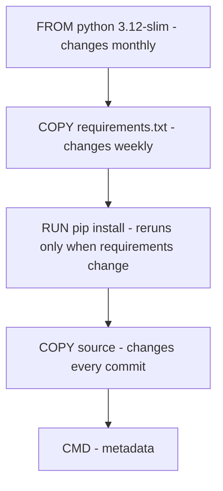

# Optimising images for size, speed and security

## In plain words

Packing for a trip, you could take every item you own in a removal van, to be safe. You would arrive late, pay more, and spend the holiday searching for your toothbrush. A good traveller takes one small bag with exactly what the trip needs.

A container image is a packed bag for your application. A careless image contains compilers, documentation, caches and leftover files the running program never touches. It still works. It is also slow to download, slow to start on a new machine, costly to store, and full of extra software in which security flaws can hide.

**Optimising** an image means making three things better at once: its **size** (fewer bytes), its **build speed** (less waiting after each change) and its **security** (less software that could be attacked). The happy fact of this lesson is that the same handful of habits improves all three.

Why this matters for a job: image size and build time are things a team feels every day, in pipeline minutes and deployment delays. "How would you make this image smaller?" is one of the most frequent hands-on interview questions, often asked with a real Dockerfile to improve.

> **Before this lesson:** this lesson pulls together [Dockerfile instructions, one by one](#/lesson/docker/dockerfile-instructions), [Layers, the build cache, the context and .dockerignore](#/lesson/docker/layers-cache-context), [Multi-stage builds](#/lesson/docker/multi-stage-builds) and [Container security](#/lesson/docker/container-security). Read those first.

## Measure before you change anything

You cannot improve what you have not measured. Three commands tell you where the bytes are.

```bash
docker image ls harbour/reportly
```

```text
REPOSITORY         TAG   IMAGE ID       SIZE
harbour/reportly   v1    3c1f9a7e2b10   1.24GB
```

`docker image ls` shows the total size of the image when unpacked on disk.

```bash
docker image history harbour/reportly:v1 --format 'table {{.Size}}\t{{.CreatedBy}}'
```

```text
SIZE      CREATED BY
0B        CMD ["python" "main.py"]
312MB     RUN /bin/sh -c pip install -r requirements.txt
88MB      COPY . . # buildkit
395MB     RUN /bin/sh -c apt-get update && apt-get install -y build-essential git curl
0B        WORKDIR /app
...       (base image python:3.12, about 1.02GB before these steps are counted separately)
```

`docker image history` lists the image's **layers** (the stacked sets of file changes that make up an image, one per filesystem-changing instruction), newest first, with the size each one added. Read it like a bank statement: the large numbers are where to look. Here an 88 MB `COPY . .` is suspicious for a small Python project, and a 395 MB package installation is probably build tooling.

For a file-by-file view, the open-source tool `dive` shows the contents of each layer and marks files that were added in one layer and deleted in a later one, which is wasted space:

```bash
docker run --rm -it -v /var/run/docker.sock:/var/run/docker.sock wagoodman/dive harbour/reportly:v1
```

## The starting point

Here is the Dockerfile behind that 1.24 GB image. It works. Every line has something to improve.

```dockerfile
FROM python:3.12
WORKDIR /app
RUN apt-get update && apt-get install -y build-essential git curl
COPY . .
RUN pip install -r requirements.txt
CMD python main.py
```

We will fix it in six steps, measuring after each.

## Step 1: choose a smaller base image

The **base image** is the image named after `FROM`, on which yours is built. `python:3.12` is the full variant: a complete Debian system with compilers and development files, about 1 GB. The `slim` variant has only what Python needs to run.

```dockerfile
FROM python:3.12-slim
```

| Base | Approximate size |
|---|---|
| `python:3.12` | 1.02 GB |
| `python:3.12-slim` | 130 MB |
| `python:3.12-alpine` | 55 MB |

One word changed, and about 900 MB is gone. Why not go straight to `alpine`? Alpine Linux uses a different C library (musl instead of the more common glibc). Many Python packages publish ready-made builds only for glibc, so on Alpine the installer has to compile them from source, which is slow and can fail. For Python, `slim` is the dependable choice. For a Go or Rust program that is a single self-contained binary, Alpine, distroless or `scratch` are excellent.

## Step 2: stop copying what you do not need

`COPY . .` copies the whole **build context**, the folder you gave to `docker build`. That 88 MB layer contains the `.git` history, a local virtual environment, test data and cached files.

Create a `.dockerignore` file beside the Dockerfile. It lists what must never be sent to the builder:

```text
.git
.venv
__pycache__/
**/*.pyc
tests/
docs/
data/
*.log
.env*
Dockerfile
.dockerignore
```

Each line is a pattern for files or folders to leave out. `**/*.pyc` means "files ending in `.pyc` at any depth".

The layer drops from 88 MB to about 400 kB. The build also starts faster, because less is transferred, and secrets in `.env` can no longer leak into the image.

## Step 3: order instructions so the cache works

Docker reuses the stored result of an instruction when nothing it depends on has changed; this is the **build cache**. Once one instruction has to run again, every instruction after it runs again too.

In the starting Dockerfile, `COPY . .` comes before `pip install`. Any change to any source file invalidates the copy, and therefore reinstalls every dependency: a 60-second wait for a one-character fix.

Copy the list of dependencies first, install, and copy the source last:

```dockerfile
COPY requirements.txt .
RUN pip install -r requirements.txt
COPY . .
```

Now an edit to the source reruns only the final `COPY`. The rule to remember: **things that change rarely go near the top; things that change often go near the bottom.**



## Step 4: clean up in the same instruction

Every `RUN` creates a layer, and layers are permanent. Deleting a file in a *later* instruction hides it but does not remove its bytes from the earlier layer. So anything temporary must be removed in the **same** `RUN` that created it.

```dockerfile
# wasteful: the package lists stay in the first layer for ever
RUN apt-get update
RUN apt-get install -y curl
RUN rm -rf /var/lib/apt/lists/*

# better: one layer, with nothing left behind
RUN apt-get update \
 && apt-get install -y --no-install-recommends curl \
 && rm -rf /var/lib/apt/lists/*
```

- `&&` runs the next command only if the previous one succeeded.
- `--no-install-recommends` tells the package manager to skip optional extras, often a large saving.
- `rm -rf /var/lib/apt/lists/*` deletes the downloaded package index, which is useless once installation is finished.

For Python, `pip install --no-cache-dir` stops pip keeping a copy of every downloaded package inside the layer.

The small model below shows why the split version is larger. It adds up layer sizes the way an image does.

```python-run
def image_size(layers):
    """Each layer is a list of (path, megabytes) changes; negative megabytes mean a delete."""
    total, files = 0, {}
    for i, layer in enumerate(layers, 1):
        added = sum(mb for _, mb in layer if mb > 0)       # deletes add (almost) nothing and remove nothing
        total += added
        for path, mb in layer:
            if mb > 0:
                files[path] = mb
            else:
                files.pop(path, None)
        print(f"  layer {i}: +{added:4d} MB")
    return total, sum(files.values())

split = [[("apt lists", 45)], [("build tools", 350)], [("app", 2)], [("apt lists", -45), ("build tools", -350)]]
single = [[("app", 2)]]          # install, build and clean up inside one RUN: nothing is left to store
for name, layers in [("four separate instructions", split), ("one combined instruction", single)]:
    print(name)
    stored, visible = image_size(layers)
    print(f"  stored in the image: {stored} MB, visible to the container: {visible} MB\n")
```

Both images *show* the container 2 MB of files. The first *ships* 397 MB, because the deleted files are still in its earlier layers.

## Step 5: keep build tools out with a multi-stage build

Some Python packages must be compiled during installation, which needs `build-essential` (a compiler and its companions). They are needed only while building, never while running. A **multi-stage build** uses one stage with the tools to do the work and a second, clean stage that receives only the result.

```dockerfile
# syntax=docker/dockerfile:1
FROM python:3.12-slim AS build
RUN apt-get update \
 && apt-get install -y --no-install-recommends build-essential \
 && rm -rf /var/lib/apt/lists/*
RUN python -m venv /opt/venv
ENV PATH="/opt/venv/bin:$PATH"
COPY requirements.txt .
RUN --mount=type=cache,target=/root/.cache/pip pip install -r requirements.txt

FROM python:3.12-slim
RUN useradd --system --uid 10001 --no-create-home app
COPY --from=build /opt/venv /opt/venv
ENV PATH="/opt/venv/bin:$PATH" PYTHONUNBUFFERED=1 PYTHONDONTWRITEBYTECODE=1
WORKDIR /app
COPY --chown=10001:10001 . .
USER 10001
CMD ["python", "main.py"]
```

What each new part does:

- `FROM ... AS build` starts a stage named `build` that contains the compiler.
- `python -m venv /opt/venv` creates a **virtual environment**: a self-contained folder holding the installed Python packages. Having everything in one folder makes it easy to copy.
- `RUN --mount=type=cache,target=/root/.cache/pip` gives pip a download cache that persists between builds but is **not** stored in the image. It speeds up rebuilds without adding bytes.
- The second `FROM` starts the final stage from a clean base. `COPY --from=build /opt/venv /opt/venv` brings over only the installed packages. The compiler stays behind.
- `USER 10001` runs the app as an unprivileged user (from the security lesson).
- `CMD ["python", "main.py"]` uses the bracketed *exec form*, so the application receives stop signals directly.

## Step 6: remove what the application does not use

The last savings come from the dependency list itself.

- Split development dependencies (test tools, linters) into a separate file that the production image never installs.
- Check for heavyweight packages pulled in for one small function.
- Prefer the smaller variant when a library offers one, such as `opencv-python-headless`, or the CPU-only build of a machine-learning library when no graphics card is used.

## The results

| Version | Size | Rebuild after a source edit |
|---|---|---|
| Starting Dockerfile | 1.24 GB | about 75 s |
| + slim base | 520 MB | about 75 s |
| + `.dockerignore` | 430 MB | about 70 s |
| + dependency layer first | 430 MB | about 2 s |
| + clean-up and `--no-cache-dir` | 380 MB | about 2 s |
| + multi-stage, no build tools | 205 MB | about 2 s |
| + trimmed dependencies | 160 MB | about 2 s |

The image is about one eighth of its original size and rebuilds in two seconds. A vulnerability scan would also list far fewer findings, because roughly 400 packages that the application never used are gone.

## Why smaller is also safer and faster

| Habit | Size | Build speed | Security |
|---|---|---|---|
| Smaller base image | Much smaller | Faster pulls | Fewer packages to patch |
| `.dockerignore` | Smaller | Faster context transfer, fewer cache misses | No accidental secrets |
| Dependencies before source | Same | Much faster rebuilds | |
| Clean up in the same `RUN` | Smaller | | No leftover files |
| Multi-stage build | Much smaller | Stages can build in parallel | No compilers or tools for an intruder |
| Pinned versions | | Reproducible, stable cache | Known, reviewable contents |
| Non-root user | | | Limits damage |
| Cache mounts | Same | Faster dependency installs | |

Smaller images also mean shared layers are a larger fraction of each image, so pushes and pulls move less data: only the layers that changed travel.

## Layer count: a note on an old piece of advice

Older guides say to merge as many instructions as possible to reduce the number of layers. That mattered years ago. Today a few extra layers cost nothing measurable, and separate layers give better caching. Combine instructions when they belong together logically (install and clean up), not as a goal in itself. In particular, do not merge "install dependencies" with "copy source": that sacrifices the cache for no gain.

> [!WARNING]
> Do not optimise away the ability to diagnose problems. A distroless image has no shell, so `docker exec ... sh` will not work. That is a good trade for production, provided the team knows the alternatives (covered in the final lesson) before the first incident.

> [!INTERVIEW]
> "How would you shrink this image?" Measure with `docker image history`; switch to a slim or minimal base; add a `.dockerignore`; use a multi-stage build so build tools do not ship; clean up package caches in the same `RUN`; install only production dependencies. Then add the speed and security angle: order layers for the cache, pin versions, run as non-root. Naming the measurement step first is what separates a good answer from a list.

> [!TIP]
> Set a size budget in the pipeline, for example "fail if the image exceeds 250 MB". Sizes creep upward one dependency at a time, and a budget makes the creep visible when it happens instead of a year later.

## Pitfalls

- **Deleting files in a later layer** and expecting the image to shrink.
- **`COPY . .` before installing dependencies,** which reinstalls everything on each change.
- **No `.dockerignore`.**
- **Choosing Alpine for Python by reflex** and then fighting compile errors.
- **`apt-get update` in its own instruction.** The cached, stale package list is reused for later installs.
- **Using `--no-cache-dir` together with a cache mount.** They work against each other; with a cache mount, let pip use its cache.
- **Copying the virtual environment to a different path.** Paths inside it are fixed; keep the same location in both stages.
- **Unpinned `FROM` tags,** which make builds change without warning.
- **Squashing all layers into one.** Layer sharing between images and versions is lost, so every pull downloads everything.
- **Optimising a base image nobody else uses.** A slightly larger base that all your services share is downloaded once per machine.

## Cheat sheet

| Goal | Technique |
|---|---|
| Find the big layers | `docker image history IMAGE` or `dive` |
| Smaller base | `-slim`, distroless, Alpine or `scratch` as the language allows |
| Smaller context | `.dockerignore` |
| Fast rebuilds | Copy dependency lists, install, then copy source |
| No leftovers | Install and clean up in one `RUN`; `--no-install-recommends`; `--no-cache-dir` |
| No build tools shipped | Multi-stage build with `COPY --from` |
| Faster dependency installs | `RUN --mount=type=cache,target=...` |
| Reproducible builds | Pin base image tags (and digests) and dependency versions |
| Safer | `USER` non-root, minimal base, regular rebuilds and scans |
| Guard against growth | Size check in the pipeline |

## Summary

- Measure first: `docker image history` shows which instruction added which bytes.
- The largest single saving is usually the base image; the next is keeping build tools out with a multi-stage build.
- A `.dockerignore` shrinks the context, the image and the risk of leaking files.
- Order instructions from rarely changing to frequently changing so that the cache absorbs most rebuilds.
- Temporary files must be removed in the instruction that created them; later deletes only hide them.
- The same habits reduce size, speed up builds and shrink the attack surface, so optimisation is rarely a trade-off between them.

## Glossary

| Term | Meaning |
|---|---|
| Optimise | Improve a chosen quality, here size, build speed and security |
| Base image | The image named in `FROM`, on which yours is built |
| Layer | The set of file changes produced by one instruction; layers stack to form the image |
| Build cache | Stored results of earlier build steps that are reused when inputs are unchanged |
| Build context | The folder whose files are available to the build |
| `.dockerignore` | A file listing patterns to exclude from the build context |
| Slim / Alpine / distroless / scratch | Progressively smaller kinds of base image |
| glibc / musl | Two implementations of the C library that programs depend on |
| Multi-stage build | A Dockerfile with several stages where only the last one is shipped |
| Virtual environment | A self-contained folder of installed Python packages |
| Cache mount | A build-time folder that persists between builds without being stored in the image |
| Attack surface | Everything in the image an attacker could try to use |
| Squash | Merging all layers of an image into one |

## Check yourself

```quiz
[
  {"q": "Which command shows how much each instruction added to an image?",
   "options": ["docker ps", "docker image history IMAGE", "docker logs IMAGE", "docker stats"],
   "answer": 1,
   "explain": "history lists the layers with their sizes and the instruction that created each, which is where optimisation starts."},
  {"q": "What is usually the largest single saving when shrinking a Python image built FROM python:3.12?",
   "options": ["Merging RUN instructions", "Switching to python:3.12-slim", "Deleting comments from the Dockerfile", "Using ADD instead of COPY"],
   "answer": 1,
   "explain": "The full base image is about 1 GB, mostly build tooling. The slim variant is around 130 MB."},
  {"q": "A Dockerfile has `RUN apt-get install -y gcc` and, three lines later, `RUN apt-get purge -y gcc`. How does the image size change because of the purge?",
   "options": ["It shrinks by the size of gcc", "It does not shrink; the earlier layer still contains gcc", "It doubles", "The build fails"],
   "answer": 1,
   "explain": "Layers are permanent. A later delete only hides files. Remove them in the same RUN or use a multi-stage build."},
  {"q": "Why copy requirements.txt and install before copying the rest of the source?",
   "options": ["pip requires it", "So that source edits do not invalidate the cached dependency layer", "It makes the image smaller", "COPY can only copy one file"],
   "answer": 1,
   "explain": "The cache is invalidated from the first changed instruction onward. Keeping the slow install above the frequently changing source avoids repeating it."},
  {"q": "What does a multi-stage build remove from the final image?",
   "options": ["The application code", "Compilers and other build-only tools, which stay in the earlier stage", "The base image", "Environment variables"],
   "answer": 1,
   "explain": "Only what is explicitly copied from the build stage reaches the final stage, so the toolchain is left behind."},
  {"q": "Why can python:3.12-alpine be a poor choice for a Python service?",
   "options": ["Alpine cannot run Python", "Many packages ship prebuilt only for glibc, so on Alpine's musl they must be compiled, which is slow and may fail", "Alpine images are larger", "Alpine has no package manager"],
   "answer": 1,
   "explain": "The different C library means prebuilt packages often do not apply. slim avoids the problem at a modest size cost."},
  {"q": "What does `RUN --mount=type=cache,target=/root/.cache/pip pip install -r requirements.txt` do?",
   "options": ["Stores pip's cache inside the image", "Keeps pip's download cache between builds without adding it to the image", "Disables the layer cache", "Installs packages at run time"],
   "answer": 1,
   "explain": "A cache mount is managed by the builder and exists only during that instruction, so rebuilds are faster and the image is no larger."},
  {"q": "How does a smaller image improve security?",
   "options": ["Small files cannot contain flaws", "It contains fewer packages that can have vulnerabilities and fewer tools an intruder could use", "It is encrypted", "Scanners skip small images"],
   "answer": 1,
   "explain": "Less software means a smaller attack surface and shorter vulnerability reports."}
]
```

> **Source:** Stoneman, *Learn Docker in a Month of Lunches*, ch. 17 (topic coverage). Checked against <https://docs.docker.com/build/building/best-practices/>, <https://docs.docker.com/build/cache/optimize/> and <https://docs.docker.com/build/building/multi-stage/>. All wording and examples are original.
