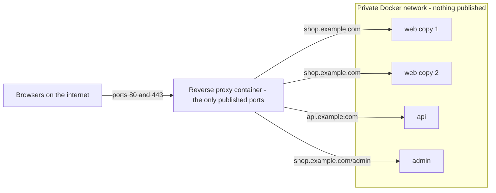

# Reverse proxies in front of containers

## In plain words

A large office building has one front door and a reception desk. Visitors do not wander the corridors looking for the right room. They tell the receptionist who they have come to see, and the receptionist sends them to the right floor. The receptionist also checks badges, keeps a visitor log, and knows which meeting rooms are in use. The people inside the building never deal with the street directly.

A **reverse proxy** is that reception desk for web applications. It is a program that receives every incoming request from the internet and passes each one on to the right container behind it. The containers stay hidden on a private network. The proxy is the single public entrance.

That one entrance is a natural place to do jobs every application would otherwise repeat: deciding which container handles which web address, spreading requests across several copies, handling encryption, and remembering answers that do not change.

Why this matters for a job: almost no production system exposes application containers straight to the internet. There is always a proxy in front, called a reverse proxy, a load balancer, an ingress or an API gateway depending on context. You will configure one, and you will debug problems that turn out to be the proxy's doing.

> **Before this lesson:** you need Compose services and networks ([Compose fundamentals](#/lesson/docker/compose-basics), [Container networking and DNS](#/lesson/docker/compose-networking)), health checks ([Health checks and dependency checks](#/lesson/docker/health-checks)) and the idea of replicas from [Orchestration with Docker Swarm](#/lesson/docker/swarm).

## The problem a proxy solves

Suppose you run three applications in containers on one server: a website, an API and an admin tool. Each listens on a port inside its container. To reach them from outside you publish each on a different host port:

```bash
docker run -d -p 8001:8000 harbour/shop-web:3
docker run -d -p 8002:8000 harbour/shop-api:3
docker run -d -p 8003:8000 harbour/shop-admin:3
```

`-p 8001:8000` connects port 8001 on the server to port 8000 in the container. Now users must type `shop.example.com:8001`. That has several problems:

- Web browsers expect port 80 for ordinary web traffic and port 443 for encrypted traffic. Only one program can own each port on a machine.
- Every application must handle encryption certificates itself.
- You cannot run two copies of the website, because both cannot have host port 8001.
- Every container is directly reachable from the internet.

A reverse proxy owns ports 80 and 443 and forwards each request to the right place:



The word *reverse* distinguishes it from an ordinary (forward) proxy, which sits in front of *users* and fetches pages on their behalf. A reverse proxy sits in front of *servers*. In proxy vocabulary, the containers behind it are called **upstreams** or **backends**.

## A first proxy with Nginx

**Nginx** (said "engine x") is one of the most widely used web servers and reverse proxies. Here is the smallest setup: one application container and Nginx in front.

```yaml
# compose.yaml
services:
  proxy:
    image: nginx:1.27-alpine
    ports:
      - "80:80"
    volumes:
      - ./nginx.conf:/etc/nginx/conf.d/default.conf:ro
    depends_on:
      - web

  web:
    image: harbour/shop-web:3
```

- `proxy` is the only service with `ports:`. It publishes port 80.
- The `volumes:` line mounts a configuration file from your project into the place Nginx reads its settings from; `:ro` makes it read-only.
- `web` publishes nothing. It can be reached only by other containers on the project's network.

```nginx
# nginx.conf
server {
    listen 80;
    server_name shop.example.com;

    location / {
        proxy_pass http://web:8000;
        proxy_set_header Host $host;
        proxy_set_header X-Real-IP $remote_addr;
        proxy_set_header X-Forwarded-For $proxy_add_x_forwarded_for;
        proxy_set_header X-Forwarded-Proto $scheme;
    }
}
```

Line by line:

- `server { ... }` describes one website.
- `listen 80;` accepts connections on port 80.
- `server_name shop.example.com;` says this block handles requests addressed to that host name.
- `location / { ... }` applies to every path beginning with `/`, which is all of them.
- `proxy_pass http://web:8000;` is the heart of it: forward the request to the host `web` on port 8000. `web` is the Compose service name, turned into an address by Docker's built-in name lookup (from the networking lesson).
- The four `proxy_set_header` lines add **headers** (named pieces of information that accompany every web request) telling the application what the original request looked like. Without them the application sees every request as coming from the proxy.

```bash
docker compose up -d
curl -s -H "Host: shop.example.com" http://localhost/
```

`curl` fetches a web address; `-H "Host: ..."` sets the host name the request claims to be for, which lets you test before any real domain name points at your machine.

```text
<h1>Harbour Shop</h1>
```

The request reached Nginx on port 80 and was passed to the `web` container, which is not reachable in any other way.

### Why the forwarded headers matter

| Header | Tells the application |
|---|---|
| `Host` | Which host name the user asked for |
| `X-Forwarded-For` | The user's real network address (otherwise every request appears to come from the proxy) |
| `X-Forwarded-Proto` | Whether the user connected with `http` or `https` |

An application that builds links, writes access logs or limits requests per user needs these. A classic symptom of missing headers is a login page that redirects to `http://web:8000/...`, an address that means nothing to a browser.

## Routing by host name and by path

One proxy can serve many applications. The proxy decides where a request goes by looking at two things: the host name and the **path** (the part of a web address after the host, such as `/api/orders`).

```nginx
server {
    listen 80;
    server_name shop.example.com;

    location /admin/ {
        proxy_pass http://admin:8000;
    }
    location / {
        proxy_pass http://web:8000;
    }
}

server {
    listen 80;
    server_name api.example.com;

    location / {
        proxy_pass http://api:8000;
    }
}
```

Two rules decide which block wins. First the `server` whose `server_name` matches the host is chosen. Then, inside it, the `location` with the **longest matching prefix** is used: `/admin/users` matches both `/admin/` and `/`, and the longer one wins.

The function below implements that selection: exact host before wildcard host, then longest path prefix. Change the rules and requests and predict the output.

```python-run
def route(rules, host, path):
    """rules: list of (host_pattern, path_prefix, backend)."""
    host = host.lower().split(":")[0]
    best, best_key = "404 not found", None
    for pattern, prefix, backend in rules:
        if pattern == host:
            specificity = 2
        elif pattern.startswith("*.") and host.endswith(pattern[1:]) and len(host) > len(pattern) - 1:
            specificity = 1
        elif pattern == "*":
            specificity = 0
        else:
            continue
        on_boundary = prefix == "/" or path == prefix or path.startswith(prefix + "/")
        if on_boundary and (best_key is None or (specificity, len(prefix)) > best_key):
            best, best_key = backend, (specificity, len(prefix))
    return best

rules = [("shop.example.com", "/", "web:8000"), ("shop.example.com", "/admin", "admin:8000"),
         ("api.example.com", "/", "api:8000"), ("*.example.com", "/", "landing:8000")]
for host, path in [("shop.example.com", "/"), ("shop.example.com", "/admin/users"), ("shop.example.com", "/administrator"),
                   ("API.example.com:443", "/v1/orders"), ("blog.example.com", "/"), ("other.org", "/")]:
    print(f"{host + path:38s} -> {route(rules, host, path)}")
```

Note `/administrator`: it starts with the letters `/admin`, but not on a path boundary, so it goes to `web`. Sloppy prefix matching is a real source of routing mistakes.

## Load balancing across copies

Run several copies of the website and the proxy can share requests among them, which is called **load balancing**.

```bash
docker compose up -d --scale web=3
```

```nginx
upstream shop_web {
    server web:8000;
}
```

There is a trap here. Nginx looks the name `web` up **once, when it starts**, and remembers the addresses it got. Containers added later are unknown to it, and containers that were replaced leave it sending traffic to addresses that no longer exist. Reload the proxy (`docker compose exec proxy nginx -s reload`) after scaling, or use a proxy that tracks containers automatically, described below.

Ways to spread the load:

| Method | How it chooses | Suits |
|---|---|---|
| Round robin | Each backend in turn | Similar requests, similar servers |
| Least connections | The backend with the fewest requests in progress | Requests of very different lengths |
| IP hash | The same user address always goes to the same backend | Applications that keep per-user data in memory |

A good proxy also stops sending requests to a backend that fails, then tries it again later. Together with container health checks, this means users rarely meet a broken copy.

## TLS termination

**TLS** (Transport Layer Security) is the encryption behind addresses that begin with `https`. It needs a **certificate**, a file that proves the server's identity, and a matching private key.

With a proxy, encryption can end at the front door, an arrangement called **TLS termination**. The proxy holds the certificate, decrypts incoming requests and passes plain requests to the containers over the private network.

```nginx
server {
    listen 80;
    server_name shop.example.com;
    return 301 https://$host$request_uri;
}

server {
    listen 443 ssl;
    server_name shop.example.com;
    ssl_certificate     /run/secrets/shop_cert;
    ssl_certificate_key /run/secrets/shop_key;

    location / {
        proxy_pass http://web:8000;
        proxy_set_header X-Forwarded-Proto https;
        proxy_set_header Host $host;
    }
}
```

- The first block answers any plain request on port 80 with code 301, "moved permanently", sending the browser to the `https` address.
- `listen 443 ssl;` accepts encrypted connections.
- The certificate and key are read from `/run/secrets/`, which is where Docker secrets appear (from the lesson on configs and secrets). The private key is exactly the kind of value that belongs in a secret.

The benefit is that certificates live in one place. Twenty application containers need no knowledge of encryption at all.

## Caching and other shared jobs

Since every request passes through the proxy, it can do more shared work:

| Job | What the proxy does |
|---|---|
| **Caching** | Stores answers that do not change often (images, style sheets, public pages) and returns them without asking the application |
| **Compression** | Shrinks text responses before sending them |
| **Rate limiting** | Refuses a user who sends too many requests in a short time |
| **Request size and time limits** | Rejects oversized uploads and cuts off very slow requests |
| **Access logging** | One consistent record of every request for all applications |
| **Static files** | Serves fixed files itself, far faster than an application would |

```nginx
proxy_cache_path /var/cache/nginx keys_zone=shop_cache:10m max_size=200m inactive=60m;

server {
    listen 80;
    server_name shop.example.com;

    location /static/ {
        proxy_cache shop_cache;
        proxy_cache_valid 200 10m;
        add_header X-Cache-Status $upstream_cache_status;
        proxy_pass http://web:8000;
    }
}
```

`proxy_cache_valid 200 10m` keeps successful answers for ten minutes. `add_header X-Cache-Status ...` adds a header reporting `HIT` (served from the cache) or `MISS` (fetched from the application), which makes the cache easy to observe:

```bash
curl -sI -H "Host: shop.example.com" http://localhost/static/logo.png | grep X-Cache
```

```text
X-Cache-Status: MISS
X-Cache-Status: HIT
```

(The two lines are the results of running the command twice.)

> [!WARNING]
> Never cache responses that depend on who is asking, such as an account page, unless the cache key includes the user. A cache that returns one user's page to another is a serious privacy failure. Cache static files and public pages; let the application mark everything personal as not cacheable.

## A proxy that configures itself: Traefik

With Nginx, every new application means editing a file and reloading. In a world where containers are created and removed constantly, a newer kind of proxy reads its configuration from the container platform itself. **Traefik** (said "traffic") is the best-known. It watches Docker and builds its routes from **labels** (key-value notes attached to containers).

```yaml
services:
  proxy:
    image: traefik:v3.1
    command:
      - --providers.docker=true
      - --providers.docker.exposedbydefault=false
      - --entrypoints.web.address=:80
    ports:
      - "80:80"
    volumes:
      - /var/run/docker.sock:/var/run/docker.sock:ro

  web:
    image: harbour/shop-web:3
    labels:
      - traefik.enable=true
      - traefik.http.routers.web.rule=Host(`shop.example.com`)
      - traefik.http.services.web.loadbalancer.server.port=8000

  api:
    image: harbour/shop-api:3
    labels:
      - traefik.enable=true
      - traefik.http.routers.api.rule=Host(`shop.example.com`) && PathPrefix(`/api`)
      - traefik.http.services.api.loadbalancer.server.port=8000
```

- `--providers.docker=true` tells Traefik to discover containers from Docker. `exposedbydefault=false` means only containers that opt in are routed.
- `--entrypoints.web.address=:80` opens port 80.
- The Docker socket mount is how Traefik learns about containers.
- Each application declares its own route in its `labels`: which host (and path) it answers for, and which container port to use.

Scale `web` to five copies and Traefik notices within a second and balances across all five, with no reload. It can also obtain and renew free TLS certificates automatically.

> [!WARNING]
> Mounting the Docker socket gives a container control of the Docker Engine, and the proxy is the container most exposed to the internet. Keep the mount read-only at the least, and in serious deployments place a small filtering proxy between Traefik and the socket that permits only read requests.

| | Nginx | Traefik |
|---|---|---|
| Configuration | Files you write | Discovered from container labels |
| Reacts to new containers | After a reload | Automatically |
| Automatic certificates | With extra tooling | Built in |
| Caching and static files | Excellent | Limited |
| Best fit | Stable setups, heavy caching | Dynamic container platforms |

Other names you will meet: HAProxy and Envoy (proxies), Caddy (automatic certificates by default) and, in Kubernetes, an **Ingress controller**, which is a reverse proxy configured from Kubernetes objects.

> [!INTERVIEW]
> "Why put a reverse proxy in front of containers?" One public entry point on ports 80 and 443; routing by host and path to many services; load balancing over replicas with failed ones removed; TLS termination in one place; caching, compression and rate limiting; and the application containers stay off the public network. Mention forwarded headers and stale DNS in the proxy as the two classic gotchas.

## Pitfalls

- **Publishing the application ports as well.** Users, and attackers, can then bypass the proxy. Only the proxy should have `ports:`.
- **`proxy_pass http://localhost:8000`.** Inside the proxy container, `localhost` is the proxy. Use the service name.
- **Missing forwarded headers.** Wrong redirects, every user appearing to have the proxy's address, links to `http` on an `https` site.
- **Stale addresses after scaling or replacing containers** with a file-configured proxy.
- **Trailing slashes in `proxy_pass`.** `proxy_pass http://admin:8000;` and `proxy_pass http://admin:8000/;` forward different paths: the second removes the matched prefix.
- **Timeouts and size limits.** The proxy's defaults (for example a 1 MB upload limit in Nginx) cause errors the application never sees. A `502 Bad Gateway` means the proxy could not get a valid answer from the backend; a `504 Gateway Timeout` means the backend was too slow.
- **Caching personal responses.**
- **The proxy as a single point of failure.** Run more than one copy in production.
- **WebSockets and other long-lived connections** need extra proxy settings to pass through.

## Cheat sheet

| Need | Nginx | Traefik label |
|---|---|---|
| Forward to a service | `proxy_pass http://name:port;` | `traefik.http.services.X.loadbalancer.server.port=PORT` |
| Route by host | `server_name host;` | ``traefik.http.routers.X.rule=Host(`host`)`` |
| Route by path | `location /path/ { ... }` | ``PathPrefix(`/path`)`` |
| Pass the real client details | `proxy_set_header X-Forwarded-For ...` | Automatic |
| Encryption | `listen 443 ssl;` with certificate and key | Entry point on 443 with a certificate resolver |
| Send plain to encrypted | `return 301 https://$host$request_uri;` | Redirect middleware |
| Cache | `proxy_cache zone;` | (use another layer) |
| Apply changes | `nginx -s reload` | Automatic |
| Test a host route locally | `curl -H "Host: name" http://localhost/` | Same |

## Summary

- A reverse proxy is the single public entrance in front of containers that otherwise stay on a private network.
- It routes each request by host name and path, choosing the most specific match, and forwards it to a backend by service name.
- It balances load across copies and can avoid failed ones; file-configured proxies must be reloaded when containers change, while label-driven proxies follow changes automatically.
- TLS termination keeps certificates and keys in one place.
- Shared jobs such as caching, compression, rate limiting and access logging live naturally in the proxy.
- Forwarded headers tell applications about the original request; forgetting them causes subtle bugs.

## Glossary

| Term | Meaning |
|---|---|
| Reverse proxy | A program that receives requests on behalf of servers and forwards each to the right one |
| Upstream / backend | A server or container the proxy forwards requests to |
| Host name | The name part of a web address, such as `shop.example.com` |
| Path | The part of a web address after the host, such as `/api/orders` |
| Header | A named piece of information sent with a web request or response |
| Routing | Deciding which backend should handle a request |
| Load balancing | Spreading requests across several copies of a service |
| Round robin | Giving requests to each backend in turn |
| TLS | Transport Layer Security, the encryption used by `https` |
| Certificate | A file proving a server's identity for TLS |
| TLS termination | Decrypting at the proxy and forwarding plain requests inside |
| Cache | A store of earlier answers that can be returned without recomputing |
| Rate limiting | Restricting how many requests a client may make in a period |
| 502 / 504 | Proxy error codes: bad answer from the backend / backend too slow |
| Ingress controller | A reverse proxy in Kubernetes configured from cluster objects |
| Label | A key-value note attached to a container |

## Check yourself

```quiz
[
  {"q": "In a Compose project with a reverse proxy, which services should have a `ports:` section?",
   "options": ["Every service", "Only the proxy", "Only the database", "None"],
   "answer": 1,
   "explain": "The proxy is the single public entrance. Application containers are reached over the private network by service name."},
  {"q": "Inside the Nginx container, what should `proxy_pass` point to for a Compose service named web listening on 8000?",
   "options": ["http://localhost:8000", "http://127.0.0.1:8000", "http://web:8000", "http://0.0.0.0:8000"],
   "answer": 2,
   "explain": "localhost inside the proxy container is the proxy itself. Docker's name lookup resolves the service name web."},
  {"q": "A request for /admin/users matches both `location /` and `location /admin/`. Which does Nginx use?",
   "options": ["The first one in the file", "The longest matching prefix, /admin/", "Both, in turn", "Neither"],
   "answer": 1,
   "explain": "Among prefix locations the longest match wins, regardless of order."},
  {"q": "Why does an application behind a proxy need the X-Forwarded-For header?",
   "options": ["To enable caching", "Otherwise every request appears to come from the proxy's address instead of the real user's", "To choose the backend", "To compress responses"],
   "answer": 1,
   "explain": "The proxy makes a new connection to the backend. The header carries the original client address for logs and per-user limits."},
  {"q": "What is TLS termination at the proxy?",
   "options": ["Blocking encrypted traffic", "The proxy holds the certificate, decrypts requests and forwards plain requests to containers on the private network", "Encrypting traffic twice", "Disabling https"],
   "answer": 1,
   "explain": "Certificates and keys are managed in one place, and application containers need no encryption setup."},
  {"q": "You scale a service from 2 to 5 containers behind an Nginx proxy configured by a file. Requests still reach only 2. Why?",
   "options": ["Docker limits load balancing to 2", "Nginx resolved the service name when it started and has not been reloaded", "The new containers are unhealthy", "Port 80 is full"],
   "answer": 1,
   "explain": "Nginx caches the addresses from start-up. Reload it, or use a proxy that discovers containers dynamically."},
  {"q": "How does Traefik learn which container should receive requests for a host name?",
   "options": ["From a hand-written routes file only", "From labels on the containers, which it reads through the Docker API", "By scanning ports", "From DNS records on the internet"],
   "answer": 1,
   "explain": "Each service declares its routing rule in labels. Traefik watches Docker and updates routes as containers come and go."},
  {"q": "Which responses are safe for a proxy to cache for all users?",
   "options": ["Account pages", "Shopping baskets", "Static files such as images and style sheets", "Login responses"],
   "answer": 2,
   "explain": "Only content that is identical for everyone should be shared from a cache. Personal responses must not be."}
]
```

> **Source:** Stoneman, *Learn Docker in a Month of Lunches*, ch. 20 (topic coverage). Checked against <https://nginx.org/en/docs/http/ngx_http_proxy_module.html>, <https://doc.traefik.io/traefik/providers/docker/> and <https://docs.docker.com/engine/network/>. All wording and examples are original.
