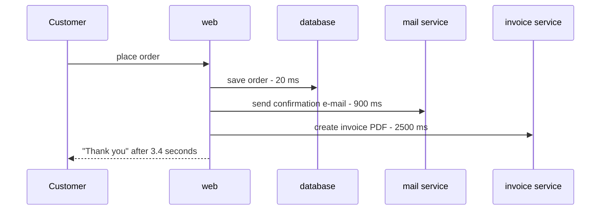
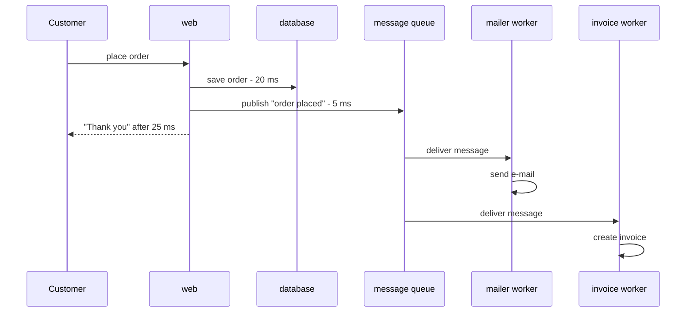
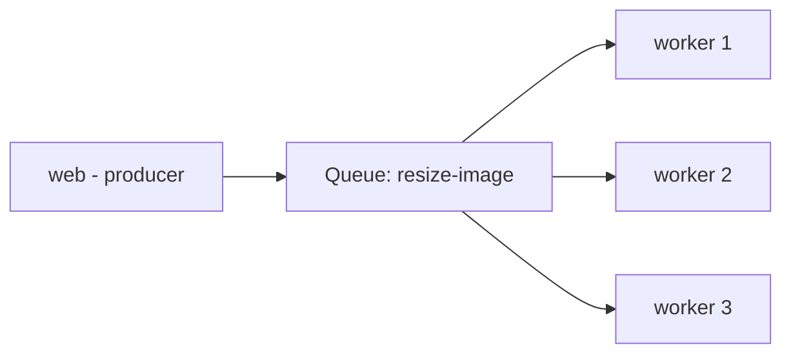
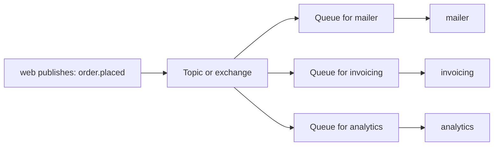

# Asynchronous messaging between containers

## In plain words

There are two ways to ask a colleague for something. You can phone them: you wait on the line until they answer, and if they are out, your request fails. Or you can leave a note in their in-tray: you carry on with your own work at once, and they deal with the note when they are free. If they are away today, the note is still there tomorrow.

Programs have the same two styles. In **synchronous** communication, one program calls another and waits for the reply, like the phone call. In **asynchronous** communication, one program leaves a **message** in a shared in-tray and moves on; another program picks it up later.

The shared in-tray is a program called a **message queue** (or *message broker*). It runs as one more container next to your application. Using one makes a system of containers far more tolerant of slow or failing parts, because the parts no longer need to be available at the same moment.

Why this matters for a job: any system that sends e-mails, resizes images, charges cards, trains models or produces reports uses background work fed by a queue. "How would you handle a task that takes thirty seconds without making the user wait?" is a classic design question, and its answer is this lesson.

> **Before this lesson:** you should be comfortable with Compose services, networks and health checks ([Compose fundamentals](#/lesson/docker/compose-basics), [Container networking and DNS](#/lesson/docker/compose-networking), [Health checks and dependency checks](#/lesson/docker/health-checks)), and with scaling a service ([Orchestration with Docker Swarm](#/lesson/docker/swarm)).

## The problem with waiting

Imagine a shop's web application. When a customer places an order, the code does four things in a row, each a call to another service, each waited for:



Three things are wrong with this design:

- **It is slow.** The customer waits 3.4 seconds, though only the 20 ms database write had to happen before saying thank you.
- **It is fragile.** If the mail service is down, the whole order fails, even though the order itself was fine.
- **It does not scale evenly.** A sale brings a burst of orders, and the slow invoice service becomes a bottleneck that holds up every web request.

Services that depend on each other this closely are called **tightly coupled**.

## The same flow with a queue

Now let the web application do only the essential work, then leave a message saying what happened:



The customer gets an answer in 25 ms. If the mailer is down, messages wait in the queue and are processed when it returns; no order is lost and no customer sees an error. If orders arrive in a burst, the queue grows for a while and the workers catch up. The services are now **loosely coupled**: each needs the queue to be up, not each other.

Some vocabulary:

| Term | Meaning |
|---|---|
| **Message** | A small packet of data describing a job to do or an event that happened |
| **Producer** (publisher) | The program that sends messages |
| **Consumer** (subscriber, worker) | The program that receives and processes them |
| **Broker** | The server that accepts, stores and delivers messages |
| **Queue** | A named list of waiting messages inside the broker |

## Two delivery patterns

### Work queue: each message to one worker

Several identical workers read from one queue. Each message is given to exactly **one** of them. This is how you share a workload: to process faster, start more workers.



### Publish and subscribe: each message to every interested service

A producer announces an **event**, a statement that something happened, without knowing who cares. Every subscribed service receives its own copy. This pattern is called publish-subscribe, or **pub/sub**.



Its great strength is that new features can be added without touching existing code. To add a loyalty-points service next month, you start a new container that subscribes to `order.placed`. The web application is not changed, rebuilt or even restarted.

## Running a queue in a container

Four brokers are common. All run as ordinary containers.

| Broker | Character | Typical use |
|---|---|---|
| **Redis** | An in-memory data store with simple queue and pub/sub features; very fast and easy | Lightweight background jobs |
| **RabbitMQ** | A full message broker with flexible routing and delivery guarantees | General application messaging |
| **NATS** | Small and very fast, with an optional durable mode | Messaging between many small services |
| **Apache Kafka** | A durable, replayable log of events built for very high volume | Event streams and data pipelines |

Here is a small system with Redis: a web app that queues jobs and a worker that performs them.

```yaml
# compose.yaml
services:
  queue:
    image: redis:7-alpine
    command: ["redis-server", "--appendonly", "yes"]
    volumes:
      - queue-data:/data
    healthcheck:
      test: ["CMD", "redis-cli", "ping"]
      interval: 5s
      retries: 5

  web:
    image: harbour/shop-web:3
    ports:
      - "8000:8000"
    environment:
      QUEUE_URL: redis://queue:6379/0
    depends_on:
      queue:
        condition: service_healthy

  worker:
    image: harbour/shop-worker:3
    environment:
      QUEUE_URL: redis://queue:6379/0
    depends_on:
      queue:
        condition: service_healthy

volumes:
  queue-data:
```

- `queue` runs Redis. `--appendonly yes` makes Redis write every change to disk, and the volume keeps that file, so queued messages survive a restart of the container.
- The health check runs `redis-cli ping`, which answers `PONG` when Redis is ready.
- `web` and `worker` both receive the queue's address as `redis://queue:6379/0`. The host name `queue` is the Compose service name. Nothing publishes the queue's port: it is reachable only inside the project's network.
- The worker has no `ports:` at all. Nothing ever connects *to* it; it reaches out to the queue.

The producer's side, in Python:

```python
import json, os, redis

queue = redis.Redis.from_url(os.environ["QUEUE_URL"])

def place_order(order):
    save_to_database(order)
    message = {"type": "order.placed", "order_id": order["id"], "email": order["email"]}
    queue.lpush("orders", json.dumps(message))
    return "Thank you"
```

- `redis.Redis.from_url(...)` connects using the address from the environment.
- The message is a small dictionary, turned into text with `json.dumps` (JSON is a common text format for structured data).
- `lpush("orders", ...)` adds the text to the left end of a list named `orders`.

And the worker:

```python
import json, os, redis

queue = redis.Redis.from_url(os.environ["QUEUE_URL"])

while True:
    _, raw = queue.brpop("orders")          # wait until a message is available
    message = json.loads(raw)
    send_confirmation_email(message["email"], message["order_id"])
    print(f"handled order {message['order_id']}", flush=True)
```

- `brpop("orders")` takes a message from the right end of the list, and **blocks** (waits without using processor time) when the list is empty.
- The loop never ends; the worker is a long-running process, exactly what a container should be.
- `flush=True` makes the line appear in `docker logs` straight away.

Scale the workers and watch them share the work:

```bash
docker compose up -d --scale worker=3
docker compose logs -f worker
```

```text
worker-2  | handled order 1041
worker-1  | handled order 1042
worker-3  | handled order 1043
worker-2  | handled order 1044
```

Each order was handled by exactly one worker.

## What can go wrong, and the guarantees you need

The simple worker above has a flaw. `brpop` removes the message from the queue *before* the work is done. If the worker crashes halfway through sending the e-mail, the message is gone and the job is lost.

### Acknowledgements

Real brokers solve this with **acknowledgements**. The broker hands a message to a worker but keeps its own copy, marked "in progress". The worker sends an acknowledgement (often shortened to **ack**) only after finishing. If the worker dies or disconnects first, the broker gives the message to another worker.

| Guarantee | Meaning | Consequence |
|---|---|---|
| At most once | A message is delivered zero or one times | Jobs can be lost |
| **At least once** | A message is delivered one or more times | Jobs are never lost, but may be done twice |
| Exactly once | Delivered and processed precisely once | Very hard to achieve end to end; rarely truly available |

Most systems choose at-least-once, which shifts a responsibility onto you.

### Idempotent consumers

If a worker finishes the job and then crashes a moment before acknowledging, the broker delivers the message again. The job runs twice. So a consumer must be **idempotent**: doing the same job twice must have the same result as doing it once. Typical techniques:

- Record the identifiers of messages already handled, and skip repeats.
- Write operations as "set the order's status to paid" (safe to repeat), never "add one payment" (not safe).
- Use a unique key so that a second insert of the same record is rejected.

### Retries and the dead-letter queue

A message that fails because the mail server was briefly unreachable should be retried, after a pause that grows with each attempt. A message that fails every time, perhaps because its data is malformed, must not be retried for ever, or it blocks everything behind it. Such a "poison" message is moved, after a few attempts, to a separate **dead-letter queue**, where a person can examine it.

The simulation below puts these three ideas together: acknowledgements, retries and a dead-letter queue, with a worker that crashes at an awkward moment.

```python-run
from collections import deque

def run(messages, crashes_before_ack=(), always_fails=(), max_attempts=3):
    queue = deque((m, 1) for m in messages)
    done, handled_ids, dead = [], set(), []
    crashes = set(crashes_before_ack)
    while queue:
        msg, attempt = queue.popleft()
        if msg in always_fails:
            if attempt >= max_attempts:
                dead.append(msg); print(f"{msg}: failed {attempt} times -> dead-letter queue")
            else:
                queue.append((msg, attempt + 1)); print(f"{msg}: attempt {attempt} failed, will retry")
            continue
        if msg in handled_ids:
            print(f"{msg}: delivered again, already handled -> skipped (idempotent)")
            continue
        handled_ids.add(msg); done.append(msg)
        if msg in crashes:
            crashes.discard(msg)
            queue.append((msg, attempt + 1)); print(f"{msg}: done, but worker crashed before ack -> redelivered")
        else:
            print(f"{msg}: done and acknowledged")
    return done, dead

done, dead = run(["order-1", "order-2", "order-3", "order-4"],
                 crashes_before_ack=["order-2"], always_fails=["order-3"])
print("processed once each:", done)
print("needs a human:      ", dead)
```

`order-2` is delivered twice and processed once, thanks to the record of handled identifiers. `order-3` never succeeds and ends up in the dead-letter queue without blocking `order-4`.

## Keeping messages safe in the broker

A queue that lives only in memory loses everything when its container is replaced. For messages that matter:

- Turn on the broker's **persistence** (writing messages to disk) and give it a named volume, as in the Compose file above.
- In RabbitMQ, declare queues *durable* and mark messages *persistent*; in Kafka, messages are written to disk and copied to several brokers by design.
- In production, run the broker as a cluster of several nodes, or use a managed cloud service. A single broker container is a single point of failure for everything that depends on it.

## Watching a queue

The most telling number in a queue-based system is the **queue depth**: how many messages are waiting. With Redis:

```bash
docker compose exec queue redis-cli llen orders
```

```text
(integer) 12
```

`llen` prints the length of the list.

| What you see | What it means | What to do |
|---|---|---|
| Depth stays near zero | Workers keep up | Nothing |
| Depth rises during bursts, then falls | Normal smoothing of load | Nothing |
| Depth keeps rising | Messages arrive faster than they are processed | Add workers, or make each job faster |
| Depth is high and no worker is busy | Workers are stuck or disconnected | Check worker logs and health |
| The dead-letter queue is growing | Some messages cannot be processed | Inspect them; fix the code or the data |

Expose queue depth and message age as metrics (see the lesson on Prometheus) and alert on "the oldest message is more than N minutes old". Systems that scale automatically often use queue depth as the signal for adding workers.

Workers also need **graceful shutdown**. When a worker container is stopped for an update, it should finish the job in hand, acknowledge it, and then exit, instead of dropping it halfway. That means handling the stop signal (`SIGTERM`) and setting a stop grace period longer than the longest job.

## When not to use a queue

Asynchronous messaging is not free. It adds a broker to run, makes it harder to follow one request through the system, and replaces "it worked or it failed" with "it will be done eventually". That property has a name, **eventual consistency**: for a short time after an order, the invoice does not exist yet, and the rest of the system must cope with that.

| Use a direct (synchronous) call when | Use a message when |
|---|---|
| The caller needs the answer to continue (checking a password, reading a price) | The work can happen later (e-mail, reports, image processing) |
| The operation is fast | The operation is slow or its duration varies a lot |
| A failure should be shown to the user immediately | A failure can be retried quietly |
| There is one receiver | Several services want to know about the event |

> [!WARNING]
> Do not put large payloads in messages. A message should carry identifiers and small facts ("order 1042 was placed"), not a 40 MB video. Store the large object somewhere shared (a file store or database) and put its location in the message.

> [!INTERVIEW]
> "A request triggers a job that takes a minute. How do you design it?" Accept the request, store the job, publish a message and return at once with a job identifier. Workers in separate containers consume from the queue and update the job's status; the client polls or is notified. Then show depth: at-least-once delivery with acknowledgements, idempotent consumers, retries with growing delays, a dead-letter queue, persistence, and scaling workers on queue depth.

> [!TIP]
> Include a `type` and a `version` in every message, for example `{"type": "order.placed", "version": 2, ...}`. Producers and consumers are deployed at different times, and during a rolling update both old and new versions are running. A version field lets a consumer handle both shapes.

## Pitfalls

- **Removing a message before the work is finished.** A crash loses the job. Acknowledge afterwards.
- **Consumers that are not idempotent.** Redelivery sends two e-mails or charges twice.
- **Retrying a poison message for ever.** Use a retry limit and a dead-letter queue.
- **A broker without persistence or a volume.** A restart empties the queue.
- **Assuming order.** With several workers, messages are not processed in the order they were sent.
- **No monitoring of queue depth.** A backlog builds silently for hours.
- **Workers killed mid-job on every deployment.** Handle `SIGTERM` and allow enough grace time.
- **Changing a message's shape without versioning.** Old consumers fail on new messages during an update.
- **Using a queue where a simple call would do,** adding moving parts for no benefit.
- **Publishing the broker's port to the internet.** Keep it on the private network and require a password.

## Cheat sheet

| Need | Technique |
|---|---|
| Fast response for slow work | Publish a message, return at once, process in a worker |
| Share work among workers | Work queue; each message goes to one consumer |
| Tell several services about an event | Publish and subscribe |
| Process faster | `docker compose up -d --scale worker=N` |
| Never lose a job | Acknowledge after processing; persistent broker with a volume |
| Cope with duplicates | Idempotent consumers; track handled message identifiers |
| Temporary failures | Retry with growing delays |
| Permanent failures | Dead-letter queue |
| Health of the system | Monitor queue depth and age of the oldest message |
| Safe deployments | Graceful shutdown; versioned message formats |
| Queue depth in Redis | `redis-cli llen NAME` |

## Summary

- Synchronous calls make the caller wait and fail when the callee fails; asynchronous messaging lets a producer leave a message with a broker and carry on.
- A work queue gives each message to one of several workers; publish and subscribe gives every subscriber its own copy, so features can be added without changing the producer.
- Brokers such as Redis, RabbitMQ, NATS and Kafka run as containers, reached by service name on a private network; workers scale by adding containers.
- Reliable processing needs acknowledgements after the work, idempotent consumers to absorb redelivery, limited retries and a dead-letter queue.
- Persist messages on a volume, watch queue depth, shut workers down gracefully and version message formats.
- Messaging adds complexity and eventual consistency, so keep direct calls where an immediate answer is needed.

## Glossary

| Term | Meaning |
|---|---|
| Synchronous | The caller waits for the reply before continuing |
| Asynchronous | The sender continues without waiting; the work happens later |
| Message | A small packet of data describing a job or an event |
| Broker | The server that stores messages and delivers them |
| Queue | A named list of waiting messages |
| Producer / consumer | The sender / the receiver of messages |
| Worker | A consumer process that performs background jobs |
| Event | A message stating that something happened |
| Publish-subscribe (pub/sub) | A pattern where every subscriber receives each published message |
| Coupling | How much services depend on each other; loose coupling is the goal |
| Acknowledgement (ack) | A consumer's confirmation that a message has been processed |
| At-least-once delivery | A guarantee that no message is lost, at the price of possible duplicates |
| Idempotent | Giving the same result whether performed once or several times |
| Dead-letter queue | A holding place for messages that repeatedly fail |
| Persistence | Saving messages to disk so they survive a restart |
| Queue depth | The number of messages waiting |
| Eventual consistency | Different parts of a system agree after a short delay, not instantly |

## Check yourself

```quiz
[
  {"q": "What is the key difference between synchronous and asynchronous communication between services?",
   "options": ["Asynchronous is always faster", "In synchronous calls the caller waits for the reply; in asynchronous messaging it continues and the work happens later", "Synchronous calls need a queue", "Asynchronous messages cannot fail"],
   "answer": 1,
   "explain": "Asynchronous messaging decouples the sender from the receiver in time, through a broker that holds the message."},
  {"q": "The mailer service is down for ten minutes. In a queue-based design, what happens to order confirmation e-mails?",
   "options": ["Orders fail", "They are lost", "The messages wait in the queue and are processed when the mailer returns", "The web app retries each order"],
   "answer": 2,
   "explain": "The broker stores messages until a consumer takes them, so a temporary outage only delays the work."},
  {"q": "Three workers read from one work queue. A message arrives. How many workers process it?",
   "options": ["All three", "Exactly one", "Two, for safety", "None until it is acknowledged"],
   "answer": 1,
   "explain": "In a work queue each message is delivered to a single consumer, which is how the load is shared."},
  {"q": "You want a new analytics service to react to every order without changing the web app. Which pattern fits?",
   "options": ["A direct call from web to analytics", "Publish and subscribe: analytics subscribes to the order event", "A shared volume", "A second database"],
   "answer": 1,
   "explain": "With pub/sub the producer does not know its subscribers, so adding one requires no change to existing services."},
  {"q": "Why should a worker acknowledge a message only after finishing the job?",
   "options": ["It is faster", "If the worker crashes mid-job, the unacknowledged message is redelivered instead of being lost", "The broker requires a delay", "To keep messages in order"],
   "answer": 1,
   "explain": "The broker keeps unacknowledged messages and hands them to another worker when the first one disappears."},
  {"q": "With at-least-once delivery, what must consumers be?",
   "options": ["Stateless", "Idempotent, because a message may be delivered more than once", "Single-threaded", "Synchronous"],
   "answer": 1,
   "explain": "Redelivery after a crash or lost acknowledgement means the same job can arrive twice; processing it twice must be harmless."},
  {"q": "A malformed message fails every time it is processed. What should happen to it?",
   "options": ["Retry for ever", "Delete it silently", "Move it to a dead-letter queue after a limited number of attempts", "Stop all workers"],
   "answer": 2,
   "explain": "A retry limit stops the poison message from blocking others, and the dead-letter queue keeps it for inspection."},
  {"q": "The number of waiting messages keeps rising over an hour. What does that indicate?",
   "options": ["Everything is healthy", "Messages arrive faster than the workers process them; add workers or speed up the jobs", "The broker has lost its volume", "Too many workers are running"],
   "answer": 1,
   "explain": "A steadily growing queue depth means consumption is slower than production."}
]
```

> **Source:** Stoneman, *Learn Docker in a Month of Lunches*, ch. 21 (topic coverage). Checked against <https://redis.io/docs/latest/develop/data-types/lists/>, <https://www.rabbitmq.com/docs/confirms> and <https://docs.docker.com/compose/how-tos/startup-order/>. All wording and examples are original.
