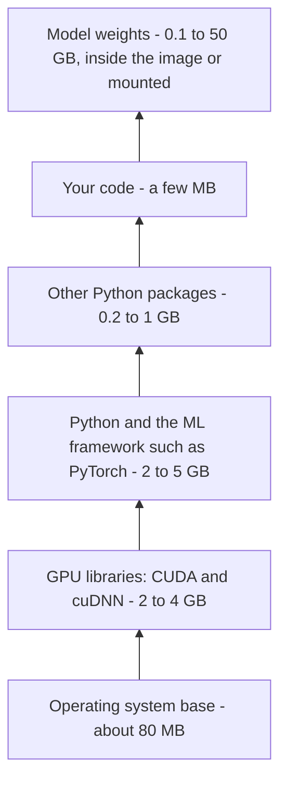

# ML images: CUDA bases, dependencies and model weights

## In plain words

Packaging an ordinary web application is like packing a suitcase. Packaging a machine-learning application is like moving house with a grand piano. There is the usual luggage (your code, a few libraries) and then there is one enormous, awkward object: the **model**, a file of numbers that can be many gigabytes, plus equally heavy libraries for doing arithmetic on a graphics card.

**Machine learning** (ML) means programs that learn patterns from examples instead of following hand-written rules. The learned patterns are stored as a long list of numbers called **weights**. A **GPU** (graphics processing unit) is a processor originally made for drawing game graphics that happens to be very fast at the arithmetic ML needs. **CUDA** is the software from the chip maker NVIDIA that lets programs use its GPUs.

Everything you have learned about images still applies, but the sizes are ten or a hundred times larger, so mistakes that cost seconds elsewhere cost many minutes here. An ML image built carelessly is 15 GB and takes twenty minutes to rebuild after a one-line change. Built well, it is a third of that size and rebuilds in seconds.

Why this matters for a job: ML engineers and the platform engineers who support them spend a surprising share of their time on exactly this. "Why is our image 12 GB and how do we fix it?" is a real and frequent question.

> **Before this lesson:** this lesson builds directly on [Layers, the build cache, the context and .dockerignore](#/lesson/docker/layers-cache-context), [Multi-stage builds](#/lesson/docker/multi-stage-builds) and [Optimising images for size, speed and security](#/lesson/docker/optimising-images). Knowing what a volume is ([Volumes, bind mounts and tmpfs](#/lesson/docker/volumes-bind-mounts)) is also needed.

## What is inside an ML image

A typical image for running a model stacks five things. Their sizes explain every piece of advice that follows.



Your own code, the part that changes ten times a day, is the smallest piece by a factor of a thousand. The goal is to arrange the image so that changing that sliver never forces the gigabytes below it to be rebuilt, pushed or pulled again.

## Choosing a base image

### Does the image need CUDA at all?

The GPU has a **driver**, the software that lets the operating system talk to the hardware. With containers, the driver stays on the **host** machine. The image must contain the CUDA *libraries* that programs call, and those must be compatible with the host's driver. (How the container is given access to the GPU is the subject of the next lesson.)

NVIDIA publishes official base images in three flavours:

| Flavour | Contains | Approximate size | Use for |
|---|---|---|---|
| `base` | The minimum CUDA runtime | 250 MB | Apps that bring their own CUDA libraries |
| `runtime` | The CUDA libraries needed to *run* GPU programs | 2 to 3 GB | Running models |
| `devel` | Runtime plus compilers and headers needed to *build* GPU code | 6 to 8 GB | Compiling custom GPU extensions |

A tag looks like `nvidia/cuda:12.4.1-cudnn-runtime-ubuntu22.04`: the CUDA version, an optional `cudnn` (a library of deep-learning building blocks), the flavour, and the operating system.

Two rules of thumb:

- **Never ship `devel`.** If you must compile something, do it in a `devel` build stage and copy the result into a `runtime` final stage, exactly the multi-stage pattern from earlier.
- **Check whether your framework already bundles CUDA.** PyTorch's standard Linux packages include their own copies of the CUDA libraries. In that case a plain `python:3.12-slim` base works on a GPU host, and adding an `nvidia/cuda` base stores the same libraries twice.

### CPU-only images

Not every workload needs a GPU. Small models, and all the supporting services around a model, run on ordinary processors. The CPU-only build of PyTorch is under 250 MB installed, against several gigabytes for the GPU build. You select it with the package index address:

```dockerfile
RUN pip install --no-cache-dir torch --index-url https://download.pytorch.org/whl/cpu
```

`--index-url` tells `pip`, Python's package installer, where to download from; this address serves the CPU-only builds.

| Scenario | Sensible base |
|---|---|
| Model served on CPU | `python:3.12-slim` with CPU-only framework packages |
| PyTorch on GPU, standard packages | `python:3.12-slim` (the packages bring CUDA) |
| Framework that expects system CUDA | `nvidia/cuda:<version>-cudnn-runtime-ubuntu22.04` |
| Compiling custom GPU code | `...-devel-...` in a build stage only |

## Dependencies: the slowest layer

Installing an ML framework downloads gigabytes. It must happen as rarely as possible, and be as fast as possible when it does.

### Rule 1: dependencies before code

The same rule as always, with much higher stakes. Copy only the files that list your dependencies, install, and copy your code afterwards.

### Rule 2: lock the versions

A **lock file** records the exact version of every package, including the packages your packages depend on. Without one, "the same" Dockerfile installs different software next month. With ML libraries, where a mismatched pair of versions may refuse to load a model, this matters a great deal.

### Rule 3: a cache mount, so downloads are reused

A **cache mount** gives a build step a folder that survives between builds but is not stored in the image. When the dependency layer has to be rebuilt because you added one small package, the three-gigabyte framework is taken from the cache instead of the internet.

Here is the pattern with `pip`:

```dockerfile
# syntax=docker/dockerfile:1
FROM python:3.12-slim
WORKDIR /app
COPY requirements.txt .
RUN --mount=type=cache,target=/root/.cache/pip \
    pip install -r requirements.txt
COPY src/ src/
```

- The first line switches on the current Dockerfile syntax, which cache mounts need.
- `COPY requirements.txt .` copies only the dependency list.
- `--mount=type=cache,target=/root/.cache/pip` attaches a persistent folder at the place where pip keeps downloaded packages.
- Note that `--no-cache-dir` is deliberately absent: we *want* pip to use its cache here, and the cache is not part of the image.

And with **uv**, a newer and much faster Python package installer:

```dockerfile
# syntax=docker/dockerfile:1
FROM python:3.12-slim
COPY --from=ghcr.io/astral-sh/uv:0.5 /uv /usr/local/bin/uv
ENV UV_LINK_MODE=copy UV_COMPILE_BYTECODE=1 UV_PYTHON_DOWNLOADS=never
WORKDIR /app

COPY pyproject.toml uv.lock ./
RUN --mount=type=cache,target=/root/.cache/uv \
    uv sync --frozen --no-install-project --no-dev

COPY src/ src/
RUN --mount=type=cache,target=/root/.cache/uv \
    uv sync --frozen --no-dev

ENV PATH="/app/.venv/bin:$PATH"
```

Line by line:

- `COPY --from=ghcr.io/astral-sh/uv:0.5 /uv /usr/local/bin/uv` copies the `uv` program out of its official image. This is the `COPY --from` you know from multi-stage builds, used with an external image.
- `UV_LINK_MODE=copy` makes uv copy files from its cache instead of linking to them, which is required because the cache lives on a different filesystem. `UV_COMPILE_BYTECODE=1` prepares Python files in advance so the application starts faster.
- `pyproject.toml` describes the project; `uv.lock` is the lock file.
- The first `uv sync` installs every dependency but **not your own project** (`--no-install-project`). `--frozen` means "use the lock file exactly; fail if it is out of date". `--no-dev` skips development-only tools. This creates the big, stable layer.
- The second `uv sync`, after the source is copied, installs your project itself, which takes moments.
- The last line puts the virtual environment (the folder of installed packages, `/app/.venv`) first on the search path.

The simulation below compares rebuild times for common changes, with and without these habits.

```python-run
DOWNLOAD = {"torch": 240, "transformers": 25, "other": 15}      # seconds to download each group
INSTALL = 40                                                    # seconds to unpack and install

def rebuild(change, deps_before_code, cache_mount):
    """change: 'code' or 'add small package'. Returns seconds for the dependency step + copy."""
    if change == "code" and deps_before_code:
        return 2                                     # only the final COPY reruns
    downloads = sum(DOWNLOAD.values())
    if cache_mount:
        downloads = 3 if change == "code" else 6     # everything is cached; maybe one small new package
    return downloads + INSTALL + 2

print(f"{'layout':44s} {'edit code':>10s} {'add package':>12s}")
for label, order, cache in [("COPY . then install, no cache mount", False, False),
                            ("dependencies first, no cache mount", True, False),
                            ("dependencies first, with cache mount", True, True)]:
    a = rebuild("code", order, cache)
    b = rebuild("add small package", order, cache)
    print(f"{label:44s} {a:8d} s {b:10d} s")
```

Ordering fixes the common case (a code edit). The cache mount fixes the painful case (adding one package no longer downloads PyTorch again).

## Model weights: three strategies

Where should a multi-gigabyte weights file live? There is no single right answer, only trade-offs.

### Strategy 1: bake the weights into the image

```dockerfile
COPY --link models/sentiment-v3/ /models/sentiment-v3/
COPY src/ src/
```

`COPY --link` stores the copied files as an independent layer that does not depend on the layers before it, so it can be reused even when earlier layers change.

- **For:** the image is complete and self-contained. One tag identifies both code and model. It starts with no network access. Rolling back the image rolls back the model.
- **Against:** the image is huge. Every node must pull it. If the weights layer comes *after* the code, each code change pushes the weights again; put the weights layer **before** the code layer so that it stays cached.

### Strategy 2: download the weights when the container starts

The image contains only code. At start-up the application fetches the weights from a model store (an object storage service or a model hub).

- **For:** small image. The model can be changed without a new image.
- **Against:** slow start (minutes), which hurts when scaling up under load. Start-up depends on the network and on the store being available. The model version must be pinned explicitly, or the same image can behave differently tomorrow.

### Strategy 3: mount the weights from a volume

The weights sit on storage attached to the host, or on shared network storage, and are mounted into the container read-only.

```yaml
services:
  api:
    image: harbour/sentiment-api:3.2.0
    environment:
      MODEL_PATH: /models/sentiment-v3
    volumes:
      - model-store:/models:ro

volumes:
  model-store:
```

- `MODEL_PATH` tells the application where to load from.
- `model-store:/models:ro` mounts a named volume read-only (`:ro`), so the service cannot alter the weights.

- **For:** small image, fast start once the volume is populated, and many containers share one copy on a node.
- **Against:** something must put the right files on the volume, and "which model is this container running?" is no longer answered by the image tag alone.

| | Baked into the image | Downloaded at start | Mounted volume |
|---|---|---|---|
| Image size | Very large | Small | Small |
| Start-up time | Fast after the pull | Slow | Fast |
| Works without network | Yes | No | Yes |
| Code and model versioned together | Yes | Only if pinned | Only if managed |
| Best for | Small and medium models, strict reproducibility | Development, frequently changing models | Very large models, many replicas per node |

A common compromise is a small **init step**: a one-off container that downloads a specific, pinned model version into a volume, which the main service then mounts. It is the "wait for a job to finish" Compose pattern from the reliability lessons:

```yaml
services:
  fetch-model:
    image: harbour/model-fetcher:1
    command: ["fetch", "sentiment-v3@sha256:7be1...", "/models"]
    volumes:
      - model-store:/models
  api:
    image: harbour/sentiment-api:3.2.0
    depends_on:
      fetch-model:
        condition: service_completed_successfully
    volumes:
      - model-store:/models:ro
```

> [!WARNING]
> Framework download helpers default to a hidden cache folder in the user's home directory (for example `~/.cache/huggingface`). Inside a container that folder is in the writable layer: the model is downloaded again every time the container is recreated, and silently if nobody is watching the logs. Point the cache at a mounted volume with the relevant environment variable (such as `HF_HOME`), or use one of the strategies above deliberately.

## Verifying and pinning models

Weights are data that your program executes arithmetic on, and some model file formats can contain code that runs when loaded. Treat a model like any other dependency:

- **Pin an exact version** (a revision identifier or content hash), never "latest".
- **Verify a checksum** after download. A checksum is a short fingerprint computed from a file's contents; if one byte differs, the fingerprint differs.
- **Prefer formats that hold only numbers**, such as `safetensors`, over formats that can embed code, such as Python's pickle.
- **Record the model version in the image's labels or the service's configuration**, so that a running container can state which model it uses.

## A complete example

A service that classifies text with a medium-sized model, on GPU, with baked-in weights:

```dockerfile
# syntax=docker/dockerfile:1
FROM python:3.12-slim AS build
COPY --from=ghcr.io/astral-sh/uv:0.5 /uv /usr/local/bin/uv
ENV UV_LINK_MODE=copy UV_COMPILE_BYTECODE=1
WORKDIR /app
COPY pyproject.toml uv.lock ./
RUN --mount=type=cache,target=/root/.cache/uv \
    uv sync --frozen --no-install-project --no-dev

FROM python:3.12-slim
RUN useradd --system --uid 10001 --no-create-home app
WORKDIR /app
COPY --from=build /app/.venv /app/.venv
COPY --link models/sentiment-v3/ /models/sentiment-v3/
COPY --chown=10001:10001 src/ src/
ENV PATH="/app/.venv/bin:$PATH" \
    PYTHONUNBUFFERED=1 \
    MODEL_PATH=/models/sentiment-v3
LABEL org.opencontainers.image.version="3.2.0" \
      com.harbourline.model="sentiment-v3"
USER 10001
EXPOSE 8000
CMD ["uvicorn", "src.main:app", "--host", "0.0.0.0", "--port", "8000"]
```

The order of the final stage is the point: the virtual environment (gigabytes, changes monthly), then the weights (gigabytes, change occasionally), then the code (kilobytes, changes constantly). A code edit rebuilds and pushes a few kilobytes.

```text
# .dockerignore
.git
.venv
__pycache__/
data/
notebooks/
checkpoints/
wandb/
*.ipynb
models/*
!models/sentiment-v3/
```

ML project folders collect training data, experiment outputs and half-trained **checkpoints** (saved snapshots of a model during training) that can total hundreds of gigabytes. The last two lines exclude every model folder except the one this image ships. Without a `.dockerignore`, all of it is sent to the builder on every build.

```bash
docker image history harbour/sentiment-api:3.2.0 --format 'table {{.Size}}\t{{.CreatedBy}}' | head -6
```

```text
SIZE      CREATED BY
0B        CMD ["uvicorn" "src.main:app" "--host" "0.0.0.0"...
41.2kB    COPY src/ src/ # buildkit
1.31GB    COPY models/sentiment-v3/ /models/sentiment-v3/ # buildkit
5.62GB    COPY /app/.venv /app/.venv # buildkit
4.1kB     RUN /bin/sh -c useradd --system --uid 10001 ...
```

`docker image history` lists layers newest first. The two large layers sit beneath the tiny code layer, as intended.

## Training images and inference images

**Training** is the process of producing the weights; **inference** is using them to answer requests. They want different images.

| | Training image | Inference image |
|---|---|---|
| Purpose | Experimentation, long batch jobs | Serving requests reliably |
| Contents | Notebooks, plotting and data tools, sometimes compilers | Only what loading and running the model needs |
| Size | Large is acceptable | As small as possible |
| Runs as | Often root, for convenience | Non-root, read-only filesystem |
| Data | Datasets mounted from volumes | Weights only |
| Change rate | Constantly | Per release |

Use one Dockerfile with a shared base stage and separate `train` and `serve` targets, so that both use identical framework versions. A model that behaves differently in production because the serving image had a different library version is a notoriously hard bug to find.

> [!INTERVIEW]
> "Our ML image is 14 GB and takes 25 minutes to build. What do you do?" Measure with `docker image history`. Check for a `devel` CUDA base where `runtime` or a slim Python base would do; duplicated CUDA (system libraries plus the copy bundled in the framework's packages); weights or datasets copied through a missing `.dockerignore`; dependencies installed after `COPY . .`; no cache mounts. Then choose a weights strategy deliberately, and order layers from most stable to most volatile.

> [!TIP]
> Before optimising, list what is in the virtual environment by size: `du -sh /app/.venv/lib/python3.12/site-packages/* | sort -h | tail`. `du -sh` prints the size of each folder and `sort -h | tail` shows the ten largest. Two or three packages usually account for most of the total.

## Pitfalls

- **Shipping a `devel` image.** Gigabytes of compilers in production.
- **CUDA twice:** an `nvidia/cuda` base plus framework packages that bundle the same libraries.
- **CUDA version newer than the host driver supports.** The container starts and the framework reports that no GPU is usable.
- **GPU packages in a CPU-only service.**
- **Weights layer after the code layer,** so each commit pushes gigabytes.
- **No `.dockerignore` in a project full of data and checkpoints.**
- **Unpinned model downloads at start-up.** Behaviour changes without a deployment.
- **Model cache in the writable layer,** downloaded again on every recreation.
- **Loading untrusted model files** in formats that can execute code.
- **`--no-cache-dir` combined with a cache mount,** which defeats the mount.
- **Different library versions for training and serving.**

## Cheat sheet

| Goal | Technique |
|---|---|
| Smallest GPU base | `python:3.12-slim` if the framework bundles CUDA; otherwise `nvidia/cuda:...-runtime-...` |
| Need to compile GPU code | `devel` in a build stage, `runtime` in the final stage |
| CPU-only PyTorch | `pip install torch --index-url https://download.pytorch.org/whl/cpu` |
| Reuse downloads between builds | `RUN --mount=type=cache,target=/root/.cache/pip` (or `/root/.cache/uv`) |
| Reproducible dependencies | A lock file; `uv sync --frozen` or pinned `requirements.txt` |
| Stable dependency layer | `uv sync --frozen --no-install-project` before copying source |
| Weights in the image | `COPY --link` in a layer above dependencies and below code |
| Weights outside the image | Read-only volume, filled by a pinned init job |
| Keep data out of the context | `.dockerignore` for data, notebooks, checkpoints |
| Find heavy layers | `docker image history IMAGE` |
| Trustworthy weights | Pin a revision, verify a checksum, prefer `safetensors` |

## Summary

- An ML image is dominated by GPU libraries, the framework and the weights; your code is tiny by comparison, so layer order decides whether a change costs kilobytes or gigabytes.
- Choose the base deliberately: slim Python when the framework bundles CUDA or for CPU-only work, the CUDA `runtime` flavour otherwise, and `devel` only in a build stage.
- Install dependencies before copying code, lock their versions, and use cache mounts so that large downloads are reused.
- Weights can be baked into the image, downloaded at start or mounted from a volume; each trades image size against start-up time and versioning clarity.
- Pin and verify models as you would any dependency, and keep datasets and checkpoints out of the build context.
- Build training and inference images from a shared base so library versions match.

## Glossary

| Term | Meaning |
|---|---|
| Machine learning (ML) | Programs that learn patterns from examples |
| Model | The learned program: its structure plus its weights |
| Weights | The numbers a model learned during training, stored in a file |
| Training / inference | Producing the weights / using them to answer requests |
| GPU | Graphics processing unit: a processor that is very fast at ML arithmetic |
| CUDA | NVIDIA's software for running programs on its GPUs |
| cuDNN | NVIDIA's library of deep-learning building blocks |
| Driver | Software that lets the operating system use a hardware device |
| Framework | A library for building and running models, such as PyTorch or TensorFlow |
| Lock file | A file recording the exact version of every dependency |
| uv | A fast Python package installer and project manager |
| Cache mount | A build-time folder that persists between builds without entering the image |
| Virtual environment | A self-contained folder of installed Python packages |
| Checkpoint | A saved snapshot of a model during training |
| Checksum | A short fingerprint of a file's contents used to detect changes |
| safetensors | A model file format that stores only numbers and cannot carry code |
| Init step | A one-off container that prepares something before the main service starts |

## Check yourself

```quiz
[
  {"q": "In a typical ML image, which part is smallest and changes most often?",
   "options": ["The CUDA libraries", "The ML framework", "The model weights", "Your own code"],
   "answer": 3,
   "explain": "Code is a few megabytes and changes constantly, which is why it belongs in the last layer."},
  {"q": "Which NVIDIA base image flavour should a production inference image never ship?",
   "options": ["base", "runtime", "devel", "All are equally fine"],
   "answer": 2,
   "explain": "devel adds compilers and headers, several extra gigabytes that are needed only to build GPU code. Use it in a build stage."},
  {"q": "Where does the GPU driver live when running GPU containers?",
   "options": ["Inside every image", "On the host machine; the image carries compatible CUDA libraries", "In the registry", "In a volume"],
   "answer": 1,
   "explain": "The driver belongs to the host's kernel. Images contain user-level libraries that must be compatible with it."},
  {"q": "What does `RUN --mount=type=cache,target=/root/.cache/pip pip install -r requirements.txt` achieve?",
   "options": ["It makes the layer permanent", "Downloaded packages are reused across builds without being stored in the image", "It installs packages at run time", "It disables the build cache"],
   "answer": 1,
   "explain": "When the layer must rebuild, large packages come from the mounted cache instead of being downloaded again."},
  {"q": "Why run `uv sync --frozen --no-install-project` before copying the source code?",
   "options": ["uv cannot install projects", "It creates a dependency layer that stays cached when only the source changes", "It makes the image larger", "It removes the lock file"],
   "answer": 1,
   "explain": "Dependencies are installed from the lock file alone, so edits to the source do not invalidate that expensive layer."},
  {"q": "Weights are baked into the image. Where should their COPY go relative to the code?",
   "options": ["After the code", "Before the code, so that code changes do not rebuild or push the weights layer again", "In the same instruction as the code", "It makes no difference"],
   "answer": 1,
   "explain": "Layers after a changed layer are rebuilt. Stable, heavy layers go below volatile, light ones."},
  {"q": "What is the main drawback of downloading weights when the container starts?",
   "options": ["The image becomes larger", "Start-up is slow and depends on the network, which hurts when scaling up", "It prevents GPU use", "It needs root"],
   "answer": 1,
   "explain": "Each new container waits for a multi-gigabyte download, and fails to start if the model store is unreachable."},
  {"q": "Why prefer the safetensors format for model files from outside your organisation?",
   "options": ["It is always smaller", "It holds only numbers, whereas pickle-based formats can run code when loaded", "It needs no framework", "It is encrypted"],
   "answer": 1,
   "explain": "Loading a pickle can execute arbitrary code. A format limited to tensors removes that risk."}
]
```

> **Source:** module beyond the book (Stoneman's ch. 3-4 and ch. 17 cover the underlying build and optimisation principles). Checked against <https://docs.astral.sh/uv/guides/integration/docker/>, <https://docs.docker.com/build/cache/optimize/>, <https://hub.docker.com/r/nvidia/cuda> and <https://pytorch.org/get-started/locally/>. All wording and examples are original.
