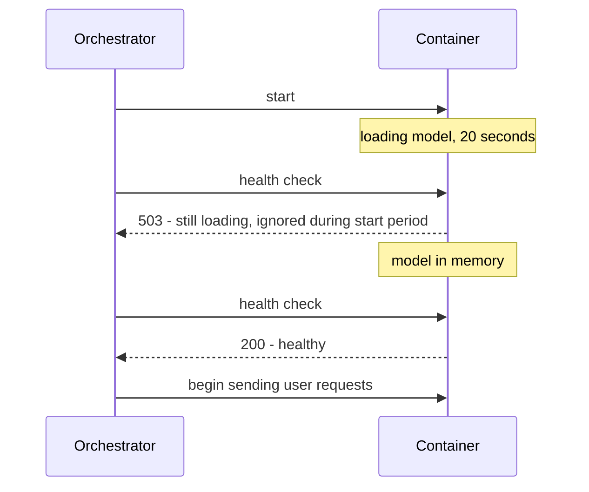
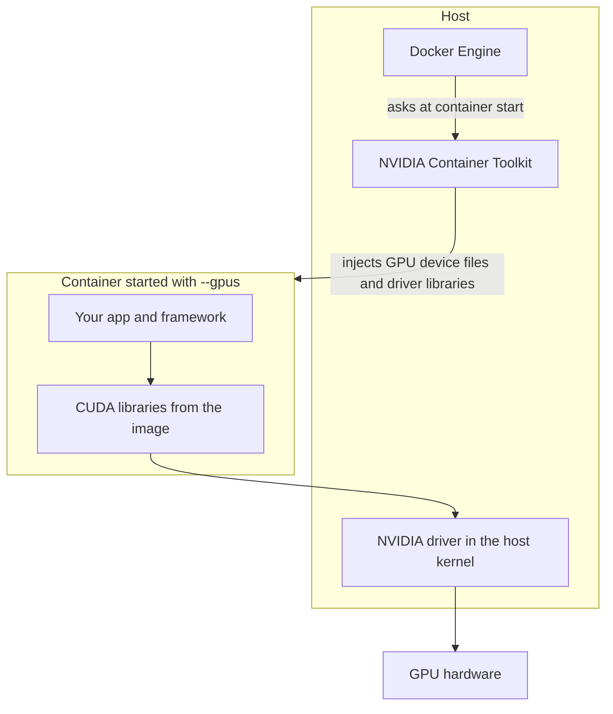

# Slim FastAPI images and GPU access at run time

## In plain words

The previous lesson packed the heavy parts of a machine-learning application into an image. This one is about the two remaining questions: how to wrap a small, well-behaved **web service** around the model, and how to let the container use the machine's **GPU**.

A web service is like a restaurant's serving hatch. Customers do not walk into the kitchen. They hand an order through the hatch and receive a plate back. **FastAPI** is a popular Python tool for building that hatch: a program that accepts requests over the network, passes them to your model, and returns the answers.

The GPU question is like kitchen equipment. A container is a sealed room and cannot see the building's special oven unless a door is opened for it. By default a container cannot see the host's graphics card at all. You must ask for it explicitly, and the host must have been prepared to grant the request.

Why this matters for a job: "put the model behind an API in a container" is the most common task handed to a new ML engineer, and "the container cannot see the GPU" is the most common obstacle. Both have short, standard solutions.

> **Before this lesson:** read [ML images: CUDA bases, dependencies and model weights](#/lesson/docker/ml-images) first. You also need health checks ([Health checks and dependency checks](#/lesson/docker/health-checks)), the security settings from [Container security](#/lesson/docker/container-security), and the signal handling explained in [Dockerfile instructions, one by one](#/lesson/docker/dockerfile-instructions).

## The smallest FastAPI container

Start with a service that has no model at all, to see the moving parts.

```python
# app/main.py
from fastapi import FastAPI

app = FastAPI()

@app.get("/health")
def health():
    return {"status": "ok"}

@app.get("/square/{number}")
def square(number: int):
    return {"number": number, "square": number * number}
```

- `app = FastAPI()` creates the application.
- `@app.get("/health")` says "when someone requests the address `/health`, run the function below and send back what it returns".
- `{number}` in the second address is a placeholder; `number: int` tells FastAPI to convert it to a whole number and to reject anything else.

FastAPI describes *what* to answer. A separate program, an **ASGI server**, does the network work of listening and replying; the usual one is **Uvicorn**. (ASGI is the standard that lets Python web applications and servers fit together.)

```dockerfile
FROM python:3.12-slim
WORKDIR /srv
RUN pip install --no-cache-dir "fastapi==0.115.*" "uvicorn[standard]==0.32.*"
COPY app/ app/
CMD ["uvicorn", "app.main:app", "--host", "0.0.0.0", "--port", "8000"]
```

- `pip install` adds the two packages, with versions pinned so that the build is repeatable.
- `CMD [...]` starts Uvicorn. `app.main:app` means "in the file `app/main.py`, the object named `app`".
- `--host 0.0.0.0` is essential. It makes the server listen on every network interface of the container. The default, `127.0.0.1`, accepts connections only from inside the container itself, so a published port would lead nowhere.

```bash
docker build -t harbour/square-api:0.1 .
docker run -d --name sq -p 8000:8000 harbour/square-api:0.1
curl -s localhost:8000/square/12
```

`docker build -t` builds and names the image; `docker run -d -p 8000:8000` starts it in the background and connects port 8000 of your machine to port 8000 in the container; `curl -s` fetches the address.

```text
{"number":12,"square":144}
```

## Making it production-ready

The first version works. Six changes make it small, safe and well-behaved. Each uses an idea from an earlier lesson.

```dockerfile
# syntax=docker/dockerfile:1
FROM python:3.12-slim AS build
COPY --from=ghcr.io/astral-sh/uv:0.5 /uv /usr/local/bin/uv
ENV UV_LINK_MODE=copy UV_COMPILE_BYTECODE=1
WORKDIR /srv
COPY pyproject.toml uv.lock ./
RUN --mount=type=cache,target=/root/.cache/uv \
    uv sync --frozen --no-install-project --no-dev

FROM python:3.12-slim
RUN useradd --system --uid 10001 --no-create-home api
WORKDIR /srv
COPY --from=build /srv/.venv /srv/.venv
COPY --chown=10001:10001 app/ app/
ENV PATH="/srv/.venv/bin:$PATH" \
    PYTHONUNBUFFERED=1 \
    PYTHONDONTWRITEBYTECODE=1
USER 10001
EXPOSE 8000
HEALTHCHECK --interval=10s --timeout=3s --start-period=30s --retries=3 \
  CMD ["python", "-c", "import urllib.request,sys; sys.exit(0 if urllib.request.urlopen('http://127.0.0.1:8000/health', timeout=2).status == 200 else 1)"]
CMD ["uvicorn", "app.main:app", "--host", "0.0.0.0", "--port", "8000"]
```

| Change | Why |
|---|---|
| Two stages | The installer (`uv`) and its cache stay in the build stage; the final image receives only the installed packages |
| Lock file and `--frozen` | The same versions every time |
| Dependencies before code | Editing code does not reinstall packages |
| `USER 10001` | The server does not run as the administrator account |
| `PYTHONUNBUFFERED=1` | Log lines appear immediately in `docker logs` instead of being held back |
| `HEALTHCHECK` written in Python | No `curl` needs installing; the check calls `/health` and exits 0 or 1 |
| Exec-form `CMD` | Uvicorn is the container's first process and receives the stop signal directly |

The last row deserves a sentence. When Docker stops a container it sends a stop signal to the first process. Uvicorn responds by finishing the requests in progress and then exiting, a **graceful shutdown**. If the command were written without brackets, a shell would be the first process, the signal would not reach Uvicorn, and every request in flight would be cut off ten seconds later.

### How many worker processes?

Uvicorn can start several copies of your application with `--workers N`, to use several processor cores. In containers the usual advice is the opposite: **one process per container, and scale by running more containers.**

| | One worker per container, many containers | Many workers in one container |
|---|---|---|
| Scaling | The orchestrator adds and removes containers | Fixed when the container starts |
| A worker crashes | The container exits and is replaced visibly | Hidden inside the container |
| Memory use | Clear: one model per container | N copies of the model in one container |
| Health | One health status per copy | One status covering all workers |

The memory row matters for ML: each worker process loads its own copy of the model. Four workers with a 3 GB model need 12 GB, and on a GPU four copies of the weights in its memory.

## Loading a model once

A model takes seconds or minutes to load. It must be loaded **once when the service starts**, not on every request. FastAPI provides a start-up hook called **lifespan** for this.

```python
# app/main.py
import os
from contextlib import asynccontextmanager
from fastapi import FastAPI, HTTPException
from pydantic import BaseModel

state = {}

@asynccontextmanager
async def lifespan(app: FastAPI):
    state["model"] = load_model(os.environ.get("MODEL_PATH", "/models/sentiment-v3"))
    yield
    state.clear()

app = FastAPI(lifespan=lifespan)

class Review(BaseModel):
    text: str

@app.get("/health")
def health():
    if "model" not in state:
        raise HTTPException(status_code=503, detail="model not loaded")
    return {"status": "ok"}

@app.post("/classify")
def classify(review: Review):
    label, score = state["model"].predict(review.text)
    return {"label": label, "score": score}
```

- Everything before `yield` in `lifespan` runs once at start-up: here, loading the model from the path given in the `MODEL_PATH` environment variable.
- Everything after `yield` runs at shutdown.
- `class Review(BaseModel)` declares the shape of the data the service accepts: an object with one text field. FastAPI rejects anything else with a clear error.
- `/health` answers with status code 503 ("service unavailable") until the model is in memory, and 200 afterwards.
- `/classify` uses the already loaded model.

That health behaviour connects to two settings. The `--start-period=30s` in the `HEALTHCHECK` gives the model time to load before failures count. And in an orchestrator, traffic is not sent to the container until the check passes, so no user ever reaches a copy that is still loading. Set the start period from the measured loading time, with a margin.



## Giving a container access to a GPU

### Step 0: what the host needs

Three things must be present on the machine, once:

1. An NVIDIA GPU and its **driver**, installed on the host.
2. Docker.
3. The **NVIDIA Container Toolkit**, a small add-on that teaches Docker how to hand a GPU to a container.

`nvidia-smi` is NVIDIA's status tool. Run on the host, it confirms the driver works:

```bash
nvidia-smi --query-gpu=name,memory.total,driver_version --format=csv
```

```text
name, memory.total [MiB], driver_version
NVIDIA RTX A4000, 16376 MiB, 550.90.07
```

### Step 1: ask for the GPU

```bash
docker run --rm --gpus all nvidia/cuda:12.4.1-base-ubuntu22.04 nvidia-smi
```

- `--gpus all` requests every GPU on the host.
- The image is NVIDIA's small base image, and the command run inside it is `nvidia-smi`.

```text
+-----------------------------------------------------------------------------------------+
| NVIDIA-SMI 550.90.07              Driver Version: 550.90.07      CUDA Version: 12.4     |
|   0  NVIDIA RTX A4000               Off |   00000000:01:00.0 Off |                  Off |
|  41%   38C    P8             10W /  140W |       3MiB /  16376MiB |      0%      Default |
+-----------------------------------------------------------------------------------------+
```

The container sees the card. Without `--gpus`, the same command fails with "command not found" or reports no devices: the hardware is invisible.



The toolkit works at the moment the container starts: it adds the GPU's device files and the matching driver libraries from the host into the container. That is why the driver is not in your image, and why one image runs on hosts with different driver versions, as long as they are new enough for the image's CUDA libraries.

Variations:

| Flag | Meaning |
|---|---|
| `--gpus all` | Every GPU |
| `--gpus 1` | Any one GPU |
| `--gpus '"device=0"'` | The GPU with index 0 |
| `--gpus '"device=0,2"'` | GPUs 0 and 2 |

### Step 2: the same in Compose

```yaml
services:
  api:
    image: harbour/sentiment-api:3.2.0
    ports:
      - "8000:8000"
    environment:
      MODEL_PATH: /models/sentiment-v3
    deploy:
      resources:
        reservations:
          devices:
            - driver: nvidia
              count: 1
              capabilities: [gpu]
```

The `devices` block under `deploy.resources.reservations` is the Compose spelling of `--gpus 1`: reserve one device, from the `nvidia` driver, with the `gpu` capability. Use `count: all` for every GPU, or `device_ids: ["0"]` in place of `count` to choose specific cards.

### Step 3: confirm from inside the application

```bash
docker compose exec api python -c "import torch; print(torch.cuda.is_available(), torch.cuda.get_device_name(0))"
```

```text
True NVIDIA RTX A4000
```

`torch.cuda.is_available()` is PyTorch's answer to "can I use a GPU?". Log this at start-up. A service that silently falls back to the processor is ten to fifty times slower and otherwise looks healthy, a very confusing way to fail.

## Sharing and limiting a GPU

Memory and CPU limits (`--memory`, `--cpus`) are enforced by the kernel's control groups. **GPU memory is not.** By default, every container given the same GPU can use all of its memory, and the first to ask gets it.

| Approach | What it does |
|---|---|
| One GPU per container | The simplest isolation: assign distinct `device=` values |
| Limit inside the application | Tell the framework how much GPU memory it may take |
| Time-slicing | Several containers take turns on one GPU; no memory isolation |
| Hardware partitioning (NVIDIA MIG) | Some data-centre GPUs can be divided into isolated slices |

The classic failure is two containers on one GPU where the second crashes with "CUDA out of memory" because the first claimed the whole card. Decide the assignment deliberately.

The small planner below assigns containers to GPUs by memory needed, the kind of bookkeeping an orchestrator does.

```python-run
def assign(gpus_mb, jobs):
    """gpus_mb: free memory per GPU. jobs: (name, mb_needed). First GPU with room wins."""
    free = list(gpus_mb)
    plan = []
    for name, need in jobs:
        for i, mb in enumerate(free):
            if need <= mb:
                free[i] -= need
                plan.append((name, f"GPU {i}", need))
                break
        else:
            plan.append((name, "NO GPU HAS ROOM", need))
    return plan, free

plan, free = assign([16000, 16000], [("sentiment-api", 3200), ("embedder", 9000), ("summariser", 11000), ("reranker", 3000), ("vision", 7000)])
for name, where, need in plan:
    print(f"{name:14s} needs {need:6d} MB -> {where}")
print("free memory left per GPU:", free)
```

`vision` does not fit although 5800 MB are free in total: the free memory is split across two cards (800 and 5000), and a model cannot straddle them. Running out "with memory free" is usually this.

## Other run-time settings ML services need

**Shared memory.** Some ML libraries pass data between processes through a memory area called `/dev/shm`. Docker's default size for it is 64 MB, far too small for data loaders, and the symptom is a cryptic "bus error". Raise it:

```yaml
    shm_size: "2gb"
```

**Main memory limit.** Loading a model can briefly need two or three times its file size. Set the memory limit from measurement; too low, and the container is killed during start-up with exit code 137.

**Read-only filesystem.** Frameworks like to write caches to the home folder. With a read-only root filesystem, point those caches at a tmpfs or a volume through their environment variables.

**Request timeouts.** Inference can be slow. Make sure any reverse proxy in front allows longer responses than the slowest expected request.

A complete service definition:

```yaml
services:
  api:
    image: harbour/sentiment-api:3.2.0
    user: "10001:10001"
    read_only: true
    tmpfs:
      - /tmp
    shm_size: "1gb"
    cap_drop: [ALL]
    security_opt: [no-new-privileges:true]
    environment:
      MODEL_PATH: /models/sentiment-v3
      HF_HOME: /tmp/hf
    ports:
      - "127.0.0.1:8000:8000"
    volumes:
      - model-store:/models:ro
    stop_grace_period: 30s
    deploy:
      resources:
        limits:
          memory: 8G
        reservations:
          devices:
            - driver: nvidia
              count: 1
              capabilities: [gpu]

volumes:
  model-store:
```

`stop_grace_period: 30s` gives requests in progress thirty seconds to finish when the container is stopped.

## The same idea in Kubernetes

For orientation: Kubernetes exposes GPUs as a countable resource, once NVIDIA's device plug-in is installed on the cluster.

```yaml
resources:
  limits:
    nvidia.com/gpu: 1
```

The scheduler then places the pod only on a node with a free GPU. The image and the application code are unchanged.

> [!WARNING]
> `--gpus all` on a machine with several GPUs gives the container every one of them, and many frameworks then claim memory on all of them at start. On shared machines always request specific devices or a count.

> [!INTERVIEW]
> "How does a container use the host's GPU?" The driver stays on the host. The NVIDIA Container Toolkit injects the GPU's device files and driver libraries at container start when you pass `--gpus` (or a device reservation in Compose, or an `nvidia.com/gpu` limit in Kubernetes). The image carries CUDA user-level libraries compatible with the host driver. Add that GPU memory is not isolated by cgroups, so assignment must be planned.

> [!TIP]
> Keep a two-line diagnostic handy. `docker run --rm --gpus all nvidia/cuda:12.4.1-base-ubuntu22.04 nvidia-smi` tests the host setup with no application involved. If that works and your service still sees no GPU, the problem is in your image (CPU-only packages, or a CUDA version newer than the driver supports), not in Docker.

## Pitfalls

- **Server bound to `127.0.0.1`.** The published port leads nowhere. Use `--host 0.0.0.0`.
- **Shell-form `CMD`.** Requests are cut off at every stop.
- **Loading the model inside the request function.** Every request waits for the load.
- **Health check passing before the model is loaded,** or no start period, so that slow starts are treated as failures.
- **Several workers, each with its own model copy,** exhausting memory.
- **Forgetting `--gpus`.** The framework quietly uses the processor.
- **Toolkit not installed on the host.** `could not select device driver "" with capabilities: [[gpu]]` is the tell-tale error.
- **CPU-only framework packages in a GPU image.** `is_available()` returns `False` although `nvidia-smi` works.
- **Default 64 MB `/dev/shm`.** "Bus error" in data loaders.
- **Two services on one GPU** without planning memory.
- **Home-folder caches on a read-only filesystem.** "Permission denied" at start.

## Cheat sheet

| Task | Command or setting |
|---|---|
| Run FastAPI | `CMD ["uvicorn", "app.main:app", "--host", "0.0.0.0", "--port", "8000"]` |
| Load the model once | FastAPI `lifespan` function |
| Honest health | `/health` returns 503 until the model is loaded; `HEALTHCHECK --start-period=...` |
| Test host GPU setup | `docker run --rm --gpus all nvidia/cuda:12.4.1-base-ubuntu22.04 nvidia-smi` |
| One specific GPU | `--gpus '"device=0"'` |
| GPU in Compose | `deploy.resources.reservations.devices` with `driver: nvidia`, `capabilities: [gpu]` |
| Check from the app | `python -c "import torch; print(torch.cuda.is_available())"` |
| Larger shared memory | `--shm-size 2g` or `shm_size: "2gb"` |
| Time to finish requests | `stop_grace_period: 30s` |
| GPU usage on the host | `nvidia-smi` |

## Summary

- FastAPI defines the web service and Uvicorn serves it; bind to `0.0.0.0` and start it with an exec-form `CMD` so that shutdown is graceful.
- A production image uses a build stage for dependencies, a non-root user, unbuffered logs and a health check that needs no extra tools.
- Load the model once at start-up; report unhealthy until it is loaded and allow a start period that covers the loading time.
- Prefer one worker process per container and scale with more containers, because each process holds its own copy of the model.
- A container sees a GPU only when asked for with `--gpus` or a device reservation, and only if the host has the driver and the NVIDIA Container Toolkit.
- GPU memory is not limited by Docker; plan which service uses which card, and raise `/dev/shm` when libraries need it.

## Glossary

| Term | Meaning |
|---|---|
| Web service (API) | A program that answers requests from other programs over the network |
| FastAPI | A Python library for building web services |
| ASGI | The standard interface between Python web applications and servers |
| Uvicorn | A server program that runs ASGI applications such as FastAPI ones |
| Endpoint | One address of a web service, such as `/health` |
| Lifespan | FastAPI's hook for code that runs once at start-up and once at shutdown |
| Worker process | One running copy of the application inside the server |
| Graceful shutdown | Finishing requests in progress before exiting |
| GPU | A processor that is very fast at the arithmetic machine learning uses |
| Driver | Software on the host that lets the operating system use the GPU |
| NVIDIA Container Toolkit | The add-on that lets Docker give GPUs to containers |
| `nvidia-smi` | NVIDIA's command for showing GPU status |
| Inference | Using a trained model to answer a request |
| `/dev/shm` | A shared memory area that processes use to exchange data |
| Status code 503 | "Service unavailable": the server cannot handle requests right now |

## Check yourself

```quiz
[
  {"q": "A FastAPI container publishes port 8000, but requests from the host get no answer. The server was started with `--host 127.0.0.1`. Why does it fail?",
   "options": ["Port 8000 is reserved", "The server accepts connections only from inside the container; it must listen on 0.0.0.0", "FastAPI needs HTTPS", "The image is too small"],
   "answer": 1,
   "explain": "Traffic through a published port arrives on the container's external interface. A server bound to the container's own loopback never sees it."},
  {"q": "Where should a large model be loaded in a FastAPI service?",
   "options": ["Inside each request function", "Once at start-up, for example in the lifespan function", "In the Dockerfile CMD", "In the health check"],
   "answer": 1,
   "explain": "Loading takes seconds or minutes. Doing it once and keeping the model in memory makes requests fast."},
  {"q": "Why is one worker process per container usually preferred for model serving?",
   "options": ["Python cannot run several processes", "Each worker loads its own copy of the model, and the orchestrator can scale and health-check containers individually", "It uses more GPU", "Uvicorn forbids workers"],
   "answer": 1,
   "explain": "Several workers multiply memory use and hide failures inside one container. Scaling by containers keeps things visible."},
  {"q": "The /health endpoint returns 503 while the model loads. Which HEALTHCHECK option stops this from marking the container unhealthy too early?",
   "options": ["--interval", "--timeout", "--start-period", "--retries=0"],
   "answer": 2,
   "explain": "Failures during the start period are not counted, giving a slow start time to complete."},
  {"q": "Which three things must the host have for `docker run --gpus all` to work with an NVIDIA card?",
   "options": ["CUDA, Python and PyTorch", "The NVIDIA driver, Docker and the NVIDIA Container Toolkit", "Kubernetes, Helm and a registry", "Only Docker"],
   "answer": 1,
   "explain": "The driver talks to the hardware, and the toolkit lets Docker inject the GPU into containers. Frameworks live in the image."},
  {"q": "`nvidia-smi` works inside the container, but `torch.cuda.is_available()` returns False. What is a likely cause?",
   "options": ["The --gpus flag is missing", "The image has CPU-only framework packages or CUDA libraries the host driver does not support", "The GPU is too hot", "The port is not published"],
   "answer": 1,
   "explain": "The device is visible, so Docker's side is fine. The framework build inside the image cannot use it."},
  {"q": "Two containers are given the same GPU. What stops the first from using all of the GPU's memory?",
   "options": ["Docker's --memory flag", "Nothing by default; GPU memory is not limited by cgroups", "The NVIDIA driver divides it equally", "Compose"],
   "answer": 1,
   "explain": "Docker's memory limits cover main memory only. GPU memory must be planned per device or limited in the application."},
  {"q": "A data loader in a container crashes with 'bus error'. Which setting most likely fixes it?",
   "options": ["A larger --memory", "A larger --shm-size, because the default /dev/shm is only 64 MB", "--privileged", "A different port"],
   "answer": 1,
   "explain": "Libraries that share data between processes through /dev/shm exhaust the small default quickly."}
]
```

> **Source:** module beyond the book (Stoneman's ch. 8 and ch. 17 cover the underlying health-check and optimisation principles). Checked against <https://fastapi.tiangolo.com/deployment/docker/>, <https://docs.docker.com/compose/how-tos/gpu-support/>, <https://docs.docker.com/engine/containers/resource_constraints/#gpu> and <https://docs.nvidia.com/datacenter/cloud-native/container-toolkit/latest/install-guide.html>. All wording and examples are original.
