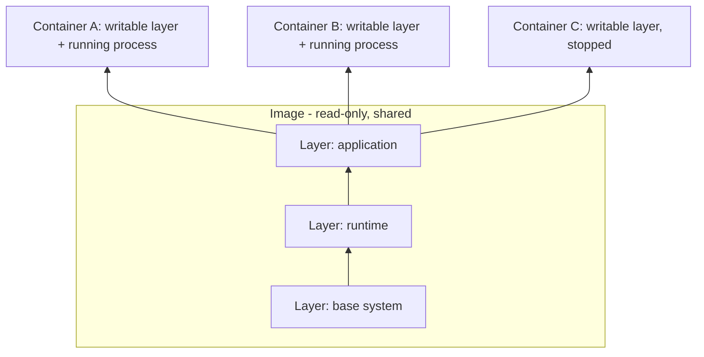
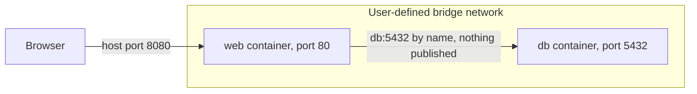

# Core interview questions with worked answers

## In plain words

A job interview about Docker is not a quiz on command names. The interviewer is trying to find out whether you hold a correct picture of how containers work, because someone with the right picture can work out the answer to a question they have never seen, and someone with a memorised list cannot.

Think of a driving test. The examiner does not ask you to recite the highway code from memory. They watch whether you check the mirror before you pull out. The questions in this lesson are the "mirror checks" of Docker: six comparisons that come up again and again, each of which shows whether you understand one core idea.

For every question this lesson gives three things: the short answer you could say in thirty seconds, the reasoning behind it explained from the beginning, and a small demonstration you can run yourself. Reading an answer is not the same as being able to give it, so run the commands and then say each answer aloud in your own words.

Why this matters for a job: these six questions account for a large share of what is asked about Docker at junior and mid levels, and the ideas behind them are the ones you use daily at work.

> **Before this lesson:** this is a review lesson. It assumes the earlier modules, in particular [What a container is](#/lesson/docker/what-is-a-container), [Dockerfile instructions, one by one](#/lesson/docker/dockerfile-instructions), [Layers, the build cache, the context and .dockerignore](#/lesson/docker/layers-cache-context), [Volumes, bind mounts and tmpfs](#/lesson/docker/volumes-bind-mounts) and [Container networking and DNS](#/lesson/docker/compose-networking). Each answer links back to the lesson that teaches it in full.

## How to give a good answer

A reliable shape for any technical answer has three parts:

1. **One sentence that answers the question directly.**
2. **One or two sentences of mechanism:** what is happening underneath.
3. **One consequence or example:** when it matters in practice.

Starting with the direct answer shows that you know it. The mechanism shows that you understand it. The consequence shows that you have used it. Stop there; the interviewer will ask for more if they want it.

## Question 1: what is the difference between an image and a container?

**Short answer.** An image is a read-only package containing an application and everything it needs to run. A container is a running (or stopped) instance created from an image. One image can start many containers.

**The reasoning.** An everyday comparison: an image is a recipe, and a container is a dish cooked from it. The recipe does not change when you cook, and you can cook the same recipe many times.

More precisely, an image is a stack of read-only **layers** (each a set of files) plus a short description of how to start the program. When a container is created, Docker adds one thin **writable layer** on top, private to that container, and starts the program as an isolated process. Changes the program makes to files go into the writable layer. The image is never altered.



**Demonstration.**

```bash
docker pull nginx:1.27-alpine
docker run -d --name web1 nginx:1.27-alpine
docker run -d --name web2 nginx:1.27-alpine
docker image ls nginx
docker ps --format 'table {{.Names}}\t{{.Image}}\t{{.Status}}'
```

- `docker pull` downloads the image.
- Each `docker run -d --name ...` creates and starts one container from it, in the background.
- `docker image ls` lists images; `docker ps` lists running containers.

```text
REPOSITORY   TAG           IMAGE ID       SIZE
nginx        1.27-alpine   91ca84b4f577   47MB

NAMES     IMAGE               STATUS
web2      nginx:1.27-alpine   Up 3 seconds
web1      nginx:1.27-alpine   Up 5 seconds
```

One image, two containers. Now change a file in one of them:

```bash
docker exec web1 sh -c 'echo changed > /usr/share/nginx/html/index.html'
docker exec web2 cat /usr/share/nginx/html/index.html | head -3
```

`docker exec` runs a command inside a running container. The second container still shows the original page, because the change went into `web1`'s private writable layer.

| | Image | Container |
|---|---|---|
| What it is | A package of files and start-up settings | A process with its own writable layer |
| Can it change | No | Yes, in its writable layer |
| Created by | `docker build` or `docker pull` | `docker run` or `docker create` |
| Listed by | `docker image ls` | `docker ps -a` |
| Stored in | A registry and the local image store | Only on the host where it runs |
| Lifetime | Until deleted | Until removed; its writable layer goes with it |

**A good follow-up to volunteer.** "Because the writable layer is deleted with the container, data that must survive belongs in a volume."

## Question 2: what are layers, and how does the build cache work?

**Short answer.** Each Dockerfile instruction that changes files produces a layer, and an image is those layers stacked. During a build Docker reuses the stored result of an instruction if its inputs are unchanged. Once one instruction has to run again, every instruction after it runs again too, so the order of instructions decides how fast rebuilds are.

**The reasoning.** A layer records "what changed" in one step: files added, changed or removed. Layers are identified by a fingerprint of their content, so identical layers are stored once and shared between images.

For each instruction the builder asks: "have I already run exactly this, on top of exactly this previous layer?" What counts as "exactly this" depends on the instruction:

| Instruction | Reused when |
|---|---|
| `RUN` | The command text is identical |
| `COPY`, `ADD` | The contents of the copied files are identical |
| Any instruction | And the instruction before it was reused |

The last row is the important one. A change early in the file invalidates everything below it.

**Demonstration: the classic ordering mistake.**

```dockerfile
# slow: any source edit reinstalls every dependency
FROM python:3.12-slim
WORKDIR /app
COPY . .
RUN pip install -r requirements.txt
CMD ["python", "main.py"]
```

```dockerfile
# fast: dependencies are reinstalled only when requirements.txt changes
FROM python:3.12-slim
WORKDIR /app
COPY requirements.txt .
RUN pip install -r requirements.txt
COPY . .
CMD ["python", "main.py"]
```

In the first file, `COPY . .` copies every file, so changing any one of them changes its inputs; it reruns, and `pip install` after it reruns as well. In the second, the dependency list is copied alone, so the slow install is reused until that list changes.

After editing one source file and rebuilding the second version:

```text
 => CACHED [2/5] WORKDIR /app
 => CACHED [3/5] COPY requirements.txt .
 => CACHED [4/5] RUN pip install -r requirements.txt
 => [5/5] COPY . .
```

`CACHED` marks the reused steps. Only the last one ran.

The simulation below lets you test your prediction for any change.

```python-run
def rebuilt(steps, changed):
    """steps: list of (text, files_it_copies). Returns the steps that must run again."""
    missed = False
    out = []
    for text, files in steps:
        if not missed and files and (files == ["*"] or set(files) & set(changed)):
            missed = True
        if missed:
            out.append(text)
    return out

slow = [("FROM python", None), ("COPY . .", ["*"]), ("RUN pip install", None), ("CMD", None)]
fast = [("FROM python", None), ("COPY requirements.txt", ["requirements.txt"]),
        ("RUN pip install", None), ("COPY . .", ["*"]), ("CMD", None)]
for name, dockerfile in [("slow", slow), ("fast", fast)]:
    for change in (["main.py"], ["requirements.txt"]):
        print(f"{name} order, changed {change[0]:17s} -> reruns {rebuilt(dockerfile, change)}")
```

**A good follow-up to volunteer.** "A file deleted in a later layer is still stored in the earlier one, so clean up in the same `RUN` that created the files, or use a multi-stage build."

## Question 3: CMD or ENTRYPOINT?

**Short answer.** `ENTRYPOINT` sets the program that always runs. `CMD` sets default arguments, which are replaced by anything typed after the image name in `docker run`. If only `CMD` is present, it is the whole default command.

**The reasoning.** Docker forms the container's command by joining two lists: the entrypoint, then the command. Arguments given on the `docker run` line replace the second list only.

| Dockerfile | `docker run img` | `docker run img --verbose` |
|---|---|---|
| `CMD ["serve"]` | `serve` | `--verbose` |
| `ENTRYPOINT ["tool"]` | `tool` | `tool --verbose` |
| `ENTRYPOINT ["tool"]` and `CMD ["serve"]` | `tool serve` | `tool --verbose` |

The third row is the common idiom: a fixed program with overridable default arguments.

```dockerfile
FROM alpine:3.20
ENTRYPOINT ["ping", "-c", "2"]
CMD ["localhost"]
```

```bash
docker build -t demo/pinger .
docker run --rm demo/pinger
docker run --rm demo/pinger example.com
```

- The first `run` executes `ping -c 2 localhost`: the entrypoint plus the default argument.
- The second executes `ping -c 2 example.com`: the typed argument replaced `CMD`.
- `--rm` deletes each container when it finishes.

To replace the entrypoint itself, for example to look around inside an image, there is a separate option:

```bash
docker run --rm -it --entrypoint sh demo/pinger
```

**The second half of the answer: the two forms.** Both instructions can be written as a list in square brackets (**exec form**) or as plain text (**shell form**).

| | Exec form `["python", "app.py"]` | Shell form `python app.py` |
|---|---|---|
| What starts | The program itself | A shell, which then starts the program |
| First process in the container | Your program | The shell |
| Receives the stop signal | Your program | The shell, which does not pass it on |

With shell form, `docker stop` asks the shell to stop, your program never hears, and after ten seconds it is killed abruptly. Use exec form.

**A good follow-up to volunteer.** "Exec form is a JSON list and needs double quotes; with single quotes Docker silently treats it as shell form."

## Question 4: COPY or ADD?

**Short answer.** Both copy files into the image. `ADD` does two extra things: it can download from a web address, and it automatically unpacks local archive files. Because those extras are surprising, use `COPY` unless you specifically want an archive unpacked.

**The reasoning.**

```dockerfile
COPY app.tar.gz /opt/        # result: the file /opt/app.tar.gz
ADD  app.tar.gz /opt/        # result: the archive's contents unpacked under /opt/
```

The two lines look alike and produce different images. That surprise is the argument for `COPY`: it does exactly one thing.

| Situation | Use |
|---|---|
| Ordinary files and folders | `COPY` |
| Files from another build stage | `COPY --from=stage` |
| A local archive that should be unpacked into the image | `ADD` |
| A file from the internet | `RUN curl ...` followed by a checksum test, so that the download is verified and its temporary files can be removed in the same layer |

**A good follow-up to volunteer.** "Both take files only from the build context, so a `.dockerignore` controls what they can see."

## Question 5: volume or bind mount?

**Short answer.** Both attach storage from outside the container so that data survives when the container is removed. A volume is storage that Docker creates and manages, referred to by name. A bind mount attaches a specific folder or file from the host. Use volumes for application data, and bind mounts for development and for handing in configuration files.

**The reasoning.** A container's own writable layer disappears with the container. A **mount** replaces one folder inside the container with storage that lives elsewhere.

```bash
docker run -d --name db -v pgdata:/var/lib/postgresql/data -e POSTGRES_PASSWORD=dev postgres:16
docker run -d --name site -v "$(pwd)/html":/usr/share/nginx/html:ro nginx:1.27-alpine
```

- In the first command, `pgdata` has no slash in front, so Docker reads it as the **name of a volume** and creates it if needed.
- In the second, `$(pwd)/html` is a path on the host (`$(pwd)` expands to the current folder), so it is a **bind mount**. `:ro` makes it read-only inside the container.

| | Volume | Bind mount | tmpfs |
|---|---|---|---|
| Where the data lives | An area managed by Docker | A host path you choose | Memory only |
| Referred to by | A name | A host path | A container path |
| Works the same on any host | Yes | No, depends on that path existing | Yes |
| Filled from the image when new and empty | Yes | No | No |
| Easy for you to edit from the host | No | Yes | No |
| Typical use | Databases, uploads | Source code in development, config files | Scratch files, secrets |

Mention **tmpfs** as the third kind: storage in memory that is gone when the container stops.

**Demonstration that data outlives the container.**

```bash
docker exec db psql -U postgres -c "create table t(x int); insert into t values (42);"
docker rm -f db
docker run -d --name db2 -v pgdata:/var/lib/postgresql/data -e POSTGRES_PASSWORD=dev postgres:16
docker exec db2 psql -U postgres -t -c "select x from t;"
```

```text
 42
```

The first container was deleted (`docker rm -f`), and a new one attached to the same volume still finds the row.

**A good follow-up to volunteer.** "A mount hides whatever the image had at that path, which is why bind-mounting a project folder over `/app` can make installed dependencies vanish."

## Question 6: what networking modes does Docker have?

**Short answer.** The main ones are bridge (the default: a private network on the host), host (the container shares the host's network directly), none (no network) and overlay (a network spanning several hosts in a cluster). On a user-defined bridge network, containers can reach each other by name.

**The reasoning.** Each container normally gets its own private network environment. The mode, chosen by the network's **driver**, decides what that environment is connected to.

| Mode | What the container gets | Use it for |
|---|---|---|
| `bridge` (default) | An address on a private network inside the host; reaches the outside through the host; reachable from outside only through published ports | Almost everything on one host |
| User-defined bridge | The same, plus name lookup between containers and isolation from other networks | Multi-container applications; Compose creates one per project |
| `host` | No separate network: the container uses the host's ports directly | Special cases needing top network speed or host-level visibility |
| `none` | No network at all | Jobs that must not communicate |
| `overlay` | A network that spans many hosts | Swarm services |
| `macvlan` | Its own address on the physical network | Legacy systems that need a real address per container |

The detail that distinguishes a strong answer is the difference between the **default** bridge and a **user-defined** one:

```bash
docker network create appnet
docker run -d --name cache --network appnet redis:7-alpine
docker run --rm --network appnet alpine:3.20 ping -c 1 cache
```

- `docker network create appnet` makes a user-defined bridge network.
- Both containers join it with `--network appnet`.
- The second container can reach the first by the name `cache`.

```text
PING cache (172.20.0.2): 56 data bytes
64 bytes from 172.20.0.2: seq=0 ttl=64 time=0.089 ms
```

On the default bridge that same lookup fails with `bad address 'cache'`, because automatic name lookup exists only on user-defined networks.

**Publishing ports** completes the picture. Containers on the same network talk to each other on their internal ports with nothing published. `-p 8080:80` is only for traffic entering from the host or beyond: host port 8080 leads to container port 80.



**A good follow-up to volunteer.** "Inside a container, `localhost` is the container itself, so one container reaches another by service name, never by `localhost`."

## Quick-fire answers

Shorter questions that often follow the six above. Each answer is one or two sentences, with the lesson that covers it.

| Question | Answer |
|---|---|
| Container versus virtual machine? | A VM has its own operating system kernel on virtual hardware. A container is an isolated process sharing the host's kernel, so it starts faster and is lighter, and it is a weaker isolation boundary. |
| What isolates a container? | Namespaces limit what it can see (processes, network, files); cgroups limit what it can use (memory, CPU). |
| What does `EXPOSE` do? | It records which port the application listens on. It publishes nothing; `-p` does that. |
| `ARG` versus `ENV`? | `ARG` exists only while building. `ENV` is stored in the image and present in the running container. Neither is safe for secrets. |
| What is a tag? A digest? | A tag is a movable name for an image version. A digest is a fingerprint of the content that can never point to anything else. |
| Why avoid `latest`? | It is only a default name, not "newest". You cannot tell what is running or roll back to a known version. |
| What is a multi-stage build? | A Dockerfile with several `FROM` stages where build tools stay in early stages and only the results are copied into the small final image. |
| What does `depends_on` guarantee? | Start order only. Readiness needs a health check with `condition: service_healthy`, and the application should still retry. |
| What happens on `docker stop`? | The first process gets a polite stop signal, then is killed after a grace period (ten seconds by default). |
| What does exit code 137 mean? | The process was killed outright, commonly for exceeding its memory limit. |
| Compose versus Swarm or Kubernetes? | Compose runs a multi-container application on one host. Orchestrators run it across many hosts and repair it automatically. |
| How do you pass a secret? | As a file from the platform's secret store, never in the image or a committed file. |
| How do you keep containers running? | A restart policy on a single host; desired state in an orchestrator. |

## Common ways to lose marks

- **Calling a container a lightweight virtual machine** and stopping there. Mention the shared kernel.
- **Describing commands instead of concepts.** "You type `docker run`" answers nothing about what an image is.
- **Saying `EXPOSE` opens a port.**
- **Saying `depends_on` waits for the database to be ready.**
- **Treating `CMD` and `ENTRYPOINT` as interchangeable** without mentioning how run-time arguments interact with each.
- **Forgetting the default versus user-defined bridge difference.**
- **Guessing.** "I am not certain, but here is how I would find out" followed by a real method (`docker inspect`, the documentation, a quick experiment) is a strong answer.

> [!INTERVIEW]
> When you are asked a comparison ("X versus Y"), give the difference in one sentence, then say when you would choose each. Interviewers are checking judgement as much as knowledge, and "it depends" only counts as an answer if you say what it depends on.

> [!TIP]
> Practise by explaining each of the six answers aloud to someone who does not know Docker, or to an empty room. If you cannot do it without notes in under a minute, reread the linked lesson and run its examples.

> [!WARNING]
> Do not memorise these answers word for word. A follow-up question one step to the side will show at once whether there is understanding underneath. Use the answers to check your own understanding, then put them in your own words.

## Cheat sheet

| Pair | The one-line difference |
|---|---|
| Image / container | Read-only package / running instance with a private writable layer |
| Layer / cache | Result of one instruction / reuse of that result when inputs are unchanged |
| `CMD` / `ENTRYPOINT` | Default arguments, replaced by run-time arguments / the fixed program |
| Exec form / shell form | Program runs directly and gets signals / a shell runs in between |
| `COPY` / `ADD` | Copies files / also downloads and unpacks archives |
| Volume / bind mount | Docker-managed, named, portable / a specific host path |
| `EXPOSE` / `-p` | Documentation / publishes a port on the host |
| `ARG` / `ENV` | Build time only / build time and run time |
| Tag / digest | Movable name / permanent content fingerprint |
| Default bridge / user-defined bridge | No name lookup / containers find each other by name |
| Bridge / host network | Private network with published ports / shares the host's network |

## Summary

- Structure every answer as a direct statement, the mechanism and a practical consequence.
- An image is a read-only stack of layers; a container is a process started from it with its own writable layer.
- The build cache reuses an instruction's result when its inputs and its predecessor are unchanged, so put stable steps first.
- `ENTRYPOINT` is the program and `CMD` is its default arguments; write both in exec form so the program receives stop signals.
- Prefer `COPY`; keep `ADD` for unpacking local archives.
- Volumes are Docker-managed and portable; bind mounts map host paths; tmpfs lives in memory.
- Bridge networking is the default, user-defined bridges add name lookup, and published ports are only for traffic from outside.

## Glossary

| Term | Meaning |
|---|---|
| Image | A read-only package of an application and everything it needs |
| Container | A running or stopped instance of an image |
| Layer | The set of file changes made by one build instruction |
| Writable layer | A container's private layer where its own file changes go |
| Build cache | Stored results of build steps, reused when nothing they depend on changed |
| Entrypoint | The program a container always runs |
| Command (`CMD`) | The default arguments, or default command, of a container |
| Exec form / shell form | Writing a command as a bracketed list / as plain text run by a shell |
| Signal | A message from the operating system to a process, such as a request to stop |
| Mount | Storage from outside the container attached at a folder inside it |
| Volume | Storage created and managed by Docker, referred to by name |
| Bind mount | A folder or file on the host attached into a container |
| tmpfs | Storage held in memory |
| Bridge network | A private network inside one host |
| Overlay network | A network spanning several hosts |
| Publish a port | Connect a port on the host to a port in a container |
| Namespace / cgroup | Kernel features that limit what a process can see / use |

## Check yourself

```quiz
[
  {"q": "Which statement best describes the relationship between an image and a container?",
   "options": ["They are two names for the same thing", "An image is a read-only package; a container is an instance of it with its own writable layer", "A container is a compressed image", "An image is a stopped container"],
   "answer": 1,
   "explain": "Many containers can be started from one image. Each adds a private writable layer; the image is never changed."},
  {"q": "A Dockerfile has COPY . . followed by RUN npm ci. You change one source file. What is rebuilt?",
   "options": ["Nothing", "Only COPY", "COPY and the RUN after it", "Only RUN"],
   "answer": 2,
   "explain": "The changed file invalidates COPY, and every instruction after a rebuilt one is rebuilt too."},
  {"q": "An image has ENTRYPOINT [\"tool\"] and CMD [\"serve\"]. What does `docker run img status` execute?",
   "options": ["tool serve status", "tool status", "status", "serve status"],
   "answer": 1,
   "explain": "Arguments after the image name replace CMD and are appended to ENTRYPOINT."},
  {"q": "Why is exec form preferred for CMD and ENTRYPOINT?",
   "options": ["It is shorter", "The program runs directly as the first process and receives stop signals", "It allows variables", "It is required by Compose"],
   "answer": 1,
   "explain": "In shell form a shell is the first process and does not pass the stop signal on, so the program is killed after the grace period."},
  {"q": "What does `ADD site.tar.gz /var/www/` do that COPY would not?",
   "options": ["Nothing different", "It unpacks the archive into /var/www/", "It compresses the files", "It deletes the archive from the context"],
   "answer": 1,
   "explain": "ADD automatically extracts local tar archives. COPY would place the archive file itself in the folder."},
  {"q": "In `docker run -v appdata:/data img`, what is appdata?",
   "options": ["A folder in the current directory", "A named volume managed by Docker", "A tmpfs mount", "An image"],
   "answer": 1,
   "explain": "A source without a leading slash or dot is a volume name. A host path would make it a bind mount."},
  {"q": "Two containers are started with plain `docker run` and no --network option. Can one reach the other by container name?",
   "options": ["Yes, always", "No; the default bridge has no automatic name lookup. Put them on a user-defined network", "Only if ports are published", "Only on Linux"],
   "answer": 1,
   "explain": "Name resolution between containers is a feature of user-defined networks, which is also what Compose creates."},
  {"q": "What is a good structure for answering 'what is the difference between X and Y'?",
   "options": ["List every command you know", "One sentence stating the difference, the mechanism behind it, and when you would choose each", "Say it depends and stop", "Describe X only"],
   "answer": 1,
   "explain": "A direct answer, the reason and a practical consequence show knowledge, understanding and judgement."}
]
```

> **Source:** review module drawing on Stoneman, *Learn Docker in a Month of Lunches*, ch. 2-7 (topic coverage). Checked against <https://docs.docker.com/reference/dockerfile/>, <https://docs.docker.com/engine/storage/> and <https://docs.docker.com/engine/network/drivers/>. All wording and examples are original.
