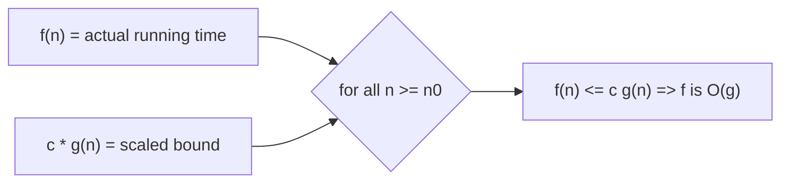

# Big-O, Big-Omega and Big-Theta

Counting primitive operations exactly is tedious and, worse, the exact count depends on details we
do not care about (is `A[i] += 1` one operation or three?). **Asymptotic analysis** throws those
details away on purpose: we keep only the growth rate of the running time as $n$ becomes large.

## 1. The big-O notation

Let $f(n)$ and $g(n)$ be functions from non-negative integers to real numbers.

> We say $f(n)$ is $O(g(n))$ if there is a real constant $c > 0$ and an integer constant
> $n_0 \ge 1$ such that
> $$f(n) \le c \cdot g(n) \quad \text{for every } n \ge n_0.$$

Read it as "$f(n)$ is **big-Oh** of $g(n)$" or "$f$ is order at most $g$". Picture it: beyond some
point $n_0$, the curve of $f$ stays under the curve of $c \cdot g$ forever.



### Worked example 1

Claim: $8n + 5$ is $O(n)$.

We need $c$ and $n_0$ with $8n + 5 \le c n$ for all $n \ge n_0$. Choose $c = 9$: then we need
$5 \le n$, so $n_0 = 5$ works. (Many other pairs work too, e.g. $c = 13, n_0 = 1$, because
$8n + 5 \le 8n + 5n$ when $n \ge 1$.) The witness pair is not unique — you only need one.

### Worked example 2

Claim: $5n^4 + 3n^3 + 2n^2 + 4n + 1$ is $O(n^4)$.

For $n \ge 1$ every lower power is at most $n^4$, so the sum is at most
$(5+3+2+4+1) n^4 = 15 n^4$. Take $c = 15$, $n_0 = 1$.

This generalises into the most useful rule of thumb:

> **Proposition.** If $f(n)$ is a polynomial of degree $d$ with positive leading coefficient,
> $f(n) = a_0 + a_1 n + \cdots + a_d n^d$, then $f(n)$ is $O(n^d)$.

The proof is exactly the one above: for $n \ge 1$, $n^i \le n^d$ whenever $i \le d$, so
$f(n) \le (|a_0| + |a_1| + \cdots + |a_d|) n^d$.

### Worked example 3

- $5n^2 + 3n \log n + 2n + 5$ is $O(n^2)$: each term is at most a constant times $n^2$ for $n \ge 2$
  ($c = 15$ works).
- $20 n^3 + 10 n \log n + 5$ is $O(n^3)$ with $c = 35$, $n_0 = 1$.
- $3 \log n + 2$ is $O(\log n)$ with $c = 5$, $n_0 = 2$ (we need $n_0 = 2$ because $\log 1 = 0$).
- $2^{n+2}$ is $O(2^n)$: $2^{n+2} = 4 \cdot 2^n$, so $c = 4$.
- $2n + 100 \log n$ is $O(n)$: $c = 102$, $n_0 = 1$.

### 1.1 Style rules for big-O

Big-O lets us ignore constant factors and lower-order terms, and we should **use that freedom**:

1. Use the *simplest* $g$: say $O(n)$, not $O(4n + 3)$.
2. Use the *tightest* reasonable $g$: $8n + 5$ is technically $O(n^2)$ and even $O(2^n)$, but saying
   so is true and useless. Characterise as closely as you can.
3. Never write "$f(n) \le O(g(n))$" or "$f(n) = O(g(n))$" as if it were an equation — "is" is the
   right word, because $O(g(n))$ is really a *set* of functions.

> [!WARNING]
> Big-O is an **upper bound**. A statement such as "this algorithm is $O(n^2)$" does not say it is
> slow; an $O(n)$ algorithm is also $O(n^2)$. When you want to say "exactly this fast, no faster"
> use big-Theta.

## 2. Big-Omega

Big-O gives an "at most" statement. The mirror image gives "at least":

> $f(n)$ is $\Omega(g(n))$ if there exist $c > 0$ and $n_0 \ge 1$ with
> $f(n) \ge c \cdot g(n)$ for all $n \ge n_0$.

Equivalently, $f(n)$ is $\Omega(g(n))$ exactly when $g(n)$ is $O(f(n))$.

**Example.** $3n \log n - 2n$ is $\Omega(n \log n)$. For $n \ge 2$, $\log n \ge 1$, so
$2n \le 2n\log n$ and therefore $3n\log n - 2n \ge n\log n$. Take $c = 1$, $n_0 = 2$.

## 3. Big-Theta

When both bounds hold we have the full picture:

> $f(n)$ is $\Theta(g(n))$ if $f(n)$ is $O(g(n))$ **and** $f(n)$ is $\Omega(g(n))$; that is, there
> are constants $c' > 0$, $c'' > 0$ and $n_0 \ge 1$ such that
> $c' g(n) \le f(n) \le c'' g(n)$ for $n \ge n_0$.

**Example.** $3n\log n + 4n + 5\log n$ is $\Theta(n\log n)$: it is at least $3 n \log n$ and, for
$n \ge 2$, at most $(3 + 4 + 5) n \log n$.

| Notation | Meaning | Analogy |
|---|---|---|
| $f$ is $O(g)$ | $f$ grows no faster than $g$ | $\le$ |
| $f$ is $\Omega(g)$ | $f$ grows at least as fast as $g$ | $\ge$ |
| $f$ is $\Theta(g)$ | same growth rate | $=$ |
| $f$ is $o(g)$ | strictly slower: $f/g \to 0$ | $<$ |
| $f$ is $\omega(g)$ | strictly faster: $f/g \to \infty$ | $>$ |

The little-o and little-omega are rarely needed in this book but handy in conversation: $n$ is
$o(n \log n)$, and $2^n$ is $\omega(n^{100})$.

> [!INTERVIEW]
> A classic confusion: "worst case" and "big-O" are *different axes*. Worst case vs average case says
> **which input** you analyse; O vs Ω vs Θ says **what kind of bound** you give for it. Quick-sort's
> worst-case running time is $\Theta(n^2)$; its expected running time is $\Theta(n \log n)$. Both
> are tight bounds — on different quantities.

## 4. Comparative analysis

Asymptotic notation lets us rank algorithms. If algorithm A runs in $O(n)$ and B in $\Theta(n^2)$,
then A is *asymptotically better*: for all sufficiently large inputs, A wins, no matter the
constants.

How large an input can each solve? Suppose one operation takes 1 microsecond:

| Running time | max $n$ in 1 second | in 1 minute | in 1 hour |
|---|---|---|---|
| $400 n$ | 2,500 | 150,000 | 9,000,000 |
| $2 n^2$ | 707 | 5,477 | 42,426 |
| $2^n$ | 19 | 25 | 31 |

And what does a faster computer buy you? If a machine is 256 times faster, an $O(n)$ algorithm can
handle inputs 256 times larger; an $O(n^2)$ algorithm 16 times larger; an $O(2^n)$ algorithm only 8
more items. **Better algorithms beat better hardware.**

```python-run
import math
# Largest n solvable in a given budget of operations, for several running times
budget = 10**8   # about one second of simple Python-free machine operations
def largest_n(f):
    lo, hi = 1, 1
    while f(hi) <= budget:
        hi *= 2
    while lo < hi:                     # binary search for the boundary
        mid = (lo + hi + 1) // 2
        if f(mid) <= budget: lo = mid
        else: hi = mid - 1
    return lo
for name, f in [("n", lambda n: n), ("n log n", lambda n: n * math.log2(max(n, 2))),
                ("n^2", lambda n: n * n), ("n^3", lambda n: n ** 3), ("2^n", lambda n: 2 ** n)]:
    print(f"{name:8s} -> n up to {largest_n(f):,}")
```

### 4.1 Some words of caution

- **Constants can matter in practice.** $10^{100} n$ is $O(n)$, but nobody would choose it over
  $10 n \log n$ for realistic inputs. The book's rule of thumb: be suspicious of an algorithm whose
  hidden constant is enormous, and treat any running time that is exponential as infeasible except
  for small $n$.
- **The line between efficient and inefficient** is usually drawn between polynomial time
  ($O(n^c)$) and exponential time ($\Omega(b^n)$ for $b > 1$). An $n^{100}$ algorithm is
  "polynomial" but not practical; the dividing line is a useful idealisation.
- **Asymptotics speak about large $n$.** For tiny inputs, an $O(n^2)$ insertion sort often beats
  $O(n\log n)$ merge-sort, which is why real libraries switch to insertion sort for short runs.

## 5. Useful facts for manipulating bounds

These follow directly from the definitions and let you analyse code compositionally:

1. **Sum rule.** If $f_1$ is $O(g_1)$ and $f_2$ is $O(g_2)$, then $f_1 + f_2$ is
   $O(\max(g_1, g_2))$. Sequential code costs as much as its most expensive part.
2. **Product rule.** $f_1 \cdot f_2$ is $O(g_1 \cdot g_2)$. A loop of $O(n)$ iterations with an
   $O(\log n)$ body costs $O(n \log n)$.
3. **Transitivity.** If $f$ is $O(g)$ and $g$ is $O(h)$, then $f$ is $O(h)$.
4. **Logs vs polynomials.** $\log^k n$ is $O(n^\epsilon)$ for every constant $k$ and every
   $\epsilon > 0$: any power of a log grows slower than any positive power of $n$.
5. **Polynomials vs exponentials.** $n^k$ is $O(b^n)$ for every $k$ and every $b > 1$.

### Proving that something is NOT big-O

To show $n^2$ is **not** $O(n)$, argue by contradiction: suppose $n^2 \le c n$ for all
$n \ge n_0$. Dividing by $n$ gives $n \le c$ for all $n \ge n_0$, which fails at
$n = \max(n_0, \lceil c \rceil + 1)$. Contradiction. This "contra" style appears again in the next
lesson.

## 6. Using limits (a shortcut)

If $L = \lim_{n\to\infty} f(n)/g(n)$ exists, then:

- $L = 0$ ⇒ $f$ is $o(g)$ (hence $O(g)$, not $\Omega(g)$),
- $0 < L < \infty$ ⇒ $f$ is $\Theta(g)$,
- $L = \infty$ ⇒ $f$ is $\omega(g)$.

For example $\lim (n \log n) / n^2 = \lim \log n / n = 0$, so $n\log n$ is $o(n^2)$. L'Hôpital's
rule is often the quickest route for logs and exponentials.

```python-run
import math
# Numerically watch f(n)/g(n) settle (Theta), go to 0 (o) or blow up (omega)
pairs = [("3n^2+10n", "n^2", lambda n: 3*n*n + 10*n, lambda n: n*n),
         ("n log n", "n^2", lambda n: n*math.log2(n), lambda n: n*n),
         ("2^n", "n^5", lambda n: 2.0**n, lambda n: n**5)]
for fn, gn, f, g in pairs:
    print(f"{fn} / {gn}:", [round(f(n)/g(n), 4) for n in [2, 16, 64, 128]])
```

## 7. Pitfalls

- Writing $O(2n)$ or $O(n + 5)$ — always simplify.
- Forgetting $n_0$: $\log n$ is $0$ at $n = 1$, so a claim like "$3\log n \le c \log n$ for all
  $n \ge 1$" is fine, but "$5 \le c\log n$ for all $n \ge 1$" is not.
- Claiming $2^{2n}$ is $O(2^n)$. It is not: $2^{2n} = (2^n)^2 = 4^n$, and $4^n/2^n = 2^n \to \infty$.
  Constants in the **exponent** matter.
- Mixing up Θ and "average case".

## 8. Summary

- $O$ = asymptotic upper bound, $\Omega$ = lower bound, $\Theta$ = both.
- Drop constants and lower-order terms; a degree-$d$ polynomial is $\Theta(n^d)$.
- Asymptotically faster algorithms dominate on large inputs, and improvements in hardware cannot
  rescue an exponential algorithm.

> **Source:** Goodrich, Tamassia & Goldwasser, *Data Structures and Algorithms in Python*, ch. 3.3.1–3.3.2.

## Check yourself

```quiz
[
  {"q": "Which (c, n0) pair proves 8n + 5 is O(n)?",
   "options": ["c = 8, n0 = 1", "c = 9, n0 = 5", "c = 1, n0 = 100", "c = 8, n0 = 1000"], "answer": 1,
   "explain": "8n + 5 <= 9n iff n >= 5. With c = 8 the inequality 8n + 5 <= 8n never holds."},
  {"q": "f(n) = 5n^4 + 3n^3 + 2n^2 + 4n + 1 is...",
   "options": ["Theta(n^4)", "Theta(n^5)", "O(n^3)", "Theta(15)"], "answer": 0,
   "explain": "A degree-d polynomial with positive leading coefficient is Theta(n^d)."},
  {"q": "Is 2^(2n) O(2^n)?",
   "options": ["Yes, constants do not matter", "No, 2^(2n) = 4^n grows strictly faster", "Yes, with c = 2", "Only for n < 10"], "answer": 1,
   "explain": "4^n / 2^n = 2^n is unbounded, so no constant c works. Constants in exponents change the growth rate."},
  {"q": "Quick-sort's worst-case time is Theta(n^2) and expected time Theta(n log n). This shows that...",
   "options": ["Theta means average case", "Big-O notation and the case analysed are independent choices", "Quick-sort is O(n log n) in the worst case", "Big-Omega is only for best case"], "answer": 1,
   "explain": "Which input (worst/average/best) and which bound type (O/Omega/Theta) are separate axes."},
  {"q": "A 256x faster computer lets an O(n^2) algorithm solve inputs how many times larger in the same time?",
   "options": ["256", "16", "8", "2"], "answer": 1,
   "explain": "(kn)^2 = 256 n^2 gives k = 16. A linear algorithm would gain 256x, an exponential one just +8 items."},
  {"q": "lim n->inf f(n)/g(n) = 7. Then f is...",
   "options": ["o(g)", "Theta(g)", "omega(g)", "unrelated to g"], "answer": 1,
   "explain": "A finite positive limit means f and g grow at the same rate up to a constant."},
  {"q": "Which statement is true?",
   "options": ["(log n)^3 is O(n^0.1)", "n^100 is not O(2^n)", "n log n is Omega(n^2)", "log n is Theta(log log n)"], "answer": 0,
   "explain": "Any power of log n is eventually dominated by any positive power of n. Every polynomial is O(2^n)."}
]
```
