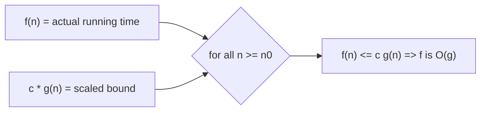

# Big-O, Big-Omega and Big-Theta

> **Before this lesson:** You should know what an input size $n$, a primitive operation and the
> seven growth functions (constant, $\log n$, $n$, $n \log n$, $n^2$, $n^3$, $2^n$) are. All of
> that is taught in the previous lesson,
> [Measuring algorithms and the seven functions](#/lesson/dsa-foundations/seven-functions). Basic
> Python is enough for the code.

## In plain words

Big-O notation is a way of describing how fast a cost grows while deliberately ignoring the fine
print. Saying "this search is $O(n)$" means: as the list gets longer, the work grows in proportion
to its length at worst. It does not say how many seconds the search takes.

An everyday comparison: when a friend asks how far away a town is, you answer "about an hour", not
"61 minutes and 14 seconds in today's traffic in my car". The rough answer is more useful, because
it stays true for other cars and other days and it lets you compare with "about a day" or "about
five minutes". Big-O is the "about an hour" of algorithms: precise enough to compare methods,
loose enough to survive a change of computer or programming language.

Why it matters for a job: big-O is the shared language of every technical interview and every
design discussion. "That lookup is linear, can we make it constant?" is a sentence you will hear
in your first week. This lesson gives the exact meaning of the three symbols ($O$, $\Omega$,
$\Theta$) so that you can use them correctly and spot when others do not.

## 1. The big-O notation

### 1.1 Why throw detail away?

The previous lesson counted primitive operations and got answers such as $2n + 3$. Counting that
exactly is tedious, and worse, the exact count depends on choices nobody cares about: is
`A[i] += 1` one step or three (read, add, write)? On a different machine the answer changes; the
growth shape does not. **Asymptotic analysis** keeps only the growth shape. ("Asymptotic" means
"concerning what happens as $n$ becomes very large".) Two things get thrown away on purpose:

- **Constant factors.** $2n$ and $50n$ are both "linear".
- **Lower-order terms.** In $n^2 + 10n$, the $10n$ part stops mattering once $n$ is large: at
  $n = 1000$ it contributes 10,000 out of 1,010,000, about one percent.

### 1.2 The definition, built up slowly

Take two step-count functions $f(n)$ and $g(n)$. Think of $f$ as the true cost of some algorithm,
messy and detailed, and $g$ as one of the seven clean shapes. We want to say "$f$ grows no faster
than $g$". The formal sentence is:

> $f(n)$ is $O(g(n))$ if there are a positive number $c$ and a whole number $n_0 \ge 1$ such that
> $$f(n) \le c \cdot g(n) \quad \text{for every } n \ge n_0.$$

Each piece of that sentence does one job:

- $c$ is a multiplier you are allowed to choose. It is how the definition ignores constant
  factors: if $f$ is ten times $g$, pick $c = 10$.
- $n_0$ is a starting point you are allowed to choose. It is how the definition ignores small
  inputs: the inequality only has to hold from $n_0$ onwards.
- The inequality must then hold for **every** larger $n$, forever. One lucky value is not enough.

The symbol $\le$ means "less than or equal to" and $\ge$ means "greater than or equal to". Read
the whole thing aloud as "$f(n)$ is **big-Oh** of $g(n)$". As a picture: beyond some point $n_0$,
the curve of $f$ stays under the curve of $c \cdot g$ forever.



The pair $(c, n_0)$ is called a **witness**, because producing one pair that works proves the
claim.

### Worked example 1

Claim: $8n + 5$ is $O(n)$.

We must find $c$ and $n_0$ with $8n + 5 \le c \cdot n$ for all $n \ge n_0$. Try $c = 9$. The
inequality $8n + 5 \le 9n$ is the same as $5 \le n$ (subtract $8n$ from both sides), so it holds
from $n_0 = 5$ onwards. Check one value: at $n = 5$, $8 \cdot 5 + 5 = 45$ and $9 \cdot 5 = 45$. It
holds, with nothing to spare, and the gap only widens after that.

Many other witnesses work too. For instance $c = 13, n_0 = 1$: when $n \ge 1$ we have $5 \le 5n$,
so $8n + 5 \le 8n + 5n = 13n$. You need only one witness, and there is no prize for the smallest.

Note that $c = 8$ can never work: $8n + 5 \le 8n$ is false for every $n$. The multiplier has to
leave room for the extra 5.

### Worked example 2

Claim: $5n^4 + 3n^3 + 2n^2 + 4n + 1$ is $O(n^4)$.

The trick is to replace every lower power by the highest one. For $n \ge 1$, each of $n^3$, $n^2$,
$n$ and $1$ is at most $n^4$. So the sum is at most
$5n^4 + 3n^4 + 2n^4 + 4n^4 + 1n^4 = 15 n^4$. Take $c = 15$, $n_0 = 1$.

The same trick proves the most useful rule of thumb in this lesson:

> **Rule.** If $f(n)$ is a polynomial of degree $d$ whose highest term has a positive multiplier,
> $f(n) = a_0 + a_1 n + \cdots + a_d n^d$, then $f(n)$ is $O(n^d)$.

In words: **keep the highest power, drop everything else, drop its multiplier.** The proof is the
one above: for $n \ge 1$, $n^i \le n^d$ whenever $i \le d$, so
$f(n) \le (|a_0| + |a_1| + \cdots + |a_d|) n^d$. (The bars $|a|$ mean "the size of $a$ ignoring
its sign", which covers polynomials with some negative multipliers.)

### Worked example 3

The same "replace every term by the biggest one" move handles mixed functions. In each line, the
logarithm is base 2, so $\log 1 = 0$, $\log 2 = 1$, and $\log n \le n$ for every $n \ge 1$.

- $5n^2 + 3n \log n + 2n + 5$ is $O(n^2)$: for $n \ge 1$ each term is at most its multiplier times
  $n^2$, so $c = 5 + 3 + 2 + 5 = 15$ works.
- $20 n^3 + 10 n \log n + 5$ is $O(n^3)$ with $c = 35$, $n_0 = 1$.
- $3 \log n + 2$ is $O(\log n)$ with $c = 5$, $n_0 = 2$. Here $n_0 = 1$ would fail: $\log 1 = 0$,
  so the right-hand side would be 0 while the left-hand side is 2.
- $2^{n+2}$ is $O(2^n)$: $2^{n+2} = 2^2 \cdot 2^n = 4 \cdot 2^n$, so $c = 4$.
- $2n + 100 \log n$ is $O(n)$: $c = 102$, $n_0 = 1$.

### 1.3 Style rules for big-O

Big-O lets us ignore constant factors and lower-order terms, and we should **use that freedom**:

1. Use the *simplest* $g$: say $O(n)$, not $O(4n + 3)$.
2. Use the *tightest* reasonable $g$. $8n + 5$ is technically $O(n^2)$ and even $O(2^n)$, because
   those functions are also above it; saying so is true and useless. Describe the growth as
   closely as you can.
3. Say "$f(n)$ **is** $O(g(n))$". You will often see it written $f(n) = O(g(n))$, and that is
   accepted shorthand, but it is not an equation: $O(g(n))$ stands for a whole *collection* of
   functions (all those that grow no faster than $g$), and $f$ is one member of it.

> [!WARNING]
> Big-O is an **upper bound**, a ceiling on growth. A statement such as "this algorithm is
> $O(n^2)$" does not say it is slow; an $O(n)$ algorithm is also $O(n^2)$, in the same way that a
> person under 2 metres tall is also under 3 metres tall. When you want to say "exactly this
> growth, no faster and no slower", use big-Theta (section 3).

## 2. Big-Omega

Big-O is an "at most" statement. Its mirror image is an "at least" statement, written with the
Greek capital letter omega, $\Omega$:

> $f(n)$ is $\Omega(g(n))$ if there are a positive number $c$ and a whole number $n_0 \ge 1$ with
> $f(n) \ge c \cdot g(n)$ for all $n \ge n_0$.

The only change from big-O is the direction of the inequality. Now $c \cdot g$ is a floor that $f$
stays above. Put another way, $f(n)$ is $\Omega(g(n))$ exactly when $g(n)$ is $O(f(n))$.

**Why would anyone want a lower bound?** To show that something cannot be improved. "Finding the
largest of $n$ unsorted numbers takes $\Omega(n)$ steps" says that no algorithm, however clever,
can avoid looking at every number.

**Example.** $3n \log n - 2n$ is $\Omega(n \log n)$. For $n \ge 2$ we have $\log n \ge 1$, so
$2n \le 2n\log n$. Subtracting a smaller amount leaves more, therefore
$3n\log n - 2n \ge 3n\log n - 2n\log n = n\log n$. Take $c = 1$, $n_0 = 2$.

## 3. Big-Theta

When the same $g$ works as both a ceiling and a floor, we know the growth exactly. The symbol is
the Greek capital letter theta, $\Theta$:

> $f(n)$ is $\Theta(g(n))$ if $f(n)$ is $O(g(n))$ **and** $f(n)$ is $\Omega(g(n))$. That is,
> there are positive numbers $c'$ and $c''$ and a whole number $n_0 \ge 1$ such that
> $c' g(n) \le f(n) \le c'' g(n)$ for $n \ge n_0$.

Picture $f$ trapped in a corridor between two scaled copies of $g$. It can wobble inside the
corridor but can never leave it.

**Example.** $3n\log n + 4n + 5\log n$ is $\Theta(n\log n)$. It is at least $3 n \log n$ (the other
two terms only add). And for $n \ge 2$, both $n$ and $\log n$ are at most $n \log n$, so it is at
most $(3 + 4 + 5) n \log n = 12 n \log n$.

In casual speech programmers say "big-O" when they mean $\Theta$. In an interview, "this is
$O(n \log n)$" is normally understood as "and not better". Knowing the difference lets you be
exact when it matters.

| Notation | Meaning | Analogy |
|---|---|---|
| $f$ is $O(g)$ | $f$ grows no faster than $g$ | $\le$ |
| $f$ is $\Omega(g)$ | $f$ grows at least as fast as $g$ | $\ge$ |
| $f$ is $\Theta(g)$ | same growth rate | $=$ |
| $f$ is $o(g)$ | strictly slower: $f/g \to 0$ | $<$ |
| $f$ is $\omega(g)$ | strictly faster: $f/g \to \infty$ | $>$ |

The last two rows use lower-case letters. In the table, $f/g \to 0$ is read "the ratio of $f$ to
$g$ shrinks towards zero as $n$ grows", and $\to \infty$ is read "grows without limit". Little-o
and little-omega are rarely needed in this track but are handy in conversation: $n$ is
$o(n \log n)$, and $2^n$ is $\omega(n^{100})$.

> [!INTERVIEW]
> A classic confusion: "worst case" and "big-O" are *two separate choices*. Worst case versus
> average case says **which input** you are analysing; $O$ versus $\Omega$ versus $\Theta$ says
> **what kind of bound** you are giving for it. Quick-sort, a sorting algorithm covered later in
> this track, has worst-case running time $\Theta(n^2)$ and average running time
> $\Theta(n \log n)$. Both are exact statements, about different quantities.

## 4. Comparative analysis

Asymptotic notation lets us rank algorithms. If algorithm A runs in $O(n)$ and algorithm B in
$\Theta(n^2)$, then A is *asymptotically better*: for all large enough inputs A wins, whatever the
constant factors are.

How large an input can each handle? Suppose one operation takes 1 microsecond (a millionth of a
second), so a second buys a million operations:

| Running time | max $n$ in 1 second | in 1 minute | in 1 hour |
|---|---|---|---|
| $400 n$ | 2,500 | 150,000 | 9,000,000 |
| $2 n^2$ | 707 | 5,477 | 42,426 |
| $2^n$ | 19 | 25 | 31 |

Check one cell to see where the numbers come from: $2n^2 \le 1{,}000{,}000$ means
$n^2 \le 500{,}000$, so $n \le 707$. Giving the quadratic algorithm sixty times longer (a minute)
raises $n$ only to 5,477, about eight times more, because $\sqrt{60} \approx 7.7$. The exponential
row barely moves at all.

And what does a faster computer buy you? If a machine is 256 times faster, an $O(n)$ algorithm can
handle inputs 256 times larger; an $O(n^2)$ algorithm only 16 times larger (since $16^2 = 256$);
an $O(2^n)$ algorithm only 8 more items (since $2^8 = 256$). **Better algorithms beat better
hardware.**

The demo below computes, for five growth shapes, the largest $n$ that fits in a budget of one
hundred million operations.

```python-run
import math
# Largest n solvable in a given budget of operations, for several running times
budget = 10**8   # about one second of simple Python-free machine operations
def largest_n(f):
    lo, hi = 1, 1
    while f(hi) <= budget:
        hi *= 2
    while lo < hi:                     # binary search for the boundary
        mid = (lo + hi + 1) // 2
        if f(mid) <= budget: lo = mid
        else: hi = mid - 1
    return lo
for name, f in [("n", lambda n: n), ("n log n", lambda n: n * math.log2(max(n, 2))),
                ("n^2", lambda n: n * n), ("n^3", lambda n: n ** 3), ("2^n", lambda n: 2 ** n)]:
    print(f"{name:8s} -> n up to {largest_n(f):,}")
```

**Reading this code.** `budget = 10**8` is the allowance of operations. `largest_n(f)` finds the
biggest `n` for which `f(n)` still fits. It works in two phases. First it doubles `hi` until
`f(hi)` exceeds the budget, so the answer lies somewhere between `lo` and `hi`. Then it repeatedly
tests the midpoint `mid` and throws away the half that cannot contain the answer; this halving
search is called *binary search* and gets its own treatment in the recursion module. The final
loop runs `largest_n` on five functions written with `lambda` (a one-line unnamed function). In
`math.log2(max(n, 2))` the `max` guards against $\log 1 = 0$. The output is:

```
n        -> n up to 100,000,000
n log n  -> n up to 4,523,071
n^2      -> n up to 10,000
n^3      -> n up to 464
2^n      -> n up to 26
```

With the same budget, the linear method handles a hundred million items and the exponential one
handles twenty-six.

### 4.1 Some words of caution

- **Constants can matter in practice.** $10^{100} n$ is $O(n)$, but nobody would choose it over
  $10 n \log n$ for any input that exists. Be suspicious of an algorithm whose hidden multiplier
  is enormous, and treat any exponential running time as unusable except for small $n$.
- **The line between efficient and inefficient** is usually drawn between polynomial time
  ($O(n^c)$ for some fixed $c$) and exponential time ($\Omega(b^n)$ for some $b > 1$). An
  $n^{100}$ algorithm is "polynomial" and still hopeless; the dividing line is a convenient
  simplification, not a law.
- **Asymptotics speak about large $n$.** For tiny inputs a quadratic sorting method with almost no
  overhead often beats an $n \log n$ method with more bookkeeping, which is why real sorting
  libraries switch to the plain quadratic method for short lists.

## 5. Useful facts for manipulating bounds

These follow from the definitions and let you analyse a program one piece at a time:

1. **Sum rule.** If $f_1$ is $O(g_1)$ and $f_2$ is $O(g_2)$, then $f_1 + f_2$ is
   $O(\max(g_1, g_2))$. Code that does one thing and then another costs as much as its more
   expensive part. A linear pass followed by a quadratic one is quadratic overall.
2. **Product rule.** $f_1 \cdot f_2$ is $O(g_1 \cdot g_2)$. A loop that runs $O(n)$ times with a
   body costing $O(\log n)$ costs $O(n \log n)$ in total.
3. **Transitivity.** If $f$ is $O(g)$ and $g$ is $O(h)$, then $f$ is $O(h)$: bounds chain together.
4. **Logs lose to powers.** $\log^k n$ (meaning $\log n$ raised to the power $k$) is
   $O(n^\epsilon)$ for every fixed $k$ and every fixed $\epsilon > 0$, however small. Any power of
   a logarithm grows more slowly than even $n^{0.01}$, eventually.
5. **Powers lose to exponentials.** $n^k$ is $O(b^n)$ for every fixed $k$ and every $b > 1$.

### Proving that something is NOT big-O

To prove a negative, use **proof by contradiction**: assume the claim is true and show that the
assumption leads to something impossible. To show $n^2$ is **not** $O(n)$, suppose it were. Then
some witness $(c, n_0)$ would give $n^2 \le c \cdot n$ for all $n \ge n_0$. Dividing both sides by
$n$ gives $n \le c$ for all $n \ge n_0$. But $n$ can be chosen larger than both $c$ and $n_0$,
for example $n = \max(n_0, \lceil c \rceil + 1)$, and then $n \le c$ is false. The assumption has
broken, so no witness exists. The same style of argument appears again in the next lesson.

## 6. Using limits (a shortcut)

A quicker test is to look at the ratio $f(n)/g(n)$ and ask what it does as $n$ grows. The value
that a quantity settles towards is called its **limit**, written $\lim_{n\to\infty}$ ("the limit
as $n$ goes to infinity"). If the ratio settles to a value $L$, then:

- $L = 0$ means $f$ is $o(g)$: $f$ becomes negligible next to $g$ (so $f$ is $O(g)$ but not
  $\Omega(g)$).
- $L$ is a positive, finite number means $f$ is $\Theta(g)$: they grow together, $L$ being the
  constant factor between them.
- $L = \infty$ (the ratio grows without limit) means $f$ is $\omega(g)$.

For example $(n \log n) / n^2 = \log n / n$, and since a logarithm loses to $n$ this ratio heads
to 0. So $n\log n$ is $o(n^2)$. If you have studied calculus, L'Hôpital's rule is often the
quickest way to evaluate such ratios; if you have not, plugging in a few growing values of $n$, as
the next demo does, tells you what is happening.

```python-run
import math
# Numerically watch f(n)/g(n) settle (Theta), go to 0 (o) or blow up (omega)
pairs = [("3n^2+10n", "n^2", lambda n: 3*n*n + 10*n, lambda n: n*n),
         ("n log n", "n^2", lambda n: n*math.log2(n), lambda n: n*n),
         ("2^n", "n^5", lambda n: 2.0**n, lambda n: n**5)]
for fn, gn, f, g in pairs:
    print(f"{fn} / {gn}:", [round(f(n)/g(n), 4) for n in [2, 16, 64, 128]])
```

**Reading the output.** Each line shows one ratio at $n = 2, 16, 64, 128$:

```
3n^2+10n / n^2: [8.0, 3.625, 3.1562, 3.0781]
n log n / n^2: [0.5, 0.25, 0.0938, 0.0547]
2^n / n^5: [0.125, 0.0625, 17179869184.0, 9.903520314283042e+27]
```

The first ratio settles towards 3, a positive finite number, so $3n^2 + 10n$ is $\Theta(n^2)$.
The second keeps shrinking towards 0, so $n \log n$ is $o(n^2)$. The third starts *below* 1 and
then explodes: for small $n$ the polynomial $n^5$ is bigger, but the exponential overtakes it and
never looks back. That is a reminder that asymptotic statements are about large $n$ only.

## 7. Worked exercises: simplifying and proving bounds

Practice turns the definitions into reflexes. For each function below, the table gives the tight
bound (the $\Theta$ form) and a one-line reason:

| $f(n)$ | Tight bound | Why |
|---|---|---|
| $3n^2 + 100n\log n + 10^6$ | $\Theta(n^2)$ | highest-order term wins; constants vanish |
| $n(n-1)/2$ | $\Theta(n^2)$ | expands to $\tfrac12 n^2 - \tfrac12 n$ |
| $\log(n^3)$ | $\Theta(\log n)$ | $= 3\log n$ |
| $\log_2 n + \log_{10} n$ | $\Theta(\log n)$ | bases differ by a constant factor |
| $2^{n+5}$ | $\Theta(2^n)$ | $= 32 \cdot 2^n$ |
| $2^{2n}$ | $\Theta(4^n)$, **not** $O(2^n)$ | a constant in the exponent changes the base |
| $n\log n + n^{1.1}$ | $\Theta(n^{1.1})$ | any positive power of $n$ beats $\log n$ |
| $\sqrt{n} + \log^5 n$ | $\Theta(\sqrt n)$ | powers of logs lose to powers of $n$ |
| $n!$ versus $2^n$ | $n!$ is $\omega(2^n)$ | $n! \ge 2^{n-1}$ and the ratio keeps growing |
| $\sum_{i=1}^{n} i^2$ | $\Theta(n^3)$ | at least $n/2$ terms are $\ge (n/2)^2$, and all are $\le n^2$ |

**A full two-sided proof.** Claim: $f(n) = \tfrac12 n^2 - 3n$ is $\Theta(n^2)$.

- *Upper bound.* $\tfrac12 n^2 - 3n \le \tfrac12 n^2$ for all $n \ge 1$: take $c'' = \tfrac12$,
  $n_0 = 1$.
- *Lower bound.* We want $\tfrac12 n^2 - 3n \ge c' n^2$. Try $c' = \tfrac14$: the inequality becomes
  $\tfrac14 n^2 \ge 3n$, i.e. $n \ge 12$. Take $c' = \tfrac14$, $n_0 = 12$.

Both bounds hold for $n \ge 12$, so $f$ is $\Theta(n^2)$. Note how the subtracted term forces a larger
$n_0$ for the lower bound: for small $n$ the function is even negative. Asymptotic statements say
nothing about small inputs.

**A one-sided relationship.** $n\log n$ is $O(n^2)$ (since $\log n \le n$) but **not**
$\Omega(n^2)$: that would need $n \log n \ge c\,n^2$, i.e. $\log n \ge c\,n$, for all large $n$ —
false for every $c > 0$ because $\log n / n \to 0$.

The cell below finds, numerically, the crossover point $n_0$ beyond which one function stays below
another — a useful sanity check for witnesses you derive by hand.

```python-run
import math
def crossover(f, g, limit=10**6):
    """Smallest n0 such that f(n) <= g(n) for every checked n in [n0, limit]."""
    last_bad, n = 0, 1
    while n <= limit:
        if f(n) > g(n): last_bad = n
        n = n + 1 if n < 5000 else int(n * 1.01) + 1
    return last_bad + 1
cases = [("8n + 5 <= 9n", lambda n: 8*n + 5, lambda n: 9*n),
         ("n^2/4 <= n^2/2 - 3n", lambda n: n*n/4, lambda n: n*n/2 - 3*n),
         ("100 n log n <= n^2", lambda n: 100*n*math.log2(n), lambda n: n*n),
         ("n^3 <= 1.1^n", lambda n: n**3, lambda n: 1.1**n if n < 5000 else float("inf"))]
for label, f, g in cases:
    print(f"{label:22s} holds from n0 = {crossover(f, g)}")
```

The first two lines reproduce the witnesses found by hand ($n_0 = 5$ and $n_0 = 12$). The third is
the practical moral of section 4.1: an $O(n\log n)$ algorithm with a constant of 100 only overtakes
a simple quadratic one once inputs reach about a thousand. The fourth shows that an exponential,
however small its base, eventually overtakes any polynomial.

## 8. Pitfalls

- **Unsimplified answers.** Writing $O(2n)$ or $O(n + 5)$ signals that the idea has not landed.
  Always reduce to the bare shape, $O(n)$.
- **Forgetting $n_0$.** $\log n$ is $0$ at $n = 1$, so a claim like "$3\log n \le c \log n$ for
  all $n \ge 1$" is fine, but "$5 \le c\log n$ for all $n \ge 1$" is false at $n = 1$ whatever $c$
  is. Starting from $n_0 = 2$ repairs it.
- **Dropping a constant from an exponent.** $2^{2n}$ is **not** $O(2^n)$:
  $2^{2n} = (2^n)^2 = 4^n$, and the ratio $4^n/2^n = 2^n$ grows without limit. Multipliers in
  front of a function can be dropped; multipliers inside an exponent cannot.
- **Reading $O$ as "equals".** An $O(n^2)$ bound on a method that is really linear is true and
  misleading. If you know the exact growth, say $\Theta$ or say "tight".
- **Mixing up $\Theta$ and "average case".** One names a kind of bound, the other names which
  inputs are being considered.

## 9. Summary

- $O$ is an upper bound on growth, $\Omega$ a lower bound, and $\Theta$ both at once.
- A bound is proved by exhibiting a witness: a multiplier $c$ and a starting point $n_0$.
- Drop constant factors and lower-order terms; a polynomial of degree $d$ is $\Theta(n^d)$.
- Faster-growing costs lose on large inputs whatever the constants, and faster hardware cannot
  rescue an exponential algorithm.

> **Source:** Goodrich, Tamassia & Goldwasser, *Data Structures and Algorithms in Python*, ch. 3.3.1–3.3.2.

## Glossary

- **Asymptotic analysis**: studying how a cost behaves as the input size becomes very large.
- **Constant factor**: a fixed multiplier in front of a function, such as the 8 in $8n$.
- **Lower-order term**: a part of a formula that grows more slowly than its largest part.
- **Big-O, $O(g)$**: "grows no faster than $g$"; an upper bound.
- **Big-Omega, $\Omega(g)$**: "grows at least as fast as $g$"; a lower bound.
- **Big-Theta, $\Theta(g)$**: "grows at the same rate as $g$"; both bounds together.
- **Little-o, little-omega**: strictly slower than, strictly faster than.
- **Witness $(c, n_0)$**: the multiplier and starting point that make a big-O inequality hold.
- **Tight bound**: a bound that cannot be improved; the $\Theta$ form.
- **Polynomial time / exponential time**: step counts bounded by a power of $n$ / growing like
  $b^n$.
- **Proof by contradiction**: assuming the opposite of a claim and deriving an impossibility.
- **Limit**: the value a quantity settles towards as $n$ grows without bound.

## Check yourself

```quiz
[
  {"q": "Which (c, n0) pair proves 8n + 5 is O(n)?",
   "options": ["c = 8, n0 = 1", "c = 9, n0 = 5", "c = 1, n0 = 100", "c = 8, n0 = 1000"], "answer": 1,
   "explain": "8n + 5 <= 9n iff n >= 5. With c = 8 the inequality 8n + 5 <= 8n never holds."},
  {"q": "f(n) = 5n^4 + 3n^3 + 2n^2 + 4n + 1 is...",
   "options": ["Theta(n^4)", "Theta(n^5)", "O(n^3)", "Theta(15)"], "answer": 0,
   "explain": "A degree-d polynomial with positive leading coefficient is Theta(n^d)."},
  {"q": "Is 2^(2n) O(2^n)?",
   "options": ["Yes, constants do not matter", "No, 2^(2n) = 4^n grows strictly faster", "Yes, with c = 2", "Only for n < 10"], "answer": 1,
   "explain": "4^n / 2^n = 2^n is unbounded, so no constant c works. Constants in exponents change the growth rate."},
  {"q": "Quick-sort's worst-case time is Theta(n^2) and expected time Theta(n log n). This shows that...",
   "options": ["Theta means average case", "Big-O notation and the case analysed are independent choices", "Quick-sort is O(n log n) in the worst case", "Big-Omega is only for best case"], "answer": 1,
   "explain": "Which input (worst/average/best) and which bound type (O/Omega/Theta) are separate axes."},
  {"q": "A 256x faster computer lets an O(n^2) algorithm solve inputs how many times larger in the same time?",
   "options": ["256", "16", "8", "2"], "answer": 1,
   "explain": "(kn)^2 = 256 n^2 gives k = 16. A linear algorithm would gain 256x, an exponential one only 8 more items."},
  {"q": "lim n->inf f(n)/g(n) = 7. Then f is...",
   "options": ["o(g)", "Theta(g)", "omega(g)", "unrelated to g"], "answer": 1,
   "explain": "A finite positive limit means f and g grow at the same rate up to a constant."},
  {"q": "Which statement is true?",
   "options": ["(log n)^3 is O(n^0.1)", "n^100 is not O(2^n)", "n log n is Omega(n^2)", "log n is Theta(log log n)"], "answer": 0,
   "explain": "Any power of log n is eventually dominated by any positive power of n. Every polynomial is O(2^n)."}
]
```
