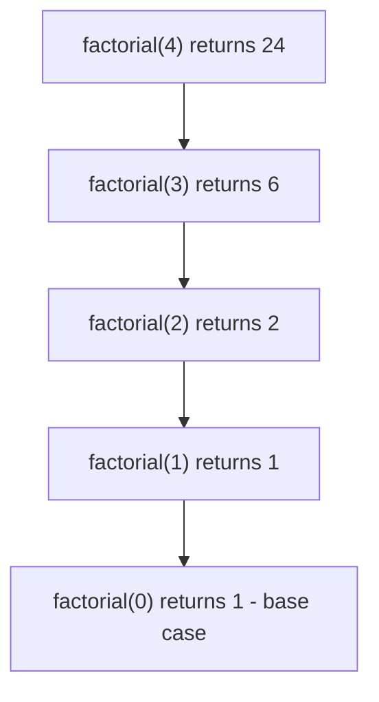

# Thinking recursively: four classic examples

**Recursion** is a technique in which a function solves a problem by calling itself on smaller
instances of the same problem. It is an elegant alternative to loops, and for some structures —
trees, nested folders, divide-and-conquer — it is by far the most natural way to think.

Recursion shows up everywhere outside programming too: a Russian Matryoshka doll contains a smaller
doll that contains a smaller doll; a fractal is made of smaller copies of itself; a directory holds
files and other directories. Goodrich et al. introduce the idea with four examples, which we follow
here.

## 1. Anatomy of a recursive function

Every correct recursive function has:

1. One or more **base cases** — inputs small enough to answer directly, with no recursive call.
2. One or more **recursive cases** — the function calls itself on inputs that are *closer to a base
   case*, then combines the results.

Each call gets its own **activation record** (or *frame*) holding its parameters and local
variables. When a call is made, the caller's frame is suspended; when the callee returns, the
caller resumes. Python keeps these frames on the **call stack**.

## 2. Example 1 — the factorial

$$n! = \begin{cases} 1 & n = 0 \\ n \cdot (n-1)! & n \ge 1 \end{cases}$$

The definition is itself recursive, and the code mirrors it:

```python-run
def factorial(n):
    if n == 0:                    # base case
        return 1
    return n * factorial(n - 1)   # recursive case

print([factorial(k) for k in range(8)])
```

### Recursion traces

A **recursion trace** draws each call as a box, with arrows to the calls it makes and the values
returned. For `factorial(4)`:



There are $n+1$ activations, each doing constant work, so `factorial(n)` runs in $O(n)$ time and
uses $O(n)$ stack space.

```python-run
def factorial_traced(n, depth=0):
    print("  " * depth + f"factorial({n}) called")
    result = 1 if n == 0 else n * factorial_traced(n - 1, depth + 1)
    print("  " * depth + f"factorial({n}) returns {result}")
    return result
factorial_traced(4)
```

## 3. Example 2 — drawing an English ruler

An English ruler has a long tick at each whole inch, a slightly shorter tick at each half inch,
shorter still at quarters, and so on. Look at the pattern between two inch marks with a *central
tick* of length $L$:

> an interval with central tick length $L \ge 1$ is: an interval with central length $L-1$, a single
> tick of length $L$, then another interval with central length $L-1$.

That **is** a recursive definition. The base case is $L = 0$: draw nothing.

```python-run
def draw_line(tick_length, tick_label=''):
    line = '-' * tick_length
    if tick_label:
        line += ' ' + tick_label
    print(line)

def draw_interval(center_length):
    if center_length > 0:                 # stop when length drops to 0
        draw_interval(center_length - 1)  # top half
        draw_line(center_length)          # center tick
        draw_interval(center_length - 1)  # bottom half

def draw_ruler(num_inches, major_length):
    draw_line(major_length, '0')
    for j in range(1, 1 + num_inches):
        draw_interval(major_length - 1)
        draw_line(major_length, str(j))

draw_ruler(2, 4)
```

`draw_interval` makes **two** recursive calls — this is *binary recursion*, and its trace is a full
binary tree. How many lines does `draw_interval(c)` print? Let $L(c)$ be that number:
$L(0) = 0$ and $L(c) = 2L(c-1) + 1$. Unrolling: $L(c) = 2^c - 1$. (Proof by induction:
$2(2^{c-1} - 1) + 1 = 2^c - 1$.) The output itself is exponential in $c$, so no algorithm could
do better; the recursion is optimal for this task.

## 4. Example 3 — binary search

Given a **sorted** sequence `data` and a `target`, binary search keeps a candidate range
`[low, high]`. Compare against the middle element `data[mid]` with `mid = (low + high) // 2`:

- if `target == data[mid]`, found;
- if `target < data[mid]`, recur on `[low, mid - 1]`;
- if `target > data[mid]`, recur on `[mid + 1, high]`.

If `low > high` the range is empty: not found.

```python-run
def binary_search(data, target, low, high):
    """Return True if target is in data[low:high+1]."""
    if low > high:
        return False                       # interval empty: no match
    mid = (low + high) // 2
    if target == data[mid]:
        return True
    elif target < data[mid]:
        return binary_search(data, target, low, mid - 1)
    else:
        return binary_search(data, target, mid + 1, high)

data = [2, 4, 5, 7, 8, 9, 12, 14, 17, 19, 22, 25, 27, 28, 33, 37]
print(binary_search(data, 22, 0, len(data) - 1), binary_search(data, 23, 0, len(data) - 1))
```

### Dry run: searching for 22

| call | low | high | mid | data[mid] | decision |
|---|---|---|---|---|---|
| 1 | 0 | 15 | 7 | 14 | 22 > 14 → right |
| 2 | 8 | 15 | 11 | 25 | 22 < 25 → left |
| 3 | 8 | 10 | 9 | 19 | 22 > 19 → right |
| 4 | 10 | 10 | 10 | 22 | found |

Each call at least halves the number of candidates (`high - low + 1`), so there are at most
$\lfloor \log_2 n \rfloor + 1$ calls: $O(\log n)$. Compare with **sequential search**, $O(n)$, which
works on unsorted data. For a billion sorted items, binary search needs about 30 probes.

> [!INTERVIEW]
> Binary search bugs are classic: using `mid = (low + high) / 2` (float in Python 3), updating with
> `high = mid` instead of `mid - 1` (infinite loop), or using `low < high` and missing the
> one-element case. State your invariant — "if target is present, it lies in `data[low..high]`" —
> and every update follows from it.

## 5. Example 4 — file systems

A directory contains files and other directories, nested arbitrarily deep. The *cumulative disk
usage* of a directory is its own immediate size plus the cumulative usage of every entry inside it.
Recursive by nature:

```
DiskUsage(path):
    total = size(path)
    if path is a directory:
        for each child in path:
            total += DiskUsage(child)
    return total
```

The book implements this with the `os` module: `os.path.getsize`, `os.path.isdir`, `os.listdir` and
`os.path.join`. Here is a self-contained version over a simulated file system (nested dicts), so you
can run it in the browser:

```python-run
# A simulated file system: dict = directory, int = file size in KB; directories themselves cost 1 KB
fs = {
  "user": {
    "rt": {"courses": {"cs016": {"grades": 8, "homeworks": {"hw1": 3, "hw2": 2, "hw3": 4},
                                  "programs": {"pr1": 57, "pr2": 97, "pr3": 74}},
                       "cs252": {"projects": {"papers": {"buylow": 26, "sellhigh": 55},
                                              "demos": {"market": 4786}},
                                 "grades": 3}}}}
}

def disk_usage(name, node, depth=0):
    total = node if isinstance(node, int) else 1
    if isinstance(node, dict):
        for child, sub in node.items():
            total += disk_usage(child, sub, depth + 1)
    print("    " * depth + f"{total:6d}  {name}")   # postorder: children print first
    return total

disk_usage("/", fs)
```

Notice the report is printed **after** children are processed — this is a *postorder* traversal,
which we revisit with trees. The Unix `du` command reports exactly this.

### How expensive is it?

A single call may loop over many children, so we cannot simply say "constant work per call". The
book's insight is to **count the total across all calls**: every entry of the file system is the
argument of exactly one recursive call, and each entry appears in exactly one parent's loop. So the
total work is proportional to the number $n$ of entries: $O(n)$. This style — charging the cost of
loop iterations to the children rather than the parent — previews amortised reasoning.

## 6. How Python runs recursion

- Each call pushes a frame; returning pops it. The depth of recursion is the stack height.
- Python limits the depth (by default about 1000 frames) to catch infinite recursion; exceeding it
  raises `RecursionError`. You can raise the limit with `sys.setrecursionlimit`, but deep linear
  recursion is better rewritten as a loop (see the design lesson).

```python-run
import sys
print("current limit:", sys.getrecursionlimit())
def depth(n):
    return 0 if n == 0 else 1 + depth(n - 1)
try:
    depth(100000)
except RecursionError as e:
    print("RecursionError:", e)
```

## 7. Pitfalls

- **Missing or unreachable base case** → infinite recursion → `RecursionError`.
- **Not making progress**: `binary_search(data, target, low, mid)` can loop forever when
  `low == mid`.
- **Recomputing work** in multiple recursive calls (the next lesson's `bad_fibonacci`).
- **Hidden copying**: passing `data[1:]` to each call costs $O(n)$ per call — pass indices instead.

## 8. Summary

| Example | Recursion type | Time |
|---|---|---|
| factorial | linear | $O(n)$ |
| draw_interval(c) | binary | $O(2^c)$ (optimal: output size) |
| binary search | linear (tail) | $O(\log n)$ |
| disk usage | multiple | $O(n)$ for $n$ entries |

> **Source:** Goodrich, Tamassia & Goldwasser, *Data Structures and Algorithms in Python*, ch. 4.1.

## Check yourself

```quiz
[
  {"q": "What are the two essential ingredients of a recursive function?",
   "options": ["A loop and a counter", "Base case(s) and recursive case(s) that progress toward a base case", "A global variable and a return statement", "Memoisation and a stack"], "answer": 1,
   "explain": "Without a base case recursion never stops; without progress toward it, it never reaches it."},
  {"q": "How many lines does draw_interval(c) print?",
   "options": ["c", "2c", "2^c - 1", "c^2"], "answer": 2,
   "explain": "L(0) = 0, L(c) = 2 L(c-1) + 1, which solves to 2^c - 1."},
  {"q": "Binary search on 1,000,000 sorted items needs at most about how many probes?",
   "options": ["1000", "20", "500000", "100"], "answer": 1,
   "explain": "floor(log2 10^6) + 1 = 20. Each probe halves the candidate range."},
  {"q": "In binary search, what is wrong with recursing on [low, mid] instead of [low, mid-1] when target < data[mid]?",
   "options": ["Nothing", "It can fail to shrink the range and recurse forever when low == mid", "It returns wrong answers for even n", "It becomes O(n)"], "answer": 1,
   "explain": "If low == high == mid, the call repeats with the same range. Excluding mid guarantees progress."},
  {"q": "Why is the recursive disk-usage computation O(n) overall even though one call can loop over many children?",
   "options": ["Directories have at most 2 children", "Each entry is processed by exactly one call and appears in exactly one parent's loop", "Python caches os.listdir", "It is actually O(n^2)"], "answer": 1,
   "explain": "Summing loop iterations across all calls counts each entry once, giving O(n)."},
  {"q": "What happens in Python when recursion exceeds the depth limit?",
   "options": ["The program silently returns None", "A RecursionError is raised", "Python switches to iteration", "The stack grows unlimited"], "answer": 1,
   "explain": "CPython caps the call depth (default about 1000) and raises RecursionError to catch runaway recursion."}
]
```
