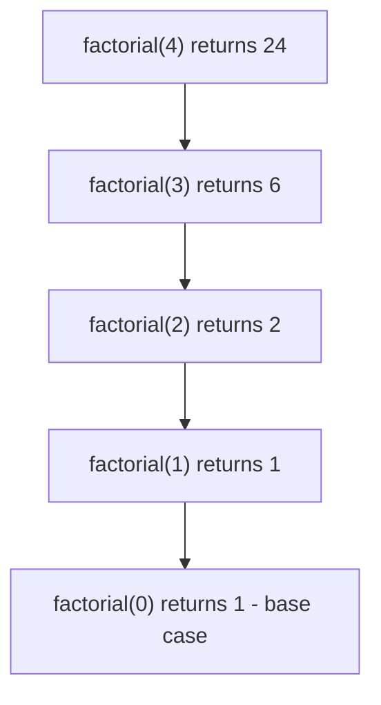

# Thinking recursively: four classic examples

> **Before this lesson:** You should be able to write and call a Python function, and know what
> $O(n)$ and $O(\log n)$ mean from
> [Big-O, Big-Omega and Big-Theta](#/lesson/dsa-foundations/asymptotic-notation). Induction, used
> in section 7, is introduced in
> [Analysing real code and proving it correct](#/lesson/dsa-foundations/analysis-examples).

## In plain words

**Recursion** is a way of solving a problem in which a function calls *itself* on a smaller
version of the same problem, and keeps doing so until the problem is small enough to answer
outright.

Picture a queue outside a cinema. You want to know your position, but you cannot see the front.
So you ask the person ahead, "what number are you?" They do not know either, so they ask the
person ahead of them, and so on. The person at the very front knows without asking: "I am number
1." That answer travels back down the line, each person adding one, until it reaches you. Nobody
counted the whole queue; everyone did one small step and trusted the person in front. That is
recursion: a question passed along in ever smaller form, one case that can be answered directly,
and answers assembled on the way back.

The same shape appears in a Russian doll that contains a smaller doll, and in a folder that
contains files and other folders.

Why it matters for a job: trees, nested data such as JSON, file systems, and most "divide the
problem in half" algorithms are written recursively. Interviewers reach for recursion constantly,
and being able to say what the smallest case is and how the problem shrinks is the main skill
they are checking. This lesson teaches it through four examples.

## 1. Anatomy of a recursive function

Every correct recursive function has two kinds of branches:

1. One or more **base cases**: inputs small enough to answer directly, with no further call. In
   the queue, this is the person at the front.
2. One or more **recursive cases**: the function calls itself on an input that is *closer to a
   base case*, then uses the result to build its own answer.

How can a function be "inside itself" without confusion? Each call is a separate piece of work
with its own private copy of the parameters and local variables. Python stores those in a small
record called an **activation record**, or **frame**. When a function makes a call, its own frame
is put on hold; when the call returns, the frame picks up where it left off. The frames are kept
in a pile called the **call stack**: the newest call on top, finished calls removed from the top.

## 2. Example 1: the factorial

The **factorial** of a whole number $n$, written $n!$, is the product of every whole number from
1 up to $n$. So $4! = 4 \times 3 \times 2 \times 1 = 24$. It counts the number of ways to arrange
$n$ different things in a row. Notice that $4! = 4 \times 3!$: a factorial contains a smaller
factorial. That gives a definition in two lines:

$$n! = \begin{cases} 1 & n = 0 \\ n \cdot (n-1)! & n \ge 1 \end{cases}$$

The first line is the base case (by convention $0! = 1$); the second defines $n!$ using a smaller
factorial. The code copies the definition:

```python-run
def factorial(n):
    if n == 0:                    # base case
        return 1
    return n * factorial(n - 1)   # recursive case

print([factorial(k) for k in range(8)])
```

**Reading this code line by line**

- `if n == 0: return 1` is the base case. `return` hands a value back to whoever called the
  function and ends that call.
- `return n * factorial(n - 1)` is the recursive case. To evaluate it Python must first finish
  the inner call `factorial(n - 1)`; only then can it multiply by `n` and return.
- The last line builds a list by calling `factorial(k)` for `k = 0, 1, ..., 7`.
- Output: `[1, 1, 2, 6, 24, 120, 720, 5040]`.

Follow `factorial(3)` by hand. It needs `factorial(2)`, which needs `factorial(1)`, which needs
`factorial(0)`, which returns 1 at once. Now the waiting calls finish in reverse order:
`factorial(1)` returns $1 \times 1 = 1$, `factorial(2)` returns $2 \times 1 = 2$, and
`factorial(3)` returns $3 \times 2 = 6$. The calls go down, the answers come back up.

### Recursion traces

A **recursion trace** is a drawing of that process: each call is a box, with an arrow to the call
it makes and a note of the value it returns. For `factorial(4)`:



There are $n+1$ calls, each doing a constant amount of work (one comparison, one multiplication),
so `factorial(n)` runs in $O(n)$ time. It also uses $O(n)$ memory, because at the deepest point
all $n + 1$ frames are on the call stack at once, each waiting for the one above it.

The next version prints a line when each call starts and when it returns, indented by how deep
the call is, so you can watch the stack grow and shrink:

```python-run
def factorial_traced(n, depth=0):
    print("  " * depth + f"factorial({n}) called")
    result = 1 if n == 0 else n * factorial_traced(n - 1, depth + 1)
    print("  " * depth + f"factorial({n}) returns {result}")
    return result
factorial_traced(4)
```

The extra parameter `depth` starts at 0 and grows by one with each nested call; `"  " * depth`
repeats two spaces that many times to make the indentation. The first five lines of output are
the "called" messages marching inwards, and the last five are the "returns" messages coming back
out with the values 1, 1, 2, 6, 24.

## 3. Example 2: drawing an English ruler

A ruler marked in inches has a long tick at each whole inch, a slightly shorter tick at each half
inch, a shorter one at each quarter, and so on. Look at the stretch between two inch marks. In
the middle is the longest of the minor ticks, say of length $L$. On either side of it is a
smaller copy of the same pattern, whose middle tick has length $L - 1$:

> an interval with central tick length $L \ge 1$ is: an interval with central length $L-1$, a
> single tick of length $L$, then another interval with central length $L-1$.

That sentence **is** a recursive definition: the pattern is described using smaller copies of
itself. The base case is $L = 0$: draw nothing.

```python-run
def draw_line(tick_length, tick_label=''):
    line = '-' * tick_length
    if tick_label:
        line += ' ' + tick_label
    print(line)

def draw_interval(center_length):
    if center_length > 0:                 # stop when length drops to 0
        draw_interval(center_length - 1)  # top half
        draw_line(center_length)          # center tick
        draw_interval(center_length - 1)  # bottom half

def draw_ruler(num_inches, major_length):
    draw_line(major_length, '0')
    for j in range(1, 1 + num_inches):
        draw_interval(major_length - 1)
        draw_line(major_length, str(j))

draw_ruler(2, 4)
```

**Reading this code.** `draw_line` prints one tick: `'-' * tick_length` is a string of that many
dashes, with an optional label after it. `draw_interval` is the recursive part: draw the smaller
pattern, then the middle tick, then the smaller pattern again. `draw_ruler(2, 4)` prints a ruler
two inches long whose inch marks are four dashes: a labelled tick, then for each inch an interval
followed by the next labelled tick. The output begins `---- 0`, `-`, `--`, `-`, `---`, `-`, `--`,
`-`, `---- 1` and repeats the same seven minor ticks before `---- 2`.

`draw_interval` makes **two** recursive calls each time. This is called *binary recursion*, and
its trace branches like a family tree instead of forming a single chain. How many lines does
`draw_interval(c)` print? Call that number $L(c)$. Nothing is printed for 0, so $L(0) = 0$; and a
call with $c$ prints two smaller patterns plus one tick, so $L(c) = 2L(c-1) + 1$. Work out a few:
$L(1) = 1$, $L(2) = 3$, $L(3) = 7$, $L(4) = 15$. Each is one less than a power of two, and
indeed $L(c) = 2^c - 1$ (check by induction: $2(2^{c-1} - 1) + 1 = 2^c - 1$). The running time is
exponential in $c$, but so is the amount of output required, so no method could be faster; the
recursion is as good as possible for this task.

## 4. Example 3: binary search

Suppose a list is **sorted** (in increasing order) and you want to know whether it contains some
value, the `target`. Checking every item in turn, called **sequential search**, takes $O(n)$.
Sorted order allows something far better, the method you use to find a word in a dictionary: open
it in the middle and discard the half that cannot contain the word.

**Binary search** keeps two positions, `low` and `high`, marking the stretch of the list that
could still contain the target. It looks at the middle position, `mid = (low + high) // 2` (`//`
divides and rounds down), and compares:

- if `target == data[mid]`, it is found;
- if `target < data[mid]`, the target can only be to the left, so search `[low, mid - 1]`;
- if `target > data[mid]`, it can only be to the right, so search `[mid + 1, high]`.

If `low > high`, the stretch is empty and the target is absent. That is the base case.

```python-run
def binary_search(data, target, low, high):
    """Return True if target is in data[low:high+1]."""
    if low > high:
        return False                       # interval empty: no match
    mid = (low + high) // 2
    if target == data[mid]:
        return True
    elif target < data[mid]:
        return binary_search(data, target, low, mid - 1)
    else:
        return binary_search(data, target, mid + 1, high)

data = [2, 4, 5, 7, 8, 9, 12, 14, 17, 19, 22, 25, 27, 28, 33, 37]
print(binary_search(data, 22, 0, len(data) - 1), binary_search(data, 23, 0, len(data) - 1))
```

### Dry run: searching for 22

| call | low | high | mid | data[mid] | decision |
|---|---|---|---|---|---|
| 1 | 0 | 15 | 7 | 14 | 22 > 14 → right |
| 2 | 8 | 15 | 11 | 25 | 22 < 25 → left |
| 3 | 8 | 10 | 9 | 19 | 22 > 19 → right |
| 4 | 10 | 10 | 10 | 22 | found |

The number of candidates still in play is `high - low + 1`. Every call that does not find the
target cuts that number at least in half, so starting from $n$ there can be at most
$\lfloor \log_2 n \rfloor + 1$ calls: $O(\log n)$. For 16 items that is at most 5 calls; for a
billion sorted items, about 30. Sequential search would need up to a billion. The price is that
the data must be sorted first.

> [!INTERVIEW]
> Binary search is famous for small bugs: writing `mid = (low + high) / 2` (in Python 3 a single
> slash gives a fraction such as `7.5`, which cannot be used as a position), updating with
> `high = mid` instead of `mid - 1` (the range can stop shrinking, so the search never ends), or
> looping while `low < high` and skipping the one-element case. Say your invariant aloud, "if the
> target is present, it lies in `data[low..high]`", and every update follows from it.

## 5. Example 4: file systems

A folder (programmers say **directory**) contains files and other directories, nested as deep as
you like. The *total disk usage* of a directory is the space it takes itself plus the total
usage of everything inside it. The definition refers to itself, so the computation is recursive.
In **pseudocode**, an informal mix of code and English used to describe an algorithm:

```
DiskUsage(path):
    total = size(path)
    if path is a directory:
        for each child in path:
            total += DiskUsage(child)
    return total
```

Notice that this function can make *many* recursive calls, one per child. On a real computer you
would write it with Python's `os` module (`os.path.getsize`, `os.path.isdir`, `os.listdir` and
`os.path.join`). So that it runs in the browser, the version below works on a pretend file system
built from nested dictionaries: a dictionary stands for a directory, and a whole number stands
for a file of that many kilobytes.

```python-run
# A simulated file system: dict = directory, int = file size in KB; directories themselves cost 1 KB
fs = {
  "user": {
    "rt": {"courses": {"cs016": {"grades": 8, "homeworks": {"hw1": 3, "hw2": 2, "hw3": 4},
                                  "programs": {"pr1": 57, "pr2": 97, "pr3": 74}},
                       "cs252": {"projects": {"papers": {"buylow": 26, "sellhigh": 55},
                                              "demos": {"market": 4786}},
                                 "grades": 3}}}}
}

def disk_usage(name, node, depth=0):
    total = node if isinstance(node, int) else 1
    if isinstance(node, dict):
        for child, sub in node.items():
            total += disk_usage(child, sub, depth + 1)
    print("    " * depth + f"{total:6d}  {name}")   # postorder: children print first
    return total

disk_usage("/", fs)
```

**Reading this code.** `isinstance(node, int)` asks "is this a whole number?", in other words "is
this a file?". The line `total = node if isinstance(node, int) else 1` starts the total at the
file's size, or at 1 KB for a directory's own bookkeeping. If the node is a dictionary, the loop
`for child, sub in node.items()` visits each name and its contents, and adds the usage of each by
calling `disk_usage` again. The `print` comes last, so a directory's line appears only after all
the lines of its contents. The final line of output is `5126  /`, the grand total in kilobytes.

Handling the children first and the parent afterwards is called a *postorder* visit; it returns
in the trees module. The Unix command `du` ("disk usage") prints a report in exactly this order.

### How expensive is it?

One call may loop over many children, so "a constant amount of work per call" is not true here.
The way out is to **count the total across all calls** instead of call by call. Every entry of
the file system is the subject of exactly one call. And every entry is handled exactly once by a
loop, the loop of its one parent directory. So the total number of loop iterations, over the
whole run, is the number of entries $n$, and the total work is $O(n)$. Billing each loop
iteration to the child instead of the parent is a small example of the amortised reasoning
mentioned in the previous lesson.

## 6. How Python runs recursion

- Each call adds a frame to the top of the call stack (programmers say it is *pushed*), and
  returning removes it (*popped*). The depth of the recursion is the height of the stack.
- Python refuses to let the stack grow past a fixed depth, about 1000 frames by default. This
  catches recursions that would never end; exceeding the limit raises an error named
  `RecursionError`. The limit can be raised with `sys.setrecursionlimit`, but a recursion that
  goes thousands of levels deep in a single chain is better rewritten as a loop (the design
  lesson shows how).

The demo asks for the limit, then deliberately exceeds it. `try:` runs the risky call and
`except RecursionError as e:` catches the error so that the program can print it and carry on.

```python-run
import sys
print("current limit:", sys.getrecursionlimit())
def depth(n):
    return 0 if n == 0 else 1 + depth(n - 1)
try:
    depth(100000)
except RecursionError as e:
    print("RecursionError:", e)
```

## 7. Proving a recursion correct, and bending it to new questions

A recursion trace shows *what* happens; **induction** shows that it is always right. Recursion and
induction are the same idea seen from two sides: the base case of the function is the base case of
the proof, and the recursive call is justified by the induction hypothesis.

**Claim.** `binary_search(data, target, low, high)` returns `True` if and only if `target` occurs in
`data[low..high]`, provided `data` is sorted.

*Proof by induction on the size $r = high - low + 1$ of the range.* (This is the "strong" form of
induction, in which the step may assume the claim for every smaller size, not only for $r - 1$.
Below, "iff" abbreviates "if and only if", and the mark ∎ signals the end of a proof.)

- **Base case, $r \le 0$** (`low > high`): the range is empty, so the target cannot occur in it, and
  the function returns `False`. Correct.
- **Inductive step, $r \ge 1$.** Assume the claim for all ranges smaller than $r$. Since
  `low <= mid <= high`, the element `data[mid]` is inside the range.
  - If `target == data[mid]`, returning `True` is correct.
  - If `target < data[mid]`: because `data` is sorted, every element at index `mid` or beyond is
    larger than the target, so the target occurs in `data[low..high]` iff it occurs in
    `data[low..mid-1]`. That range has fewer than $r$ elements, so by the induction hypothesis the
    recursive call answers correctly.
  - If `target > data[mid]`: symmetric, with the range `data[mid+1..high]`. ∎

Notice where each hypothesis was used: *sortedness* justifies discarding half the range, and
*excluding `mid`* makes the new range strictly smaller, which is what lets the induction (and the
recursion) terminate. Drop either one and both the proof and the program break.

### Variation: the first position at or after the target

The yes/no version throws information away. A more useful building block, the one behind
Python's `bisect` module and the sorted maps later in this track, returns the **leftmost position
whose element is $\ge$ the target** (or `len(data)` if every element is smaller). That position
is where the target *is* if it is present, and where it *would be inserted* to keep the list
sorted if it is absent. The recursion needs two small changes: never stop early, and keep `mid`
as a candidate when `data[mid] >= target`.

In the code, `low=0, high=None` are **default values**: a caller may leave those arguments out,
and the function fills in `high = len(data)` on the first call. The last lines compare each
answer with `bisect.bisect_left`, the standard-library function that computes the same thing.

```python-run
import bisect
def lower_bound(data, target, low=0, high=None):
    """Leftmost index i in [low, high] with data[i] >= target (high = len(data) at the top call)."""
    if high is None:
        high = len(data)
    if low == high:                        # range of candidate answers has one element
        return low
    mid = (low + high) // 2
    if data[mid] < target:
        return lower_bound(data, target, mid + 1, high)   # answer is strictly right of mid
    return lower_bound(data, target, low, mid)            # mid itself may be the answer

data = [2, 4, 4, 4, 7, 9, 9, 12]
for t in [4, 5, 1, 13, 9]:
    i = lower_bound(data, t)
    found = i < len(data) and data[i] == t
    print(f"target {t:2d}: index {i}  found={found}  (bisect_left agrees: {bisect.bisect_left(data, t) == i})")
first, after = lower_bound(data, 4), lower_bound(data, 5)
print("number of 4s:", after - first)
```

### Dry run: `lower_bound(data, 4)` on `[2, 4, 4, 4, 7, 9, 9, 12]`

| low | high | mid | data[mid] | decision |
|---|---|---|---|---|
| 0 | 8 | 4 | 7 | 7 ≥ 4 → answer in [0, 4] |
| 0 | 4 | 2 | 4 | 4 ≥ 4 → answer in [0, 2] |
| 0 | 2 | 1 | 4 | 4 ≥ 4 → answer in [0, 1] |
| 0 | 1 | 0 | 2 | 2 < 4 → answer in [1, 1] |
| 1 | 1 | – | – | return 1 |

The invariant, stated the same way as before: *the answer always lies in `[low, high]`*. Here `high`
is an **inclusive candidate** (hence the recursive call with `mid`, not `mid - 1`), and the range
still shrinks every time because `mid < high` whenever `low < high`. Four rounds for eight elements:
the same $\lfloor \log_2 n \rfloor + 1$ bound.

This one function answers a family of questions on sorted data in $O(\log n)$: membership (check
`data[i] == target`), the first and last occurrence of a duplicated key, how many elements are
smaller than a value (the index itself), and how many copies of a key exist (the difference of two
lower bounds, as in the last line of the cell).

> [!TIP]
> Whenever you write a recursion, say the induction out loud: "assuming the call on the smaller
> input returns the right answer, is my combination step right? is the smaller input really smaller?
> are the smallest inputs handled directly?" Those three questions catch nearly every recursion bug.

## 8. Pitfalls

- **A missing or unreachable base case.** The calls never stop, the stack fills up, and Python
  raises `RecursionError`. `factorial(-1)` does this with the code above: it counts down past
  zero and never meets `n == 0`.
- **Not making progress.** Recursing with `binary_search(data, target, low, mid)` can repeat the
  same range forever when `low == mid`. Every recursive call must be on a strictly smaller
  problem.
- **Recomputing work** in several recursive calls. The next lesson's `bad_fibonacci` solves the
  same subproblems again and again and becomes exponentially slow.
- **Hidden copying.** Passing a slice such as `data[1:]` to each call copies the rest of the list
  every time, costing $O(n)$ per call. Pass positions (`low`, `high`) and leave the list alone.
- **Trying to hold the whole trace in your head.** Trust the recursive call to do its job on the
  smaller input, and check only the base case and the combining step.

## 9. Summary

| Example | Recursion type | Time |
|---|---|---|
| factorial | linear | $O(n)$ |
| draw_interval(c) | binary | $O(2^c)$ (optimal: output size) |
| binary search | linear (tail) | $O(\log n)$ |
| disk usage | multiple | $O(n)$ for $n$ entries |

> **Source:** Goodrich, Tamassia & Goldwasser, *Data Structures and Algorithms in Python*, ch. 4.1.

## Glossary

- **Recursion**: solving a problem by having a function call itself on smaller inputs.
- **Base case**: an input answered directly, with no recursive call.
- **Recursive case**: a branch in which the function calls itself on a smaller input.
- **Activation record (frame)**: the private storage for one call's parameters and variables.
- **Call stack**: the pile of frames for calls that have started and not yet returned.
- **Recursion trace**: a diagram of the calls a recursion makes and the values they return.
- **Factorial ($n!$)**: the product $1 \times 2 \times \cdots \times n$, with $0! = 1$.
- **Binary recursion**: recursion in which a call makes two recursive calls.
- **Sequential search**: checking items one after another; $O(n)$.
- **Binary search**: repeatedly halving a sorted range to find a value; $O(\log n)$.
- **Lower bound**: the leftmost position in a sorted list whose element is at least the target.
- **Directory**: a folder; a file-system entry that contains other entries.
- **Pseudocode**: an informal, language-neutral description of an algorithm.
- **RecursionError**: the error Python raises when calls nest deeper than its limit.

## Check yourself

```quiz
[
  {"q": "What are the two essential ingredients of a recursive function?",
   "options": ["A loop and a counter", "Base case(s) and recursive case(s) that progress toward a base case", "A global variable and a return statement", "Memoisation and a stack"], "answer": 1,
   "explain": "Without a base case recursion never stops; without progress toward it, it never reaches it."},
  {"q": "How many lines does draw_interval(c) print?",
   "options": ["c", "2c", "2^c - 1", "c^2"], "answer": 2,
   "explain": "L(0) = 0, L(c) = 2 L(c-1) + 1, which solves to 2^c - 1."},
  {"q": "Binary search on 1,000,000 sorted items needs at most about how many probes?",
   "options": ["1000", "20", "500000", "100"], "answer": 1,
   "explain": "floor(log2 10^6) + 1 = 20. Each probe halves the candidate range."},
  {"q": "In binary search, what is wrong with recursing on [low, mid] instead of [low, mid-1] when target < data[mid]?",
   "options": ["Nothing", "It can fail to shrink the range and recurse forever when low == mid", "It returns wrong answers for even n", "It becomes O(n)"], "answer": 1,
   "explain": "If low == high == mid, the call repeats with the same range. Excluding mid guarantees progress."},
  {"q": "Why is the recursive disk-usage computation O(n) overall even though one call can loop over many children?",
   "options": ["Directories have at most 2 children", "Each entry is processed by exactly one call and appears in exactly one parent's loop", "Python caches os.listdir", "It is actually O(n^2)"], "answer": 1,
   "explain": "Summing loop iterations across all calls counts each entry once, giving O(n)."},
  {"q": "What happens in Python when recursion exceeds the depth limit?",
   "options": ["The program silently returns None", "A RecursionError is raised", "Python switches to iteration", "The stack grows unlimited"], "answer": 1,
   "explain": "CPython caps the call depth (default about 1000) and raises RecursionError to catch runaway recursion."}
]
```
