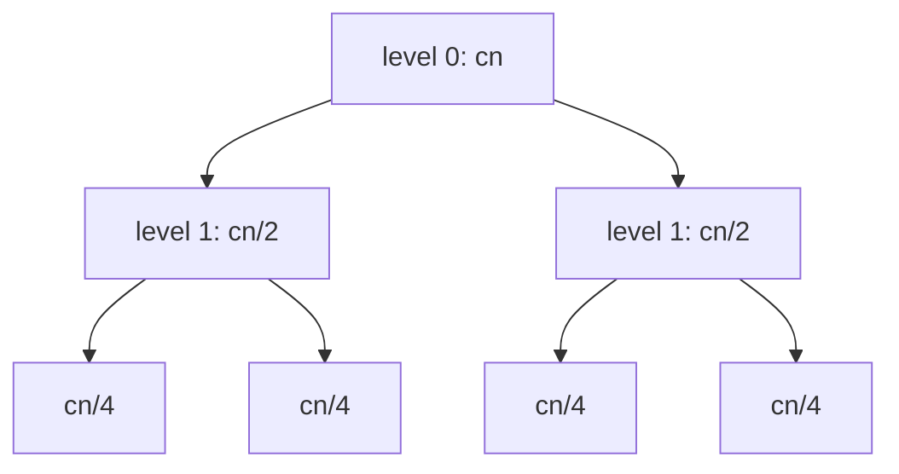

# Analysing recursive algorithms

To analyse a recursive algorithm we account for the operations performed **in each activation**
(excluding the work done by its recursive calls) and sum over all activations. A recursion trace
or **recursion tree** organises the sum. This lesson develops that technique, shows how recursion
can go badly wrong, and classifies recursion into linear, binary and multiple.

## 1. The method

1. Draw the recursion trace (or imagine it): one node per activation.
2. Bound the non-recursive work done by each activation.
3. Sum over all nodes. Often it is easiest to sum **level by level**.

Applied to the four examples of the previous lesson:

- **factorial(n):** $n+1$ activations × $O(1)$ = $O(n)$.
- **draw_interval(c):** $2^c - 1$ lines printed, and every activation except the base cases prints
  one line; there are $2^{c+1} - 1$ activations. $O(2^c)$.
- **binary search:** one recursive call per activation, and the range size $r = high - low + 1$
  at least halves: after $j$ calls, $r \le n / 2^j$. The recursion stops by the time $r < 1$, so
  there are at most $\lfloor \log n \rfloor + 1$ activations: $O(\log n)$.
- **disk usage:** $O(n)$ by charging each loop iteration to the child it recurses into.

## 2. Recurrence equations and recursion trees

The running time $T(n)$ of a recursive function naturally satisfies a **recurrence**: an equation
that expresses $T(n)$ in terms of $T$ on smaller inputs.

| Algorithm | Recurrence | Solution |
|---|---|---|
| factorial | $T(n) = T(n-1) + c$ | $\Theta(n)$ |
| binary search | $T(n) = T(n/2) + c$ | $\Theta(\log n)$ |
| binary_sum (below) | $T(n) = 2T(n/2) + c$ | $\Theta(n)$ |
| merge-sort | $T(n) = 2T(n/2) + cn$ | $\Theta(n \log n)$ |
| bad_fibonacci | $T(n) = T(n-1) + T(n-2) + c$ | $\Theta(\phi^n)$ |
| unique3 (below) | $T(n) = 2T(n-1) + c$ | $\Theta(2^n)$ |

A **recursion tree** expands the recurrence: the root costs the non-recursive work at size $n$,
its children cost the work at their sizes, and so on.



For $T(n) = 2T(n/2) + cn$, each level sums to $cn$ and there are $\log n + 1$ levels, so
$T(n) = cn(\log n + 1) = \Theta(n\log n)$. For $T(n) = 2T(n/2) + c$, level $i$ has $2^i$ nodes of
cost $c$; summing a geometric series over $\log n$ levels gives about $2cn = \Theta(n)$.

> [!TIP]
> Quick rules for $T(n) = aT(n/b) + f(n)$: compare $f(n)$ with $n^{\log_b a}$. If $f$ is
> polynomially smaller, the leaves dominate: $\Theta(n^{\log_b a})$. If equal, every level costs the
> same: multiply by $\log n$. If $f$ is polynomially larger (and regular), the root dominates:
> $\Theta(f(n))$. This is the *master theorem*; recursion trees are its intuition.

## 3. Recursion run amok

Recursion is elegant, but a careless recursive formulation can be catastrophically slow.

### 3.1 Element uniqueness, recursively

```python
def unique3(S, start, stop):
    """Return True if there are no duplicates in S[start:stop]."""
    if stop - start <= 1:
        return True
    elif not unique3(S, start, stop - 1):
        return False
    elif not unique3(S, start + 1, stop):
        return False
    else:
        return S[start] != S[stop - 1]
```

It is correct — the slice has no duplicates iff the first $n-1$ have none, the last $n-1$ have
none, and the two endpoints differ. But a call on size $n$ makes **two** calls on size $n-1$, so
there are $1 + 2 + 4 + \cdots + 2^{n-1} = 2^n - 1$ calls. Exponential! Compare to the $O(n \log n)$
sort-based algorithm.

### 3.2 Fibonacci, badly

```python
def bad_fibonacci(n):
    if n <= 1:
        return n
    return bad_fibonacci(n - 2) + bad_fibonacci(n - 1)
```

Let $c_n$ be the number of calls for input $n$. Then $c_0 = c_1 = 1$ and
$c_n = 1 + c_{n-1} + c_{n-2}$. The numbers grow like this: 1, 1, 3, 5, 9, 15, 25, 41, 67, 109, 177…
Every two steps the count more than doubles ($c_n > 2 c_{n-2}$), so $c_n > 2^{n/2}$: exponential.
The waste comes from recomputing the same subproblems over and over — `bad_fibonacci(n-2)` is
computed independently by both the top call and by `bad_fibonacci(n-1)`.

### 3.3 Fibonacci, well

Return a **pair** so that each call does the work only once:

```python
def good_fibonacci(n):
    """Return the pair (F(n), F(n-1))."""
    if n <= 1:
        return (n, 0)
    a, b = good_fibonacci(n - 1)
    return (a + b, a)
```

One recursive call per activation: $O(n)$.

```python-run
calls = 0
def bad_fibonacci(n):
    global calls
    calls += 1
    return n if n <= 1 else bad_fibonacci(n - 2) + bad_fibonacci(n - 1)

def good_fibonacci(n):
    if n <= 1:
        return (n, 0)
    a, b = good_fibonacci(n - 1)
    return (a + b, a)

for n in [10, 20, 25]:
    calls = 0
    v = bad_fibonacci(n)
    print(f"F({n}) = {v}: bad version made {calls:,} calls; good version makes {n} calls ->",
          good_fibonacci(n)[0])
```

> [!INTERVIEW]
> The two Fibonacci versions are the shortest possible introduction to **dynamic programming**:
> identify overlapping subproblems and compute each once (by returning extra values, memoising with
> `functools.lru_cache`, or filling a table bottom-up).

### 3.4 Maximum recursion depth

Infinite recursion (a base case never reached) would exhaust memory; Python guards against this by
limiting the call depth to about 1000 and raising `RecursionError`. Linear recursions on large
inputs (a recursive sum over 10,000 items) hit this limit even when correct. Remedies:
`sys.setrecursionlimit(...)` for moderate depths, or — better — use a recursion of depth
$O(\log n)$, or eliminate the recursion.

## 4. Kinds of recursion

The book classifies recursions by the maximum number of recursive calls an activation can make.

### 4.1 Linear recursion — at most one call

**Summing a sequence:**

```python
def linear_sum(S, n):
    """Return the sum of the first n numbers of S."""
    if n == 0:
        return 0
    return linear_sum(S, n - 1) + S[n - 1]
```

$n+1$ calls, $O(n)$ time and $O(n)$ space.

**Reversing a sequence in place** — swap the ends and recur on the middle:

```python
def reverse(S, start, stop):
    """Reverse elements of S[start:stop]."""
    if start < stop - 1:
        S[start], S[stop - 1] = S[stop - 1], S[start]
        reverse(S, start + 1, stop - 1)
```

There are two base cases (empty slice and one-element slice); about $n/2$ calls: $O(n)$.

**Computing powers.** The trivial recursion $x^n = x \cdot x^{n-1}$ makes $n$ calls. Better: use
repeated squaring,

$$x^n = \begin{cases} 1 & n = 0 \\ \left(x^{\lfloor n/2 \rfloor}\right)^2 \cdot x & n \text{ odd} \\ \left(x^{\lfloor n/2 \rfloor}\right)^2 & n \text{ even} \end{cases}$$

```python
def power(x, n):
    if n == 0:
        return 1
    partial = power(x, n // 2)     # ONE recursive call, result reused
    result = partial * partial
    if n % 2 == 1:
        result *= x
    return result
```

$n$ halves each call: $O(\log n)$ multiplications. Note it is crucial to compute `partial` once
and square it; writing `power(x, n//2) * power(x, n//2)` makes two calls and is back to $O(n)$.

### 4.2 Binary recursion — two calls

**Binary sum** — sum each half and add:

```python
def binary_sum(S, start, stop):
    if start >= stop:
        return 0
    elif start == stop - 1:
        return S[start]
    mid = (start + stop) // 2
    return binary_sum(S, start, mid) + binary_sum(S, mid, stop)
```

The trace is a binary tree with $n$ leaves and $2n - 1$ nodes, so $O(n)$ time — same as linear sum —
but its depth is only $1 + \log_2 n$, so it uses $O(\log n)$ stack space and never hits the
recursion limit for practical $n$.

### 4.3 Multiple recursion — more than two calls

Disk usage is one example (one call per child). Another is **combinatorial puzzle search**: try
each unused symbol in the next position, recur, then undo. The book's `PuzzleSolve(k, S, U)`
generates all length-$k$ sequences of distinct elements of $U$:

```python-run
def puzzle_solve(k, S, U, found):
    """Extend sequence S with k more distinct elements from U; record full sequences."""
    for e in list(U):
        S.append(e)
        U.remove(e)
        if k == 1:
            found.append("".join(S))      # a complete candidate; test it here
        else:
            puzzle_solve(k - 1, S, U, found)
        S.pop()                           # undo: backtrack
        U.add(e)

found = []
puzzle_solve(3, [], {"a", "b", "c"}, found)
print(sorted(found))
# Solve "pot + pan = bib"-style puzzles by testing each assignment of digits to letters.
```

The number of calls is $n(n-1)(n-2)\cdots$ — exponential-like growth — which is why puzzle search is
only practical for small $n$, and why pruning (abandoning a partial assignment as soon as it cannot
succeed) matters so much.

## 5. Solving recurrences by unrolling: four worked examples

The table in section 2 listed solutions; here is how to obtain them. **Unrolling** (iterated
substitution) expands the recurrence until a pattern appears, sums the pattern, and then — because a
guess is not a proof — confirms it by induction.

**Example A: $T(n) = T(n-1) + n$, $T(0) = 0$** (a recursion that does linear work and shrinks by
one — selection sort, or quick-sort's worst case).

$$T(n) = n + T(n-1) = n + (n-1) + T(n-2) = \cdots = n + (n-1) + \cdots + 1 = \frac{n(n+1)}{2}.$$

$\Theta(n^2)$. *Check:* assuming $T(n-1) = (n-1)n/2$, we get
$T(n) = n + \frac{(n-1)n}{2} = \frac{n(n+1)}{2}$. ✓

**Example B: $T(n) = T(n/2) + c$, $T(1) = c$** (binary search).

$$T(n) = c + T(n/2) = 2c + T(n/4) = \cdots = kc + T(n/2^k).$$

The recursion bottoms out when $n/2^k = 1$, i.e. $k = \log_2 n$: $T(n) = c\log_2 n + c$.
$\Theta(\log n)$.

**Example C: $T(n) = T(n/2) + cn$, $T(1) = c$** (prune-and-search: linear work, then recurse on
*one* half — the pattern of quick-select).

$$T(n) = cn + \frac{cn}{2} + \frac{cn}{4} + \cdots + c \;<\; cn\left(1 + \tfrac12 + \tfrac14 + \cdots\right) = 2cn.$$

A geometric series: $\Theta(n)$. The first level dominates; all later levels together cost no more
than the first.

**Example D: $T(n) = 2T(n/2) + cn$, $T(1) = c$** (merge-sort).

$$T(n) = cn + 2T(n/2) = cn + cn + 4T(n/4) = \cdots = k\,cn + 2^k\,T(n/2^k).$$

With $k = \log_2 n$: $T(n) = cn\log_2 n + cn$. $\Theta(n \log n)$. Every level costs the same $cn$,
and there are $\log_2 n$ of them.

Compare C and D: identical per-call work, but one recursive call versus two changes the total from
$n$ to $n \log n$. And compare D with $T(n) = 2T(n/2) + c$ (binary sum), where level $i$ costs
$2^i c$: there the **last** level dominates and the total is $\Theta(n)$. In general, ask *which
level of the recursion tree is the most expensive*:

| Pattern | Level costs | Total | Example |
|---|---|---|---|
| decreasing geometrically | root dominates | $\Theta(\text{root cost})$ | $T(n/2) + cn = \Theta(n)$ |
| equal on every level | all levels count | $\Theta(\text{level cost} \times \text{depth})$ | $2T(n/2) + cn = \Theta(n\log n)$ |
| increasing geometrically | leaves dominate | $\Theta(\text{number of leaves})$ | $2T(n/2) + c = \Theta(n)$ |

### Checking the algebra by counting

A recurrence is a claim about a program, so it can be tested: instrument the function to count its
basic steps and compare with the closed form.

```python-run
import math

def steps_A(n):                       # T(n) = T(n-1) + n
    return 0 if n == 0 else n + steps_A(n - 1)
def steps_B(n):                       # T(n) = T(n/2) + 1
    return 1 if n <= 1 else 1 + steps_B(n // 2)
def steps_C(n):                       # T(n) = T(n/2) + n
    return 1 if n <= 1 else n + steps_C(n // 2)
def steps_D(n):                       # T(n) = 2 T(n/2) + n
    return 1 if n <= 1 else n + 2 * steps_D(n // 2)
def steps_E(n):                       # T(n) = 2 T(n/2) + 1
    return 1 if n <= 1 else 1 + 2 * steps_E(n // 2)

print(f"{'n':>6} {'A: n(n+1)/2':>14} {'B: log n + 1':>14} {'C: < 2n':>12} {'D: n log n + n':>16} {'E: 2n - 1':>12}")
for n in [16, 64, 256, 512]:
    lg = int(math.log2(n))
    print(f"{n:>6} {steps_A(n):>6} = {n*(n+1)//2:<6} {steps_B(n):>6} = {lg + 1:<6}"
          f" {steps_C(n):>6} < {2*n:<4} {steps_D(n):>8} = {n*lg + n:<6} {steps_E(n):>6} = {2*n - 1}")
```

Every column matches its closed form exactly (for powers of two). When $n$ is not a power of two the
floors and ceilings perturb the constants but not the growth rate.

### A recurrence that is not divide-and-conquer

For `bad_fibonacci`, $c_n = 1 + c_{n-1} + c_{n-2}$. Unrolling does not telescope neatly, so bound it
instead. Dropping the 1 and using $c_{n-1} \ge c_{n-2}$ gives $c_n \ge 2c_{n-2}$, hence
$c_n \ge 2^{n/2}$; and $c_n \le 2c_{n-1}$ (roughly) gives $c_n \le 2^n$. The truth lies between:
$c_n$ grows like $\phi^n$ with $\phi = (1 + \sqrt5)/2 \approx 1.618$, because the recurrence is the
Fibonacci recurrence itself — in fact $c_n = 2F_{n+1} - 1$.

```python-run
def calls(n):
    return 1 if n <= 1 else 1 + calls(n - 1) + calls(n - 2)
def fib(n):
    a, b = 0, 1
    for _ in range(n): a, b = b, a + b
    return a
for n in [5, 10, 20, 25]:
    print(n, calls(n), 2 * fib(n + 1) - 1, "ratio to previous n ~", round(calls(n) / calls(n - 1), 3))
```

The ratio of consecutive call counts settles at about 1.618: each extra unit of $n$ multiplies the
running time by the golden ratio.

## 6. Pitfalls

- Calling the same subproblem twice (`power` with two calls, `bad_fibonacci`).
- Passing slices (`S[1:]`) instead of indices: each slice copies, turning $O(n)$ into $O(n^2)$.
- Forgetting the "undo" step in backtracking, so state leaks between branches.
- Assuming recursion uses no extra memory: every pending call holds a frame.

## 7. Summary

- Analyse recursion by summing per-activation work over the recursion trace/tree.
- Overlapping subproblems can make innocent recursions exponential; fix by computing each once.
- Linear recursion: depth $O(n)$; binary recursion halving the input: depth $O(\log n)$; multiple
  recursion: enumerates combinatorial spaces.

> **Source:** Goodrich, Tamassia & Goldwasser, *Data Structures and Algorithms in Python*, ch. 4.2–4.4.

## Check yourself

```quiz
[
  {"q": "Solve T(n) = 2T(n/2) + cn.",
   "options": ["Theta(n)", "Theta(n log n)", "Theta(n^2)", "Theta(log n)"], "answer": 1,
   "explain": "Each of the log n + 1 levels of the recursion tree sums to cn."},
  {"q": "Why does unique3 take exponential time?",
   "options": ["It sorts at every step", "Each call on size n makes two calls on size n-1", "It copies the list", "Comparisons are expensive"], "answer": 1,
   "explain": "T(n) = 2T(n-1) + c gives 2^n - 1 calls."},
  {"q": "good_fibonacci is linear because...",
   "options": ["it uses a loop internally", "it returns (F(n), F(n-1)) so each level makes only one recursive call", "it memoises with a dict", "Fibonacci numbers are small"], "answer": 1,
   "explain": "Returning the pair supplies both values the caller needs, so the duplicate subcall disappears."},
  {"q": "What is wrong with `return power(x, n//2) * power(x, n//2)`?",
   "options": ["Nothing, it is O(log n)", "It makes two recursive calls, so the running time becomes O(n)", "It gives the wrong answer for odd n only", "It causes infinite recursion"], "answer": 1,
   "explain": "T(n) = 2T(n/2) + c solves to Theta(n). Computing partial once keeps T(n) = T(n/2) + c = Theta(log n)."},
  {"q": "binary_sum and linear_sum both run in O(n) time. What is binary_sum's advantage?",
   "options": ["Fewer additions", "Recursion depth O(log n) instead of O(n)", "It works on unsorted data", "It avoids base cases"], "answer": 1,
   "explain": "Halving the range gives depth 1 + log n, so stack usage is logarithmic and the recursion limit is never a concern."},
  {"q": "In backtracking puzzle search, why must you undo the choice (S.pop(), U.add(e)) after the recursive call?",
   "options": ["To free memory", "So the next candidate in the loop starts from the same state", "Python requires it", "To make the algorithm O(n)"], "answer": 1,
   "explain": "All branches share S and U; failing to restore them corrupts the state seen by sibling branches."},
  {"q": "bad_fibonacci(n) makes c_n calls with c_n = 1 + c_(n-1) + c_(n-2). Which bound holds?",
   "options": ["c_n = O(n)", "c_n > 2^(n/2)", "c_n = O(n^2)", "c_n = O(log n)"], "answer": 1,
   "explain": "c_n > 2 c_(n-2), so the count at least doubles every two steps."}
]
```
