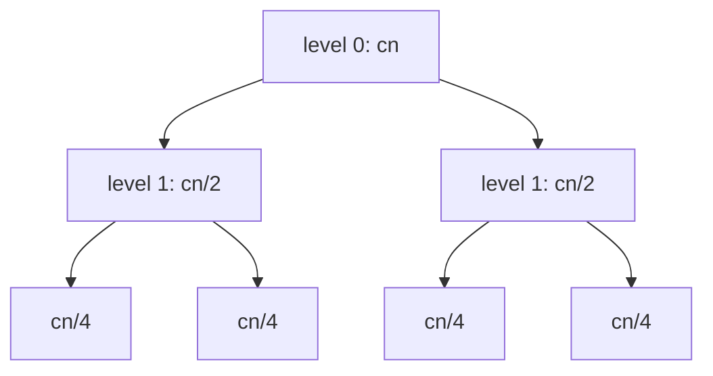

# Analysing recursive algorithms

> **Before this lesson:** You should know what base cases, recursive cases and a recursion trace
> are, and have seen factorial, the ruler, binary search and disk usage. All four are in
> [Thinking recursively: four classic examples](#/lesson/dsa-foundations/recursion-examples). The
> arithmetic and geometric sums come from
> [Measuring algorithms and the seven functions](#/lesson/dsa-foundations/seven-functions).

## In plain words

A loop wears its cost on its sleeve: you can see how many times it goes round. A recursive
function hides its cost, because the work is spread over many calls that you cannot see all at
once. This lesson teaches the bookkeeping that brings the cost into view: work out what *one*
call does on its own, count how many calls there are, and add up.

Think of a manager who is handed a job, does a little of it personally, and delegates the rest to
assistants, who delegate in turn. To find the total effort you would not follow one person
around. You would draw the organisation chart, write beside each person the work they personally
did, and add up the chart, usually one layer of management at a time. That chart is what this
lesson calls a recursion tree.

Why it matters for a job: two recursive functions can look almost identical while one finishes
in a blink and the other would outlast the universe. The second half of this lesson shows
exactly that with Fibonacci numbers, a standard interview example. Being able to predict which
kind you have written, before running it, is the skill.

## 1. The method

To analyse a recursive algorithm, account for the operations performed **inside each call**, not
counting the work done by the calls it makes, and then add over all calls. (A single call is
also called an *activation*, the term used in the previous lesson's "activation record".)

1. Draw the recursion trace, or imagine it: one box per call.
2. Bound the work each box does by itself.
3. Add over all boxes. It is often easiest to add **level by level**, where level 0 is the first
   call, level 1 is the calls it makes, and so on.

Applied to the four examples of the previous lesson:

- **factorial(n):** $n+1$ calls, each doing $O(1)$ work of its own: $O(n)$.
- **draw_interval(c):** every call with $c \ge 1$ prints one line and there are $2^c - 1$ lines;
  counting the base-case calls too gives $2^{c+1} - 1$ calls in all. $O(2^c)$.
- **binary search:** each call does $O(1)$ work and makes at most one further call, on a range at
  most half the size. After $j$ calls the range holds at most $n / 2^j$ items, and the recursion
  stops once that drops below 1, so there are at most $\lfloor \log n \rfloor + 1$ calls:
  $O(\log n)$.
- **disk usage:** $O(n)$, by billing each loop iteration to the child it handles.

## 2. Recurrence equations and recursion trees

Write $T(n)$ for the running time of a recursive function on an input of size $n$. Because the
function calls itself, $T(n)$ can be described in terms of $T$ on smaller inputs. Such an
equation is called a **recurrence**. For factorial: the call on $n$ does a constant amount of
work, say $c$ steps, plus whatever the call on $n - 1$ costs. So $T(n) = T(n-1) + c$. Reading a
recurrence aloud helps: "the time for $n$ is the time for $n - 1$, plus a constant".

The table lists the recurrences that come up in this track. The "solution" column gives $T(n)$
as an ordinary formula with no $T$ on the right-hand side, called a **closed form**; section 5
shows how to obtain each one. ($\phi$ is a constant close to 1.618, explained in section 5.)

| Algorithm | Recurrence | Solution |
|---|---|---|
| factorial | $T(n) = T(n-1) + c$ | $\Theta(n)$ |
| binary search | $T(n) = T(n/2) + c$ | $\Theta(\log n)$ |
| binary_sum (below) | $T(n) = 2T(n/2) + c$ | $\Theta(n)$ |
| merge-sort | $T(n) = 2T(n/2) + cn$ | $\Theta(n \log n)$ |
| bad_fibonacci | $T(n) = T(n-1) + T(n-2) + c$ | $\Theta(\phi^n)$ |
| unique3 (below) | $T(n) = 2T(n-1) + c$ | $\Theta(2^n)$ |

A **recursion tree** is the organisation chart for a recurrence. The box at the top, called the
**root**, is labelled with the work the first call does itself. Below it are boxes for the calls
it makes, each labelled with its own work, and so on down to the base cases at the bottom, which
are called **leaves**. The picture shows the top of the tree for $T(n) = 2T(n/2) + cn$: a call
that does $cn$ work itself and makes two calls on halves.



Add it up one level at a time. Level 0 has one box costing $cn$. Level 1 has two boxes costing
$cn/2$ each, total $cn$. Level 2 has four boxes costing $cn/4$ each, total $cn$ again. Every
level adds up to $cn$. How many levels are there? The size halves at each level and stops at 1,
so about $\log n + 1$. Hence $T(n) = cn(\log n + 1) = \Theta(n\log n)$.

Now change the recurrence slightly to $T(n) = 2T(n/2) + c$: each call does only constant work.
Level $i$ has $2^i$ boxes costing $c$ each, so the levels cost $c, 2c, 4c, \ldots$, a doubling
series. A doubling series adds up to less than twice its last term, and the last level has about
$n$ boxes, so the total is about $2cn = \Theta(n)$. Same tree shape, very different total.

> [!TIP]
> There is a general shortcut for recurrences of the form $T(n) = aT(n/b) + f(n)$, meaning "make
> $a$ calls on inputs $b$ times smaller, and do $f(n)$ work yourself". Compare $f(n)$ with
> $n^{\log_b a}$, which is the number of leaves. If $f$ is smaller by a power of $n$, the leaves
> dominate and $T(n) = \Theta(n^{\log_b a})$. If the two are equal, every level costs the same
> and you multiply by $\log n$. If $f$ is larger by a power of $n$, the root dominates and
> $T(n) = \Theta(f(n))$. This is called the *master theorem*. You do not need to memorise it:
> the recursion tree gives the same answers and shows why.

## 3. Recursion run amok

Recursion reads well, but a careless recursive formulation can be disastrously slow. The next
two examples are correct programs that are useless in practice.

### 3.1 Element uniqueness, recursively

```python
def unique3(S, start, stop):
    """Return True if there are no duplicates in S[start:stop]."""
    if stop - start <= 1:
        return True
    elif not unique3(S, start, stop - 1):
        return False
    elif not unique3(S, start + 1, stop):
        return False
    else:
        return S[start] != S[stop - 1]
```

The idea: a stretch of $n$ items has no duplicates exactly when the first $n-1$ items have none,
the last $n-1$ items have none, and the two end items differ from each other. (Any pair of equal
items either lies inside one of those two shorter stretches or is the pair of ends.) That logic
is correct. The cost is the problem. A call on size $n$ makes **two** calls on size $n-1$, each
of those makes two on size $n - 2$, and so on: $1 + 2 + 4 + \cdots + 2^{n-1} = 2^n - 1$ calls.
For a list of 40 items that is about a million million calls, where the sort-based method from
the analysis lesson needed a few hundred steps.

### 3.2 Fibonacci, badly

The **Fibonacci numbers** are the sequence $0, 1, 1, 2, 3, 5, 8, 13, 21, \ldots$ in which each
number is the sum of the two before it. Writing $F(n)$ for the $n$-th one, $F(0) = 0$,
$F(1) = 1$ and $F(n) = F(n-2) + F(n-1)$. Translating that definition word for word gives:

```python
def bad_fibonacci(n):
    if n <= 1:
        return n
    return bad_fibonacci(n - 2) + bad_fibonacci(n - 1)
```

Let $c_n$ be the number of calls made for input $n$. A call on 0 or 1 returns at once, so
$c_0 = c_1 = 1$. Otherwise there is the call itself plus everything its two sub-calls do:
$c_n = 1 + c_{n-1} + c_{n-2}$. The counts run 1, 1, 3, 5, 9, 15, 25, 41, 67, 109, 177, ...
Every two steps the count more than doubles ($c_n > 2 c_{n-2}$), so $c_n > 2^{n/2}$: exponential.

Where does the waste come from? Computing `bad_fibonacci(5)` asks for `bad_fibonacci(3)` and
`bad_fibonacci(4)`. But `bad_fibonacci(4)` asks for `bad_fibonacci(3)` again, from scratch, as if
nobody had ever worked it out. The same smaller problems are solved over and over; they are
called **overlapping subproblems**.

### 3.3 Fibonacci, well

The cure is to make each call hand back *two* values, $F(n)$ and $F(n-1)$, as a pair. The caller
then has everything it needs from a single recursive call:

```python
def good_fibonacci(n):
    """Return the pair (F(n), F(n-1))."""
    if n <= 1:
        return (n, 0)
    a, b = good_fibonacci(n - 1)
    return (a + b, a)
```

**Reading this code.** `(n, 0)` is a **tuple**, a fixed group of values; here a pair. The line
`a, b = good_fibonacci(n - 1)` unpacks the returned pair into two names: `a` is $F(n-1)$ and `b`
is $F(n-2)$. The function then returns `(a + b, a)`, which is $(F(n), F(n-1))$. Each call makes
one recursive call and does constant work, so the recurrence is $T(n) = T(n-1) + c$: $O(n)$.

The demo counts the calls made by the bad version. `global calls` lets the function update the
counter defined outside it.

```python-run
calls = 0
def bad_fibonacci(n):
    global calls
    calls += 1
    return n if n <= 1 else bad_fibonacci(n - 2) + bad_fibonacci(n - 1)

def good_fibonacci(n):
    if n <= 1:
        return (n, 0)
    a, b = good_fibonacci(n - 1)
    return (a + b, a)

for n in [10, 20, 25]:
    calls = 0
    v = bad_fibonacci(n)
    print(f"F({n}) = {v}: bad version made {calls:,} calls; good version makes {n} calls ->",
          good_fibonacci(n)[0])
```

The output shows 177 calls for $F(10)$, 21,891 for $F(20)$ and 242,785 for $F(25)$, against 10,
20 and 25 calls for the good version. Five more units of $n$ multiplied the work by eleven.

> [!INTERVIEW]
> The two Fibonacci versions are the shortest introduction to **dynamic programming**: notice
> that subproblems overlap, and compute each one once. There are three usual ways: return extra
> values (as above), **memoise** (store each answer the first time it is computed and look it up
> afterwards, for instance with Python's `functools.lru_cache`), or fill in a table from the
> smallest case upwards with a loop.

### 3.4 Maximum recursion depth

A recursion that never reaches a base case would use up all the computer's memory, so Python
caps the depth of the call stack at about 1000 and raises `RecursionError` beyond that. The cap
also catches *correct* recursions that go deep in a single chain: a recursive sum over 10,000
items needs 10,000 frames at once. Remedies: raise the cap with `sys.setrecursionlimit(...)` for
moderate depths; or, better, restructure so that the depth is $O(\log n)$; or replace the
recursion with a loop.

## 4. Kinds of recursion

Recursions are classified by the largest number of recursive calls one call can make directly.

### 4.1 Linear recursion: at most one call

**Summing a sequence.** The sum of the first $n$ numbers is the sum of the first $n - 1$, plus
the $n$-th:

```python
def linear_sum(S, n):
    """Return the sum of the first n numbers of S."""
    if n == 0:
        return 0
    return linear_sum(S, n - 1) + S[n - 1]
```

`S[n - 1]` is the $n$-th item because Python numbers positions from 0. There are $n+1$ calls in a
single chain, so $O(n)$ time and $O(n)$ space for the stack.

**Reversing a sequence in place.** "In place" means rearranging the list itself without building
a second list. Swap the two end items, then reverse what lies between them:

```python
def reverse(S, start, stop):
    """Reverse elements of S[start:stop]."""
    if start < stop - 1:
        S[start], S[stop - 1] = S[stop - 1], S[start]
        reverse(S, start + 1, stop - 1)
```

The line `S[start], S[stop - 1] = S[stop - 1], S[start]` swaps two items in one statement. The
base cases are implicit: when the stretch has zero items or one item, the `if` is false and the
function returns without doing anything. Each call shortens the stretch by two, so there are
about $n/2$ calls: $O(n)$.

**Computing powers.** The direct recursion $x^n = x \cdot x^{n-1}$ makes $n$ calls. A better
idea, **repeated squaring**, uses the fact that $x^{10} = (x^5)^2$: one squaring takes the place
of five multiplications. When $n$ is odd, one extra factor of $x$ is needed:

$$x^n = \begin{cases} 1 & n = 0 \\ \left(x^{\lfloor n/2 \rfloor}\right)^2 \cdot x & n \text{ odd} \\ \left(x^{\lfloor n/2 \rfloor}\right)^2 & n \text{ even} \end{cases}$$

```python
def power(x, n):
    if n == 0:
        return 1
    partial = power(x, n // 2)     # ONE recursive call, result reused
    result = partial * partial
    if n % 2 == 1:
        result *= x
    return result
```

`n // 2` is $n$ halved and rounded down, and `n % 2` is the remainder after dividing by 2, which
is 1 exactly when $n$ is odd. Trace `power(2, 5)`: it needs `power(2, 2)`, which needs
`power(2, 1)`, which needs `power(2, 0) = 1`. Coming back: $1 \cdot 1 \cdot 2 = 2$, then
$2 \cdot 2 = 4$, then $4 \cdot 4 \cdot 2 = 32$. Four calls instead of six.

$n$ halves at each call, so there are $O(\log n)$ calls and multiplications. It is essential to
compute `partial` once and square it. Writing `power(x, n//2) * power(x, n//2)` makes two
recursive calls, the recurrence becomes $T(n) = 2T(n/2) + c$, and the cost is back to $O(n)$.

### 4.2 Binary recursion: two calls

**Binary sum.** Split the stretch in half, sum each half recursively, and add the two results:

```python
def binary_sum(S, start, stop):
    if start >= stop:
        return 0
    elif start == stop - 1:
        return S[start]
    mid = (start + stop) // 2
    return binary_sum(S, start, mid) + binary_sum(S, mid, stop)
```

The trace branches in two at every call. It has $n$ bottom boxes (one per item) and $2n - 1$
boxes in all, each doing constant work, so the time is $O(n)$, the same as the linear sum. The
gain is in memory. Only one chain of calls is in progress at any moment, and the chain is at most
$1 + \log_2 n$ deep, so the stack holds $O(\log n)$ frames and Python's depth cap is never a
concern for realistic $n$.

### 4.3 Multiple recursion: more than two calls

Disk usage is one example (one call per child). Another is **puzzle search by trying every
arrangement**: put each unused symbol in the next position, recurse to fill the remaining
positions, then take the symbol back out and try the next one. Taking a choice back so that
another can be tried is called **backtracking**. The function below builds every sequence of $k$
different elements chosen from a set $U$:

```python-run
def puzzle_solve(k, S, U, found):
    """Extend sequence S with k more distinct elements from U; record full sequences."""
    for e in list(U):
        S.append(e)
        U.remove(e)
        if k == 1:
            found.append("".join(S))      # a complete candidate; test it here
        else:
            puzzle_solve(k - 1, S, U, found)
        S.pop()                           # undo: backtrack
        U.add(e)

found = []
puzzle_solve(3, [], {"a", "b", "c"}, found)
print(sorted(found))
# Solve "pot + pan = bib"-style puzzles by testing each assignment of digits to letters.
```

**Reading this code.** `S` is the sequence built so far (a list) and `U` is the set of symbols
not yet used. `for e in list(U)` loops over a *copy* of the set, because the loop body changes
`U`. `S.append(e)` and `U.remove(e)` make the choice; if this was the last position (`k == 1`)
the finished sequence is recorded, otherwise the function recurses to fill the remaining
`k - 1` positions. `S.pop()` and `U.add(e)` then undo the choice. The output is the six
orderings `['abc', 'acb', 'bac', 'bca', 'cab', 'cba']`.

With $n$ symbols there are $n$ choices for the first position, $n - 1$ for the second, and so on,
so the number of sequences is $n(n-1)(n-2)\cdots$, which grows as fast as a factorial. That is
why this kind of search is practical only for small $n$, and why **pruning** (abandoning a
partial sequence as soon as it clearly cannot lead to a solution) matters so much.

## 5. Solving recurrences by unrolling: four worked examples

The table in section 2 listed solutions; here is how to get them. **Unrolling** means replacing
$T$ on the right-hand side by its own definition, again and again, until a pattern appears. You
then add up the pattern. Since spotting a pattern is a guess and not a proof, the last step is
to confirm the result by induction.

**Example A: $T(n) = T(n-1) + n$, $T(0) = 0$** (a recursion that does linear work and shrinks by
one — selection sort, or quick-sort's worst case).

$$T(n) = n + T(n-1) = n + (n-1) + T(n-2) = \cdots = n + (n-1) + \cdots + 1 = \frac{n(n+1)}{2}.$$

$\Theta(n^2)$. *Check:* assuming $T(n-1) = (n-1)n/2$, we get
$T(n) = n + \frac{(n-1)n}{2} = \frac{n(n+1)}{2}$. ✓

**Example B: $T(n) = T(n/2) + c$, $T(1) = c$** (binary search).

$$T(n) = c + T(n/2) = 2c + T(n/4) = \cdots = kc + T(n/2^k).$$

The recursion bottoms out when $n/2^k = 1$, i.e. $k = \log_2 n$: $T(n) = c\log_2 n + c$.
$\Theta(\log n)$.

**Example C: $T(n) = T(n/2) + cn$, $T(1) = c$** (prune-and-search: linear work, then recurse on
*one* half — the pattern of quick-select).

$$T(n) = cn + \frac{cn}{2} + \frac{cn}{4} + \cdots + c \;<\; cn\left(1 + \tfrac12 + \tfrac14 + \cdots\right) = 2cn.$$

A geometric series: $\Theta(n)$. The first level dominates; all later levels together cost no more
than the first.

**Example D: $T(n) = 2T(n/2) + cn$, $T(1) = c$** (merge-sort).

$$T(n) = cn + 2T(n/2) = cn + cn + 4T(n/4) = \cdots = k\,cn + 2^k\,T(n/2^k).$$

With $k = \log_2 n$: $T(n) = cn\log_2 n + cn$. $\Theta(n \log n)$. Every level costs the same $cn$,
and there are $\log_2 n$ of them.

Compare C and D: identical per-call work, but one recursive call versus two changes the total from
$n$ to $n \log n$. And compare D with $T(n) = 2T(n/2) + c$ (binary sum), where level $i$ costs
$2^i c$: there the **last** level dominates and the total is $\Theta(n)$. In general, ask *which
level of the recursion tree is the most expensive*:

| Pattern | Level costs | Total | Example |
|---|---|---|---|
| decreasing geometrically | root dominates | $\Theta(\text{root cost})$ | $T(n/2) + cn = \Theta(n)$ |
| equal on every level | all levels count | $\Theta(\text{level cost} \times \text{depth})$ | $2T(n/2) + cn = \Theta(n\log n)$ |
| increasing geometrically | leaves dominate | $\Theta(\text{number of leaves})$ | $2T(n/2) + c = \Theta(n)$ |

### Checking the algebra by counting

A recurrence is a claim about a program, so it can be tested: instrument the function to count its
basic steps and compare with the closed form.

```python-run
import math

def steps_A(n):                       # T(n) = T(n-1) + n
    return 0 if n == 0 else n + steps_A(n - 1)
def steps_B(n):                       # T(n) = T(n/2) + 1
    return 1 if n <= 1 else 1 + steps_B(n // 2)
def steps_C(n):                       # T(n) = T(n/2) + n
    return 1 if n <= 1 else n + steps_C(n // 2)
def steps_D(n):                       # T(n) = 2 T(n/2) + n
    return 1 if n <= 1 else n + 2 * steps_D(n // 2)
def steps_E(n):                       # T(n) = 2 T(n/2) + 1
    return 1 if n <= 1 else 1 + 2 * steps_E(n // 2)

print(f"{'n':>6} {'A: n(n+1)/2':>14} {'B: log n + 1':>14} {'C: < 2n':>12} {'D: n log n + n':>16} {'E: 2n - 1':>12}")
for n in [16, 64, 256, 512]:
    lg = int(math.log2(n))
    print(f"{n:>6} {steps_A(n):>6} = {n*(n+1)//2:<6} {steps_B(n):>6} = {lg + 1:<6}"
          f" {steps_C(n):>6} < {2*n:<4} {steps_D(n):>8} = {n*lg + n:<6} {steps_E(n):>6} = {2*n - 1}")
```

Every column matches its closed form exactly (for powers of two). When $n$ is not a power of two the
floors and ceilings perturb the constants but not the growth rate.

### A recurrence that is not divide-and-conquer

For `bad_fibonacci`, $c_n = 1 + c_{n-1} + c_{n-2}$. Unrolling does not telescope neatly, so bound it
instead. Dropping the 1 and using $c_{n-1} \ge c_{n-2}$ gives $c_n \ge 2c_{n-2}$, hence
$c_n \ge 2^{n/2}$; and $c_n \le 2c_{n-1}$ (roughly) gives $c_n \le 2^n$. The truth lies between.
The recurrence for $c_n$ is the Fibonacci rule with an extra 1, and in fact
$c_n = 2F_{n+1} - 1$. Fibonacci numbers grow by a factor that settles at
$\phi = (1 + \sqrt5)/2 \approx 1.618$, a constant known as the **golden ratio**, so $c_n$ grows
like $\phi^n$.

```python-run
def calls(n):
    return 1 if n <= 1 else 1 + calls(n - 1) + calls(n - 2)
def fib(n):
    a, b = 0, 1
    for _ in range(n): a, b = b, a + b
    return a
for n in [5, 10, 20, 25]:
    print(n, calls(n), 2 * fib(n + 1) - 1, "ratio to previous n ~", round(calls(n) / calls(n - 1), 3))
```

The ratio of consecutive call counts settles at about 1.618: each extra unit of $n$ multiplies the
running time by the golden ratio.

## 6. Pitfalls

- **Solving the same subproblem twice.** `power` written with two calls and `bad_fibonacci` both
  do this. If two recursive calls have the same arguments, compute once and reuse.
- **Passing slices instead of positions.** `S[1:]` copies the rest of the list at every call,
  which turns an $O(n)$ recursion into $O(n^2)$.
- **Forgetting the "undo" step in backtracking.** `S` and `U` are shared by every branch of the
  search; a choice that is not taken back corrupts what the next branch sees.
- **Assuming recursion costs no memory.** Every call that has started and not finished holds a
  frame. The space used is proportional to the *depth* of the recursion, not the number of calls.
- **Reading the recurrence off wrongly.** Count the recursive calls that really execute. Binary
  search has two recursive calls in its text, but only one of them runs each time.

## 7. Summary

- Analyse a recursion by adding each call's own work over the whole recursion tree.
- A recurrence states the running time in terms of smaller inputs; unrolling or a recursion tree
  turns it into a closed form.
- Overlapping subproblems can make an innocent-looking recursion exponential; the fix is to
  compute each subproblem once.
- Linear recursion has depth $O(n)$; binary recursion that halves its input has depth
  $O(\log n)$; multiple recursion explores every combination of choices.

> **Source:** Goodrich, Tamassia & Goldwasser, *Data Structures and Algorithms in Python*, ch. 4.2–4.4.

## Glossary

- **Activation**: one call of a function, with its own frame.
- **Recurrence**: an equation giving $T(n)$ in terms of $T$ on smaller inputs.
- **Closed form**: a formula for $T(n)$ that no longer refers to $T$.
- **Recursion tree**: a diagram with one node per call, labelled with that call's own work.
- **Root / leaf**: the first call at the top of the tree / a base-case call at the bottom.
- **Unrolling**: substituting a recurrence into itself repeatedly until a pattern appears.
- **Master theorem**: a ready-made rule for solving recurrences of the form $aT(n/b) + f(n)$.
- **Fibonacci numbers**: the sequence in which each number is the sum of the previous two.
- **Overlapping subproblems**: smaller problems that a recursion solves more than once.
- **Memoise**: store a computed answer so that it is looked up, not recomputed, next time.
- **Linear / binary / multiple recursion**: at most one, two, or more than two recursive calls
  per call.
- **Repeated squaring**: computing $x^n$ in $O(\log n)$ multiplications by squaring $x^{n/2}$.
- **Backtracking**: undoing a choice in a search so that the next alternative can be tried.
- **Pruning**: abandoning a branch of a search as soon as it cannot succeed.
- **Golden ratio ($\phi$)**: the constant $(1+\sqrt5)/2 \approx 1.618$.

## Check yourself

```quiz
[
  {"q": "Solve T(n) = 2T(n/2) + cn.",
   "options": ["Theta(n)", "Theta(n log n)", "Theta(n^2)", "Theta(log n)"], "answer": 1,
   "explain": "Each of the log n + 1 levels of the recursion tree sums to cn."},
  {"q": "Why does unique3 take exponential time?",
   "options": ["It sorts at every step", "Each call on size n makes two calls on size n-1", "It copies the list", "Comparisons are expensive"], "answer": 1,
   "explain": "T(n) = 2T(n-1) + c gives 2^n - 1 calls."},
  {"q": "good_fibonacci is linear because...",
   "options": ["it uses a loop internally", "it returns (F(n), F(n-1)) so each level makes only one recursive call", "it memoises with a dict", "Fibonacci numbers are small"], "answer": 1,
   "explain": "Returning the pair supplies both values the caller needs, so the duplicate subcall disappears."},
  {"q": "What is wrong with `return power(x, n//2) * power(x, n//2)`?",
   "options": ["Nothing, it is O(log n)", "It makes two recursive calls, so the running time becomes O(n)", "It gives the wrong answer for odd n only", "It causes infinite recursion"], "answer": 1,
   "explain": "T(n) = 2T(n/2) + c solves to Theta(n). Computing partial once keeps T(n) = T(n/2) + c = Theta(log n)."},
  {"q": "binary_sum and linear_sum both run in O(n) time. What is binary_sum's advantage?",
   "options": ["Fewer additions", "Recursion depth O(log n) instead of O(n)", "It works on unsorted data", "It avoids base cases"], "answer": 1,
   "explain": "Halving the range gives depth 1 + log n, so stack usage is logarithmic and the recursion limit is never a concern."},
  {"q": "In backtracking puzzle search, why must you undo the choice (S.pop(), U.add(e)) after the recursive call?",
   "options": ["To free memory", "So the next candidate in the loop starts from the same state", "Python requires it", "To make the algorithm O(n)"], "answer": 1,
   "explain": "All branches share S and U; failing to restore them corrupts the state seen by sibling branches."},
  {"q": "bad_fibonacci(n) makes c_n calls with c_n = 1 + c_(n-1) + c_(n-2). Which bound holds?",
   "options": ["c_n = O(n)", "c_n > 2^(n/2)", "c_n = O(n^2)", "c_n = O(log n)"], "answer": 1,
   "explain": "c_n > 2 c_(n-2), so the count at least doubles every two steps."}
]
```
