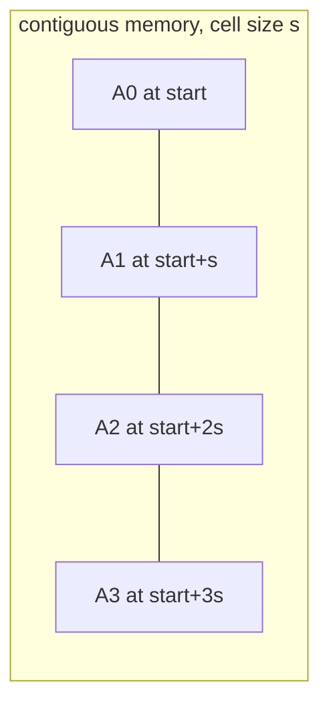
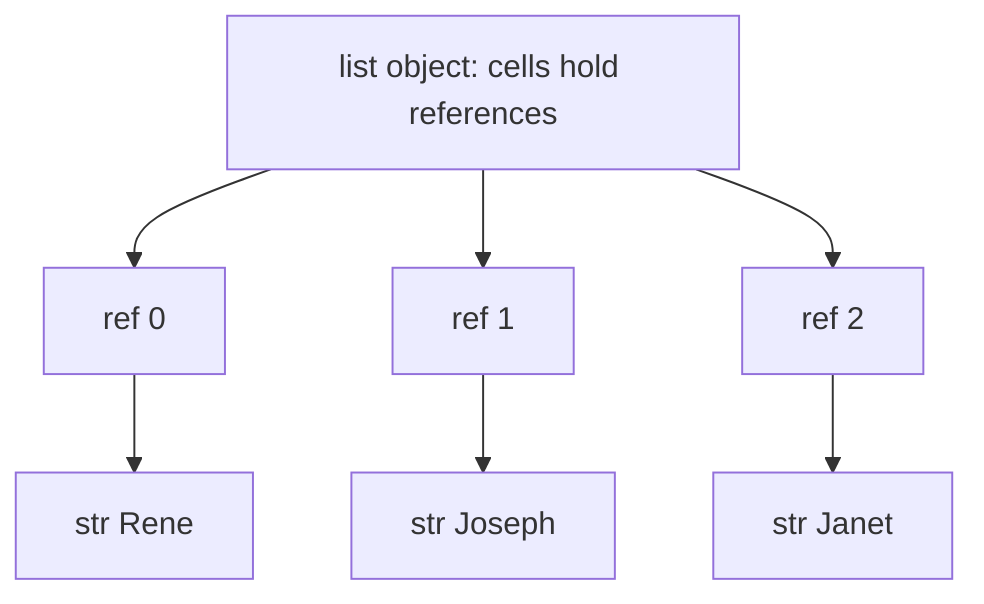

# Low-level arrays and Python's sequence types

> **Before this lesson:** You should be able to use Python lists, tuples and strings (indexing
> with `data[2]`, slicing, `append`), and know what $O(1)$ and $O(n)$ mean from
> [Big-O, Big-Omega and Big-Theta](#/lesson/dsa-foundations/asymptotic-notation). Nothing about
> computer hardware is assumed.

## In plain words

An **array** is a row of equal-sized boxes sitting side by side in the computer's memory, each
holding one value. Python's `list`, `tuple` and `str` are all built on arrays, and nearly
everything about their speed follows from that one fact.

Picture a street of identical terraced houses numbered 0, 1, 2 and so on. Because every house is
the same width, a courier who knows where the street starts can work out where house 500 is
without walking past the first 499: it is 500 house-widths along. That is why reading `data[500]`
is instant. But suppose a new family must move in at number 3 and nobody may be left without a
house: everyone from number 3 onwards has to move one door down. That is why inserting at the
front of a long list is slow.

Why it matters for a job: when your code is unexpectedly slow, or a list "mysteriously" changes
when you altered a different variable, the cause is usually in this lesson. Interviewers also
expect you to know, without looking it up, which list operations are $O(1)$ and which are $O(n)$.

## 1. Memory, addresses and arrays

A computer's main memory is an enormous row of small storage units called **bytes** (a byte holds
eight bits, enough for a number from 0 to 255). Every byte has a number that identifies it, its
**memory address**. The hardware can read or write the byte at any address in essentially the
same short time. That is what the name "random access memory" (RAM) means: byte number 8,675,309
is no slower to reach than byte number 3.

An **array** is a group of related values stored *contiguously*, meaning next to each other with
no gaps, each occupying the same number of bytes. Each slot is a **cell**, and a cell's position
in the row is its **index**, counted from 0. Because every cell has the same size $s$, the
address of cell $i$ needs no searching:

$$\text{address}(A[i]) = \text{start} + s \cdot i.$$

For example, if an array starts at address 1000 and each cell is 4 bytes, cell 6 begins at
$1000 + 4 \times 6 = 1024$. One multiplication and one addition, whatever the length of the
array: that is why indexing is $O(1)$.



A Python `str` such as `"SAMPLE"` is an array of characters stored directly in its cells. In
CPython (the standard Python interpreter) a string containing only plain English characters, the
set known as ASCII, uses 1 byte per character. A string containing characters from other
alphabets uses 2 or 4 bytes per character, since Unicode, the worldwide character standard, has
far more than 256 symbols. Within any one string all cells have the same width, so indexing stays
$O(1)$.

## 2. Referential arrays

Suppose we want an array of 200 names. Names have different lengths, so storing the text itself
in equal-sized cells would waste space: every cell would have to be as large as the longest name.
Python does something else. The cells of a list do not hold the items; they hold **references**,
which are memory addresses saying where each item lives. The items themselves, which Python calls
**objects**, are stored elsewhere. An array of this kind is a **referential array**. Every
reference is the same size (8 bytes on today's 64-bit machines), so the row of cells is uniform
even though the objects are not. Think of a row of identical pigeonholes, each containing a slip
of paper with the location of a parcel.



This design has consequences that surprise newcomers. Two words first: an object is **mutable**
if it can be changed after it is created (a list is), and **immutable** if it cannot (numbers,
strings and tuples are).

- **Items can be shared.** For a list `primes`, the slice `primes[3:6]` creates a *new list*
  whose cells point to the *same* number objects. Since numbers are immutable, nobody can tell.
- **`[0] * 8`** creates eight cells all pointing to the one object `0`. Harmless again, because
  `0` cannot change. But `[[]] * 3` makes three references to *one* inner list, and changing it
  through one cell changes what all three cells show. This is a classic bug.
- **`backup = list(primes)`** is a **shallow copy**: a new row of cells holding the same
  references. To copy the items as well, use `copy.deepcopy`.
- **`primes.extend(extras)`** copies *references* from `extras` into `primes`; no item is
  duplicated.

The demo shows the shared-list bug, its fix, and why the same pattern is safe with numbers.

```python-run
data = [[]] * 3          # three references to ONE list
data[0].append("surprise")
print(data)
safe = [[] for _ in range(3)]   # three distinct lists
safe[0].append("ok")
print(safe)

counters = [0] * 4
counters[2] += 1          # rebinds cell 2 to a new int object; others still reference 0
print(counters)
```

**Reading this code line by line**

- `data = [[]] * 3` builds one empty list and three cells that all refer to it.
- `data[0].append("surprise")` follows cell 0 to that one list and adds a string to it. Printing
  shows `[['surprise'], ['surprise'], ['surprise']]`: all three cells show the change.
- `safe = [[] for _ in range(3)]` runs the expression `[]` three separate times, producing three
  different lists. (The name `_` is a convention for a loop variable that is never used.) After
  the append, the output is `[['ok'], [], []]`.
- `counters[2] += 1` does not alter the object `0`, which is immutable. It computes a new number,
  `1`, and makes cell 2 refer to it. The other cells still refer to `0`: `[0, 0, 1, 0]`.

## 3. Compact arrays

A referential array has two costs. Reaching an item takes two steps (find the cell, then follow
the reference), and every item is a full object with its own bookkeeping: a Python `int` takes
about 28 bytes, on top of the 8-byte reference. A **compact array** avoids both by storing the
raw value directly in the cell. This works only when every item is the same simple kind of
value, such as a whole number of a fixed size. Python strings are compact arrays of characters.
For numbers, the standard `array` module provides compact arrays:

```python
from array import array
primes = array('i', [2, 3, 5, 7, 11, 13, 17, 19])
```

The first argument is a **type code**, a single letter that says what kind of value every cell
holds and therefore how wide the cells are. The middle column gives the name of the matching
type in the C language, in which Python itself is written. "Signed" kinds can hold negative
numbers; "unsigned" kinds cannot, and use the saved bit to reach twice as high.

| code | C type | typical bytes |
|---|---|---|
| `'b'` / `'B'` | signed/unsigned char | 1 |
| `'u'` | Unicode char | 2 or 4 |
| `'h'` / `'H'` | signed/unsigned short | 2 |
| `'i'` / `'I'` | signed/unsigned int | 2 or 4 |
| `'l'` / `'L'` | signed/unsigned long | 4 or 8 |
| `'f'` | float | 4 |
| `'d'` | double | 8 |

Compact arrays use far less memory. They are also faster to scan, because the values sit next to
one another and processors are much quicker at reading neighbouring memory than at jumping
around (a property called *locality*). The restriction is that one array holds one kind of
simple value and nothing else. For serious numerical work, the NumPy library's `ndarray` is the
heavy-duty compact array.

The demo measures both layouts with `sys.getsizeof`, which reports how many bytes one object
occupies. For the list it adds the size of the row of references to the sizes of the 10,000
separate `int` objects.

```python-run
import sys
from array import array
n = 10000
as_list = list(range(n))
as_array = array('i', range(n))
list_bytes = sys.getsizeof(as_list) + sum(sys.getsizeof(x) for x in as_list)
print("list  (array of refs + int objects):", list_bytes, "bytes")
print("array('i') compact:                ", sys.getsizeof(as_array), "bytes")
```

(Small ints are cached and shared in CPython, so the real list total is a bit lower than this
estimate — but the order-of-magnitude difference is genuine.)

## 4. Python's sequence types

| Type | Mutable? | Storage |
|---|---|---|
| `list` | yes | dynamic referential array |
| `tuple` | no | fixed referential array (more memory-efficient than list) |
| `str` | no | compact array of characters |
| `array.array` | yes | dynamic compact array of one primitive type |
| `bytes` / `bytearray` | no / yes | compact array of bytes |

### 4.1 Cost of non-mutating list and tuple operations

| Operation | Running time |
|---|---|
| `len(data)` | $O(1)$ |
| `data[j]` | $O(1)$ |
| `data.count(value)` | $O(n)$ |
| `data.index(value)` | $O(k+1)$, $k$ = index of first match |
| `value in data` | $O(k+1)$ |
| `data1 == data2` (also `!=`, `<`, …) | $O(k+1)$, $k$ = first differing index |
| `data[j:k]` | $O(k-j+1)$ |
| `data1 + data2` | $O(n_1 + n_2)$ |
| `c * data` | $O(cn)$ |

How to read the table. `count` must look at every item, so it is always $O(n)$. Membership (`in`)
and `index` stop at the first match, at position $k$, so they are $O(n)$ in the worst case and
quick when the match is near the front. Comparing two lists goes item by item, the way words are
ordered in a dictionary (this is called *lexicographic* order), and stops at the first
difference. Slicing, `+` and `*` build new sequences, so they cost time proportional to the
length of the *result*.

### 4.2 Cost of mutating list operations

"Amortised" in this table means "averaged over a long run of operations"; the next lesson
explains where it comes from.

| Operation | Running time |
|---|---|
| `data[j] = val` | $O(1)$ |
| `data.append(val)` | $O(1)$ amortised |
| `data.insert(k, val)` | $O(n - k + 1)$ amortised |
| `data.pop()` | $O(1)$ amortised |
| `data.pop(k)`, `del data[k]` | $O(n - k)$ amortised |
| `data.remove(value)` | $O(n)$ amortised |
| `data1.extend(data2)`, `data1 += data2` | $O(n_2)$ amortised |
| `data.reverse()` | $O(n)$ |
| `data.sort()` | $O(n \log n)$ |

Why is `insert(k, val)` $O(n - k + 1)$? Cells cannot be squeezed in between other cells. To open
a gap at index $k$, every item from $k$ to the end must move one cell to the right, and the
moving has to start **from the last item and work backwards**, or each move would overwrite a
value not yet moved. Take `[10, 20, 30, 40]` and insert 15 at index 1: 40 moves to cell 4, 30 to
cell 3, 20 to cell 2, and only then is 15 written into cell 1. Three items moved, which is
$n - k = 4 - 1$. Inserting at the front (`insert(0, v)`) moves everything: $\Theta(n)$. Inserting
near the end is cheap. Removing with `pop(k)` is the mirror image: the items after $k$ each move
one cell left to close the gap.

The demo builds a list of `n` items twice, once by always inserting at the front and once by
appending at the end, and times each.

```python-run
import time
for n in [20000, 40000, 80000]:
    data = []
    t0 = time.perf_counter()
    for i in range(n):
        data.insert(0, i)          # always shift everything
    t1 = time.perf_counter()
    data = []
    for i in range(n):
        data.append(i)             # amortised O(1)
    t2 = time.perf_counter()
    print(f"n={n}: insert(0) total {1000*(t1-t0):7.1f} ms   append total {1000*(t2-t1):6.2f} ms")
```

When `n` doubles, the `insert(0)` total roughly quadruples, because each of the $n$ insertions
moves a list that is on average $n/2$ long: quadratic overall. The `append` total roughly
doubles: linear overall.

### 4.3 Strings

Strings are immutable, so every method that seems to modify one (`upper`, `replace`, `strip`)
returns a **new** string, at a cost proportional to its length. Searching operations (`in`,
`find`, `count`, `replace`, `split`) use clever algorithms, studied in the pattern-matching
lesson, and take roughly linear time in practice.

**The composition trap.** Suppose you build a string by adding one piece at a time in a loop:

```python
letters = ''
for c in document:
    if c.isalpha():
        letters += c           # creates a new string each time!
```

Because a string cannot be changed, `letters += c` has to build a brand-new string containing
everything so far plus one more character. Copying 1 character, then 2, then 3, up to $n$, adds
up to $n(n+1)/2$: $O(n^2)$ in the worst case. (CPython sometimes avoids the copy when nothing
else refers to the string, but that is an implementation detail you should not rely on.) The
approach that is always linear is to collect the pieces and combine them once with `join`:

```python
letters = ''.join(c for c in document if c.isalpha())
```

> [!INTERVIEW]
> "Why is `''.join(parts)` preferred over `+=` in a loop?" — strings are immutable compact arrays,
> so each concatenation allocates and copies; `join` computes the total length once and copies each
> part exactly once: $O(n)$ overall.

## 5. Worked example: what a copy really copies

The referential-array model predicts the behaviour of every copying operation in Python. Follow one
small structure through four operations and check each prediction by running the cell.

```python-run
import copy
row_a, row_b = [1, 2], [3, 4]
table = [row_a, row_b]            # a list whose two cells reference two other lists

alias   = table                   # no new list at all: a second name for the same object
shallow = list(table)             # new outer array; its cells reference the SAME row objects
sliced  = table[:]                # slicing also builds a new outer array of the same references
deep    = copy.deepcopy(table)    # new outer array AND new copies of the rows

print("same outer object?   alias:", alias is table, " shallow:", shallow is table, " deep:", deep is table)
print("same first row?      shallow:", shallow[0] is table[0], " sliced:", sliced[0] is table[0],
      " deep:", deep[0] is table[0])

table[0].append(99)               # mutate a ROW through the original
table.append([5, 6])              # mutate the OUTER list through the original
print("table  :", table)
print("alias  :", alias)          # sees both changes: it is the same list
print("shallow:", shallow)        # sees the row mutation, not the appended row
print("deep   :", deep)           # sees neither
```

| Operation | New outer array? | New element objects? | Cost |
|---|---|---|---|
| `alias = table` | no | no | $O(1)$ |
| `list(table)`, `table[:]`, `table.copy()` | yes | no (references are copied) | $O(n)$ |
| `copy.deepcopy(table)` | yes | yes, recursively | proportional to the total size of everything reachable |

**Dry run in terms of cells.** `table` is an array of two cells holding the addresses of `row_a` and
`row_b`. A shallow copy allocates a *new* two-cell array and copies those two addresses into it —
it never looks inside the rows. So appending to `table[0]` changes an object that both arrays
reference (the shallow copy "sees" it), while appending to `table` itself changes only the original
outer array. A deep copy follows every reference and rebuilds the whole structure.

The same reasoning explains two classic surprises:

- **Mutable default arguments.** `def f(x, acc=[])` creates the default list **once**, when the
  function is defined; every call that omits `acc` gets a reference to that same list.
- **Augmented assignment.** For a list, `a += b` calls `extend` and mutates the object in place
  (every alias sees it), whereas `a = a + b` builds a **new** list and rebinds only the name `a`.

```python-run
def remember(x, seen=[]):         # one shared default list for all calls
    seen.append(x)
    return seen
print(remember(1), remember(2))   # both calls return the SAME list object

a = [1, 2]; alias = a
a += [3]                          # in-place extend: alias sees it
print(alias)
a = a + [4]                       # new list: alias does not
print(alias, a)
```

## 6. How much memory does a sequence use?

Three numbers describe a CPython list on a 64-bit machine: a fixed **header** (56 bytes — type
pointer, reference count, length, a pointer to the cell array and its allocated capacity), **8 bytes
per cell** for the references, and the size of the **element objects** themselves, which live
elsewhere. A tuple has a smaller header and, being immutable, never over-allocates. A string of
ASCII text stores one byte per character directly.

```python-run
import sys
n = 1000
nums = list(range(n))
print("empty list:", sys.getsizeof([]), "bytes;  empty tuple:", sys.getsizeof(()), "bytes")
print("list of 1000 refs :", sys.getsizeof(nums), "bytes  ->", (sys.getsizeof(nums) - sys.getsizeof([])) / n, "bytes per cell")
print("tuple of 1000 refs:", sys.getsizeof(tuple(nums)), "bytes")
print("one int object    :", sys.getsizeof(12345), "bytes (not counted in the list's own size)")
print("str of 1000 ASCII chars:", sys.getsizeof("a" * n), "bytes ->", (sys.getsizeof("a" * n) - sys.getsizeof("")) / n, "byte per char")
print("str of 1000 Greek chars:", sys.getsizeof("α" * n), "bytes (2 bytes per char: wider compact array)")
grown = []
for i in range(n): grown.append(i)
print("same 1000 items built by append:", sys.getsizeof(grown), "bytes (spare capacity for future appends)")
```

(These figures are for a 64-bit CPython. The in-browser interpreter is a 32-bit WebAssembly build, so there you will see 4-byte references and smaller headers; the structure of the argument is unchanged.)

Three lessons from the output. (1) `sys.getsizeof(a_list)` reports the header plus the cell array
only — a list of a million small integers costs about 8 MB for the cells **plus** roughly 28 bytes
for each distinct integer object. (2) A list built by repeated `append` is larger than one built in
a single step from an iterable of known length, because it carries spare capacity — the subject of
the next lesson. (3) A string's cells are 1, 2 or 4 bytes wide depending on the widest character it
contains, but uniform within one string, which keeps indexing $O(1)$.

When memory matters — millions of numbers — these overheads are the reason to reach for
`array.array` or NumPy: 8 bytes (or fewer) per number, stored contiguously, with no per-element
object at all.

## 7. Pitfalls

- **`[[0] * cols] * rows`** creates `rows` references to a single row, so writing to one row
  changes them all. Build each row separately: `[[0] * cols for _ in range(rows)]`. (The 2-D
  arrays lesson returns to this.)
- **`x in some_list` inside a loop** hides an $O(n)$ scan in each iteration.
- **`list.insert(0, x)` or `list.pop(0)` in a loop** moves the whole list every time. For work at
  both ends, use `collections.deque`, covered in the queues lesson.
- **Shallow copies share mutable items.** `list(table)` gives a new outer list whose rows are the
  same objects as before.
- **Believing `sys.getsizeof(a_list)` is the whole story.** It counts the row of references and
  not the objects they point to.

## 8. Summary

- An array is a row of equal-sized cells; the address of cell $i$ is computed by arithmetic, so
  indexing is $O(1)$. Being contiguous is both what makes arrays fast and what makes inserting
  in the middle slow.
- Python lists and tuples are **referential** arrays (cells hold references to objects); strings
  and `array.array` are **compact** (cells hold the values).
- An operation that moves or copies items costs time proportional to how many items move.
- Copying a list copies references unless you ask for a deep copy.

> **Source:** Goodrich, Tamassia & Goldwasser, *Data Structures and Algorithms in Python*, ch. 5.1–5.2 and 5.4.

## Glossary

- **Byte**: a unit of memory holding eight bits, a number from 0 to 255.
- **Memory address**: the number that identifies one byte of memory.
- **Array**: a row of equal-sized cells stored next to each other in memory.
- **Cell / index**: one slot of an array / its position, counted from 0.
- **Contiguous**: adjacent in memory, with no gaps.
- **Reference**: a stored memory address that says where an object lives.
- **Object**: a value in Python's memory, such as a number, string or list.
- **Referential array**: an array whose cells hold references to objects stored elsewhere.
- **Compact array**: an array whose cells hold the values themselves.
- **Mutable / immutable**: able / not able to be changed after creation.
- **Alias**: a second name for the same object.
- **Shallow copy / deep copy**: a new container sharing the old items / a new container with
  copies of the items, all the way down.
- **Type code**: the letter telling `array.array` what kind of value its cells hold.
- **ASCII / Unicode**: the small character set of plain English text / the worldwide standard.

## Check yourself

```quiz
[
  {"q": "Why is indexing an array O(1)?",
   "options": ["Python caches all lookups", "The address of cell i is start + i * cellsize, a constant-time computation", "Arrays are sorted", "Because arrays are short"], "answer": 1,
   "explain": "Equal-size contiguous cells let the address be computed directly by arithmetic."},
  {"q": "A Python list stores...",
   "options": ["the element objects themselves, contiguously", "references to element objects", "a linked list of nodes", "a hash table"], "answer": 1,
   "explain": "Lists are referential arrays: uniform cells of object references."},
  {"q": "What does `grid = [[]] * 3; grid[0].append(1); print(grid)` print?",
   "options": ["[[1], [], []]", "[[1], [1], [1]]", "[1, [], []]", "an error"], "answer": 1,
   "explain": "All three cells reference the same inner list."},
  {"q": "Cost of data.insert(k, val) on a list of length n?",
   "options": ["O(1)", "O(k)", "O(n - k + 1) amortised", "O(log n)"], "answer": 2,
   "explain": "Elements k..n-1 must each shift one cell right."},
  {"q": "Why is array('i', ...) more memory efficient than a list of ints?",
   "options": ["It compresses data", "It stores raw machine integers in its cells instead of references to int objects", "It uses a linked structure", "It is not; they are equal"], "answer": 1,
   "explain": "Compact arrays avoid both the reference and the per-object overhead."},
  {"q": "Best way to build a long string from many pieces?",
   "options": ["s += piece in a loop", "''.join(pieces)", "s = s + piece in a loop", "str(list)"], "answer": 1,
   "explain": "join copies each character once; repeated concatenation can copy the growing prefix each time, O(n^2)."},
  {"q": "data1 == data2 for two lists costs...",
   "options": ["Always O(1)", "O(k + 1), where k is the first index at which they differ", "Always O(n^2)", "O(log n)"], "answer": 1,
   "explain": "Lexicographic comparison stops at the first difference."}
]
```
