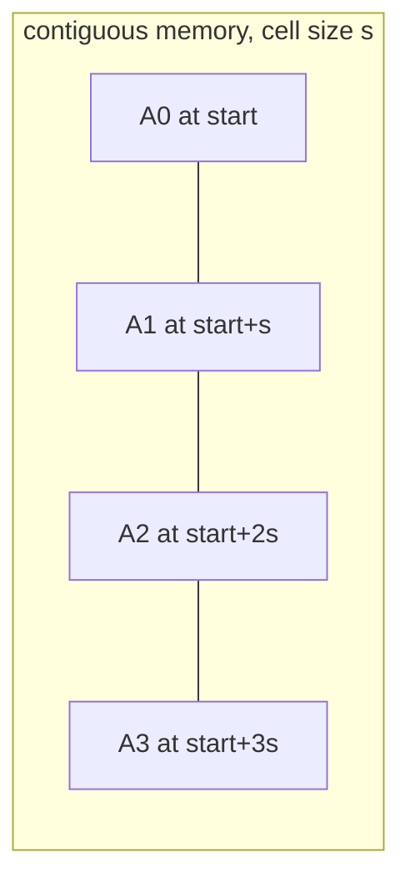
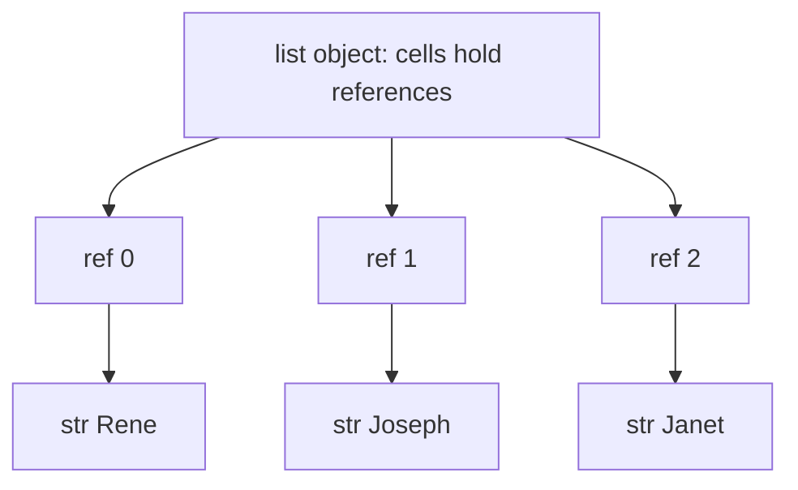

# Low-level arrays and Python's sequence types

Python's `list`, `tuple` and `str` classes look simple, but their performance is determined by a
low-level structure: the **array**. To predict whether an operation is $O(1)$ or $O(n)$ you need a
mental model of how these sequences sit in memory. This lesson builds that model.

## 1. Memory, addresses and arrays

A computer's main memory is a huge sequence of **bytes**, each with a numeric **memory address**.
Hardware can read or write the byte at any address in (essentially) constant time — this is what
"random access memory" means: byte #8675309 is no slower to reach than byte #3.

An **array** is a group of related values stored *contiguously* in memory, each occupying the same
number of bytes. Each location is a **cell**, identified by its **index**. Because cells have equal
size $s$, the address of cell $i$ is simply

$$\text{address}(A[i]) = \text{start} + s \cdot i.$$

That one multiplication-plus-addition is why indexing an array is $O(1)$ regardless of its length.



A Python `str` such as `"SAMPLE"` is a compact array of characters. In CPython a string with only
ASCII text uses 1 byte per character; strings with wider characters use 2 or 4 bytes per character
(Unicode code points), but the cells within one string are all the same width so indexing stays
$O(1)$.

## 2. Referential arrays

Suppose we want an array of 200 names. Names have different lengths, so storing them directly in
equal-size cells would waste space (every cell as large as the longest name). Python instead uses a
**referential array**: the list's cells hold **references** (memory addresses) to the element
objects, which live elsewhere in memory. Each reference has the same size (64 bits on a 64-bit
machine), so the array of references is uniform even if the objects are not.



Consequences:

- **Elements can be shared.** `primes[3:6]` creates a *new list* whose cells reference the *same*
  integer objects. Since ints are immutable, sharing is harmless.
- **`[0] * 8`** creates eight cells all referencing the single object `0`. Again harmless for
  immutables — but `[[]] * 3` makes three references to *one* inner list, a classic bug.
- **`backup = list(primes)`** is a *shallow copy*: a new list, same element references. Use
  `copy.deepcopy` to copy elements too.
- **`primes.extend(extras)`** copies *references* from `extras` into `primes`, not the objects.

```python-run
data = [[]] * 3          # three references to ONE list
data[0].append("surprise")
print(data)
safe = [[] for _ in range(3)]   # three distinct lists
safe[0].append("ok")
print(safe)

counters = [0] * 4
counters[2] += 1          # rebinds cell 2 to a new int object; others still reference 0
print(counters)
```

## 3. Compact arrays

Referential arrays add a level of indirection and per-object overhead: a Python `int` object takes
about 28 bytes, plus the 8-byte reference. A **compact array** stores the raw bits of primitive
values directly in its cells. Python strings are compact arrays of characters. For numbers, the
standard `array` module provides compact arrays:

```python
from array import array
primes = array('i', [2, 3, 5, 7, 11, 13, 17, 19])
```

The first argument is a **type code**:

| code | C type | typical bytes |
|---|---|---|
| `'b'` / `'B'` | signed/unsigned char | 1 |
| `'u'` | Unicode char | 2 or 4 |
| `'h'` / `'H'` | signed/unsigned short | 2 |
| `'i'` / `'I'` | signed/unsigned int | 2 or 4 |
| `'l'` / `'L'` | signed/unsigned long | 4 or 8 |
| `'f'` | float | 4 |
| `'d'` | double | 8 |

Compact arrays use far less memory and have better *locality* (the data is adjacent, which
caches love), but they can only hold one primitive type. They cannot hold arbitrary objects. For
numerical work, NumPy's `ndarray` is the industrial-strength compact array.

```python-run
import sys
from array import array
n = 10000
as_list = list(range(n))
as_array = array('i', range(n))
list_bytes = sys.getsizeof(as_list) + sum(sys.getsizeof(x) for x in as_list)
print("list  (array of refs + int objects):", list_bytes, "bytes")
print("array('i') compact:                ", sys.getsizeof(as_array), "bytes")
```

(Small ints are cached and shared in CPython, so the real list total is a bit lower than this
estimate — but the order-of-magnitude difference is genuine.)

## 4. Python's sequence types

| Type | Mutable? | Storage |
|---|---|---|
| `list` | yes | dynamic referential array |
| `tuple` | no | fixed referential array (more memory-efficient than list) |
| `str` | no | compact array of characters |
| `array.array` | yes | dynamic compact array of one primitive type |
| `bytes` / `bytearray` | no / yes | compact array of bytes |

### 4.1 Cost of non-mutating list and tuple operations

| Operation | Running time |
|---|---|
| `len(data)` | $O(1)$ |
| `data[j]` | $O(1)$ |
| `data.count(value)` | $O(n)$ |
| `data.index(value)` | $O(k+1)$, $k$ = index of first match |
| `value in data` | $O(k+1)$ |
| `data1 == data2` (also `!=`, `<`, …) | $O(k+1)$, $k$ = first differing index |
| `data[j:k]` | $O(k-j+1)$ |
| `data1 + data2` | $O(n_1 + n_2)$ |
| `c * data` | $O(cn)$ |

Membership and `index` stop early at the first match — so they are $O(n)$ in the worst case but may
be fast in practice. Comparisons are lexicographic and stop at the first difference. Slicing and
concatenation create new sequences, so they cost time proportional to the *result*.

### 4.2 Cost of mutating list operations

| Operation | Running time |
|---|---|
| `data[j] = val` | $O(1)$ |
| `data.append(val)` | $O(1)$ amortised |
| `data.insert(k, val)` | $O(n - k + 1)$ amortised |
| `data.pop()` | $O(1)$ amortised |
| `data.pop(k)`, `del data[k]` | $O(n - k)$ amortised |
| `data.remove(value)` | $O(n)$ amortised |
| `data1.extend(data2)`, `data1 += data2` | $O(n_2)$ amortised |
| `data.reverse()` | $O(n)$ |
| `data.sort()` | $O(n \log n)$ |

Why is `insert(k, val)` $O(n - k + 1)$? To open a gap at index $k$, every element from $k$ to the end
must shift one cell to the right — and the shifting must go **from the end backwards**, or you
would overwrite values. Inserting at the front (`insert(0, v)`) shifts everything: $\Theta(n)$.
Inserting near the end is cheap. Popping at index $k$ shifts the elements after $k$ left.

```python-run
import time
for n in [20000, 40000, 80000]:
    data = []
    t0 = time.perf_counter()
    for i in range(n):
        data.insert(0, i)          # always shift everything
    t1 = time.perf_counter()
    data = []
    for i in range(n):
        data.append(i)             # amortised O(1)
    t2 = time.perf_counter()
    print(f"n={n}: insert(0) total {1000*(t1-t0):7.1f} ms   append total {1000*(t2-t1):6.2f} ms")
```

### 4.3 Strings

Strings are immutable, so every "modifying" method returns a **new** string, costing time
proportional to its length. Pattern operations (`in`, `find`, `count`, `replace`, `split`) are
surprisingly sophisticated — we study pattern matching later — but roughly linear in practice.

**The composition trap.** Building a string with repeated `+=` in a loop:

```python
letters = ''
for c in document:
    if c.isalpha():
        letters += c           # creates a new string each time!
```

Each `+=` may copy the whole string so far, giving $O(n^2)$ in the worst case. (CPython sometimes
optimises this when there is only one reference to the string, but do not rely on it.) The
idiomatic, guaranteed-linear approach:

```python
letters = ''.join(c for c in document if c.isalpha())
```

> [!INTERVIEW]
> "Why is `''.join(parts)` preferred over `+=` in a loop?" — strings are immutable compact arrays,
> so each concatenation allocates and copies; `join` computes the total length once and copies each
> part exactly once: $O(n)$ overall.

## 5. Pitfalls

- `[[0] * cols] * rows` creates `rows` references to one row. (See the 2-D arrays lesson.)
- `x in list` inside a loop: hidden $O(n)$.
- `list.insert(0, x)` / `list.pop(0)` in a loop: use `collections.deque` instead.
- Shallow copies share mutable elements.

## 6. Summary

- Arrays give $O(1)$ indexing via address arithmetic; contiguity is the price and the benefit.
- Python lists and tuples are **referential** arrays; strings and `array.array` are **compact**.
- Operations that shift or copy elements cost time proportional to how many elements move.

> **Source:** Goodrich, Tamassia & Goldwasser, *Data Structures and Algorithms in Python*, ch. 5.1–5.2 and 5.4.

## Check yourself

```quiz
[
  {"q": "Why is indexing an array O(1)?",
   "options": ["Python caches all lookups", "The address of cell i is start + i * cellsize, a constant-time computation", "Arrays are sorted", "Because arrays are short"], "answer": 1,
   "explain": "Equal-size contiguous cells let the address be computed directly by arithmetic."},
  {"q": "A Python list stores...",
   "options": ["the element objects themselves, contiguously", "references to element objects", "a linked list of nodes", "a hash table"], "answer": 1,
   "explain": "Lists are referential arrays: uniform cells of object references."},
  {"q": "What does `grid = [[]] * 3; grid[0].append(1); print(grid)` print?",
   "options": ["[[1], [], []]", "[[1], [1], [1]]", "[1, [], []]", "an error"], "answer": 1,
   "explain": "All three cells reference the same inner list."},
  {"q": "Cost of data.insert(k, val) on a list of length n?",
   "options": ["O(1)", "O(k)", "O(n - k + 1) amortised", "O(log n)"], "answer": 2,
   "explain": "Elements k..n-1 must each shift one cell right."},
  {"q": "Why is array('i', ...) more memory efficient than a list of ints?",
   "options": ["It compresses data", "It stores raw machine integers in its cells instead of references to int objects", "It uses a linked structure", "It is not; they are equal"], "answer": 1,
   "explain": "Compact arrays avoid both the reference and the per-object overhead."},
  {"q": "Best way to build a long string from many pieces?",
   "options": ["s += piece in a loop", "''.join(pieces)", "s = s + piece in a loop", "str(list)"], "answer": 1,
   "explain": "join copies each character once; repeated concatenation can copy the growing prefix each time, O(n^2)."},
  {"q": "data1 == data2 for two lists costs...",
   "options": ["Always O(1)", "O(k + 1), where k is the first index at which they differ", "Always O(n^2)", "O(log n)"], "answer": 1,
   "explain": "Lexicographic comparison stops at the first difference."}
]
```
