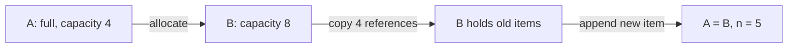

# Dynamic arrays and amortised analysis

> **Before this lesson:** You should know that an array is a row of equal-sized cells next to
> each other in memory, and that a Python list stores references in such a row. Both come from
> [Low-level arrays and Python's sequence types](#/lesson/dsa-foundations/low-level-arrays). The
> doubling sum $1 + 2 + 4 + \cdots + 2^m = 2^{m+1} - 1$ comes from
> [Measuring algorithms and the seven functions](#/lesson/dsa-foundations/seven-functions).

## In plain words

An array cannot grow: the memory right after it may already be in use by something else. Yet a
Python list accepts `append` after `append` without complaint. The trick behind it is the
**dynamic array**: keep the items in an array that is somewhat bigger than needed, and when it
fills up, get a much bigger array and move everything across.

Think of a growing family renting a flat. Moving house is expensive, so they do not move every
time a child is born. They rent a flat with spare rooms, and when it is finally full they move
to one twice the size. Moves are painful but rare, and each one buys a long quiet stretch. Averaged
over the years, the cost of moving per new family member is small and steady. That averaging
has a name, **amortisation**, and this lesson shows how to do it rigorously.

Why it matters for a job: "what is the time complexity of `list.append`?" is a standard
interview question, and the full answer ("constant on average, linear once in a while, because
of doubling") is this lesson. The same idea powers Java's `ArrayList`, C++'s `vector`, Go's
slices and the hash tables later in this track.

## 1. Watching a list grow

A low-level array has a **fixed capacity**, the number of cells it was created with. To see how
a list copes, we can measure it. `sys.getsizeof` reports the number of bytes a list object
occupies: a fixed header plus its row of references, *not* counting the items themselves. The
demo appends one item at a time and prints a line only when the size changes.

```python-run
import sys, struct
PTR = struct.calcsize('P')            # bytes per reference: 8 on 64-bit CPython, 4 in the browser
data = []
last = sys.getsizeof(data)
print(f"len  0: {last} bytes")
for k in range(1, 70):
    data.append(None)
    size = sys.getsizeof(data)
    if size != last:
        print(f"len {k:2d}: {size} bytes   (grew; room for about {(size - sys.getsizeof([])) // PTR} refs)")
        last = size
```

**Reading this code.** `struct.calcsize('P')` gives the size in bytes of one reference on the
machine running the code. `data.append(None)` adds one more item (the value does not matter;
`None` is Python's "nothing" value). Each time `sys.getsizeof(data)` differs from the previous
reading, the loop prints the new size and how many references now fit.

The size does not change on every append. It jumps now and then, and stays flat in between while
the spare room fills up. The list reserves **more capacity than it currently needs**, and when
that runs out it obtains a bigger array.

## 2. The dynamic array algorithm

Keep an underlying array `A` with capacity `c`, and a separate count `n` of how many cells are
really in use. To append when `n < c`, write the new item into `A[n]` and add one to `n`. When
the array is full (`n == c`):

1. Ask for a new, larger array `B`. (Requesting memory is called **allocating** it.)
2. Copy every item across: `B[i] = A[i]` for $i = 0, \ldots, n-1$.
3. From now on use `B` as `A`. Nothing refers to the old array any more, so Python's *garbage
   collector*, the part of the system that recycles unused memory, reclaims it.
4. Store the new item in the new array.



How much bigger should `B` be? The common rule is **double** the capacity. We will see why that
choice is the key to efficiency.

## 3. Implementation

The class below is a simplified Python list built from scratch. A real implementation would get
a raw fixed-size array from the operating system (in Python, through the `ctypes` module). To
keep the demo runnable anywhere, `_make_array` returns an ordinary list of `None` values that we
promise never to grow, which behaves the same for our purposes.

A few Python conventions used here and throughout the track: a **class** is a template for
objects that bundles data with the functions (**methods**) that work on it; `self` is the object
a method is working on; names starting with one underscore (`_n`, `_A`) are internal details;
and methods with double underscores are hooks that Python calls for built-in syntax, so
`__len__` runs when you write `len(d)` and `__getitem__` runs when you write `d[k]`.

```python-run
class DynamicArray:
    """A dynamic array akin to a simplified Python list."""
    def __init__(self):
        self._n = 0                          # count actual elements
        self._capacity = 1                   # default array capacity
        self._A = self._make_array(self._capacity)

    def __len__(self):
        return self._n

    def __getitem__(self, k):
        if not 0 <= k < self._n:
            raise IndexError('invalid index')
        return self._A[k]

    def append(self, obj):
        if self._n == self._capacity:        # not enough room
            self._resize(2 * self._capacity) # so double capacity
        self._A[self._n] = obj
        self._n += 1

    def _resize(self, c):
        B = self._make_array(c)
        for k in range(self._n):             # O(n) copy
            B[k] = self._A[k]
        self._A = B
        self._capacity = c

    def insert(self, k, value):
        if self._n == self._capacity:
            self._resize(2 * self._capacity)
        for j in range(self._n, k, -1):      # shift rightmost first
            self._A[j] = self._A[j - 1]
        self._A[k] = value
        self._n += 1

    def remove(self, value):
        for k in range(self._n):
            if self._A[k] == value:
                for j in range(k, self._n - 1):   # shift left
                    self._A[j] = self._A[j + 1]
                self._A[self._n - 1] = None       # help garbage collection
                self._n -= 1
                return
        raise ValueError('value not found')

    @staticmethod
    def _make_array(c):
        return [None] * c                    # stands in for a raw fixed-size array

d = DynamicArray()
for x in range(10):
    d.append(x)
    print(f"appended {x}: len={len(d)} capacity={d._capacity}")
d.insert(0, 'front'); d.remove(5)
print([d[i] for i in range(len(d))])
```

**Reading the class.**

- `__init__` runs when a `DynamicArray()` is created: no items yet, capacity 1.
- `__getitem__` first checks that `k` is a position in use, and raises `IndexError` otherwise.
  The chained comparison `0 <= k < self._n` means "`k` is at least 0 and less than `_n`".
- `append` doubles the capacity if the array is full, then writes into the first free cell.
- `_resize` is the "move house" step: make array `B`, copy every item, switch over.
- `insert` shifts items one cell right, starting from the last, to open a gap at `k`.
  `range(self._n, k, -1)` counts downwards.
- `remove` finds the first matching value, shifts everything after it one cell left, and clears
  the now-unused last cell.

The output shows the capacity going 1, 2, 4, 4, 8, 8, 8, 8, 16, 16 while the length goes from 1
to 10. Capacity doubles exactly when an append finds the array full. The last line is
`['front', 0, 1, 2, 3, 4, 6, 7, 8, 9]`.

## 4. Amortised analysis

An append that triggers a resize from capacity $k$ must copy $k$ items, so it costs
$\Theta(k)$: linear. If we judged `append` by its worst single call, we would label it $O(n)$
and conclude that $n$ appends could cost $O(n^2)$. That is far too gloomy, because expensive
appends are rare and get rarer. **Amortised analysis** bounds the *total* cost of a whole
sequence of operations, and reports the average per operation.

### 4.1 The cyber-dollar (accounting) argument

Pretend the computer is coin-operated: each primitive operation costs one coin, which we call a
**cyber-dollar**. Appending without a resize costs 1 dollar. Growing from capacity $k$ to $2k$
costs $k$ dollars for the copying.

> **Claim.** Starting from an empty dynamic array of capacity 1 that doubles when full, a
> sequence of $n$ appends takes $O(n)$ time.

*Why.* Charge every append a flat fee of **3** cyber-dollars, more than a plain append needs.
One dollar pays for writing the item. The other two go into a savings account. Now look at the
moment an array of capacity $2^i$ fills up. The last resize happened at capacity $2^{i-1}$, so
since then $2^{i-1}$ items have been appended, each saving 2 dollars: $2^i$ dollars in the
account. Copying the $2^i$ items into the new array costs exactly $2^i$ dollars. The savings
cover it. So the account never goes below zero, and $n$ appends cost at most $3n$ dollars in
total. ∎

Each append is therefore **$O(1)$ amortised**: constant when averaged over the sequence. Note
what this does *not* say. It is not about probability or luck; it is a guarantee about the total,
true for every sequence of appends.

### 4.2 The direct summation argument

The same result by plain addition. With doubling, a resize happens when the size reaches
$1, 2, 4, \ldots, 2^m$, where $2^m$ is the last power of two below $n$. The total number of
items copied is

$$1 + 2 + 4 + \cdots + 2^m = 2^{m+1} - 1 < 2n.$$

Add $n$ for the writes themselves and the total is under $3n$. The doubling sum from the first
lesson does all the work: every resize costs as much as all earlier resizes put together, so the
last one dominates and it is at most $n$.

The demo counts copies and writes for three growth rules: doubling, growing by a quarter, and
adding a fixed 100 cells.

```python-run
def total_cost(n, grow):
    cap, size, cost = 1, 0, 0
    for _ in range(n):
        if size == cap:
            new_cap = grow(cap)
            cost += size              # copy existing elements
            cap = new_cap
        cost += 1                     # write the new element
        size += 1
    return cost
for n in [1000, 10000, 100000]:
    print(f"n={n:6d}  doubling: {total_cost(n, lambda c: 2*c)/n:5.2f} per op   "
          f"x1.25: {total_cost(n, lambda c: max(c+1, int(c*1.25)))/n:5.2f} per op   "
          f"+100: {total_cost(n, lambda c: c+100)/n:7.2f} per op")
```

In the output, the first two columns stay flat as `n` grows (between 2 and 3 steps per append
for doubling, between 5 and 6 for the 1.25 rule), while the `+100` column keeps climbing:
roughly 6, 51 and 501 steps per append.

### 4.3 Geometric versus arithmetic growth

**Geometric** growth means multiplying the capacity by a fixed factor each time. Any factor
above 1 works: grow by $1 + r$ for any fixed $r > 0$ and the copy costs form a geometric sum
bounded by a constant times $n$, so append is still $O(1)$ amortised. The smaller $r$ is, the
larger that constant but the less memory is wasted. CPython itself grows lists by roughly one
eighth plus a small extra, choosing less waste at the price of more frequent copying.

**Arithmetic** growth means adding a fixed number $c$ of cells each time, and it is a disaster:

> **Claim.** With a fixed increment $c$, $n$ appends take $\Omega(n^2)$ time.

There are $m = \lceil n/c \rceil$ resizes, and they copy $c$, then $2c$, then $3c$ items, up to
$(m-1)c$. That is an arithmetic sum:
$c \sum_{i=1}^{m-1} i = c \cdot \frac{m(m-1)}{2} = \Omega(n^2/c)$. A larger $c$ only postpones
the trouble. The intuition: with a fixed increment, the "quiet stretch" bought by each move
stays the same length while the moves keep getting more expensive.

### 4.4 Shrinking

If many items are removed, the array may be mostly empty and waste memory. A safe rule: when the
number of items drops **below one quarter** of the capacity, halve the capacity. Halving as soon
as the array is half empty is dangerous, because a program that alternates append and pop right
at the boundary would trigger a resize on every operation, a behaviour called **thrashing**.
With the quarter rule, any mixture of appends and pops still costs $O(1)$ amortised per
operation, and the capacity stays within a constant factor of $n$. Section 8 proves it.

## 5. Python's list in practice

Timing `append` on a real Python list for larger and larger $n$ gives a roughly constant average
of a few tens of nanoseconds (billionths of a second), which matches the amortised bound. Some
related facts:

- `extend` beats repeated `append`: it knows the final size in advance, resizes at most once,
  and its loop runs inside the interpreter's compiled C code.
- A **list comprehension** such as `[i * i for i in range(n)]` is faster than appending in a
  Python loop, for the same reasons.
- Creating a list at full size with `[None] * n` is a single allocation.

```python-run
import time
def by_append(n):
    out = []
    for i in range(n):
        out.append(i * i)
    return out
def by_comprehension(n):
    return [i * i for i in range(n)]
n = 300000
for f in (by_append, by_comprehension):
    t0 = time.perf_counter(); f(n); t = time.perf_counter() - t0
    print(f"{f.__name__:18s} {1e9 * t / n:6.1f} ns per element")
```

> [!INTERVIEW]
> "What is the time complexity of `list.append`?" The complete answer: **$O(1)$ amortised**, $O(n)$
> worst case for a single call (when it resizes). Explain doubling and the geometric series. Bonus:
> "Why not grow by a constant amount?" — because that gives $\Theta(n^2)$ total.

## 6. Amortisation beyond arrays

Amortised analysis applies wherever an occasional expensive step is paid for by many cheap ones.
Later in this track it explains hash tables that rebuild themselves when they get crowded, the
self-adjusting splay tree, and the union-find structure. There are three standard ways to carry
it out:

1. **Aggregate**: bound the total cost of $n$ operations and divide by $n$ (section 4.2).
2. **Accounting**: overcharge the cheap operations and save the surplus for the expensive ones
   (the cyber-dollars of section 4.1).
3. **Potential**: describe the savings as a formula in the current state of the data structure
   (section 8, and later the splay-tree analysis).

## 7. Worked trace: the bank account during nine appends

The cyber-dollar argument is easiest to believe when you watch the account. Charge **3** dollars per
append. A plain write costs 1; a resize from capacity $c$ costs $c$ (one per element copied) plus 1
for the write that follows.

| append # | capacity before | resize? | actual cost | charged | bank balance after |
|---|---|---|---|---|---|
| 1 | 1 | no | 1 | 3 | 2 |
| 2 | 1 | yes: copy 1 | 2 | 3 | 3 |
| 3 | 2 | yes: copy 2 | 3 | 3 | 3 |
| 4 | 4 | no | 1 | 3 | 5 |
| 5 | 4 | yes: copy 4 | 5 | 3 | 3 |
| 6 | 8 | no | 1 | 3 | 5 |
| 7 | 8 | no | 1 | 3 | 7 |
| 8 | 8 | no | 1 | 3 | 9 |
| 9 | 8 | yes: copy 8 | 9 | 3 | 3 |

Total actual cost: $1 + 2 + 3 + 1 + 5 + 1 + 1 + 1 + 9 = 24$; total charged: $27$. The balance never
goes negative, and right after every resize it returns to the same small value: each expensive
operation is fully paid for by the cheap ones that preceded it. The cell below runs the same
bookkeeping for a million appends.

```python-run
def bank_trace(n, charge=3, show=9):
    cap, size, balance, lowest, total = 1, 0, 0, 0, 0
    for i in range(1, n + 1):
        cost = 1
        if size == cap:
            cost += size                    # copy every existing element
            cap *= 2
        size += 1
        total += cost
        balance += charge - cost
        lowest = min(lowest, balance)
        if i <= show:
            print(f"append {i}: cost {cost}, balance {balance}")
    return total, lowest
total, lowest = bank_trace(10**6)
print(f"1,000,000 appends: total cost {total:,} (< 3n), lowest balance ever: {lowest}")
total2, lowest2 = bank_trace(10**6, charge=2, show=0)
print(f"charging only 2 per append: lowest balance {lowest2:,}  -> 2 is not enough")
```

Charging 2 is not enough — the balance sinks without bound — while 3 always suffices: the amortised
cost of an append under doubling is at most 3 primitive operations.

## 8. The potential method, and why the shrinking rule works

The third technique replaces the savings account by a formula. Instead of tracking deposits and
withdrawals, we define a number that can be read off the data structure at any moment and plays
the role of the balance. It is called the **potential** and written with the Greek letter phi,
$\Phi$. For the dynamic array, take

$$\Phi = 2n - c,$$

where $n$ is the number of items and $c$ the capacity. (With doubling, an array holding at least
one item is always at least half full, so $\Phi \ge 0$.) Right after a resize the array is half
full and $\Phi$ is near 0: no savings. As items are appended, $\Phi$ rises by 2 each time. When
the array is full, $\Phi = n$: enough to pay for copying $n$ items.

The **amortised cost** of an operation is defined as its actual cost plus the change in
potential it causes, $\hat{c} = c_{\text{actual}} + \Delta\Phi$, where $\Delta\Phi$ (read "delta
phi") means "the new $\Phi$ minus the old $\Phi$". Add this up over a sequence of operations and
the changes in potential cancel in pairs, leaving only the final $\Phi$ minus the initial one.
So as long as $\Phi$ ends no lower than it began, the total actual cost is at most the total
amortised cost.

- **Append without resize:** actual cost 1; $n$ grows by one so $\Delta\Phi = +2$. Amortised cost
  $1 + 2 = 3$.
- **Append with resize** (the array is full, $n = c$): actual cost $n + 1$. Before: $\Phi = 2n - n = n$.
  After: $n + 1$ elements, capacity $2n$, so $\Phi = 2(n + 1) - 2n = 2$. $\Delta\Phi = 2 - n$.
  Amortised cost $(n + 1) + (2 - n) = 3$.

Both cases cost exactly 3: the potential stored up during cheap appends is released precisely when
the expensive copy happens. This is the cyber-dollar proof with the bookkeeping made algebraic, and
it is the form of argument used later for splay trees.

**Shrinking.** Now add `pop`, halving the capacity when the array becomes too empty. If we halved
as soon as the array is half full, an adversary sitting at the boundary could alternate:

```python-run
def cost_of(ops, shrink_at):
    """Total element copies for a sequence of '+' (append) and '-' (pop) operations."""
    cap, size, copies = 1, 0, 0
    for op in ops:
        if op == '+':
            if size == cap:
                copies += size; cap *= 2
            size += 1
        else:
            size -= 1
            if cap > 1 and size <= cap * shrink_at:
                copies += size; cap //= 2
    return copies
n = 1024
ops = '+' * n + '+-' * 2000        # fill exactly to a power of two, then oscillate at the boundary
print("halve when half full   :", cost_of(ops, 0.5), "copies")
print("halve when quarter full:", cost_of(ops, 0.25), "copies")
```

With the half-full rule, each `+` at the boundary doubles the array and each `-` halves it again:
every operation copies about $n$ elements — $\Theta(n)$ per operation, the **thrashing** mentioned
above. With the quarter-full rule, after any resize (up or down) the array is about half full, so at
least $c/4$ operations must happen before the next resize in either direction; those operations pay
for it. Formally, use $\Phi = 2n - c$ when the array is at least half full and $\Phi = c/2 - n$ when
it is less than half full; every operation then has amortised cost at most 3.

> [!NOTE]
> CPython's `list` does shrink: when the length falls below half of the allocated capacity, a
> `pop` reallocates to a smaller array, with enough slack that alternating append/pop does not
> thrash.

## 9. Pitfalls

- **Saying "append is $O(1)$" and leaving out "amortised".** In systems that must respond within
  a fixed time (audio, games, control software), the occasional $O(n)$ pause matters.
- **Confusing amortised with average-case.** Average-case depends on how likely inputs are;
  amortised is a guarantee on the total for any sequence.
- **Shrinking at half full.** It causes thrashing; use one quarter.
- **Growing by a fixed increment.** The total becomes quadratic.
- **Keeping a memory address into the array across a resize.** Python hides addresses, so this
  cannot go wrong there, but in C or C++ a resize moves the data and any saved address into the
  old array becomes invalid.

## 10. Summary

| Policy | Cost of $n$ appends | Per-append (amortised) |
|---|---|---|
| double (or any factor $>1$) | $O(n)$ | $O(1)$ |
| add a constant $c$ | $\Theta(n^2)$ | $\Theta(n)$ |

> **Source:** Goodrich, Tamassia & Goldwasser, *Data Structures and Algorithms in Python*, ch. 5.3.

## Glossary

- **Capacity**: the number of cells an array has, used or not.
- **Dynamic array**: an array-based list that replaces its array with a larger one when full.
- **Allocate**: to request a block of memory.
- **Resize**: to allocate a new array and copy the items into it.
- **Amortised cost**: the cost per operation averaged over any sequence of operations.
- **Cyber-dollar**: an imaginary coin that pays for one primitive operation in an accounting
  argument.
- **Geometric growth**: multiplying the capacity by a fixed factor at each resize.
- **Arithmetic growth**: adding a fixed number of cells at each resize.
- **Thrashing**: resizing again and again because grow and shrink thresholds are too close.
- **Aggregate / accounting / potential method**: the three standard ways to do an amortised
  analysis.
- **Potential ($\Phi$)**: a formula in the structure's state that stands for saved-up work.
- **Class / method**: a template for objects / a function that belongs to a class.

## Check yourself

```quiz
[
  {"q": "With capacity doubling, what is the total cost of n appends starting from an empty array?",
   "options": ["O(n log n)", "O(n)", "O(n^2)", "O(log n)"], "answer": 1,
   "explain": "Copy costs form 1 + 2 + 4 + ... < 2n, plus n writes: under 3n."},
  {"q": "In the cyber-dollar argument, how much is each append charged?",
   "options": ["1", "2", "3", "log n"], "answer": 2,
   "explain": "1 pays for the write, 2 are banked to pay for copying when the array next doubles."},
  {"q": "What happens with a fixed increment growth policy (add 100 cells)?",
   "options": ["O(1) amortised", "Omega(n^2) total time for n appends", "O(n log n) total", "It never resizes"], "answer": 1,
   "explain": "About n/100 resizes copying 100, 200, 300, ... elements sums to Theta(n^2/100)."},
  {"q": "Why shrink only when the array falls below 1/4 full rather than 1/2?",
   "options": ["To save time copying", "To avoid thrashing: alternating append/pop at the boundary would resize every time", "Python requires it", "To keep capacity a power of two"], "answer": 1,
   "explain": "A gap between the grow threshold (full) and shrink threshold (1/4) guarantees many cheap operations between resizes."},
  {"q": "The worst-case cost of a single append is...",
   "options": ["O(1)", "O(n), when it triggers a resize", "O(log n)", "O(n^2)"], "answer": 1,
   "explain": "One append can copy the whole array. The O(1) bound is amortised."},
  {"q": "Which growth factor still yields O(1) amortised append?",
   "options": ["Only exactly 2", "Any constant factor greater than 1, such as 1.125", "Only powers of 2", "Any additive constant"], "answer": 1,
   "explain": "Any geometric growth makes the copy costs a geometric series bounded by a constant times n."}
]
```
