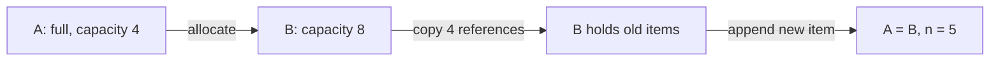

# Dynamic arrays and amortised analysis

A low-level array has a **fixed capacity** chosen when it is created: the memory after it might
belong to something else, so it cannot simply grow. Yet a Python `list` grows forever with
`append`. How? The answer — the **dynamic array** — is one of the most important tricks in data
structures, and its analysis introduces **amortisation**.

## 1. Watching a list grow

`sys.getsizeof` reports the bytes a list object occupies (its header plus its array of references,
*not* the elements). Append items one at a time and watch:

```python-run
import sys, struct
PTR = struct.calcsize('P')            # bytes per reference: 8 on 64-bit CPython, 4 in the browser
data = []
last = sys.getsizeof(data)
print(f"len  0: {last} bytes")
for k in range(1, 70):
    data.append(None)
    size = sys.getsizeof(data)
    if size != last:
        print(f"len {k:2d}: {size} bytes   (grew; room for about {(size - sys.getsizeof([])) // PTR} refs)")
        last = size
```

The size does not change on every append. It jumps occasionally, then stays flat while the spare
room fills up. The list reserves **more capacity than it currently needs**, and when that runs out
it allocates a bigger array.

## 2. The dynamic array algorithm

Maintain an underlying array `A` of capacity `c` and a count `n` of elements actually stored. To
append when `n < c`, write into `A[n]`. When the array is full (`n == c`):

1. Allocate a new array `B` with larger capacity.
2. Copy `B[i] = A[i]` for $i = 0, \ldots, n-1$.
3. Let `A = B` (the old array is reclaimed by the garbage collector).
4. Store the new element in the new array.



How much bigger should `B` be? The common rule is **double** the capacity. We will see why that
choice is the key to efficiency.

## 3. Implementation

The book's `DynamicArray` uses `ctypes` to obtain a raw array. Here we simulate a fixed-capacity
raw array with a Python list we never resize, which keeps the logic identical:

```python-run
class DynamicArray:
    """A dynamic array akin to a simplified Python list."""
    def __init__(self):
        self._n = 0                          # count actual elements
        self._capacity = 1                   # default array capacity
        self._A = self._make_array(self._capacity)

    def __len__(self):
        return self._n

    def __getitem__(self, k):
        if not 0 <= k < self._n:
            raise IndexError('invalid index')
        return self._A[k]

    def append(self, obj):
        if self._n == self._capacity:        # not enough room
            self._resize(2 * self._capacity) # so double capacity
        self._A[self._n] = obj
        self._n += 1

    def _resize(self, c):
        B = self._make_array(c)
        for k in range(self._n):             # O(n) copy
            B[k] = self._A[k]
        self._A = B
        self._capacity = c

    def insert(self, k, value):
        if self._n == self._capacity:
            self._resize(2 * self._capacity)
        for j in range(self._n, k, -1):      # shift rightmost first
            self._A[j] = self._A[j - 1]
        self._A[k] = value
        self._n += 1

    def remove(self, value):
        for k in range(self._n):
            if self._A[k] == value:
                for j in range(k, self._n - 1):   # shift left
                    self._A[j] = self._A[j + 1]
                self._A[self._n - 1] = None       # help garbage collection
                self._n -= 1
                return
        raise ValueError('value not found')

    @staticmethod
    def _make_array(c):
        return [None] * c                    # stands in for a raw fixed-size array

d = DynamicArray()
for x in range(10):
    d.append(x)
    print(f"appended {x}: len={len(d)} capacity={d._capacity}")
d.insert(0, 'front'); d.remove(5)
print([d[i] for i in range(len(d))])
```

## 4. Amortised analysis

A single append that triggers a resize from capacity $k$ costs $\Theta(k)$ — linear! So a
worst-case-per-operation analysis would call `append` an $O(n)$ operation, suggesting $n$ appends
cost $O(n^2)$. That is far too pessimistic: expensive appends are rare. **Amortised analysis**
bounds the *total* cost of a sequence of operations.

### 4.1 The cyber-dollar (accounting) argument

Imagine the computer is a coin-operated appliance: each primitive operation costs one
**cyber-dollar**. Appending without resizing costs 1 dollar; growing from size $k$ to $2k$ costs $k$
dollars for the copy.

> **Proposition.** Starting from an empty dynamic array of capacity 1 that doubles when full, a
> sequence of $n$ appends takes $O(n)$ time.

*Justification.* Charge each append **3** cyber-dollars. One pays for writing the element; the other
two are saved in a bank. When the array has capacity $2^i$ and becomes full, the $2^{i-1}$ elements
added since the last resize have each deposited 2 dollars — $2^i$ dollars in total — which is exactly
enough to pay for copying all $2^i$ elements into the new array. So the bank never goes negative,
and $n$ appends cost at most $3n$ dollars. ∎

Each append is therefore **$O(1)$ amortised**.

### 4.2 The direct summation argument

With doubling, resizes happen when the size reaches $1, 2, 4, \ldots, 2^m$ where $2^m < n$. The total
copying cost is

$$1 + 2 + 4 + \cdots + 2^m = 2^{m+1} - 1 < 2n.$$

Plus $n$ for the writes themselves: under $3n$ total. The geometric series from the first lesson is
doing all the work.

```python-run
def total_cost(n, grow):
    cap, size, cost = 1, 0, 0
    for _ in range(n):
        if size == cap:
            new_cap = grow(cap)
            cost += size              # copy existing elements
            cap = new_cap
        cost += 1                     # write the new element
        size += 1
    return cost
for n in [1000, 10000, 100000]:
    print(f"n={n:6d}  doubling: {total_cost(n, lambda c: 2*c)/n:5.2f} per op   "
          f"x1.25: {total_cost(n, lambda c: max(c+1, int(c*1.25)))/n:5.2f} per op   "
          f"+100: {total_cost(n, lambda c: c+100)/n:7.2f} per op")
```

### 4.3 Geometric versus arithmetic growth

Any **geometric** growth factor works: grow by a factor $1 + r$ for any constant $r > 0$ and the
copies form a geometric series bounded by a constant times $n$ — still $O(1)$ amortised (the
constant gets worse as $r$ shrinks). CPython itself grows lists by roughly 1/8 plus a small constant,
trading a slightly higher amortised constant for less wasted space.

**Arithmetic** growth — adding a fixed $c$ cells each time — is a disaster:

> **Proposition.** With a fixed increment $c$, $n$ appends take $\Omega(n^2)$ time.

There are $m = \lceil n/c \rceil$ resizes, copying $c, 2c, 3c, \ldots, (m-1)c$ elements:
$c \sum_{i=1}^{m-1} i = c \cdot \frac{m(m-1)}{2} = \Omega(n^2/c)$. A larger $c$ only delays the
inevitable. Run the cell above: the `+100` column keeps growing with $n$.

### 4.4 Shrinking

If many elements are removed, the array may waste memory. A safe policy: when the number of
elements drops **below one quarter** of the capacity, halve the capacity. (Halving at one half is
dangerous: alternating append/pop at the boundary would trigger a resize every operation —
"thrashing".) With the quarter rule, any sequence of appends and pops still runs in $O(1)$ amortised
time per operation, and the capacity is always $O(n)$.

## 5. Python's list in practice

The book measures the average cost of `append` for growing $n$ and finds it roughly constant
(tens of nanoseconds), confirming the amortised bound. Two related costs:

- `extend` is preferred over repeated `append`s: it knows the final size in advance and resizes
  once, and its loop runs in C.
- **List comprehensions** are faster than appending in a Python loop for the same reason.
- Preallocating with `[None] * n` is a single allocation.

```python-run
import time
def by_append(n):
    out = []
    for i in range(n):
        out.append(i * i)
    return out
def by_comprehension(n):
    return [i * i for i in range(n)]
n = 300000
for f in (by_append, by_comprehension):
    t0 = time.perf_counter(); f(n); t = time.perf_counter() - t0
    print(f"{f.__name__:18s} {1e9 * t / n:6.1f} ns per element")
```

> [!INTERVIEW]
> "What is the time complexity of `list.append`?" The complete answer: **$O(1)$ amortised**, $O(n)$
> worst case for a single call (when it resizes). Explain doubling and the geometric series. Bonus:
> "Why not grow by a constant amount?" — because that gives $\Theta(n^2)$ total.

## 6. Amortisation beyond arrays

Amortised analysis applies wherever an occasional expensive step is "paid for" by many cheap ones:
hash-table rehashing (maps module), splay trees, union-find with path compression, and the
"clear and rebuild" queue tricks of the next module. The three standard techniques are:

1. **Aggregate**: bound the total of $n$ operations and divide (the summation above).
2. **Accounting**: overcharge cheap operations and bank credit (the cyber-dollars).
3. **Potential**: define a potential function of the data structure state whose increase pays for
   future work (used in the splay-tree analysis).

## 7. Worked trace: the bank account during nine appends

The cyber-dollar argument is easiest to believe when you watch the account. Charge **3** dollars per
append. A plain write costs 1; a resize from capacity $c$ costs $c$ (one per element copied) plus 1
for the write that follows.

| append # | capacity before | resize? | actual cost | charged | bank balance after |
|---|---|---|---|---|---|
| 1 | 1 | no | 1 | 3 | 2 |
| 2 | 1 | yes: copy 1 | 2 | 3 | 3 |
| 3 | 2 | yes: copy 2 | 3 | 3 | 3 |
| 4 | 4 | no | 1 | 3 | 5 |
| 5 | 4 | yes: copy 4 | 5 | 3 | 3 |
| 6 | 8 | no | 1 | 3 | 5 |
| 7 | 8 | no | 1 | 3 | 7 |
| 8 | 8 | no | 1 | 3 | 9 |
| 9 | 8 | yes: copy 8 | 9 | 3 | 3 |

Total actual cost: $1 + 2 + 3 + 1 + 5 + 1 + 1 + 1 + 9 = 24$; total charged: $27$. The balance never
goes negative, and right after every resize it returns to the same small value: each expensive
operation is fully paid for by the cheap ones that preceded it. The cell below runs the same
bookkeeping for a million appends.

```python-run
def bank_trace(n, charge=3, show=9):
    cap, size, balance, lowest, total = 1, 0, 0, 0, 0
    for i in range(1, n + 1):
        cost = 1
        if size == cap:
            cost += size                    # copy every existing element
            cap *= 2
        size += 1
        total += cost
        balance += charge - cost
        lowest = min(lowest, balance)
        if i <= show:
            print(f"append {i}: cost {cost}, balance {balance}")
    return total, lowest
total, lowest = bank_trace(10**6)
print(f"1,000,000 appends: total cost {total:,} (< 3n), lowest balance ever: {lowest}")
total2, lowest2 = bank_trace(10**6, charge=2, show=0)
print(f"charging only 2 per append: lowest balance {lowest2:,}  -> 2 is not enough")
```

Charging 2 is not enough — the balance sinks without bound — while 3 always suffices: the amortised
cost of an append under doubling is at most 3 primitive operations.

## 8. The potential method, and why the shrinking rule works

The third standard technique expresses the "bank balance" as a function of the data structure's
current state. Define the **potential**

$$\Phi = 2n - c,$$

where $n$ is the number of elements and $c$ the capacity. (With doubling the array is always at
least half full once it holds an element, so $\Phi \ge 0$.) The **amortised cost** of an operation is
its actual cost plus the change in potential, $\hat{c} = c_{\text{actual}} + \Delta\Phi$. Summed over
a sequence, the $\Delta\Phi$ terms telescope, so total actual cost $\le$ total amortised cost
whenever $\Phi$ ends no lower than it started.

- **Append without resize:** actual cost 1; $n$ grows by one so $\Delta\Phi = +2$. Amortised cost
  $1 + 2 = 3$.
- **Append with resize** (the array is full, $n = c$): actual cost $n + 1$. Before: $\Phi = 2n - n = n$.
  After: $n + 1$ elements, capacity $2n$, so $\Phi = 2(n + 1) - 2n = 2$. $\Delta\Phi = 2 - n$.
  Amortised cost $(n + 1) + (2 - n) = 3$.

Both cases cost exactly 3: the potential stored up during cheap appends is released precisely when
the expensive copy happens. This is the cyber-dollar proof with the bookkeeping made algebraic, and
it is the form of argument used later for splay trees.

**Shrinking.** Now add `pop`, halving the capacity when the array becomes too empty. If we halved
as soon as the array is half full, an adversary sitting at the boundary could alternate:

```python-run
def cost_of(ops, shrink_at):
    """Total element copies for a sequence of '+' (append) and '-' (pop) operations."""
    cap, size, copies = 1, 0, 0
    for op in ops:
        if op == '+':
            if size == cap:
                copies += size; cap *= 2
            size += 1
        else:
            size -= 1
            if cap > 1 and size <= cap * shrink_at:
                copies += size; cap //= 2
    return copies
n = 1024
ops = '+' * n + '+-' * 2000        # fill exactly to a power of two, then oscillate at the boundary
print("halve when half full   :", cost_of(ops, 0.5), "copies")
print("halve when quarter full:", cost_of(ops, 0.25), "copies")
```

With the half-full rule, each `+` at the boundary doubles the array and each `-` halves it again:
every operation copies about $n$ elements — $\Theta(n)$ per operation, the **thrashing** mentioned
above. With the quarter-full rule, after any resize (up or down) the array is about half full, so at
least $c/4$ operations must happen before the next resize in either direction; those operations pay
for it. Formally, use $\Phi = 2n - c$ when the array is at least half full and $\Phi = c/2 - n$ when
it is less than half full; every operation then has amortised cost at most 3.

> [!NOTE]
> CPython's `list` does shrink: when the length falls below half of the allocated capacity, a
> `pop` reallocates to a smaller array, with enough slack that alternating append/pop does not
> thrash.

## 9. Pitfalls

- Saying "append is O(1)" without "amortised" — in real-time systems, the occasional $O(n)$ stall
  matters.
- Shrinking at half-full: causes thrashing.
- Growing by a constant increment: quadratic.
- Holding a reference to an element index across resizes is fine in Python, but in C/C++ a resize
  invalidates pointers into the old array.

## 10. Summary

| Policy | Cost of $n$ appends | Per-append (amortised) |
|---|---|---|
| double (or any factor $>1$) | $O(n)$ | $O(1)$ |
| add a constant $c$ | $\Theta(n^2)$ | $\Theta(n)$ |

> **Source:** Goodrich, Tamassia & Goldwasser, *Data Structures and Algorithms in Python*, ch. 5.3.

## Check yourself

```quiz
[
  {"q": "With capacity doubling, what is the total cost of n appends starting from an empty array?",
   "options": ["O(n log n)", "O(n)", "O(n^2)", "O(log n)"], "answer": 1,
   "explain": "Copy costs form 1 + 2 + 4 + ... < 2n, plus n writes: under 3n."},
  {"q": "In the cyber-dollar argument, how much is each append charged?",
   "options": ["1", "2", "3", "log n"], "answer": 2,
   "explain": "1 pays for the write, 2 are banked to pay for copying when the array next doubles."},
  {"q": "What happens with a fixed increment growth policy (add 100 cells)?",
   "options": ["O(1) amortised", "Omega(n^2) total time for n appends", "O(n log n) total", "It never resizes"], "answer": 1,
   "explain": "About n/100 resizes copying 100, 200, 300, ... elements sums to Theta(n^2/100)."},
  {"q": "Why shrink only when the array falls below 1/4 full rather than 1/2?",
   "options": ["To save time copying", "To avoid thrashing: alternating append/pop at the boundary would resize every time", "Python requires it", "To keep capacity a power of two"], "answer": 1,
   "explain": "A gap between the grow threshold (full) and shrink threshold (1/4) guarantees many cheap operations between resizes."},
  {"q": "The worst-case cost of a single append is...",
   "options": ["O(1)", "O(n), when it triggers a resize", "O(log n)", "O(n^2)"], "answer": 1,
   "explain": "One append can copy the whole array. The O(1) bound is amortised."},
  {"q": "Which growth factor still yields O(1) amortised append?",
   "options": ["Only exactly 2", "Any constant factor greater than 1, such as 1.125", "Only powers of 2", "Any additive constant"], "answer": 1,
   "explain": "Any geometric growth makes the copy costs a geometric series bounded by a constant times n."}
]
```
