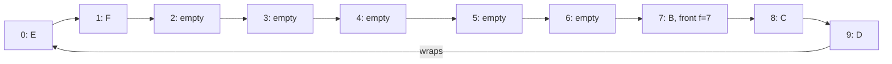

# Queues, circular arrays and deques

> **Before this lesson:** You should know what a stack and an abstract data type are, from
> [Stacks and their applications](#/lesson/dsa-foundations/stacks); why removing the first item
> of a Python list is slow, from
> [Low-level arrays](#/lesson/dsa-foundations/low-level-arrays); and the modulo operator `%`,
> from [Using arrays](#/lesson/dsa-foundations/using-arrays).

## In plain words

A **queue** is a collection where items leave in the same order they arrived. The rule is
**first-in, first-out**, shortened to **FIFO**. Items join at the **back** and leave from the
**front**.

It is the queue you already know: people waiting at a ticket counter, callers on hold at a
support line, documents waiting for a printer. Whoever has waited longest is served next, which
is the fair order. A stack, by contrast, serves the newest arrival first.

A **deque** (pronounced "deck", short for double-ended queue) relaxes the rule: items may be
added or removed at either end, though still never in the middle.

Why it matters for a job: queues sit between every pair of systems that work at different
speeds, such as a web server and the jobs it hands to background workers. In interviews, a queue
drives breadth-first search (the standard way to find a shortest route in a maze or a network),
and a deque drives the "sliding window" problems. This lesson also teaches a neat trick, the
circular array, that makes a queue fast.

## 1. The queue ADT

To **enqueue** is to add an item at the back; to **dequeue** is to remove the item at the front
and hand it back.

| Operation | Meaning |
|---|---|
| `Q.enqueue(e)` | add `e` to the back |
| `Q.dequeue()` | remove and return the first element; error if empty |
| `Q.first()` | return the first element without removing it; error if empty |
| `Q.is_empty()` | `True` if empty |
| `len(Q)` | number of elements |

| Operation | Return | front ← Q ← back |
|---|---|---|
| `enqueue(5)` | – | [5] |
| `enqueue(3)` | – | [5, 3] |
| `dequeue()` | 5 | [3] |
| `enqueue(7)` | – | [3, 7] |
| `first()` | 3 | [3, 7] |
| `dequeue()` | 3 | [7] |
| `dequeue()` | 7 | [] |
| `dequeue()` | error | [] |

## 2. Why a plain list is not good enough

The obvious first attempt is to adapt a list as we did for the stack: `enqueue` is `append`,
which is $O(1)$, and `dequeue` is `pop(0)`. The trouble is `pop(0)`. Removing cell 0 of an array
leaves a hole at the start, and Python closes it by moving every remaining item one cell to the
left: **$\Theta(n)$** work for every dequeue.

A second attempt: on dequeue, do not shift anything. Replace `data[f]` with `None` and move a
"front" index `f` one step to the right. Now dequeue is $O(1)$, but the list grows without end.
After millions of enqueue and dequeue operations, a queue holding three items could occupy a
list of millions of cells, almost all of them dead space at the start that is never reused.

## 3. Using an array circularly

The fix is to reuse the dead space: let the indices **wrap around**. Imagine the array of
capacity $N$ bent into a ring, so that the cell after the last one is cell 0. The front of the
queue is at index `f`, and the queue's items occupy the next `size` cells going round the ring.
When the back of the queue reaches the end of the array, it continues at cell 0, into space
that earlier dequeues freed.

The wrap-around is modular arithmetic, the clock arithmetic from the Caesar cipher. The next
free cell for an enqueue is

$$\text{avail} = (f + \text{size}) \bmod N,$$

and after a dequeue the front moves to $f = (f + 1) \bmod N$. With $N = 10$, the cell after
index 9 is $(9 + 1) \bmod 10 = 0$.



In the picture $N = 10$, $f = 7$ and the size is 5. The queue holds B, C, D, E, F in that order:
B, C, D in cells 7 to 9, then E and F in cells 0 and 1 after wrapping. The next enqueue goes to
cell $(7 + 5) \bmod 10 = 2$.

### 3.1 The ArrayQueue implementation

The class keeps three things: the array `_data`, the number of items `_size`, and the index
`_front` of the first item. Read `dequeue` and `enqueue` first; each is the formula above plus a
check for whether the array should change size.

```python-run
class Empty(Exception):
    pass

class ArrayQueue:
    """FIFO queue implementation using a Python list as underlying storage."""
    DEFAULT_CAPACITY = 10

    def __init__(self):
        self._data = [None] * ArrayQueue.DEFAULT_CAPACITY
        self._size = 0
        self._front = 0

    def __len__(self):
        return self._size

    def is_empty(self):
        return self._size == 0

    def first(self):
        if self.is_empty():
            raise Empty('Queue is empty')
        return self._data[self._front]

    def dequeue(self):
        if self.is_empty():
            raise Empty('Queue is empty')
        answer = self._data[self._front]
        self._data[self._front] = None                  # help garbage collection
        self._front = (self._front + 1) % len(self._data)
        self._size -= 1
        if 0 < self._size < len(self._data) // 4:       # shrink when 1/4 full
            self._resize(len(self._data) // 2)
        return answer

    def enqueue(self, e):
        if self._size == len(self._data):
            self._resize(2 * len(self._data))           # double the array size
        avail = (self._front + self._size) % len(self._data)
        self._data[avail] = e
        self._size += 1

    def _resize(self, cap):
        old = self._data
        self._data = [None] * cap
        walk = self._front
        for k in range(self._size):                     # only consider existing elements
            self._data[k] = old[walk]                   # intentionally shift indices
            walk = (1 + walk) % len(old)                # use old size as modulus
        self._front = 0                                 # front has been realigned

Q = ArrayQueue()
for i in range(25):
    Q.enqueue(i)
    if i % 3 == 2:
        Q.dequeue()
print("size", len(Q), "capacity", len(Q._data), "front index", Q._front, "first", Q.first())
while len(Q) > 2:
    Q.dequeue()
print("after draining: size", len(Q), "capacity", len(Q._data), "contents", [Q._data[(Q._front + k) % len(Q._data)] for k in range(len(Q))])
```

**Reading this code.**

- `dequeue` saves the front item, clears its cell, moves `_front` one step round the ring, and
  reduces the size. If the array is now less than a quarter full, it halves the capacity.
- `enqueue` doubles the capacity if the array is full, computes `avail`, and stores the item.
- `_resize` builds a new array and copies the items across **in queue order**: `walk` starts at
  the old front and steps round the *old* ring (note the modulus `len(old)`), while `k` counts
  0, 1, 2, ... in the new array. Afterwards the front is at index 0 again. A plain copy of the
  old list would not do, because wrapped items sit at the start of the old array although they
  belong at the back of the queue.
- Setting a vacated cell to `None` removes the queue's reference to the departed item, so that
  the garbage collector can reclaim it.

The test enqueues 0 to 24 and dequeues after every third enqueue, leaving 17 items; it prints
`size 17 capacity 20 front index 4 first 8`. (The front *index* is 4 although the front *item*
is 8, because the resize from capacity 10 to 20 moved the queue back to the start of the new
array.) Draining down to two items triggers the shrinking
rule several times and ends with capacity 10 and contents `[23, 24]`.

Shrinking at one quarter full, as in the dynamic-arrays lesson, keeps memory proportional to the
number of items without thrashing.

### 3.2 Performance

| Operation | Running time |
|---|---|
| `enqueue(e)` | $O(1)$ amortised |
| `dequeue()` | $O(1)$ amortised |
| `first()`, `is_empty()`, `len(Q)` | $O(1)$ |

Space $O(n)$. The amortisation is due to resizing, exactly as with dynamic arrays.

### 3.3 A fixed-capacity ring buffer

Many systems (sound playback, network equipment, logging) use a **bounded** circular array that
never changes size, usually called a **ring buffer**. When it is full, an enqueue either fails
or overwrites the oldest item, depending on the design. Because nothing is ever copied or
allocated, every operation is $O(1)$ in the *worst case*, which matters in software that must
never pause. You will build one in the circular-queue exercise.

> [!WARNING]
> With only `front` and `back` indices (no `size` counter), "full" and "empty" both look like
> `front == back`. Either keep a size counter (as above) or deliberately leave one cell unused.

## 4. Double-ended queues

A **deque** supports insertion and deletion at both front and back:

| Operation | Meaning |
|---|---|
| `D.add_first(e)` / `D.add_last(e)` | insert at front / back |
| `D.delete_first()` / `D.delete_last()` | remove and return front / back |
| `D.first()` / `D.last()` | peek at front / back |
| `D.is_empty()`, `len(D)` | as usual |

A circular array handles a deque equally well. Two pieces of arithmetic are new. Adding at the
front moves the front index one step **backwards** round the ring:

$$f = (f - 1) \bmod N.$$

And the last item sits at index $(f + \text{size} - 1) \bmod N$. Python's `%` never returns a
negative result when $N$ is positive, so `(0 - 1) % 10` is `9` and stepping back from cell 0
lands on the last cell, as it should.

The compact class below starts with capacity 4. Its `_grow` method rebuilds the array in deque
order with twice the room.

```python-run
class ArrayDeque:
    def __init__(self, cap=4):
        self._data, self._front, self._size = [None] * cap, 0, 0
    def __len__(self): return self._size
    def _grow(self):
        old, n = self._data, len(self._data)
        self._data = [old[(self._front + k) % n] for k in range(self._size)] + [None] * n
        self._front = 0
    def add_first(self, e):
        if self._size == len(self._data): self._grow()
        self._front = (self._front - 1) % len(self._data)
        self._data[self._front] = e
        self._size += 1
    def add_last(self, e):
        if self._size == len(self._data): self._grow()
        self._data[(self._front + self._size) % len(self._data)] = e
        self._size += 1
    def delete_first(self):
        e = self._data[self._front]; self._data[self._front] = None
        self._front = (self._front + 1) % len(self._data); self._size -= 1
        return e
    def delete_last(self):
        back = (self._front + self._size - 1) % len(self._data)
        e = self._data[back]; self._data[back] = None; self._size -= 1
        return e

D = ArrayDeque()
D.add_last(5); D.add_first(3); D.add_first(7); D.add_last(9); D.add_last(1)
print([D._data[(D._front + k) % len(D._data)] for k in range(len(D))])
print(D.delete_last(), D.delete_first(), len(D))
```

The five additions leave the deque as `[7, 3, 5, 9, 1]` (7 and 3 were added at the front, so the
later one is first). Then `delete_last()` returns 1, `delete_first()` returns 7, and three items
remain: the second line of output is `1 7 3`.

### 4.1 Python's `collections.deque`

In real Python code you do not write your own. The standard library's `collections.deque` is
written in C as a chain of fixed-size blocks of cells (a cross between an array and the linked
lists of the next module). Every operation at either end is $O(1)$ in the worst case. Its method
names differ from the ADT's:

| ADT | `collections.deque` |
|---|---|
| `add_first` / `add_last` | `appendleft` / `append` |
| `delete_first` / `delete_last` | `popleft` / `pop` |
| `first` / `last` | `D[0]` / `D[-1]` |
| — | `rotate(k)`, `extend`, `extendleft`, `remove`, `maxlen=` bounded mode |

Reading `D[j]` in the middle is $O(n)$, unlike a list, because the deque has to walk along its
blocks to get there. Creating `deque(maxlen=k)` gives a bounded buffer: once it holds `k` items,
each append at one end silently drops an item from the other end. That is ideal for "the last
$k$ items" windows. In the demo the window holds at most three numbers, and `rotate(1)` moves
the last item round to the front.

```python-run
from collections import deque
D = deque(maxlen=3)
for x in range(6):
    D.append(x)
    print(list(D))
D.rotate(1)
print("rotated:", list(D))
```

> [!INTERVIEW]
> "Implement a queue with two stacks": push onto an *in* stack; to dequeue, if the *out* stack is
> empty, pop everything from *in* onto *out*, then pop from *out*. Each element moves at most twice,
> so operations are $O(1)$ amortised. It is the same amortisation argument as dynamic arrays.

## 5. Applications

- **Round-robin scheduling**: an operating system shares one processor among many running
  programs by taking a program from the front of a queue, letting it run for a short time
  slice, and putting it at the back again.
- **Breadth-first search**: exploring a maze, tree or network outwards from a starting point,
  nearest places first. The places waiting to be explored are kept in a queue (section 7, and
  the trees and graphs modules).
- **Sliding windows**: a deque of positions gives the maximum of every window of $k$ consecutive
  values in $O(n)$ overall (section 7).
- **Buffers** between a part of a program that produces work and a part that consumes it.
  Python's `queue.Queue` is a deque plus the locking needed for safe sharing.

## 6. Worked dry run: a circular queue of capacity 5

Index arithmetic is easiest to trust after tracing it once. Take a fixed-capacity circular queue
with $N = 5$, starting with `front = 0`, `size = 0`. Each row shows the array after the operation
(`.` is an empty cell) and the cell that the *next* enqueue would use,
`avail = (front + size) % 5`.

| operation | returns | cells 0–4 | front | size | avail |
|---|---|---|---|---|---|
| enqueue(A) | | A . . . . | 0 | 1 | 1 |
| enqueue(B) | | A B . . . | 0 | 2 | 2 |
| enqueue(C) | | A B C . . | 0 | 3 | 3 |
| dequeue() | A | . B C . . | 1 | 2 | 3 |
| dequeue() | B | . . C . . | 2 | 1 | 3 |
| enqueue(D) | | . . C D . | 2 | 2 | 4 |
| enqueue(E) | | . . C D E | 2 | 3 | 0 |
| enqueue(F) | | F . C D E | 2 | 4 | 1 |
| enqueue(G) | | F G C D E | 2 | 5 | 2 (= front: full) |
| dequeue() | C | F G . D E | 3 | 4 | 2 |

Points to notice. After `enqueue(E)`, `avail` wraps to $(2 + 3) \bmod 5 = 0$, so F is stored
**before** C in the array while being **after** it in the queue: array order and queue order are
different things, which is exactly why resizing must copy "from front, wrapping" rather than slice.
When the queue is full, `avail` equals `front` — the same relation that holds when it is empty —
which is why we track `size` instead of comparing indices. The cell below replays the trace.

```python-run
N = 5
data, front, size = [None] * N, 0, 0
def show(op, ret=""):
    cells = " ".join("." if x is None else x for x in data)
    print(f"{op:12s} {str(ret):3s} | {cells} | front={front} size={size} avail={(front + size) % N}")
def enqueue(x):
    global size
    assert size < N, "queue is full"
    data[(front + size) % N] = x
    size += 1
    show(f"enqueue({x})")
def dequeue():
    global front, size
    x, data[front] = data[front], None
    front = (front + 1) % N
    size -= 1
    show("dequeue()", x)
for step in ["A", "B", "C", None, None, "D", "E", "F", "G", None]:
    dequeue() if step is None else enqueue(step)
print("queue order:", [data[(front + k) % N] for k in range(size)])
```

## 7. Worked applications: level-by-level search and a sliding window

**Breadth-first search.** A queue hands items back in the order they were discovered, which
makes it the engine of any "nearest first" exploration. Finding the fewest moves through a grid
maze is the standard example: every cell that is $d$ steps from the start is dequeued before any
cell that is $d + 1$ steps away.

In the maze below, `S` is the start, `E` the exit, `#` a wall and `.` open floor. The dictionary
`dist` records the number of moves to each cell reached so far, and doubles as the record of
which cells have been seen. The loop takes the oldest waiting cell, and for each of its four
neighbours that is inside the grid, not a wall and not yet seen, records a distance one greater
and adds it to the queue.

```python-run
from collections import deque
maze = ["S.#.....",
        ".##.###.",
        "....#...",
        ".##.#.#.",
        "...#..#E"]
def shortest_path_length(maze):
    R, C = len(maze), len(maze[0])
    start = next((r, c) for r in range(R) for c in range(C) if maze[r][c] == "S")
    dist = {start: 0}
    Q = deque([start])
    while Q:
        r, c = Q.popleft()                        # FIFO: closest unexplored cell first
        if maze[r][c] == "E":
            return dist[(r, c)]
        for nr, nc in ((r + 1, c), (r - 1, c), (r, c + 1), (r, c - 1)):
            if 0 <= nr < R and 0 <= nc < C and maze[nr][nc] != "#" and (nr, nc) not in dist:
                dist[(nr, nc)] = dist[(r, c)] + 1     # mark when ENQUEUED, not when dequeued
                Q.append((nr, nc))
    return -1
print("fewest moves from S to E:", shortest_path_length(maze))
```

Each cell enters and leaves the queue at most once, so the search is $O(RC)$. Replace the deque by a
stack and the same code performs a depth-first search — which still finds *a* path, but not
necessarily a shortest one. Swap `popleft()` for `list.pop(0)` and it still works but each dequeue
becomes $O(n)$.

**Sliding-window maximum with a deque.** Given a sequence and a window width $k$, report the maximum
of every window of $k$ consecutive values. Recomputing each maximum costs $O(nk)$. A deque of
*indices* does it in $O(n)$, using both ends:

- keep the deque's values **decreasing** from front to back: before appending a new index, pop from
  the **back** every index whose value is $\le$ the new value — those elements can never be a
  maximum again, since the newcomer is at least as large and stays in the window longer;
- pop from the **front** when the front index has slid out of the window;
- the front is always the index of the current window's maximum.

```python-run
from collections import deque
def sliding_max(values, k):
    D, out = deque(), []                  # D holds indices; their values are decreasing
    for i, x in enumerate(values):
        while D and values[D[-1]] <= x:   # delete_last: dominated candidates
            D.pop()
        D.append(i)                       # add_last
        if D[0] <= i - k:                 # delete_first: fell out of the window
            D.popleft()
        if i >= k - 1:
            out.append(values[D[0]])      # first: the maximum
    return out
vals = [1, 3, -1, -3, 5, 3, 6, 7]
print(sliding_max(vals, 3))
print(sliding_max(vals, 3) == [max(vals[i:i + 3]) for i in range(len(vals) - 2)])
```

**Dry run** ($k = 3$): after reading 1, 3, −1 the deque holds the indices of `[3, −1]` (1 was popped
when 3 arrived) → maximum 3. Reading −3 appends it: `[3, −1, −3]` → 3. Reading 5 pops all three:
`[5]` → 5. Reading 3: `[5, 3]` → 5. Reading 6 pops both: `[6]` → 6. Reading 7: `[7]` → 7. Output
`[3, 3, 5, 5, 6, 7]`.

**Why $O(n)$:** each index is appended exactly once and removed at most once, so the total number of
deque operations is at most $2n$, even though a single step may pop many elements — the same
amortised accounting as the dynamic array. This algorithm needs **all four** deque operations, which
is why neither a stack nor a queue suffices.

## 8. Pitfalls

- **`list.pop(0)` inside a breadth-first search loop.** Each call is $O(n)$, making the whole
  search quadratic. Use `collections.deque` and `popleft`.
- **Resizing a circular array with a plain copy.** The wrapped items end up out of order. Copy
  from the front, stepping round the ring.
- **Using the new length as the modulus** while copying out of the old array.
- **An off-by-one error for the last item.** Its index is `(f + size - 1) % N`; the formula
  `(f + size) % N` gives the next *free* cell.
- **Telling full from empty by comparing indices.** Both states look the same; keep a size count.
- **Marking a cell as seen only when it is dequeued.** In breadth-first search, mark it when it
  is enqueued, or the same cell is added many times.

## 9. Summary

- A queue is first-in, first-out. A circular array makes enqueue and dequeue $O(1)$ amortised
  using $O(n)$ space.
- Index arithmetic modulo the capacity is the whole trick: `avail = (f + size) % N`,
  `f = (f + 1) % N`, and for deques `f = (f - 1) % N`.
- A deque allows insertion and removal at both ends; in real Python code use
  `collections.deque`.
- Queues power breadth-first search; deques power sliding-window algorithms.

> **Source:** Goodrich, Tamassia & Goldwasser, *Data Structures and Algorithms in Python*, ch. 6.2–6.3.

## Glossary

- **Queue**: a collection in which the item that has waited longest is removed first.
- **FIFO**: first-in, first-out.
- **Enqueue / dequeue**: add an item at the back / remove and return the item at the front.
- **Circular array**: an array whose indices wrap from the last cell back to cell 0.
- **Modular arithmetic**: arithmetic on remainders, used here to wrap indices.
- **Ring buffer**: a fixed-capacity circular array that never resizes.
- **Deque**: a double-ended queue, allowing insertion and removal at both ends.
- **`collections.deque`**: Python's built-in deque, with $O(1)$ operations at both ends.
- **Round-robin scheduling**: giving each waiting task a turn in rotation.
- **Breadth-first search (BFS)**: exploring outwards from a start, nearest first, using a queue.
- **Sliding window**: a fixed-width stretch of a sequence that moves along one position at a
  time.

## Check yourself

```quiz
[
  {"q": "Why is `list.pop(0)` a poor dequeue?",
   "options": ["It returns the wrong element", "It shifts all remaining elements: Theta(n)", "It is not allowed on lists", "It is O(log n)"], "answer": 1,
   "explain": "Removing from the front of an array requires moving every later element left."},
  {"q": "A circular queue has capacity N = 8, front f = 6 and size 4. Where does the next enqueue go?",
   "options": ["index 2", "index 10", "index 7", "index 0"], "answer": 0,
   "explain": "(6 + 4) mod 8 = 2."},
  {"q": "In ArrayQueue._resize, why is copying old[0:size] not enough?",
   "options": ["Python forbids slicing", "The elements may wrap around, so queue order differs from index order", "It would be O(n^2)", "Because of garbage collection"], "answer": 1,
   "explain": "Walking from the old front with modular indexing copies elements in queue order and resets front to 0."},
  {"q": "For a circular deque with front f and capacity N, add_first places the new element at...",
   "options": ["(f + 1) mod N", "(f - 1) mod N", "f + size", "0"], "answer": 1,
   "explain": "The front moves one step backwards around the circle."},
  {"q": "In collections.deque, accessing D[len(D)//2] costs...",
   "options": ["O(1)", "O(n)", "O(log n)", "It is not supported"], "answer": 1,
   "explain": "deque is a linked structure of blocks; end operations are O(1) but middle indexing walks."},
  {"q": "With front and back indices but no size counter, what ambiguity arises?",
   "options": ["Cannot tell full from empty, since both have front == back", "Cannot dequeue", "Cannot resize", "None"], "answer": 0,
   "explain": "Keep a size counter or leave one slot permanently empty."},
  {"q": "Queue from two stacks: what is the amortised cost of dequeue?",
   "options": ["O(n)", "O(1)", "O(log n)", "O(n^2)"], "answer": 1,
   "explain": "Each element is pushed and popped at most twice in total."}
]
```
