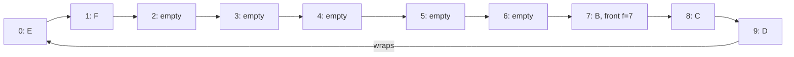

# Queues, circular arrays and deques

A **queue** is the stack's cousin: a collection whose elements are inserted and removed according
to the **first-in, first-out (FIFO)** principle. Elements enter at the **back** and leave from the
**front**, like people in a line at a ticket counter, calls waiting at a customer-service centre,
or jobs waiting for a printer. A **deque** ("deck", double-ended queue) generalises both: insert and
remove at either end.

## 1. The queue ADT

| Operation | Meaning |
|---|---|
| `Q.enqueue(e)` | add `e` to the back |
| `Q.dequeue()` | remove and return the first element; error if empty |
| `Q.first()` | return the first element without removing it; error if empty |
| `Q.is_empty()` | `True` if empty |
| `len(Q)` | number of elements |

| Operation | Return | front ← Q ← back |
|---|---|---|
| `enqueue(5)` | – | [5] |
| `enqueue(3)` | – | [5, 3] |
| `dequeue()` | 5 | [3] |
| `enqueue(7)` | – | [3, 7] |
| `first()` | 3 | [3, 7] |
| `dequeue()` | 3 | [7] |
| `dequeue()` | 7 | [] |
| `dequeue()` | error | [] |

## 2. Why a plain list is not good enough

Adapting a list as for the stack: `enqueue` = `append` ($O(1)$), `dequeue` = `pop(0)` — but
`pop(0)` shifts every remaining element: **$\Theta(n)$**.

A second idea: on dequeue, don't shift; just replace `data[f]` with `None` and advance a front index
`f`. Now dequeue is $O(1)$, but the list grows forever: after many enqueue/dequeue cycles a queue
holding 3 elements could occupy a list of millions of cells — the "dead" prefix is never reclaimed.

## 3. Using an array circularly

The fix: let the front index **wrap around**. Treat the underlying array of capacity $N$ as a
circle. The front is at index `f`; the queue's elements occupy the `size` cells starting at `f`,
wrapping past the end back to index 0. The next free cell for enqueue is

$$\text{avail} = (f + \text{size}) \bmod N,$$

and after a dequeue the front advances to $f = (f + 1) \bmod N$. The modulo operator makes the
array circular.



In the picture $N = 10$, $f = 7$, size $= 5$: elements B, C, D, E, F; the next enqueue goes to
$(7 + 5) \bmod 10 = 2$.

### 3.1 The ArrayQueue implementation

```python-run
class Empty(Exception):
    pass

class ArrayQueue:
    """FIFO queue implementation using a Python list as underlying storage."""
    DEFAULT_CAPACITY = 10

    def __init__(self):
        self._data = [None] * ArrayQueue.DEFAULT_CAPACITY
        self._size = 0
        self._front = 0

    def __len__(self):
        return self._size

    def is_empty(self):
        return self._size == 0

    def first(self):
        if self.is_empty():
            raise Empty('Queue is empty')
        return self._data[self._front]

    def dequeue(self):
        if self.is_empty():
            raise Empty('Queue is empty')
        answer = self._data[self._front]
        self._data[self._front] = None                  # help garbage collection
        self._front = (self._front + 1) % len(self._data)
        self._size -= 1
        if 0 < self._size < len(self._data) // 4:       # shrink when 1/4 full
            self._resize(len(self._data) // 2)
        return answer

    def enqueue(self, e):
        if self._size == len(self._data):
            self._resize(2 * len(self._data))           # double the array size
        avail = (self._front + self._size) % len(self._data)
        self._data[avail] = e
        self._size += 1

    def _resize(self, cap):
        old = self._data
        self._data = [None] * cap
        walk = self._front
        for k in range(self._size):                     # only consider existing elements
            self._data[k] = old[walk]                   # intentionally shift indices
            walk = (1 + walk) % len(old)                # use old size as modulus
        self._front = 0                                 # front has been realigned

Q = ArrayQueue()
for i in range(25):
    Q.enqueue(i)
    if i % 3 == 2:
        Q.dequeue()
print("size", len(Q), "capacity", len(Q._data), "front index", Q._front, "first", Q.first())
while len(Q) > 2:
    Q.dequeue()
print("after draining: size", len(Q), "capacity", len(Q._data), "contents", [Q._data[(Q._front + k) % len(Q._data)] for k in range(len(Q))])
```

Key details:

- **Resizing** cannot just copy the list: the elements may wrap around. `_resize` walks from the old
  front, copying in queue order, so in the new array the front is index 0. (Note that it uses the
  *old* length as the modulus.)
- **Shrinking** at one-quarter full keeps memory proportional to the number of elements, with the
  same amortised guarantees as the dynamic array.
- Setting the vacated cell to `None` lets the garbage collector reclaim the object.

### 3.2 Performance

| Operation | Running time |
|---|---|
| `enqueue(e)` | $O(1)$ amortised |
| `dequeue()` | $O(1)$ amortised |
| `first()`, `is_empty()`, `len(Q)` | $O(1)$ |

Space $O(n)$. The amortisation is due to resizing, exactly as with dynamic arrays.

### 3.3 A fixed-capacity ring buffer

Many systems (audio buffers, network packet queues, logging) use a **bounded** circular buffer
that never resizes: enqueue fails (or overwrites the oldest item) when full. Then every operation
is $O(1)$ *worst case*, with no allocation at all — important in real-time code. You will
implement this in the circular-queue exercise.

> [!WARNING]
> With only `front` and `back` indices (no `size` counter), "full" and "empty" both look like
> `front == back`. Either keep a size counter (as above) or deliberately leave one cell unused.

## 4. Double-ended queues

A **deque** supports insertion and deletion at both front and back:

| Operation | Meaning |
|---|---|
| `D.add_first(e)` / `D.add_last(e)` | insert at front / back |
| `D.delete_first()` / `D.delete_last()` | remove and return front / back |
| `D.first()` / `D.last()` | peek at front / back |
| `D.is_empty()`, `len(D)` | as usual |

A circular array implements it just as well. The only new arithmetic is moving the front
**backwards** for `add_first`:

$$f = (f - 1) \bmod N,$$

and the index of the last element, $(f + \text{size} - 1) \bmod N$. Python's `%` always returns a
non-negative result for positive $N$, so `(0 - 1) % 10 == 9` wraps correctly.

```python-run
class ArrayDeque:
    def __init__(self, cap=4):
        self._data, self._front, self._size = [None] * cap, 0, 0
    def __len__(self): return self._size
    def _grow(self):
        old, n = self._data, len(self._data)
        self._data = [old[(self._front + k) % n] for k in range(self._size)] + [None] * n
        self._front = 0
    def add_first(self, e):
        if self._size == len(self._data): self._grow()
        self._front = (self._front - 1) % len(self._data)
        self._data[self._front] = e
        self._size += 1
    def add_last(self, e):
        if self._size == len(self._data): self._grow()
        self._data[(self._front + self._size) % len(self._data)] = e
        self._size += 1
    def delete_first(self):
        e = self._data[self._front]; self._data[self._front] = None
        self._front = (self._front + 1) % len(self._data); self._size -= 1
        return e
    def delete_last(self):
        back = (self._front + self._size - 1) % len(self._data)
        e = self._data[back]; self._data[back] = None; self._size -= 1
        return e

D = ArrayDeque()
D.add_last(5); D.add_first(3); D.add_first(7); D.add_last(9); D.add_last(1)
print([D._data[(D._front + k) % len(D._data)] for k in range(len(D))])
print(D.delete_last(), D.delete_first(), len(D))
```

### 4.1 Python's `collections.deque`

The standard library's `deque` is implemented in C as a doubly linked list of fixed-size blocks
(a hybrid). All end operations are $O(1)$ worst case. Its method names differ from the ADT:

| ADT | `collections.deque` |
|---|---|
| `add_first` / `add_last` | `appendleft` / `append` |
| `delete_first` / `delete_last` | `popleft` / `pop` |
| `first` / `last` | `D[0]` / `D[-1]` |
| — | `rotate(k)`, `extend`, `extendleft`, `remove`, `maxlen=` bounded mode |

Indexing `D[j]` in the middle is $O(n)$ (it walks blocks), unlike a list. Creating
`deque(maxlen=k)` gives a bounded buffer that silently discards from the opposite end — perfect for
"last $k$ items" windows.

```python-run
from collections import deque
D = deque(maxlen=3)
for x in range(6):
    D.append(x)
    print(list(D))
D.rotate(1)
print("rotated:", list(D))
```

> [!INTERVIEW]
> "Implement a queue with two stacks": push onto an *in* stack; to dequeue, if the *out* stack is
> empty, pop everything from *in* onto *out*, then pop from *out*. Each element moves at most twice,
> so operations are $O(1)$ amortised. It is the same amortisation argument as dynamic arrays.

## 5. Applications

- **Round-robin scheduling**: dequeue a process, run it for a time slice, enqueue it again (the
  linked-lists module does this with a circular list).
- **Breadth-first search**: the frontier is a queue (graphs module, and level-order tree traversal).
- **Sliding windows**: a deque of indices gives the maximum of every window of size $k$ in $O(n)$.
- **Buffers** between producer and consumer threads (`queue.Queue` wraps a deque with locks).

## 6. Pitfalls

- `list.pop(0)` in a BFS loop: quadratic. Use `collections.deque.popleft`.
- Resizing a circular buffer with a plain slice copy: the wrapped elements end up out of order.
- Computing `avail` with the *new* length while copying from the old array.
- Off-by-one in `last`: it is `(f + size - 1) % N`, not `(f + size) % N`.

## 7. Summary

- Queue = FIFO; circular arrays make enqueue/dequeue $O(1)$ amortised with $O(n)$ space.
- Index arithmetic modulo the capacity is the whole trick: `avail = (f + size) % N`,
  `f = (f + 1) % N`, and for deques `f = (f - 1) % N`.
- Use `collections.deque` in real Python code.

> **Source:** Goodrich, Tamassia & Goldwasser, *Data Structures and Algorithms in Python*, ch. 6.2–6.3.

## Check yourself

```quiz
[
  {"q": "Why is `list.pop(0)` a poor dequeue?",
   "options": ["It returns the wrong element", "It shifts all remaining elements: Theta(n)", "It is not allowed on lists", "It is O(log n)"], "answer": 1,
   "explain": "Removing from the front of an array requires moving every later element left."},
  {"q": "A circular queue has capacity N = 8, front f = 6 and size 4. Where does the next enqueue go?",
   "options": ["index 2", "index 10", "index 7", "index 0"], "answer": 0,
   "explain": "(6 + 4) mod 8 = 2."},
  {"q": "In ArrayQueue._resize, why can't we just copy old[0:size]?",
   "options": ["Python forbids slicing", "The elements may wrap around, so queue order differs from index order", "It would be O(n^2)", "Because of garbage collection"], "answer": 1,
   "explain": "Walking from the old front with modular indexing copies elements in queue order and resets front to 0."},
  {"q": "For a circular deque with front f and capacity N, add_first places the new element at...",
   "options": ["(f + 1) mod N", "(f - 1) mod N", "f + size", "0"], "answer": 1,
   "explain": "The front moves one step backwards around the circle."},
  {"q": "In collections.deque, accessing D[len(D)//2] costs...",
   "options": ["O(1)", "O(n)", "O(log n)", "It is not supported"], "answer": 1,
   "explain": "deque is a linked structure of blocks; end operations are O(1) but middle indexing walks."},
  {"q": "With front and back indices but no size counter, what ambiguity arises?",
   "options": ["Cannot tell full from empty, since both have front == back", "Cannot dequeue", "Cannot resize", "None"], "answer": 0,
   "explain": "Keep a size counter or leave one slot permanently empty."},
  {"q": "Queue from two stacks: what is the amortised cost of dequeue?",
   "options": ["O(n)", "O(1)", "O(log n)", "O(n^2)"], "answer": 1,
   "explain": "Each element is pushed and popped at most twice in total."}
]
```
