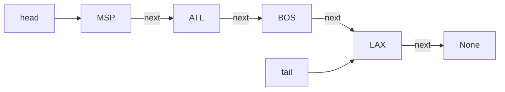
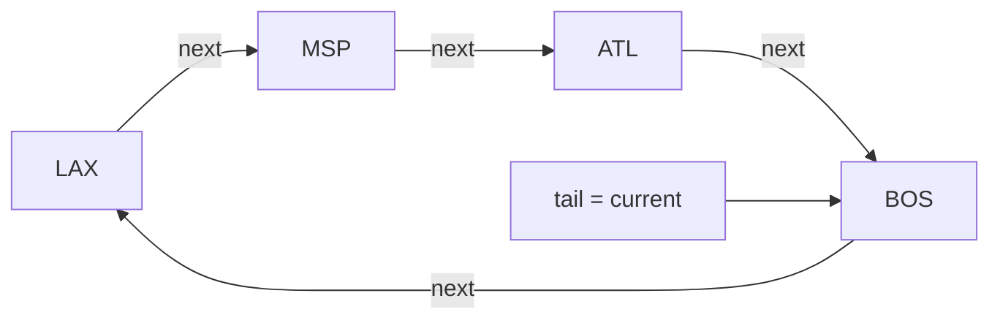

# Singly and circularly linked lists

> **Before this lesson:** You should know how arrays store items side by side and why inserting
> at the front of one is slow ([Low-level arrays](#/lesson/dsa-foundations/low-level-arrays)),
> what a reference is (same lesson), and the stack and queue ADTs
> ([Stacks](#/lesson/dsa-foundations/stacks),
> [Queues, circular arrays and deques](#/lesson/dsa-foundations/queues-deques)).

## In plain words

A **linked list** stores a sequence without putting the items next to each other in memory.
Each item lives in its own small object, called a **node**, and each node holds a note saying
where the next node is. To read the sequence you start at the first node and follow the notes.

Think of a treasure hunt. Each clue is hidden somewhere different and tells you where to find
the next clue. You cannot jump straight to clue number 7; you have to follow the chain. But
adding a new clue in the middle is easy: change one note to point to the new clue and make the
new clue point to the one that used to come next. Nothing else moves. An array is the opposite
trade: instant access to position 7, but inserting in the middle shifts everything after it.

Why it matters for a job: linked lists are an interview staple (reverse a list, detect a loop,
merge two lists), largely because they test whether you can manipulate references without
losing track of anything. They are also the building block for stacks, queues, the trees and
graphs later in this track, and many system-level structures.

## 1. The singly linked list

Arrays have three weaknesses. A dynamic array may hold far more cells than it has items. Its
good average speed hides an occasional slow resize, which is a problem for software that must
never pause. And inserting or deleting anywhere but the end requires shifting. Linked lists
avoid all three. The price is that there is no more $O(1)$ access by position.

A **singly linked list** is a chain of nodes. Each node stores two references: one to its
**element** (the item it carries) and one to the **next** node, or `None` if it is the last.
The list object itself keeps a reference to the first node, the **head**, usually another to the
last node, the **tail**, and a count of the nodes. "Singly" means each node has a single link,
pointing forwards only.



The picture shows a list of four airport codes. Starting at the head and following `next`
references one node at a time is called **traversing** the list. (You will also hear "pointer
hopping"; *pointer* is another word for a reference.) Reaching the item at position $k$ takes
$k$ hops, so access by position costs $O(k)$.

The node is a tiny class with two fields:

```python
class _Node:
    """Lightweight, nonpublic class for storing a singly linked node."""
    __slots__ = '_element', '_next'          # streamline memory usage
    def __init__(self, element, next):
        self._element = element
        self._next = next
```

The line `__slots__ = '_element', '_next'` is an optional memory saver. Normally every Python
object carries a private dictionary for its fields; `__slots__` declares the fields in advance
so that no dictionary is needed. With millions of nodes that saving is substantial.

The four basic operations follow. Draw the boxes and arrows on paper as you read; linked-list
code is far easier to get right with a picture.

### 1.1 Inserting at the head: $O(1)$

1. Create a new node whose element is `e` and whose `next` is the current head.
2. Make `head` refer to the new node.
3. Add one to the size.

Inserting `SFO` in front of `MSP -> ATL` gives `SFO -> MSP -> ATL`. No existing node changed.

### 1.2 Inserting at the tail: $O(1)$ with a tail reference

1. Create a new node with `next = None`.
2. Make the current tail's `next` refer to the new node. (If the list was empty, the new node
   is also the head.)
3. Make `tail` refer to the new node.

### 1.3 Removing at the head: $O(1)$

Set `head = head._next` and subtract one from the size. The old first node is no longer
referenced by anything, so Python reclaims it. If the list has become empty, also set
`tail = None`.

### 1.4 Removing at the tail: $O(n)$

To remove the last node, the node *before* it must become the new tail, and its `next` must be
set to `None`. But a node knows only its successor, not its **predecessor** (the node before
it). The only way to find the second-to-last node is to walk the whole list from the head:
$O(n)$. This lopsidedness is the main limitation of singly linked lists and the reason doubly
linked lists exist.

## 2. A stack with a singly linked list

A stack needs to add and remove at one end. The head supports both in $O(1)$, so the top of the
stack is the **head**.

```python-run
class Empty(Exception):
    pass

class LinkedStack:
    """LIFO Stack implementation using a singly linked list for storage."""
    class _Node:
        __slots__ = '_element', '_next'
        def __init__(self, element, next):
            self._element = element
            self._next = next

    def __init__(self):
        self._head = None                       # reference to the head node
        self._size = 0
    def __len__(self):
        return self._size
    def is_empty(self):
        return self._size == 0
    def push(self, e):
        self._head = self._Node(e, self._head)  # create and link a new node
        self._size += 1
    def top(self):
        if self.is_empty():
            raise Empty('Stack is empty')
        return self._head._element
    def pop(self):
        if self.is_empty():
            raise Empty('Stack is empty')
        answer = self._head._element
        self._head = self._head._next           # bypass the former top node
        self._size -= 1
        return answer

S = LinkedStack()
for c in "LINKED":
    S.push(c)
print(''.join(S.pop() for _ in range(len(S))))
```

**Reading this code.**

- The node class is defined *inside* `LinkedStack`, which keeps it private to the stack.
- An empty stack has `_head = None`.
- `push` does the whole of "insert at head" in one line: `self._Node(e, self._head)` creates a
  node whose `next` is the old head, and the assignment makes it the new head.
- `pop` saves the head's element, then moves `_head` on to the second node, which drops the
  first node out of the chain.
- The test pushes the letters L, I, N, K, E, D and pops them all, printing `DEKNIL`: reversed,
  as a stack should.

Every operation is $O(1)$ in the **worst case**. There is no "amortised" qualifier, because
there is no array to resize: each push creates exactly one node.

## 3. A queue with a singly linked list

A queue adds at the back and removes from the front. Removing at the tail is the one slow
operation, so removal must happen at the head: the **front of the queue is the head** (dequeue
there) and the **back is the tail** (enqueue there).

```python-run
class LinkedQueue:
    """FIFO queue implementation using a singly linked list for storage."""
    class _Node:
        __slots__ = '_element', '_next'
        def __init__(self, element, next):
            self._element, self._next = element, next

    def __init__(self):
        self._head = self._tail = None
        self._size = 0
    def __len__(self):
        return self._size
    def is_empty(self):
        return self._size == 0
    def first(self):
        if self.is_empty(): raise Exception('Queue is empty')
        return self._head._element
    def dequeue(self):
        if self.is_empty(): raise Exception('Queue is empty')
        answer = self._head._element
        self._head = self._head._next
        self._size -= 1
        if self.is_empty():                     # special case: queue now empty
            self._tail = None                   # removed head had been the tail
        return answer
    def enqueue(self, e):
        newest = self._Node(e, None)            # node will be new tail node
        if self.is_empty():
            self._head = newest                 # special case: previously empty
        else:
            self._tail._next = newest
        self._tail = newest                     # update reference to tail node
        self._size += 1

Q = LinkedQueue()
for x in [10, 20, 30]: Q.enqueue(x)
print(Q.dequeue(), Q.dequeue())
Q.enqueue(40)
print(Q.first(), len(Q))
```

The test enqueues 10, 20, 30, dequeues twice (printing `10 20`), enqueues 40, and prints
`30 2`: the front item is now 30 and two items remain.

The two special cases for an empty queue are the classic source of bugs. Enqueuing into an
empty queue must set the head as well as the tail. Dequeuing the last item must clear the tail,
or it would go on referring to a node that is no longer in the queue.

## 4. Circularly linked lists

In a **circularly linked list** the last node's `next` refers back to the first node instead of
holding `None`, so the chain forms a ring. A ring has no natural beginning or end, but the list
must hold on to some node. By convention it keeps the **tail**, because the head is then one hop
away as `tail._next`. A single reference gives access to both ends.



### 4.1 Round-robin scheduling

An operating system shares one processor (CPU) among many running programs, called
*processes*, by giving each a short time slice in turn. This is round-robin scheduling. With an
ordinary queue it reads `p = Q.dequeue(); run(p); Q.enqueue(p)`, which destroys a node and
creates another on every turn. A circular list offers something cheaper: a **rotate** operation
that moves the tail reference one step forward, `tail = tail._next`. The old front becomes the
new back, and no node is created or destroyed.

### 4.2 CircularQueue

In the class below, `enqueue` on an empty queue makes the new node point to itself, a ring of
one. Otherwise the new node is spliced in between the tail and the head and becomes the new
tail. `dequeue` removes the node after the tail, which is the head.

```python-run
class CircularQueue:
    """Queue implementation using circularly linked list for storage."""
    class _Node:
        __slots__ = '_element', '_next'
        def __init__(self, element, next):
            self._element, self._next = element, next

    def __init__(self):
        self._tail = None                       # will represent tail of queue
        self._size = 0
    def __len__(self):
        return self._size
    def is_empty(self):
        return self._size == 0
    def first(self):
        return self._tail._next._element        # head is after the tail
    def dequeue(self):
        oldhead = self._tail._next
        if self._size == 1:                     # removing only element
            self._tail = None                   # queue becomes empty
        else:
            self._tail._next = oldhead._next    # bypass the old head
        self._size -= 1
        return oldhead._element
    def enqueue(self, e):
        newest = self._Node(e, None)
        if self.is_empty():
            newest._next = newest               # initialize circularly
        else:
            newest._next = self._tail._next     # new node points to head
            self._tail._next = newest           # old tail points to new node
        self._tail = newest                     # new node becomes the tail
        self._size += 1
    def rotate(self):
        """Rotate front element to the back of the queue."""
        if self._size > 0:
            self._tail = self._tail._next       # old head becomes new tail

Q = CircularQueue()
for p in ["editor", "browser", "music", "compiler"]:
    Q.enqueue(p)
schedule = []
for slice_no in range(10):
    schedule.append(Q.first())                  # run the process at the front
    Q.rotate()
print(" -> ".join(schedule))
```

The output cycles through the four programs in order, `editor -> browser -> music -> compiler
-> editor -> ...`, for ten time slices.

> [!INTERVIEW]
> Classic singly-linked-list interview tasks: reverse a list in place (using three references:
> the previous node, the current node and the next node), detect a cycle (Floyd's "tortoise and
> hare"), find the middle node (a slow reference and a fast one), and merge two sorted lists.
> Many of them are easier with a **dummy node**, also called a **sentinel**: an extra node that
> holds no data and sits in front of the real first node, so that the empty list needs no
> special handling. The doubly linked list lesson uses two of them.

The next demo shows two of those tasks. `reverse` walks along the list turning each `next`
reference round to point backwards; the single line with three assignments saves the onward
link, redirects the current node, and steps forward, all at once. `has_cycle` moves one
reference a single step at a time and another two steps at a time: if the list loops back on
itself the fast one eventually catches the slow one from behind, and if it does not, the fast
one runs off the end.

```python-run
# In-place reversal of a singly linked list, plus Floyd's cycle detection
class Node:
    def __init__(self, v, nxt=None): self.v, self.next = v, nxt
def build(vals):
    head = None
    for v in reversed(vals): head = Node(v, head)
    return head
def to_list(h):
    out = []
    while h: out.append(h.v); h = h.next
    return out
def reverse(head):
    prev = None
    while head:
        head.next, prev, head = prev, head, head.next
    return prev
def has_cycle(head):
    slow = fast = head
    while fast and fast.next:
        slow, fast = slow.next, fast.next.next
        if slow is fast: return True
    return False
h = build([1, 2, 3, 4, 5])
print(to_list(reverse(h)))
c = build([1, 2, 3]); c.next.next.next = c.next     # 3 -> 2 makes a cycle
print(has_cycle(build([1, 2, 3])), has_cycle(c))
```

## 5. Costs at a glance

| Operation | Singly linked (head + tail) | Circular (tail only) |
|---|---|---|
| insert at head | $O(1)$ | $O(1)$ |
| insert at tail | $O(1)$ | $O(1)$ |
| remove at head | $O(1)$ | $O(1)$ |
| remove at tail | $O(n)$ | $O(n)$ |
| access $k$-th | $O(k)$ | $O(k)$ |
| rotate | – | $O(1)$ |

## 6. Operating in the middle of a singly linked list

Stacks and queues only touch the ends. The same node structure supports general sequence operations,
and working through them shows exactly where singly linked lists are strong and where they are weak.

- **Search / access by index:** walk from the head — $O(k)$ to reach position $k$, $O(n)$ worst case.
- **Insert after a known node `p`:** create the node with `next = p.next`, then set `p.next` to it.
  $O(1)$ — two assignments, **in that order** (reversing them loses the rest of the list).
- **Delete the node after `p`:** `p.next = p.next.next`. $O(1)$.
- **Delete a node `p` itself, or insert before it:** needs `p`'s *predecessor*, which a singly
  linked node does not know — an $O(n)$ walk from the head.

So "$O(1)$ insertion and deletion" in a singly linked list always means *after a node you already
hold*. The standard way to keep the code uniform is a **dummy header node** in front of the
first real node. Then every real node has a predecessor, and inserting at the front is the same
operation as inserting anywhere else: "insert after the header".

In the class below, `__iter__` with `yield` makes the list usable in a `for` loop or with
`list(L)`: each `yield` hands out one element and pauses until the next is requested.

```python-run
class Node:
    __slots__ = "element", "next"
    def __init__(self, element, next=None):
        self.element, self.next = element, next

class SinglyLinkedList:
    def __init__(self, items=()):
        self._header = Node(None)                # dummy node: never holds data
        self._size = 0
        tail = self._header
        for x in items:
            tail.next = Node(x); tail = tail.next; self._size += 1

    def __iter__(self):
        walk = self._header.next
        while walk is not None:
            yield walk.element
            walk = walk.next

    def _node_before(self, k):
        """Return the node immediately before index k (the header when k == 0): O(k)."""
        walk = self._header
        for _ in range(k):
            walk = walk.next
        return walk

    def insert(self, k, e):
        p = self._node_before(k)
        p.next = Node(e, p.next)                 # new node points onward FIRST, then p points to it
        self._size += 1

    def delete(self, k):
        p = self._node_before(k)
        target = p.next
        p.next = target.next                     # bypass the node
        self._size -= 1
        return target.element

    def remove_all(self, value):
        """Delete every node holding value in one pass: O(n)."""
        p = self._header
        while p.next is not None:
            if p.next.element == value:
                p.next = p.next.next             # stay at p: the new p.next is unexamined
                self._size -= 1
            else:
                p = p.next

L = SinglyLinkedList("LAX MSP ATL BOS".split())
L.insert(0, "SFO"); L.insert(3, "ORD"); L.insert(6, "JFK")
print(list(L))
print("deleted:", L.delete(0), L.delete(2), "->", list(L))
M = SinglyLinkedList([3, 1, 3, 3, 2, 3]); M.remove_all(3)
print(list(M), M._size)
```

### Dry run: `insert(3, "ORD")` into SFO → LAX → MSP → ATL → BOS

1. `_node_before(3)` walks header → SFO → LAX → MSP and returns the MSP node (3 hops).
2. `Node("ORD", p.next)` creates ORD pointing at ATL. The list is still intact: MSP → ATL.
3. `p.next = ...` re-points MSP at ORD: SFO → LAX → MSP → ORD → ATL → BOS.

If steps 2 and 3 were swapped — `p.next = Node("ORD")` and only then trying to attach the rest — the
only reference to ATL would already be gone, and ATL and BOS would be unreachable (and garbage
collected). **Link the new node to the list before linking the list to the new node.**

`remove_all` illustrates the other classic subtlety: after deleting `p.next`, do **not** advance
`p`, because the node that slid into `p.next` has not been examined yet (consecutive matches such as
the `3, 3` above would otherwise be skipped).

## 7. Worked application: the Josephus problem

A circular list models any process that goes "round and round". In the *Josephus problem* (the
children's game "hot potato"), $n$ people stand in a circle; counting off repeatedly, every $k$-th
person is eliminated until one remains. With the `CircularQueue` idea, one round of the game is
*rotate $k - 1$ times, then dequeue*:

```python-run
class CircularList:
    class _Node:
        __slots__ = "element", "next"
        def __init__(self, element, next=None): self.element, self.next = element, next
    def __init__(self, items):
        self._tail, self._size = None, 0
        for x in items:
            node = self._Node(x)
            if self._tail is None: node.next = node
            else: node.next, self._tail.next = self._tail.next, node
            self._tail = node; self._size += 1
    def rotate(self):
        self._tail = self._tail.next                 # O(1): the front becomes the back
    def dequeue(self):
        head = self._tail.next
        if self._size == 1: self._tail = None
        else: self._tail.next = head.next            # bypass the old head
        self._size -= 1
        return head.element

def josephus(n, k):
    circle, order = CircularList(range(1, n + 1)), []
    while circle._size > 0:
        for _ in range(k - 1):
            circle.rotate()                          # k - 1 people survive this count
        order.append(circle.dequeue())               # the k-th is eliminated
    return order

order = josephus(7, 3)
print("elimination order:", order, " survivor:", order[-1])
print("survivor for n = 41, k = 3:", josephus(41, 3)[-1])
```

For $n = 7$, $k = 3$: count 1, 2, **3** (out), 4, 5, **6** (out), 7, 1, **2** (out), … giving the
order 3, 6, 2, 7, 5, 1 and survivor 4. Each elimination costs $k - 1$ rotations plus one dequeue,
all $O(1)$, so the simulation runs in $O(nk)$ time with no node ever allocated or copied — on an
array-based list each removal from the middle would shift elements instead. Round-robin scheduling
is the same loop with "run for a time slice" in place of "count".

## 8. Pitfalls

- **Forgetting the tail.** It must be updated when the list becomes empty and when inserting
  into an empty list.
- **Losing the rest of the list.** Overwriting a node's `next` before saving where it pointed
  cuts off everything after it. Link the new node to the list first.
- **Endless loops on a circular list.** `while node is not None` never ends on a ring; loop
  until you are back at the node where you started.
- **Advancing after a deletion.** When removing matching nodes in one pass, stay where you are
  after a removal, or the node that moved up is skipped.
- **Assuming linked lists are always faster for insertion.** Finding the position still takes
  $O(n)$ hops, and because nodes are scattered in memory, traversing them is slower in practice
  than scanning an array.

## 9. Summary

- A singly linked list gives $O(1)$ worst-case insertion at both ends and removal at the head,
  which suits stacks (top at the head) and queues (front at the head, back at the tail).
- A circular list keeps only a tail reference and supports $O(1)$ rotation, which suits
  round-robin processing.
- Insertion and deletion are $O(1)$ only *after a node you already hold*; reaching a position
  costs $O(k)$.
- Removing the tail of a singly linked list is $O(n)$; double linking fixes that.

> **Source:** Goodrich, Tamassia & Goldwasser, *Data Structures and Algorithms in Python*, ch. 7.1–7.2.

## Glossary

- **Linked list**: a sequence stored as a chain of nodes joined by references.
- **Node**: a small object holding one element and a reference to a neighbouring node.
- **Head / tail**: the first / last node of a list.
- **Singly linked**: each node refers only to the next node.
- **Traversal**: visiting nodes one after another by following references.
- **Pointer**: another word for a reference to an object.
- **Predecessor / successor**: the node before / after a given node.
- **`__slots__`**: a Python declaration that saves memory by fixing an object's fields.
- **Circularly linked list**: a list whose last node refers back to the first.
- **Rotate**: move the front item of a circular list to the back by advancing one reference.
- **Dummy node (sentinel)**: a node holding no data, used to remove special cases.
- **Cycle**: a loop in a chain of nodes, so that following `next` never reaches `None`.
- **Josephus problem**: repeatedly eliminating every $k$-th person from a circle.

## Check yourself

```quiz
[
  {"q": "Why is removing the tail of a singly linked list O(n)?",
   "options": ["Nodes must be copied", "We must walk from the head to find the predecessor of the tail", "Python lists are slow", "The tail reference is lost"], "answer": 1,
   "explain": "Nodes only point forward; finding the new tail requires traversal."},
  {"q": "In LinkedQueue, where are enqueue and dequeue performed?",
   "options": ["Enqueue at head, dequeue at tail", "Enqueue at tail, dequeue at head", "Both at head", "Both at tail"], "answer": 1,
   "explain": "Removing at the head is O(1) while removing at the tail is O(n), so the front of the queue is the head."},
  {"q": "What must dequeue do when it removes the last remaining node of LinkedQueue?",
   "options": ["Nothing special", "Set the tail reference to None", "Set head to tail", "Raise an exception"], "answer": 1,
   "explain": "Otherwise tail would still reference a removed node, corrupting the next enqueue."},
  {"q": "A circular linked list stores a reference to the tail because...",
   "options": ["The tail is always smallest", "The head is reachable in O(1) as tail.next, so both ends are available", "It saves memory", "Python requires it"], "answer": 1,
   "explain": "One reference gives both ends."},
  {"q": "What does CircularQueue.rotate() do?",
   "options": ["Reverses the list", "Advances the tail one step so the old front becomes the back", "Removes the front", "Sorts the list"], "answer": 1,
   "explain": "tail = tail.next: O(1), no allocation; perfect for round-robin scheduling."},
  {"q": "Why do LinkedStack operations not need an 'amortised' qualifier?",
   "options": ["They do", "There is no resizing; each operation does a constant amount of work", "Python garbage collection is free", "Linked lists are arrays"], "answer": 1,
   "explain": "Each push/pop creates or bypasses one node: O(1) worst case."}
]
```
