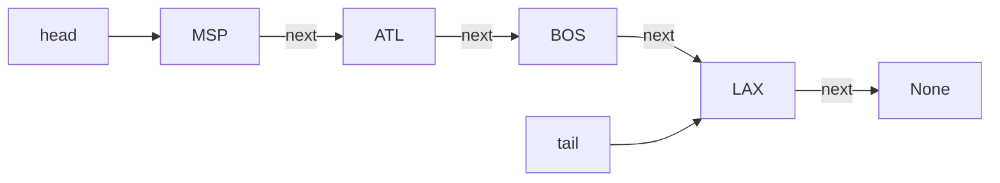
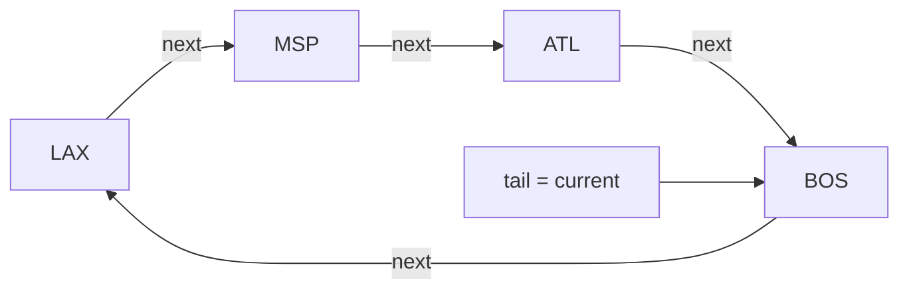

# Singly and circularly linked lists

Array-based sequences have three weaknesses: a dynamic array may be considerably longer than the
number of elements it stores; amortised bounds hide occasional expensive resizes (bad for real-time
systems); and insertions or deletions at interior positions require shifting. **Linked lists**
avoid all three by storing each element in its own small object — a **node** — that references its
neighbour(s). The price: no more $O(1)$ access by index.

## 1. The singly linked list

A **singly linked list** is a collection of nodes forming a linear sequence. Each node stores a
reference to its **element** and a reference to the **next** node (or `None` at the end). The list
object keeps a reference to the first node, the **head**, and usually to the last node, the
**tail**, plus a size counter.



Walking from the head following `next` references is called **traversing** the list (or *link
hopping*, *pointer hopping*). Reaching element $k$ takes $k$ hops: $O(k)$.

```python
class _Node:
    """Lightweight, nonpublic class for storing a singly linked node."""
    __slots__ = '_element', '_next'          # streamline memory usage
    def __init__(self, element, next):
        self._element = element
        self._next = next
```

`__slots__` tells Python not to create a per-instance dictionary — a real memory saving when there
are millions of nodes.

### 1.1 Inserting at the head — $O(1)$

1. Create a new node whose element is `e` and whose `next` is the current head.
2. Set `head` to the new node.
3. Increment size.

### 1.2 Inserting at the tail — $O(1)$ with a tail reference

1. Create a new node with `next = None`.
2. Set the current tail's `next` to the new node (if the list is empty, the new node is also the
   head).
3. Set `tail` to the new node.

### 1.3 Removing at the head — $O(1)$

Set `head = head._next`; decrement size. If the list becomes empty, also set `tail = None`.

### 1.4 Removing at the tail — $O(n)$!

To remove the last node we must make the *second-to-last* node the new tail, but nodes do not know
their predecessors. The only way to find it is to walk from the head: $O(n)$. This asymmetry is the
main limitation of singly linked lists — and the motivation for doubly linked lists.

## 2. A stack with a singly linked list

The top of the stack goes at the **head**, since both insertion and removal there are $O(1)$.

```python-run
class Empty(Exception):
    pass

class LinkedStack:
    """LIFO Stack implementation using a singly linked list for storage."""
    class _Node:
        __slots__ = '_element', '_next'
        def __init__(self, element, next):
            self._element = element
            self._next = next

    def __init__(self):
        self._head = None                       # reference to the head node
        self._size = 0
    def __len__(self):
        return self._size
    def is_empty(self):
        return self._size == 0
    def push(self, e):
        self._head = self._Node(e, self._head)  # create and link a new node
        self._size += 1
    def top(self):
        if self.is_empty():
            raise Empty('Stack is empty')
        return self._head._element
    def pop(self):
        if self.is_empty():
            raise Empty('Stack is empty')
        answer = self._head._element
        self._head = self._head._next           # bypass the former top node
        self._size -= 1
        return answer

S = LinkedStack()
for c in "LINKED":
    S.push(c)
print(''.join(S.pop() for _ in range(len(S))))
```

All operations are $O(1)$ **worst case** — no amortisation, because there is never a resize.

## 3. A queue with a singly linked list

Elements leave from the front and enter at the back. Removing from the tail is slow, so the
**front is the head** (dequeue there) and the **back is the tail** (enqueue there).

```python-run
class LinkedQueue:
    """FIFO queue implementation using a singly linked list for storage."""
    class _Node:
        __slots__ = '_element', '_next'
        def __init__(self, element, next):
            self._element, self._next = element, next

    def __init__(self):
        self._head = self._tail = None
        self._size = 0
    def __len__(self):
        return self._size
    def is_empty(self):
        return self._size == 0
    def first(self):
        if self.is_empty(): raise Exception('Queue is empty')
        return self._head._element
    def dequeue(self):
        if self.is_empty(): raise Exception('Queue is empty')
        answer = self._head._element
        self._head = self._head._next
        self._size -= 1
        if self.is_empty():                     # special case: queue now empty
            self._tail = None                   # removed head had been the tail
        return answer
    def enqueue(self, e):
        newest = self._Node(e, None)            # node will be new tail node
        if self.is_empty():
            self._head = newest                 # special case: previously empty
        else:
            self._tail._next = newest
        self._tail = newest                     # update reference to tail node
        self._size += 1

Q = LinkedQueue()
for x in [10, 20, 30]: Q.enqueue(x)
print(Q.dequeue(), Q.dequeue())
Q.enqueue(40)
print(Q.first(), len(Q))
```

The special cases for the empty queue are the classic source of bugs: enqueuing into an empty queue
must set the head; dequeuing the last element must clear the tail.

## 4. Circularly linked lists

In a **circularly linked list** the tail's `next` points back to the head instead of `None`. There
is no natural beginning or end, but we keep a reference to some node — conventionally the **tail**,
because the head is then just `tail._next`. One reference gives access to both ends.



### 4.1 Round-robin scheduling

An operating system shares a CPU among processes by giving each a short time slice in turn. With a
queue: `p = Q.dequeue(); run(p); Q.enqueue(p)`. With a circular list we can do better — a
**rotate** operation simply advances the tail one step: `tail = tail._next`. No nodes are created or
destroyed.

### 4.2 CircularQueue

```python-run
class CircularQueue:
    """Queue implementation using circularly linked list for storage."""
    class _Node:
        __slots__ = '_element', '_next'
        def __init__(self, element, next):
            self._element, self._next = element, next

    def __init__(self):
        self._tail = None                       # will represent tail of queue
        self._size = 0
    def __len__(self):
        return self._size
    def is_empty(self):
        return self._size == 0
    def first(self):
        return self._tail._next._element        # head is after the tail
    def dequeue(self):
        oldhead = self._tail._next
        if self._size == 1:                     # removing only element
            self._tail = None                   # queue becomes empty
        else:
            self._tail._next = oldhead._next    # bypass the old head
        self._size -= 1
        return oldhead._element
    def enqueue(self, e):
        newest = self._Node(e, None)
        if self.is_empty():
            newest._next = newest               # initialize circularly
        else:
            newest._next = self._tail._next     # new node points to head
            self._tail._next = newest           # old tail points to new node
        self._tail = newest                     # new node becomes the tail
        self._size += 1
    def rotate(self):
        """Rotate front element to the back of the queue."""
        if self._size > 0:
            self._tail = self._tail._next       # old head becomes new tail

Q = CircularQueue()
for p in ["editor", "browser", "music", "compiler"]:
    Q.enqueue(p)
schedule = []
for slice_no in range(10):
    schedule.append(Q.first())                  # run the process at the front
    Q.rotate()
print(" -> ".join(schedule))
```

> [!INTERVIEW]
> Classic singly-linked-list interview tasks: reverse a list in place (three pointers: `prev`,
> `cur`, `next`), detect a cycle (Floyd's tortoise and hare), find the middle (slow/fast pointers),
> merge two sorted lists (dummy head node). A **dummy/sentinel** node avoids empty-list special
> cases — the doubly linked list lesson uses two of them.

```python-run
# In-place reversal of a singly linked list, plus Floyd's cycle detection
class Node:
    def __init__(self, v, nxt=None): self.v, self.next = v, nxt
def build(vals):
    head = None
    for v in reversed(vals): head = Node(v, head)
    return head
def to_list(h):
    out = []
    while h: out.append(h.v); h = h.next
    return out
def reverse(head):
    prev = None
    while head:
        head.next, prev, head = prev, head, head.next
    return prev
def has_cycle(head):
    slow = fast = head
    while fast and fast.next:
        slow, fast = slow.next, fast.next.next
        if slow is fast: return True
    return False
h = build([1, 2, 3, 4, 5])
print(to_list(reverse(h)))
c = build([1, 2, 3]); c.next.next.next = c.next     # 3 -> 2 makes a cycle
print(has_cycle(build([1, 2, 3])), has_cycle(c))
```

## 5. Costs at a glance

| Operation | Singly linked (head + tail) | Circular (tail only) |
|---|---|---|
| insert at head | $O(1)$ | $O(1)$ |
| insert at tail | $O(1)$ | $O(1)$ |
| remove at head | $O(1)$ | $O(1)$ |
| remove at tail | $O(n)$ | $O(n)$ |
| access $k$-th | $O(k)$ | $O(k)$ |
| rotate | – | $O(1)$ |

## 6. Operating in the middle of a singly linked list

Stacks and queues only touch the ends. The same node structure supports general sequence operations,
and working through them shows exactly where singly linked lists are strong and where they are weak.

- **Search / access by index:** walk from the head — $O(k)$ to reach position $k$, $O(n)$ worst case.
- **Insert after a known node `p`:** create the node with `next = p.next`, then set `p.next` to it.
  $O(1)$ — two assignments, **in that order** (reversing them loses the rest of the list).
- **Delete the node after `p`:** `p.next = p.next.next`. $O(1)$.
- **Delete a node `p` itself, or insert before it:** needs `p`'s *predecessor*, which a singly
  linked node does not know — an $O(n)$ walk from the head.

So "$O(1)$ insertion and deletion" in a singly linked list always means *after a node you already
hold*. The standard trick for uniform code is a **dummy header node** in front of the first real
node: then every real node has a predecessor, and inserting at the front is just "insert after the
header".

```python-run
class Node:
    __slots__ = "element", "next"
    def __init__(self, element, next=None):
        self.element, self.next = element, next

class SinglyLinkedList:
    def __init__(self, items=()):
        self._header = Node(None)                # dummy node: never holds data
        self._size = 0
        tail = self._header
        for x in items:
            tail.next = Node(x); tail = tail.next; self._size += 1

    def __iter__(self):
        walk = self._header.next
        while walk is not None:
            yield walk.element
            walk = walk.next

    def _node_before(self, k):
        """Return the node just before index k (the header when k == 0): O(k)."""
        walk = self._header
        for _ in range(k):
            walk = walk.next
        return walk

    def insert(self, k, e):
        p = self._node_before(k)
        p.next = Node(e, p.next)                 # new node points onward FIRST, then p points to it
        self._size += 1

    def delete(self, k):
        p = self._node_before(k)
        target = p.next
        p.next = target.next                     # bypass the node
        self._size -= 1
        return target.element

    def remove_all(self, value):
        """Delete every node holding value in one pass: O(n)."""
        p = self._header
        while p.next is not None:
            if p.next.element == value:
                p.next = p.next.next             # stay at p: the new p.next is unexamined
                self._size -= 1
            else:
                p = p.next

L = SinglyLinkedList("LAX MSP ATL BOS".split())
L.insert(0, "SFO"); L.insert(3, "ORD"); L.insert(6, "JFK")
print(list(L))
print("deleted:", L.delete(0), L.delete(2), "->", list(L))
M = SinglyLinkedList([3, 1, 3, 3, 2, 3]); M.remove_all(3)
print(list(M), M._size)
```

### Dry run: `insert(3, "ORD")` into SFO → LAX → MSP → ATL → BOS

1. `_node_before(3)` walks header → SFO → LAX → MSP and returns the MSP node (3 hops).
2. `Node("ORD", p.next)` creates ORD pointing at ATL. The list is still intact: MSP → ATL.
3. `p.next = ...` re-points MSP at ORD: SFO → LAX → MSP → ORD → ATL → BOS.

If steps 2 and 3 were swapped — `p.next = Node("ORD")` and only then trying to attach the rest — the
only reference to ATL would already be gone, and ATL and BOS would be unreachable (and garbage
collected). **Link the new node to the list before linking the list to the new node.**

`remove_all` illustrates the other classic subtlety: after deleting `p.next`, do **not** advance
`p`, because the node that slid into `p.next` has not been examined yet (consecutive matches such as
the `3, 3` above would otherwise be skipped).

## 7. Worked application: the Josephus problem

A circular list models any process that goes "round and round". In the *Josephus problem* (the
children's game "hot potato"), $n$ people stand in a circle; counting off repeatedly, every $k$-th
person is eliminated until one remains. With the `CircularQueue` idea this is just *rotate $k - 1$
times, then dequeue*:

```python-run
class CircularList:
    class _Node:
        __slots__ = "element", "next"
        def __init__(self, element, next=None): self.element, self.next = element, next
    def __init__(self, items):
        self._tail, self._size = None, 0
        for x in items:
            node = self._Node(x)
            if self._tail is None: node.next = node
            else: node.next, self._tail.next = self._tail.next, node
            self._tail = node; self._size += 1
    def rotate(self):
        self._tail = self._tail.next                 # O(1): the front becomes the back
    def dequeue(self):
        head = self._tail.next
        if self._size == 1: self._tail = None
        else: self._tail.next = head.next            # bypass the old head
        self._size -= 1
        return head.element

def josephus(n, k):
    circle, order = CircularList(range(1, n + 1)), []
    while circle._size > 0:
        for _ in range(k - 1):
            circle.rotate()                          # k - 1 people survive this count
        order.append(circle.dequeue())               # the k-th is eliminated
    return order

order = josephus(7, 3)
print("elimination order:", order, " survivor:", order[-1])
print("survivor for n = 41, k = 3:", josephus(41, 3)[-1])
```

For $n = 7$, $k = 3$: count 1, 2, **3** (out), 4, 5, **6** (out), 7, 1, **2** (out), … giving the
order 3, 6, 2, 7, 5, 1 and survivor 4. Each elimination costs $k - 1$ rotations plus one dequeue,
all $O(1)$, so the simulation runs in $O(nk)$ time with no node ever allocated or copied — on an
array-based list each removal from the middle would shift elements instead. Round-robin scheduling
is the same loop with "run for a time slice" in place of "count".

## 8. Pitfalls

- Forgetting to update `tail` when the list becomes empty or when inserting into an empty list.
- Losing the rest of the list by overwriting `head._next` before saving it.
- Infinite loops traversing a circular list with `while node is not None`; loop until you return to
  the start instead.
- Assuming linked lists are always faster for insertion: finding the position is $O(n)$, and node
  objects have poor cache locality.

## 9. Summary

- Singly linked lists give $O(1)$ worst-case insert at both ends and removal at the head, ideal for
  stacks (top = head) and queues (front = head, back = tail).
- Circular lists keep only a tail reference and support $O(1)$ rotation, ideal for round-robin.
- Removing the tail of a singly linked list is $O(n)$ — fixed by double linking.

> **Source:** Goodrich, Tamassia & Goldwasser, *Data Structures and Algorithms in Python*, ch. 7.1–7.2.

## Check yourself

```quiz
[
  {"q": "Why is removing the tail of a singly linked list O(n)?",
   "options": ["Nodes must be copied", "We must walk from the head to find the predecessor of the tail", "Python lists are slow", "The tail reference is lost"], "answer": 1,
   "explain": "Nodes only point forward; finding the new tail requires traversal."},
  {"q": "In LinkedQueue, where are enqueue and dequeue performed?",
   "options": ["Enqueue at head, dequeue at tail", "Enqueue at tail, dequeue at head", "Both at head", "Both at tail"], "answer": 1,
   "explain": "Removing at the head is O(1) while removing at the tail is O(n), so the front of the queue is the head."},
  {"q": "What must dequeue do when it removes the last remaining node of LinkedQueue?",
   "options": ["Nothing special", "Set the tail reference to None", "Set head to tail", "Raise an exception"], "answer": 1,
   "explain": "Otherwise tail would still reference a removed node, corrupting the next enqueue."},
  {"q": "A circular linked list stores a reference to the tail because...",
   "options": ["The tail is always smallest", "The head is reachable in O(1) as tail.next, so both ends are available", "It saves memory", "Python requires it"], "answer": 1,
   "explain": "One reference gives both ends."},
  {"q": "What does CircularQueue.rotate() do?",
   "options": ["Reverses the list", "Advances the tail one step so the old front becomes the back", "Removes the front", "Sorts the list"], "answer": 1,
   "explain": "tail = tail.next: O(1), no allocation; perfect for round-robin scheduling."},
  {"q": "Why do LinkedStack operations not need an 'amortised' qualifier?",
   "options": ["They do", "There is no resizing; each operation does a constant amount of work", "Python garbage collection is free", "Linked lists are arrays"], "answer": 1,
   "explain": "Each push/pop creates or bypasses one node: O(1) worst case."}
]
```
