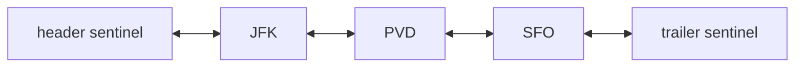

# Doubly linked lists and positional lists

> **Before this lesson:** You should know nodes, head and tail references, and why removing the
> last node of a singly linked list costs $O(n)$. All of that is in
> [Singly and circularly linked lists](#/lesson/dsa-foundations/singly-circular). The deque ADT
> comes from [Queues, circular arrays and deques](#/lesson/dsa-foundations/queues-deques).

## In plain words

A **doubly linked list** is a linked list in which every node knows both of its neighbours: the
one after it (`next`) and the one before it (`prev`). With both links in hand, any node can be
removed, or a new node inserted beside it, in a constant number of steps.

Picture a line of people holding hands. Each person holds the hand of the person on either
side. If someone in the middle wants to leave, they join their two neighbours' hands together
and step out; nobody else in the line is disturbed. In a singly linked list each person could
see only the person in front, so the one behind a leaver would not know whose hand to take.

The second idea in this lesson is a **position**: a safe handle on a place in the list, like a
bookmark, that stays correct while other items come and go around it.

Why it matters for a job: the doubly linked list combined with a dictionary gives the LRU
cache, among the most frequently asked design questions in interviews and a structure used in
real systems wherever memory is limited (web caches, database buffers). Section 6 builds one.

## 1. Header and trailer sentinels

In the previous lesson, code for the ends of a list was full of special cases ("if the list is
empty, also set the tail..."). Doubly linked lists usually avoid these with two **sentinel**
nodes, dummy nodes that hold no element: a **header** in front of the first real node and a
**trailer** after the last. An empty list is the two sentinels linked to each other,
`header <-> trailer`.



Why bother with two nodes that store nothing? Because every real node now always has a node on
each side of it (possibly a sentinel), so the insertion and deletion code never has to check
for `None` or update separate `head` and `tail` references. All insertions look like "insert between two existing nodes", and all deletions look
like "unlink a node that has neighbours on both sides".

## 2. Inserting and deleting

**Insert `e` between nodes `predecessor` and `successor`:**

1. Create `newest` with `prev = predecessor`, `next = successor`.
2. Set `predecessor.next = newest` and `successor.prev = newest`.

**Delete node `node`:**

1. Let `p = node.prev`, `s = node.next`.
2. Link `p.next = s` and `s.prev = p`.
3. Optionally clear `node`'s fields (helps garbage collection and marks it as deprecated).

Both are $O(1)$: a fixed number of reference updates, whatever the length of the list.

The code below has two classes. `_DoublyLinkedBase` holds the sentinels and the two operations
described above. `LinkedDeque(_DoublyLinkedBase)` **inherits** from it: writing a class name in
parentheses means "start with everything that class has, and add to it". The deque's six methods
are then one line each, because "first item" is `header._next` and "last item" is
`trailer._prev`.

```python-run
class _DoublyLinkedBase:
    """A base class providing a doubly linked list representation."""
    class _Node:
        __slots__ = '_element', '_prev', '_next'
        def __init__(self, element, prev, next):
            self._element, self._prev, self._next = element, prev, next

    def __init__(self):
        self._header = self._Node(None, None, None)
        self._trailer = self._Node(None, None, None)
        self._header._next = self._trailer          # trailer is after header
        self._trailer._prev = self._header          # header is before trailer
        self._size = 0

    def __len__(self):
        return self._size
    def is_empty(self):
        return self._size == 0

    def _insert_between(self, e, predecessor, successor):
        newest = self._Node(e, predecessor, successor)
        predecessor._next = newest
        successor._prev = newest
        self._size += 1
        return newest

    def _delete_node(self, node):
        predecessor, successor = node._prev, node._next
        predecessor._next = successor
        successor._prev = predecessor
        self._size -= 1
        element = node._element
        node._prev = node._next = node._element = None   # deprecate node
        return element

class LinkedDeque(_DoublyLinkedBase):
    """Double-ended queue implementation based on a doubly linked list."""
    def first(self):
        if self.is_empty(): raise Exception("Deque is empty")
        return self._header._next._element
    def last(self):
        if self.is_empty(): raise Exception("Deque is empty")
        return self._trailer._prev._element
    def insert_first(self, e):
        self._insert_between(e, self._header, self._header._next)
    def insert_last(self, e):
        self._insert_between(e, self._trailer._prev, self._trailer)
    def delete_first(self):
        if self.is_empty(): raise Exception("Deque is empty")
        return self._delete_node(self._header._next)
    def delete_last(self):
        if self.is_empty(): raise Exception("Deque is empty")
        return self._delete_node(self._trailer._prev)

D = LinkedDeque()
D.insert_last(5); D.insert_first(3); D.insert_first(7); D.insert_last(9)
print(D.first(), D.last(), len(D))
print(D.delete_last(), D.delete_first(), D.delete_first(), D.delete_first(), D.is_empty())
```

The test builds the deque 7, 3, 5, 9 (two insertions at each end), so the first line prints
`7 9 4`. The second line removes 9 from the back and then 7, 3, 5 from the front, and prints
`9 7 3 5 True`.

Every deque operation is $O(1)$ in the **worst case**, which is better than the circular
array's amortised bound. The cost is memory: two extra references per item.

## 3. The positional list ADT

Stacks, queues and deques allow access only at the ends. Many applications need to work
*inside* a sequence: the cursor in a text editor, a waiting list that someone in the middle
leaves, a playlist where a song is inserted after the one now playing. Whole-number indices are
a poor way to describe such places:

- an index changes whenever an item is inserted or deleted before it, so a remembered index
  goes stale;
- reaching index $k$ in a linked list costs $O(k)$ hops.

What we want is something like a *reference to a node*: it stays correct as the list changes
and can be used in $O(1)$. But handing users the nodes themselves would let them tamper with
the links and wreck the list. The answer is an abstraction called a **position**: a small
object that marks a place in the list and lets you read the element there, nothing more. A
position stays valid while other items are inserted or removed around it. It becomes invalid
only when its own item is deleted.

### 3.1 Operations

A position `p` supports `p.element()`. A positional list `L` supports:

| Accessors | Meaning |
|---|---|
| `L.first()` / `L.last()` | position of first / last element (None if empty) |
| `L.before(p)` / `L.after(p)` | position before / after `p` (None at the ends) |
| `L.is_empty()`, `len(L)`, `iter(L)` | as usual; iteration yields elements |

| Updates | Meaning |
|---|---|
| `L.add_first(e)` / `L.add_last(e)` | insert at an end, return new position |
| `L.add_before(p, e)` / `L.add_after(p, e)` | insert next to `p`, return new position |
| `L.replace(p, e)` | replace element at `p`, return old element |
| `L.delete(p)` | remove and return element at `p`; `p` becomes invalid |

All of these run in $O(1)$ worst-case time with a doubly linked implementation.

### 3.2 Implementation

The `Position` class wraps a node and remembers which list it belongs to. A few details of the
code are worth knowing before you read it:

- `_validate(p)` is the gatekeeper. It rejects anything that is not a `Position`, a position
  from a different list, and a position whose node has been deleted (recognisable because
  `_delete_node` set its `_next` to `None`). If all is well it returns the underlying node.
- `_make_position(node)` goes the other way, wrapping a node in a `Position`, and returns `None`
  for a sentinel so that users can never get hold of the header or trailer.
- `__eq__` defines what `==` means for positions: two `Position` objects are equal when they
  wrap the very same node (`is` tests whether two names refer to one object).
- `super()._insert_between(...)` calls the version of the method defined in the parent class.

The cell also contains the sorting function discussed in section 4.

```python-run
class _DoublyLinkedBase:                       # (same base class as above, repeated so this cell runs alone)
    class _Node:
        __slots__ = '_element', '_prev', '_next'
        def __init__(self, element, prev, next):
            self._element, self._prev, self._next = element, prev, next
    def __init__(self):
        self._header = self._Node(None, None, None)
        self._trailer = self._Node(None, None, None)
        self._header._next, self._trailer._prev = self._trailer, self._header
        self._size = 0
    def __len__(self): return self._size
    def is_empty(self): return self._size == 0
    def _insert_between(self, e, predecessor, successor):
        newest = self._Node(e, predecessor, successor)
        predecessor._next = successor._prev = newest
        self._size += 1
        return newest
    def _delete_node(self, node):
        node._prev._next, node._next._prev = node._next, node._prev
        self._size -= 1
        element = node._element
        node._prev = node._next = node._element = None
        return element

class PositionalList(_DoublyLinkedBase):
    """A sequential container of elements allowing positional access."""
    class Position:
        def __init__(self, container, node):
            self._container, self._node = container, node
        def element(self):
            return self._node._element
        def __eq__(self, other):
            return type(other) is type(self) and other._node is self._node
        def __ne__(self, other):
            return not (self == other)

    def _validate(self, p):
        if not isinstance(p, self.Position): raise TypeError('p must be proper Position type')
        if p._container is not self: raise ValueError('p does not belong to this container')
        if p._node._next is None: raise ValueError('p is no longer valid')   # deprecated node
        return p._node

    def _make_position(self, node):
        if node is self._header or node is self._trailer:
            return None                                   # boundary violation
        return self.Position(self, node)

    def first(self):  return self._make_position(self._header._next)
    def last(self):   return self._make_position(self._trailer._prev)
    def before(self, p): return self._make_position(self._validate(p)._prev)
    def after(self, p):  return self._make_position(self._validate(p)._next)
    def __iter__(self):
        cursor = self.first()
        while cursor is not None:
            yield cursor.element()
            cursor = self.after(cursor)

    def _insert_between(self, e, predecessor, successor):
        node = super()._insert_between(e, predecessor, successor)
        return self._make_position(node)
    def add_first(self, e): return self._insert_between(e, self._header, self._header._next)
    def add_last(self, e):  return self._insert_between(e, self._trailer._prev, self._trailer)
    def add_before(self, p, e):
        original = self._validate(p)
        return self._insert_between(e, original._prev, original)
    def add_after(self, p, e):
        original = self._validate(p)
        return self._insert_between(e, original, original._next)
    def delete(self, p):
        return self._delete_node(self._validate(p))
    def replace(self, p, e):
        original = self._validate(p)
        old, original._element = original._element, e
        return old

L = PositionalList()
p = L.add_last(8)          # 8
q = L.add_after(p, 5)      # 8 5
r = L.add_before(q, 3)     # 8 3 5
L.add_first(9)             # 9 8 3 5
print(list(L), "| before(q):", L.before(q).element())
L.replace(p, 7); L.delete(r)
print(list(L))
try:
    L.after(r)
except ValueError as e:
    print("deleted position rejected:", e)

def insertion_sort_positional(L):
    if len(L) > 1:
        marker = L.first()
        while marker != L.last():
            pivot = L.after(marker)                  # next item to place
            value = pivot.element()
            if value > marker.element():
                marker = pivot                       # pivot becomes new marker
            else:
                walk = marker                        # find leftmost item greater than value
                while walk != L.first() and L.before(walk).element() > value:
                    walk = L.before(walk)
                L.delete(pivot)
                L.add_before(walk, value)            # reinsert value before walk
L2 = PositionalList()
for x in [15, 22, 25, 29, 36, 23, 53, 11, 42]:
    L2.add_last(x)
insertion_sort_positional(L2)
print(list(L2))
```

**Reading the output.** The comments beside the first four operations show the list growing to
`9 8 3 5`; `before(q)` is the position holding 3. After replacing 8 by 7 and deleting 3, the
list is `[9, 7, 5]`. The position `r` now refers to a deleted node, so `L.after(r)` is refused
with `p is no longer valid`. The last line is the sorted list
`[11, 15, 22, 23, 25, 29, 36, 42, 53]`.

## 4. Sorting a positional list

Insertion sort, from the arrays module, adapts naturally. Keep a position called `marker` on the
last item of the sorted stretch at the front. Let `pivot` be the position after it, the next
item to place. If the pivot's value is larger than the marker's, it is already in the right
place, and the marker moves forward onto it. Otherwise, walk left from the marker to find where
the value belongs, delete the pivot, and add its value back before that spot. Nothing is
shifted: an insertion is four reference updates. But finding the spot is still a walk, so the
worst case remains $O(n^2)$, the same as the array version.

```python
def insertion_sort_positional(L):
    if len(L) > 1:
        marker = L.first()
        while marker != L.last():
            pivot = L.after(marker)                  # next item to place
            value = pivot.element()
            if value > marker.element():
                marker = pivot                       # pivot becomes new marker
            else:
                walk = marker                        # find leftmost item greater than value
                while walk != L.first() and L.before(walk).element() > value:
                    walk = L.before(walk)
                L.delete(pivot)
                L.add_before(walk, value)            # reinsert value before walk
```

The runnable cell in section 3.2 above includes this function too; scroll up and run it with your own data.

> [!INTERVIEW]
> A doubly linked list plus a dictionary from keys to nodes is the textbook **LRU cache** ("least
> recently used"). The dictionary finds a node in $O(1)$; the list moves it to the front, or
> drops the node at the back, in $O(1)$. Python's `collections.OrderedDict` is built this way
> (see its `move_to_end` and `popitem(last=False)` methods). Section 6 builds one from scratch.

## 5. Dry run: the four reference updates

Insert `X` between `A` and `B` in `header ⇄ A ⇄ B ⇄ trailer`, i.e. `_insert_between("X", A, B)`.

| step | statement | forward chain | backward chain |
|---|---|---|---|
| 0 | (before) | A → B | B → A |
| 1 | `newest = _Node("X", A, B)` | A → B; X → B | B → A; X → A |
| 2 | `A._next = newest` | A → X → B | B → A; X → A |
| 3 | `B._prev = newest` | A → X → B | B → X → A |

Step 1 sets the two references **inside the new node**; steps 2 and 3 redirect the two neighbours.
After step 2 alone the structure is inconsistent — a forward walk sees X, a backward walk does not.
A bug that omits step 3 can therefore survive any test that only traverses forwards, and surface
much later when something walks backwards or deletes from the other end. Deletion is the mirror
image: `p._next = s` and `s._prev = p` unlink the node from both chains, after which nothing in the
list references it.

Because both neighbours are always real nodes (thanks to the sentinels), neither routine contains a
single `if`. Compare the singly linked queue of the previous lesson, where enqueue and dequeue each
needed a special case for the empty list.

## 6. Worked application: an LRU cache from a positional list and a dictionary

A **cache** is a small, fast store of recently used results, kept so that they need not be
fetched or computed again. Since it is small, something must be thrown out when it fills up;
throwing an item out is called **eviction**. A **least-recently-used (LRU) cache** holds at most
`capacity` items, each a value filed under a **key** (the name used to look it up), and when it
is full it evicts the item that has gone unused for the longest time. Two operations must both
be $O(1)$:

- `get(key)`: return the value and mark the item as the most recently used;
- `put(key, value)`: insert or update, mark as most recently used, and evict if over capacity.

No single structure does this. A dictionary finds a key in $O(1)$ but knows nothing about how
recently each item was used. A list kept in order of recency can drop its last item in $O(1)$
but needs $O(n)$ to *find* a key. So combine them. The dictionary maps each key to its **node**
(its position) in a doubly linked list ordered from most to least recently used. The dictionary
supplies the lookup. The node supplies the $O(1)$ "unlink and move to the front", the one
operation that only a doubly linked list can do.

```python-run
class LRUCache:
    class _Node:
        __slots__ = "key", "value", "prev", "next"
        def __init__(self, key=None, value=None):
            self.key, self.value, self.prev, self.next = key, value, None, None

    def __init__(self, capacity):
        self._capacity = capacity
        self._where = {}                               # key -> node (the item's position)
        self._header, self._trailer = self._Node(), self._Node()
        self._header.next, self._trailer.prev = self._trailer, self._header

    def _unlink(self, node):
        node.prev.next, node.next.prev = node.next, node.prev
    def _add_first(self, node):
        first = self._header.next
        node.prev, node.next = self._header, first
        self._header.next = first.prev = node

    def get(self, key):
        node = self._where.get(key)
        if node is None:
            return None
        self._unlink(node); self._add_first(node)      # move to front: most recently used
        return node.value

    def put(self, key, value):
        node = self._where.get(key)
        if node is not None:
            node.value = value
            self._unlink(node)
        else:
            if len(self._where) == self._capacity:
                oldest = self._trailer.prev            # least recently used sits at the back
                self._unlink(oldest)
                del self._where[oldest.key]            # the node remembers its key for this step
            node = self._where[key] = self._Node(key, value)
        self._add_first(node)

    def order(self):
        out, walk = [], self._header.next
        while walk is not self._trailer:
            out.append(walk.key); walk = walk.next
        return out

cache = LRUCache(3)
for op, *args in [("put", "a", 1), ("put", "b", 2), ("put", "c", 3), ("get", "a"),
                  ("put", "d", 4), ("get", "b"), ("put", "c", 30), ("put", "e", 5)]:
    result = getattr(cache, op)(*args)
    print(f"{op}{tuple(args)!s:12} -> {str(result):5}  recency order (most recent first): {cache.order()}")
```

### Reading the trace

After `put a, b, c` the order is `c b a`. `get(a)` moves `a` to the front: `a c b`. `put(d)` finds
the cache full and evicts the item at the back — `b`, the least recently used — giving `d a c`.
`get(b)` now misses. Updating `c` moves it to the front, and inserting `e` evicts `a`.

Every operation performs one dictionary lookup and a constant number of reference updates:
**$O(1)$** (expected, because of the hash table), with $O(\text{capacity})$ space. Three design
points generalise:

1. **Positions are what make it work.** The dictionary stores a reference to the node itself, so no
   search of the list is ever needed. An index into an array-based list would be useless — it would
   shift every time another item moved.
2. **Each node stores its key** as well as its value, so that eviction (which starts from the list)
   can delete the matching dictionary entry.
3. **Sentinels remove the edge cases** of an empty cache and of touching the first or last item.

Python packages exactly this design as `collections.OrderedDict` (`move_to_end`,
`popitem(last=False)`) and uses it inside `functools.lru_cache`. The same list-plus-map pattern,
with a different eviction rule, gives FIFO caches, and it is how the "favourites" structures of the
next lesson can find their items in $O(1)$.

## 7. Pitfalls

- **Forgetting one of the four link updates** when inserting: two inside the new node, two on
  its neighbours. A list that is only half linked passes forward-only tests and fails later.
- **Reusing a deleted position.** Always validate before use.
- **Comparing positions with `is` instead of `==`.** Two different `Position` wrappers can refer
  to the same node, which is why the class defines its own `__eq__`.
- **Thinking in indices.** A position does not shift when items are inserted elsewhere; an index
  does.
- **Forgetting to store the key in an LRU node.** Eviction starts from the list, and without the
  key it cannot remove the matching dictionary entry.

## 8. Summary

| Operation | Doubly linked list (positional) |
|---|---|
| first / last / before / after | $O(1)$ |
| add_first / add_last / add_before / add_after | $O(1)$ |
| replace / delete | $O(1)$ |
| access by index $k$ | $O(k)$ |

> **Source:** Goodrich, Tamassia & Goldwasser, *Data Structures and Algorithms in Python*, ch. 7.3–7.5.

## Glossary

- **Doubly linked list**: a linked list whose nodes refer to both the next and the previous
  node.
- **Sentinel**: a dummy node that holds no element and removes special cases at the ends.
- **Header / trailer**: the sentinels before the first and after the last real node.
- **Inheritance**: defining a class that starts with all the features of another class.
- **Positional list**: a list ADT whose operations are stated in terms of positions, not
  indices.
- **Position**: an object marking a place in a list; it stays valid while other items change.
- **Validate**: check that a position belongs to this list and has not been deleted.
- **Cache**: a small, fast store of results kept to avoid repeating work.
- **Key**: the name under which a value is stored and looked up.
- **Eviction**: removing an item from a full cache to make room.
- **LRU (least recently used)**: the eviction rule that removes the item unused for longest.
- **`OrderedDict`**: Python's dictionary that also remembers an order, built from a hash table
  plus a doubly linked list.

## Check yourself

```quiz
[
  {"q": "What is the main benefit of header and trailer sentinels?",
   "options": ["They store the minimum and maximum", "Every real node has real neighbours, eliminating special cases for empty lists and ends", "They make indexing O(1)", "They reduce memory"], "answer": 1,
   "explain": "All inserts become 'between two nodes' and all deletes 'unlink a node with two neighbours'."},
  {"q": "Deleting a node from a doubly linked list given a reference to it costs...",
   "options": ["O(n)", "O(1)", "O(log n)", "O(k)"], "answer": 1,
   "explain": "Its prev and next are known, so two reference updates suffice."},
  {"q": "Why does the positional list use Position objects instead of integer indices?",
   "options": ["Indices are slower to compare", "Positions stay valid as other elements are inserted/removed and give O(1) access", "Python lists do not support indices", "To sort faster"], "answer": 1,
   "explain": "An index shifts when elements are inserted before it, and reaching index k costs O(k) in a linked list."},
  {"q": "How does _validate detect a position whose element was deleted?",
   "options": ["It searches the list", "Deleted nodes have their next reference set to None", "It checks a global set", "It cannot"], "answer": 1,
   "explain": "_delete_node clears the node's fields; a None next marks it deprecated."},
  {"q": "Which ADT operation is O(1) worst case in LinkedDeque but only O(1) amortised in the circular-array deque?",
   "options": ["first", "insert_last", "len", "is_empty"], "answer": 1,
   "explain": "The array version may need to resize on insertion; the linked version never does."},
  {"q": "An LRU cache is typically built from...",
   "options": ["a heap and a stack", "a hash map plus a doubly linked list", "two queues", "a sorted array"], "answer": 1,
   "explain": "The map locates nodes, the list orders them by recency with O(1) moves and evictions."}
]
```
