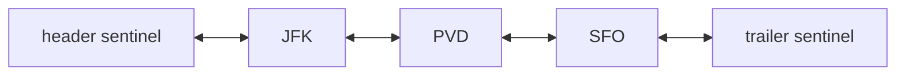

# Doubly linked lists and positional lists

In a singly linked list, removing the tail — or any node other than the head — is awkward because a
node does not know its predecessor. A **doubly linked list** stores two references in each node,
`next` and `prev`, which makes insertion and deletion at *any known position* $O(1)$. Building on
that, the **positional list ADT** gives users a safe way to refer to positions inside a list.

## 1. Header and trailer sentinels

To avoid special cases at the ends, the book's doubly linked lists add two **sentinel** (dummy)
nodes: a **header** before the first real node and a **trailer** after the last. Sentinels store no
element. An empty list is just `header <-> trailer`.



Why sentinels? Every real node now always has a real predecessor *and* successor node (possibly a
sentinel), so insertion and deletion code never has to check for `None` or update `head`/`tail`
references. All insertions look like "insert between two existing nodes", and all deletions look
like "unlink a node that has neighbours on both sides".

## 2. Inserting and deleting

**Insert `e` between nodes `predecessor` and `successor`:**

1. Create `newest` with `prev = predecessor`, `next = successor`.
2. Set `predecessor.next = newest` and `successor.prev = newest`.

**Delete node `node`:**

1. Let `p = node.prev`, `s = node.next`.
2. Link `p.next = s` and `s.prev = p`.
3. Optionally clear `node`'s fields (helps garbage collection and marks it as deprecated).

Both are $O(1)$.

```python-run
class _DoublyLinkedBase:
    """A base class providing a doubly linked list representation."""
    class _Node:
        __slots__ = '_element', '_prev', '_next'
        def __init__(self, element, prev, next):
            self._element, self._prev, self._next = element, prev, next

    def __init__(self):
        self._header = self._Node(None, None, None)
        self._trailer = self._Node(None, None, None)
        self._header._next = self._trailer          # trailer is after header
        self._trailer._prev = self._header          # header is before trailer
        self._size = 0

    def __len__(self):
        return self._size
    def is_empty(self):
        return self._size == 0

    def _insert_between(self, e, predecessor, successor):
        newest = self._Node(e, predecessor, successor)
        predecessor._next = newest
        successor._prev = newest
        self._size += 1
        return newest

    def _delete_node(self, node):
        predecessor, successor = node._prev, node._next
        predecessor._next = successor
        successor._prev = predecessor
        self._size -= 1
        element = node._element
        node._prev = node._next = node._element = None   # deprecate node
        return element

class LinkedDeque(_DoublyLinkedBase):
    """Double-ended queue implementation based on a doubly linked list."""
    def first(self):
        if self.is_empty(): raise Exception("Deque is empty")
        return self._header._next._element
    def last(self):
        if self.is_empty(): raise Exception("Deque is empty")
        return self._trailer._prev._element
    def insert_first(self, e):
        self._insert_between(e, self._header, self._header._next)
    def insert_last(self, e):
        self._insert_between(e, self._trailer._prev, self._trailer)
    def delete_first(self):
        if self.is_empty(): raise Exception("Deque is empty")
        return self._delete_node(self._header._next)
    def delete_last(self):
        if self.is_empty(): raise Exception("Deque is empty")
        return self._delete_node(self._trailer._prev)

D = LinkedDeque()
D.insert_last(5); D.insert_first(3); D.insert_first(7); D.insert_last(9)
print(D.first(), D.last(), len(D))
print(D.delete_last(), D.delete_first(), D.delete_first(), D.delete_first(), D.is_empty())
```

All deque operations are $O(1)$ **worst case** — better than the circular array's amortised bound,
at the cost of two extra references per element.

## 3. The positional list ADT

Stacks, queues and deques only allow access at the ends. Many applications need to work *inside* a
sequence: a text editor's cursor, a waiting list where someone in the middle leaves, a playlist where
a song is inserted after the current one. Integer indices are a poor way to describe such places:

- an index changes when elements are inserted or deleted before it;
- finding position $k$ in a linked list costs $O(k)$.

We want something like a *reference to a node* — stable, $O(1)$ to use — without exposing the nodes
themselves (which users could corrupt). The book's answer is the **position** abstraction: an
object that marks a place in the list. A position's place remains valid while other elements are
inserted or removed around it; it becomes invalid only if its own element is deleted.

### 3.1 Operations

A position `p` supports `p.element()`. A positional list `L` supports:

| Accessors | Meaning |
|---|---|
| `L.first()` / `L.last()` | position of first / last element (None if empty) |
| `L.before(p)` / `L.after(p)` | position before / after `p` (None at the ends) |
| `L.is_empty()`, `len(L)`, `iter(L)` | as usual; iteration yields elements |

| Updates | Meaning |
|---|---|
| `L.add_first(e)` / `L.add_last(e)` | insert at an end, return new position |
| `L.add_before(p, e)` / `L.add_after(p, e)` | insert next to `p`, return new position |
| `L.replace(p, e)` | replace element at `p`, return old element |
| `L.delete(p)` | remove and return element at `p`; `p` becomes invalid |

All of these run in $O(1)$ worst-case time with a doubly linked implementation.

### 3.2 Implementation

The `Position` class wraps a node and remembers which list it belongs to. The list's `_validate`
method rejects positions that belong to another list or whose node has been deleted (a deleted node
has `_next is None`).

```python-run
class _DoublyLinkedBase:                       # (same base class as above, repeated so this cell runs alone)
    class _Node:
        __slots__ = '_element', '_prev', '_next'
        def __init__(self, element, prev, next):
            self._element, self._prev, self._next = element, prev, next
    def __init__(self):
        self._header = self._Node(None, None, None)
        self._trailer = self._Node(None, None, None)
        self._header._next, self._trailer._prev = self._trailer, self._header
        self._size = 0
    def __len__(self): return self._size
    def is_empty(self): return self._size == 0
    def _insert_between(self, e, predecessor, successor):
        newest = self._Node(e, predecessor, successor)
        predecessor._next = successor._prev = newest
        self._size += 1
        return newest
    def _delete_node(self, node):
        node._prev._next, node._next._prev = node._next, node._prev
        self._size -= 1
        element = node._element
        node._prev = node._next = node._element = None
        return element

class PositionalList(_DoublyLinkedBase):
    """A sequential container of elements allowing positional access."""
    class Position:
        def __init__(self, container, node):
            self._container, self._node = container, node
        def element(self):
            return self._node._element
        def __eq__(self, other):
            return type(other) is type(self) and other._node is self._node
        def __ne__(self, other):
            return not (self == other)

    def _validate(self, p):
        if not isinstance(p, self.Position): raise TypeError('p must be proper Position type')
        if p._container is not self: raise ValueError('p does not belong to this container')
        if p._node._next is None: raise ValueError('p is no longer valid')   # deprecated node
        return p._node

    def _make_position(self, node):
        if node is self._header or node is self._trailer:
            return None                                   # boundary violation
        return self.Position(self, node)

    def first(self):  return self._make_position(self._header._next)
    def last(self):   return self._make_position(self._trailer._prev)
    def before(self, p): return self._make_position(self._validate(p)._prev)
    def after(self, p):  return self._make_position(self._validate(p)._next)
    def __iter__(self):
        cursor = self.first()
        while cursor is not None:
            yield cursor.element()
            cursor = self.after(cursor)

    def _insert_between(self, e, predecessor, successor):
        node = super()._insert_between(e, predecessor, successor)
        return self._make_position(node)
    def add_first(self, e): return self._insert_between(e, self._header, self._header._next)
    def add_last(self, e):  return self._insert_between(e, self._trailer._prev, self._trailer)
    def add_before(self, p, e):
        original = self._validate(p)
        return self._insert_between(e, original._prev, original)
    def add_after(self, p, e):
        original = self._validate(p)
        return self._insert_between(e, original, original._next)
    def delete(self, p):
        return self._delete_node(self._validate(p))
    def replace(self, p, e):
        original = self._validate(p)
        old, original._element = original._element, e
        return old

L = PositionalList()
p = L.add_last(8)          # 8
q = L.add_after(p, 5)      # 8 5
r = L.add_before(q, 3)     # 8 3 5
L.add_first(9)             # 9 8 3 5
print(list(L), "| before(q):", L.before(q).element())
L.replace(p, 7); L.delete(r)
print(list(L))
try:
    L.after(r)
except ValueError as e:
    print("deleted position rejected:", e)

def insertion_sort_positional(L):
    if len(L) > 1:
        marker = L.first()
        while marker != L.last():
            pivot = L.after(marker)                  # next item to place
            value = pivot.element()
            if value > marker.element():
                marker = pivot                       # pivot becomes new marker
            else:
                walk = marker                        # find leftmost item greater than value
                while walk != L.first() and L.before(walk).element() > value:
                    walk = L.before(walk)
                L.delete(pivot)
                L.add_before(walk, value)            # reinsert value before walk
L2 = PositionalList()
for x in [15, 22, 25, 29, 36, 23, 53, 11, 42]:
    L2.add_last(x)
insertion_sort_positional(L2)
print(list(L2))
```

## 4. Sorting a positional list

Insertion sort adapts naturally: maintain a `marker` position (the last element of the sorted
prefix). Take `pivot = after(marker)`. If `pivot`'s value is not smaller than `marker`'s, just advance
the marker. Otherwise, walk left from the marker to find where it belongs, `delete(pivot)` and
`add_before(walk, value)`. No shifting — but finding the spot is still a walk, so the worst case is
$O(n^2)$, like the array version.

```python
def insertion_sort_positional(L):
    if len(L) > 1:
        marker = L.first()
        while marker != L.last():
            pivot = L.after(marker)                  # next item to place
            value = pivot.element()
            if value > marker.element():
                marker = pivot                       # pivot becomes new marker
            else:
                walk = marker                        # find leftmost item greater than value
                while walk != L.first() and L.before(walk).element() > value:
                    walk = L.before(walk)
                L.delete(pivot)
                L.add_before(walk, value)            # reinsert value before walk
```

The runnable cell in section 3.2 above includes this function too; scroll up and run it with your own data.

> [!INTERVIEW]
> A doubly linked list plus a hash map from keys to nodes is the textbook **LRU cache**: the map
> finds a node in $O(1)$, the list moves it to the front or evicts the back in $O(1)$. Python's
> `collections.OrderedDict` is implemented exactly this way (`move_to_end`, `popitem(last=False)`).

## 5. Pitfalls

- Forgetting one of the four link updates in insert (two on the new node, two on neighbours).
- Allowing a deleted position to be reused: always validate.
- Comparing positions with `is` instead of `==`: two distinct `Position` wrappers can refer to the
  same node, hence the custom `__eq__`.
- Using an index-based mental model; positions do not shift when elements are inserted elsewhere.

## 6. Summary

| Operation | Doubly linked list (positional) |
|---|---|
| first / last / before / after | $O(1)$ |
| add_first / add_last / add_before / add_after | $O(1)$ |
| replace / delete | $O(1)$ |
| access by index $k$ | $O(k)$ |

> **Source:** Goodrich, Tamassia & Goldwasser, *Data Structures and Algorithms in Python*, ch. 7.3–7.5.

## Check yourself

```quiz
[
  {"q": "What is the main benefit of header and trailer sentinels?",
   "options": ["They store the minimum and maximum", "Every real node has real neighbours, eliminating special cases for empty lists and ends", "They make indexing O(1)", "They reduce memory"], "answer": 1,
   "explain": "All inserts become 'between two nodes' and all deletes 'unlink a node with two neighbours'."},
  {"q": "Deleting a node from a doubly linked list given a reference to it costs...",
   "options": ["O(n)", "O(1)", "O(log n)", "O(k)"], "answer": 1,
   "explain": "Its prev and next are known, so two reference updates suffice."},
  {"q": "Why does the positional list use Position objects instead of integer indices?",
   "options": ["Indices are slower to compare", "Positions stay valid as other elements are inserted/removed and give O(1) access", "Python lists do not support indices", "To sort faster"], "answer": 1,
   "explain": "An index shifts when elements are inserted before it, and reaching index k costs O(k) in a linked list."},
  {"q": "How does _validate detect a position whose element was deleted?",
   "options": ["It searches the list", "Deleted nodes have their next reference set to None", "It checks a global set", "It cannot"], "answer": 1,
   "explain": "_delete_node clears the node's fields; a None next marks it deprecated."},
  {"q": "Which ADT operation is O(1) worst case in LinkedDeque but only O(1) amortised in the circular-array deque?",
   "options": ["first", "insert_last", "len", "is_empty"], "answer": 1,
   "explain": "The array version may need to resize on insertion; the linked version never does."},
  {"q": "An LRU cache is typically built from...",
   "options": ["a heap and a stack", "a hash map plus a doubly linked list", "two queues", "a sorted array"], "answer": 1,
   "explain": "The map locates nodes, the list orders them by recency with O(1) moves and evictions."}
]
```
