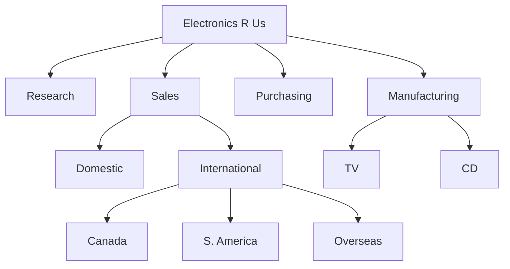

# Tree terminology, ADTs and representations

Lists, stacks and queues are **linear**: each element has at most one predecessor and one
successor. Many relationships are richer than "before" and "after". A family tree, a company
organisation chart, a file system, the table of contents of a book, the structure of an arithmetic
expression — all are **hierarchical**. The **tree** is the data structure for hierarchies, and it is
also the backbone of the fastest searching structures in this track (heaps, search trees, B-trees).

## 1. Definitions

A **tree** $T$ is a set of **nodes** storing elements, with a **parent–child** relationship such that:

- if $T$ is non-empty, it has a special node, the **root**, which has no parent;
- every other node $v$ has a unique **parent** node $w$; every node with parent $w$ is a **child**
  of $w$.

Recursively: a tree is either empty, or a root $r$ together with a (possibly empty) set of subtrees
whose roots are the children of $r$.



Vocabulary you must know cold:

| Term | Meaning |
|---|---|
| **siblings** | nodes with the same parent |
| **external node / leaf** | node with no children |
| **internal node** | node with at least one child |
| **ancestor** of $v$ | $v$ itself, or an ancestor of $v$'s parent |
| **descendant** of $v$ | $u$ such that $v$ is an ancestor of $u$ |
| **subtree rooted at $v$** | $v$ and all its descendants |
| **edge** | a pair $(u, v)$ where $u$ is the parent of $v$ |
| **path** | a sequence of nodes, each consecutive pair forming an edge |
| **ordered tree** | children of each node have a meaningful left-to-right order |

The file system is a classic tree: directories are internal nodes, files are leaves (an empty
directory is also a leaf). A book's structure — book, chapters, sections, subsections — is an
**ordered** tree: the order of chapters matters.

## 2. The tree ADT

Goodrich et al. define trees in terms of **positions** (as in the positional list): each node is
accessed through a position object `p` with `p.element()`.

| Accessor | Meaning |
|---|---|
| `T.root()` | position of the root, or None if empty |
| `T.is_root(p)` | is `p` the root? |
| `T.parent(p)` | position of `p`'s parent (None for the root) |
| `T.num_children(p)` | number of children of `p` |
| `T.children(p)` | iteration of `p`'s children |
| `T.is_leaf(p)` | does `p` have no children? |
| `len(T)`, `T.is_empty()` | size / emptiness |
| `T.positions()`, `iter(T)` | iterate positions / elements |

In the book this is an **abstract base class** `Tree`: methods like `is_root`, `is_leaf` and
`is_empty` are implemented in terms of the abstract ones (`root`, `parent`, `num_children`), so every
concrete tree class inherits them for free — an example of the *template method* idea that recurs
with Euler tours.

## 3. Depth and height

The **depth** of a position $p$ is the number of ancestors of $p$ excluding $p$ itself. The root has
depth 0; otherwise depth($p$) = 1 + depth(parent($p$)).

```python
def depth(self, p):
    if self.is_root(p):
        return 0
    return 1 + self.depth(self.parent(p))
```

Time $O(d_p + 1)$ where $d_p$ is the depth — worst case $O(n)$ for a path-shaped tree.

The **height** of $p$: 0 if $p$ is a leaf, otherwise 1 + the maximum height of its children. The
height of a tree is the height of its root — equivalently, the **maximum depth of its leaves**.

A tempting but slow way to compute height: take the max depth over all leaves (`height1`). Each depth
computation is $O(n)$ in the worst case, so the total is $O(n^2)$. The recursive definition is far
better:

```python
def _height2(self, p):
    if self.is_leaf(p):
        return 0
    return 1 + max(self._height2(c) for c in self.children(p))
```

Each position is visited once, and the work at $p$ is $O(c_p + 1)$ for its $c_p$ children. Summed:
$\sum_p (c_p + 1) = n + \sum_p c_p = n + (n - 1)$, because every node except the root is a child
exactly once. So `height2` is $O(n)$.

> [!TIP]
> "Every node except the root is the child of exactly one node, so $\sum_p c_p = n - 1$" is the key
> counting fact for analysing tree algorithms. It shows that a tree with $n$ nodes has $n-1$ edges.

## 4. Binary trees

A **binary tree** is an ordered tree in which every node has at most two children, labelled **left
child** and **right child**, with left before right. The subtree rooted at a left (right) child is
the **left (right) subtree**. A binary tree is **proper** (or *full*) if every node has zero or two
children.

Binary trees model **decision trees** (each internal node asks a yes/no question) and **arithmetic
expressions** (leaves are operands, internal nodes are binary operators — the next lesson).

The binary tree ADT adds `T.left(p)`, `T.right(p)` and `T.sibling(p)`.

### 4.1 Properties of binary trees

Level $d$ of a tree is the set of nodes at depth $d$. In a binary tree, level 0 has at most 1 node,
level 1 at most 2, level $d$ at most $2^d$. Let $n$ = number of nodes, $n_E$ = external nodes,
$n_I$ = internal nodes, $h$ = height. Then for any non-empty binary tree:

1. $h + 1 \le n \le 2^{h+1} - 1$
2. $1 \le n_E \le 2^h$
3. $h \le n_I \le 2^h - 1$
4. $\log(n + 1) - 1 \le h \le n - 1$

If the tree is **proper**:

1. $2h + 1 \le n \le 2^{h+1} - 1$
2. $h + 1 \le n_E \le 2^h$
3. $h \le n_I \le 2^h - 1$
4. $\log(n + 1) - 1 \le h \le (n - 1)/2$

And a crucial counting fact: **in a non-empty proper binary tree, $n_E = n_I + 1$.** Proof sketch:
repeatedly remove a leaf together with its parent (replacing the parent by the leaf's sibling); each
step removes one external and one internal node, ending with a single external node.

The bound $h \ge \log(n+1) - 1$ says a binary tree with $n$ nodes has height at least about
$\log n$ — the best case for search trees, which is why balanced trees achieve $O(\log n)$ operations.

## 5. Implementing trees

### 5.1 Linked structure for binary trees

Each node stores `element`, `parent`, `left`, `right`. The tree stores a reference to the root and the
size. All accessor methods are $O(1)$; `depth(p)` is $O(d_p + 1)$, `height` is $O(n)$, and updates
like `add_left(p, e)`, `add_right(p, e)`, `replace(p, e)`, `delete(p)` (for a node with at most one
child), `attach(p, T1, T2)` (attach two trees as subtrees of leaf `p`) are $O(1)$.

```python-run
class Node:
    __slots__ = "element", "parent", "left", "right"
    def __init__(self, element, parent=None, left=None, right=None):
        self.element, self.parent, self.left, self.right = element, parent, left, right

def add_left(p, e):
    assert p.left is None
    p.left = Node(e, p); return p.left
def add_right(p, e):
    assert p.right is None
    p.right = Node(e, p); return p.right

def depth(p):
    return 0 if p.parent is None else 1 + depth(p.parent)
def height(p):
    kids = [c for c in (p.left, p.right) if c]
    return 0 if not kids else 1 + max(height(c) for c in kids)
def size(p):
    return 0 if p is None else 1 + size(p.left) + size(p.right)

root = Node("A")
b = add_left(root, "B"); c = add_right(root, "C")
d = add_left(b, "D"); e = add_right(b, "E"); f = add_right(c, "F"); g = add_left(e, "G")
print("size", size(root), "height", height(root), "depth of G", depth(g))
leaves = []
def collect(p):
    if p:
        if not p.left and not p.right: leaves.append(p.element)
        collect(p.left); collect(p.right)
collect(root)
print("leaves", leaves)
```

### 5.2 Array-based representation

Number the positions by **level numbering** $f$:

- $f(\text{root}) = 0$;
- if $p$ is the left child of $q$, $f(p) = 2f(q) + 1$;
- if $p$ is the right child of $q$, $f(p) = 2f(q) + 2$.

Store the element at position $p$ in `A[f(p)]`. Parent of index $i$ is $\lfloor (i-1)/2 \rfloor$.
No references are needed — navigation is arithmetic. The catch: the array needs length up to
$2^n - 1$ for an unbalanced tree (a long right path), and updates like deleting a node with its
subtree require moving many cells. The representation shines for **complete** binary trees, which
fill levels left to right without gaps — exactly the shape of a binary **heap** (priority-queues
module). LeetCode's level-order list format with `None` holes is a variation of this numbering.

```python-run
A = ["A", "B", "C", "D", "E", None, "F"]          # level numbering
for i, x in enumerate(A):
    if x is None: continue
    left, right = 2 * i + 1, 2 * i + 2
    kids = [A[j] for j in (left, right) if j < len(A) and A[j] is not None]
    parent = A[(i - 1) // 2] if i > 0 else None
    print(f"index {i}: {x}  parent={parent}  children={kids}")
```

### 5.3 General trees

For a tree whose nodes can have any number of children, each node stores its element, its parent, and
a **container (e.g. a list) of children**. `children(p)` is then $O(c_p + 1)$. An alternative used in
some systems is the **first-child / next-sibling** representation, which turns any tree into a
binary tree.

| Representation | Space | Child access | Best for |
|---|---|---|---|
| linked binary | $O(n)$ | $O(1)$ | general binary trees |
| array (level numbering) | $O(2^n)$ worst, $O(n)$ complete | $O(1)$ | heaps, complete trees |
| linked general (child lists) | $O(n)$ | $O(c_p + 1)$ | file systems, DOM, org charts |

> [!INTERVIEW]
> Be precise with "height" and "depth": depth is measured from the root down (root depth 0); height
> from the leaves up (leaf height 0). LeetCode's "maximum depth" counts *nodes* on the longest path,
> which is height + 1. Clarify the convention before coding.

## 6. Worked example: one pass down, one pass up

Depth, height and subtree size are all defined recursively, so two linear passes compute all three
for every node. The example also shows a common *input format*: a **parent array**, where
`parent[v]` is the parent of node `v` and the root has parent `-1`.

```python-run
def analyse(parent):
    n = len(parent)
    children = [[] for _ in range(n)]
    root = None
    for v, p in enumerate(parent):
        if p == -1: root = v
        else: children[p].append(v)          # build child lists: O(n)

    depth, height, size = [0] * n, [0] * n, [1] * n
    order, stack = [], [root]
    while stack:                             # iterative preorder: parents before children
        v = stack.pop()
        order.append(v)
        for c in children[v]:
            depth[c] = depth[v] + 1          # depth flows DOWN from the parent
            stack.append(c)
    for v in reversed(order):                # reversed preorder: children before parents
        for c in children[v]:
            height[v] = max(height[v], height[c] + 1)   # height and size flow UP
            size[v] += size[c]
    return root, children, depth, height, size

#          0   1  2  3  4  5  6  7  8
parent = [-1,  0, 0, 1, 1, 2, 4, 4, 7]
root, children, depth, height, size = analyse(parent)
print("node  children   depth height size")
for v in range(len(parent)):
    print(f"{v:>4}  {str(children[v]):<10} {depth[v]:>5} {height[v]:>6} {size[v]:>4}")
leaves = [v for v in range(len(parent)) if not children[v]]
print("leaves:", leaves, "| tree height:", height[root], "= max leaf depth:", max(depth[v] for v in leaves))
print("edges:", sum(len(c) for c in children), "= n - 1 =", len(parent) - 1)
```

### Reading the output

The tree is `0 → {1, 2}`, `1 → {3, 4}`, `2 → {5}`, `4 → {6, 7}`, `7 → {8}`.

| node | depth | height | size | how it was obtained |
|---|---|---|---|---|
| 8 | 4 | 0 | 1 | a leaf: height 0, size 1 |
| 7 | 3 | 1 | 2 | 1 + height(8); 1 + size(8) |
| 4 | 2 | 2 | 4 | 1 + max(height(6), height(7)) = 1 + 1; 1 + 1 + 2 |
| 1 | 1 | 3 | 6 | 1 + max(height(3), height(4)) = 1 + 2; 1 + 1 + 4 |
| 0 | 0 | 4 | 9 | 1 + max(3, 1); 1 + 6 + 2 |

Two directions of information flow appear, and recognising which one a quantity needs is the key
skill for tree problems: **depth** is inherited from the parent (computed top-down, in preorder),
while **height** and **size** are assembled from the children (bottom-up, in postorder). The whole
computation is $O(n)$: building the child lists touches each node once, and the two passes do work
proportional to $\sum_v (c_v + 1) = 2n - 1$. Processing the nodes in *reversed preorder* is a handy
way to obtain a children-before-parents order without recursion — important in Python when the tree
may be a path of 100,000 nodes.

## 7. Pitfalls

- Computing height as the max depth of all leaves: $O(n^2)$.
- Assuming a binary tree with $n$ nodes has height $\log n$ — only if it is balanced; worst case
  $n - 1$.
- Array representation for sparse trees: exponential space.
- Forgetting to set the parent reference when adding children (breaks depth and upward navigation).

## 8. Summary

- Trees model hierarchies: root, parent/child, leaves, internal nodes, depth, height.
- Height via recursion is $O(n)$ thanks to $\sum c_p = n - 1$.
- Binary trees: $\log(n+1) - 1 \le h \le n - 1$; proper binary trees have one more leaf than internal
  nodes.
- Linked structures are flexible; level-numbered arrays are compact for complete trees.

> **Source:** Goodrich, Tamassia & Goldwasser, *Data Structures and Algorithms in Python*, ch. 8.1–8.3.

## Check yourself

```quiz
[
  {"q": "What is the depth of the root?",
   "options": ["0", "1", "the height of the tree", "undefined"], "answer": 0,
   "explain": "Depth counts proper ancestors; the root has none."},
  {"q": "Why is height2 (recursive on children) O(n)?",
   "options": ["It only visits leaves", "Each node is visited once and the sum of all children counts is n - 1", "It uses memoisation", "Trees have height log n"], "answer": 1,
   "explain": "Work at p is O(c_p + 1); summing gives n + (n - 1)."},
  {"q": "A proper binary tree has 10 internal nodes. How many leaves?",
   "options": ["10", "11", "20", "9"], "answer": 1,
   "explain": "In a non-empty proper binary tree n_E = n_I + 1."},
  {"q": "Minimum possible height of a binary tree with 15 nodes?",
   "options": ["3", "4", "14", "7"], "answer": 0,
   "explain": "h >= log2(n + 1) - 1 = log2 16 - 1 = 3: a perfect tree with levels of 1, 2, 4, 8 nodes."},
  {"q": "In level numbering, the children of index i are at...",
   "options": ["i+1 and i+2", "2i and 2i+1", "2i+1 and 2i+2", "i/2 and i/2+1"], "answer": 2,
   "explain": "f(left) = 2f(q) + 1 and f(right) = 2f(q) + 2 with root at 0."},
  {"q": "Why is the array representation bad for arbitrary binary trees?",
   "options": ["Child access is slow", "A skewed tree with n nodes may need an array of size about 2^n", "It cannot store None", "Parents cannot be found"], "answer": 1,
   "explain": "Level numbers grow exponentially along a long path, leaving huge gaps."},
  {"q": "Which statement about siblings is correct?",
   "options": ["Siblings have the same depth and the same parent", "Siblings are always leaves", "A node is its own sibling", "Siblings must be in different subtrees of the root"], "answer": 0,
   "explain": "Siblings share a parent, hence also share depth."}
]
```
