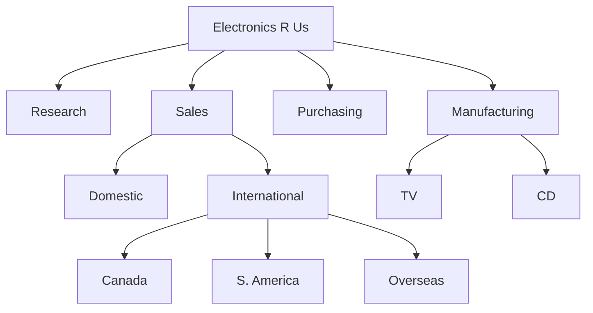

# Tree terminology, ADTs and representations

> **Before this lesson:** You should know nodes and references from
> [Singly and circularly linked lists](#/lesson/dsa-foundations/singly-circular), positions from
> [Doubly linked lists and positional lists](#/lesson/dsa-foundations/doubly-positional), and be
> comfortable with recursion ([Thinking recursively](#/lesson/dsa-foundations/recursion-examples)).

## In plain words

A **tree** is a way of organising items into a hierarchy: one item at the top, some items below
it, more items below each of those, and so on. Every item except the top one has exactly one
item directly above it.

You already use trees daily. The folders on your computer form one: a top folder, folders
inside it, and files inside those. A company's organisation chart is one: a chief executive,
the managers who report to her, the staff who report to them. Computer scientists draw trees
upside down compared with the plants: the starting point, called the *root*, is at the top and
the tree grows downwards.

Why it matters for a job: trees are behind most of what makes software fast. Databases find a
record among billions using a tree; your browser holds each web page as a tree of elements; the
programs that translate code represent it as a tree. In interviews, tree questions are among
the most common, and nearly all of them rest on the vocabulary and the two representations in
this lesson.

## 1. Definitions

The structures so far (lists, stacks, queues) are **linear**: each item has at most one item
before it and one after it. Many relationships are richer than "before" and "after". A family
tree, an organisation chart, a file system, the contents page of a book and the structure of an
arithmetic expression are all **hierarchical**, arranged in levels with each item belonging to
one item on the level above.

A **tree** $T$ is a set of **nodes** that store elements and are linked by a **parent-child**
relationship such that:

- if $T$ is not empty, it has one special node, the **root**, which has no parent;
- every other node $v$ has exactly one **parent** node $w$, and $v$ is called a **child** of $w$.

A tree can also be described recursively: it is either empty, or it consists of a root $r$
together with zero or more smaller trees, called **subtrees**, whose roots are the children of
$r$. This second description is why almost every tree algorithm is recursive.

In the organisation chart below, "Electronics R Us" is the root. "Sales" is a child of the root
and the parent of "Domestic" and "International".



Tree vocabulary borrows from family trees. You need the following terms so often that they are
worth memorising; each is illustrated by the chart above.

| Term | Meaning |
|---|---|
| **siblings** | nodes with the same parent |
| **external node / leaf** | node with no children |
| **internal node** | node with at least one child |
| **ancestor** of $v$ | $v$ itself, or an ancestor of $v$'s parent |
| **descendant** of $v$ | $u$ such that $v$ is an ancestor of $u$ |
| **subtree rooted at $v$** | $v$ and all its descendants |
| **edge** | a pair $(u, v)$ where $u$ is the parent of $v$ |
| **path** | a sequence of nodes, each consecutive pair forming an edge |
| **ordered tree** | children of each node have a meaningful left-to-right order |

In the chart: "Domestic" and "International" are siblings. "Research", "Canada" and "TV" are
leaves; "Sales" is an internal node. The ancestors of "Canada" are "Canada" itself,
"International", "Sales" and the root (note that, by this definition, a node counts as its own
ancestor). The subtree rooted at "International" has four nodes. There is a path from the root
to "Overseas" passing through "Sales" and "International".

A file system is a tree in which directories are internal nodes and files are leaves (an empty
directory is a leaf too). The structure of a book (chapters, sections, subsections) is an
**ordered** tree, because the order of the chapters matters.

## 2. The tree ADT

As with the positional list, a tree's nodes are reached through **position** objects: a position
`p` marks one node, and `p.element()` returns the item stored there. The tree `T` then offers
these read-only operations:

| Accessor | Meaning |
|---|---|
| `T.root()` | position of the root, or None if empty |
| `T.is_root(p)` | is `p` the root? |
| `T.parent(p)` | position of `p`'s parent (None for the root) |
| `T.num_children(p)` | number of children of `p` |
| `T.children(p)` | iteration of `p`'s children |
| `T.is_leaf(p)` | does `p` have no children? |
| `len(T)`, `T.is_empty()` | size / emptiness |
| `T.positions()`, `iter(T)` | iterate positions / elements |

A convenient way to organise the code is an **abstract base class**: a class that declares these
operations and implements the easy ones in terms of the others, leaving a few to be filled in by
each concrete kind of tree. For instance `is_root(p)` can be written once as "`p` equals
`root()`", and `is_leaf(p)` as "`num_children(p)` is 0". Every concrete tree class that inherits
from the base class gets those for nothing. The next lesson uses the same idea for traversals.

## 3. Depth and height

Two numbers describe where a node sits. They are easy to confuse, so fix them with a picture of
a building: depth is how many floors down from the roof you are; height is how many floors
there are below you.

The **depth** of a position $p$ is the number of ancestors of $p$ other than $p$ itself, which
is the number of steps from $p$ up to the root. The root has depth 0, its children have depth
1, and in general depth($p$) = 1 + depth(parent($p$)). That recursive definition is the code:

```python
def depth(self, p):
    if self.is_root(p):
        return 0
    return 1 + self.depth(self.parent(p))
```

The time is $O(d_p + 1)$, where $d_p$ is the depth of $p$: one call per step up. In the worst
case, a tree where every node has a single child (a tree shaped like a linked list), that is
$O(n)$.

The **height** of a position $p$ is 0 if $p$ is a leaf, and otherwise 1 plus the largest height
among its children. It is the number of steps from $p$ down to the farthest leaf below it. The
height of a whole tree is the height of its root, which equals the **largest depth of any
leaf**. In the chart, the root has height 3 (root, Sales, International, Canada).

A tempting way to compute the height of a tree is to take the largest depth over all leaves.
It is slow: each depth computation can take $O(n)$, and there can be many leaves, for $O(n^2)$
in total. Following the recursive definition is far better:

```python
def _height2(self, p):
    if self.is_leaf(p):
        return 0
    return 1 + max(self._height2(c) for c in self.children(p))
```

How expensive is this? Each position is visited exactly once, and the work done at a position
$p$ with $c_p$ children is $O(c_p + 1)$: one step for itself and one per child in the `max`.
Adding over all positions gives $\sum_p (c_p + 1) = n + \sum_p c_p$. Now the key observation:
every node except the root is a child of exactly one node, so adding up the numbers of children
counts every node but the root once, and $\sum_p c_p = n - 1$. The total is $n + (n - 1)$, so
`height2` is $O(n)$.

> [!TIP]
> "Every node except the root is the child of exactly one node, so $\sum_p c_p = n - 1$" is the
> counting fact behind the analysis of nearly every tree algorithm. It also shows that a tree
> with $n$ nodes has exactly $n-1$ edges.

## 4. Binary trees

A **binary tree** is an ordered tree in which every node has at most two children, each
labelled as either the **left child** or the **right child**. The subtree hanging from the left
child is the **left subtree**, and likewise on the right. A binary tree is **proper** (also
called *full*) if every node has either no children or two; no node has exactly one.

Binary trees model **decision trees**, in which each internal node asks a yes-or-no question
and each leaf is an outcome, and **arithmetic expressions**, in which leaves are numbers and
internal nodes are operators such as `+` that take two inputs (next lesson).

The binary tree ADT adds three operations: `T.left(p)`, `T.right(p)` and `T.sibling(p)`.

### 4.1 Properties of binary trees

**Level** $d$ of a tree is the set of nodes at depth $d$. In a binary tree each node has at most
two children, so the levels can at most double in size: level 0 has 1 node, level 1 at most 2,
level 2 at most 4, and level $d$ at most $2^d$. A tree of height $h$ therefore has at most
$1 + 2 + 4 + \cdots + 2^h = 2^{h+1} - 1$ nodes (the doubling sum again), and at least $h + 1$
(a single path). Write $n$ for the number of nodes, $n_E$ for the number of external nodes
(leaves), $n_I$ for the number of internal nodes, and $h$ for the height. For any non-empty
binary tree:

1. $h + 1 \le n \le 2^{h+1} - 1$
2. $1 \le n_E \le 2^h$
3. $h \le n_I \le 2^h - 1$
4. $\log(n + 1) - 1 \le h \le n - 1$

If the tree is **proper**:

1. $2h + 1 \le n \le 2^{h+1} - 1$
2. $h + 1 \le n_E \le 2^h$
3. $h \le n_I \le 2^h - 1$
4. $\log(n + 1) - 1 \le h \le (n - 1)/2$

One more counting fact is used again and again: **in a non-empty proper binary tree, the number
of leaves is one more than the number of internal nodes, $n_E = n_I + 1$.** To see why, shrink
the tree step by step: remove a leaf together with its parent, and put the leaf's sibling in
the parent's place. Each step removes one leaf and one internal node and leaves a proper tree.
The process ends with a single node, a leaf. So there was one more leaf than internal nodes all
along.

The fourth line, $h \ge \log(n+1) - 1$, says that a binary tree with $n$ nodes cannot be
shallower than about $\log n$ levels. And $h \le n - 1$ says it can be as deep as a linked
list. The whole subject of "balanced" search trees, later in this track, is about keeping the
height near the first bound, because operations take time proportional to the height.

## 5. Implementing trees

### 5.1 Linked structure for binary trees

The natural representation gives each node four fields: `element`, `parent`, `left` and `right`,
with `None` wherever there is no such neighbour. The tree object keeps a reference to the root
and a count of nodes. Every operation of the ADT is then $O(1)$, as are local changes such as
adding a left or right child to a node, replacing a node's element, and deleting a node that
has at most one child (its child, if any, takes its place). `depth(p)` is $O(d_p + 1)$ and the
height of the tree is $O(n)$, as computed above.

The demo builds a small tree by hand and measures it. `assert p.left is None` guards against
overwriting an existing child.

```python-run
class Node:
    __slots__ = "element", "parent", "left", "right"
    def __init__(self, element, parent=None, left=None, right=None):
        self.element, self.parent, self.left, self.right = element, parent, left, right

def add_left(p, e):
    assert p.left is None
    p.left = Node(e, p); return p.left
def add_right(p, e):
    assert p.right is None
    p.right = Node(e, p); return p.right

def depth(p):
    return 0 if p.parent is None else 1 + depth(p.parent)
def height(p):
    kids = [c for c in (p.left, p.right) if c]
    return 0 if not kids else 1 + max(height(c) for c in kids)
def size(p):
    return 0 if p is None else 1 + size(p.left) + size(p.right)

root = Node("A")
b = add_left(root, "B"); c = add_right(root, "C")
d = add_left(b, "D"); e = add_right(b, "E"); f = add_right(c, "F"); g = add_left(e, "G")
print("size", size(root), "height", height(root), "depth of G", depth(g))
leaves = []
def collect(p):
    if p:
        if not p.left and not p.right: leaves.append(p.element)
        collect(p.left); collect(p.right)
collect(root)
print("leaves", leaves)
```

The tree built is A at the root, with children B and C; B has children D and E; C has a right
child F; E has a left child G. The output is `size 7 height 3 depth of G 3` and
`leaves ['D', 'G', 'F']`. Each function mirrors its definition: `size` of an empty subtree is
0, otherwise 1 plus the sizes of the two subtrees.

### 5.2 Array-based representation

A binary tree can also be stored in a plain array with no references at all. Give every
position a number, its **level number** $f$, by these rules:

- the root gets $f = 0$;
- the left child of the node numbered $f(q)$ gets $2f(q) + 1$;
- the right child of the node numbered $f(q)$ gets $2f(q) + 2$.

This numbers the root 0, the next level 1 and 2, the level after that 3 to 6, and so on, left
to right, reserving a number for every *possible* position whether or not a node is there.
Store the element of position $p$ in cell `A[f(p)]`. Moving around the tree is then arithmetic:
the children of index $i$ are at $2i + 1$ and $2i + 2$, and its parent is at
$\lfloor (i-1)/2 \rfloor$.

The catch is wasted space. Because a number is reserved for every possible position, a lopsided
tree leaves most cells empty: a tree of $n$ nodes that always branches right needs an array of
length $2^n - 1$. The representation is ideal for **complete** binary trees, in which every
level is full except possibly the last, and the last is filled from the left with no gaps.
That is exactly the shape of the binary **heap** of the priority-queues module. (LeetCode's
habit of writing a tree as a level-by-level list with `null` for missing nodes is a relative of
this numbering.)

```python-run
A = ["A", "B", "C", "D", "E", None, "F"]          # level numbering
for i, x in enumerate(A):
    if x is None: continue
    left, right = 2 * i + 1, 2 * i + 2
    kids = [A[j] for j in (left, right) if j < len(A) and A[j] is not None]
    parent = A[(i - 1) // 2] if i > 0 else None
    print(f"index {i}: {x}  parent={parent}  children={kids}")
```

### 5.3 General trees

A tree whose nodes may have any number of children is called a **general tree**. Each node
stores its element, its parent and a **collection of its children**, typically a list. Going
through the children of $p$ then takes $O(c_p + 1)$. An alternative is the **first-child /
next-sibling** representation: each node keeps one reference to its first child and one to its
next sibling, which stores any tree using two references per node, as if it were a binary tree.

| Representation | Space | Child access | Best for |
|---|---|---|---|
| linked binary | $O(n)$ | $O(1)$ | general binary trees |
| array (level numbering) | $O(2^n)$ worst, $O(n)$ complete | $O(1)$ | heaps, complete trees |
| linked general (child lists) | $O(n)$ | $O(c_p + 1)$ | file systems, DOM, org charts |

> [!INTERVIEW]
> Be precise with "height" and "depth": depth is measured from the root down (root depth 0); height
> from the leaves up (leaf height 0). LeetCode's "maximum depth" counts *nodes* on the longest path,
> which is height + 1. Clarify the convention before coding.

## 6. Worked example: one pass down, one pass up

Depth, height and subtree size are all defined recursively, so two linear passes compute all three
for every node. The example also shows a common *input format*: a **parent array**, where
`parent[v]` is the parent of node `v` and the root has parent `-1`.

```python-run
def analyse(parent):
    n = len(parent)
    children = [[] for _ in range(n)]
    root = None
    for v, p in enumerate(parent):
        if p == -1: root = v
        else: children[p].append(v)          # build child lists: O(n)

    depth, height, size = [0] * n, [0] * n, [1] * n
    order, stack = [], [root]
    while stack:                             # iterative preorder: parents before children
        v = stack.pop()
        order.append(v)
        for c in children[v]:
            depth[c] = depth[v] + 1          # depth flows DOWN from the parent
            stack.append(c)
    for v in reversed(order):                # reversed preorder: children before parents
        for c in children[v]:
            height[v] = max(height[v], height[c] + 1)   # height and size flow UP
            size[v] += size[c]
    return root, children, depth, height, size

#          0   1  2  3  4  5  6  7  8
parent = [-1,  0, 0, 1, 1, 2, 4, 4, 7]
root, children, depth, height, size = analyse(parent)
print("node  children   depth height size")
for v in range(len(parent)):
    print(f"{v:>4}  {str(children[v]):<10} {depth[v]:>5} {height[v]:>6} {size[v]:>4}")
leaves = [v for v in range(len(parent)) if not children[v]]
print("leaves:", leaves, "| tree height:", height[root], "= max leaf depth:", max(depth[v] for v in leaves))
print("edges:", sum(len(c) for c in children), "= n - 1 =", len(parent) - 1)
```

### Reading the output

The tree is `0 → {1, 2}`, `1 → {3, 4}`, `2 → {5}`, `4 → {6, 7}`, `7 → {8}`.

| node | depth | height | size | how it was obtained |
|---|---|---|---|---|
| 8 | 4 | 0 | 1 | a leaf: height 0, size 1 |
| 7 | 3 | 1 | 2 | 1 + height(8); 1 + size(8) |
| 4 | 2 | 2 | 4 | 1 + max(height(6), height(7)) = 1 + 1; 1 + 1 + 2 |
| 1 | 1 | 3 | 6 | 1 + max(height(3), height(4)) = 1 + 2; 1 + 1 + 4 |
| 0 | 0 | 4 | 9 | 1 + max(3, 1); 1 + 6 + 2 |

Two directions of information flow appear, and recognising which one a quantity needs is the key
skill for tree problems: **depth** is inherited from the parent (computed top-down, in preorder),
while **height** and **size** are assembled from the children (bottom-up, in postorder). The whole
computation is $O(n)$: building the child lists touches each node once, and the two passes do work
proportional to $\sum_v (c_v + 1) = 2n - 1$. Processing the nodes in *reversed preorder* is a handy
way to obtain a children-before-parents order without recursion — important in Python when the tree
may be a path of 100,000 nodes.

## 7. Pitfalls

- **Computing height as the largest depth over all leaves.** That is $O(n^2)$; recurse on the
  children instead.
- **Assuming a binary tree with $n$ nodes has height about $\log n$.** That holds only when the
  tree is balanced. The worst case is $n - 1$.
- **Mixing up depth and height.** Depth is measured down from the root (the root has depth 0);
  height is measured up from the leaves (a leaf has height 0).
- **Using the array representation for a sparse tree.** The space can be exponential.
- **Forgetting to set the parent reference** when adding a child. Depth and any upward movement
  then break.
- **Deep recursion on a path-shaped tree.** A tree of 100,000 nodes in a single chain exceeds
  Python's recursion limit; use an explicit stack as in section 6.

## 8. Summary

- A tree models a hierarchy: a root, parent and child links, leaves and internal nodes.
- Depth counts steps up to the root; height counts steps down to the farthest leaf.
- Computing height recursively is $O(n)$ because the numbers of children add up to $n - 1$.
- For binary trees $\log(n+1) - 1 \le h \le n - 1$, and a proper binary tree has one more leaf
  than internal nodes.
- Linked nodes suit trees of any shape; a level-numbered array is compact for complete trees.

> **Source:** Goodrich, Tamassia & Goldwasser, *Data Structures and Algorithms in Python*, ch. 8.1–8.3.

## Glossary

- **Tree**: a hierarchy of nodes in which every node but the root has exactly one parent.
- **Root**: the single node with no parent, drawn at the top.
- **Parent / child**: a node directly above / directly below another.
- **Siblings**: nodes with the same parent.
- **Leaf (external node)**: a node with no children.
- **Internal node**: a node with at least one child.
- **Ancestor / descendant**: a node on the way up to the root / a node in the subtree below.
- **Subtree**: a node together with all its descendants.
- **Edge / path**: a parent-child link / a sequence of nodes joined by edges.
- **Depth**: the number of edges from a node up to the root.
- **Height**: the number of edges from a node down to its farthest leaf.
- **Level**: all the nodes at one depth.
- **Binary tree**: a tree in which each node has at most a left child and a right child.
- **Proper (full) binary tree**: a binary tree in which every node has zero or two children.
- **Complete binary tree**: all levels full except possibly the last, which is filled from the
  left.
- **Level numbering**: numbering positions so that children of $i$ are $2i + 1$ and $2i + 2$.
- **General tree**: a tree whose nodes may have any number of children.

## Check yourself

```quiz
[
  {"q": "What is the depth of the root?",
   "options": ["0", "1", "the height of the tree", "undefined"], "answer": 0,
   "explain": "Depth counts proper ancestors; the root has none."},
  {"q": "Why is height2 (recursive on children) O(n)?",
   "options": ["It only visits leaves", "Each node is visited once and the sum of all children counts is n - 1", "It uses memoisation", "Trees have height log n"], "answer": 1,
   "explain": "Work at p is O(c_p + 1); summing gives n + (n - 1)."},
  {"q": "A proper binary tree has 10 internal nodes. How many leaves?",
   "options": ["10", "11", "20", "9"], "answer": 1,
   "explain": "In a non-empty proper binary tree n_E = n_I + 1."},
  {"q": "Minimum possible height of a binary tree with 15 nodes?",
   "options": ["3", "4", "14", "7"], "answer": 0,
   "explain": "h >= log2(n + 1) - 1 = log2 16 - 1 = 3: a perfect tree with levels of 1, 2, 4, 8 nodes."},
  {"q": "In level numbering, the children of index i are at...",
   "options": ["i+1 and i+2", "2i and 2i+1", "2i+1 and 2i+2", "i/2 and i/2+1"], "answer": 2,
   "explain": "f(left) = 2f(q) + 1 and f(right) = 2f(q) + 2 with root at 0."},
  {"q": "Why is the array representation bad for arbitrary binary trees?",
   "options": ["Child access is slow", "A skewed tree with n nodes may need an array of size about 2^n", "It cannot store None", "Parents cannot be found"], "answer": 1,
   "explain": "Level numbers grow exponentially along a long path, leaving huge gaps."},
  {"q": "Which statement about siblings is correct?",
   "options": ["Siblings have the same depth and the same parent", "Siblings are always leaves", "A node is its own sibling", "Siblings must be in different subtrees of the root"], "answer": 0,
   "explain": "Siblings share a parent, hence also share depth."}
]
```
