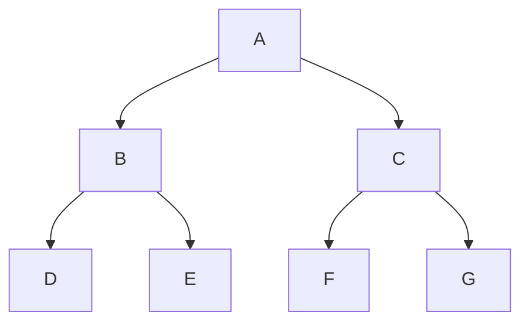
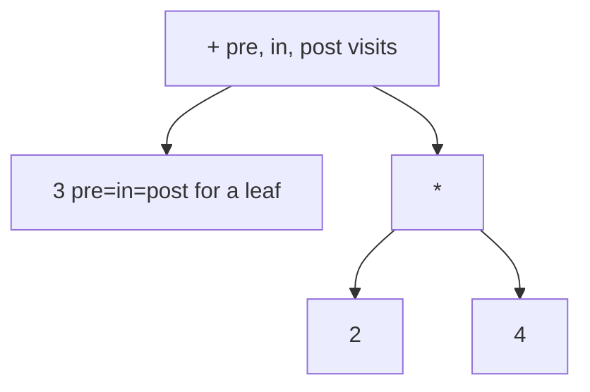
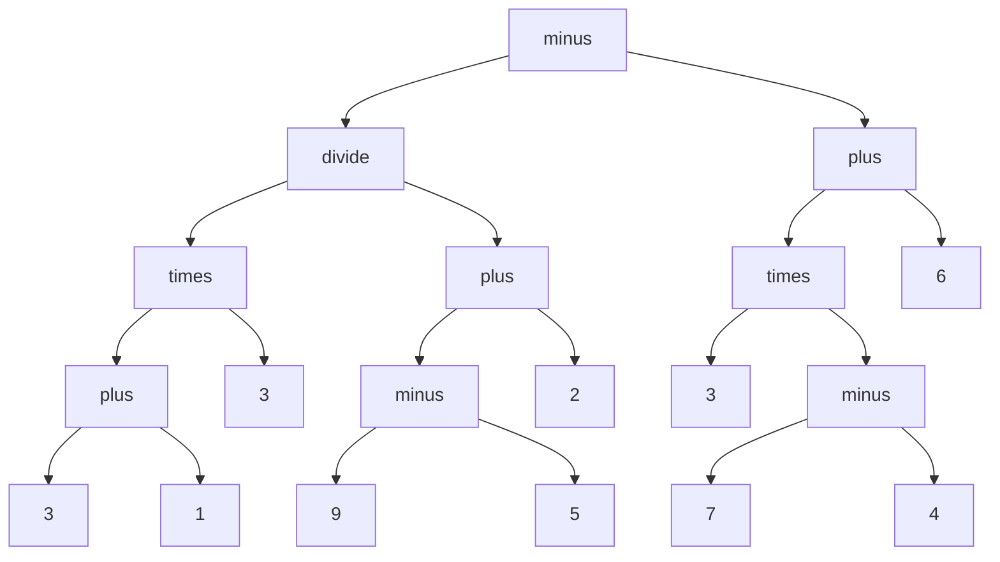

# Traversals, Euler tours and expression trees

> **Before this lesson:** You should know the tree vocabulary (root, child, leaf, subtree, depth,
> height) and what a binary tree is, from
> [Tree terminology, ADTs and representations](#/lesson/dsa-foundations/tree-basics); stacks and
> postfix notation from [Stacks](#/lesson/dsa-foundations/stacks); and queues from
> [Queues, circular arrays and deques](#/lesson/dsa-foundations/queues-deques).

## In plain words

A list has one obvious order in which to go through its items: front to back. A tree does not.
A **traversal** is a rule for visiting every node of a tree exactly once, and there are several
sensible rules, each useful for different jobs.

Imagine visiting every room of a house with several floors and wings. You could note each room
as you first enter it, before exploring the rooms beyond it. You could note it on your way back
out, after everything beyond it has been seen. Or you could do every room on the ground floor,
then every room on the first floor, and so on. All three plans see every room; they differ in
the order of the notes. Those are, roughly, preorder, postorder and breadth-first.

"Visiting" a node can mean anything: printing it, adding it to a total, checking a condition.

Why it matters for a job: most tree problems in interviews are solved by picking the right
traversal and doing a small amount of work at each node. Choosing among "before the children",
"after the children" and "level by level" is often the entire insight.

## 1. Preorder traversal

Visit the root **first**, then traverse the subtree of each child in turn, using the same rule
recursively. In pseudocode, for a tree `T` and a position `p`:

```
preorder(T, p):
    visit(p)
    for each child c of p:
        preorder(T, c)
```

Take a book as a tree: the title at the root, chapters as its children, sections as theirs. The
preorder traversal reads title, chapter 1, section 1.1, section 1.2, chapter 2, and so on. That
is the table of contents. Preorder is the natural choice whenever a parent has to be dealt with
before its children: printing an indented outline, or copying a tree (a node must exist before
its children can be attached to it).

## 2. Postorder traversal

Traverse the subtree of each child first, then visit the root **last**.

```
postorder(T, p):
    for each child c of p:
        postorder(T, c)
    visit(p)
```

Postorder is the natural choice when a node's answer depends on its children's answers. Disk
usage is the standard example: a folder's total is known only after the totals of everything
inside it. The same goes for computing height, evaluating an arithmetic expression, and
deleting a tree (remove the children before the parent).

**Running time.** Both traversals take $O(n)$ when a visit costs $O(1)$. At each position the
work, apart from the recursive calls, is $O(c_p + 1)$ for its $c_p$ children, and the previous
lesson showed that this adds up to $O(n)$ over the whole tree.

## 3. Breadth-first traversal

Visit every position at depth $d$ before any position at depth $d + 1$: the root, then its
children, then their children, level by level. This order is used when nearer things matter
first, for example examining all the moves available now in a game before any reply to them,
or searching for a shortest route. Breadth-first traversal is **not** recursive. It keeps the
positions waiting to be visited in a **queue**:

```
breadthfirst(T):
    Q = queue containing T.root()
    while Q not empty:
        p = Q.dequeue()
        visit(p)
        for each child c of p:
            Q.enqueue(c)
```

Why does a queue produce level order? The root is dequeued first and its children join the
queue. They are dequeued next, in order, and *their* children join behind them. Because a queue
is first-in, first-out, everything from one level leaves before anything from the next. Each
position is enqueued once and dequeued once: $O(n)$.

## 4. Inorder traversal of a binary tree

A binary tree offers one more option, because each node has a distinct left and right side:
visit a node **between** its left subtree and its right subtree.

```
inorder(p):
    if p has a left child:  inorder(left(p))
    visit(p)
    if p has a right child: inorder(right(p))
```

Informally, inorder visits the nodes from left to right, as if the tree had been squashed flat
onto a line. Its main use comes later in this track: in a **binary search tree**, where
everything in a node's left subtree is smaller than the node and everything in its right
subtree is larger, an inorder traversal lists the values in **sorted order**.

### Dry run

Work out all four orders for the tree below before reading the table. For preorder, say each
node as you first reach it. For postorder, say it when you leave it for the last time.



| Traversal | Order |
|---|---|
| preorder | A B D E C F G |
| inorder | D B E A F C G |
| postorder | D E B F G C A |
| breadth-first | A B C D E F G |

```python-run
from collections import deque
class N:
    def __init__(self, v, l=None, r=None): self.v, self.l, self.r = v, l, r
root = N("A", N("B", N("D"), N("E")), N("C", N("F"), N("G")))

def preorder(p, out):
    if p: out.append(p.v); preorder(p.l, out); preorder(p.r, out)
    return out
def inorder(p, out):
    if p: inorder(p.l, out); out.append(p.v); inorder(p.r, out)
    return out
def postorder(p, out):
    if p: postorder(p.l, out); postorder(p.r, out); out.append(p.v)
    return out
def breadthfirst(p):
    out, Q = [], deque([p] if p else [])
    while Q:
        q = Q.popleft(); out.append(q.v)
        for c in (q.l, q.r):
            if c: Q.append(c)
    return out
print("pre ", preorder(root, []))
print("in  ", inorder(root, []))
print("post", postorder(root, []))
print("bfs ", breadthfirst(root))
```

**Reading this code.** `N` is a minimal node with a value `v`, a left child `l` and a right child
`r`. The three recursive functions are identical except for *where* the line
`out.append(p.v)` sits: before both recursive calls, between them, or after them. `if p:` skips
a missing child (`None`). `breadthfirst` uses a `deque` as its queue. The output matches the
table.

### Reconstructing a tree

Given both the preorder and the inorder sequence of a binary tree whose labels are all
different, the tree can be rebuilt, and there is only one tree that fits. The first item of the
preorder is the root. Find it in the inorder sequence: everything to its left belongs to the
left subtree, everything to its right to the right subtree. Then repeat on each part. With
preorder `A B D E C F G` and inorder `D B E A F C G`: the root is A; `D B E` is the left
subtree and `F C G` the right; the next preorder item, B, is the root of the left part; and so
on. (Postorder with inorder works the same way. Preorder with postorder is not enough in
general, because neither says which side an only child is on.)

## 5. Implementing traversals in Python: generators

A traversal is most convenient when the caller can write `for p in preorder(tree):` and stop
early if they wish. Python supports this with **generators**: functions that use `yield` to
hand out one value at a time, pausing in between. A recursive generator passes along everything
produced by its recursive calls with `yield from`. The node class here keeps a list of children
(`kids`), so the same code works for trees of any shape.

```python-run
class N:
    def __init__(self, v, kids=()): self.v, self.kids = v, list(kids)

def preorder(p):
    yield p
    for c in p.kids:
        yield from preorder(c)

def postorder(p):
    for c in p.kids:
        yield from postorder(c)
    yield p

book = N("Paper", [N("Title"), N("Abstract"),
                   N("1", [N("1.1"), N("1.2")]),
                   N("2", [N("2.1"), N("2.2"), N("2.3")]),
                   N("References")])
print([p.v for p in preorder(book)])
print([p.v for p in postorder(book)])
```

### Applications

- **Table of contents with indentation**: preorder, passing the depth down as a parameter
  (`print(2 * d * ' ' + str(p.element()))`). For numbered headings ("1.2.3"), pass a *path* list
  that is extended and shrunk as you recurse.
- **Parenthetic string representation**: preorder that prints `label(child1, child2, ...)`.
- **Disk space**: postorder summing children's totals.

```python-run
class N:
    def __init__(self, v, kids=()): self.v, self.kids = v, list(kids)
book = N("Paper", [N("Title"), N("Abstract"), N("Intro", [N("Motivation"), N("Outline")]),
                   N("Method", [N("Setup"), N("Results")]), N("References")])

def labeled_toc(p, path=()):
    label = ".".join(str(j) for j in path)
    print("  " * len(path) + (label + " " if label else "") + p.v)
    for j, c in enumerate(p.kids, start=1):
        labeled_toc(c, path + (j,))

def parenthesize(p):
    if not p.kids:
        return p.v
    return p.v + " (" + ", ".join(parenthesize(c) for c in p.kids) + ")"

labeled_toc(book)
print(parenthesize(book))
```

## 6. The Euler tour and the template method pattern

Preorder, inorder and postorder are three views of one walk. Picture the tree drawn on the
ground with its edges as walls, and walk all the way round it, starting at the root and keeping
the wall on your left, as if tracing its outline with a finger. This walk is called an **Euler
tour** (after the mathematician Leonhard Euler, pronounced "oiler"). It passes each node
several times:

- a **pre visit** when it first reaches the node, coming down on the node's left side;
- for a binary tree, an **in visit** when it passes underneath, between the two subtrees;
- a **post visit** when it leaves the node for the last time, going up on its right side.

Doing your work at the pre visit gives a preorder traversal, at the in visit an inorder
traversal, and at the post visit a postorder traversal.



This suggests writing the walk once and plugging different work into it, a design known as the
**template method pattern**. The `EulerTour` class below implements the walk. At the right
moments it calls two **hook** methods, `_hook_previsit(p, d, path)` and
`_hook_postvisit(p, d, path, results)`, which do nothing by default. A subclass overrides only
the hooks it needs, and a new algorithm is a few lines long. Here `d` is the depth of `p`,
`path` records which child was taken at each level on the way down, and `results` is the list
of values returned by the tours of the children, so the post-visit hook is the natural place to
compute anything that is built up from the bottom, such as disk space.

```python-run
class EulerTour:
    """Template method: subclasses override the hooks."""
    def __init__(self, root): self._root = root
    def execute(self):
        return self._tour(self._root, 0, []) if self._root else None
    def _tour(self, p, d, path):
        self._hook_previsit(p, d, path)
        results = []
        path.append(0)
        for c in p.kids:
            results.append(self._tour(c, d + 1, path))
            path[-1] += 1
        path.pop()
        return self._hook_postvisit(p, d, path, results)
    def _hook_previsit(self, p, d, path): pass
    def _hook_postvisit(self, p, d, path, results): pass

class N:
    def __init__(self, v, kids=()): self.v, self.kids = v, list(kids)

class PreorderPrinter(EulerTour):
    def _hook_previsit(self, p, d, path):
        print(2 * d * " " + p.v)

class DiskSpace(EulerTour):
    def _hook_postvisit(self, p, d, path, results):
        return p.v[1] + sum(results)           # node value is (name, size)

fs = N(("/", 1), [N(("a", 5), [N(("x", 10)), N(("y", 20))]), N(("b", 7))])
print("disk space:", DiskSpace(fs).execute())
PreorderPrinter(N("root", [N("left", [N("ll")]), N("right")])).execute()
```

`DiskSpace` overrides only the post-visit hook: a node's total is its own size plus the totals
of its children, giving `disk space: 43` ($1 + 5 + 10 + 20 + 7$). `PreorderPrinter` overrides
only the pre-visit hook and prints an indented outline. A version for binary trees adds a third
hook, `_hook_invisit`, called between the left and right subtrees.

## 7. Case study: expression trees

An arithmetic expression such as $((((3 + 1) \times 3) / ((9 - 5) + 2)) - ((3 \times (7 - 4)) + 6))$
has a tree hidden inside it. Every operator combines two smaller expressions, so make the
operator a node and the two smaller expressions its left and right subtrees. The result is a
proper binary tree called an **expression tree**: its **leaves** hold the operands (numbers or
variables) and its **internal nodes** hold the operators $+, -, \times, /$. The value of an
internal node is its operator applied to the values of its two subtrees. The parentheses are no
longer needed, because the shape of the tree says what is grouped with what.



- **Evaluation** is a **postorder** traversal: evaluate both children, then apply the operator.
- **Printing a fully parenthesised infix string** is an **Euler tour**: print `(` on the pre-visit of
  an internal node, the label on the in-visit, `)` on the post-visit.
- **Postfix** (reverse Polish) form is the postorder sequence; **prefix** form is the preorder.

### Building a tree from postfix

The stack algorithm that *evaluated* postfix in the stacks lesson also *builds* the tree, with
one change: push trees instead of numbers. Read the postfix tokens left to right. An operand
becomes a one-node tree and is pushed. An operator pops the right subtree, then the left
subtree, and pushes a new tree with the operator at its root and those two below it. At the
end the stack holds exactly one tree. In the demo, the tree built from the postfix string is
printed back as fully parenthesised infix and evaluated; the value is $-13$.

```python-run
class ExpressionTree:
    def __init__(self, token, left=None, right=None):
        self.token, self.left, self.right = token, left, right
    def is_leaf(self):
        return self.left is None and self.right is None
    def evaluate(self):                               # postorder
        if self.is_leaf():
            return float(self.token)
        a, b = self.left.evaluate(), self.right.evaluate()
        return {'+': a + b, '-': a - b, '*': a * b, '/': a / b}[self.token]
    def infix(self):                                  # Euler tour
        if self.is_leaf():
            return self.token
        return "(" + self.left.infix() + " " + self.token + " " + self.right.infix() + ")"

def build_from_postfix(tokens):
    S = []
    for t in tokens:
        if t in "+-*/":
            right = S.pop(); left = S.pop()
            S.append(ExpressionTree(t, left, right))
        else:
            S.append(ExpressionTree(t))
    assert len(S) == 1, "malformed expression"
    return S[0]

t = build_from_postfix("3 1 + 3 * 9 5 - 2 + / 3 7 4 - * 6 + -".split())
print(t.infix(), "=", t.evaluate())
```

> [!INTERVIEW]
> Tree questions usually reduce to choosing the traversal: **preorder** to pass information *down*
> (depth, path, bounds), **postorder** to pass results *up* (height, sums, balance checks, diameter),
> **inorder** for BST ordering, **BFS** for anything "by level" or "nearest". Saying this out loud
> before coding is a strong signal.

## 8. Traversals without recursion: the explicit stack

Recursive traversals use the call stack implicitly, and on a degenerate tree (a path of $n$ nodes)
they recurse $n$ deep — past Python's limit for large inputs. Making the stack explicit removes the
limit and shows what the recursion is really doing.

**Inorder** is the instructive one. The rule "left subtree, node, right subtree" becomes: *slide
left as far as possible, pushing every node passed; pop a node and visit it; then move to its right
child and repeat.*

```python-run
class N:
    def __init__(self, v, l=None, r=None): self.v, self.l, self.r = v, l, r

def inorder_iterative(root, trace=False):
    out, stack, p = [], [], root
    while stack or p is not None:
        while p is not None:               # slide left, remembering the way back
            stack.append(p)
            p = p.l
        p = stack.pop()                    # leftmost unvisited node
        out.append(p.v)
        if trace: print(f"visit {p.v}   stack now: {[n.v for n in stack]}")
        p = p.r                            # continue in its right subtree (may be None)
    return out

def preorder_iterative(root):
    out, stack = [], [root] if root else []
    while stack:
        p = stack.pop()
        out.append(p.v)
        if p.r: stack.append(p.r)          # push right first so that left is processed first
        if p.l: stack.append(p.l)
    return out

def postorder_iterative(root):
    out, stack = [], [(root, False)] if root else []
    while stack:
        p, children_done = stack.pop()
        if children_done:
            out.append(p.v)                # second time we see p: its subtrees are finished
        else:
            stack.append((p, True))        # come back to p after its children
            if p.r: stack.append((p.r, False))
            if p.l: stack.append((p.l, False))
    return out

root = N("A", N("B", N("D"), N("E")), N("C", N("F"), N("G")))
print(inorder_iterative(root, trace=True))
print(preorder_iterative(root), postorder_iterative(root))

chain = None
for i in range(50000):                     # a left-leaning path: recursion would overflow
    chain = N(i, chain)
print(len(inorder_iterative(chain)), "nodes traversed iteratively")
```

### Dry run of the inorder loop on A(B(D, E), C(F, G))

| action | stack (bottom → top) | output |
|---|---|---|
| slide left from A: push A, B, D | A B D | |
| pop D, visit; D has no right child | A B | D |
| pop B, visit; move to B's right child E | A | D B |
| slide left from E: push E; pop E, visit | A | D B E |
| pop A, visit; move to A's right child C | | D B E A |
| slide left from C: push C, F; pop F, visit | C | D B E A F |
| pop C, visit; move to G; push G, pop G, visit | | D B E A F C G |

The stack always holds exactly the **ancestors whose left subtree is being explored** — the nodes
the recursion would have suspended. Its size never exceeds the height of the tree, so the space is
$O(h)$, and each node is pushed and popped once: $O(n)$ time.

Preorder is simpler (visit on pop), and postorder needs one extra bit per stack entry — "have my
children been processed yet?" — which is precisely the *pre-visit / post-visit* distinction of the
Euler tour. Seen this way, all three orders are the same walk around the tree; they differ only in
*when*, during a node's time on the stack, its element is emitted.

## 9. Pitfalls

- **Recursing into a missing child.** Decide once where the check for `None` lives (at the top
  of the function, or before each call) and keep to it.
- **Popping operands in the wrong order** when building an expression tree. The first pop is the
  right operand; getting it backwards turns `a - b` into `b - a`.
- **Using a stack where a queue is needed.** Level order requires a queue; a stack gives a
  depth-first order instead.
- **Deep recursion on a lopsided tree.** When the height is close to $n$, a recursive traversal
  exceeds Python's limit on large inputs. Use an explicit stack.
- **Doing expensive work at each visit.** The $O(n)$ bound assumes a visit costs $O(1)$;
  building a new list or string at every node can quietly make the whole traversal quadratic.

## 10. Summary

| Traversal | Visit time | Typical use |
|---|---|---|
| preorder | before children | copying, printing outlines, passing info down |
| postorder | after children | evaluation, sizes, deletion |
| inorder (binary) | between subtrees | sorted output of a BST, infix expressions |
| breadth-first | by level, with a queue | level views, shortest paths |
| Euler tour | pre/in/post hooks | unifies all of the above |

> **Source:** Goodrich, Tamassia & Goldwasser, *Data Structures and Algorithms in Python*, ch. 8.4–8.5.

## Glossary

- **Traversal**: a rule for visiting every node of a tree exactly once.
- **Visit**: whatever work is done at a node during a traversal.
- **Preorder**: visit a node before its children.
- **Postorder**: visit a node after its children.
- **Inorder**: in a binary tree, visit a node between its left and right subtrees.
- **Breadth-first (level order)**: visit nodes level by level, using a queue.
- **Depth-first**: any traversal that goes as deep as possible before backing up (preorder,
  inorder and postorder are all depth-first).
- **Generator**: a Python function that produces values one at a time with `yield`.
- **Euler tour**: a walk around the outline of a tree that passes each node several times.
- **Template method pattern**: a fixed algorithm that calls replaceable hook methods.
- **Hook**: a method that does nothing by default and is overridden to add behaviour.
- **Expression tree**: a binary tree with operands at the leaves and operators at internal
  nodes.
- **Prefix / postfix form**: an expression written with each operator before / after its
  operands.

## Check yourself

```quiz
[
  {"q": "Which traversal lists the keys of a binary search tree in sorted order?",
   "options": ["Preorder", "Inorder", "Postorder", "Breadth-first"], "answer": 1,
   "explain": "Left subtree keys, then the node, then right subtree keys."},
  {"q": "Evaluating an expression tree is naturally which traversal?",
   "options": ["Preorder", "Postorder", "Breadth-first", "None"], "answer": 1,
   "explain": "A node's value depends on both children's values, so children are processed first."},
  {"q": "Breadth-first traversal uses which auxiliary structure?",
   "options": ["Stack", "Queue", "Heap", "Hash table"], "answer": 1,
   "explain": "Positions are processed in the order they are discovered, level by level."},
  {"q": "For the tree A(B(D,E), C(F,G)), what is the postorder?",
   "options": ["A B D E C F G", "D B E A F C G", "D E B F G C A", "A B C D E F G"], "answer": 2,
   "explain": "Children before parent: D E B, then F G C, then A."},
  {"q": "In the Euler tour template, which hook receives the children's results?",
   "options": ["_hook_previsit", "_hook_invisit", "_hook_postvisit", "execute"], "answer": 2,
   "explain": "The post-visit happens after all children have been toured, so their results are available."},
  {"q": "When building an expression tree from postfix, on operator '-' you pop...",
   "options": ["left then right", "right then left", "only one tree", "all trees"], "answer": 1,
   "explain": "The top of the stack is the most recent, i.e. the right operand."},
  {"q": "Which pair of traversals uniquely determines a binary tree with distinct labels?",
   "options": ["preorder and postorder", "preorder and inorder", "postorder alone", "breadth-first alone"], "answer": 1,
   "explain": "The preorder head identifies the root and inorder splits left and right subtrees."}
]
```
