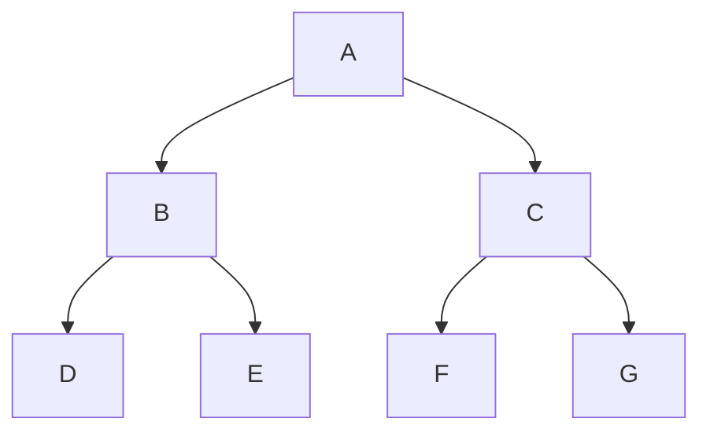
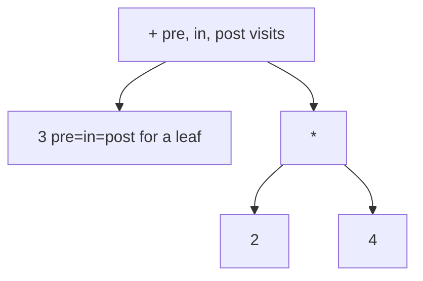
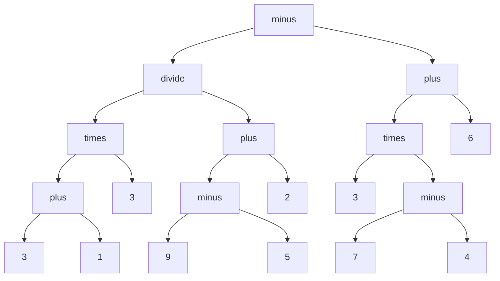

# Traversals, Euler tours and expression trees

A **traversal** of a tree is a systematic way of visiting all its positions. "Visiting" can mean
anything: printing, summing, checking a property. The order of visits is what distinguishes
traversals, and choosing the right order is the key to dozens of tree algorithms. This lesson covers
preorder, postorder, breadth-first and inorder traversals, the unifying **Euler tour**, and the
book's case study: the **expression tree**.

## 1. Preorder traversal

Visit the root **first**, then recursively traverse the subtrees of its children in order.

```
preorder(T, p):
    visit(p)
    for each child c of p:
        preorder(T, c)
```

The preorder of a book's table-of-contents tree is the table of contents itself: book title, then
chapter 1, its sections, then chapter 2, … Preorder is natural whenever a parent must be handled
before its children (printing indented outlines, copying a tree).

## 2. Postorder traversal

Recursively traverse the children first, then visit the root **last**.

```
postorder(T, p):
    for each child c of p:
        postorder(T, c)
    visit(p)
```

Postorder is natural when a node's result depends on its children's results: disk usage (a
directory's total is known only after its contents are summed), height, evaluating an expression,
deleting a tree (free children before the parent).

**Running time:** both are $O(n)$ when visiting costs $O(1)$: at each position the non-recursive
work is $O(c_p + 1)$, which sums to $O(n)$ as shown in the previous lesson.

## 3. Breadth-first traversal

Visit all positions at depth $d$ before any position at depth $d + 1$ — level by level. Used in game
trees (examine all moves one step ahead before deeper ones) and shortest-path search. It is **not**
recursive; it uses a **queue**:

```
breadthfirst(T):
    Q = queue containing T.root()
    while Q not empty:
        p = Q.dequeue()
        visit(p)
        for each child c of p:
            Q.enqueue(c)
```

Each position is enqueued and dequeued once: $O(n)$.

## 4. Inorder traversal of a binary tree

For binary trees we can visit a node **between** its left and right subtrees:

```
inorder(p):
    if p has a left child:  inorder(left(p))
    visit(p)
    if p has a right child: inorder(right(p))
```

Informally, inorder visits nodes left to right, as if the tree were squashed flat. Its key
application: in a **binary search tree** (every key in the left subtree $\le$ the node's key $\le$
every key in the right subtree), an inorder traversal lists the keys in **sorted order**.

### Dry run



| Traversal | Order |
|---|---|
| preorder | A B D E C F G |
| inorder | D B E A F C G |
| postorder | D E B F G C A |
| breadth-first | A B C D E F G |

```python-run
from collections import deque
class N:
    def __init__(self, v, l=None, r=None): self.v, self.l, self.r = v, l, r
root = N("A", N("B", N("D"), N("E")), N("C", N("F"), N("G")))

def preorder(p, out):
    if p: out.append(p.v); preorder(p.l, out); preorder(p.r, out)
    return out
def inorder(p, out):
    if p: inorder(p.l, out); out.append(p.v); inorder(p.r, out)
    return out
def postorder(p, out):
    if p: postorder(p.l, out); postorder(p.r, out); out.append(p.v)
    return out
def breadthfirst(p):
    out, Q = [], deque([p] if p else [])
    while Q:
        q = Q.popleft(); out.append(q.v)
        for c in (q.l, q.r):
            if c: Q.append(c)
    return out
print("pre ", preorder(root, []))
print("in  ", inorder(root, []))
print("post", postorder(root, []))
print("bfs ", breadthfirst(root))
```

### Reconstructing a tree

Given the preorder and inorder sequences of a binary tree with distinct labels, the tree is uniquely
determined: the first preorder element is the root; its position in the inorder sequence splits
the left and right subtrees. (Postorder + inorder also works; preorder + postorder does not in
general.)

## 5. Implementing traversals in Python: generators

The book implements traversals as **generators** that `yield` positions, so callers can write
`for p in T.preorder():` and stop early if they wish. A recursive generator uses `yield from`
(or an explicit loop) to pass along the positions produced by the recursive call:

```python-run
class N:
    def __init__(self, v, kids=()): self.v, self.kids = v, list(kids)

def preorder(p):
    yield p
    for c in p.kids:
        yield from preorder(c)

def postorder(p):
    for c in p.kids:
        yield from postorder(c)
    yield p

book = N("Paper", [N("Title"), N("Abstract"),
                   N("1", [N("1.1"), N("1.2")]),
                   N("2", [N("2.1"), N("2.2"), N("2.3")]),
                   N("References")])
print([p.v for p in preorder(book)])
print([p.v for p in postorder(book)])
```

### Applications

- **Table of contents with indentation**: preorder, passing the depth down as a parameter
  (`print(2 * d * ' ' + str(p.element()))`). For numbered headings ("1.2.3"), pass a *path* list
  that is extended and shrunk as you recurse.
- **Parenthetic string representation**: preorder that prints `label(child1, child2, ...)`.
- **Disk space**: postorder summing children's totals.

```python-run
class N:
    def __init__(self, v, kids=()): self.v, self.kids = v, list(kids)
book = N("Paper", [N("Title"), N("Abstract"), N("Intro", [N("Motivation"), N("Outline")]),
                   N("Method", [N("Setup"), N("Results")]), N("References")])

def labeled_toc(p, path=()):
    label = ".".join(str(j) for j in path)
    print("  " * len(path) + (label + " " if label else "") + p.v)
    for j, c in enumerate(p.kids, start=1):
        labeled_toc(c, path + (j,))

def parenthesize(p):
    if not p.kids:
        return p.v
    return p.v + " (" + ", ".join(parenthesize(c) for c in p.kids) + ")"

labeled_toc(book)
print(parenthesize(book))
```

## 6. The Euler tour and the template method pattern

Pre-, in- and postorder are special cases of a more general traversal. Imagine walking around the
tree, starting at the root and keeping the edges always on your left — like tracing its outline.
This **Euler tour** encounters each node several times:

- a **"pre visit"** when first reaching it (on the left, for a binary tree),
- for a binary tree, an **"in visit"** from below (between its left and right subtrees),
- a **"post visit"** when leaving it for the last time (on the right).



The book captures this with the **template method pattern**: an `EulerTour` class implements the
generic tour, calling *hook* methods `_hook_previsit(p, d, path)` and
`_hook_postvisit(p, d, path, results)` that do nothing by default. Subclasses override only the
hooks to create specific algorithms. The post-visit hook receives the list of results returned by the
children's tours — so it naturally computes bottom-up values (disk space, expression value, layout).

```python-run
class EulerTour:
    """Template method: subclasses override the hooks."""
    def __init__(self, root): self._root = root
    def execute(self):
        return self._tour(self._root, 0, []) if self._root else None
    def _tour(self, p, d, path):
        self._hook_previsit(p, d, path)
        results = []
        path.append(0)
        for c in p.kids:
            results.append(self._tour(c, d + 1, path))
            path[-1] += 1
        path.pop()
        return self._hook_postvisit(p, d, path, results)
    def _hook_previsit(self, p, d, path): pass
    def _hook_postvisit(self, p, d, path, results): pass

class N:
    def __init__(self, v, kids=()): self.v, self.kids = v, list(kids)

class PreorderPrinter(EulerTour):
    def _hook_previsit(self, p, d, path):
        print(2 * d * " " + p.v)

class DiskSpace(EulerTour):
    def _hook_postvisit(self, p, d, path, results):
        return p.v[1] + sum(results)           # node value is (name, size)

fs = N(("/", 1), [N(("a", 5), [N(("x", 10)), N(("y", 20))]), N(("b", 7))])
print("disk space:", DiskSpace(fs).execute())
PreorderPrinter(N("root", [N("left", [N("ll")]), N("right")])).execute()
```

The binary version adds `_hook_invisit`, called between the left and right subtrees.

## 7. Case study: expression trees

An arithmetic expression such as $((((3 + 1) \times 3) / ((9 - 5) + 2)) - ((3 \times (7 - 4)) + 6))$
can be represented by a proper binary tree: **leaves** hold operands (numbers or variables) and
**internal nodes** hold operators $+, -, \times, /$. The value of an internal node is its operator
applied to the values of its two subtrees.



- **Evaluation** is a **postorder** traversal: evaluate both children, then apply the operator.
- **Printing a fully parenthesised infix string** is an **Euler tour**: print `(` on the pre-visit of
  an internal node, the label on the in-visit, `)` on the post-visit.
- **Postfix** (reverse Polish) form is the postorder sequence; **prefix** form is the preorder.

### Building a tree from postfix

Scan postfix tokens with a stack of trees: an operand becomes a one-node tree pushed on the stack; an
operator pops the right tree, then the left tree, and pushes a new tree with the operator at the
root. At the end the stack holds exactly one tree. (The book builds trees from a fully parenthesised
infix string with the same stack idea.)

```python-run
class ExpressionTree:
    def __init__(self, token, left=None, right=None):
        self.token, self.left, self.right = token, left, right
    def is_leaf(self):
        return self.left is None and self.right is None
    def evaluate(self):                               # postorder
        if self.is_leaf():
            return float(self.token)
        a, b = self.left.evaluate(), self.right.evaluate()
        return {'+': a + b, '-': a - b, '*': a * b, '/': a / b}[self.token]
    def infix(self):                                  # Euler tour
        if self.is_leaf():
            return self.token
        return "(" + self.left.infix() + " " + self.token + " " + self.right.infix() + ")"

def build_from_postfix(tokens):
    S = []
    for t in tokens:
        if t in "+-*/":
            right = S.pop(); left = S.pop()
            S.append(ExpressionTree(t, left, right))
        else:
            S.append(ExpressionTree(t))
    assert len(S) == 1, "malformed expression"
    return S[0]

t = build_from_postfix("3 1 + 3 * 9 5 - 2 + / 3 7 4 - * 6 + -".split())
print(t.infix(), "=", t.evaluate())
```

> [!INTERVIEW]
> Tree questions usually reduce to choosing the traversal: **preorder** to pass information *down*
> (depth, path, bounds), **postorder** to pass results *up* (height, sums, balance checks, diameter),
> **inorder** for BST ordering, **BFS** for anything "by level" or "nearest". Saying this out loud
> before coding is a strong signal.

## 8. Traversals without recursion: the explicit stack

Recursive traversals use the call stack implicitly, and on a degenerate tree (a path of $n$ nodes)
they recurse $n$ deep — past Python's limit for large inputs. Making the stack explicit removes the
limit and shows what the recursion is really doing.

**Inorder** is the instructive one. The rule "left subtree, node, right subtree" becomes: *slide
left as far as possible, pushing every node passed; pop a node and visit it; then move to its right
child and repeat.*

```python-run
class N:
    def __init__(self, v, l=None, r=None): self.v, self.l, self.r = v, l, r

def inorder_iterative(root, trace=False):
    out, stack, p = [], [], root
    while stack or p is not None:
        while p is not None:               # slide left, remembering the way back
            stack.append(p)
            p = p.l
        p = stack.pop()                    # leftmost unvisited node
        out.append(p.v)
        if trace: print(f"visit {p.v}   stack now: {[n.v for n in stack]}")
        p = p.r                            # continue in its right subtree (may be None)
    return out

def preorder_iterative(root):
    out, stack = [], [root] if root else []
    while stack:
        p = stack.pop()
        out.append(p.v)
        if p.r: stack.append(p.r)          # push right first so that left is processed first
        if p.l: stack.append(p.l)
    return out

def postorder_iterative(root):
    out, stack = [], [(root, False)] if root else []
    while stack:
        p, children_done = stack.pop()
        if children_done:
            out.append(p.v)                # second time we see p: its subtrees are finished
        else:
            stack.append((p, True))        # come back to p after its children
            if p.r: stack.append((p.r, False))
            if p.l: stack.append((p.l, False))
    return out

root = N("A", N("B", N("D"), N("E")), N("C", N("F"), N("G")))
print(inorder_iterative(root, trace=True))
print(preorder_iterative(root), postorder_iterative(root))

chain = None
for i in range(50000):                     # a left-leaning path: recursion would overflow
    chain = N(i, chain)
print(len(inorder_iterative(chain)), "nodes traversed iteratively")
```

### Dry run of the inorder loop on A(B(D, E), C(F, G))

| action | stack (bottom → top) | output |
|---|---|---|
| slide left from A: push A, B, D | A B D | |
| pop D, visit; D has no right child | A B | D |
| pop B, visit; move to B's right child E | A | D B |
| slide left from E: push E; pop E, visit | A | D B E |
| pop A, visit; move to A's right child C | | D B E A |
| slide left from C: push C, F; pop F, visit | C | D B E A F |
| pop C, visit; move to G; push G, pop G, visit | | D B E A F C G |

The stack always holds exactly the **ancestors whose left subtree is being explored** — the nodes
the recursion would have suspended. Its size never exceeds the height of the tree, so the space is
$O(h)$, and each node is pushed and popped once: $O(n)$ time.

Preorder is simpler (visit on pop), and postorder needs one extra bit per stack entry — "have my
children been processed yet?" — which is precisely the *pre-visit / post-visit* distinction of the
Euler tour. Seen this way, all three orders are the same walk around the tree; they differ only in
*when*, during a node's time on the stack, its element is emitted.

## 9. Pitfalls

- Recursing on `None` children without a guard (or guarding inconsistently).
- Popping operands in the wrong order when building expression trees (`a - b` vs `b - a`).
- Using a stack instead of a queue for level order (that gives a DFS order).
- Deep recursion on degenerate trees (height ~ $n$): use an explicit stack in Python for large inputs.

## 10. Summary

| Traversal | Visit time | Typical use |
|---|---|---|
| preorder | before children | copying, printing outlines, passing info down |
| postorder | after children | evaluation, sizes, deletion |
| inorder (binary) | between subtrees | sorted output of a BST, infix expressions |
| breadth-first | by level, with a queue | level views, shortest paths |
| Euler tour | pre/in/post hooks | unifies all of the above |

> **Source:** Goodrich, Tamassia & Goldwasser, *Data Structures and Algorithms in Python*, ch. 8.4–8.5.

## Check yourself

```quiz
[
  {"q": "Which traversal lists the keys of a binary search tree in sorted order?",
   "options": ["Preorder", "Inorder", "Postorder", "Breadth-first"], "answer": 1,
   "explain": "Left subtree keys, then the node, then right subtree keys."},
  {"q": "Evaluating an expression tree is naturally which traversal?",
   "options": ["Preorder", "Postorder", "Breadth-first", "None"], "answer": 1,
   "explain": "A node's value depends on both children's values, so children are processed first."},
  {"q": "Breadth-first traversal uses which auxiliary structure?",
   "options": ["Stack", "Queue", "Heap", "Hash table"], "answer": 1,
   "explain": "Positions are processed in the order they are discovered, level by level."},
  {"q": "For the tree A(B(D,E), C(F,G)), what is the postorder?",
   "options": ["A B D E C F G", "D B E A F C G", "D E B F G C A", "A B C D E F G"], "answer": 2,
   "explain": "Children before parent: D E B, then F G C, then A."},
  {"q": "In the Euler tour template, which hook receives the children's results?",
   "options": ["_hook_previsit", "_hook_invisit", "_hook_postvisit", "execute"], "answer": 2,
   "explain": "The post-visit happens after all children have been toured, so their results are available."},
  {"q": "When building an expression tree from postfix, on operator '-' you pop...",
   "options": ["left then right", "right then left", "only one tree", "all trees"], "answer": 1,
   "explain": "The top of the stack is the most recent, i.e. the right operand."},
  {"q": "Which pair of traversals uniquely determines a binary tree with distinct labels?",
   "options": ["preorder and postorder", "preorder and inorder", "postorder alone", "breadth-first alone"], "answer": 1,
   "explain": "The preorder head identifies the root and inorder splits left and right subtrees."}
]
```
