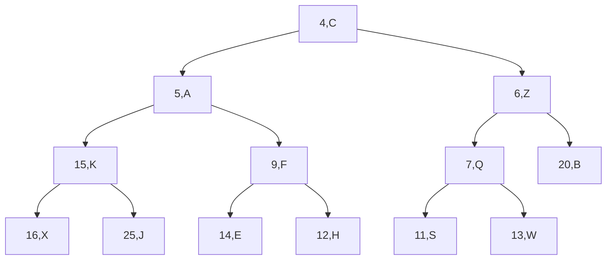

# Priority queues and binary heaps

> **Before this lesson:** You should know binary trees, complete binary trees and level
> numbering (children of index $i$ at $2i+1$ and $2i+2$), all from
> [Tree terminology, ADTs and representations](#/lesson/dsa-foundations/tree-basics); the queue
> ADT from [Queues, circular arrays and deques](#/lesson/dsa-foundations/queues-deques); and
> logarithms from [Measuring algorithms and the seven functions](#/lesson/dsa-foundations/seven-functions).

## In plain words

An ordinary queue serves whoever has waited longest. A **priority queue** serves whoever is most
urgent, regardless of when they arrived.

A hospital emergency department works this way. Patients are not seen in order of arrival: a
nurse gives each a priority, and the most critical patient is treated next, even if they came
through the door a minute ago. New patients keep arriving, and at every moment the question is
the same: who is the most urgent person waiting *right now*?

The data structure that answers that question quickly is the **heap**. Its trick is to stay only
partly organised: tidy enough that the most urgent item is always at the top, but no tidier, so
that adding and removing remain cheap.

Why it matters for a job: operating systems choose the next task to run with a priority queue;
route-finding (Dijkstra's algorithm, later in this track) is built on one; and "find the top
$k$ items" is among the most common interview patterns. Python's `heapq` module, covered at the
end, is the tool you will reach for in practice.

## 1. The priority queue ADT

Each item is stored with a **key**, a value that states its priority. By convention the item
with the **smallest key** is served first (think "priority 1 is the most urgent"). Keys can be
any values that can be compared with `<`: numbers, strings, tuples.

| Operation | Meaning |
|---|---|
| `P.add(k, v)` | put a new entry into the queue: key `k`, value `v` |
| `P.min()` | return (but do not remove) a tuple `(k, v)` with minimum key; error if empty |
| `P.remove_min()` | remove and return a `(k, v)` with minimum key; error if empty |
| `P.is_empty()`, `len(P)` | as usual |

Several items may share a key; then `min` may return any one of them. The trace below shows the
contents written in key order for readability. A priority queue does not have to store them in
that order internally, and the heap will not.

| Operation | Returns | Contents afterwards |
|---|---|---|
| `P.add(6, 'x')` | | {(6,x)} |
| `P.add(2, 'y')` | | {(2,y), (6,x)} |
| `P.add(8, 'z')` | | {(2,y), (6,x), (8,z)} |
| `P.min()` | (2,y) | unchanged |
| `P.add(4, 'w')` | | {(2,y), (4,w), (6,x), (8,z)} |
| `P.remove_min()` | (2,y) | {(4,w), (6,x), (8,z)} |
| `P.remove_min()` | (4,w) | {(6,x), (8,z)} |
| `len(P)` | 2 | |
| `P.remove_min()` | (6,x) | {(8,z)} |

Entries come out in key order no matter what order they went in.

### The composition pattern

A key and its value must travel together as they are moved around inside the data structure. The
tidy way to ensure that is to bundle each pair into one small object, an approach called the
**composition design pattern**. The `_Item` class below does so, and defines `__lt__`, the hook
Python calls for the `<` operator, to compare keys only. With that in place, two items can be
compared directly with `a < b`.

```python
class _Item:
    __slots__ = '_key', '_value'
    def __init__(self, k, v):
        self._key, self._value = k, v
    def __lt__(self, other):
        return self._key < other._key      # compare items based on their keys
```

## 2. Two list-based implementations

Before the heap, consider the two obvious designs.

**Unsorted list.** Put each new item at the end: `add` is $O(1)$. But to find the smallest key,
`min` and `remove_min` must look at every item: $O(n)$. This is a waiting room with no system at
all; the nurse rereads every chart each time.

**Sorted list.** Keep the items in order of key. Now the smallest is always first, so `min` and
`remove_min` are $O(1)$. But `add` must find the right place for the newcomer by walking along
the list, as in insertion sort: $O(n)$.

| Operation | Unsorted list | Sorted list |
|---|---|---|
| `len`, `is_empty` | $O(1)$ | $O(1)$ |
| `add` | $O(1)$ | $O(n)$ |
| `min` | $O(n)$ | $O(1)$ |
| `remove_min` | $O(n)$ | $O(1)$ |

Either way, one operation is linear. The unsorted list does no organising and pays when
removing; the sorted list organises completely and pays when adding. A heap organises *partly*
and pays $O(\log n)$ for both.

## 3. The heap data structure

A **binary heap** is a binary tree that stores one item at each node and obeys two rules:

1. **Heap order** (a rule about the keys): every node other than the root holds a key that is
   **at least as large as** the key of its parent. Follow any path from the root down to a
   leaf and the keys never decrease, so **the smallest key is at the root**.
2. **Completeness** (a rule about the shape): the tree is a complete binary tree. Every level is
   full ($2^i$ nodes at level $i$) except possibly the bottom one, and the nodes of the bottom
   level sit as far **left** as possible.

Rule 1 puts the answer at the top. Rule 2 keeps the tree as short as it can be, which is what
makes updates fast. In the picture each node shows a key and a value; check that every child's
key is at least its parent's.



Notice what heap order does **not** say. It says nothing about siblings (6 may sit to the right
of 5, or to the left), and nothing about how the left subtree compares with the right. In the
picture, 15 is higher up than 7. A heap is only *partly* sorted: enough to find the smallest
key instantly, and no more. The tree shown here is a **min-heap**; reversing the rule so that
parents are at least as large as their children gives a **max-heap**, with the largest key at
the root.

### Height of a heap

> **Claim.** A heap storing $n$ entries has height $h = \lfloor \log n \rfloor$.

*Why.* A complete tree of height $h$ has all of levels 0 to $h - 1$ full, which is
$1 + 2 + 4 + \cdots + 2^{h-1} = 2^h - 1$ nodes, plus at least 1 and at most $2^h$ nodes on the
bottom level. So $2^h \le n \le 2^{h+1} - 1$. Taking logarithms gives
$\log(n+1) - 1 \le h \le \log n$, and the only whole number in that range is
$\lfloor \log n \rfloor$. ∎

A heap of a million items is only 19 levels deep. If updates can be done in time proportional to
the height, they cost $O(\log n)$.

## 4. Adding an item: up-heap bubbling

A new item has to go somewhere without breaking either rule. Take the rules one at a time.

1. **Keep the tree complete.** There is only one place a new node can go: the next free spot on
   the bottom level, immediately to the right of the last node (or the leftmost spot of a new
   level, if the bottom level is full).
2. **Restore heap order.** The new item may be smaller than its parent. Compare them; if the new
   key is smaller, swap the two. Now compare with the new parent, and so on, until the parent's
   key is no larger or the item has reached the root. The item rises like a bubble, so this is
   called **up-heap bubbling** (you will also see *sift-up* and *swim*).

Only the path from the new node to the root is touched, with at most one swap per level:
$O(\log n)$.

## 5. Removing the minimum: down-heap bubbling

The smallest key is at the root, but plucking out the root would leave two separate trees. So:

1. Take the **last** item (the rightmost node on the bottom level), put it in the root's place,
   and delete the last node. The shape is still a complete tree.
2. **Restore heap order.** The item now at the root is probably too large to be there. Compare
   it with its children. Find the child with the **smaller** key; if that child's key is smaller
   than the item's, swap them and continue from the child's position. Stop when the item is no
   larger than its children or has become a leaf. This is **down-heap bubbling** (also
   *sift-down* or *sink*).

Why the smaller child? After the swap, that child sits above the other child, so it must not be
larger than it. Choosing the smaller of the two guarantees that. Again there is at most one swap
per level: $O(\log n)$.

## 6. Array-based representation

A complete binary tree fits an array perfectly, using the level numbering from the trees module:
the root at index 0 and, for the item at index $j$,

$$\text{left}(j) = 2j + 1, \qquad \text{right}(j) = 2j + 2, \qquad \text{parent}(j) = \lfloor (j - 1)/2 \rfloor.$$

Because the tree is complete, its $n$ items fill indices $0$ to $n-1$ with **no gaps**. The
"last node" is index $n - 1$; adding a node is `append` and removing the last is `pop`. There
are no node objects and no references, only a list and some arithmetic, which is why heaps are
so fast in practice.

Reading the drawing above level by level, left to right, gives exactly the array layout: the root
first, then its two children, then the four grandchildren, and finally the six entries of the
bottom level — thirteen cells, indices 0 to 12, with no holes.

```python-run
class Empty(Exception):
    pass

class HeapPriorityQueue:
    """A min-oriented priority queue implemented with a binary heap."""
    class _Item:
        __slots__ = '_key', '_value'
        def __init__(self, k, v): self._key, self._value = k, v
        def __lt__(self, other): return self._key < other._key

    # ---- nonpublic behaviours ----
    def _parent(self, j): return (j - 1) // 2
    def _left(self, j): return 2 * j + 1
    def _right(self, j): return 2 * j + 2
    def _has_left(self, j): return self._left(j) < len(self._data)
    def _has_right(self, j): return self._right(j) < len(self._data)
    def _swap(self, i, j):
        self._data[i], self._data[j] = self._data[j], self._data[i]

    def _upheap(self, j):
        parent = self._parent(j)
        if j > 0 and self._data[j] < self._data[parent]:
            self._swap(j, parent)
            self._upheap(parent)                 # recur at position of parent

    def _downheap(self, j):
        if self._has_left(j):
            left = self._left(j)
            small_child = left                   # although right may be smaller
            if self._has_right(j):
                right = self._right(j)
                if self._data[right] < self._data[left]:
                    small_child = right
            if self._data[small_child] < self._data[j]:
                self._swap(j, small_child)
                self._downheap(small_child)      # recur at position of small child

    # ---- public behaviours ----
    def __init__(self): self._data = []
    def __len__(self): return len(self._data)
    def is_empty(self): return len(self._data) == 0
    def add(self, key, value):
        self._data.append(self._Item(key, value))
        self._upheap(len(self._data) - 1)        # upheap newly added position
    def min(self):
        if self.is_empty(): raise Empty('Priority queue is empty.')
        item = self._data[0]
        return (item._key, item._value)
    def remove_min(self):
        if self.is_empty(): raise Empty('Priority queue is empty.')
        self._swap(0, len(self._data) - 1)       # put minimum item at the end
        item = self._data.pop()                  # and remove it from the list
        self._downheap(0)                        # then fix new root
        return (item._key, item._value)

P = HeapPriorityQueue()
for k, v in [(5, 'A'), (9, 'C'), (3, 'B'), (7, 'D'), (1, 'E'), (8, 'F')]:
    P.add(k, v)
    print("add", (k, v), "->", [i._key for i in P._data])
while not P.is_empty():
    print("remove_min", P.remove_min(), "->", [i._key for i in P._data])
```

**Reading this code.**

- `_parent`, `_left` and `_right` are the three formulas. `_has_left(j)` checks that the left
  child's index is inside the list, in other words that the child exists.
- `_upheap(j)`: if `j` is not the root and its item is smaller than its parent's, swap and
  repeat from the parent's index.
- `_downheap(j)`: if there is a left child, assume it is the smaller child; if there is also a
  right child and it is smaller, choose that one. If the chosen child is smaller than the item
  at `j`, swap and repeat from the child's index.
- `add` appends and bubbles up. `remove_min` swaps the root with the last item, pops it off the
  end, and bubbles the new root down.

In the output, the list after each `add` shows the heap as an array. After adding 5, 9, 3 it is
`[3, 9, 5]`: the 3 was appended at index 2 and swapped with the root. The removals then come out
as 1, 3, 5, 7, 8, 9, in key order.

### Dry run: adding key 2 to `[4, 5, 6, 15, 9, 7, 20]`

Append 2 at index 7. Its parent is at index $(7-1)//2 = 3$ and holds 15; since $2 < 15$, swap.
The 2 is now at index 3, whose parent is index 1 holding 5: swap. Now at index 1, whose parent
is index 0 holding 4: swap. At the root: stop. The result is
`[2, 4, 6, 5, 9, 7, 20, 15]`, after three swaps, which is the height of the tree.

### Analysis

| What you ask for | Cost |
|---|---|
| `P.add(k, v)` | $O(\log n)$ — amortised if the underlying array has to grow |
| `P.remove_min()` | $O(\log n)$ — amortised likewise |
| `P.min()` | $O(1)$: the answer sits at index 0 |
| `len(P)`, `P.is_empty()` | $O(1)$ |

Space $O(n)$. A heap handles a sequence of $n$ mixed operations in $O(n \log n)$, versus $O(n^2)$ for
the list versions.

## 7. Bottom-up heap construction

Inserting $n$ items one by one costs $O(n \log n)$. If all keys are known in advance there is a
faster way — **bottom-up construction** (Floyd's *heapify*), which takes only $O(n)$.

**Idea:** every leaf is already a valid one-item heap. Working from the **last internal node back
to the root**, call down-heap on each position. When we reach position $j$, both its subtrees are
already heaps, so one down-heap makes the subtree rooted at $j$ a heap.

```python
def _heapify(self):
    start = self._parent(len(self) - 1)        # start at PARENT of last leaf
    for j in range(start, -1, -1):             # going to and including the root
        self._downheap(j)
```

**Why $O(n)$ and not $O(n \log n)$?** A down-heap from a node costs time proportional to that
node's *height*, and in a complete tree most nodes are near the bottom, where heights are tiny.
About $n/2$ of the nodes are leaves (height 0, no work at all), about $n/4$ have height 1,
about $n/8$ have height 2, and so on. Only one node, the root, pays the full $\log n$. Adding
up "number of nodes times height":

$$\sum_{h \ge 0} \frac{n}{2^{h+1}} \cdot h = \frac{n}{2}\sum_{h\ge 0} \frac{h}{2^h} = \frac{n}{2} \cdot 2 = n.$$

(The inner sum $0 + \tfrac12 + \tfrac24 + \tfrac38 + \tfrac4{16} + \cdots$ comes to exactly 2.)
Compare this with inserting one at a time, where the many bottom-level items are the ones that
may each have to climb the whole height.

There is also a neat way to see the bound without any algebra. For each internal node, draw the
path that steps to its right child and then goes left as far as possible. That path has as many
edges as the node's height, and no two such paths share an edge. So all the down-heap work
together is at most the number of edges in the tree, $n - 1$.

```python-run
import random
def downheap(a, j, n):
    while 2 * j + 1 < n:
        c = 2 * j + 1
        if c + 1 < n and a[c + 1] < a[c]:
            c += 1
        if a[c] < a[j]:
            a[j], a[c] = a[c], a[j]; j = c
        else:
            break
def heapify(a):
    for j in range((len(a) - 2) // 2, -1, -1):
        downheap(a, j, len(a))
def is_heap(a):
    return all(a[(i - 1) // 2] <= a[i] for i in range(1, len(a)))
a = [16, 15, 4, 12, 6, 7, 23, 20, 25, 9, 11, 17, 5, 8, 14]
heapify(a)
print(a, is_heap(a))
```

## 8. Python's `heapq` module

Python does not have a priority-queue class but provides heap functions that operate on a plain
`list` treated as a **min-heap**:

| Function | Meaning | Time |
|---|---|---|
| `heappush(L, e)` | push `e` | $O(\log n)$ |
| `heappop(L)` | pop and return the smallest | $O(\log n)$ |
| `heappushpop(L, e)` | push then pop (faster than separate calls) | $O(\log n)$ |
| `heapreplace(L, e)` | pop then push | $O(\log n)$ |
| `heapify(L)` | bottom-up construction in place | $O(n)$ |
| `nlargest(k, it)`, `nsmallest(k, it)` | $k$ extreme values | $O(n + k\log n)$ |

The module has traditionally offered only a min-heap. For max-heap behaviour, push the keys
negated (`-key`), so that the largest original key becomes the smallest stored one. For
key-value pairs, push tuples. Python compares tuples item by item from the left, so
`(key, value)` works until two keys are equal, at which point it tries to compare the values
and may fail. The standard fix is a three-part tuple `(key, counter, value)` with a counter
that increases on every push: ties are settled by arrival order and the values are never
compared. The demo does this for a list of jobs.

```python-run
import heapq, itertools
counter = itertools.count()
jobs = []
for prio, name in [(3, "write report"), (1, "fix outage"), (2, "review PR"), (1, "call customer")]:
    heapq.heappush(jobs, (prio, next(counter), name))    # counter keeps FIFO order among ties
while jobs:
    prio, _, name = heapq.heappop(jobs)
    print(prio, name)
print(heapq.nlargest(3, [5, 1, 9, 3, 7, 8]))
```

> [!INTERVIEW]
> "Top $k$ elements of a stream": keep a **min-heap of size $k$**; push each element and pop when
> the size exceeds $k$. Time $O(n \log k)$, space $O(k)$. For "$k$ smallest", use a max-heap (negated
> keys). Also know: building a heap is $O(n)$, not $O(n\log n)$, and a heap does **not** support
> efficient search for an arbitrary key ($O(n)$).

## 9. Pitfalls

- **Swapping with the wrong child.** Down-heap must swap with the **smaller** of the two
  children, not with whichever child happens to be smaller than the item.
- **Running heapify in the wrong direction.** It must go from the last parent **back to** the
  root, so that both subtrees are already heaps when a node is processed.
- **Index formula slips.** The formulas here assume the root is at index 0. Some textbooks put
  the root at index 1, where the children of $j$ are $2j$ and $2j + 1$.
- **Expecting the heap array to be sorted.** Only index 0 is guaranteed to be the smallest.
  Looping over a heap list does not give sorted order; popping repeatedly does.
- **Searching a heap.** Finding an arbitrary key takes $O(n)$; a heap only knows its minimum.

## 10. Summary

- A priority queue offers `add`, `min` and `remove_min`, serving the smallest key first.
- A heap is a complete binary tree with heap order; its height is $\lfloor \log n \rfloor$, and
  it is stored in an array with no references.
- `add` appends and bubbles up; `remove_min` moves the last item to the root and bubbles down;
  both are $O(\log n)$, and `min` is $O(1)$.
- Building a heap from $n$ known items bottom-up takes $O(n)$.
- In Python, use `heapq` on a plain list.

> **Source:** Goodrich, Tamassia & Goldwasser, *Data Structures and Algorithms in Python*, ch. 9.1–9.3.

## Glossary

- **Priority queue**: a collection that always removes the item with the smallest key next.
- **Key**: the value that determines an item's priority.
- **Composition pattern**: bundling several values (here key and value) into one object.
- **Binary heap**: a complete binary tree in which no child has a smaller key than its parent.
- **Heap-order property**: every non-root key is at least its parent's key.
- **Complete binary tree**: every level full except possibly the last, which is filled from
  the left.
- **Min-heap / max-heap**: a heap with the smallest / largest key at the root.
- **Up-heap bubbling (sift-up)**: swapping a new item upwards until heap order holds.
- **Down-heap bubbling (sift-down)**: swapping an item downwards with its smaller child until
  heap order holds.
- **Heapify (bottom-up construction)**: turning an arbitrary array into a heap in $O(n)$.
- **`heapq`**: Python's standard module of heap functions on a list.
- **Tie-breaker**: an extra value used to order items whose keys are equal.

## Check yourself

```quiz
[
  {"q": "In a min-heap, where is the maximum key guaranteed to be?",
   "options": ["At the root", "At the last array index", "At some leaf", "At the right child of the root"], "answer": 2,
   "explain": "Heap order only says parents <= children, so the maximum has no children: it is a leaf, but any leaf."},
  {"q": "Height of a heap with 1000 entries?",
   "options": ["9", "10", "500", "999"], "answer": 0,
   "explain": "floor(log2 1000) = 9, since 2^9 = 512 <= 1000 < 1024."},
  {"q": "In the array representation (root at 0), the parent of index 11 is at index...",
   "options": ["4", "5", "6", "10"], "answer": 1,
   "explain": "(11 - 1) // 2 = 5."},
  {"q": "During down-heap bubbling, the item is swapped with...",
   "options": ["its left child always", "its larger child", "its smaller child, if that child is smaller than the item", "its parent"], "answer": 2,
   "explain": "The smaller child becomes the parent of the other child, preserving heap order."},
  {"q": "Why is bottom-up heap construction O(n)?",
   "options": ["It skips half the levels", "Most nodes are near the bottom, and down-heap cost is proportional to node height; the heights sum to O(n)", "It sorts with radix sort", "It uses O(n) extra memory"], "answer": 1,
   "explain": "n/4 nodes do 1 step, n/8 do 2, ...: the series sums to about n."},
  {"q": "With an unsorted list implementation, remove_min costs...",
   "options": ["O(1)", "O(log n)", "O(n)", "O(n log n)"], "answer": 2,
   "explain": "Every item must be inspected to find the minimum."},
  {"q": "How do you get max-heap behaviour from Python's heapq?",
   "options": ["heapq.maxheap()", "Push negated keys", "Reverse the list after each push", "It is impossible"], "answer": 1,
   "explain": "heapq is a min-heap; negating keys reverses the order."}
]
```
