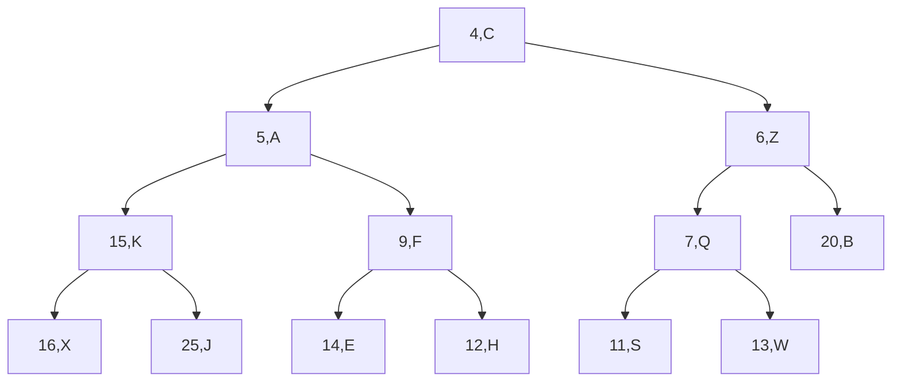

# Priority queues and binary heaps

A FIFO queue serves whoever has waited longest. Real systems often need something smarter: an
air-traffic controller lands the plane that is lowest on fuel, an operating system runs the most
urgent job, an emergency room treats the most critical patient. A **priority queue** is a collection
of prioritised elements that allows arbitrary insertion and removal of the element with *first
priority*. This lesson defines the ADT, examines two simple list implementations, and then builds
the data structure that makes it fast: the **binary heap**.

## 1. The priority queue ADT

Each element is stored with a **key** that determines its priority. By convention the element with
the **minimum key** is served first. Keys can be any objects that are mutually comparable with `<`.

| Operation | Meaning |
|---|---|
| `P.add(k, v)` | insert an item with key `k` and value `v` |
| `P.min()` | return (but do not remove) a tuple `(k, v)` with minimum key; error if empty |
| `P.remove_min()` | remove and return a `(k, v)` with minimum key; error if empty |
| `P.is_empty()`, `len(P)` | as usual |

Several items may share a key; then `min` may return any of them.

| Operation | Return | Priority queue |
|---|---|---|
| `P.add(5,'A')` | | {(5,A)} |
| `P.add(9,'C')` | | {(5,A), (9,C)} |
| `P.add(3,'B')` | | {(3,B), (5,A), (9,C)} |
| `P.add(7,'D')` | | {(3,B), (5,A), (7,D), (9,C)} |
| `P.min()` | (3,B) | unchanged |
| `P.remove_min()` | (3,B) | {(5,A), (7,D), (9,C)} |
| `P.remove_min()` | (5,A) | {(7,D), (9,C)} |
| `len(P)` | 2 | |

### The composition pattern

The book stores each key–value pair as a single `_Item` object — the **composition design pattern**
— with `__lt__` defined to compare keys only. This keeps key and value together as they move through
the data structure.

```python
class _Item:
    __slots__ = '_key', '_value'
    def __init__(self, k, v):
        self._key, self._value = k, v
    def __lt__(self, other):
        return self._key < other._key      # compare items based on their keys
```

## 2. Two list-based implementations

**Unsorted list.** `add` appends at the end: $O(1)$. `min` and `remove_min` must scan all items for
the smallest key: $O(n)$.

**Sorted list.** Keep items in nondecreasing key order. `min` and `remove_min` take the first item:
$O(1)$. `add` must walk to find the right spot (as in insertion sort): $O(n)$.

| Operation | Unsorted list | Sorted list |
|---|---|---|
| `len`, `is_empty` | $O(1)$ | $O(1)$ |
| `add` | $O(1)$ | $O(n)$ |
| `min` | $O(n)$ | $O(1)$ |
| `remove_min` | $O(n)$ | $O(1)$ |

One side is always linear. A heap balances both at $O(\log n)$.

## 3. The heap data structure

A **binary heap** is a binary tree $T$ storing items at its positions that satisfies two properties:

1. **Heap-order property** (relational): for every position $p$ other than the root, the key at $p$
   is **greater than or equal to** the key at $p$'s parent. Consequently keys along any root-to-leaf
   path are nondecreasing and **the minimum key is at the root**.
2. **Complete binary tree property** (structural): levels $0, 1, \ldots, h-1$ have the maximum
   possible number of nodes ($2^i$ at level $i$), and the nodes at level $h$ occupy the **leftmost**
   positions.



Note what heap order does **not** say: there is no ordering between siblings or between the left and
right subtrees. A heap is only *partially* sorted — just enough to find the minimum instantly.

### Height of a heap

> **Proposition.** A heap storing $n$ entries has height $h = \lfloor \log n \rfloor$.

*Justification.* Completeness gives $1 + 2 + 4 + \cdots + 2^{h-1} + 1 \le n \le 2^{h+1} - 1$, i.e.
$2^h \le n \le 2^{h+1} - 1$. Taking logs: $\log(n+1) - 1 \le h \le \log n$, and since $h$ is an
integer, $h = \lfloor \log n \rfloor$. ∎

So if we can do updates in time proportional to the height, they are $O(\log n)$.

## 4. Adding an item: up-heap bubbling

1. **Keep the tree complete:** place the new item at the position just beyond the rightmost node of
   the bottom level (or the leftmost position of a new level).
2. **Restore heap order:** compare the new item with its parent; if its key is smaller, swap. Repeat
   until the parent's key is $\le$ or the item reaches the root. This is **up-heap bubbling**
   (also *sift-up*, *swim*).

At most one swap per level: $O(\log n)$.

## 5. Removing the minimum: down-heap bubbling

The minimum is at the root, but removing the root would break the tree. Instead:

1. Copy the **last** item (rightmost at the bottom level) into the root and delete the last position
   — the tree stays complete.
2. **Restore heap order** by **down-heap bubbling** (*sift-down*, *sink*): at position $p$, find the
   child $c$ with the **smaller** key; if key($c$) < key($p$), swap and continue from $c$; otherwise
   stop.

Why the smaller child? After the swap, that child becomes the parent of the other child, so it must
not be larger than it. Again one swap per level: $O(\log n)$.

## 6. Array-based representation

A complete binary tree maps perfectly onto an array using level numbering (trees module): root at
index 0, and for the item at index $j$:

$$\text{left}(j) = 2j + 1, \qquad \text{right}(j) = 2j + 2, \qquad \text{parent}(j) = \lfloor (j - 1)/2 \rfloor.$$

Because the tree is complete, the $n$ items occupy exactly indices $0..n-1$ with **no gaps**. The
"last position" is simply index $n - 1$; adding is `append`, removing the last is `pop`. No node
objects, no references — this is why heaps are so fast in practice.

The heap drawn above is the array

`[(4,C), (5,A), (6,Z), (15,K), (9,F), (7,Q), (20,B), (16,X), (25,J), (14,E), (12,H), (11,S), (13,W)]`.

```python-run
class Empty(Exception):
    pass

class HeapPriorityQueue:
    """A min-oriented priority queue implemented with a binary heap."""
    class _Item:
        __slots__ = '_key', '_value'
        def __init__(self, k, v): self._key, self._value = k, v
        def __lt__(self, other): return self._key < other._key

    # ---- nonpublic behaviours ----
    def _parent(self, j): return (j - 1) // 2
    def _left(self, j): return 2 * j + 1
    def _right(self, j): return 2 * j + 2
    def _has_left(self, j): return self._left(j) < len(self._data)
    def _has_right(self, j): return self._right(j) < len(self._data)
    def _swap(self, i, j):
        self._data[i], self._data[j] = self._data[j], self._data[i]

    def _upheap(self, j):
        parent = self._parent(j)
        if j > 0 and self._data[j] < self._data[parent]:
            self._swap(j, parent)
            self._upheap(parent)                 # recur at position of parent

    def _downheap(self, j):
        if self._has_left(j):
            left = self._left(j)
            small_child = left                   # although right may be smaller
            if self._has_right(j):
                right = self._right(j)
                if self._data[right] < self._data[left]:
                    small_child = right
            if self._data[small_child] < self._data[j]:
                self._swap(j, small_child)
                self._downheap(small_child)      # recur at position of small child

    # ---- public behaviours ----
    def __init__(self): self._data = []
    def __len__(self): return len(self._data)
    def is_empty(self): return len(self._data) == 0
    def add(self, key, value):
        self._data.append(self._Item(key, value))
        self._upheap(len(self._data) - 1)        # upheap newly added position
    def min(self):
        if self.is_empty(): raise Empty('Priority queue is empty.')
        item = self._data[0]
        return (item._key, item._value)
    def remove_min(self):
        if self.is_empty(): raise Empty('Priority queue is empty.')
        self._swap(0, len(self._data) - 1)       # put minimum item at the end
        item = self._data.pop()                  # and remove it from the list
        self._downheap(0)                        # then fix new root
        return (item._key, item._value)

P = HeapPriorityQueue()
for k, v in [(5, 'A'), (9, 'C'), (3, 'B'), (7, 'D'), (1, 'E'), (8, 'F')]:
    P.add(k, v)
    print("add", (k, v), "->", [i._key for i in P._data])
while not P.is_empty():
    print("remove_min", P.remove_min(), "->", [i._key for i in P._data])
```

### Dry run: adding key 2 to `[4, 5, 6, 15, 9, 7, 20]`

Append → index 7 (parent index 3, key 15): 2 < 15, swap. Now at index 3 (parent 1, key 5): swap.
Now at index 1 (parent 0, key 4): swap. At the root: stop. Result
`[2, 4, 6, 5, 9, 7, 20, 15]` — three swaps, the height of the tree.

### Analysis

| Operation | Running time |
|---|---|
| `len(P)`, `P.is_empty()`, `P.min()` | $O(1)$ |
| `P.add(k, v)` | $O(\log n)$ (amortised if the array resizes) |
| `P.remove_min()` | $O(\log n)$ (amortised likewise) |

Space $O(n)$. A heap handles a sequence of $n$ mixed operations in $O(n \log n)$, versus $O(n^2)$ for
the list versions.

## 7. Bottom-up heap construction

Inserting $n$ items one by one costs $O(n \log n)$. If all keys are known in advance there is a
faster way — **bottom-up construction** (Floyd's *heapify*), which takes only $O(n)$.

**Idea:** every leaf is already a valid one-item heap. Working from the **last internal node back
to the root**, call down-heap on each position. When we reach position $j$, both its subtrees are
already heaps, so one down-heap makes the subtree rooted at $j$ a heap.

```python
def _heapify(self):
    start = self._parent(len(self) - 1)        # start at PARENT of last leaf
    for j in range(start, -1, -1):             # going to and including the root
        self._downheap(j)
```

**Why $O(n)$?** Down-heap from a node costs time proportional to its *height*, and most nodes are
near the bottom: about $n/2$ are leaves (height 0, no work), $n/4$ have height 1, $n/8$ height 2, …

$$\sum_{h \ge 0} \frac{n}{2^{h+1}} \cdot h = \frac{n}{2}\sum_{h\ge 0} \frac{h}{2^h} = \frac{n}{2} \cdot 2 = n.$$

The book gives a lovely combinatorial proof: associate with each internal node $p$ the path that
goes to its right child and then left as far as possible. These paths are edge-disjoint and have
length equal to the height of $p$, so the total down-heap work is at most the number of edges,
$n - 1$.

```python-run
import random
def downheap(a, j, n):
    while 2 * j + 1 < n:
        c = 2 * j + 1
        if c + 1 < n and a[c + 1] < a[c]:
            c += 1
        if a[c] < a[j]:
            a[j], a[c] = a[c], a[j]; j = c
        else:
            break
def heapify(a):
    for j in range((len(a) - 2) // 2, -1, -1):
        downheap(a, j, len(a))
def is_heap(a):
    return all(a[(i - 1) // 2] <= a[i] for i in range(1, len(a)))
a = [16, 15, 4, 12, 6, 7, 23, 20, 25, 9, 11, 17, 5, 8, 14]
heapify(a)
print(a, is_heap(a))
```

## 8. Python's `heapq` module

Python does not have a priority-queue class but provides heap functions that operate on a plain
`list` treated as a **min-heap**:

| Function | Meaning | Time |
|---|---|---|
| `heappush(L, e)` | push `e` | $O(\log n)$ |
| `heappop(L)` | pop and return the smallest | $O(\log n)$ |
| `heappushpop(L, e)` | push then pop (faster than separate calls) | $O(\log n)$ |
| `heapreplace(L, e)` | pop then push | $O(\log n)$ |
| `heapify(L)` | bottom-up construction in place | $O(n)$ |
| `nlargest(k, it)`, `nsmallest(k, it)` | $k$ extreme values | $O(n + k\log n)$ |

There is no max-heap variant in the classic API; push negated keys (or wrap in a reversing class).
For key–value pairs push tuples `(key, tiebreak, value)` — include a counter as a tie-breaker so
that values are never compared.

```python-run
import heapq, itertools
counter = itertools.count()
jobs = []
for prio, name in [(3, "write report"), (1, "fix outage"), (2, "review PR"), (1, "call customer")]:
    heapq.heappush(jobs, (prio, next(counter), name))    # counter keeps FIFO order among ties
while jobs:
    prio, _, name = heapq.heappop(jobs)
    print(prio, name)
print(heapq.nlargest(3, [5, 1, 9, 3, 7, 8]))
```

> [!INTERVIEW]
> "Top $k$ elements of a stream": keep a **min-heap of size $k$**; push each element and pop when
> the size exceeds $k$. Time $O(n \log k)$, space $O(k)$. For "$k$ smallest", use a max-heap (negated
> keys). Also know: building a heap is $O(n)$, not $O(n\log n)$, and a heap does **not** support
> efficient search for an arbitrary key ($O(n)$).

## 9. Pitfalls

- Swapping with *any* smaller child in down-heap rather than the **smaller** one.
- Starting heapify from index 0 and going up — it must go from the last parent **down to** the root.
- Off-by-one in parent/child formulas when using 1-based vs 0-based arrays.
- Expecting the heap array to be sorted, or iterating a heap list and assuming sorted order.

## 10. Summary

- Priority queue ADT: `add`, `min`, `remove_min`.
- Heap = complete binary tree + heap order; height $\lfloor \log n \rfloor$; stored in an array.
- `add` = append + up-heap; `remove_min` = swap root with last, pop, down-heap; both $O(\log n)$.
- Bottom-up construction: $O(n)$.

> **Source:** Goodrich, Tamassia & Goldwasser, *Data Structures and Algorithms in Python*, ch. 9.1–9.3.

## Check yourself

```quiz
[
  {"q": "In a min-heap, where is the maximum key guaranteed to be?",
   "options": ["At the root", "At the last array index", "At some leaf", "At the right child of the root"], "answer": 2,
   "explain": "Heap order only says parents <= children, so the maximum has no children: it is a leaf, but any leaf."},
  {"q": "Height of a heap with 1000 entries?",
   "options": ["9", "10", "500", "999"], "answer": 0,
   "explain": "floor(log2 1000) = 9, since 2^9 = 512 <= 1000 < 1024."},
  {"q": "In the array representation (root at 0), the parent of index 11 is at index...",
   "options": ["4", "5", "6", "10"], "answer": 1,
   "explain": "(11 - 1) // 2 = 5."},
  {"q": "During down-heap bubbling, the item is swapped with...",
   "options": ["its left child always", "its larger child", "its smaller child, if that child is smaller than the item", "its parent"], "answer": 2,
   "explain": "The smaller child becomes the parent of the other child, preserving heap order."},
  {"q": "Why is bottom-up heap construction O(n)?",
   "options": ["It skips half the levels", "Most nodes are near the bottom, and down-heap cost is proportional to node height; the heights sum to O(n)", "It sorts with radix sort", "It uses O(n) extra memory"], "answer": 1,
   "explain": "n/4 nodes do 1 step, n/8 do 2, ...: the series sums to about n."},
  {"q": "With an unsorted list implementation, remove_min costs...",
   "options": ["O(1)", "O(log n)", "O(n)", "O(n log n)"], "answer": 2,
   "explain": "Every item must be inspected to find the minimum."},
  {"q": "How do you get max-heap behaviour from Python's heapq?",
   "options": ["heapq.maxheap()", "Push negated keys", "Reverse the list after each push", "It is impossible"], "answer": 1,
   "explain": "heapq is a min-heap; negating keys reverses the order."}
]
```
