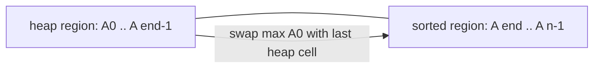

# PQ sorting, heap-sort and adaptable priority queues

> **Before this lesson:** You should know the priority queue ADT, the binary heap, up-heap and
> down-heap bubbling, and bottom-up construction, all from
> [Priority queues and binary heaps](#/lesson/dsa-foundations/heaps). Insertion sort, "in place"
> and "stable" come from [Using arrays](#/lesson/dsa-foundations/using-arrays).

## In plain words

This lesson does two things with the heap from the previous lesson.

First, it turns a priority queue into a way of sorting. The idea is almost embarrassingly
direct: put everything into a priority queue, then take everything out. Since a priority queue
always hands back the smallest item, the items come out in order. It is like sorting a hand of
cards by throwing them all on the table and repeatedly picking up the lowest one. How fast this
is depends entirely on how the priority queue is built, and using a heap gives **heap-sort**,
one of the classic fast sorting algorithms.

Second, it fixes a limitation. In a real emergency room a patient sometimes gets worse (their
priority must change) or goes home (they must be removed from the middle of the queue). A plain
heap cannot find a particular item quickly. Giving each item a "ticket" that records where it
currently sits in the heap solves that.

Why it matters for a job: heap-sort is the standard answer to "which sort is guaranteed
$O(n \log n)$ and needs no extra memory?". And updating priorities is exactly what the
shortest-path and network-design algorithms later in this track need.

## 1. Sorting with a priority queue

The abbreviation **PQ** means priority queue. The sorting recipe has two phases. Here `C` is the
collection to sort, held in a positional list, and `PriorityQueue` stands for any implementation
of the ADT:

```python
def pq_sort(C):
    """Sort a collection of elements stored in a positional list."""
    n = len(C)
    P = PriorityQueue()
    for j in range(n):                 # phase 1: move everything into the PQ
        element = C.delete(C.first())
        P.add(element, element)        # use element as key and value
    for j in range(n):                 # phase 2: pull them out in order
        (k, v) = P.remove_min()
        C.add_last(v)
```

Each item is used as both its own key and its value. The running time depends entirely on how
fast the priority queue's `add` and `remove_min` are, so each of the three implementations from
the previous lesson gives a different sorting algorithm, and two of them turn out to be
algorithms with names of their own.

### 1.1 Selection-sort: unsorted-list PQ

With an unsorted list, each `add` is $O(1)$, so phase 1 costs $O(n)$. In phase 2 every
`remove_min` scans whatever is left to *select* the smallest:
$O(n) + O(n-1) + \cdots + O(1) = O(n^2)$. This is **selection-sort**: repeatedly find the
smallest remaining item and move it to the output.

| stage | output collection C | unsorted priority queue P |
|---|---|---|
| start | (6, 1, 9, 3, 8, 2) | () |
| end of phase 1 | () | (6, 1, 9, 3, 8, 2) |
| phase 2, 1st removal | (1) | (6, 9, 3, 8, 2) |
| 2nd | (1, 2) | (6, 9, 3, 8) |
| 3rd | (1, 2, 3) | (6, 9, 8) |
| 4th | (1, 2, 3, 6) | (9, 8) |
| 5th | (1, 2, 3, 6, 8) | (9) |
| 6th | (1, 2, 3, 6, 8, 9) | () |

Selection-sort is $\Theta(n^2)$ on **every** input, even one that is already sorted, because the
scan for the smallest item must always look at everything that remains.

### 1.2 Insertion-sort: sorted-list PQ

With a sorted list, the work moves to phase 1: each `add` walks to the right place for the new
item, $O(1) + O(2) + \cdots + O(n) = O(n^2)$ in the worst case. Phase 2 takes the first item
$n$ times, $O(n)$ in all. This is the **insertion-sort** of the arrays module, and as there, its
best case (input already in order, with the walk starting from the back) is $O(n)$.

### 1.3 Heap-sort: heap PQ

With a heap, both phases are fast. Phase 1 is $n$ adds at $O(\log n)$ each, or $O(n)$ in total
using bottom-up construction. Phase 2 is $n$ calls of `remove_min`, each $O(\log n)$. Together:

> **Claim.** Even on its worst input, heap-sort needs only $O(n\log n)$ time for $n$ items.

For a million items that is roughly twenty million steps instead of a million million. And it is
a *guarantee* on every input, which the otherwise excellent quick-sort of a later lesson cannot
offer.

| PQ implementation | Phase 1 | Phase 2 | Name |
|---|---|---|---|
| unsorted list | $O(n)$ | $O(n^2)$ | selection-sort |
| sorted list | $O(n^2)$ | $O(n)$ | insertion-sort |
| heap | $O(n \log n)$ or $O(n)$ | $O(n \log n)$ | heap-sort |

## 2. In-place heap-sort

The recipe above uses a separate priority queue, which costs $O(n)$ extra memory. When the data
is in an array, heap-sort needs **no second structure at all**. A heap *is* an array, so let the
left part of the array be the heap and the right part hold the finished, sorted output, with the
boundary between them moving left one cell at a time.

To end up in **increasing** order, use a **max-heap** (each parent at least as large as its
children). That may look backwards, but it is what makes the trick work: the largest item
belongs in the last cell, and removing it from the heap frees exactly that cell.

1. **Phase 1: build.** Rearrange the array into a max-heap, ideally with bottom-up heapify in
   $O(n)$.
2. **Phase 2: extract.** For `end` going from `n-1` down to `1`: swap the largest item `A[0]`
   with `A[end]`, which puts it in its final place; treat the heap as now ending at
   `A[end-1]`; and bubble the new root down to restore heap order.



### Dry run on `[9, 7, 5, 2, 6, 4]` (already a max-heap after phase 1)

| step | array (heap \| sorted) |
|---|---|
| start | 9 7 5 2 6 4 \| |
| swap 9↔4, sift down | 7 6 5 2 4 \| 9 |
| swap 7↔4, sift down | 6 4 5 2 \| 7 9 |
| swap 6↔2, sift down | 5 4 2 \| 6 7 9 |
| swap 5↔2, sift down | 4 2 \| 5 6 7 9 |
| swap 4↔2 | 2 \| 4 5 6 7 9 |

```python-run
def heap_sort(A):
    n = len(A)
    def downheap(j, size):                       # max-heap sift-down within A[0:size]
        while 2 * j + 1 < size:
            c = 2 * j + 1
            if c + 1 < size and A[c + 1] > A[c]:
                c += 1                           # larger child
            if A[c] > A[j]:
                A[j], A[c] = A[c], A[j]
                j = c
            else:
                break
    for j in range(n // 2 - 1, -1, -1):          # phase 1: bottom-up heapify, O(n)
        downheap(j, n)
    for end in range(n - 1, 0, -1):              # phase 2: n - 1 extractions
        A[0], A[end] = A[end], A[0]
        downheap(0, end)
        print(A[:end], "|", A[end:])
    return A

heap_sort([7, 4, 8, 2, 5, 3, 9, 1])
```

**Reading this code.** The inner function `downheap(j, size)` is the sift-down of the previous
lesson with two changes: comparisons are reversed (it is a max-heap, so it looks for the
*larger* child), and it takes `size`, the current length of the heap region, so that it never
reaches into the sorted part. The first loop is bottom-up heapify, starting from the last node
that has a child, index `n // 2 - 1`. The second loop does the extractions and prints the heap
part and the sorted part after each one, so you can watch the bar move left: the first line
shows `[9]` on the right, the next `[8, 9]`, and so on.

### Properties of heap-sort

- **Time** $O(n \log n)$ in the worst case; **extra space** $O(1)$, since it works in place.
- **Not stable.** Swapping the root with the last cell of the heap moves an item a long way
  past others, which can change the relative order of items with equal keys.
- **Unfriendly to the processor's cache.** It hops between index $j$ and index $2j+1$, far
  apart in a large array, so in practice it is usually slower than a well-written quick-sort.
  It still earns its place as the safety net inside *introsort*, the algorithm behind C++'s
  standard sort, which starts with quick-sort and switches to heap-sort if things go badly.

> [!INTERVIEW]
> "Which sort is $O(n\log n)$ worst case **and** in place?" Heap-sort. Merge-sort needs $O(n)$
> extra space; quick-sort is $O(n^2)$ in the worst case. The trade-off: heap-sort is not stable.

## 3. Adaptable priority queues

The basic ADT lets us look at or remove only the minimum. Real situations need more. Picture a
standby list for a flight:

- a waiting passenger gives up and goes home: **remove an entry from the middle**;
- a passenger turns out to have priority status: **change the key** of an existing entry.

A heap cannot find a particular entry quickly; the only way is to look through the whole array,
$O(n)$. The fix is a **locator**: when an item is added, the priority queue hands the caller a
small token, like a cloakroom ticket. Later the caller presents the ticket to say *which* entry
should be updated or removed, and the queue can go straight to it. A priority queue with these
extra operations is called **adaptable**.

| New operation | Meaning |
|---|---|
| `loc = P.add(k, v)` | insert, returning a locator |
| `P.update(loc, k, v)` | give the entry behind `loc` a new key `k` and value `v` |
| `P.remove(loc)` | remove that entry and return its `(k, v)` |

### 3.1 Implementation

A `Locator` is the key-value item of the previous lesson with one extra field: its current
**index** in the heap array. The heap stores the locators themselves, and whenever two of them
are swapped, both index fields are rewritten. So a locator always knows where it is, and the
queue can find any entry in $O(1)$:

- **update(loc, k, v):** store the new key and value, then call `_bubble(j)`, which bubbles up
  if the new key is smaller than the parent's and bubbles down otherwise. $O(\log n)$.
- **remove(loc):** swap the entry with the last item, pop it off the end, then `_bubble(j)` the
  item that took its place. $O(\log n)$.

In the demo, four people are added, Bob's priority is changed from 9 to 1, Cat is removed, and
the rest are served in order: `(1, 'bob')`, `(5, 'ann')`, `(7, 'dan')`.

```python-run
class AdaptableHeapPriorityQueue:
    class Locator:
        __slots__ = '_key', '_value', '_index'
        def __init__(self, k, v, j): self._key, self._value, self._index = k, v, j
        def __lt__(self, other): return self._key < other._key

    def __init__(self): self._data = []
    def __len__(self): return len(self._data)
    def is_empty(self): return not self._data

    def _swap(self, i, j):
        d = self._data
        d[i], d[j] = d[j], d[i]
        d[i]._index, d[j]._index = i, j              # keep locators' indices up to date
    def _upheap(self, j):
        while j > 0 and self._data[j] < self._data[(j - 1) // 2]:
            self._swap(j, (j - 1) // 2); j = (j - 1) // 2
    def _downheap(self, j):
        n = len(self._data)
        while 2 * j + 1 < n:
            c = 2 * j + 1
            if c + 1 < n and self._data[c + 1] < self._data[c]: c += 1
            if self._data[c] < self._data[j]:
                self._swap(j, c); j = c
            else:
                break
    def _bubble(self, j):
        if j > 0 and self._data[j] < self._data[(j - 1) // 2]:
            self._upheap(j)
        else:
            self._downheap(j)

    def add(self, key, value):
        token = self.Locator(key, value, len(self._data))
        self._data.append(token)
        self._upheap(len(self._data) - 1)
        return token
    def min(self):
        return (self._data[0]._key, self._data[0]._value)
    def remove_min(self):
        return self.remove(self._data[0])
    def _check(self, loc):
        j = loc._index
        if not (0 <= j < len(self) and self._data[j] is loc):
            raise ValueError('Invalid locator')
        return j
    def update(self, loc, newkey, newval):
        j = self._check(loc)
        loc._key, loc._value = newkey, newval
        self._bubble(j)
    def remove(self, loc):
        j = self._check(loc)
        if j == len(self) - 1:
            self._data.pop()                         # item at last position: remove it directly
        else:
            self._swap(j, len(self) - 1)             # swap item to the last position
            self._data.pop()                         # remove it from the list
            self._bubble(j)                          # fix item displaced by the swap
        return (loc._key, loc._value)

P = AdaptableHeapPriorityQueue()
locs = {name: P.add(prio, name) for prio, name in [(5, "ann"), (9, "bob"), (3, "cat"), (7, "dan")]}
P.update(locs["bob"], 1, "bob")          # bob becomes most urgent
P.remove(locs["cat"])                    # cat leaves the queue
while not P.is_empty():
    print(P.remove_min())
```

| Operation | Running time |
|---|---|
| `len`, `is_empty`, `min` | $O(1)$ |
| `add(k, v)` | $O(\log n)$ |
| `update(loc, k, v)` | $O(\log n)$ |
| `remove(loc)` | $O(\log n)$ |
| `remove_min()` | $O(\log n)$ |

### 3.2 The lazy alternative with `heapq`

Python's `heapq` has no locators. The usual workaround is **lazy deletion**: do not remove or
change anything inside the heap. To "update" an entry, push a *new* entry with the new priority
and note in a dictionary which priority is the current one for that task. When popping, check
each entry against the dictionary and throw away any that are out of date (**stale**). The heap
may hold more entries than there are tasks, but every operation is still logarithmic. This is
how Dijkstra's shortest-path algorithm is usually written in Python (graphs module).

In the demo, task `b` is given priority 9 and then 1. The heap holds both entries; the entry
with 9 is skipped when it eventually surfaces, and the fourth `pop_task()` finds the heap
exhausted and returns `None`.

```python-run
import heapq
best = {}                 # current priority for each task
heap = []
def set_priority(task, prio):
    best[task] = prio
    heapq.heappush(heap, (prio, task))
def pop_task():
    while heap:
        prio, task = heapq.heappop(heap)
        if best.get(task) == prio:          # skip stale entries
            del best[task]
            return task, prio
    return None
set_priority("a", 5); set_priority("b", 9); set_priority("b", 1); set_priority("c", 3)
print(pop_task(), pop_task(), pop_task(), pop_task())
```

## 4. Dry run: how locators stay valid

The whole adaptable design rests on one invariant: **`loc._index` is always the position of `loc`
in the heap array.** Trace it. Add four items, keeping the locators:

| operation | heap array (key:name) | indices stored in the locators |
|---|---|---|
| `a = add(5, "ann")` | `5:ann` | ann 0 |
| `b = add(9, "bob")` | `5:ann 9:bob` | ann 0, bob 1 |
| `c = add(3, "cat")` | `3:cat 9:bob 5:ann` | cat 0, bob 1, ann 2 |
| `d = add(7, "dan")` | `3:cat 7:dan 5:ann 9:bob` | cat 0, dan 1, ann 2, bob 3 |

In the third step `cat` was appended at index 2 and swapped with its parent `ann`; `_swap` rewrote
**both** index fields. In the fourth, `dan` (index 3) swapped with its parent `bob` (index 1).

Now `update(b, 1, "bob")`: `bob` sits at index 3. Its key becomes 1, smaller than its parent's
(`dan`, 7), so `_bubble` chooses up-heap: swap with `dan` (index 1), then with `cat` (index 0).
Result: `1:bob 3:cat 5:ann 7:dan`, with locator indices bob 0, cat 1, ann 2, dan 3.

Then `remove(c)`: `cat` is at index 1. It is swapped with the last item (`dan`, index 3), popped,
and `_bubble(1)` is called on `dan`: its parent is `bob` (1 < 7), so no up-heap; it has no children
within the array, so no down-heap. Result: `1:bob 7:dan 5:ann`.

At no point did we *search* for an item — each locator led straight to its cell. That is the entire
difference between $O(\log n)$ and $O(n)$ for `update` and `remove`.

`_check` guards the invariant from the outside: a locator is valid only if its index is in range
**and** the array cell at that index is that very object (`self._data[j] is loc`). A locator whose
item was already removed fails the test, as does a locator from a different queue.

## 5. The three priority-queue sorts, side by side

All three sorts of section 1 can be run in place on an array, and counting their basic operations
shows the table's bounds concretely — including the fact that selection-sort is indifferent to the
input order while insertion-sort is not.

```python-run
import random
def selection_sort(A):
    A, comps = A[:], 0
    for i in range(len(A) - 1):
        m = i
        for j in range(i + 1, len(A)):          # scan the unsorted part for the minimum
            comps += 1
            if A[j] < A[m]: m = j
        A[i], A[m] = A[m], A[i]
    return A, comps
def insertion_sort(A):
    A, comps = A[:], 0
    for k in range(1, len(A)):
        cur, j = A[k], k
        while j > 0:
            comps += 1
            if A[j - 1] <= cur: break
            A[j] = A[j - 1]; j -= 1
        A[j] = cur
    return A, comps
def heap_sort(A):
    A, comps, n = A[:], 0, len(A)
    def down(j, size):
        nonlocal comps
        while 2 * j + 1 < size:
            c = 2 * j + 1
            if c + 1 < size:
                comps += 1
                if A[c + 1] > A[c]: c += 1
            comps += 1
            if A[c] > A[j]: A[j], A[c] = A[c], A[j]; j = c
            else: break
    for j in range(n // 2 - 1, -1, -1): down(j, n)
    for end in range(n - 1, 0, -1):
        A[0], A[end] = A[end], A[0]; down(0, end)
    return A, comps

n = 2000
inputs = {"random": random.sample(range(n), n), "sorted": list(range(n)), "reversed": list(range(n, 0, -1))}
print(f"{'input':9s} {'selection':>10} {'insertion':>10} {'heap':>8}   (comparisons, n = {n})")
for name, data in inputs.items():
    results = [f(data) for f in (selection_sort, insertion_sort, heap_sort)]
    assert all(r[0] == sorted(data) for r in results)
    print(f"{name:9s} {results[0][1]:>10} {results[1][1]:>10} {results[2][1]:>8}")
```

Selection-sort always performs exactly $n(n-1)/2 = 1{,}999{,}000$ comparisons. Insertion-sort
ranges from $n - 1$ (sorted) through about $n^2/4$ (random) to $n(n-1)/2$ (reversed). Heap-sort
stays between about 36,000 and 39,000 whatever the order — under the ceiling of
$2n\log_2 n \approx 44{,}000$ (at most two comparisons per level of each down-heap) — which is what
a worst-case $O(n\log n)$ guarantee looks like in numbers.

## 6. Pitfalls

- **Using a min-heap for in-place heap-sort.** It sorts into decreasing order, or forces a
  reversal at the end. Use a max-heap for increasing order.
- **Forgetting to shrink the heap before sifting down.** If the down-heap is allowed to reach
  the cell that received the maximum, that maximum is pulled straight back into the heap.
- **Not updating indices in `_swap`.** In an adaptable priority queue this silently corrupts
  every locator, and the failure shows up far from its cause.
- **Assuming a displaced item only moves down.** After `remove(loc)`, the item that filled the
  hole came from elsewhere in the tree and may need to go **up or down**; always call `_bubble`.
- **Forgetting stale entries with lazy deletion.** Every pop must check that the entry is
  current.

## 7. Summary

- Sorting with a priority queue: an unsorted list gives selection-sort ($O(n^2)$), a sorted
  list gives insertion-sort ($O(n^2)$), and a heap gives heap-sort ($O(n\log n)$).
- In-place heap-sort builds a max-heap, then repeatedly swaps the root to the end of the heap
  region and sifts down. It uses $O(1)$ extra space and is not stable.
- Locators, items that know their own index in the heap, give $O(\log n)$ `update` and `remove`.
- With `heapq`, the same effect is achieved by lazy deletion.

> **Source:** Goodrich, Tamassia & Goldwasser, *Data Structures and Algorithms in Python*, ch. 9.4–9.5.

## Glossary

- **PQ**: abbreviation for priority queue.
- **Selection-sort**: sorting by repeatedly selecting the smallest remaining item; always
  $\Theta(n^2)$.
- **Heap-sort**: sorting by building a heap and repeatedly removing its extreme item;
  $O(n \log n)$.
- **Max-heap**: a heap in which every parent is at least as large as its children.
- **In-place heap-sort**: heap-sort that uses the array itself as the heap.
- **Introsort**: a hybrid sort that starts as quick-sort and falls back to heap-sort.
- **Adaptable priority queue**: a priority queue that also supports updating and removing
  arbitrary entries.
- **Locator**: a token returned on insertion that records an entry's current place in the heap.
- **Lazy deletion**: leaving outdated entries in a heap and discarding them when they are
  popped.
- **Stale entry**: an entry that has been superseded by a newer one.

## Check yourself

```quiz
[
  {"q": "pq_sort with an unsorted-list priority queue is which algorithm?",
   "options": ["Insertion-sort", "Selection-sort", "Heap-sort", "Merge-sort"], "answer": 1,
   "explain": "Phase 2 repeatedly selects the minimum by scanning: O(n^2)."},
  {"q": "Worst-case running time of heap-sort?",
   "options": ["O(n)", "O(n log n)", "O(n^2)", "O(log n)"], "answer": 1,
   "explain": "n removals at O(log n) each, plus O(n) or O(n log n) to build."},
  {"q": "To sort an array into increasing order in place, heap-sort uses...",
   "options": ["a min-heap", "a max-heap", "two heaps", "a sorted list"], "answer": 1,
   "explain": "The maximum is repeatedly swapped to the end of the shrinking heap region."},
  {"q": "Is heap-sort stable?",
   "options": ["Yes", "No", "Only with bottom-up construction", "Only for integers"], "answer": 1,
   "explain": "Long-distance swaps between the root and the last cell can reorder equal keys."},
  {"q": "What extra information does a Locator store compared with a plain _Item?",
   "options": ["A pointer to its parent", "Its current index in the heap array", "A timestamp", "Its original key"], "answer": 1,
   "explain": "The index lets update/remove find the entry in O(1); _swap keeps it current."},
  {"q": "After replacing the removed entry with the last item in an adaptable heap, the displaced item...",
   "options": ["always needs down-heap", "always needs up-heap", "may need up-heap or down-heap", "never moves"], "answer": 2,
   "explain": "It came from a different subtree, so it can be smaller than its new parent or larger than its new children."},
  {"q": "Lazy deletion with heapq means...",
   "options": ["Deleting the heap when it is empty", "Pushing a new entry on update and skipping stale entries on pop", "Never popping", "Sorting the heap list"], "answer": 1,
   "explain": "Stale entries are detected against a side table of current priorities."}
]
```
