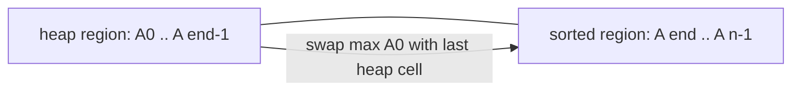

# PQ sorting, heap-sort and adaptable priority queues

A priority queue hands back its elements in key order — so any priority queue is secretly a sorting
algorithm. This lesson shows how the choice of PQ implementation yields **selection-sort**,
**insertion-sort** or **heap-sort**, develops the in-place version of heap-sort, and then extends
the heap to an **adaptable priority queue** that supports updating and removing arbitrary entries —
the structure Dijkstra's and Prim's algorithms need.

## 1. Sorting with a priority queue

```python
def pq_sort(C):
    """Sort a collection of elements stored in a positional list."""
    n = len(C)
    P = PriorityQueue()
    for j in range(n):                 # phase 1: move everything into the PQ
        element = C.delete(C.first())
        P.add(element, element)        # use element as key and value
    for j in range(n):                 # phase 2: pull them out in order
        (k, v) = P.remove_min()
        C.add_last(v)
```

The running time depends entirely on the PQ's `add` and `remove_min`.

### 1.1 Selection-sort: unsorted-list PQ

Phase 1 is $O(n)$ ($n$ constant-time adds). Phase 2 repeatedly *selects* the minimum from what is
left: $O(n) + O(n-1) + \cdots + O(1) = O(n^2)$.

| stage | output collection C | unsorted priority queue P |
|---|---|---|
| start | (6, 1, 9, 3, 8, 2) | () |
| end of phase 1 | () | (6, 1, 9, 3, 8, 2) |
| phase 2, 1st removal | (1) | (6, 9, 3, 8, 2) |
| 2nd | (1, 2) | (6, 9, 3, 8) |
| 3rd | (1, 2, 3) | (6, 9, 8) |
| 4th | (1, 2, 3, 6) | (9, 8) |
| 5th | (1, 2, 3, 6, 8) | (9) |
| 6th | (1, 2, 3, 6, 8, 9) | () |

Selection sort is $\Theta(n^2)$ on **every** input — the scan for the minimum never gets shorter.

### 1.2 Insertion-sort: sorted-list PQ

Phase 1 inserts each element into its sorted position: $O(1) + O(2) + \cdots + O(n) = O(n^2)$ worst
case. Phase 2 is $O(n)$. This is exactly insertion sort; its best case (already sorted input,
scanning from the back) is $O(n)$.

### 1.3 Heap-sort: heap PQ

Phase 1: $n$ adds at $O(\log n)$ each — or $O(n)$ using bottom-up construction. Phase 2: $n$
`remove_min` calls, the $j$-th costing $O(\log(n - j + 1))$. Total:

> **Proposition.** Even on its worst input, heap-sort needs only $O(n\log n)$ time for $n$ items.

That is dramatically better than $O(n^2)$, and it is a *guarantee*, unlike quick-sort's.

| PQ implementation | Phase 1 | Phase 2 | Name |
|---|---|---|---|
| unsorted list | $O(n)$ | $O(n^2)$ | selection-sort |
| sorted list | $O(n^2)$ | $O(n)$ | insertion-sort |
| heap | $O(n \log n)$ or $O(n)$ | $O(n \log n)$ | heap-sort |

## 2. In-place heap-sort

If the collection is an array, heap-sort needs **no auxiliary structure**: use the left part of the
array as the heap and the right part as the sorted output.

To sort into **increasing** order, use a **max-heap** (parent key $\ge$ children's keys):

1. **Phase 1 — build.** Turn the array into a max-heap. Either grow the heap one element at a time
   (the heap occupies `A[0..i-1]`, add `A[i]` with up-heap), or better, heapify bottom-up in $O(n)$.
2. **Phase 2 — extract.** For `end = n-1` down to `1`: swap the maximum `A[0]` with `A[end]` (it is
   now in its final place), shrink the heap to `A[0..end-1]`, and down-heap the new root.



### Dry run on `[9, 7, 5, 2, 6, 4]` (already a max-heap after phase 1)

| step | array (heap \| sorted) |
|---|---|
| start | 9 7 5 2 6 4 \| |
| swap 9↔4, sift down | 7 6 5 2 4 \| 9 |
| swap 7↔4, sift down | 6 4 5 2 \| 7 9 |
| swap 6↔2, sift down | 5 4 2 \| 6 7 9 |
| swap 5↔2, sift down | 4 2 \| 5 6 7 9 |
| swap 4↔2 | 2 \| 4 5 6 7 9 |

```python-run
def heap_sort(A):
    n = len(A)
    def downheap(j, size):                       # max-heap sift-down within A[0:size]
        while 2 * j + 1 < size:
            c = 2 * j + 1
            if c + 1 < size and A[c + 1] > A[c]:
                c += 1                           # larger child
            if A[c] > A[j]:
                A[j], A[c] = A[c], A[j]
                j = c
            else:
                break
    for j in range(n // 2 - 1, -1, -1):          # phase 1: bottom-up heapify, O(n)
        downheap(j, n)
    for end in range(n - 1, 0, -1):              # phase 2: n - 1 extractions
        A[0], A[end] = A[end], A[0]
        downheap(0, end)
        print(A[:end], "|", A[end:])
    return A

heap_sort([7, 4, 8, 2, 5, 3, 9, 1])
```

### Properties of heap-sort

- **Time** $O(n \log n)$ worst case; **extra space** $O(1)$ (in place).
- **Not stable**: swapping the root with the last heap cell can reorder equal keys.
- Poor cache locality (jumps between index $j$ and $2j+1$), so in practice it is usually slower than
  a well-implemented quick-sort — but it is the fallback inside *introsort* when quick-sort's
  recursion gets too deep.

> [!INTERVIEW]
> "Which sort is $O(n\log n)$ worst case **and** in place?" Heap-sort. Merge-sort needs $O(n)$
> extra space; quick-sort is $O(n^2)$ in the worst case. The trade-off: heap-sort is not stable.

## 3. Adaptable priority queues

The basic ADT only lets us look at or remove the minimum. Real scenarios need more:

- a standby passenger gives up and leaves the queue — **remove an arbitrary entry**;
- a passenger finds a frequent-flyer card — **update the key (priority)** of an existing entry.

Finding an arbitrary entry in a heap takes $O(n)$ (a heap is not a search structure). The fix is a
**locator**: when an item is added, the PQ returns a small token object to the caller. Later the
caller hands the locator back to say *which* entry to update or remove.

| New operation | Meaning |
|---|---|
| `loc = P.add(k, v)` | insert, returning a locator |
| `P.update(loc, k, v)` | give the entry behind `loc` a new key `k` and value `v` |
| `P.remove(loc)` | remove that entry and return its `(k, v)` |

### 3.1 Implementation

A `Locator` is an `_Item` with one extra field: its current **index** in the heap array. Whenever
two items are swapped, their index fields are updated. With the index available in $O(1)$:

- **update(loc, k, v):** set the new key/value, then `_bubble(j)`: if the new key is smaller than
  the parent's, up-heap; otherwise down-heap. $O(\log n)$.
- **remove(loc):** swap the item with the last item, pop it, then `_bubble(j)` on the item that took
  its place. $O(\log n)$.

```python-run
class AdaptableHeapPriorityQueue:
    class Locator:
        __slots__ = '_key', '_value', '_index'
        def __init__(self, k, v, j): self._key, self._value, self._index = k, v, j
        def __lt__(self, other): return self._key < other._key

    def __init__(self): self._data = []
    def __len__(self): return len(self._data)
    def is_empty(self): return not self._data

    def _swap(self, i, j):
        d = self._data
        d[i], d[j] = d[j], d[i]
        d[i]._index, d[j]._index = i, j              # keep locators' indices up to date
    def _upheap(self, j):
        while j > 0 and self._data[j] < self._data[(j - 1) // 2]:
            self._swap(j, (j - 1) // 2); j = (j - 1) // 2
    def _downheap(self, j):
        n = len(self._data)
        while 2 * j + 1 < n:
            c = 2 * j + 1
            if c + 1 < n and self._data[c + 1] < self._data[c]: c += 1
            if self._data[c] < self._data[j]:
                self._swap(j, c); j = c
            else:
                break
    def _bubble(self, j):
        if j > 0 and self._data[j] < self._data[(j - 1) // 2]:
            self._upheap(j)
        else:
            self._downheap(j)

    def add(self, key, value):
        token = self.Locator(key, value, len(self._data))
        self._data.append(token)
        self._upheap(len(self._data) - 1)
        return token
    def min(self):
        return (self._data[0]._key, self._data[0]._value)
    def remove_min(self):
        return self.remove(self._data[0])
    def _check(self, loc):
        j = loc._index
        if not (0 <= j < len(self) and self._data[j] is loc):
            raise ValueError('Invalid locator')
        return j
    def update(self, loc, newkey, newval):
        j = self._check(loc)
        loc._key, loc._value = newkey, newval
        self._bubble(j)
    def remove(self, loc):
        j = self._check(loc)
        if j == len(self) - 1:
            self._data.pop()                         # item at last position; just remove it
        else:
            self._swap(j, len(self) - 1)             # swap item to the last position
            self._data.pop()                         # remove it from the list
            self._bubble(j)                          # fix item displaced by the swap
        return (loc._key, loc._value)

P = AdaptableHeapPriorityQueue()
locs = {name: P.add(prio, name) for prio, name in [(5, "ann"), (9, "bob"), (3, "cat"), (7, "dan")]}
P.update(locs["bob"], 1, "bob")          # bob becomes most urgent
P.remove(locs["cat"])                    # cat leaves the queue
while not P.is_empty():
    print(P.remove_min())
```

| Operation | Running time |
|---|---|
| `len`, `is_empty`, `min` | $O(1)$ |
| `add(k, v)` | $O(\log n)$ |
| `update(loc, k, v)` | $O(\log n)$ |
| `remove(loc)` | $O(\log n)$ |
| `remove_min()` | $O(\log n)$ |

### 3.2 The lazy alternative with `heapq`

Python's `heapq` has no locators. The standard workaround is **lazy deletion**: to "update" an entry,
push a *new* entry with the new priority and remember (in a dict) which entry is current; when
popping, skip entries that are stale. The heap may hold more than $n$ entries, but each operation
remains logarithmic. This is how Dijkstra's algorithm is usually written in Python (graphs module).

```python-run
import heapq
best = {}                 # current priority for each task
heap = []
def set_priority(task, prio):
    best[task] = prio
    heapq.heappush(heap, (prio, task))
def pop_task():
    while heap:
        prio, task = heapq.heappop(heap)
        if best.get(task) == prio:          # skip stale entries
            del best[task]
            return task, prio
    return None
set_priority("a", 5); set_priority("b", 9); set_priority("b", 1); set_priority("c", 3)
print(pop_task(), pop_task(), pop_task(), pop_task())
```

## 4. Dry run: how locators stay valid

The whole adaptable design rests on one invariant: **`loc._index` is always the position of `loc`
in the heap array.** Trace it. Add four items, keeping the locators:

| operation | heap array (key:name) | indices stored in the locators |
|---|---|---|
| `a = add(5, "ann")` | `5:ann` | ann 0 |
| `b = add(9, "bob")` | `5:ann 9:bob` | ann 0, bob 1 |
| `c = add(3, "cat")` | `3:cat 9:bob 5:ann` | cat 0, bob 1, ann 2 |
| `d = add(7, "dan")` | `3:cat 7:dan 5:ann 9:bob` | cat 0, dan 1, ann 2, bob 3 |

In the third step `cat` was appended at index 2 and swapped with its parent `ann`; `_swap` rewrote
**both** index fields. In the fourth, `dan` (index 3) swapped with its parent `bob` (index 1).

Now `update(b, 1, "bob")`: `bob` sits at index 3. Its key becomes 1, smaller than its parent's
(`dan`, 7), so `_bubble` chooses up-heap: swap with `dan` (index 1), then with `cat` (index 0).
Result: `1:bob 3:cat 5:ann 7:dan`, with locator indices bob 0, cat 1, ann 2, dan 3.

Then `remove(c)`: `cat` is at index 1. It is swapped with the last item (`dan`, index 3), popped,
and `_bubble(1)` is called on `dan`: its parent is `bob` (1 < 7), so no up-heap; it has no children
within the array, so no down-heap. Result: `1:bob 7:dan 5:ann`.

At no point did we *search* for an item — each locator led straight to its cell. That is the entire
difference between $O(\log n)$ and $O(n)$ for `update` and `remove`.

`_check` guards the invariant from the outside: a locator is valid only if its index is in range
**and** the array cell at that index is that very object (`self._data[j] is loc`). A locator whose
item was already removed fails the test, as does a locator from a different queue.

## 5. The three priority-queue sorts, side by side

All three sorts of section 1 can be run in place on an array, and counting their basic operations
shows the table's bounds concretely — including the fact that selection-sort is indifferent to the
input order while insertion-sort is not.

```python-run
import random
def selection_sort(A):
    A, comps = A[:], 0
    for i in range(len(A) - 1):
        m = i
        for j in range(i + 1, len(A)):          # scan the unsorted part for the minimum
            comps += 1
            if A[j] < A[m]: m = j
        A[i], A[m] = A[m], A[i]
    return A, comps
def insertion_sort(A):
    A, comps = A[:], 0
    for k in range(1, len(A)):
        cur, j = A[k], k
        while j > 0:
            comps += 1
            if A[j - 1] <= cur: break
            A[j] = A[j - 1]; j -= 1
        A[j] = cur
    return A, comps
def heap_sort(A):
    A, comps, n = A[:], 0, len(A)
    def down(j, size):
        nonlocal comps
        while 2 * j + 1 < size:
            c = 2 * j + 1
            if c + 1 < size:
                comps += 1
                if A[c + 1] > A[c]: c += 1
            comps += 1
            if A[c] > A[j]: A[j], A[c] = A[c], A[j]; j = c
            else: break
    for j in range(n // 2 - 1, -1, -1): down(j, n)
    for end in range(n - 1, 0, -1):
        A[0], A[end] = A[end], A[0]; down(0, end)
    return A, comps

n = 2000
inputs = {"random": random.sample(range(n), n), "sorted": list(range(n)), "reversed": list(range(n, 0, -1))}
print(f"{'input':9s} {'selection':>10} {'insertion':>10} {'heap':>8}   (comparisons, n = {n})")
for name, data in inputs.items():
    results = [f(data) for f in (selection_sort, insertion_sort, heap_sort)]
    assert all(r[0] == sorted(data) for r in results)
    print(f"{name:9s} {results[0][1]:>10} {results[1][1]:>10} {results[2][1]:>8}")
```

Selection-sort always performs exactly $n(n-1)/2 = 1{,}999{,}000$ comparisons. Insertion-sort
ranges from $n - 1$ (sorted) through about $n^2/4$ (random) to $n(n-1)/2$ (reversed). Heap-sort
stays between about 36,000 and 39,000 whatever the order — under the ceiling of
$2n\log_2 n \approx 44{,}000$ (at most two comparisons per level of each down-heap) — which is what
a worst-case $O(n\log n)$ guarantee looks like in numbers.

## 6. Pitfalls

- In-place heap-sort with a *min*-heap sorts into decreasing order (or forces a final reversal).
- Forgetting to shrink the heap boundary before sifting down — the just-placed maximum gets pulled
  back in.
- In an adaptable PQ, forgetting to update indices in `_swap` silently corrupts every locator.
- After `remove(loc)`, the displaced item may need to go **up or down** — always `_bubble`.

## 7. Summary

- `pq_sort` + unsorted list = selection-sort ($O(n^2)$); + sorted list = insertion-sort ($O(n^2)$);
  + heap = heap-sort ($O(n\log n)$).
- In-place heap-sort: build a max-heap, then repeatedly swap the root to the end and sift down.
- Locators (items that know their heap index) give $O(\log n)$ `update` and `remove`.

> **Source:** Goodrich, Tamassia & Goldwasser, *Data Structures and Algorithms in Python*, ch. 9.4–9.5.

## Check yourself

```quiz
[
  {"q": "pq_sort with an unsorted-list priority queue is which algorithm?",
   "options": ["Insertion-sort", "Selection-sort", "Heap-sort", "Merge-sort"], "answer": 1,
   "explain": "Phase 2 repeatedly selects the minimum by scanning: O(n^2)."},
  {"q": "Worst-case running time of heap-sort?",
   "options": ["O(n)", "O(n log n)", "O(n^2)", "O(log n)"], "answer": 1,
   "explain": "n removals at O(log n) each, plus O(n) or O(n log n) to build."},
  {"q": "To sort an array into increasing order in place, heap-sort uses...",
   "options": ["a min-heap", "a max-heap", "two heaps", "a sorted list"], "answer": 1,
   "explain": "The maximum is repeatedly swapped to the end of the shrinking heap region."},
  {"q": "Is heap-sort stable?",
   "options": ["Yes", "No", "Only with bottom-up construction", "Only for integers"], "answer": 1,
   "explain": "Long-distance swaps between the root and the last cell can reorder equal keys."},
  {"q": "What extra information does a Locator store compared with a plain _Item?",
   "options": ["A pointer to its parent", "Its current index in the heap array", "A timestamp", "Its original key"], "answer": 1,
   "explain": "The index lets update/remove find the entry in O(1); _swap keeps it current."},
  {"q": "After replacing the removed entry with the last item in an adaptable heap, the displaced item...",
   "options": ["always needs down-heap", "always needs up-heap", "may need up-heap or down-heap", "never moves"], "answer": 2,
   "explain": "It came from a different subtree, so it can be smaller than its new parent or larger than its new children."},
  {"q": "Lazy deletion with heapq means...",
   "options": ["Deleting the heap when it is empty", "Pushing a new entry on update and skipping stale entries on pop", "Never popping", "Sorting the heap list"], "answer": 1,
   "explain": "Stale entries are detected against a side table of current priorities."}
]
```
