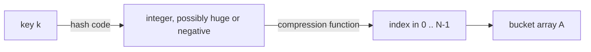

# Maps and hash functions

> **Before this lesson:** You should be able to use a Python dictionary (`d[k] = v`, `d[k]`,
> `k in d`), know why reading `A[i]` from an array is $O(1)$
> ([Low-level arrays](#/lesson/dsa-foundations/low-level-arrays)), know the modulo operator `%`
> ([Using arrays](#/lesson/dsa-foundations/using-arrays)), and know what mutable and immutable
> mean (the low-level arrays lesson again).

## In plain words

A **map** stores pairs: a **key** that you look things up by, and a **value** that you get
back. A paper dictionary is a map from words to definitions; a phone's contact list is a map
from names to numbers. Each key appears at most once.

The question of this lesson is how to make lookups instant even with millions of keys. The
answer is a cloakroom trick. Imagine a cloakroom with 100 numbered hooks. A slow attendant
would hang coats anywhere and search every hook when you come back. A clever one computes a
hook number *from your name* by some fixed rule (say, add up the letters and keep the last two
digits) and hangs your coat there. When you return, the same rule gives the same hook, and the
attendant walks straight to it. The rule is called a **hash function**, and a table organised
this way is a **hash table**.

Why it matters for a job: Python's `dict` and `set` are hash tables, and so are their
equivalents in every mainstream language. "Use a hash map" is the single most common way to turn
a slow interview solution into a fast one, and "how does a hash map work?" is a standard
question in its own right.

## 1. The map ADT

A map is also called an **associative array**: it behaves like an array, except that the
"index" can be any key at all, such as a student number, a web address or a pair of coordinates.
Python's `dict` is the language's built-in map, and Python itself leans on it everywhere, from
storing the variables of a module to holding parsed JSON data.

A map `M` has five core operations, written here in Python's `dict` syntax. The names in
parentheses are the hook methods that Python calls for each piece of syntax:

| Operation | Meaning |
|---|---|
| `M[k]` | return the value associated with key `k`; raise `KeyError` if absent (`__getitem__`) |
| `M[k] = v` | associate `v` with `k`, replacing any existing value (`__setitem__`) |
| `del M[k]` | remove the item with key `k`; `KeyError` if absent (`__delitem__`) |
| `len(M)` | number of items |
| `iter(M)` | iterate over the keys |

Derived conveniences: `k in M`, `M.get(k, d)`, `M.setdefault(k, d)`, `M.pop(k, d)`, `M.popitem()`,
`M.clear()`, `M.keys()`, `M.values()`, `M.items()`, `M.update(M2)`, `M == M2`.

### 1.1 Application: counting word frequencies

A classic use of a map is counting: map each word of a text to the number of times it occurs.
In the code, `freq.get(word, 0)` returns the count so far, or 0 if the word has not been seen
yet, so the line `freq[word] = 1 + freq.get(word, 0)` works for new and old words alike. The
loop afterwards walks over the (word, count) pairs to find the largest count; here the answer
is `it`, the first of several words that occur 4 times.

```python-run
text = """it was the best of times it was the worst of times it was the age of wisdom
it was the age of foolishness"""
freq = {}
for piece in text.lower().split():
    word = ''.join(c for c in piece if c.isalpha())
    if word:
        freq[word] = 1 + freq.get(word, 0)      # get avoids a KeyError for new words

max_word, max_count = '', 0
for (w, c) in freq.items():
    if c > max_count:
        max_word, max_count = w, c
print('The most frequent word is', max_word, 'with', max_count, 'occurrences')
print(sorted(freq.items(), key=lambda kv: -kv[1])[:5])
```

### 1.2 The MutableMapping abstract base class

If you write your own map class, you do not have to write all of those conveniences again.
Python's `collections.abc.MutableMapping` is an abstract base class (introduced in the trees
module) that implements every derived method (`get`, `items`, `__contains__`, `update` and the
rest) in terms of the five core ones. A new map class supplies only `__getitem__`,
`__setitem__`, `__delitem__`, `__len__` and `__iter__`, and inherits everything else. For
example, `__contains__`, the hook behind `k in M`, amounts to "try to look the key up, and see
whether that fails":

```python
def __contains__(self, k):
    try:
        self[k]
        return True
    except KeyError:
        return False
```

The map classes in this module all follow the same pattern: inherit from `MutableMapping`, and
keep each key-value pair in a small `_Item` object, as the heap did.

### 1.3 A simple unsorted map

The most direct implementation keeps the items in an unsorted list and searches the list for
every operation. It is the "slow attendant" of the cloakroom. It is worth reading because every
later map has the same five methods with cleverer insides.

```python-run
from collections.abc import MutableMapping

class UnsortedTableMap(MutableMapping):
    """Map implementation using an unordered list."""
    class _Item:
        __slots__ = '_key', '_value'
        def __init__(self, k, v): self._key, self._value = k, v

    def __init__(self):
        self._table = []
    def __getitem__(self, k):
        for item in self._table:
            if k == item._key:
                return item._value
        raise KeyError('Key Error: ' + repr(k))
    def __setitem__(self, k, v):
        for item in self._table:
            if k == item._key:                 # found a match:
                item._value = v                # reassign value
                return
        self._table.append(self._Item(k, v))   # did not find match for key
    def __delitem__(self, k):
        for j in range(len(self._table)):
            if k == self._table[j]._key:
                self._table.pop(j)
                return
        raise KeyError('Key Error: ' + repr(k))
    def __len__(self):
        return len(self._table)
    def __iter__(self):
        for item in self._table:
            yield item._key

M = UnsortedTableMap()
M['K'] = 2; M['B'] = 4; M['U'] = 2; M['B'] = 7
print(len(M), M['B'], M.get('F', 'absent'), 'K' in M, list(M.items()))   # inherited: get, in, items
```

The test stores K, B and U, then stores B again with a new value, which replaces the old one
instead of adding a fourth item. It prints
`3 7 absent True [('K', 2), ('B', 7), ('U', 2)]`. Note that `get`, `in` and `items` were never
written in our class; they came from `MutableMapping`.

Each of `__getitem__`, `__setitem__` and `__delitem__` is $O(n)$, because each may scan the
whole list. That is fine for a handful of items and hopeless for a million.

## 2. Hash tables: the idea

Start with an easy special case. If the keys were whole numbers from $0$ to $N-1$, a map could
be a plain array of length $N$, with the value for key $k$ stored at index $k$. Such an array
is called a **lookup table**, and every operation on it is $O(1)$, because indexing an array is.

Two obstacles stand between that and a general map. Keys may not be numbers at all (strings,
tuples). And even numeric keys may spread over a range vastly larger than the number of items:
500 students with 9-digit student numbers would need an array of a billion cells. A **hash
function** $h$ removes both obstacles. It converts any key $k$ into a whole number $h(k)$
between $0$ and $N-1$, and the item $(k, v)$ is stored in cell $A[h(k)]$ of an array of length
$N$. The cells are called **buckets**, and the array a **bucket array**. The notation
$[0, N-1]$ used below means "the whole numbers from 0 to $N - 1$ inclusive".



When two different keys are sent to the same bucket, that is a **collision**. Collisions cannot
be ruled out: there are more possible keys than buckets, so some keys must share (if you put 11
letters into 10 pigeonholes, some hole gets two; this is called the pigeonhole principle). So a
hash table needs two things: a hash function that makes collisions rare, and a plan for
handling the ones that happen (the next lesson). A hash function is **good** if it spreads keys
evenly over the buckets and is quick to compute.

The function is computed in two stages:

1. the **hash code** turns a key into a whole number, of any size, possibly negative;
2. the **compression function** squeezes that number into the range $[0, N - 1]$.

Keeping the stages separate means the hash code does not depend on the size of the table, so
the table can be made larger later without changing how keys are turned into numbers.

## 3. Hash codes

### 3.1 Treating the bit representation as an integer

Everything in a computer is stored as bits. For a value that fits in one machine word (a small
whole number, a floating-point number), its bits, read as a whole number, can serve directly as
the hash code. If the value has more bits than the hash code may have (a 64-bit value when hash
codes are 32 bits), the pieces must be combined, for example by adding the upper and lower
halves or by taking their **exclusive-or** (XOR, written `^` in Python: a bit-by-bit operation
that gives 1 where the two inputs differ).

### 3.2 Polynomial hash codes

For objects of varying length such as strings, adding up or XOR-ing the parts is a poor choice,
because it ignores the *order* of the characters: `"stop"`, `"tops"`, `"pots"` and `"spot"`
would all get the same code. A better code makes each character's contribution depend on its
position. Treat the string as a sequence of numbers $(x_0, x_1, \ldots, x_{n-1})$, one per
character, pick a constant $a \ne 1$, and compute

$$x_0 a^{n-1} + x_1 a^{n-2} + \cdots + x_{n-2} a + x_{n-1}.$$

This is a polynomial in $a$, hence the name. It is like reading the characters as the digits of
a number written in base $a$. It can be computed with one multiplication and one addition per
character by starting at 0 and repeating "multiply by $a$, add the next character":
$x_{n-1} + a(x_{n-2} + a(x_{n-3} + \cdots + a(x_1 + a x_0)\cdots))$. This arrangement is called
**Horner's rule**, and section 5 works an example by hand. The running value quickly becomes
too large for a machine word; the excess high bits are discarded (the arithmetic wraps round
modulo $2^{32}$ or $2^{64}$), which does no harm. Experiments on tens of thousands of English
words have found that multipliers such as $a = 33, 37, 39$ or $41$ leave only a handful of
words sharing a code.

### 3.3 Cyclic-shift hash codes

A variant replaces the multiplication by a **cyclic shift**: slide the bits of the running
value a fixed number of places to the left, and bring the bits that fall off the left end back
in on the right. It is very fast and also makes position matter. On large word lists, a shift of
5 bits has been found to give the fewest collisions. In the code, `<<` and `>>` shift bits left
and right, `&` keeps only the bits allowed by the mask, and `|` combines the two parts.

```python
def hash_code(s):
    mask = (1 << 32) - 1                 # limit to 32-bit integers
    h = 0
    for character in s:
        h = (h << 5 & mask) | (h >> 27)  # 5-bit cyclic shift of running sum
        h += ord(character)              # add in value of next character
    return h
```

```python-run
def sum_code(s): return sum(ord(c) for c in s)
def poly_code(s, a=33):
    h = 0
    for c in s:
        h = (h * a + ord(c)) & 0xFFFFFFFF       # Horner's rule, 32-bit wraparound
    return h
def cyclic_code(s):
    mask, h = (1 << 32) - 1, 0
    for c in s:
        h = (h << 5 & mask) | (h >> 27)
        h += ord(c)
    return h
for w in ["stop", "tops", "pots", "spot"]:
    print(f"{w}: sum={sum_code(w)}  poly={poly_code(w)}  cyclic={cyclic_code(w)}")
```

The demo shows the four anagrams getting the same `sum` code (454) but four different
polynomial codes and four different cyclic-shift codes.

### 3.4 Hash codes in Python

The built-in function `hash(x)` returns a whole-number hash code for `x`. A value that `hash`
accepts is called **hashable**. The rules worth knowing:

- Among the built-in types, only **immutable** ones are hashable: `int`, `float`, `str`,
  `tuple`, `frozenset`. `hash([1, 2])` raises `TypeError`. The reason is the cloakroom rule: if
  a key could change after being stored, the rule would now point to a different hook, and the
  item would be lost.
- **Equal objects must have equal hash codes**: if `x == y` then `hash(x) == hash(y)`. Hence
  `hash(5) == hash(5.0)`.
- Instances of user classes are hashable by default (based on identity). If you define `__eq__` you
  should define a consistent `__hash__`, typically hashing a tuple of the relevant fields:

```python
def __hash__(self):
    return hash((self._red, self._green, self._blue))
```

- The hash of a string is **different each time Python starts**, because a random value (a
  "salt") is mixed in. This defends servers against attackers who would otherwise prepare
  thousands of keys that all collide, turning every dictionary operation from $O(1)$ into
  $O(n)$.

## 4. Compression functions

A hash code can be any whole number, so the second stage must squeeze it into $[0, N-1]$.

### 4.1 The division method

Take the remainder on division by the table size:

$$i \bmod N.$$

It is as easy as can be, but if $N$ is not a prime number, regularities in the hash codes turn
into regular collisions. For example, take the codes $200, 205, 210, \ldots, 600$ and
$N = 100$: the codes 200, 300, 400, 500 and 600 all land in bucket 0, and similarly throughout.
With $N = 101$, a prime, there are no collisions at all. Even a prime $N$ cannot help if many
codes differ by exact multiples of $N$.

### 4.2 The MAD method

The **Multiply-Add-and-Divide** method, MAD for short, scrambles the code before taking the
remainder, which destroys such regularities:

$$[(a i + b) \bmod p] \bmod N,$$

where $p$ is a prime number larger than $N$, and $a$ (from 1 to $p-1$) and $b$ (from 0 to
$p-1$) are chosen at random when the table is created. This comes close to the ideal, in which
any two different keys collide with probability $1/N$, the same as if buckets were assigned by
rolling an $N$-sided die. The hash map built in the next lesson uses exactly this:

```python
def _hash_function(self, k):
    return (hash(k) * self._scale + self._shift) % self._prime % len(self._table)
```

with `prime = 109345121`, `scale = 1 + randrange(prime - 1)`, `shift = randrange(prime)`.

```python-run
import random
codes = list(range(200, 601, 5))
def collisions(indices):
    return len(indices) - len(set(indices))
p = 109345121
a, b = 1 + random.randrange(p - 1), random.randrange(p)
print("division, N=100:", collisions([c % 100 for c in codes]))
print("division, N=101:", collisions([c % 101 for c in codes]))
print("MAD,      N=100:", collisions([((a * c + b) % p) % 100 for c in codes]))
```

> [!INTERVIEW]
> "How does a hash map work?" in four sentences: a hash function turns the key into an array index
> (hash code, then compression); the item is stored in that bucket; collisions are resolved by
> chaining or open addressing; the table is resized when the load factor gets too high, which keeps
> expected $O(1)$ operations. Then mention the worst case $O(n)$ and the requirement that keys be
> immutable with consistent `__eq__`/`__hash__`.

## 5. Worked example: hashing a string by hand, then measuring collisions

**Horner's rule on `"cat"` with $a = 33$.** The character codes are `c` = 99, `a` = 97, `t` = 116.
The polynomial is $99 \cdot 33^2 + 97 \cdot 33 + 116$; Horner's rule evaluates it left to right
with one multiplication and one addition per character:

| step | character | computation | running value |
|---|---|---|---|
| 0 | | start | 0 |
| 1 | c (99) | $0 \cdot 33 + 99$ | 99 |
| 2 | a (97) | $99 \cdot 33 + 97$ | 3364 |
| 3 | t (116) | $3364 \cdot 33 + 116$ | 111128 |

Hash code 111128. For the anagram `"act"` the running values are 97, 3300, 109016 — a different
code, because each character's contribution depends on its position.

**Compression.** With a table of $N = 11$ buckets and the division method:
$111128 \bmod 11 = 6$ and $109016 \bmod 11 = 6$ — a collision *after* compression even though the
hash codes differ. This is normal: with only 11 buckets, many codes must share. A good hash function
does not avoid collisions; it makes them no more frequent than chance.

**Measuring quality.** Throw $n$ keys into $N$ buckets. If the function behaves like a random one,
the bucket sizes follow a balls-in-bins pattern: with load factor 1, about 37% of buckets empty and
the longest chain around $\ln n / \ln\ln n$. The cell compares four hash codes on 5,000 synthetic
identifiers of the kind programs really contain (`item0`, `item1`, …, `user_17`), where weak
functions show their flaws.

```python-run
def sum_code(s):
    return sum(ord(c) for c in s)
def first_three(s):                               # uses only part of the key
    return sum(ord(c) << (8 * i) for i, c in enumerate(s[:3]))
def poly_code(s, a=33):
    h = 0
    for c in s:
        h = (h * a + ord(c)) & 0xFFFFFFFF
    return h
def cyclic_code(s):
    h = 0
    for c in s:
        h = ((h << 5) & 0xFFFFFFFF) | (h >> 27)
        h += ord(c)
    return h

keys = [f"{prefix}{i}" for prefix in ("item", "user_", "tmp", "node", "x") for i in range(1000)]
N = 5003                                          # a prime, load factor about 1
print(f"{len(keys)} keys into {N} buckets")
print(f"{'hash code':12s} {'distinct codes':>15} {'empty buckets':>14} {'longest chain':>14}")
for name, h in [("sum", sum_code), ("first three", first_three), ("polynomial", poly_code), ("cyclic shift", cyclic_code)]:
    buckets = [0] * N
    for k in keys:
        buckets[h(k) % N] += 1
    print(f"{name:12s} {len({h(k) for k in keys}):>15} {buckets.count(0):>14} {max(buckets):>14}")
print("ideal (random):", f"{'5000':>12} {'about 1840':>14} {'about 6':>14}")
```

Reading the table:

- **Sum of codes** produces only a few hundred distinct values for 5,000 keys — digits rearranged
  give the same sum (`item12`, `item21`) — so almost every bucket is empty and a few chains are
  enormous. Lookups degrade towards a linear scan.
- **First three characters** is even worse: every key with the same prefix collides, regardless of
  table size. A hash code must depend on the **whole** key.
- **Polynomial** and **cyclic-shift** codes give 5,000 distinct codes, no long chains, and bucket
  statistics at least as good as the random ideal. (They leave *fewer* empty buckets than chance
  would, because these keys are so regular — consecutive numbers — that the codes spread out more
  evenly than random values. Do not count on that for arbitrary data.)

The experiment also explains the advice to make $N$ prime (or to use MAD compression): with a
polynomial code and $N$ a multiple of the multiplier $a$, the bucket index would depend only on the
last character. A prime modulus removes such arithmetic coincidences.

## 6. Pitfalls

- **Using a mutable object as a key**, or changing an object of your own class after using it
  as a key. Its hash changes and the table can no longer find it.
- **Defining `__eq__` without a matching `__hash__`.** Python then makes the class unhashable;
  and if you do define both, equal objects must hash equally.
- **A hash code that ignores order or reads only part of the key**, such as the first few
  characters.
- **Expecting an order from hashing.** Python dictionaries hand back keys in *insertion* order
  (guaranteed since version 3.7), which is a separate mechanism; sets promise no order at all.
- **Relying on `hash("some text")` being the same in two runs of a program.** It is not, so
  never store hash values in a file.

## 7. Summary

- The map ADT: get, set and delete by key, plus length and iteration. `MutableMapping`
  supplies every other method.
- A map kept as an unsorted list costs $O(n)$ per operation.
- A hash function is a hash code (key to whole number) followed by a compression function
  (whole number to bucket index).
- Polynomial and cyclic-shift hash codes take position into account; MAD compression spreads
  the codes evenly over the buckets.

> **Source:** Goodrich, Tamassia & Goldwasser, *Data Structures and Algorithms in Python*, ch. 10.1–10.2.1.

## Glossary

- **Map (associative array, dictionary)**: a collection of key-value pairs with unique keys.
- **Key / value**: what you look up by / what you get back.
- **Lookup table**: an array indexed directly by a small whole-number key.
- **Hash function**: a rule that turns a key into a bucket index.
- **Bucket / bucket array**: one cell of a hash table / the array of all its cells.
- **Collision**: two different keys assigned to the same bucket.
- **Hash code**: the first stage of a hash function, turning a key into a whole number.
- **Compression function**: the second stage, reducing that number to the range of indices.
- **Polynomial hash code**: a code in which each character is weighted by a power of a constant.
- **Horner's rule**: evaluating a polynomial by repeated "multiply, then add".
- **Cyclic shift**: rotating the bits of a number, with bits leaving one end re-entering at
  the other.
- **XOR (exclusive-or)**: a bitwise operation giving 1 where two bits differ.
- **Hashable**: usable as a dictionary key; having a hash that never changes.
- **Division method / MAD method**: compression by $i \bmod N$ / by
  $((ai + b) \bmod p) \bmod N$.
- **Salt**: a random value mixed into a hash so that it differs from run to run.

## Check yourself

```quiz
[
  {"q": "Which five methods must a MutableMapping subclass provide?",
   "options": ["get, set, pop, keys, values", "__getitem__, __setitem__, __delitem__, __len__, __iter__", "__contains__, __eq__, __hash__, __len__, items", "put, get, remove, size, clear"], "answer": 1,
   "explain": "All other map behaviours are implemented in terms of these five."},
  {"q": "Why is summing character codes a poor hash code for strings?",
   "options": ["It is slow", "It ignores the order of characters, so anagrams collide", "It overflows", "It produces negative numbers"], "answer": 1,
   "explain": "stop, tops, pots and spot all have the same sum."},
  {"q": "The two stages of a hash function are...",
   "options": ["encryption and decryption", "hash code and compression function", "chaining and probing", "rehashing and resizing"], "answer": 1,
   "explain": "Key to integer, then integer to an index in [0, N-1]."},
  {"q": "Why can't a Python list be a dict key?",
   "options": ["Lists are too large", "Lists are mutable; changing one would invalidate its hash/bucket", "Lists have no length", "They can"], "answer": 1,
   "explain": "Hashable objects must have a hash that never changes while they are in the table."},
  {"q": "What is the MAD compression function?",
   "options": ["i mod N", "((a i + b) mod p) mod N with p prime > N", "i XOR N", "floor(i / N)"], "answer": 1,
   "explain": "Multiply-Add-and-Divide with random a, b breaks up regular patterns in hash codes."},
  {"q": "If x == y, what must be true of their hashes?",
   "options": ["hash(x) != hash(y)", "hash(x) == hash(y)", "Nothing", "hash(x) < hash(y)"], "answer": 1,
   "explain": "Otherwise equal keys could be placed in different buckets and lookups would fail."},
  {"q": "The UnsortedTableMap's __getitem__ runs in...",
   "options": ["O(1)", "O(log n)", "O(n)", "O(n log n)"], "answer": 2,
   "explain": "It scans the list for a matching key."}
]
```
