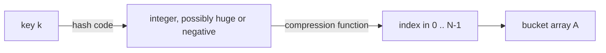

# Maps and hash functions

Python's `dict` is arguably the most important data structure in the language: namespaces, object
attributes, keyword arguments, JSON data — all dictionaries. Abstractly a dictionary is a **map**: a
collection of key–value pairs in which keys are unique and serve as addresses for values. This
lesson introduces the map ADT, a trivially simple (and slow) implementation, and then the idea that
makes maps fast: **hashing**.

## 1. The map ADT

Maps are also called **associative arrays**: like an array, but "indexed" by arbitrary keys —
a student ID, a domain name, an (x, y) coordinate.

The five core behaviours of a map `M` (matching Python's `dict` syntax):

| Operation | Meaning |
|---|---|
| `M[k]` | return the value associated with key `k`; raise `KeyError` if absent (`__getitem__`) |
| `M[k] = v` | associate `v` with `k`, replacing any existing value (`__setitem__`) |
| `del M[k]` | remove the item with key `k`; `KeyError` if absent (`__delitem__`) |
| `len(M)` | number of items |
| `iter(M)` | iterate over the keys |

Derived conveniences: `k in M`, `M.get(k, d)`, `M.setdefault(k, d)`, `M.pop(k, d)`, `M.popitem()`,
`M.clear()`, `M.keys()`, `M.values()`, `M.items()`, `M.update(M2)`, `M == M2`.

### 1.1 Application: counting word frequencies

A classic use: map each word to the number of times it occurs.

```python-run
text = """it was the best of times it was the worst of times it was the age of wisdom
it was the age of foolishness"""
freq = {}
for piece in text.lower().split():
    word = ''.join(c for c in piece if c.isalpha())
    if word:
        freq[word] = 1 + freq.get(word, 0)      # get avoids a KeyError for new words

max_word, max_count = '', 0
for (w, c) in freq.items():
    if c > max_count:
        max_word, max_count = w, c
print('The most frequent word is', max_word, 'with', max_count, 'occurrences')
print(sorted(freq.items(), key=lambda kv: -kv[1])[:5])
```

### 1.2 The MutableMapping abstract base class

Python's `collections.abc.MutableMapping` provides *concrete* implementations of all the derived
methods (`get`, `items`, `__contains__`, `update`, …) in terms of the five *abstract* core
methods. A new map class only needs to supply `__getitem__`, `__setitem__`, `__delitem__`,
`__len__` and `__iter__` — everything else is inherited. For example `__contains__` is essentially:

```python
def __contains__(self, k):
    try:
        self[k]
        return True
    except KeyError:
        return False
```

The book's `MapBase` class extends `MutableMapping` and adds a nested `_Item` class (key + value,
with `__eq__` and `__lt__` based on the key), reused by every map implementation in chapters 10–11.

### 1.3 A simple unsorted map

Store items in an unsorted list; every core operation scans it.

```python-run
from collections.abc import MutableMapping

class UnsortedTableMap(MutableMapping):
    """Map implementation using an unordered list."""
    class _Item:
        __slots__ = '_key', '_value'
        def __init__(self, k, v): self._key, self._value = k, v

    def __init__(self):
        self._table = []
    def __getitem__(self, k):
        for item in self._table:
            if k == item._key:
                return item._value
        raise KeyError('Key Error: ' + repr(k))
    def __setitem__(self, k, v):
        for item in self._table:
            if k == item._key:                 # found a match:
                item._value = v                # reassign value
                return
        self._table.append(self._Item(k, v))   # did not find match for key
    def __delitem__(self, k):
        for j in range(len(self._table)):
            if k == self._table[j]._key:
                self._table.pop(j)
                return
        raise KeyError('Key Error: ' + repr(k))
    def __len__(self):
        return len(self._table)
    def __iter__(self):
        for item in self._table:
            yield item._key

M = UnsortedTableMap()
M['K'] = 2; M['B'] = 4; M['U'] = 2; M['B'] = 7
print(len(M), M['B'], M.get('F', 'absent'), 'K' in M, list(M.items()))   # inherited: get, in, items
```

Each of `__getitem__`, `__setitem__`, `__delitem__` is $O(n)$. Fine for a handful of items; hopeless
for a million.

## 2. Hash tables: the idea

If the keys were integers in the range $0..N-1$, we could use a **lookup table**: an array of length
$N$, storing the value for key $k$ at index $k$. All operations $O(1)$.

Two obstacles: keys may not be integers (strings, tuples), and the key range may be vastly larger
than the number of items (9-digit IDs for 500 students). A **hash function** $h$ solves both: it maps
each key $k$ to an integer $h(k)$ in $[0, N-1]$, and item $(k, v)$ is stored in **bucket**
$A[h(k)]$.



If two distinct keys get the same index we have a **collision**. Collisions are unavoidable in
general (pigeonhole), so we need (1) hash functions that make them rare, and (2) a scheme to handle
them (next lesson). A hash function is **good** if it minimises collisions and is fast to compute.

It is evaluated in two stages:

1. the **hash code** maps a key to an integer (any integer);
2. the **compression function** maps that integer into $[0, N - 1]$.

Separating the two lets the hash code be independent of the table size — so the table can be resized
without recomputing how keys are interpreted.

## 3. Hash codes

### 3.1 Treating the bit representation as an integer

For a type whose representation fits in a machine word (a 32-bit int, a float), use its bits as the
hash code. For longer representations (a 64-bit value with 32-bit hash codes) we must combine the
parts: e.g. **sum** or **exclusive-or** of the high and low halves.

### 3.2 Polynomial hash codes

For variable-length objects such as strings, summing or XOR-ing the components is a poor choice:
the order of characters is ignored, so `"stop"`, `"tops"`, `"pots"` and `"spot"` all collide. A
better code takes positions into account. View the object as a tuple $(x_0, x_1, \ldots, x_{n-1})$
and compute, for a constant $a \ne 1$,

$$x_0 a^{n-1} + x_1 a^{n-2} + \cdots + x_{n-2} a + x_{n-1},$$

evaluated by **Horner's rule** in $O(n)$:
$x_{n-1} + a(x_{n-2} + a(x_{n-3} + \cdots + a(x_1 + a x_0)\cdots))$. Overflow is simply ignored
(arithmetic wraps modulo $2^{32}$ or $2^{64}$). Experiments reported in the book on a list of over
50,000 English words found that $a = 33, 37, 39$ or $41$ each produce fewer than 7 collisions.

### 3.3 Cyclic-shift hash codes

A variant replaces multiplication by a cyclic shift of the partial sum by a fixed number of bits —
fast, and it also mixes positions. The book's experiment over 230,000 words found a 5-bit shift gave
the fewest collisions.

```python
def hash_code(s):
    mask = (1 << 32) - 1                 # limit to 32-bit integers
    h = 0
    for character in s:
        h = (h << 5 & mask) | (h >> 27)  # 5-bit cyclic shift of running sum
        h += ord(character)              # add in value of next character
    return h
```

```python-run
def sum_code(s): return sum(ord(c) for c in s)
def poly_code(s, a=33):
    h = 0
    for c in s:
        h = (h * a + ord(c)) & 0xFFFFFFFF       # Horner's rule, 32-bit wraparound
    return h
def cyclic_code(s):
    mask, h = (1 << 32) - 1, 0
    for c in s:
        h = (h << 5 & mask) | (h >> 27)
        h += ord(c)
    return h
for w in ["stop", "tops", "pots", "spot"]:
    print(f"{w}: sum={sum_code(w)}  poly={poly_code(w)}  cyclic={cyclic_code(w)}")
```

### 3.4 Hash codes in Python

The built-in `hash(x)` returns an integer hash code. Key rules:

- Only **immutable** built-in types are hashable: `int`, `float`, `str`, `tuple`, `frozenset`.
  `hash([1, 2])` raises `TypeError` — if a key could change after insertion, its bucket would be
  wrong.
- **Equal objects must have equal hash codes**: if `x == y` then `hash(x) == hash(y)`. Hence
  `hash(5) == hash(5.0)`.
- Instances of user classes are hashable by default (based on identity). If you define `__eq__` you
  should define a consistent `__hash__`, typically hashing a tuple of the relevant fields:

```python
def __hash__(self):
    return hash((self._red, self._green, self._blue))
```

- String hashing is **randomised per process** (salted) to defend against attackers who craft many
  colliding keys to degrade a server's dictionaries to $O(n)$ per operation.

## 4. Compression functions

The hash code may be any integer, so we still need to squeeze it into $[0, N-1]$.

### 4.1 The division method

$$i \bmod N.$$

Simple, but if $N$ is not prime, patterns in the hash codes can cause patterns of collisions. For
example with codes $\{200, 205, 210, \ldots, 600\}$ and $N = 100$, each code collides with three
others; with $N = 101$ there are no collisions. Even a prime $N$ will not help against codes of the
form $pN + q$ for several different $p$.

### 4.2 The MAD method

**Multiply-Add-and-Divide** removes such repeated patterns:

$$[(a i + b) \bmod p] \bmod N,$$

where $p$ is a prime larger than $N$, and $a \in [1, p-1]$, $b \in [0, p-1]$ are chosen at random.
This gets close to the ideal in which the probability that two different keys collide is $1/N$.
The book's `HashMapBase` uses exactly this:

```python
def _hash_function(self, k):
    return (hash(k) * self._scale + self._shift) % self._prime % len(self._table)
```

with `prime = 109345121`, `scale = 1 + randrange(prime - 1)`, `shift = randrange(prime)`.

```python-run
import random
codes = list(range(200, 601, 5))
def collisions(indices):
    return len(indices) - len(set(indices))
p = 109345121
a, b = 1 + random.randrange(p - 1), random.randrange(p)
print("division, N=100:", collisions([c % 100 for c in codes]))
print("division, N=101:", collisions([c % 101 for c in codes]))
print("MAD,      N=100:", collisions([((a * c + b) % p) % 100 for c in codes]))
```

> [!INTERVIEW]
> "How does a hash map work?" in four sentences: a hash function turns the key into an array index
> (hash code, then compression); the item is stored in that bucket; collisions are resolved by
> chaining or open addressing; the table is resized when the load factor gets too high, which keeps
> expected $O(1)$ operations. Then mention the worst case $O(n)$ and the requirement that keys be
> immutable with consistent `__eq__`/`__hash__`.

## 5. Worked example: hashing a string by hand, then measuring collisions

**Horner's rule on `"cat"` with $a = 33$.** The character codes are `c` = 99, `a` = 97, `t` = 116.
The polynomial is $99 \cdot 33^2 + 97 \cdot 33 + 116$; Horner's rule evaluates it left to right
with one multiplication and one addition per character:

| step | character | computation | running value |
|---|---|---|---|
| 0 | | start | 0 |
| 1 | c (99) | $0 \cdot 33 + 99$ | 99 |
| 2 | a (97) | $99 \cdot 33 + 97$ | 3364 |
| 3 | t (116) | $3364 \cdot 33 + 116$ | 111128 |

Hash code 111128. For the anagram `"act"` the running values are 97, 3300, 109016 — a different
code, because each character's contribution depends on its position.

**Compression.** With a table of $N = 11$ buckets and the division method:
$111128 \bmod 11 = 6$ and $109016 \bmod 11 = 6$ — a collision *after* compression even though the
hash codes differ. This is normal: with only 11 buckets, many codes must share. A good hash function
does not avoid collisions; it makes them no more frequent than chance.

**Measuring quality.** Throw $n$ keys into $N$ buckets. If the function behaves like a random one,
the bucket sizes follow a balls-in-bins pattern: with load factor 1, about 37% of buckets empty and
the longest chain around $\ln n / \ln\ln n$. The cell compares four hash codes on 5,000 synthetic
identifiers of the kind programs really contain (`item0`, `item1`, …, `user_17`), where weak
functions show their flaws.

```python-run
def sum_code(s):
    return sum(ord(c) for c in s)
def first_three(s):                               # uses only part of the key
    return sum(ord(c) << (8 * i) for i, c in enumerate(s[:3]))
def poly_code(s, a=33):
    h = 0
    for c in s:
        h = (h * a + ord(c)) & 0xFFFFFFFF
    return h
def cyclic_code(s):
    h = 0
    for c in s:
        h = ((h << 5) & 0xFFFFFFFF) | (h >> 27)
        h += ord(c)
    return h

keys = [f"{prefix}{i}" for prefix in ("item", "user_", "tmp", "node", "x") for i in range(1000)]
N = 5003                                          # a prime, load factor about 1
print(f"{len(keys)} keys into {N} buckets")
print(f"{'hash code':12s} {'distinct codes':>15} {'empty buckets':>14} {'longest chain':>14}")
for name, h in [("sum", sum_code), ("first three", first_three), ("polynomial", poly_code), ("cyclic shift", cyclic_code)]:
    buckets = [0] * N
    for k in keys:
        buckets[h(k) % N] += 1
    print(f"{name:12s} {len({h(k) for k in keys}):>15} {buckets.count(0):>14} {max(buckets):>14}")
print("ideal (random):", f"{'5000':>12} {'about 1840':>14} {'about 6':>14}")
```

Reading the table:

- **Sum of codes** produces only a few hundred distinct values for 5,000 keys — digits rearranged
  give the same sum (`item12`, `item21`) — so almost every bucket is empty and a few chains are
  enormous. Lookups degrade towards a linear scan.
- **First three characters** is even worse: every key with the same prefix collides, regardless of
  table size. A hash code must depend on the **whole** key.
- **Polynomial** and **cyclic-shift** codes give 5,000 distinct codes, no long chains, and bucket
  statistics at least as good as the random ideal. (They leave *fewer* empty buckets than chance
  would, because these keys are so regular — consecutive numbers — that the codes spread out more
  evenly than random values. Do not count on that for arbitrary data.)

The experiment also explains the advice to make $N$ prime (or to use MAD compression): with a
polynomial code and $N$ a multiple of the multiplier $a$, the bucket index would depend only on the
last character. A prime modulus removes such arithmetic coincidences.

## 6. Pitfalls

- Using a mutable object as a key (or mutating a key object that defines its own hash).
- Defining `__eq__` without `__hash__` (Python then makes the class unhashable) or with an
  inconsistent hash.
- A hash code that ignores order or uses only part of the key (first few characters).
- Assuming iteration order from hashing (Python dicts preserve *insertion* order since 3.7; sets do
  not guarantee order).
- Relying on `hash(str)` being the same across program runs.

## 7. Summary

- Map ADT: get/set/delete by key, length, iteration; `MutableMapping` supplies the rest.
- Unsorted list map: $O(n)$ per operation.
- Hash function = hash code (key → integer) + compression (integer → bucket index).
- Polynomial and cyclic-shift codes respect position; MAD compression spreads codes well.

> **Source:** Goodrich, Tamassia & Goldwasser, *Data Structures and Algorithms in Python*, ch. 10.1–10.2.1.

## Check yourself

```quiz
[
  {"q": "Which five methods must a MutableMapping subclass provide?",
   "options": ["get, set, pop, keys, values", "__getitem__, __setitem__, __delitem__, __len__, __iter__", "__contains__, __eq__, __hash__, __len__, items", "put, get, remove, size, clear"], "answer": 1,
   "explain": "All other map behaviours are implemented in terms of these five."},
  {"q": "Why is summing character codes a poor hash code for strings?",
   "options": ["It is slow", "It ignores the order of characters, so anagrams collide", "It overflows", "It produces negative numbers"], "answer": 1,
   "explain": "stop, tops, pots and spot all have the same sum."},
  {"q": "The two stages of a hash function are...",
   "options": ["encryption and decryption", "hash code and compression function", "chaining and probing", "rehashing and resizing"], "answer": 1,
   "explain": "Key to integer, then integer to an index in [0, N-1]."},
  {"q": "Why can't a Python list be a dict key?",
   "options": ["Lists are too large", "Lists are mutable; changing one would invalidate its hash/bucket", "Lists have no length", "They can"], "answer": 1,
   "explain": "Hashable objects must have a hash that never changes while they are in the table."},
  {"q": "What is the MAD compression function?",
   "options": ["i mod N", "((a i + b) mod p) mod N with p prime > N", "i XOR N", "floor(i / N)"], "answer": 1,
   "explain": "Multiply-Add-and-Divide with random a, b breaks up regular patterns in hash codes."},
  {"q": "If x == y, what must be true of their hashes?",
   "options": ["hash(x) != hash(y)", "hash(x) == hash(y)", "Nothing", "hash(x) < hash(y)"], "answer": 1,
   "explain": "Otherwise equal keys could be placed in different buckets and lookups would fail."},
  {"q": "The UnsortedTableMap's __getitem__ runs in...",
   "options": ["O(1)", "O(log n)", "O(n)", "O(n log n)"], "answer": 2,
   "explain": "It scans the list for a matching key."}
]
```
