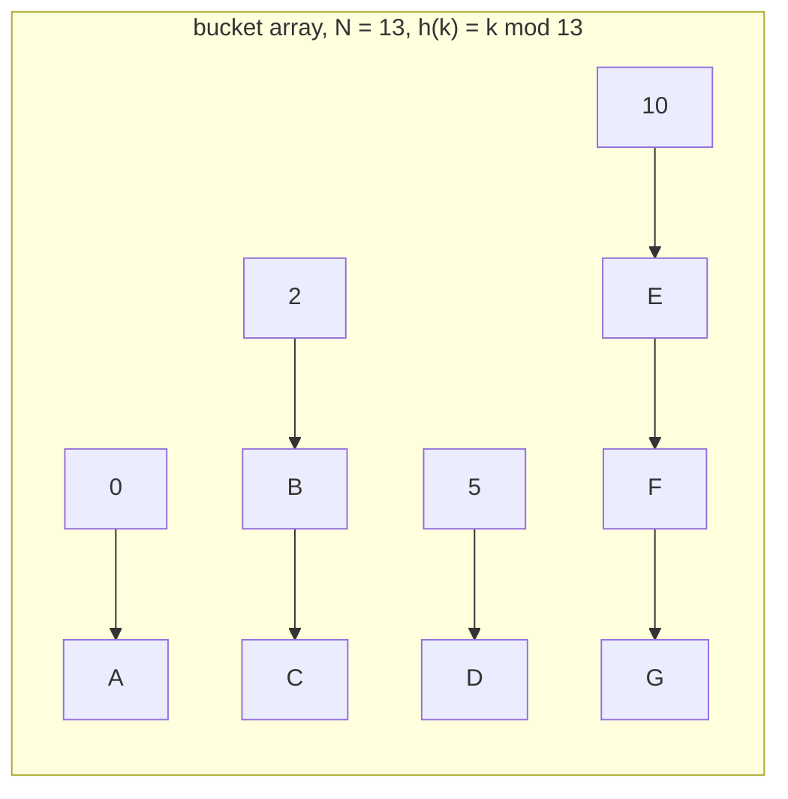

# Collision handling, load factors and rehashing

> **Before this lesson:** You should know what a map, a hash function, a bucket array and a
> collision are, and the MAD compression method, all from
> [Maps and hash functions](#/lesson/dsa-foundations/maps-hash-functions). Amortised cost and
> doubling come from [Dynamic arrays](#/lesson/dsa-foundations/dynamic-arrays).

## In plain words

The previous lesson's cloakroom attendant works out a hook number from each customer's name. A
**collision** is what happens when two customers are given the same hook. This lesson is about
what to do then, and there are two families of answer.

The first: let a hook hold several coats. Each hook carries a short rail, and everyone assigned
to that hook hangs their coat on the rail. To find a coat, go to the hook and look along its
rail. This is **separate chaining**.

The second: one coat per hook, no exceptions. If your hook is taken, try the next hook, and the
next, until you find a free one. To find the coat later, start at your hook and walk along
until you see it. This is **open addressing**.

Both work well only while the cloakroom is not too full, so both need a rule for moving to a
bigger cloakroom in good time.

Why it matters for a job: these details explain when a hash map is fast, when it is not, and
why. Interviewers probe exactly here ("what happens when two keys collide?", "what is the
worst case?", "how do you delete?"), and the same knowledge helps you read the performance
notes of any real hash table.

## 1. Separate chaining

How common are collisions? More common than intuition suggests. In a room of only 23 people it
is more likely than not that two share a birthday, although there are 365 possible days (this
is known as the *birthday paradox*). In the same way, with $n$ items and $N$ buckets, some
collisions are a near certainty long before the table is full.

In **separate chaining**, each bucket $A[j]$ holds its own small collection, a list (a "chain")
of all the items whose keys hash to $j$. An operation on key $k$ goes to bucket $A[h(k)]$ and
then works on that short list. In the picture, three keys hash to bucket 10 and share it.



With a good hash function the $n$ items are spread evenly over the $N$ buckets, so a bucket is
expected to hold about $n/N$ items. That ratio has a name and a symbol, the Greek letter lambda:

$$\lambda = n / N$$

is the **load factor**, the average number of items per bucket. A table with 50 items in 100
buckets has $\lambda = 0.5$. Each core operation takes expected time $O(\lceil \lambda \rceil)$:
go to one bucket, scan a chain of about $\lambda$ items. So as long as $\lambda$ is kept below
some fixed number, the operations are expected $O(1)$. ("Expected" means averaged over the
random choices inside the hash function; it is not a worst-case guarantee.)

The class below is a complete chained hash map. Each bucket is either `None` or a list of
`[key, value]` pairs.

```python-run
from random import randrange

class ChainHashMap:
    """Hash map implemented with separate chaining for collision resolution."""
    def __init__(self, cap=11, p=109345121):
        self._table = cap * [None]
        self._n = 0
        self._prime = p
        self._scale = 1 + randrange(p - 1)        # MAD parameters
        self._shift = randrange(p)

    def _hash_function(self, k):
        return (hash(k) * self._scale + self._shift) % self._prime % len(self._table)

    def __len__(self):
        return self._n

    def __getitem__(self, k):
        bucket = self._table[self._hash_function(k)]
        if bucket is not None:
            for key, value in bucket:
                if key == k:
                    return value
        raise KeyError('Key Error: ' + repr(k))

    def __setitem__(self, k, v):
        j = self._hash_function(k)
        if self._table[j] is None:
            self._table[j] = []                   # bucket is new to the table
        bucket = self._table[j]
        for item in bucket:
            if item[0] == k:
                item[1] = v
                return
        bucket.append([k, v])
        self._n += 1
        if self._n > len(self._table) // 2:       # keep load factor <= 0.5
            self._resize(2 * len(self._table) - 1)    # number 2^x - 1 is often prime

    def __delitem__(self, k):
        bucket = self._table[self._hash_function(k)]
        if bucket is not None:
            for i, item in enumerate(bucket):
                if item[0] == k:
                    bucket.pop(i)
                    self._n -= 1
                    return
        raise KeyError('Key Error: ' + repr(k))

    def __iter__(self):
        for bucket in self._table:
            if bucket is not None:
                for key, _ in bucket:
                    yield key

    def _resize(self, c):
        old = [(k, self[k]) for k in self]
        self._table = c * [None]
        self._n = 0
        for (k, v) in old:
            self[k] = v                           # reinsert old key-value pair

M = ChainHashMap()
for i, w in enumerate("the quick brown fox jumps over the lazy dog".split()):
    M[w] = i
print(len(M), M["the"], M["fox"], len(M._table), sorted(M))
del M["fox"]
print("fox" in set(M), max(len(b) for b in M._table if b))
```

**Reading this code.**

- `__init__` creates `cap` empty buckets and picks the random MAD parameters `_scale` and
  `_shift`.
- `_hash_function(k)` is hash code plus MAD compression: the result is always a valid index
  into `_table`.
- `__getitem__` goes to the bucket and scans its pairs for the key, raising `KeyError` if the
  bucket is missing or the key is not in it.
- `__setitem__` creates the bucket's list if needed. If the key is already there, it replaces
  the value. Otherwise it appends a new pair, and if the table is now more than half full, it
  resizes to roughly double.
- `_resize` collects every pair, makes a larger empty table, and inserts them all again. They
  must be re-inserted, not copied cell for cell, because the bucket index depends on the table
  length.

The sentence has nine words but "the" occurs twice, so the map ends with 8 keys, and `M["the"]`
is 6, the position of its *second* occurrence (the later assignment replaced the earlier one).
The table grew from 11 to 21 buckets along the way.

Chaining is easy to get right and copes gracefully when crowded ($\lambda$ may even exceed 1).
Its cost is the extra list per bucket: more memory, and an extra hop through a reference on
every lookup.

## 2. Open addressing

**Open addressing** stores every item directly in the bucket array, at most one per cell, and
handles a collision by looking for *another* cell. Trying cells one after another is called
**probing**. There are no chains, which saves memory, but the table can never hold more items
than it has cells: $\lambda \le 1$.

### 2.1 Linear probing

The most direct probing rule is "try the next cell". To insert $(k, v)$ with $j = h(k)$: if
$A[j]$ is occupied, try $A[(j+1) \bmod N]$, then $A[(j+2) \bmod N]$, and so on (wrapping round
at the end of the array) until an empty cell is found. To search for $k$: start at $A[h(k)]$
and examine consecutive cells until you find $k$ **or reach an empty cell**. An empty cell
proves that $k$ is absent, because an insertion of $k$ would have stopped there at the latest.

**Worked example.** $N = 11$, $h(k) = k \bmod 11$. Insert 13, 26, 5, 37, 16, 21, 15 in that
order. The "probes" column lists the cells examined:

| key | $h(k)$ | probes | lands in |
|---|---|---|---|
| 13 | 2 | 2 | 2 |
| 26 | 4 | 4 | 4 |
| 5 | 5 | 5 | 5 |
| 37 | 4 | 4, 5, 6 | 6 |
| 16 | 5 | 5, 6, 7 | 7 |
| 21 | 10 | 10 | 10 |
| 15 | 4 | 4, 5, 6, 7, 8 | 8 |

The final table (index: key) is 2:13, 4:26, 5:5, 6:37, 7:16, 8:15, 10:21. Look at how the keys
have bunched together in cells 4 to 8. Key 15 wanted cell 4 and ended up four cells away. This
bunching is called **primary clustering**, and it is the weakness of linear probing: a long run
of occupied cells tends to get longer, because a new key that hashes *anywhere* into the run
ends up extending it. It is like traffic: a jam grows because every arriving car joins its
tail.

### 2.2 Deletion and the AVAILABLE marker

Deleting is the subtle operation. Emptying the cell is wrong: a later search that needs to walk
*through* that cell would stop there and wrongly report that a key is absent. In the example,
suppose 37 is deleted by emptying cell 6. A search for 15 starts at cell 4, moves to 5, reaches
the now-empty cell 6 and gives up, although 15 is sitting in cell 8.

The fix is to leave a special marker in the cell, meaning "something used to be here". It is
usually called a **tombstone**; the code below calls it `_AVAIL`, for "available".

- **Search** walks past tombstones and stops only at a truly empty cell (`None`).
- **Insert** remembers the first tombstone it passes and reuses that cell. But it must still
  carry on to a truly empty cell first, to be sure the key is not already stored further along;
  stopping at the tombstone could create a second copy of an existing key.

### 2.3 Quadratic probing

Clusters form under linear probing because every key takes steps of the same size, 1. One
remedy is to take growing steps: look at $A[(h(k) + i^2) \bmod N]$ for $i = 0, 1, 2, \ldots$,
that is, 0, 1, 4, 9, 16 cells beyond the home cell. This is **quadratic probing**. It avoids
primary clustering but has a milder version of the problem, **secondary clustering**: two keys
with the same home cell still follow exactly the same sequence of cells. It also comes with a
condition: it is guaranteed to find a free cell only when $N$ is prime and the table is less
than half full.

### 2.4 Double hashing

A better remedy gives each key its own step size, computed by a second hash function $h'$:
look at $A[(h(k) + i \cdot h'(k)) \bmod N]$. A common choice is $h'(k) = q - (k \bmod q)$ for
some prime $q < N$, with $N$ itself prime. (The step must never be zero, or the search would
stay on one cell for ever; this formula gives a value from 1 to $q$.) Two keys that collide at
their home cell now go off in different directions, which all but eliminates clustering.

### 2.5 Pseudo-random probing (what Python does)

A further approach generates a scrambled-looking but repeatable sequence of cells from the hash
code itself ("pseudo-random" means "produced by a fixed rule, yet looking random"). CPython's
`dict` uses open addressing in this style. Its rule has the form
`j = (5*j + 1 + perturb) mod 2^k`, where `perturb` starts as the full hash code and has its
bits shifted to the right at each step, so that every bit of the hash eventually influences
where the search goes.

The class below implements linear probing with tombstones. The heart of it is `_find_slot(k)`,
used by all three operations. It returns a pair: `(True, j)` if the key is in cell `j`, or
`(False, j)` where `j` is the cell in which the key should be inserted.

```python-run
class ProbeHashMap:
    """Hash map implemented with linear probing for collision resolution."""
    _AVAIL = object()                             # sentinel marks locations of previous deletions

    def __init__(self, cap=11):
        self._table = cap * [None]
        self._n = 0
    def _h(self, k):
        return hash(k) % len(self._table)
    def _is_available(self, j):
        return self._table[j] is None or self._table[j] is ProbeHashMap._AVAIL

    def _find_slot(self, k):
        """Return (True, index) if k is found, else (False, first available index)."""
        j = self._h(k)
        first_avail = None
        while True:
            if self._is_available(j):
                if first_avail is None:
                    first_avail = j               # mark this as first avail
                if self._table[j] is None:
                    return (False, first_avail)   # search has failed
            elif k == self._table[j][0]:
                return (True, j)                  # found a match
            j = (j + 1) % len(self._table)        # keep looking (cyclically)

    def get(self, k, default=None):
        found, s = self._find_slot(k)
        return self._table[s][1] if found else default
    def put(self, k, v):
        found, s = self._find_slot(k)
        if not found:
            self._table[s] = (k, v)
            self._n += 1
            if self._n > len(self._table) // 2:
                self._resize(2 * len(self._table) - 1)
        else:
            self._table[s] = (k, v)
    def remove(self, k):
        found, s = self._find_slot(k)
        if found:
            self._table[s] = ProbeHashMap._AVAIL  # mark as vacated
            self._n -= 1
        return found
    def _resize(self, c):
        old = [item for item in self._table if item is not None and item is not ProbeHashMap._AVAIL]
        self._table, self._n = c * [None], 0
        for k, v in old:
            self.put(k, v)
    def show(self):
        return [("x" if c is ProbeHashMap._AVAIL else c[0]) if c is not None else "." for c in self._table]

M2 = ProbeHashMap(cap=23)
for k in [4, 27, 50, 5, 73]:             # 4, 27, 50, 73 all hash to 4 (mod 23)
    M2.put(k, k)
print(M2.show())
M2.remove(27)
print(M2.show(), "| 50 still found:", M2.get(50), "| 73:", M2.get(73))
M2.put(96, 96)                           # 96 mod 23 = 4: reuses the tombstone
print(M2.show())
```

**Reading the output.** The table has 23 cells, and the keys 4, 27, 50 and 73 all have remainder
4 when divided by 23, while 5 belongs in cell 5. After the five insertions, cells 4 to 8 hold
4, 27, 50, 5, 73: key 5 found its home cell taken by 50 and moved along, and 73 probed five
cells. Removing 27 leaves an `x` (the tombstone) in cell 5, and the searches for 50 and 73
still succeed because they walk past it. Inserting 96, which also belongs in cell 4, reuses the
tombstone's cell.

## 3. Load factors and rehashing

Every one of these schemes depends on the load factor $\lambda = n/N$ staying small:

- **Separate chaining:** keep $\lambda$ below about 0.9. (Java's `HashMap` uses 0.75.)
- **Linear probing:** performance collapses as $\lambda$ approaches 1, because clusters merge
  into ever longer runs; keep $\lambda$ below about 0.5. (Python's `dict` keeps it below 2/3.)

When an insertion pushes $\lambda$ over the limit, the table is **rehashed**: allocate a new
bucket array, usually at least twice as large and ideally of prime length; choose a new
compression function for the new length; and insert every item again. Items generally land at
*different* indices from before, because the modulus has changed. One rehash costs $\Theta(n)$.
But exactly as with dynamic arrays, growing by doubling means rehashes become rarer as they
become more expensive, and the cost works out to $O(1)$ **amortised** per insertion. A rehash
also sweeps away all tombstones.

### 3.1 Efficiency

| Operation | Unsorted list | Hash table (expected) | Hash table (worst case) |
|---|---|---|---|
| `__getitem__` | $O(n)$ | $O(1)$ | $O(n)$ |
| `__setitem__` | $O(n)$ | $O(1)$ | $O(n)$ |
| `__delitem__` | $O(n)$ | $O(1)$ | $O(n)$ |
| `__len__` | $O(1)$ | $O(1)$ | $O(1)$ |
| `__iter__` | $O(n)$ | $O(n)$ | $O(n)$ |

The worst case is every key in a single bucket, or in one enormous cluster, so that the table
behaves like the unsorted list. With a good hash function whose parameters are chosen at random
this is astronomically unlikely. With a fixed, publicly known hash function it is a real
threat, because an attacker can construct keys that all collide.

How quickly does probing slow down as the table fills? Under the idealised assumption that
each probe lands on a random cell, a search for an absent key examines about
$1/(1-\lambda)$ cells on average: 2 at $\lambda = 0.5$ and 10 at $\lambda = 0.9$. Linear
probing is worse because of clustering. An analysis due to Donald Knuth gives roughly
$\tfrac12(1 + 1/(1-\lambda)^2)$: 2.5 probes at $\lambda = 0.5$, but 50.5 at $\lambda = 0.9$.
The demo measures it: it fills a table of 10,007 cells to each load by linear probing and then
averages the length of 2,000 searches for keys that are not present.

```python-run
import random
def avg_probes_linear(N, load, trials=2000):
    table = [None] * N
    for _ in range(int(N * load)):
        j = random.randrange(N)
        while table[j] is not None: j = (j + 1) % N
        table[j] = 1
    total = 0
    for _ in range(trials):                      # unsuccessful searches
        j, probes = random.randrange(N), 1
        while table[j] is not None:
            j = (j + 1) % N; probes += 1
        total += probes
    return total / trials
for load in [0.25, 0.5, 0.75, 0.9]:
    print(f"load {load:4}: about {avg_probes_linear(10007, load):5.1f} probes per unsuccessful search")
```

### 3.2 Chaining versus open addressing

| | Separate chaining | Open addressing |
|---|---|---|
| Memory | extra list per bucket | one flat array; very cache-friendly |
| Load factor | may exceed 1 | must stay below 1 (well below for linear probing) |
| Deletion | simple | needs tombstones |
| Clustering | none | primary (linear) / secondary (quadratic) |
| Typical use | Java `HashMap`, textbook default | Python `dict`, most high-performance tables |

> [!INTERVIEW]
> Follow-up questions to expect, with short answers. "What if all keys collide?" Every operation
> becomes $O(n)$; defences are a randomised hash function, or buckets that turn into balanced
> trees when they grow long, as Java does. "Why resize by doubling?" It gives amortised $O(1)$
> insertion. "How do you delete with linear probing?" With tombstones (or by shifting later
> items back to close the gap). "Is a hash map ordered?" No; for "all keys between a and b" you
> need a sorted map, the subject of the next lesson.

## 4. A worked example of rehashing

Rehashing is easy to describe and easy to get wrong, so trace a small case. Take a chained
table with $N = 5$ buckets, compression by $k \bmod 5$, and the rule "rehash when the load
factor would exceed 1". Insert the keys 12, 7, 22, 5, 9:

| bucket | 0 | 1 | 2 | 3 | 4 |
|---|---|---|---|---|---|
| keys | 5 | | 12, 7, 22 | | 9 |

Bucket 2 has a chain of three, because 12, 7 and 22 all leave remainder 2. Now insert 16. That
would make six items in five buckets, so the table is rebuilt with $N = 11$ and every key is
placed again using $k \bmod 11$:

| key | 12 | 7 | 22 | 5 | 9 | 16 |
|---|---|---|---|---|---|---|
| old bucket ($\bmod 5$) | 2 | 2 | 2 | 0 | 4 | (1) |
| new bucket ($\bmod 11$) | 1 | 7 | 0 | 5 | 9 | 5 |

Three things are worth noticing. The chain of three has been broken up: its keys now sit in
buckets 1, 7 and 0. Not one key kept its old index, which is why a rehash cannot copy the old
array across cell by cell. And a new collision has appeared (5 and 16 both go to bucket 5),
because rehashing lowers the load factor, here from 1.2 to about 0.55, but can never abolish
collisions.

## 5. Pitfalls

- **Emptying a cell on deletion** in open addressing. Later searches stop too early.
- **Stopping an insertion at the first tombstone** without checking whether the key exists
  further along. The table ends up with two copies of one key.
- **Copying the old array cell for cell on resize.** Every index must be recomputed for the new
  table length.
- **Letting tombstones pile up.** They lengthen every search; count them towards the load
  factor, or rehash from time to time.
- **Quadratic probing with a non-prime $N$ or a table more than half full.** It may never find
  a free cell.
- **Quoting "$O(1)$" without "expected".** The worst case of a hash table is $O(n)$.

## 6. Summary

- Collisions cannot be avoided. They are handled by chaining (a list per bucket) or by open
  addressing (probing for another cell).
- Linear probing is compact and fast on real hardware but suffers from primary clustering, and
  deletion needs tombstones. Quadratic probing and double hashing reduce clustering.
- Keep the load factor bounded (about 0.5 for probing, about 0.9 for chaining) by rehashing
  into a larger table; doubling makes that $O(1)$ amortised.
- Operations take expected $O(1)$ time; the worst case is $O(n)$.

> **Source:** Goodrich, Tamassia & Goldwasser, *Data Structures and Algorithms in Python*, ch. 10.2.2–10.2.4.

## Glossary

- **Collision**: two different keys assigned to the same bucket.
- **Birthday paradox**: the surprising fact that collisions become likely with few items.
- **Separate chaining**: keeping a list of items in each bucket.
- **Load factor ($\lambda$)**: the number of items divided by the number of buckets.
- **Expected time**: running time averaged over the random choices of the hash function.
- **Open addressing**: storing at most one item per cell and probing for another cell on a
  collision.
- **Probe**: one examination of a cell during a search or insertion.
- **Linear probing**: trying consecutive cells.
- **Primary clustering**: long runs of occupied cells that form under linear probing.
- **Tombstone (available marker)**: a marker left in a cell whose item was deleted.
- **Quadratic probing**: trying cells at distances 1, 4, 9, ... from the home cell.
- **Secondary clustering**: keys with the same home cell following the same probe sequence.
- **Double hashing**: using a second hash function to choose each key's step size.
- **Rehashing**: rebuilding the table with more buckets and re-inserting every item.

## Check yourself

```quiz
[
  {"q": "The load factor of a hash table is...",
   "options": ["N / n", "n / N, items divided by buckets", "the longest chain length", "the number of collisions"], "answer": 1,
   "explain": "lambda = n/N; expected bucket size under chaining."},
  {"q": "With N = 11 and h(k) = k mod 11 using linear probing, after inserting 13, 26, 5, where does 37 go?",
   "options": ["Cell 4", "Cell 5", "Cell 6", "Cell 3"], "answer": 2,
   "explain": "37 mod 11 = 4 (occupied by 26), 5 is occupied by 5, so it lands in 6."},
  {"q": "Why does open addressing mark deleted cells as AVAILABLE instead of emptying them?",
   "options": ["To save memory", "So searches for keys placed beyond that cell do not stop early", "To speed up resizing", "It is not necessary"], "answer": 1,
   "explain": "An empty cell terminates a probe sequence; a tombstone lets the search continue."},
  {"q": "Primary clustering is associated with...",
   "options": ["separate chaining", "linear probing", "double hashing", "MAD compression"], "answer": 1,
   "explain": "Runs of occupied cells grow because any key hashing into the run extends it."},
  {"q": "Rehashing into a table twice as large costs Theta(n). Why are insertions still O(1) amortised?",
   "options": ["Rehashing is skipped most of the time by luck", "Doubling means the rehash costs form a geometric series, as with dynamic arrays", "The hash function is cached", "Because n is small"], "answer": 1,
   "explain": "n/2 cheap insertions occur between consecutive rehashes, paying for the copy."},
  {"q": "Which load factor is recommended for linear probing?",
   "options": ["Below about 0.5", "Exactly 1", "Above 2", "Any"], "answer": 0,
   "explain": "Probe counts grow like 1/(1 - lambda)^2; beyond 0.5 clusters lengthen quickly."},
  {"q": "In double hashing, the secondary hash h'(k) must...",
   "options": ["equal h(k)", "never evaluate to zero", "always be even", "be larger than N"], "answer": 1,
   "explain": "A zero step would probe the same cell forever."}
]
```
