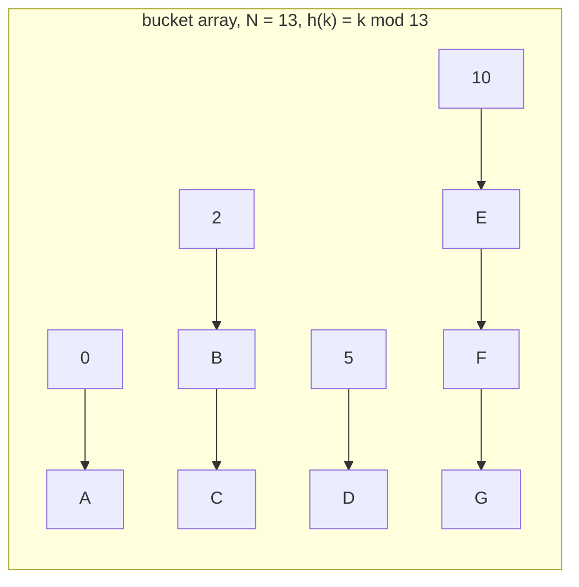

# Collision handling, load factors and rehashing

A hash function sends keys to bucket indices, but two different keys can land on the same index.
With $n$ items and $N$ buckets, collisions are a statistical certainty long before the table is full
(the *birthday paradox*: among just 23 people, two probably share a birthday out of 365 "buckets").
How a hash table deals with collisions defines its character. This lesson covers the two families —
**separate chaining** and **open addressing** — and the role of the **load factor**.

## 1. Separate chaining

Each bucket $A[j]$ holds its own small secondary container — a list ("chain") of all items whose
keys hash to $j$. Operations on key $k$ are delegated to the bucket $A[h(k)]$.



With a good hash function the $n$ items are spread evenly, so the expected size of a bucket is
$\lceil n/N \rceil$. The ratio

$$\lambda = n / N$$

is the **load factor**. The core operations run in expected $O(\lceil \lambda \rceil)$ time — so if
$\lambda$ is $O(1)$, the operations are expected $O(1)$.

```python-run
from random import randrange

class ChainHashMap:
    """Hash map implemented with separate chaining for collision resolution."""
    def __init__(self, cap=11, p=109345121):
        self._table = cap * [None]
        self._n = 0
        self._prime = p
        self._scale = 1 + randrange(p - 1)        # MAD parameters
        self._shift = randrange(p)

    def _hash_function(self, k):
        return (hash(k) * self._scale + self._shift) % self._prime % len(self._table)

    def __len__(self):
        return self._n

    def __getitem__(self, k):
        bucket = self._table[self._hash_function(k)]
        if bucket is not None:
            for key, value in bucket:
                if key == k:
                    return value
        raise KeyError('Key Error: ' + repr(k))

    def __setitem__(self, k, v):
        j = self._hash_function(k)
        if self._table[j] is None:
            self._table[j] = []                   # bucket is new to the table
        bucket = self._table[j]
        for item in bucket:
            if item[0] == k:
                item[1] = v
                return
        bucket.append([k, v])
        self._n += 1
        if self._n > len(self._table) // 2:       # keep load factor <= 0.5
            self._resize(2 * len(self._table) - 1)    # number 2^x - 1 is often prime

    def __delitem__(self, k):
        bucket = self._table[self._hash_function(k)]
        if bucket is not None:
            for i, item in enumerate(bucket):
                if item[0] == k:
                    bucket.pop(i)
                    self._n -= 1
                    return
        raise KeyError('Key Error: ' + repr(k))

    def __iter__(self):
        for bucket in self._table:
            if bucket is not None:
                for key, _ in bucket:
                    yield key

    def _resize(self, c):
        old = [(k, self[k]) for k in self]
        self._table = c * [None]
        self._n = 0
        for (k, v) in old:
            self[k] = v                           # reinsert old key-value pair

M = ChainHashMap()
for i, w in enumerate("the quick brown fox jumps over the lazy dog".split()):
    M[w] = i
print(len(M), M["the"], M["fox"], len(M._table), sorted(M))
del M["fox"]
print("fox" in set(M), max(len(b) for b in M._table if b))
```

Chaining is simple and degrades gracefully ($\lambda$ can exceed 1), but uses an auxiliary structure
per bucket — extra memory and pointer-chasing.

## 2. Open addressing

**Open addressing** stores every item directly in the bucket array — at most one item per cell — and
resolves a collision by probing for *another* cell. It requires $\lambda \le 1$ and saves the space
of the chains.

### 2.1 Linear probing

To insert $(k, v)$ with $j = h(k)$: if $A[j]$ is occupied, try $A[(j+1) \bmod N]$, then
$A[(j+2) \bmod N]$, … until an empty cell is found. To search for $k$: start at $A[h(k)]$ and examine
consecutive cells until finding $k$ **or an empty cell** (which proves $k$ is absent).

**Worked example.** $N = 11$, $h(k) = k \bmod 11$. Insert 13, 26, 5, 37, 16, 21, 15:

| key | $h(k)$ | probes | lands in |
|---|---|---|---|
| 13 | 2 | 2 | 2 |
| 26 | 4 | 4 | 4 |
| 5 | 5 | 5 | 5 |
| 37 | 4 | 4, 5, 6 | 6 |
| 16 | 5 | 5, 6, 7 | 7 |
| 21 | 10 | 10 | 10 |
| 15 | 4 | 4, 5, 6, 7, 8 | 8 |

Final table (index: key): 2:13, 4:26, 5:5, 6:37, 7:16, 8:15, 10:21. Notice how the keys bunch up in
cells 4–8: this is **primary clustering**, the weakness of linear probing. Long runs of occupied
cells get longer, because any key hashing *anywhere* into the run extends it.

### 2.2 Deletion and the AVAILABLE marker

We cannot simply empty a cell on deletion: a later search that probes through it would stop early
and wrongly conclude a key is absent. In the example, deleting 37 (cell 6) by emptying it would make
16 and 15 unreachable. The fix: replace the deleted item with a special **available** marker
(a *tombstone*, `_AVAIL`).

- **Search** skips over `_AVAIL` cells and stops only at a truly empty cell (`None`).
- **Insert** remembers the first `_AVAIL` cell seen during the probe and reuses it — but must still
  continue to an empty cell to be sure the key is not already present further along.

### 2.3 Quadratic probing

Probe $A[(h(k) + f(i)) \bmod N]$ for $i = 0, 1, 2, \ldots$ with $f(i) = i^2$. This avoids primary
clustering, but creates **secondary clustering** (keys with the same initial hash follow the same
probe sequence). Moreover, it is only guaranteed to find an empty cell when $N$ is prime and the
table is less than half full.

### 2.4 Double hashing

Use a second hash function $h'$ to set the step size: $f(i) = i \cdot h'(k)$. A common choice is
$h'(k) = q - (k \bmod q)$ for a prime $q < N$ ($h'$ must never be zero), with $N$ prime. Different
keys colliding at the same cell now take different paths, which virtually eliminates clustering.

### 2.5 Pseudo-random probing (what Python does)

Another approach uses a deterministic pseudo-random sequence seeded by the hash code. CPython's
`dict` uses open addressing with a recurrence of the form `j = (5*j + 1 + perturb) mod 2^k`, where
`perturb` starts as the full hash and is shifted right each step, so every bit of the hash
eventually influences the probe sequence.

```python-run
class ProbeHashMap:
    """Hash map implemented with linear probing for collision resolution."""
    _AVAIL = object()                             # sentinel marks locations of previous deletions

    def __init__(self, cap=11):
        self._table = cap * [None]
        self._n = 0
    def _h(self, k):
        return hash(k) % len(self._table)
    def _is_available(self, j):
        return self._table[j] is None or self._table[j] is ProbeHashMap._AVAIL

    def _find_slot(self, k):
        """Return (True, index) if k is found, else (False, first available index)."""
        j = self._h(k)
        first_avail = None
        while True:
            if self._is_available(j):
                if first_avail is None:
                    first_avail = j               # mark this as first avail
                if self._table[j] is None:
                    return (False, first_avail)   # search has failed
            elif k == self._table[j][0]:
                return (True, j)                  # found a match
            j = (j + 1) % len(self._table)        # keep looking (cyclically)

    def get(self, k, default=None):
        found, s = self._find_slot(k)
        return self._table[s][1] if found else default
    def put(self, k, v):
        found, s = self._find_slot(k)
        if not found:
            self._table[s] = (k, v)
            self._n += 1
            if self._n > len(self._table) // 2:
                self._resize(2 * len(self._table) - 1)
        else:
            self._table[s] = (k, v)
    def remove(self, k):
        found, s = self._find_slot(k)
        if found:
            self._table[s] = ProbeHashMap._AVAIL  # mark as vacated
            self._n -= 1
        return found
    def _resize(self, c):
        old = [item for item in self._table if item is not None and item is not ProbeHashMap._AVAIL]
        self._table, self._n = c * [None], 0
        for k, v in old:
            self.put(k, v)
    def show(self):
        return [("x" if c is ProbeHashMap._AVAIL else c[0]) if c is not None else "." for c in self._table]

M2 = ProbeHashMap(cap=23)
for k in [4, 27, 50, 5, 73]:             # 4, 27, 50, 73 all hash to 4 (mod 23)
    M2.put(k, k)
print(M2.show())
M2.remove(27)
print(M2.show(), "| 50 still found:", M2.get(50), "| 73:", M2.get(73))
M2.put(96, 96)                           # 96 mod 23 = 4: reuses the tombstone
print(M2.show())
```

## 3. Load factors and rehashing

All these schemes rely on the load factor $\lambda = n/N$ staying bounded:

- **Separate chaining:** keep $\lambda < 0.9$ (Java's `HashMap` uses 0.75).
- **Linear probing:** performance collapses as $\lambda$ approaches 1 because clusters merge; keep
  $\lambda < 0.5$ (Python's dict keeps $\lambda < 2/3$).

When an insertion pushes $\lambda$ over the threshold, **rehash**: allocate a new table (typically at
least double the size, ideally a prime), choose a new compression function, and reinsert every
item. Items generally land at *different* indices, because the modulus changed. A rehash costs
$\Theta(n)$, but exactly as with dynamic arrays, doubling makes it $O(1)$ **amortised** per
insertion. Rehashing also clears out tombstones.

### 3.1 Efficiency

| Operation | Unsorted list | Hash table (expected) | Hash table (worst case) |
|---|---|---|---|
| `__getitem__` | $O(n)$ | $O(1)$ | $O(n)$ |
| `__setitem__` | $O(n)$ | $O(1)$ | $O(n)$ |
| `__delitem__` | $O(n)$ | $O(1)$ | $O(n)$ |
| `__len__` | $O(1)$ | $O(1)$ | $O(1)$ |
| `__iter__` | $O(n)$ | $O(n)$ | $O(n)$ |

The worst case — every key in one bucket or one cluster — is astronomically unlikely with a good,
randomised hash function, but it is real for adversarial inputs with a fixed one.

For open addressing with uniform hashing, the expected number of probes is about
$1/(1-\lambda)$ for an unsuccessful search: 2 at $\lambda = 0.5$, 10 at $\lambda = 0.9$. For linear
probing (Knuth) it is roughly $\tfrac12(1 + 1/(1-\lambda)^2)$: 2.5 at 0.5, but 50.5 at 0.9.

```python-run
import random
def avg_probes_linear(N, load, trials=2000):
    table = [None] * N
    for _ in range(int(N * load)):
        j = random.randrange(N)
        while table[j] is not None: j = (j + 1) % N
        table[j] = 1
    total = 0
    for _ in range(trials):                      # unsuccessful searches
        j, probes = random.randrange(N), 1
        while table[j] is not None:
            j = (j + 1) % N; probes += 1
        total += probes
    return total / trials
for load in [0.25, 0.5, 0.75, 0.9]:
    print(f"load {load:4}: about {avg_probes_linear(10007, load):5.1f} probes per unsuccessful search")
```

### 3.2 Chaining versus open addressing

| | Separate chaining | Open addressing |
|---|---|---|
| Memory | extra list per bucket | one flat array; very cache-friendly |
| Load factor | may exceed 1 | must stay below 1 (well below for linear probing) |
| Deletion | simple | needs tombstones |
| Clustering | none | primary (linear) / secondary (quadratic) |
| Typical use | Java `HashMap`, textbook default | Python `dict`, most high-performance tables |

> [!INTERVIEW]
> Follow-up questions to expect: "What if all keys collide?" ($O(n)$; mitigations: randomised
> hashing, or tree-shaped buckets as in Java 8). "Why resize by doubling?" (amortised $O(1)$).
> "How do you delete with linear probing?" (tombstones, or backward-shift deletion). "Is a hash map
> ordered?" (no — use a sorted map / balanced tree for range queries).

## 4. Pitfalls

- Emptying a cell on deletion in open addressing.
- Stopping an insertion probe at the first tombstone without checking whether the key exists later
  in the probe sequence (creates duplicate keys).
- Forgetting to recompute indices on resize (copying the old array cell-for-cell).
- Letting tombstones accumulate: count them toward the load factor or rehash periodically.
- Quadratic probing with a non-prime $N$ or a table more than half full: may never find a free cell.

## 5. Summary

- Collisions are inevitable; handle them with chaining (bucket lists) or open addressing (probing).
- Linear probing: simple and cache-friendly, suffers primary clustering; deletion needs `_AVAIL`.
- Keep the load factor bounded (≈0.5 for probing, ≈0.9 for chaining) by rehashing into a larger table.
- Expected $O(1)$ per operation; worst case $O(n)$.

> **Source:** Goodrich, Tamassia & Goldwasser, *Data Structures and Algorithms in Python*, ch. 10.2.2–10.2.4.

## Check yourself

```quiz
[
  {"q": "The load factor of a hash table is...",
   "options": ["N / n", "n / N, items divided by buckets", "the longest chain length", "the number of collisions"], "answer": 1,
   "explain": "lambda = n/N; expected bucket size under chaining."},
  {"q": "With N = 11 and h(k) = k mod 11 using linear probing, after inserting 13, 26, 5, where does 37 go?",
   "options": ["Cell 4", "Cell 5", "Cell 6", "Cell 3"], "answer": 2,
   "explain": "37 mod 11 = 4 (occupied by 26), 5 is occupied by 5, so it lands in 6."},
  {"q": "Why does open addressing mark deleted cells as AVAILABLE instead of emptying them?",
   "options": ["To save memory", "So searches for keys placed beyond that cell do not stop early", "To speed up resizing", "It is not necessary"], "answer": 1,
   "explain": "An empty cell terminates a probe sequence; a tombstone lets the search continue."},
  {"q": "Primary clustering is associated with...",
   "options": ["separate chaining", "linear probing", "double hashing", "MAD compression"], "answer": 1,
   "explain": "Runs of occupied cells grow because any key hashing into the run extends it."},
  {"q": "Rehashing into a table twice as large costs Theta(n). Why are insertions still O(1) amortised?",
   "options": ["Rehashing is skipped most of the time by luck", "Doubling means the rehash costs form a geometric series, as with dynamic arrays", "The hash function is cached", "Because n is small"], "answer": 1,
   "explain": "n/2 cheap insertions occur between consecutive rehashes, paying for the copy."},
  {"q": "Which load factor is recommended for linear probing?",
   "options": ["Below about 0.5", "Exactly 1", "Above 2", "Any"], "answer": 0,
   "explain": "Probe counts grow like 1/(1 - lambda)^2; beyond 0.5 clusters lengthen quickly."},
  {"q": "In double hashing, the secondary hash h'(k) must...",
   "options": ["equal h(k)", "never evaluate to zero", "always be even", "be larger than N"], "answer": 1,
   "explain": "A zero step would probe the same cell forever."}
]
```
