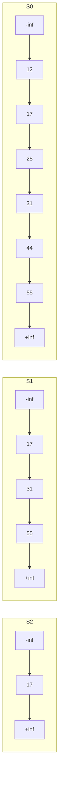

# Sorted maps, skip lists, sets and multimaps

> **Before this lesson:** You should know the map ADT and hash tables
> ([Maps and hash functions](#/lesson/dsa-foundations/maps-hash-functions),
> [Collision handling](#/lesson/dsa-foundations/collisions)), binary search and the "leftmost
> position at or after the target" variant
> ([Thinking recursively](#/lesson/dsa-foundations/recursion-examples)), and linked lists with
> sentinels ([Doubly linked lists](#/lesson/dsa-foundations/doubly-positional)).

## In plain words

A hash table is superb at one question: "is this exact key here?" It is useless at questions
about *nearby* keys, because its whole method is to scatter keys around. A **sorted map** keeps
the keys in order, so it can also answer "what is the closest key below this one?" and "give me
every key between these two".

A paper train timetable is a sorted map from departure times to trains. Nobody asks it "is
there a train at exactly 09:37?". The useful questions are "what is the next train after
09:30?" and "which trains leave between 9 and 10?", and both are easy because the times are
listed in order: find the place, then read along.

The lesson shows two ways to build a sorted map. One is a sorted array searched by halving.
The other, the **skip list**, is a linked list with express lanes laid over it, like a railway
line with stopping trains, semi-fast trains and expresses.

Why it matters for a job: "find the nearest", "find everything in a range" and "keep things in
order while inserting" come up constantly (scheduling, pricing, leaderboards, time-series
data). Knowing that a dictionary cannot do them, and what can, is a frequent interview
discriminator. The lesson ends with three close relatives of the map: sets, multisets and
multimaps.

## 1. The sorted map ADT

A sorted map needs keys that can be put in order: for any two keys, one is smaller, or they
are equal. Such an ordering is called a **total order**; numbers and strings have one built in.
In addition to everything an ordinary map does, a sorted map `M` supports:

| Operation | Meaning |
|---|---|
| `M.find_min()` / `M.find_max()` | the `(key, value)` pair with smallest / largest key |
| `M.find_lt(k)` / `M.find_le(k)` | pair with the greatest key strictly less than / at most `k` |
| `M.find_gt(k)` / `M.find_ge(k)` | pair with the least key strictly greater than / at least `k` |
| `M.find_range(start, stop)` | iterate all pairs with `start <= key < stop` |
| `iter(M)` / `reversed(M)` | keys in increasing / decreasing order |

The suffixes abbreviate comparisons: `lt` is "less than", `le` "less than or equal", `gt`
"greater than", `ge` "greater than or equal". These are called **inexact** or
**nearest-neighbour** searches, because the key asked about need not be in the map.

## 2. Sorted search tables

The first implementation stores the items in a Python list kept in **increasing order of key**.
Binary search then finds any key, or the position where it *would* be, in $O(\log n)$.

One helper does all the searching: `_find_index(k, low, high)` returns the index of the
**leftmost item whose key is at least $k$**, or `high + 1` if every key is smaller. This is the
"lower bound" search from the recursion module. Every operation is a small step away from it:

- `M[k]`: call it `j`; the key is present exactly when `j` is in range and the key at `j`
  equals `k`.
- `find_ge(k)`: the item at `j`, if there is one.
- `find_lt(k)`: the item at `j - 1`, since everything before `j` is smaller than `k`.
- `find_gt(k)`: the item at `j`, or at `j + 1` if the key at `j` equals `k`.
- `find_range(start, stop)`: start at the index for `start` and walk right until a key reaches
  `stop`.

```python-run
class SortedTableMap:
    """Map implementation using a sorted table."""
    def __init__(self):
        self._table = []                               # list of [key, value], sorted by key

    def _find_index(self, k, low, high):
        """Return index of the leftmost item with key >= k (high + 1 if no such item)."""
        if high < low:
            return high + 1                            # no element qualifies
        mid = (low + high) // 2
        if k == self._table[mid][0]:
            return mid                                 # found exact match
        elif k < self._table[mid][0]:
            return self._find_index(k, low, mid - 1)   # Note: may return mid
        else:
            return self._find_index(k, mid + 1, high)  # answer is right of mid

    def __len__(self): return len(self._table)
    def __getitem__(self, k):
        j = self._find_index(k, 0, len(self._table) - 1)
        if j == len(self._table) or self._table[j][0] != k:
            raise KeyError('Key Error: ' + repr(k))
        return self._table[j][1]
    def __setitem__(self, k, v):
        j = self._find_index(k, 0, len(self._table) - 1)
        if j < len(self._table) and self._table[j][0] == k:
            self._table[j][1] = v                      # reassign value
        else:
            self._table.insert(j, [k, v])              # adds new item: O(n) shifting
    def __delitem__(self, k):
        j = self._find_index(k, 0, len(self._table) - 1)
        if j == len(self._table) or self._table[j][0] != k:
            raise KeyError('Key Error: ' + repr(k))
        self._table.pop(j)                             # O(n) shifting
    def __iter__(self):
        for item in self._table: yield item[0]

    def find_min(self): return tuple(self._table[0]) if self._table else None
    def find_max(self): return tuple(self._table[-1]) if self._table else None
    def find_ge(self, k):
        j = self._find_index(k, 0, len(self._table) - 1)
        return tuple(self._table[j]) if j < len(self._table) else None
    def find_lt(self, k):
        j = self._find_index(k, 0, len(self._table) - 1)
        return tuple(self._table[j - 1]) if j > 0 else None
    def find_gt(self, k):
        j = self._find_index(k, 0, len(self._table) - 1)
        if j < len(self._table) and self._table[j][0] == k:
            j += 1                                     # advance past match
        return tuple(self._table[j]) if j < len(self._table) else None
    def find_range(self, start, stop):
        j = 0 if start is None else self._find_index(start, 0, len(self._table) - 1)
        while j < len(self._table) and (stop is None or self._table[j][0] < stop):
            yield tuple(self._table[j])
            j += 1

M = SortedTableMap()
for k in [44, 17, 88, 8, 32, 65, 97, 28, 54, 82, 93, 21, 29, 76, 80]:
    M[k] = str(k)
print(list(M))
print("ge(30):", M.find_ge(30), " lt(30):", M.find_lt(30), " gt(88):", M.find_gt(88))
print("range [50, 85):", [k for k, _ in M.find_range(50, 85)])
```

| Operation | Running time |
|---|---|
| `k in M`, `M[k]` | $O(\log n)$ |
| `M[k] = v` | $O(n)$ worst case; $O(\log n)$ if `k` exists |
| `del M[k]` | $O(n)$ worst case |
| `find_min`, `find_max` | $O(1)$ |
| `find_lt`, `find_gt`, `find_le`, `find_ge` | $O(\log n)$ |
| `find_range(start, stop)` | $O(s + \log n)$ where $s$ items are reported |
| `iter`, `reversed` | $O(n)$ |

The demo inserts fifteen keys in a jumbled order and prints them back sorted. Then
`find_ge(30)` gives `(32, '32')`, `find_lt(30)` gives `(29, '29')`, `find_gt(88)` gives
`(93, '93')`, and the range from 50 up to but not including 85 is `[54, 65, 76, 80, 82]`.

The table shows the trade. Searching is fast, but inserting or deleting a key has to shift
part of the array, $O(n)$. A sorted table is ideal when searches are frequent and updates are
rare. In everyday Python the `bisect` module (`bisect_left`, `bisect_right`, `insort`) provides
the binary search ready-made.

### 2.1 Two applications

**Flight databases.** Give each flight the key `(origin, destination, date, time)`. A traveller
asks for flights near a requested time: `find_ge((ORD, PVD, 05May, 09:30))` returns the first
flight on that route and day at or after 09:30, and `find_range(k1, k2)` lists every flight in
a time window. Tuples are compared item by item from the left, like words in a dictionary,
which is exactly the ordering needed here.

**Maxima sets.** Suppose each car is described by a pair (cost, performance). One car
*dominates* another if it is at least as cheap and at least as fast; nobody would choose the
dominated one. The cars that no other car dominates form the **maxima set** (economists call it
the *Pareto frontier*). Along it, paying more always buys more performance. It can be kept in
a sorted map keyed by cost. Then `best(c)`, "the best car I can get for at most $c$", is
`find_le(c)`. To `add(c, p)`: if `find_le(c)` already offers performance $\ge p$, the new car
is dominated, so ignore it. Otherwise insert it, and remove every costlier car whose
performance is $\le p$, since the newcomer now dominates those.

The demo keeps two parallel sorted lists, costs and performances, and uses `bisect`. Of the six
cars offered, (30, 100) and (15, 70) are dominated by cars already stored and are never added;
what remains is `[(10, 80), (20, 120), (25, 150), (40, 160)]`, with performance rising as cost
rises, and the best car for at most 35 is `(25, 150)`.

```python-run
import bisect
class CostPerformanceDatabase:
    def __init__(self): self._cost, self._perf = [], []      # parallel sorted lists
    def best(self, c):
        j = bisect.bisect_right(self._cost, c)
        return (self._cost[j - 1], self._perf[j - 1]) if j else None
    def add(self, c, p):
        other = self.best(c)
        if other is not None and other[1] >= p:
            return                                            # (c, p) is dominated
        j = bisect.bisect_left(self._cost, c)
        k = j
        while k < len(self._cost) and self._perf[k] <= p:    # remove pairs dominated by (c, p)
            k += 1
        self._cost[j:k] = [c]; self._perf[j:k] = [p]
db = CostPerformanceDatabase()
for c, p in [(20, 120), (10, 80), (30, 100), (25, 150), (40, 160), (15, 70)]:
    db.add(c, p)
print(list(zip(db._cost, db._perf)), "best under 35:", db.best(35))
```

## 3. Skip lists

A sorted array gives $O(\log n)$ search but $O(n)$ updates. A sorted linked list gives $O(1)$
updates once you are at the right place, but getting there takes $O(n)$, because a linked list
cannot be halved. The **skip list** gets $O(\log n)$ *expected* time for search and for updates
by laying "express lanes" over a linked list, and it decides which items get express stops by
tossing a coin.

### 3.1 Structure

A skip list is a stack of sorted linked lists $S_0, S_1, \ldots, S_h$, one above another:

- $S_0$, the bottom list, contains every item in key order, between two sentinels written
  $-\infty$ and $+\infty$ ("minus infinity" and "plus infinity": pretend keys smaller and
  larger than any real key).
- Each higher list $S_i$ contains a **random selection** of the items in the list below it:
  every item of $S_{i-1}$ is copied up into $S_i$ with probability 1/2, independently of the
  others. The sentinels are in every list.
- The top list $S_h$ contains only the sentinels.

So $S_1$ holds about half the items, $S_2$ about a quarter, and so on; the number of levels $h$
is about $\log n$. An item that appears on several levels forms a **tower**. From any position
you can step to the next or previous item on the same level, or to the same item on the level
below or above. The picture shows seven keys; 17 has a tower of height three, 31 and 55 of
height two.



### 3.2 Searching

Searching works like a rail journey: ride the express as far as it helps, then change to a
slower train. Start at the top-left sentinel. Repeat: **scan forward** along the current level
while the next key is $\le k$; then **drop down** one level. When you can go no further on the
bottom level, you are standing on the largest key that is $\le k$.

```
SkipSearch(k):
    p = start                         # top-left position
    while below(p) is not None:
        p = below(p)                  # drop down
        while k >= key(next(p)):
            p = next(p)               # scan forward
    return p
```

Searching for 44 above: at $S_2$, move to 17 (next is $+\infty$); drop to $S_1$, move to 31 (next
is 55 > 44); drop to $S_0$, move to 44. Found in 3 forward steps rather than 5.

### 3.3 Insertion

Search for $k$ to find the bottom-level position $p$ holding the largest key $\le k$, and
insert the new item right after $p$. Then **toss a coin**. While it comes up heads, also add
the item to the next level up (creating a new top level if necessary), linking it in after the
last position the search visited on that level. Half of all items stop at the bottom level, a
quarter reach exactly level 1, and so on, which is what keeps the levels in the right
proportions without any rebalancing work.

### 3.4 Deletion

Search for $k$; if found, remove the whole tower by unlinking the position at each level
(`next(prev(p)) = next(p)` etc.), and remove top levels that became empty apart from sentinels.

### 3.5 Analysis

- **Height.** An item reaches level $i$ only if its coin came up heads $i$ times running, which
  has probability $1/2^i$. So the chance that level $i$ contains *any* of the $n$ items is at
  most $n/2^i$. For $i = 3\log n$ that is at most $1/n^2$, which is tiny. The height is
  $O(\log n)$ **with high probability**, a phrase meaning that the chance of it failing shrinks
  rapidly as $n$ grows.
- **Search time.** On each level, the expected number of forward steps is at most 2. Here is
  why: every key the search steps over on level $i$ is one that was *not* promoted to level
  $i+1$ (otherwise the search would have stepped over it on the level above). So counting
  forward steps on a level is like counting coin tosses until the first heads, and that
  averages 2. With $O(\log n)$ levels, a search takes expected $O(\log n)$ time.
- **Space.** The expected number of positions over all levels is
  $n + n/2 + n/4 + \cdots < 2n$, so $O(n)$.

| Operation | Skip list (expected) |
|---|---|
| search, insert, delete | $O(\log n)$ |
| `find_min`, `find_max` | $O(1)$ |
| `find_lt/gt/le/ge` | $O(\log n)$ |
| `find_range` | $O(s + \log n)$ |
| space | $O(n)$ |

In principle the worst case has no limit (the coin could keep coming up heads), but that is
astronomically unlikely. Note where the randomness lives: in the **algorithm's own coin
tosses**, not in the data. No particular input is "bad" for a skip list, and nobody can
construct one, because they cannot predict the coin.

The implementation below uses the layout found in practice: each item is one node holding a
list `forward`, where `forward[i]` is the next node on level `i`. The length of that list is
the height of the item's tower. The helper `_predecessors(key)` performs the search walk and
records, for every level, the last node visited there; those are exactly the nodes whose
links must change on an insertion or a removal.

```python-run
import random
class SkipList:
    class _Node:
        __slots__ = "key", "value", "forward"
        def __init__(self, key, value, level):
            self.key, self.value, self.forward = key, value, [None] * level
    MAX_LEVEL = 16
    def __init__(self):
        self._head = self._Node(None, None, self.MAX_LEVEL)   # -inf sentinel tower
        self._level, self._n = 1, 0
    def _random_level(self):
        lvl = 1
        while random.random() < 0.5 and lvl < self.MAX_LEVEL:
            lvl += 1
        return lvl
    def _predecessors(self, key):
        update, x, steps = [None] * self.MAX_LEVEL, self._head, 0
        for i in range(self._level - 1, -1, -1):              # top level down
            while x.forward[i] is not None and x.forward[i].key < key:
                x = x.forward[i]; steps += 1                  # scan forward
            update[i] = x                                     # drop down
        return update, steps
    def get(self, key):
        update, steps = self._predecessors(key)
        x = update[0].forward[0]
        return (x.value if x is not None and x.key == key else None), steps
    def put(self, key, value):
        update, _ = self._predecessors(key)
        x = update[0].forward[0]
        if x is not None and x.key == key:
            x.value = value; return
        lvl = self._random_level()
        if lvl > self._level:
            for i in range(self._level, lvl): update[i] = self._head
            self._level = lvl
        node = self._Node(key, value, lvl)
        for i in range(lvl):                                  # splice the tower in
            node.forward[i] = update[i].forward[i]
            update[i].forward[i] = node
        self._n += 1
    def remove(self, key):
        update, _ = self._predecessors(key)
        x = update[0].forward[0]
        if x is None or x.key != key: return False
        for i in range(len(x.forward)):
            update[i].forward[i] = x.forward[i]
        self._n -= 1
        return True
    def keys(self):
        x, out = self._head.forward[0], []
        while x: out.append(x.key); x = x.forward[0]
        return out

random.seed(1)
S = SkipList()
for k in random.sample(range(100000), 5000): S.put(k, k * k)
probe = S.keys()[2500]
print("levels:", S._level, " search steps for one key:", S.get(probe)[1], " (list scan would take ~2500)")
S.remove(probe); print("after removal found:", S.get(probe)[0], " size:", S._n)
```

With 5,000 keys the skip list has around a dozen levels, and finding the middle key takes a
handful of forward steps (7 in this run) where a plain linked list would need about 2,500.

> [!INTERVIEW]
> Skip lists are the classic answer to "how would you build an ordered map without a balanced
> tree?". The Redis database uses one for its sorted sets, and the storage engines LevelDB and
> RocksDB use one for recent writes held in memory, partly because a skip list is comparatively
> easy to share safely between threads. Be able to describe the search walk (go right while you
> can, then down) and the coin-toss argument for the height.

## 4. Sets, multisets and multimaps

Three relatives of the map appear so often that they have names of their own.

- A **set** is a collection of items with **no duplicates** and no particular order. Think of
  it as a map that has keys but no values. Its core operations are `S.add(e)`, `S.discard(e)`,
  `e in S`, `len(S)` and `iter(S)`. On top of those come `remove`, `pop`, `clear`, subset tests
  (`<=`, `<`), union `|` (items in either set), intersection `&` (items in both), difference
  `-` (items in the first but not the second), symmetric difference `^` (items in exactly
  one), and versions that update in place (`|=` and so on). As `MutableMapping` does for maps,
  Python's `MutableSet` base class builds all of these out of the five core methods.
- A **multiset**, or *bag*, allows duplicates: it records how many copies of each item it
  holds. Implement it as a map from item to **count**. In Python: `collections.Counter`.
- A **multimap** associates one key with *several* values. The index at the back of a book maps
  each term to all the pages where it appears. Implement it as a map from key to a **list of
  values**. In Python: `collections.defaultdict(list)`.

Built on hash tables, `add`, `discard` and `in` take expected $O(1)$ time. The union of sets of
sizes $n$ and $m$ takes expected $O(n + m)$; the intersection takes expected $O(\min(n, m))$,
by looking up each item of the smaller set in the larger.

```python-run
from collections import Counter, defaultdict
class MultiMap:
    """A multimap class built upon use of an underlying map for storage."""
    _MapType = dict                         # map type; can be redefined by subclass
    def __init__(self):
        self._map = self._MapType()
        self._n = 0
    def __iter__(self):
        for k, secondary in self._map.items():
            for v in secondary:
                yield (k, v)
    def add(self, k, v):
        self._map.setdefault(k, []).append(v)
        self._n += 1
    def pop(self, k):
        secondary = self._map[k]            # may raise KeyError
        v = secondary.pop()
        if len(secondary) == 0:
            del self._map[k]                # no pairs left
        self._n -= 1
        return (k, v)
    def find_all(self, k):
        for v in self._map.get(k, []):
            yield (k, v)
index = MultiMap()
for page, word in [(3, "heap"), (7, "hash"), (9, "heap"), (12, "tree"), (15, "heap")]:
    index.add(word, page)
print(list(index.find_all("heap")), index.pop("hash"), index._n)
print(Counter("mississippi").most_common(2), {1, 2, 3} & {2, 3, 4}, {1, 2} <= {1, 2, 3})
```

## 5. Pitfalls

- **Using a hash map when you need ordered queries**, and then sorting all the keys on every
  query. Use a sorted structure.
- **A search helper that reports only "not found".** The position where the key *would* go is
  what makes inexact searches possible; return that.
- **Inserting into a skip list without recording the predecessor on every level.** The new
  tower has to be linked in on each level it reaches.
- **Leaving an empty list behind in a multimap** when the last value for a key is removed.
  Delete the key as well.
- **Expecting a skip list's bounds to be guarantees.** They are expected-case bounds; for a
  worst-case guarantee, use a balanced search tree.

## 6. Summary

- A sorted map adds nearest-key and range queries to the map ADT.
- A sorted table (sorted array plus binary search) searches in $O(\log n)$ but updates in
  $O(n)$.
- A skip list (a linked list with random express levels) searches and updates in expected
  $O(\log n)$, using $O(n)$ expected space.
- Sets, multisets and multimaps are maps in light disguise.

The table compares the structures seen so far with the balanced search trees of the next
module.

| Structure | Search | Insert/delete | Ordered queries |
|---|---|---|---|
| hash table | $O(1)$ expected | $O(1)$ expected | no |
| sorted table | $O(\log n)$ | $O(n)$ | yes |
| skip list | $O(\log n)$ expected | $O(\log n)$ expected | yes |
| balanced search tree (next module) | $O(\log n)$ worst | $O(\log n)$ worst | yes |

> **Source:** Goodrich, Tamassia & Goldwasser, *Data Structures and Algorithms in Python*, ch. 10.3–10.5.

## Glossary

- **Total order**: an ordering in which any two keys can be compared.
- **Sorted map**: a map that also answers questions about neighbouring keys and ranges.
- **Inexact (nearest-neighbour) search**: finding the closest key to one that may be absent.
- **Sorted search table**: a sorted array of items searched by binary search.
- **`bisect`**: Python's standard module for binary search in a sorted list.
- **Dominated pair**: a pair that another pair beats or equals on both measures.
- **Maxima set (Pareto frontier)**: the pairs that no other pair dominates.
- **Skip list**: a sorted linked list with randomly chosen higher "express" levels.
- **Tower**: the copies of one item across the levels of a skip list.
- **With high probability**: with a chance of failure that shrinks quickly as $n$ grows.
- **Set**: a collection of distinct items.
- **Union / intersection / difference**: items in either set / in both / in the first only.
- **Multiset (bag)**: a collection that counts duplicates.
- **Multimap**: a map in which one key may have several values.

## Check yourself

```quiz
[
  {"q": "Which query can a sorted map answer efficiently that a hash map cannot?",
   "options": ["Is key k present?", "What is the smallest key >= k?", "How many items are stored?", "Delete key k"], "answer": 1,
   "explain": "Hashing destroys order; nearest-neighbour queries need sorted structure."},
  {"q": "Inserting a new key into a SortedTableMap of n items costs...",
   "options": ["O(1)", "O(log n)", "O(n) worst case", "O(n log n)"], "answer": 2,
   "explain": "Binary search finds the spot in O(log n), but list.insert shifts up to n items."},
  {"q": "In a skip list, each item in level S_i also appears in S_(i+1) with probability...",
   "options": ["1", "1/2", "1/n", "1/log n"], "answer": 1,
   "explain": "A fair coin flip decides promotion, so levels shrink geometrically."},
  {"q": "The skip-list search procedure is...",
   "options": ["scan forward while next key <= k, then drop down; repeat", "binary search on each level", "always start at the bottom level", "hash the key to a level"], "answer": 0,
   "explain": "Express lanes are used as far as possible before descending."},
  {"q": "Expected space of a skip list with n items?",
   "options": ["O(n log n)", "O(n)", "O(n^2)", "O(log n)"], "answer": 1,
   "explain": "n + n/2 + n/4 + ... < 2n positions in expectation."},
  {"q": "A multiset is most naturally implemented as...",
   "options": ["a map from element to count", "a sorted list without duplicates", "a stack", "a set of sets"], "answer": 0,
   "explain": "As in collections.Counter."},
  {"q": "In the maxima-set database keyed by cost, a new pair (c, p) is ignored when...",
   "options": ["c is the largest cost", "find_le(c) already has performance >= p", "p is odd", "the map is empty"], "answer": 1,
   "explain": "Then an existing car is at most as expensive and at least as fast: the new one is dominated."}
]
```
