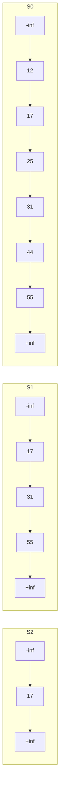

# Sorted maps, skip lists, sets and multimaps

Hash tables answer **exact** queries brilliantly — "is key $k$ present?" — but they scatter keys
deliberately, so they cannot answer "what is the nearest key to $k$?" or "list every key between
$a$ and $b$". The **sorted map** ADT adds order-based queries. This lesson covers the sorted search
table, the randomised **skip list**, and the related ADTs: sets, multisets and multimaps.

## 1. The sorted map ADT

Keys are assumed to come from a **total order** (any two are comparable with `<`). On top of the
map ADT, a sorted map `M` supports:

| Operation | Meaning |
|---|---|
| `M.find_min()` / `M.find_max()` | the `(key, value)` pair with smallest / largest key |
| `M.find_lt(k)` / `M.find_le(k)` | pair with the greatest key strictly less than / at most `k` |
| `M.find_gt(k)` / `M.find_ge(k)` | pair with the least key strictly greater than / at least `k` |
| `M.find_range(start, stop)` | iterate all pairs with `start <= key < stop` |
| `iter(M)` / `reversed(M)` | keys in increasing / decreasing order |

These are called **inexact** or **nearest-neighbour** searches.

## 2. Sorted search tables

Store the items in an array-based sequence in **increasing key order**. Then binary search locates
any key — or the position where it would be — in $O(\log n)$.

The workhorse is `_find_index(k, low, high)`: return the index of the **leftmost item with key
$\ge k$** (or `high + 1` if none). Every query is built on it:

```python-run
class SortedTableMap:
    """Map implementation using a sorted table."""
    def __init__(self):
        self._table = []                               # list of [key, value], sorted by key

    def _find_index(self, k, low, high):
        """Return index of the leftmost item with key >= k (high + 1 if no such item)."""
        if high < low:
            return high + 1                            # no element qualifies
        mid = (low + high) // 2
        if k == self._table[mid][0]:
            return mid                                 # found exact match
        elif k < self._table[mid][0]:
            return self._find_index(k, low, mid - 1)   # Note: may return mid
        else:
            return self._find_index(k, mid + 1, high)  # answer is right of mid

    def __len__(self): return len(self._table)
    def __getitem__(self, k):
        j = self._find_index(k, 0, len(self._table) - 1)
        if j == len(self._table) or self._table[j][0] != k:
            raise KeyError('Key Error: ' + repr(k))
        return self._table[j][1]
    def __setitem__(self, k, v):
        j = self._find_index(k, 0, len(self._table) - 1)
        if j < len(self._table) and self._table[j][0] == k:
            self._table[j][1] = v                      # reassign value
        else:
            self._table.insert(j, [k, v])              # adds new item: O(n) shifting
    def __delitem__(self, k):
        j = self._find_index(k, 0, len(self._table) - 1)
        if j == len(self._table) or self._table[j][0] != k:
            raise KeyError('Key Error: ' + repr(k))
        self._table.pop(j)                             # O(n) shifting
    def __iter__(self):
        for item in self._table: yield item[0]

    def find_min(self): return tuple(self._table[0]) if self._table else None
    def find_max(self): return tuple(self._table[-1]) if self._table else None
    def find_ge(self, k):
        j = self._find_index(k, 0, len(self._table) - 1)
        return tuple(self._table[j]) if j < len(self._table) else None
    def find_lt(self, k):
        j = self._find_index(k, 0, len(self._table) - 1)
        return tuple(self._table[j - 1]) if j > 0 else None
    def find_gt(self, k):
        j = self._find_index(k, 0, len(self._table) - 1)
        if j < len(self._table) and self._table[j][0] == k:
            j += 1                                     # advance past match
        return tuple(self._table[j]) if j < len(self._table) else None
    def find_range(self, start, stop):
        j = 0 if start is None else self._find_index(start, 0, len(self._table) - 1)
        while j < len(self._table) and (stop is None or self._table[j][0] < stop):
            yield tuple(self._table[j])
            j += 1

M = SortedTableMap()
for k in [44, 17, 88, 8, 32, 65, 97, 28, 54, 82, 93, 21, 29, 76, 80]:
    M[k] = str(k)
print(list(M))
print("ge(30):", M.find_ge(30), " lt(30):", M.find_lt(30), " gt(88):", M.find_gt(88))
print("range [50, 85):", [k for k, _ in M.find_range(50, 85)])
```

| Operation | Running time |
|---|---|
| `k in M`, `M[k]` | $O(\log n)$ |
| `M[k] = v` | $O(n)$ worst case; $O(\log n)$ if `k` exists |
| `del M[k]` | $O(n)$ worst case |
| `find_min`, `find_max` | $O(1)$ |
| `find_lt`, `find_gt`, `find_le`, `find_ge` | $O(\log n)$ |
| `find_range(start, stop)` | $O(s + \log n)$ where $s$ items are reported |
| `iter`, `reversed` | $O(n)$ |

A sorted table is ideal when searches dominate and updates are rare. In Python the `bisect` module
(`bisect_left`, `bisect_right`, `insort`) gives you the binary search primitive directly.

### 2.1 Two applications

**Flight databases.** Key each flight by `(origin, destination, date, time)`. A traveller asks for
flights near a requested time: `find_ge((ORD, PVD, 05May, 09:30))` returns the first flight at or
after 09:30, and `find_range(k1, k2)` lists all flights in a window. Tuple keys compare
lexicographically, which is exactly what is needed.

**Maxima sets.** Suppose cars are (cost, performance) pairs. A car is *dominated* if another car is
both cheaper and faster. The set of non-dominated pairs — the **maxima set** (also the *Pareto
frontier*) — can be kept in a sorted map keyed by cost, with performance strictly increasing along
it. `best(c)` = `find_le(c)` answers "the best car I can afford for at most $c$". To `add(c, p)`:
if `find_le(c)` already has performance $\ge p$, the new pair is dominated — ignore it; otherwise
insert it and remove the pairs it now dominates (walk right with `find_gt` while their
performance $\le p$).

```python-run
import bisect
class CostPerformanceDatabase:
    def __init__(self): self._cost, self._perf = [], []      # parallel sorted lists
    def best(self, c):
        j = bisect.bisect_right(self._cost, c)
        return (self._cost[j - 1], self._perf[j - 1]) if j else None
    def add(self, c, p):
        other = self.best(c)
        if other is not None and other[1] >= p:
            return                                            # (c, p) is dominated
        j = bisect.bisect_left(self._cost, c)
        k = j
        while k < len(self._cost) and self._perf[k] <= p:    # remove pairs dominated by (c, p)
            k += 1
        self._cost[j:k] = [c]; self._perf[j:k] = [p]
db = CostPerformanceDatabase()
for c, p in [(20, 120), (10, 80), (30, 100), (25, 150), (40, 160), (15, 70)]:
    db.add(c, p)
print(list(zip(db._cost, db._perf)), "best under 35:", db.best(35))
```

## 3. Skip lists

A sorted array gives $O(\log n)$ search but $O(n)$ updates; a sorted linked list gives $O(1)$
updates at a known position but $O(n)$ search. The **skip list** gets $O(\log n)$ *expected* time for
all of them by adding randomised "express lanes" to a linked list.

### 3.1 Structure

A skip list $S$ for a map consists of a series of lists $\{S_0, S_1, \ldots, S_h\}$:

- $S_0$ contains every item, in key order, plus sentinels $-\infty$ and $+\infty$.
- For $i \ge 1$, $S_i$ contains a **randomly chosen subset** of $S_{i-1}$ (plus the sentinels):
  each item of $S_{i-1}$ is also in $S_i$ with probability 1/2.
- $S_h$ contains only the sentinels.

So $S_1$ has about $n/2$ items, $S_2$ about $n/4$, and the height $h$ is about $\log n$. Viewed
as a grid, each item forms a **tower** across the levels it appears in; positions support
`next(p)`, `prev(p)`, `below(p)`, `above(p)`.



### 3.2 Searching

Start at the top-left sentinel. Repeat: **scan forward** while the next key is $\le k$; then **drop
down** one level. Stop at the bottom level: the current position holds the largest key $\le k$.

```
SkipSearch(k):
    p = start                         # top-left position
    while below(p) is not None:
        p = below(p)                  # drop down
        while k >= key(next(p)):
            p = next(p)               # scan forward
    return p
```

Searching for 44 above: at $S_2$, move to 17 (next is $+\infty$); drop to $S_1$, move to 31 (next
is 55 > 44); drop to $S_0$, move to 44. Found in 3 forward steps rather than 5.

### 3.3 Insertion

Search for $k$ to find the bottom-level position $p$ with the largest key $\le k$; insert the new
item after $p$. Then **flip a coin**: while it comes up heads, add the item to the next level up
(growing a new top level if needed), linking it after the last position visited on that level during
the search.

### 3.4 Deletion

Search for $k$; if found, remove the whole tower by unlinking the position at each level
(`next(prev(p)) = next(p)` etc.), and remove top levels that became empty apart from sentinels.

### 3.5 Analysis

- **Height.** The probability that a given item reaches level $i$ is $1/2^i$, so the probability
  level $i$ has *any* item is at most $n/2^i$. For $i = 3\log n$ this is at most $1/n^2$: the height
  is $O(\log n)$ **with high probability**.
- **Search time.** At each level the expected number of forward scans is at most 2: a key scanned
  at level $i$ is one that did *not* get promoted to level $i+1$, and counting coin flips until the
  first heads gives expectation 2. With $O(\log n)$ levels, search is expected $O(\log n)$.
- **Space.** Expected total positions $\sum_i n/2^i < 2n$: $O(n)$.

| Operation | Skip list (expected) |
|---|---|
| search, insert, delete | $O(\log n)$ |
| `find_min`, `find_max` | $O(1)$ |
| `find_lt/gt/le/ge` | $O(\log n)$ |
| `find_range` | $O(s + \log n)$ |
| space | $O(n)$ |

The worst case is unbounded in principle (the coin could keep coming up heads) but astronomically
unlikely. Note the randomness is in the **algorithm's coin flips**, not in the input — no input
distribution is "bad".

```python-run
import random
class SkipList:
    class _Node:
        __slots__ = "key", "value", "forward"
        def __init__(self, key, value, level):
            self.key, self.value, self.forward = key, value, [None] * level
    MAX_LEVEL = 16
    def __init__(self):
        self._head = self._Node(None, None, self.MAX_LEVEL)   # -inf sentinel tower
        self._level, self._n = 1, 0
    def _random_level(self):
        lvl = 1
        while random.random() < 0.5 and lvl < self.MAX_LEVEL:
            lvl += 1
        return lvl
    def _predecessors(self, key):
        update, x, steps = [None] * self.MAX_LEVEL, self._head, 0
        for i in range(self._level - 1, -1, -1):              # top level down
            while x.forward[i] is not None and x.forward[i].key < key:
                x = x.forward[i]; steps += 1                  # scan forward
            update[i] = x                                     # drop down
        return update, steps
    def get(self, key):
        update, steps = self._predecessors(key)
        x = update[0].forward[0]
        return (x.value if x is not None and x.key == key else None), steps
    def put(self, key, value):
        update, _ = self._predecessors(key)
        x = update[0].forward[0]
        if x is not None and x.key == key:
            x.value = value; return
        lvl = self._random_level()
        if lvl > self._level:
            for i in range(self._level, lvl): update[i] = self._head
            self._level = lvl
        node = self._Node(key, value, lvl)
        for i in range(lvl):                                  # splice the tower in
            node.forward[i] = update[i].forward[i]
            update[i].forward[i] = node
        self._n += 1
    def remove(self, key):
        update, _ = self._predecessors(key)
        x = update[0].forward[0]
        if x is None or x.key != key: return False
        for i in range(len(x.forward)):
            update[i].forward[i] = x.forward[i]
        self._n -= 1
        return True
    def keys(self):
        x, out = self._head.forward[0], []
        while x: out.append(x.key); x = x.forward[0]
        return out

random.seed(1)
S = SkipList()
for k in random.sample(range(100000), 5000): S.put(k, k * k)
probe = S.keys()[2500]
print("levels:", S._level, " search steps for one key:", S.get(probe)[1], " (list scan would take ~2500)")
S.remove(probe); print("after removal found:", S.get(probe)[0], " size:", S._n)
```

(This implementation stores each tower as one node with an array of forward pointers — the usual
practical layout — rather than a grid of separate positions.)

> [!INTERVIEW]
> Skip lists are the classic answer to "an ordered map without tree rotations". Redis sorted sets
> and LevelDB/RocksDB memtables use them, partly because they are easy to make concurrent. Know the
> search walk (right while possible, then down) and the coin-flip height argument.

## 4. Sets, multisets and multimaps

- A **set** is an unordered collection of elements **without duplicates** — conceptually a map with
  keys but no values. Core: `S.add(e)`, `S.discard(e)`, `e in S`, `len(S)`, `iter(S)`; plus
  `remove`, `pop`, `clear`, subset tests (`<=`, `<`), union `|`, intersection `&`, difference `-`,
  symmetric difference `^`, and in-place versions (`|=`, …). Python's `MutableSet` ABC derives all of
  these from the five core methods — e.g. `__lt__` (proper subset) checks sizes and then membership
  of every element; `__or__` builds a new set by adding elements of both.
- A **multiset** (or *bag*) allows duplicates. Implement it as a map from element to its **count**.
  Python: `collections.Counter`.
- A **multimap** associates a key with *multiple* values (an index maps a term to all its pages).
  Implement it as a map from key to a **container of values**. Python:
  `collections.defaultdict(list)`.

With hash tables underneath: `add`, `discard`, `in` are expected $O(1)$; union/intersection of sets
of sizes $n$ and $m$ take $O(n + m)$ and $O(\min(n, m))$ expected.

```python-run
from collections import Counter, defaultdict
class MultiMap:
    """A multimap class built upon use of an underlying map for storage."""
    _MapType = dict                         # map type; can be redefined by subclass
    def __init__(self):
        self._map = self._MapType()
        self._n = 0
    def __iter__(self):
        for k, secondary in self._map.items():
            for v in secondary:
                yield (k, v)
    def add(self, k, v):
        self._map.setdefault(k, []).append(v)
        self._n += 1
    def pop(self, k):
        secondary = self._map[k]            # may raise KeyError
        v = secondary.pop()
        if len(secondary) == 0:
            del self._map[k]                # no pairs left
        self._n -= 1
        return (k, v)
    def find_all(self, k):
        for v in self._map.get(k, []):
            yield (k, v)
index = MultiMap()
for page, word in [(3, "heap"), (7, "hash"), (9, "heap"), (12, "tree"), (15, "heap")]:
    index.add(word, page)
print(list(index.find_all("heap")), index.pop("hash"), index._n)
print(Counter("mississippi").most_common(2), {1, 2, 3} & {2, 3, 4}, {1, 2} <= {1, 2, 3})
```

## 5. Pitfalls

- Using a hash map when you need ordered queries (then sorting the keys on every query).
- `_find_index` returning "not found" instead of the insertion point — the insertion point is what
  makes inexact searches possible.
- Skip-list search that scans while `next.key <= k` at upper levels during *insertion* without
  recording the predecessor at each level.
- Forgetting to delete a multimap key when its last value is removed.

## 6. Summary

| Structure | Search | Insert/delete | Ordered queries |
|---|---|---|---|
| hash table | $O(1)$ expected | $O(1)$ expected | no |
| sorted table | $O(\log n)$ | $O(n)$ | yes |
| skip list | $O(\log n)$ expected | $O(\log n)$ expected | yes |
| balanced search tree (next module) | $O(\log n)$ worst | $O(\log n)$ worst | yes |

> **Source:** Goodrich, Tamassia & Goldwasser, *Data Structures and Algorithms in Python*, ch. 10.3–10.5.

## Check yourself

```quiz
[
  {"q": "Which query can a sorted map answer efficiently that a hash map cannot?",
   "options": ["Is key k present?", "What is the smallest key >= k?", "How many items are stored?", "Delete key k"], "answer": 1,
   "explain": "Hashing destroys order; nearest-neighbour queries need sorted structure."},
  {"q": "Inserting a new key into a SortedTableMap of n items costs...",
   "options": ["O(1)", "O(log n)", "O(n) worst case", "O(n log n)"], "answer": 2,
   "explain": "Binary search finds the spot in O(log n), but list.insert shifts up to n items."},
  {"q": "In a skip list, each item in level S_i also appears in S_(i+1) with probability...",
   "options": ["1", "1/2", "1/n", "1/log n"], "answer": 1,
   "explain": "A fair coin flip decides promotion, so levels shrink geometrically."},
  {"q": "The skip-list search procedure is...",
   "options": ["scan forward while next key <= k, then drop down; repeat", "binary search on each level", "always start at the bottom level", "hash the key to a level"], "answer": 0,
   "explain": "Express lanes are used as far as possible before descending."},
  {"q": "Expected space of a skip list with n items?",
   "options": ["O(n log n)", "O(n)", "O(n^2)", "O(log n)"], "answer": 1,
   "explain": "n + n/2 + n/4 + ... < 2n positions in expectation."},
  {"q": "A multiset is most naturally implemented as...",
   "options": ["a map from element to count", "a sorted list without duplicates", "a stack", "a set of sets"], "answer": 0,
   "explain": "As in collections.Counter."},
  {"q": "In the maxima-set database keyed by cost, a new pair (c, p) is ignored when...",
   "options": ["c is the largest cost", "find_le(c) already has performance >= p", "p is odd", "the map is empty"], "answer": 1,
   "explain": "Then an existing car is at most as expensive and at least as fast: the new one is dominated."}
]
```
