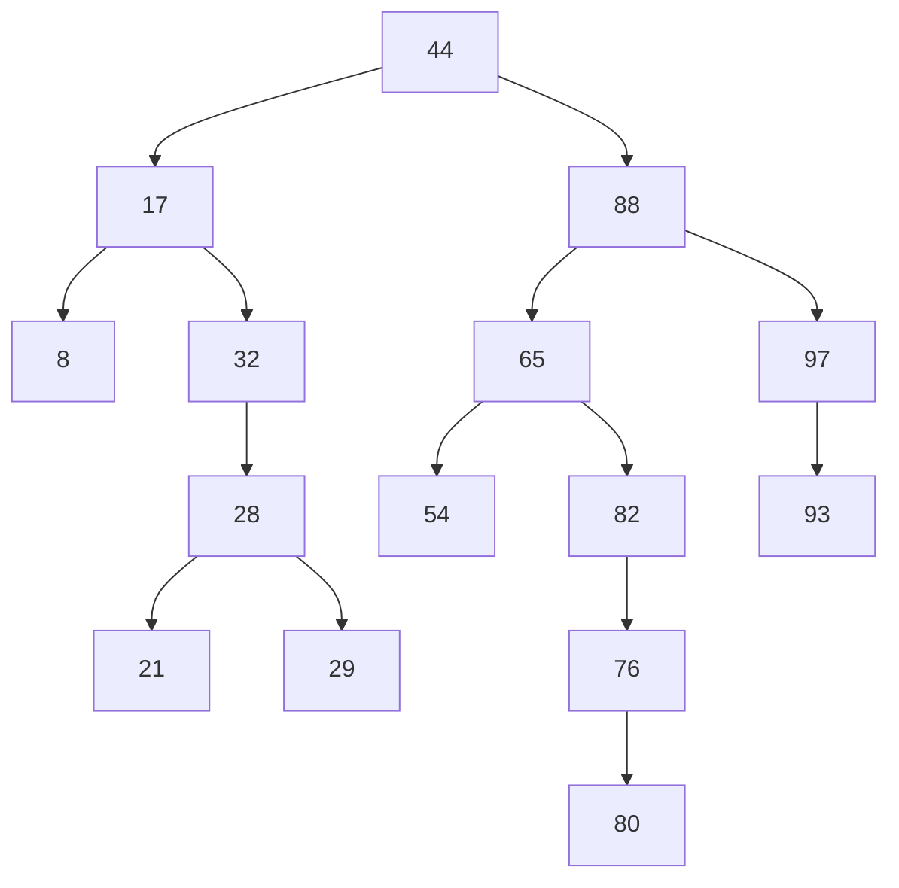

# Binary search trees

> **Before this lesson:** You should know binary trees, subtrees, height and inorder traversal
> ([Tree terminology](#/lesson/dsa-foundations/tree-basics),
> [Traversals](#/lesson/dsa-foundations/tree-traversals)), binary search
> ([Thinking recursively](#/lesson/dsa-foundations/recursion-examples)), and the sorted map ADT
> ([Sorted maps, skip lists, sets and multimaps](#/lesson/dsa-foundations/sorted-maps-skip-lists)).

## In plain words

A **binary search tree**, or **BST**, is a binary tree arranged so that you can find any key by
making one left-or-right decision per level. At every node, everything smaller lives on the left
and everything larger lives on the right.

It is the guessing game from the first lesson, frozen into a structure. Someone thinks of a
number; you guess 50; they say "lower", so you never look at anything above 50 again. In a BST
the root is the first guess, its left child is the next guess if the answer was "lower", its
right child the next guess if the answer was "higher", and so on down.

What a tree adds over a sorted array is cheap change. Inserting into a sorted array shifts
half the array along. Inserting into a tree hangs one new node on the end of a branch and
touches nothing else.

Why it matters for a job: ordered data that changes over time (a database index, an in-memory
leaderboard, the sorted collections in most languages' standard libraries) is kept in a search
tree or a close relative. In interviews, "validate a BST", "find the next larger key" and
"delete a node" are standard exercises, and all three are in this lesson.

## 1. The binary search tree property

The sorted table of the previous lesson searched in $O(\log n)$ but updated in $O(n)$. A binary
search tree keeps the same sorted information in linked nodes, so that an update changes only a
few references.

Take a binary tree in which each node holds one item, a key $k$ and a value $v$. It is a
**binary search tree** when, at every node $p$ with key $k$:

- every key in $p$'s **left subtree** is **smaller than** $k$;
- every key in $p$'s **right subtree** is **larger than** $k$.

The rule speaks of whole subtrees, not only of the two children. In the tree below, 29 is in
the left subtree of 44, three levels down, and it must be (and is) smaller than 44.



(The diagram cannot show whether an only child is a left or right child; the BST property decides: 28 < 32 so it is a left child, 80 > 76 so it is a right child, and so on.)

**The key consequence.** An inorder traversal visits the left subtree, then the node, then the
right subtree. In a BST that means "everything smaller, then this key, then everything larger",
at every node. So an **inorder traversal visits the keys in increasing order**:
8, 17, 21, 28, 29, 32, 44, 54, 65, 76, 80, 82, 88, 93, 97, in $O(n)$ time. A BST is a sorted
sequence folded into a tree.

## 2. Navigating a BST

Because inorder is sorted order, the neighbours of a key in sorted order can be found by moving
around the tree, with no full traversal:

- **`first()`**, the smallest key: from the root, keep going left until there is no left child.
- **`last()`**, the largest key: keep going right until there is no right child.
- **`after(p)`**, the next key in sorted order, called the **inorder successor** of $p$:
  - if $p$ has a right child, the successor is the **leftmost** node of the right subtree (the
    smallest of the keys larger than $p$ that hang below it);
  - otherwise go upwards: climb while you are a right child, then take one more step up. The
    node reached is the nearest ancestor that has $p$ somewhere in its *left* subtree. If the
    climb runs off the top of the tree, $p$ was the largest key and has no successor.
- **`before(p)`**, the **inorder predecessor**: the mirror image, swapping left and right.

Each takes $O(h)$ time, where $h$ is the height of the tree, since it follows a single path.
(Calling `after` $n$ times in a row, starting from `first()`, takes $O(n)$ in total and not
$O(nh)$, because the whole walk travels along each edge at most twice.)

Two examples from the picture. The successor of 32: it has no right child, so climb. 32 is the
right child of 17, so keep climbing; 17 is the left child of 44, so take that last step: the
answer is 44. The successor of 65: it has a right child, 82, and the leftmost node below 82 is
76: the answer is 76.

## 3. Searching

Searching is the guessing game. At each node, compare the target key $k$ with the key stored
there, and go left or right accordingly.

```
TreeSearch(T, p, k):
    if k == p.key():      return p                      # successful search
    else if k < p.key() and T.left(p) is not None:
        return TreeSearch(T, T.left(p), k)              # recur on left subtree
    else if k > p.key() and T.right(p) is not None:
        return TreeSearch(T, T.right(p), k)             # recur on right subtree
    return p                                            # unsuccessful search: last position visited
```

A search that fails returns the **last node it visited**, and that turns out to be very useful.
That node is exactly where the missing key *would* be attached, and its key is a neighbour of
$k$ in sorted order (either the next smaller or the next larger key in the tree). This is what
makes insertion, `find_ge`, `find_lt` and the rest easy. The search takes one step per level:
$O(h)$.

**Dry run, searching for 65.** Start at 44: 65 is larger, go right to 88. 65 is smaller, go
left to 65. Found after 3 comparisons.

**Dry run, searching for 68.** 44, right to 88, left to 65, right to 82 (68 is larger than 65),
left to 76 (68 is smaller than 82). At 76, the key 68 is smaller, but 76 has no left child. The
search fails, ending at 76, which is indeed the next key above 68.

## 4. Insertion

To insert the item $(k, v)$, first search for $k$.

- If the key is found, **replace** its value; a map holds each key once.
- Otherwise the search ended at a node $p$ that has no child on the side where $k$ belongs.
  Attach a new leaf there: as the left child if $k$ is smaller than $p$'s key, as the right
  child otherwise.

Inserting 68 into the tree above would hang it as the left child of 76. A new key always
becomes a leaf, and the cost is that of the search: $O(h)$.

## 5. Deletion

Deleting is harder, because the node to remove may be in the middle of the tree with nodes
hanging from it. There are three cases, by number of children.

1. **No children.** Remove the node; nothing else is affected.
2. **One child $r$.** Remove the node and let $r$ move up into its place, linked to the removed
   node's parent. This is safe: every key in $r$'s subtree was already on the correct side of
   all the ancestors.
3. **Two children.** The node cannot be cut out, since two subtrees cannot both hang from one
   parent link. Instead, keep the node and change what it holds:
   - find $r$ = `before(p)`, the node holding the **largest key smaller than $p$'s**, which is
     the rightmost node of $p$'s left subtree;
   - **copy** $r$'s item into $p$. Order is preserved, because $r$'s key is larger than
     everything else in the left subtree and smaller than everything in the right subtree;
   - delete the original node $r$. Being the rightmost of its subtree, $r$ has **no right
     child**, so it falls under case 1 or case 2.

(Using the successor, the leftmost node of the right subtree, works equally well.) Every case
follows one path down the tree: $O(h)$.

**Example.** Delete 88 from the tree above. It has two children, 65 and 97. Its predecessor is
the rightmost node of the subtree rooted at 65: from 65 go right to 82, which has no right
child, so $r$ is the node holding 82. Copy 82 into the node that held 88. Then delete the old
82 node, which has one child (76): promote 76 to be the right child of 65.

```python-run
class TreeMap:
    """Sorted map implementation using an (unbalanced) binary search tree."""
    class _Node:
        __slots__ = "key", "value", "left", "right", "parent"
        def __init__(self, key, value, parent=None):
            self.key, self.value, self.parent = key, value, parent
            self.left = self.right = None

    def __init__(self):
        self._root, self._size = None, 0
    def __len__(self): return self._size

    # ---------- navigation ----------
    def _subtree_search(self, p, k):
        """Return the node with key k, or the last node visited."""
        while True:
            if k == p.key: return p
            nxt = p.left if k < p.key else p.right
            if nxt is None: return p
            p = nxt
    def _subtree_first(self, p):
        while p.left is not None: p = p.left
        return p
    def _subtree_last(self, p):
        while p.right is not None: p = p.right
        return p
    def _after(self, p):
        if p.right is not None:
            return self._subtree_first(p.right)
        walk, above = p, p.parent
        while above is not None and walk is above.right:
            walk, above = above, above.parent
        return above
    def _before(self, p):
        if p.left is not None:
            return self._subtree_last(p.left)
        walk, above = p, p.parent
        while above is not None and walk is above.left:
            walk, above = above, above.parent
        return above

    # ---------- map operations ----------
    def __getitem__(self, k):
        if self._root is not None:
            p = self._subtree_search(self._root, k)
            if p.key == k: return p.value
        raise KeyError(k)
    def __setitem__(self, k, v):
        if self._root is None:
            self._root = self._Node(k, v); self._size = 1; return
        p = self._subtree_search(self._root, k)
        if p.key == k:
            p.value = v                                  # replace existing item's value
        else:
            leaf = self._Node(k, v, p)
            if k < p.key: p.left = leaf
            else: p.right = leaf
            self._size += 1
    def _replace_with_child(self, p):
        """Remove node p, which has at most one child."""
        child = p.left if p.left is not None else p.right
        if child is not None: child.parent = p.parent
        if p is self._root: self._root = child
        elif p is p.parent.left: p.parent.left = child
        else: p.parent.right = child
        self._size -= 1
    def __delitem__(self, k):
        if self._root is not None:
            p = self._subtree_search(self._root, k)
            if p.key == k:
                if p.left is not None and p.right is not None:    # p has two children
                    r = self._subtree_last(p.left)                # predecessor
                    p.key, p.value = r.key, r.value               # copy r's item into p
                    p = r                                         # and delete r instead
                self._replace_with_child(p)
                return
        raise KeyError(k)
    def __iter__(self):                                           # inorder via successor walks
        p = self._subtree_first(self._root) if self._root else None
        while p is not None:
            yield p.key
            p = self._after(p)

    # ---------- sorted map operations ----------
    def find_ge(self, k):
        if self._root is None: return None
        p = self._subtree_search(self._root, k)
        if p.key < k: p = self._after(p)
        return (p.key, p.value) if p is not None else None
    def find_lt(self, k):
        if self._root is None: return None
        p = self._subtree_search(self._root, k)
        if not p.key < k: p = self._before(p)
        return (p.key, p.value) if p is not None else None
    def find_range(self, start, stop):
        p = self._subtree_search(self._root, start) if self._root else None
        if p is not None and p.key < start: p = self._after(p)
        while p is not None and p.key < stop:
            yield (p.key, p.value)
            p = self._after(p)
    def height(self, p="root"):
        if p == "root": p = self._root
        return -1 if p is None else 1 + max(self.height(p.left), self.height(p.right))

T = TreeMap()
for k in [44, 17, 88, 8, 32, 65, 97, 28, 54, 82, 93, 21, 29, 76, 80]:
    T[k] = str(k)
print(list(T), "height", T.height())
print("find_ge(68):", T.find_ge(68), " find_lt(44):", T.find_lt(44), " range[50,85):", [k for k, _ in T.find_range(50, 85)])
del T[88]; del T[32]; del T[8]
print(list(T), "root right child is now", T._root.right.key)
```

**Reading this code.** The class is long but each method is one of the ideas above.

- `_subtree_search(p, k)` is the search loop: return the node with key `k`, or the last node
  visited.
- `_subtree_first` and `_subtree_last` slide left or right as far as possible.
- `_after` and `_before` are the successor and predecessor rules; the `while` loop is the climb.
- `__setitem__` searches, then either replaces the value or attaches a new leaf with its
  `parent` reference set.
- `_replace_with_child(p)` handles cases 1 and 2 of deletion: it links `p`'s only child (or
  `None`) to `p`'s parent, taking care of the case where `p` is the root.
- `__delitem__` reduces case 3 to the others by copying the predecessor's item into `p` and
  then removing the predecessor node.
- `find_ge` and `find_lt` search and then, if the search stopped on the wrong side of `k`, take
  one step with `_after` or `_before`.

The test builds the tree from the picture (height 5), asks three ordered queries (the key at or
above 68 is 76; the key below 44 is 32; the keys from 50 up to 85 are 54, 65, 76, 80, 82), and
then deletes 88, 32 and 8, one for each of the three cases. Afterwards the root's right child
is 82, as the worked example predicted.

## 6. Performance

Every operation follows one path from the root towards a leaf (plus, perhaps, one successor
walk):

| Operation | Running time |
|---|---|
| `k in T`, `T[k]`, `T[k] = v`, `del T[k]` | $O(h)$ |
| `find_min`, `find_max`, `find_lt/gt/le/ge` | $O(h)$ |
| `find_range(start, stop)` | $O(s + h)$ |
| `iter(T)`, `reversed(T)` | $O(n)$ |

Here $s$ is the number of items a range query reports. Everything depends on the height $h$,
and the height depends on the *order in which keys were inserted*:

- **Best case.** A tree whose levels are all full has $h = \lfloor \log n \rfloor$; a million
  keys sit within 20 levels of the root.
- **Worst case.** Insert keys in **sorted order** and each new key is larger than all the
  others, so it becomes the right child of the previous one. The "tree" is a single chain, a
  linked list in disguise, with $h = n - 1$, and every operation is $O(n)$.
- **Average case.** Insert $n$ keys in *random* order and the expected height is $O(\log n)$;
  a search visits about $1.39 \log_2 n$ nodes on average. But real data is often not random.
  Sorted or nearly sorted input is very common (records exported from a database, timestamps),
  and long runs of deletions also unbalance the tree.

The demo builds a tree from the keys 0 to 1999 twice, first in sorted order and then shuffled.
Each node is a three-item list `[key, left, right]`.

```python-run
import random
def insert(root, k):
    if root is None: return [k, None, None]
    node = root
    while True:
        i = 1 if k < node[0] else 2
        if node[i] is None:
            node[i] = [k, None, None]; return root
        node = node[i]
def height(root):                      # iterative (level by level): safe for chains of any length
    h, level = -1, [root] if root else []
    while level:
        h += 1
        level = [c for node in level for c in (node[1], node[2]) if c is not None]
    return h
n = 2000
keys = list(range(n))
root = None
for k in keys: root = insert(root, k)
print("sorted insertions: height", height(root))
random.shuffle(keys); root = None
for k in keys: root = insert(root, k)
print("random insertions: height", height(root), "  (log2 n is about 11)")
```

The sorted insertions give a height of 1999, a chain. The shuffled insertions give a height in
the low twenties (it varies from run to run), within a small factor of the ideal 10.

This sensitivity to insertion order is the reason **balanced search trees** exist. AVL trees,
splay trees, (2,4) trees and red-black trees all rearrange themselves as they are updated so
that the height stays $O(\log n)$, either always or on average over a sequence of operations.
They fill the rest of this module.

> [!INTERVIEW]
> "Validate a BST" has a famous trap. Checking only that each node's left child is smaller and
> its right child larger is **wrong**: a node deep in the left subtree may be larger than an
> ancestor, and that local check never notices. Two correct methods: pass a permitted range
> (low, high) down the tree, narrowing it at each step; or check that an inorder traversal is
> strictly increasing. Also be ready to explain deletion of a node with two children by copying
> in the predecessor or successor.

## 7. Worked example: validating a BST with bounds

To make the interview point concrete, here is the tree that fools the local check:

```
        10
       /  \
      5    15
     / \
    2   12
```

Every parent-child pair looks fine: $5 < 10$, $15 > 10$, $2 < 5$, $12 > 5$. Yet 12 sits in the
*left* subtree of 10, where every key must be smaller than 10. The tree is not a BST, and a
search for 12 would go right at the root and never find it.

The range method catches it. Each node is given the open range of keys it is allowed to hold.
The root may hold anything. Going left from a node with key $k$ lowers the upper limit to $k$;
going right raises the lower limit to $k$.

| node | allowed range | verdict |
|---|---|---|
| 10 | (anything) | fine |
| 5 | below 10 | fine |
| 2 | below 5 | fine |
| 12 | above 5 and below 10 | **violation**: 12 is not below 10 |
| 15 | above 10 | fine |

Each node is examined once, so validation takes $O(n)$ time, and the limits travel down the
tree as two extra parameters of a recursive function. You will write exactly this function in
the practice problems for this module.

## 8. Pitfalls

- **Validating a BST locally.** Compare each node against the limits inherited from *all* its
  ancestors, as above.
- **Forgetting the predecessor's own child.** When deleting a node with two children, the
  predecessor may have a **left** child, which must be promoted into its place.
- **Not updating parent references** when a child is promoted. `after` and `before` climb using
  them.
- **Recursing down a degenerate tree.** A chain of height $n$ exceeds Python's recursion limit;
  write search and insertion as loops.
- **Leaving duplicate keys undefined.** A map replaces the value. A structure that must hold
  equal keys needs a consistent rule (for example, "equal keys go left") or a count per key.

## 9. Summary

- The BST rule (smaller keys on the left, larger on the right, for whole subtrees) makes an
  inorder traversal come out sorted.
- Search, insertion and deletion each follow one path from the root: $O(h)$.
- A node with two children is deleted by copying in its inorder predecessor (or successor) and
  deleting that node instead.
- The height $h$ ranges from $\lfloor\log n\rfloor$ to $n - 1$ depending on insertion order, so
  keeping the tree balanced is everything.

> **Source:** Goodrich, Tamassia & Goldwasser, *Data Structures and Algorithms in Python*, ch. 11.1.

## Glossary

- **Binary search tree (BST)**: a binary tree in which each node's left subtree holds smaller
  keys and its right subtree holds larger keys.
- **BST property**: that ordering rule, applied at every node to whole subtrees.
- **Inorder successor / predecessor**: the node holding the next larger / next smaller key.
- **Leftmost / rightmost node**: the node reached by going left / right as far as possible; it
  holds the smallest / largest key of a subtree.
- **Unsuccessful search**: a search for a key that is not in the tree.
- **Promote**: move a child up into the place of its removed parent.
- **Degenerate tree**: a tree in which every node has at most one child, so it is a chain.
- **Balanced tree**: a tree whose height is kept proportional to $\log n$.
- **Height ($h$)**: the number of edges on the longest path from the root to a leaf.

## Check yourself

```quiz
[
  {"q": "Which traversal of a BST yields keys in increasing order?",
   "options": ["Preorder", "Inorder", "Postorder", "Level order"], "answer": 1,
   "explain": "Left subtree (smaller keys), node, right subtree (larger keys)."},
  {"q": "Where is the minimum key of a BST?",
   "options": ["At the root", "At the leftmost position (keep going left from the root)", "At the deepest leaf", "At the rightmost position"], "answer": 1,
   "explain": "Each step left moves to smaller keys; stop when there is no left child."},
  {"q": "A node p has no right child. Its inorder successor is...",
   "options": ["its left child", "its parent, always", "the nearest ancestor whose left subtree contains p", "the root"], "answer": 2,
   "explain": "Walk up while you are a right child; the next parent is the successor (or None if p is the maximum)."},
  {"q": "To delete a node with two children you...",
   "options": ["delete its entire subtree", "replace its item with its inorder predecessor's (or successor's) and delete that node instead", "rotate it to the root", "swap it with the root"], "answer": 1,
   "explain": "The predecessor has no right child, so removing it is the easy case."},
  {"q": "Inserting the keys 1, 2, 3, ..., n in that order into an empty BST gives height...",
   "options": ["log n", "n - 1", "n / 2", "sqrt(n)"], "answer": 1,
   "explain": "Every new key is the largest, so it becomes the right child of the previous one: a chain."},
  {"q": "An unsuccessful TreeSearch returns the last position visited. Why is that useful?",
   "options": ["It is the root", "It is where the new key would be attached and is adjacent to k in sorted order", "It is always a leaf with the minimum key", "It is not useful"], "answer": 1,
   "explain": "Insertion attaches there, and find_ge/find_lt need at most one after/before step from it."},
  {"q": "Checking node.left.key < node.key < node.right.key at every node is...",
   "options": ["sufficient to validate a BST", "insufficient: a descendant deeper down may violate an ancestor's bound", "too slow", "only valid for AVL trees"], "answer": 1,
   "explain": "Every key in the whole left subtree must be smaller, not only the left child."}
]
```
