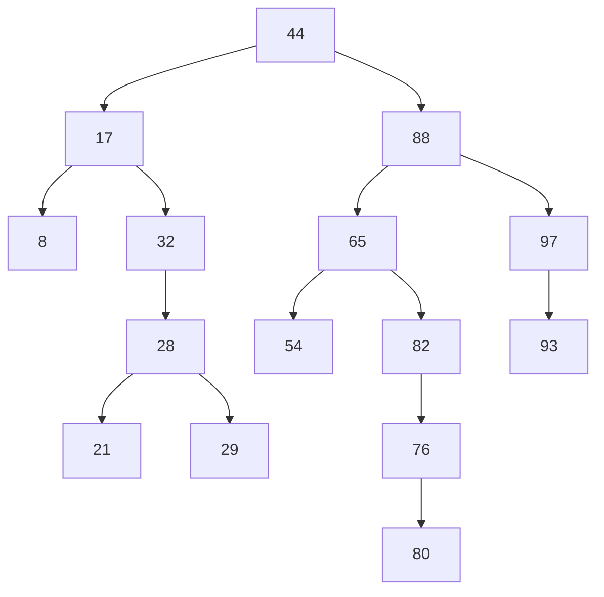

# Binary search trees

The sorted table gives $O(\log n)$ searches but $O(n)$ updates, because inserting into an array
shifts elements. A **binary search tree (BST)** stores the same sorted information in a linked tree,
so that an update only touches a few references. BSTs are the foundation for every balanced tree in
this module, and they implement the full **sorted map** ADT.

## 1. The binary search tree property

Take a binary tree whose positions each hold one item $(k, v)$. It is a **binary search tree** when,
at every position $p$ with key $k$:

- everything in $p$'s **left subtree** has a key **smaller than** $k$;
- everything in $p$'s **right subtree** has a key **larger than** $k$.



(The diagram cannot show whether an only child is a left or right child; the BST property decides: 28 < 32 so it is a left child, 80 > 76 so it is a right child, and so on.)

**Key consequence:** an **inorder traversal** visits the keys in increasing order —
8, 17, 21, 28, 29, 32, 44, 54, 65, 76, 80, 82, 88, 93, 97 — in $O(n)$ time. A BST is a sorted
sequence in disguise.

## 2. Navigating a BST

Because inorder = sorted order, we can find neighbours in sorted order without a full traversal:

- **`first()`** — the minimum: from the root, go left until there is no left child.
- **`last()`** — the maximum: go right until there is no right child.
- **`after(p)`** — the inorder successor:
  - if $p$ has a right child, it is the **leftmost** position in the right subtree;
  - otherwise it is the nearest ancestor of which $p$ lies in the *left* subtree: walk up while you
    are a right child, then take one more step up.
- **`before(p)`** — symmetric.

Each takes $O(h)$ time where $h$ is the height. (A sequence of $n$ `after` calls starting from
`first()` takes $O(n)$ in total — each edge is traversed at most twice.)

Successor of 32 above: no right child; 32 is the right child of 17, 17 is the left child of 44 → 44.
Successor of 65: leftmost of its right subtree (82 → 76) → 76.

## 3. Searching

Treat the tree as a decision tree: at each position, compare the target $k$ with the stored key.

```
TreeSearch(T, p, k):
    if k == p.key():      return p                      # successful search
    else if k < p.key() and T.left(p) is not None:
        return TreeSearch(T, T.left(p), k)              # recur on left subtree
    else if k > p.key() and T.right(p) is not None:
        return TreeSearch(T, T.right(p), k)             # recur on right subtree
    return p                                            # unsuccessful search: last position visited
```

An unsuccessful search returns the **last position visited** — precisely where the key *would* be
attached, and a neighbour of $k$ in sorted order, which is what makes `find_ge`, `find_lt`, etc.
easy. One step per level: $O(h)$.

**Dry run** (search 65): 44 → right → 88 → left → 65. Found after 3 comparisons.
**Dry run** (search 68): 44 → 88 → 65 → right → 82 → left → 76 → left? 76 has no left child →
unsuccessful, ending at 76.

## 4. Insertion

To insert $(k, v)$: search for $k$.

- If found, **overwrite** the value.
- Otherwise the search ended at a position $p$ with a missing child on the side $k$ belongs to.
  Attach a new leaf there (left if $k < p.\text{key}$, right otherwise).

New keys always become leaves. $O(h)$.

## 5. Deletion

Deleting position $p$ is harder because $p$ might be internal. Three cases:

1. **$p$ has no children:** remove it.
2. **$p$ has one child $r$:** remove $p$ and promote $r$ into its place (link $r$ to $p$'s parent).
   Every key in $r$'s subtree was already on the correct side of all of $p$'s ancestors.
3. **$p$ has two children:**
   - find $r$ = `before(p)`, the position with the **largest key less than $p$'s** — the rightmost
     position in $p$'s left subtree;
   - **replace** $p$'s item with $r$'s item (order is preserved: $r$ is larger than everything else in
     the left subtree and smaller than everything in the right);
   - delete the old position $r$ — which has **no right child**, so it falls under case 1 or 2.

(Using the inorder successor — leftmost of the right subtree — works equally well.) All $O(h)$.

**Example.** Delete 88 from the tree above: it has two children. Its predecessor is the rightmost
node of the left subtree rooted at 65: 65 → 82 → no right child, so $r = 82$. Copy 82 into 88's
position, then delete the old 82 node, which has one child (76): promote 76 to be 65's right child.

```python-run
class TreeMap:
    """Sorted map implementation using an (unbalanced) binary search tree."""
    class _Node:
        __slots__ = "key", "value", "left", "right", "parent"
        def __init__(self, key, value, parent=None):
            self.key, self.value, self.parent = key, value, parent
            self.left = self.right = None

    def __init__(self):
        self._root, self._size = None, 0
    def __len__(self): return self._size

    # ---------- navigation ----------
    def _subtree_search(self, p, k):
        """Return the node with key k, or the last node visited."""
        while True:
            if k == p.key: return p
            nxt = p.left if k < p.key else p.right
            if nxt is None: return p
            p = nxt
    def _subtree_first(self, p):
        while p.left is not None: p = p.left
        return p
    def _subtree_last(self, p):
        while p.right is not None: p = p.right
        return p
    def _after(self, p):
        if p.right is not None:
            return self._subtree_first(p.right)
        walk, above = p, p.parent
        while above is not None and walk is above.right:
            walk, above = above, above.parent
        return above
    def _before(self, p):
        if p.left is not None:
            return self._subtree_last(p.left)
        walk, above = p, p.parent
        while above is not None and walk is above.left:
            walk, above = above, above.parent
        return above

    # ---------- map operations ----------
    def __getitem__(self, k):
        if self._root is not None:
            p = self._subtree_search(self._root, k)
            if p.key == k: return p.value
        raise KeyError(k)
    def __setitem__(self, k, v):
        if self._root is None:
            self._root = self._Node(k, v); self._size = 1; return
        p = self._subtree_search(self._root, k)
        if p.key == k:
            p.value = v                                  # replace existing item's value
        else:
            leaf = self._Node(k, v, p)
            if k < p.key: p.left = leaf
            else: p.right = leaf
            self._size += 1
    def _replace_with_child(self, p):
        """Remove node p, which has at most one child."""
        child = p.left if p.left is not None else p.right
        if child is not None: child.parent = p.parent
        if p is self._root: self._root = child
        elif p is p.parent.left: p.parent.left = child
        else: p.parent.right = child
        self._size -= 1
    def __delitem__(self, k):
        if self._root is not None:
            p = self._subtree_search(self._root, k)
            if p.key == k:
                if p.left is not None and p.right is not None:    # p has two children
                    r = self._subtree_last(p.left)                # predecessor
                    p.key, p.value = r.key, r.value               # copy r's item into p
                    p = r                                         # and delete r instead
                self._replace_with_child(p)
                return
        raise KeyError(k)
    def __iter__(self):                                           # inorder via successor walks
        p = self._subtree_first(self._root) if self._root else None
        while p is not None:
            yield p.key
            p = self._after(p)

    # ---------- sorted map operations ----------
    def find_ge(self, k):
        if self._root is None: return None
        p = self._subtree_search(self._root, k)
        if p.key < k: p = self._after(p)
        return (p.key, p.value) if p is not None else None
    def find_lt(self, k):
        if self._root is None: return None
        p = self._subtree_search(self._root, k)
        if not p.key < k: p = self._before(p)
        return (p.key, p.value) if p is not None else None
    def find_range(self, start, stop):
        p = self._subtree_search(self._root, start) if self._root else None
        if p is not None and p.key < start: p = self._after(p)
        while p is not None and p.key < stop:
            yield (p.key, p.value)
            p = self._after(p)
    def height(self, p="root"):
        if p == "root": p = self._root
        return -1 if p is None else 1 + max(self.height(p.left), self.height(p.right))

T = TreeMap()
for k in [44, 17, 88, 8, 32, 65, 97, 28, 54, 82, 93, 21, 29, 76, 80]:
    T[k] = str(k)
print(list(T), "height", T.height())
print("find_ge(68):", T.find_ge(68), " find_lt(44):", T.find_lt(44), " range[50,85):", [k for k, _ in T.find_range(50, 85)])
del T[88]; del T[32]; del T[8]
print(list(T), "root right child is now", T._root.right.key)
```

## 6. Performance

Every operation follows one root-to-leaf path (possibly plus one successor walk):

| Operation | Running time |
|---|---|
| `k in T`, `T[k]`, `T[k] = v`, `del T[k]` | $O(h)$ |
| `find_min`, `find_max`, `find_lt/gt/le/ge` | $O(h)$ |
| `find_range(start, stop)` | $O(s + h)$ |
| `iter(T)`, `reversed(T)` | $O(n)$ |

So everything depends on the height $h$:

- **Best case:** a well-balanced tree has $h = \lfloor \log n \rfloor$.
- **Worst case:** inserting keys in **sorted order** produces a chain — a linked list in disguise —
  with $h = n - 1$, and operations degrade to $O(n)$.
- **Average case:** inserting $n$ keys in *random* order gives expected height $O(\log n)$
  (about $1.39 \log_2 n$ expected search depth). But deletions and non-random insertion orders
  (sorted input is very common in practice!) break this assumption.

```python-run
import random
def insert(root, k):
    if root is None: return [k, None, None]
    node = root
    while True:
        i = 1 if k < node[0] else 2
        if node[i] is None:
            node[i] = [k, None, None]; return root
        node = node[i]
def height(root):                      # iterative (level by level): safe for chains of any length
    h, level = -1, [root] if root else []
    while level:
        h += 1
        level = [c for node in level for c in (node[1], node[2]) if c is not None]
    return h
n = 2000
keys = list(range(n))
root = None
for k in keys: root = insert(root, k)
print("sorted insertions: height", height(root))
random.shuffle(keys); root = None
for k in keys: root = insert(root, k)
print("random insertions: height", height(root), "  (log2 n is about 11)")
```

This sensitivity to insertion order is the reason for **balanced search trees** — AVL, splay,
(2,4) and red-black trees — which guarantee (or amortise) $O(\log n)$ height. They occupy the rest of
this module.

> [!INTERVIEW]
> "Validate a BST": checking only `left.key < node.key < right.key` locally is **wrong** — a deep
> node can violate an ancestor's constraint. Either pass down (low, high) bounds, or check that the
> inorder traversal is strictly increasing. Also be ready to explain two-child deletion via the
> predecessor/successor swap.

## 7. Pitfalls

- Local-only BST validation (see above).
- In two-child deletion, forgetting that the predecessor may itself have a **left** child that must
  be promoted.
- Not updating parent pointers when promoting a child (breaks `after`/`before`).
- Recursing on a degenerate tree of height $n$ — Python's recursion limit; prefer loops for search
  and insert.
- Deciding how to treat duplicate keys: a map overwrites; a multiset variant needs a consistent rule
  ($\le$ to the left) or counts.

## 8. Summary

- BST property ⇒ inorder traversal is sorted; search/insert/delete follow one path: $O(h)$.
- Deletion with two children: replace with inorder predecessor (or successor), delete that instead.
- $h$ ranges from $\lfloor\log n\rfloor$ to $n - 1$; balance is everything.

> **Source:** Goodrich, Tamassia & Goldwasser, *Data Structures and Algorithms in Python*, ch. 11.1.

## Check yourself

```quiz
[
  {"q": "Which traversal of a BST yields keys in increasing order?",
   "options": ["Preorder", "Inorder", "Postorder", "Level order"], "answer": 1,
   "explain": "Left subtree (smaller keys), node, right subtree (larger keys)."},
  {"q": "Where is the minimum key of a BST?",
   "options": ["At the root", "At the leftmost position (keep going left from the root)", "At the deepest leaf", "At the rightmost position"], "answer": 1,
   "explain": "Each step left moves to smaller keys; stop when there is no left child."},
  {"q": "A node p has no right child. Its inorder successor is...",
   "options": ["its left child", "its parent, always", "the nearest ancestor whose left subtree contains p", "the root"], "answer": 2,
   "explain": "Walk up while you are a right child; the next parent is the successor (or None if p is the maximum)."},
  {"q": "To delete a node with two children you...",
   "options": ["delete its entire subtree", "replace its item with its inorder predecessor's (or successor's) and delete that node instead", "rotate it to the root", "swap it with the root"], "answer": 1,
   "explain": "The predecessor has no right child, so removing it is the easy case."},
  {"q": "Inserting the keys 1, 2, 3, ..., n in that order into an empty BST gives height...",
   "options": ["log n", "n - 1", "n / 2", "sqrt(n)"], "answer": 1,
   "explain": "Every new key is the largest, so it becomes the right child of the previous one: a chain."},
  {"q": "An unsuccessful TreeSearch returns the last position visited. Why is that useful?",
   "options": ["It is the root", "It is where the new key would be attached and is adjacent to k in sorted order", "It is always a leaf with the minimum key", "It is not useful"], "answer": 1,
   "explain": "Insertion attaches there, and find_ge/find_lt need at most one after/before step from it."},
  {"q": "Checking node.left.key < node.key < node.right.key at every node is...",
   "options": ["sufficient to validate a BST", "insufficient: a descendant deeper down may violate an ancestor's bound", "too slow", "only valid for AVL trees"], "answer": 1,
   "explain": "Every key in the whole left subtree must be smaller, not just the left child."}
]
```
