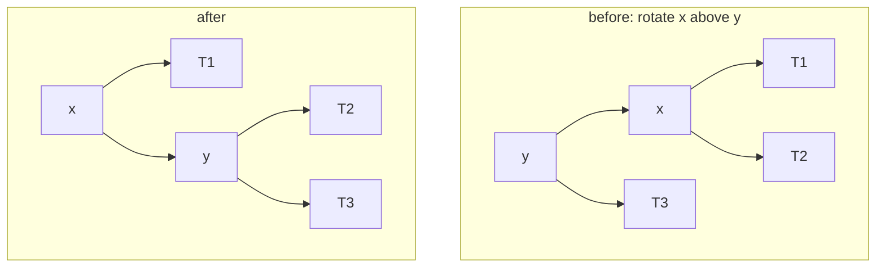
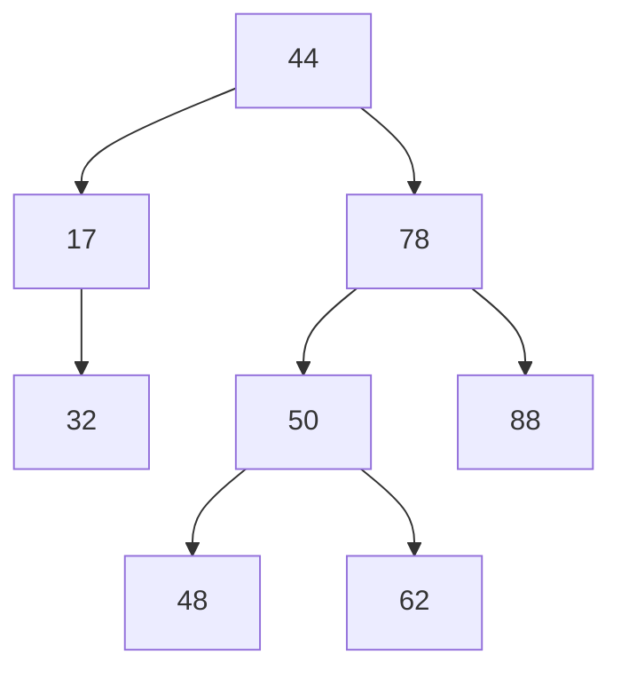
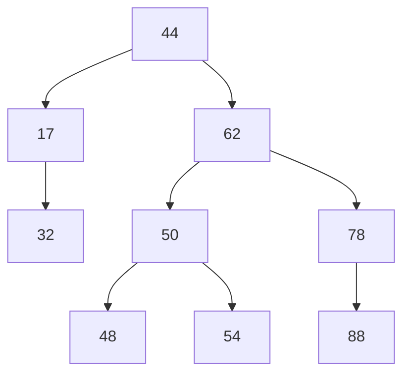

# Rotations and AVL trees

> **Before this lesson:** You should know binary search trees: the ordering rule, search,
> insertion, deletion, and why the height matters. All of that is in
> [Binary search trees](#/lesson/dsa-foundations/bst). The recurrence style used in section 2
> comes from [Analysing recursive algorithms](#/lesson/dsa-foundations/recursion-analysis).

## In plain words

The previous lesson ended with a problem: feed a binary search tree its keys in sorted order
and it grows into one long chain, as slow as a linked list. An **AVL tree** is a binary search
tree that refuses to become lopsided. After every insertion or deletion it checks its own
shape, and if one side of some node has grown too tall compared with the other, it rearranges a
few nodes to even things out.

Picture a hanging mobile, the kind suspended over a cot. Add a weight to one arm and the whole
thing tilts. To level it again you do not rebuild it; you slide the pivot point of one arm so
that the heavy side moves up and the light side moves down. The tree's version of sliding the
pivot is called a **rotation**, and it is the one tool that every balanced search tree uses.

Why it matters for a job: balanced trees are what make the sorted collections in standard
libraries and the indexes in databases reliably fast, whatever order the data arrives in.
Interviews seldom ask you to write a full AVL tree, but they do ask what a rotation is, why
balance gives $O(\log n)$, and how AVL trees compare with red-black trees.

## 1. Rotations

A **rotation** takes a node $x$ and its parent $y$ and swaps their roles: $x$ moves up to become
the parent, $y$ moves down to become its child. It does this without breaking the BST ordering
rule. The picture shows $x$ as the left child of $y$; $T_1$, $T_2$ and $T_3$ stand for whole
subtrees (possibly empty) hanging below.



Before the rotation, the BST rule tells us the order of everything in the picture: keys in
$T_1$, then $x$, then keys in $T_2$, then $y$, then keys in $T_3$. After the rotation $x$ is on
top with $y$ as its right child. $T_1$ still hangs to the left of $x$ and $T_3$ to the right of
$y$. Only the **middle subtree $T_2$ changes parents**: it was the right subtree of $x$ and is
now the left subtree of $y$. That is legal, because its keys lie between $x$ and $y$, and "right
of $x$, left of $y$" is where such keys belong. Read the new tree in inorder and you get
$T_1, x, T_2, y, T_3$ again, the same sorted sequence. This one is called a *right rotation*,
because $y$ moves down to the right; its mirror image is a *left rotation*.

A small example with numbers. Let $y = 20$ with left child $x = 10$, and let 10 have children
5 and 15, while 20 has right child 30. After rotating 10 above 20: 10 is on top, with left
child 5 and right child 20; and 20 has left child 15 (which changed parents) and right child
30. Inorder before and after: 5, 10, 15, 20, 30.

A rotation changes a fixed, small number of references, so it costs **$O(1)$**. Its effect on
shape: everything in $T_1$ moves one level up and everything in $T_3$ moves one level down.
That is how height is shifted from one side to the other.

### 1.1 Trinode restructuring

Balancing algorithms usually apply rotations in a standard package involving three nodes,
called a **trinode restructuring**. Take a node $x$, its parent $y$ and its grandparent $z$.
Rename the three as $a$, $b$, $c$ in **sorted order of their keys**, and call the four subtrees
hanging off them $T_1, T_2, T_3, T_4$ from left to right. Restructuring rearranges them so that
the **middle key $b$ becomes the top** of this little group, with $a$ as its left child, $c$ as
its right child, and the four subtrees reattached in order. Three nodes in a line or a bend
become a neat two-level triangle.

There are four starting shapes, in two families:

- **Single rotation.** If $x$, $y$, $z$ lie in a straight line (left-left or right-right,
  nicknamed "zig-zig"), then $y$ is the middle key $b$. Rotate $y$ above $z$.
- **Double rotation.** If $x$, $y$, $z$ form a bend (left-right or right-left, a "zig-zag"),
  then $x$ is the middle key $b$. Rotate $x$ above $y$, then rotate $x$ again above $z$.

In pseudocode:

```
restructure(x):
    y = parent(x); z = parent(y)
    if (x == right(y)) == (y == right(z)):    # matching alignments
        rotate(y)                             # single rotation (of y)
        return y                              # y is new subtree root
    else:                                     # opposite alignments
        rotate(x); rotate(x)                  # double rotation (of x)
        return x                              # x is new subtree root
```

Either way the cost is $O(1)$, the sorted order is preserved, and the group ends up one level
shorter than before.

## 2. The AVL tree

The AVL tree is named after its inventors, Adel'son-Vel'skii and Landis, who published it in
1962. It is a binary search tree with one extra rule:

> **Height-balance property.** At every node, the heights of the two child subtrees are equal or
> differ by one.

In this lesson heights are counted in *nodes*, not edges: a leaf has height 1 and a missing
child has height 0. (This convention makes the arithmetic of AVL trees cleaner. It is one more
than the edge-counting height of the trees module.) A node is called **balanced** if its
children's heights differ by at most one, so an AVL tree is a BST in which every node is
balanced. The rule is inherited by parts of the tree: any subtree of an AVL tree is an AVL tree.

Note what the rule does *not* demand. It does not require a perfectly even tree; one side of a
node may be a level taller than the other, and those small differences can add up, so different
leaves can sit at quite different depths. The claim is only that the tree cannot get *much*
taller than the ideal.

### 2.1 The height of an AVL tree is $O(\log n)$

> **Claim.** An AVL tree holding $n$ entries has height $O(\log n)$.

*Why.* Turn the question round. Instead of asking how tall a tree with $n$ nodes can be, ask
how *few* nodes a tree of height $h$ can have; call that minimum $n(h)$. A tree of height 1 is
a single node, so $n(1) = 1$, and the smallest tree of height 2 is a node with one child, so
$n(2) = 2$. For $h \ge 3$, the sparsest possible AVL tree of height $h$ has a root, one subtree
of height $h - 1$ (needed to reach height $h$), and another subtree as short as the balance
rule allows, height $h - 2$, each of them as sparse as possible:

$$n(h) = 1 + n(h-1) + n(h-2).$$

This is the Fibonacci rule with an extra 1, and like the Fibonacci numbers it grows
exponentially. To see it without solving the recurrence exactly: $n(h-1)$ is larger than
$n(h-2)$, so $n(h) > 2\,n(h-2)$. The minimum node count at least doubles each time the height
grows by 2. Apply that $i$ times: $n(h) > 2^i \cdot n(h - 2i)$. Choosing $i$ so that $h - 2i$ is
1 or 2 gives $n(h) > 2^{h/2 - 1}$. Taking logarithms and rearranging:

$$h < 2\log n(h) + 2 \le 2 \log n + 2.$$

So even the scrawniest AVL tree with $n$ nodes has height under $2\log n + 2$. A sharper
analysis improves the factor: $h \le 1.44 \log_2 (n + 1)$, less than half as much again as a
perfectly balanced tree. Searches in an AVL tree therefore take $O(\log n)$. ∎

The demo computes $n(h)$ for a few heights. An AVL tree 30 levels tall must contain more than
two million nodes.

```python-run
# Minimum number of nodes in an AVL tree of height h (node-counting heights): Fibonacci-like growth
import math
n = {1: 1, 2: 2}
for h in range(3, 31):
    n[h] = 1 + n[h - 1] + n[h - 2]
for h in [5, 10, 20, 30]:
    print(f"h={h:2d}: at least {n[h]:>9,} nodes;  1.44*log2(n+1) = {1.44 * math.log2(n[h] + 1):5.1f}")
```

## 3. Insertion

Begin exactly as in a plain BST: the new key becomes a leaf $p$. A new leaf can make its
ancestors taller, and nobody else, so the only nodes that can have become unbalanced are
ancestors of $p$.

**Search and repair.** Walk up from $p$ towards the root, checking balance at each node. Let
$z$ be the **first unbalanced node** you meet. Let $y$ be the child of $z$ with the **greater
height**, and $x$ the child of $y$ with the greater height. (Both lie on the path you walked,
since that is the side that grew.) Apply `restructure(x)`.

**Why a single restructuring is enough.** Before the insertion, the subtree rooted at $z$ had
some height $h$. The insertion made the subtree under $y$ one level taller, pushing $z$'s
subtree to $h + 1$ and unbalancing $z$. The restructuring lifts the middle key to the top of
the group, and checking the possible heights of $T_1$ to $T_4$ shows that the group's height
returns to **exactly $h$**, what it was before the insertion. So no node above $z$ sees any
change at all, and one restructuring (one or two rotations) restores balance in the *whole*
tree.

### Worked example

Insert 54 into this AVL tree:



54 becomes the left child of 62 (it is larger than 44, smaller than 78, larger than 50, smaller
than 62). Now walk up from the new leaf, comparing child heights:

- at 62: children have heights 1 (the new 54) and 0. Balanced.
- at 50: children 48 (height 1) and 62 (height 2). Balanced.
- at **78**: left child 50 now has height 3, right child 88 has height 1. A difference of 2:
  unbalanced.

So $z = 78$; its taller child is $y = 50$; and the taller child of 50 is $x = 62$. From 78 the
path goes left to 50 and then right to 62, a bend, so this is the **double rotation** case. The
middle key of 50, 62, 78 is 62, and it becomes the top of the group, with 50 and 78 as its
children. The subtree 54, which hung on the left of 62, moves to the right of 50:



## 4. Deletion

The subtree that used to be rooted at 78 with height 4 is now rooted at 62 with height 3, the
height it had before 54 arrived. The root 44 never notices.

## 4. Deletion

Begin as in a plain BST. Whatever the case, the tree physically loses one node that had at
most one child; let $p$ be the parent of that removed node. Heights can only *decrease*, and
only along the path from $p$ up to the root.

Walk up from $p$ to find the first unbalanced node $z$. Let $y$ be the **taller** child of $z$.
This time $y$ is on the *other* side from the deletion: the deleted side got shorter, which
left $y$'s side too tall. Let $x$ be the taller child of $y$, with one tie-breaking rule: **if
$y$'s two children have equal height, choose $x$ on the same side as $y$** (the left child if
$y$ is a left child), so that a single rotation is used. Apply `restructure(x)`.

Here deletion differs from insertion. The restructured group may end up **one level shorter**
than the subtree was before the deletion, and that can unbalance a node further up. So after
repairing $z$ we must **keep walking up to the root**, restructuring wherever necessary. That
is at most one restructuring per level: up to $O(\log n)$ of them, each $O(1)$.

## 5. Implementation

Each node stores its own height, so that balance can be checked in $O(1)$. The implementation
below is recursive: `insert` and `delete` go down the tree to do the plain BST work, and on the
way back up each call passes its node through `_rebalance`, which recomputes the height and
rotates if the node has become unbalanced. The function returns whichever node is now at the
top of that subtree, and the caller stores it back into its `left` or `right` field.

The **balance factor** of a node, `_bal(n)`, is the height of its left subtree minus the height
of its right subtree. In an AVL tree it is always $-1$, 0 or $+1$; a value of $+2$ or $-2$
signals an imbalance and tells you which side is too tall.

```python-run
class AVLTree:
    class _Node:
        __slots__ = "key", "left", "right", "height"
        def __init__(self, key):
            self.key, self.left, self.right, self.height = key, None, None, 1

    def __init__(self): self._root = None; self.rotations = 0

    @staticmethod
    def _h(n): return n.height if n else 0
    def _fix(self, n): n.height = 1 + max(self._h(n.left), self._h(n.right))
    def _bal(self, n): return self._h(n.left) - self._h(n.right)

    def _rot_right(self, y):                  # rotate y's left child x above y
        x = y.left
        y.left, x.right = x.right, y
        self._fix(y); self._fix(x); self.rotations += 1
        return x
    def _rot_left(self, x):                   # rotate x's right child y above x
        y = x.right
        x.right, y.left = y.left, x
        self._fix(x); self._fix(y); self.rotations += 1
        return y

    def _rebalance(self, z):
        self._fix(z)
        b = self._bal(z)
        if b > 1:                                     # left side is taller
            if self._bal(z.left) < 0:                 # left-right zig-zag: double rotation
                z.left = self._rot_left(z.left)
            return self._rot_right(z)
        if b < -1:                                    # right side is taller
            if self._bal(z.right) > 0:                # right-left zig-zag
                z.right = self._rot_right(z.right)
            return self._rot_left(z)
        return z

    def insert(self, key):
        def rec(n):
            if n is None: return self._Node(key)
            if key < n.key: n.left = rec(n.left)
            elif key > n.key: n.right = rec(n.right)
            return self._rebalance(n)                 # repair on the way back up
        self._root = rec(self._root)

    def delete(self, key):
        def pop_max(n):                               # remove the maximum of subtree n
            if n.right is None: return n.left, n.key
            n.right, k = pop_max(n.right)
            return self._rebalance(n), k
        def rec(n):
            if n is None: return None
            if key < n.key: n.left = rec(n.left)
            elif key > n.key: n.right = rec(n.right)
            else:
                if n.left is None: return n.right
                if n.right is None: return n.left
                n.left, n.key = pop_max(n.left)       # replace with inorder predecessor
            return self._rebalance(n)
        self._root = rec(self._root)

    def show(self, n="root", depth=0):
        if n == "root": n = self._root
        if n:
            self.show(n.right, depth + 1)
            print("     " * depth + f"{n.key}(h{n.height})")
            self.show(n.left, depth + 1)

T = AVLTree()
for k in [44, 17, 78, 32, 50, 88, 48, 62]:
    T.insert(k)
print("rotations so far:", T.rotations)
T.insert(54)                                          # triggers the double rotation of the example
print("after inserting 54 (rotations = %d):" % T.rotations); T.show()
T2 = AVLTree()
for k in range(1, 1024): T2.insert(k)                 # sorted insertions: worst case for a plain BST
print("1023 sorted insertions -> height", T2._root.height)
```

**Reading the output.** The first eight insertions build the tree of the worked example with no
rotations at all. Inserting 54 then performs two rotations (one double rotation), and the tree
is printed turned on its side: the root is at the left margin, the right subtree above it and
the left subtree below, with each node's stored height in brackets. Finally, 1,023 keys are
inserted in sorted order, the input that reduced a plain BST to a chain of height 1023, and
the AVL tree comes out with height 10, perfectly balanced.

Where is the tie rule for deletion? In `_rebalance`, when the left side is too tall and
`_bal(z.left) == 0` (the children of $y$ have equal heights), the test `_bal(z.left) < 0` is
false, so the code performs a **single** rotation. That is the "choose $x$ on the same side as
$y$" rule.

### Performance

| Operation | Running time |
|---|---|
| search, `find_*` | $O(\log n)$ |
| insert | $O(\log n)$ — at most **one** restructuring (≤ 2 rotations) |
| delete | $O(\log n)$ — up to $O(\log n)$ restructurings |
| `find_range` | $O(s + \log n)$ |

Space is $O(n)$: one extra whole number per node for the height (or, with more care, only the
balance factor, which fits in two bits).

> [!INTERVIEW]
> Know the four imbalance cases by their nicknames, which describe the path from $z$ to $x$.
> **LL** (left, left): one right rotation. **RR**: one left rotation. **LR** (left, then
> right): a left rotation at the child, then a right rotation at $z$. **RL**: the mirror image.
> Also know the trade-off with red-black trees, covered later in this module. AVL trees are
> more strictly balanced (height at most about $1.44 \log n$, against $2 \log n$), so lookups
> are slightly faster; red-black trees need fewer rotations when updating, which is why the
> sorted maps in Java (`TreeMap`) and C++ (`std::map`) typically use red-black trees.

## 6. Pitfalls

- **Updating heights in the wrong order after a rotation.** Recompute the node that moved down
  first, then the node that moved up, because the upper height depends on the lower one.
- **Using a single rotation in the zig-zag case.** The subtree stays unbalanced; the imbalance
  is merely mirrored to the other side.
- **Stopping after one restructuring when deleting.** Deletion may need one per level.
- **Recomputing heights by walking whole subtrees.** That costs $O(n)$ per check; store the
  height in the node.
- **Mixing height conventions.** Decide whether a leaf has height 0 or 1 and use that
  everywhere, or the balance factors will be off by one.

## 7. Summary

- A rotation is an $O(1)$ rearrangement of a node and its parent that keeps the keys in sorted
  order. A trinode restructuring is one single or one double rotation that lifts the middle of
  three keys to the top.
- An AVL tree is a BST in which, at every node, the heights of the two subtrees differ by at
  most 1. That forces the height to be $O(\log n)$.
- Insertion needs at most one restructuring, at the lowest unbalanced ancestor. Deletion may
  need one at every level on the way up.
- Search, insertion and deletion are all $O(\log n)$ in the worst case.

> **Source:** Goodrich, Tamassia & Goldwasser, *Data Structures and Algorithms in Python*, ch. 11.2–11.3.

## Glossary

- **Balanced search tree**: a search tree that keeps its height $O(\log n)$ as it is updated.
- **Rotation**: an $O(1)$ operation that moves a node above its parent while preserving the
  sorted order.
- **Left / right rotation**: a rotation in which the parent moves down to the left / right.
- **Trinode restructuring**: rearranging a node, its parent and its grandparent so that the
  middle key is on top.
- **Single rotation (zig-zig)**: the fix when the three nodes lie in a straight line.
- **Double rotation (zig-zag)**: the fix when the three nodes form a bend; two rotations.
- **AVL tree**: a BST satisfying the height-balance property.
- **Height-balance property**: at every node, the two subtree heights differ by at most one.
- **Balance factor**: left subtree height minus right subtree height.
- **LL, RR, LR, RL**: the four imbalance shapes, named by the path from the unbalanced node.

## Check yourself

```quiz
[
  {"q": "What does a rotation preserve?",
   "options": ["The height of every node", "The inorder (sorted) sequence of keys", "The root", "The number of leaves"], "answer": 1,
   "explain": "Rotations rearrange parent/child links while keeping the BST order intact."},
  {"q": "The AVL height-balance property requires that...",
   "options": ["all leaves have the same depth", "for every node, the heights of its two children differ by at most 1", "the tree is complete", "the root has two children"], "answer": 1,
   "explain": "This local condition forces global height O(log n)."},
  {"q": "The minimum number of nodes n(h) in an AVL tree of height h satisfies...",
   "options": ["n(h) = 2 n(h-1)", "n(h) = 1 + n(h-1) + n(h-2)", "n(h) = h", "n(h) = n(h-1) + 1"], "answer": 1,
   "explain": "Root plus sparsest subtrees of heights h-1 and h-2: Fibonacci-like, hence exponential in h."},
  {"q": "After an AVL insertion, how many trinode restructurings can be needed?",
   "options": ["At most one", "Up to log n", "Up to n", "Exactly two"], "answer": 0,
   "explain": "The restructured subtree returns to its pre-insertion height, so no ancestor is affected."},
  {"q": "After an AVL deletion, how many restructurings can be needed?",
   "options": ["At most one", "Up to O(log n), one per level on the path to the root", "None", "O(n)"], "answer": 1,
   "explain": "A restructuring may shorten the subtree, propagating imbalance upward."},
  {"q": "z is unbalanced, y is its taller (left) child and x is y's taller (right) child. Which fix?",
   "options": ["Single right rotation at z", "Double rotation: rotate x above y, then x above z", "Single left rotation at z", "No rotation needed"], "answer": 1,
   "explain": "Left-right is a zig-zag: the middle key x must become the subtree root."},
  {"q": "A rotation takes time...",
   "options": ["O(1)", "O(log n)", "O(n)", "O(h)"], "answer": 0,
   "explain": "Only a constant number of references (and two stored heights) change."}
]
```
