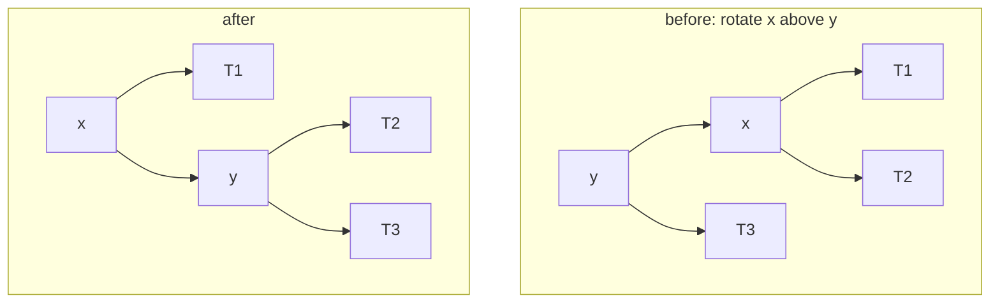
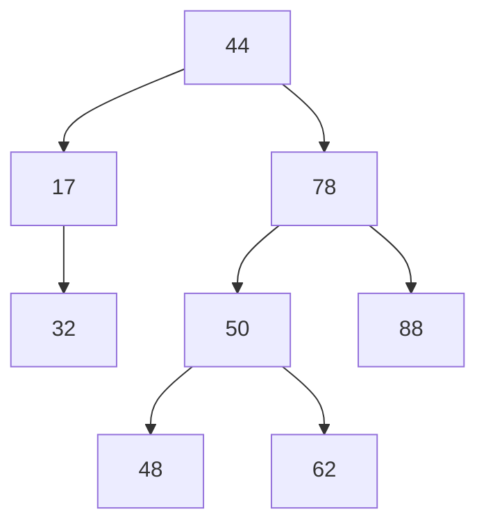
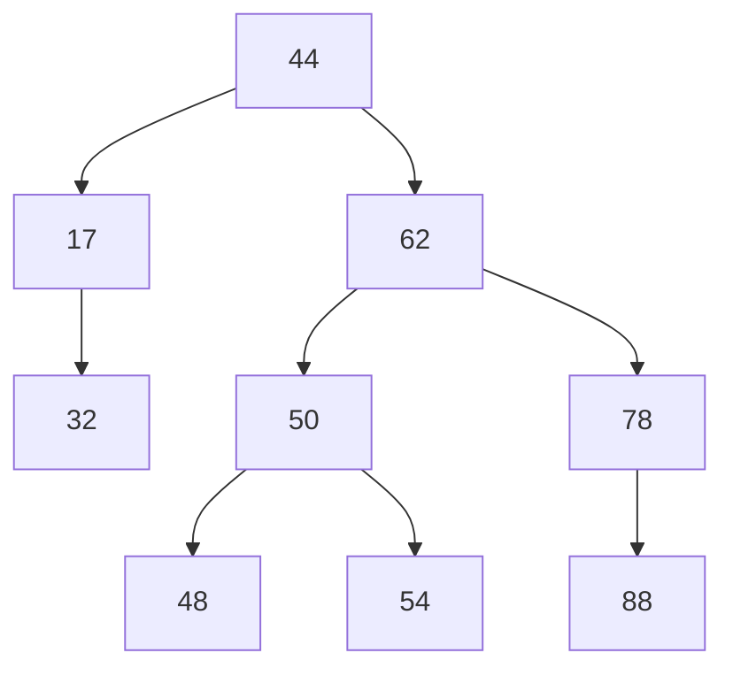

# Rotations and AVL trees

A plain binary search tree can degenerate into a chain. **Balanced search trees** repair their shape
after every update so that the height stays $O(\log n)$. The universal repair tool is the
**rotation**, and the simplest balanced tree built from it is the **AVL tree** (Adel'son-Vel'skii
and Landis, 1962). This lesson covers both.

## 1. Rotations

A **rotation** rotates a child $x$ above its parent $y$, while preserving the BST property.



Before: keys in $T_1$ < $x$ < keys in $T_2$ < $y$ < keys in $T_3$. After the (right) rotation $x$ is
the parent, $y$ its right child, and the **middle subtree $T_2$ changes parents** — from $x$'s right
to $y$'s left — which is consistent, since its keys lie between $x$ and $y$. The inorder sequence
$T_1, x, T_2, y, T_3$ is unchanged.

A rotation modifies a constant number of references: **$O(1)$**. Its effect: nodes in $T_1$ move one
level up, nodes in $T_3$ one level down. That is how height is redistributed.

### 1.1 Trinode restructuring

Balancing algorithms usually combine one or two rotations into a **trinode restructuring**.
Consider a position $x$, its parent $y$ and grandparent $z$. Rename the three nodes $a, b, c$ in
**inorder** (sorted) order, and let $T_1, T_2, T_3, T_4$ be their four other subtrees, left to right.
Restructuring makes **$b$ the root** of the subtree, with $a$ as its left child, $c$ as its right
child, and the four subtrees hanging in order.

There are four configurations, in two families:

- **Single rotation** ($x$, $y$, $z$ in a straight line — "zig-zig", shapes left-left or right-right):
  $y$ is the middle node $b$; rotate $y$ above $z$.
- **Double rotation** ($x$, $y$, $z$ form a zig-zag — shapes left-right or right-left): $x$ is the
  middle node $b$; rotate $x$ above $y$, then $x$ above $z$.

```
restructure(x):
    y = parent(x); z = parent(y)
    if (x == right(y)) == (y == right(z)):    # matching alignments
        rotate(y)                             # single rotation (of y)
        return y                              # y is new subtree root
    else:                                     # opposite alignments
        rotate(x); rotate(x)                  # double rotation (of x)
        return x                              # x is new subtree root
```

Either way: $O(1)$ time, BST order preserved, and the subtree's shape is flattened.

## 2. The AVL tree

> **Height-balance property.** For every position $p$ of $T$, the heights of the children of $p$
> differ by at most 1.

Any BST satisfying it is an **AVL tree**. (Convention: here the height of a position counts *nodes*
on the longest path down to a leaf, so a leaf has height 1 and a missing child height 0; the book
uses this node-counting convention in its AVL chapter.)

Every subtree of an AVL tree is itself an AVL tree. A position is **balanced** if its children's
heights differ by at most one.

### 2.1 The height of an AVL tree is $O(\log n)$

> **Proposition.** The height of an AVL tree storing $n$ entries is $O(\log n)$.

*Justification.* Work "backwards": let $n(h)$ be the **minimum** number of nodes in an AVL tree of
height $h$. Then $n(1) = 1$, $n(2) = 2$, and for $h \ge 3$ the sparsest AVL tree of height $h$ has a
root, a sparsest subtree of height $h - 1$ and a sparsest subtree of height $h - 2$:

$$n(h) = 1 + n(h-1) + n(h-2).$$

This is a Fibonacci-like recurrence. Since $n(h-1) > n(h-2)$, we get $n(h) > 2\,n(h-2)$: the count
at least doubles every time $h$ grows by 2. Repeating, $n(h) > 2^i \cdot n(h - 2i)$; choosing $i$ so
that $h - 2i$ is 1 or 2 gives $n(h) > 2^{h/2 - 1}$. Taking logarithms:

$$h < 2\log n(h) + 2 \le 2 \log n + 2.$$

A tighter analysis gives $h \le 1.44 \log_2 (n + 1)$. So searches in an AVL tree take
$O(\log n)$. ∎

```python-run
# Minimum number of nodes in an AVL tree of height h (node-counting heights): Fibonacci-like growth
import math
n = {1: 1, 2: 2}
for h in range(3, 31):
    n[h] = 1 + n[h - 1] + n[h - 2]
for h in [5, 10, 20, 30]:
    print(f"h={h:2d}: at least {n[h]:>9,} nodes;  1.44*log2(n+1) = {1.44 * math.log2(n[h] + 1):5.1f}")
```

## 3. Insertion

Insert as in a plain BST: the new key becomes a leaf $p$. This may increase the heights of $p$'s
ancestors — and only theirs — so only ancestors of $p$ can become unbalanced.

**Search-and-repair.** Walk up from $p$. Let $z$ be the **first unbalanced** position encountered.
Let $y$ be the child of $z$ with the **greater height** (it must be an ancestor of $p$), and $x$ the
child of $y$ with the greater height (also an ancestor of $p$, or $p$ itself). Call
`restructure(x)`.

**Why one restructuring suffices.** Before the insertion, $z$'s subtree had some height $h$. The
insertion made $y$'s subtree one taller, so $z$'s subtree grew to $h + 1$ and unbalanced. The
restructuring makes $b$ the root with $a$ and $c$ as children; a case analysis on the heights of
$T_1..T_4$ shows the subtree's height returns to **exactly $h$** — the height before insertion — so
no ancestor above sees any change. One trinode restructuring (one or two rotations) restores the
height-balance property **globally**.

### Worked example

Insert 54 into the AVL tree



54 becomes the left child of 62. Walking up: 62 (heights 1 vs 0, fine), 50 (children 48: height 1,
62: height 2 — fine), **78** (left child 50 has height 3, right child 88 has height 1 — unbalanced).
So $z = 78$, $y = 50$ (taller child), $x = 62$ (taller child of $y$). The alignment is left-right —
a zig-zag — so a **double rotation** makes $x = 62$ the subtree root with children $50$ and $78$:



## 4. Deletion

Delete as in a plain BST. The structural change is the removal of a node with at most one child;
let $p$ be the parent of the removed node. Heights can only *decrease* along the path from $p$ to the
root.

Walk up from $p$ to find the first unbalanced $z$. Now let $y$ be the **taller** child of $z$ (this
time $y$ is *not* on the path — the shorter side lost a node), and let $x$ be the taller child of
$y$; **if both children of $y$ have equal height, choose $x$ on the same side as $y$** (so a single
rotation is used). Call `restructure(x)`.

Unlike insertion, the restructured subtree may end up **one shorter** than before the deletion, which
can unbalance an ancestor further up. So we must **continue walking up to the root**, restructuring
wherever needed: up to $O(\log n)$ restructurings, each $O(1)$.

## 5. Implementation

Each node stores its height. After any structural change, walk upward recomputing heights; stop
early when a height does not change (for insertion, also after the single restructuring).

```python-run
class AVLTree:
    class _Node:
        __slots__ = "key", "left", "right", "height"
        def __init__(self, key):
            self.key, self.left, self.right, self.height = key, None, None, 1

    def __init__(self): self._root = None; self.rotations = 0

    @staticmethod
    def _h(n): return n.height if n else 0
    def _fix(self, n): n.height = 1 + max(self._h(n.left), self._h(n.right))
    def _bal(self, n): return self._h(n.left) - self._h(n.right)

    def _rot_right(self, y):                  # rotate y's left child x above y
        x = y.left
        y.left, x.right = x.right, y
        self._fix(y); self._fix(x); self.rotations += 1
        return x
    def _rot_left(self, x):                   # rotate x's right child y above x
        y = x.right
        x.right, y.left = y.left, x
        self._fix(x); self._fix(y); self.rotations += 1
        return y

    def _rebalance(self, z):
        self._fix(z)
        b = self._bal(z)
        if b > 1:                                     # left side is taller
            if self._bal(z.left) < 0:                 # left-right zig-zag: double rotation
                z.left = self._rot_left(z.left)
            return self._rot_right(z)
        if b < -1:                                    # right side is taller
            if self._bal(z.right) > 0:                # right-left zig-zag
                z.right = self._rot_right(z.right)
            return self._rot_left(z)
        return z

    def insert(self, key):
        def rec(n):
            if n is None: return self._Node(key)
            if key < n.key: n.left = rec(n.left)
            elif key > n.key: n.right = rec(n.right)
            return self._rebalance(n)                 # repair on the way back up
        self._root = rec(self._root)

    def delete(self, key):
        def pop_max(n):                               # remove the maximum of subtree n
            if n.right is None: return n.left, n.key
            n.right, k = pop_max(n.right)
            return self._rebalance(n), k
        def rec(n):
            if n is None: return None
            if key < n.key: n.left = rec(n.left)
            elif key > n.key: n.right = rec(n.right)
            else:
                if n.left is None: return n.right
                if n.right is None: return n.left
                n.left, n.key = pop_max(n.left)       # replace with inorder predecessor
            return self._rebalance(n)
        self._root = rec(self._root)

    def show(self, n="root", depth=0):
        if n == "root": n = self._root
        if n:
            self.show(n.right, depth + 1)
            print("     " * depth + f"{n.key}(h{n.height})")
            self.show(n.left, depth + 1)

T = AVLTree()
for k in [44, 17, 78, 32, 50, 88, 48, 62]:
    T.insert(k)
print("rotations so far:", T.rotations)
T.insert(54)                                          # triggers the double rotation of the example
print("after inserting 54 (rotations = %d):" % T.rotations); T.show()
T2 = AVLTree()
for k in range(1, 1024): T2.insert(k)                 # sorted insertions: worst case for a plain BST
print("1023 sorted insertions -> height", T2._root.height)
```

(The tree is printed rotated 90°: the right subtree is above, the left subtree below.)

Checking the equal-height tie rule for deletion: in `_rebalance`, when the left side is taller and
`_bal(z.left) == 0`, the code performs a **single** rotation — exactly the "choose $x$ on the same
side as $y$" rule.

### Performance

| Operation | Running time |
|---|---|
| search, `find_*` | $O(\log n)$ |
| insert | $O(\log n)$ — at most **one** restructuring (≤ 2 rotations) |
| delete | $O(\log n)$ — up to $O(\log n)$ restructurings |
| `find_range` | $O(s + \log n)$ |

Space $O(n)$ (one extra integer per node — or just a 2-bit balance factor).

> [!INTERVIEW]
> Know the four imbalance cases by name: **LL** → single right rotation, **RR** → single left
> rotation, **LR** → left rotation on the child, then right rotation, **RL** → the mirror. And the
> trade-off with red-black trees: AVL trees are more strictly balanced (height ≤ 1.44 log n versus
> ≤ 2 log n), so lookups are slightly faster, but red-black trees do fewer rotations on updates
> (O(1) per update), which is why library maps (Java `TreeMap`, C++ `std::map`) typically use
> red-black trees.

## 6. Pitfalls

- Forgetting to update heights **bottom-up** after a rotation (fix the lower node first).
- Using a single rotation in the zig-zag case: the tree stays unbalanced (just mirrored).
- Stopping after one restructuring in **deletion**.
- Recomputing heights by full traversal ($O(n)$) instead of storing them.
- Mixing height conventions (leaf = 0 vs leaf = 1) when computing balance factors — pick one.

## 7. Summary

- A rotation is an $O(1)$ local rearrangement preserving inorder; trinode restructuring = one single
  or one double rotation making the middle key the subtree root.
- AVL: sibling subtree heights differ by ≤ 1 ⇒ height $O(\log n)$.
- Insert: one restructuring at the lowest unbalanced ancestor. Delete: possibly one per level.

> **Source:** Goodrich, Tamassia & Goldwasser, *Data Structures and Algorithms in Python*, ch. 11.2–11.3.

## Check yourself

```quiz
[
  {"q": "What does a rotation preserve?",
   "options": ["The height of every node", "The inorder (sorted) sequence of keys", "The root", "The number of leaves"], "answer": 1,
   "explain": "Rotations rearrange parent/child links while keeping the BST order intact."},
  {"q": "The AVL height-balance property requires that...",
   "options": ["all leaves have the same depth", "for every node, the heights of its two children differ by at most 1", "the tree is complete", "the root has two children"], "answer": 1,
   "explain": "This local condition forces global height O(log n)."},
  {"q": "The minimum number of nodes n(h) in an AVL tree of height h satisfies...",
   "options": ["n(h) = 2 n(h-1)", "n(h) = 1 + n(h-1) + n(h-2)", "n(h) = h", "n(h) = n(h-1) + 1"], "answer": 1,
   "explain": "Root plus sparsest subtrees of heights h-1 and h-2: Fibonacci-like, hence exponential in h."},
  {"q": "After an AVL insertion, how many trinode restructurings can be needed?",
   "options": ["At most one", "Up to log n", "Up to n", "Exactly two"], "answer": 0,
   "explain": "The restructured subtree returns to its pre-insertion height, so no ancestor is affected."},
  {"q": "After an AVL deletion, how many restructurings can be needed?",
   "options": ["At most one", "Up to O(log n), one per level on the path to the root", "None", "O(n)"], "answer": 1,
   "explain": "A restructuring may shorten the subtree, propagating imbalance upward."},
  {"q": "z is unbalanced, y is its taller (left) child and x is y's taller (right) child. Which fix?",
   "options": ["Single right rotation at z", "Double rotation: rotate x above y, then x above z", "Single left rotation at z", "No rotation needed"], "answer": 1,
   "explain": "Left-right is a zig-zag: the middle key x must become the subtree root."},
  {"q": "A rotation takes time...",
   "options": ["O(1)", "O(log n)", "O(n)", "O(h)"], "answer": 0,
   "explain": "Only a constant number of references (and two stored heights) change."}
]
```
