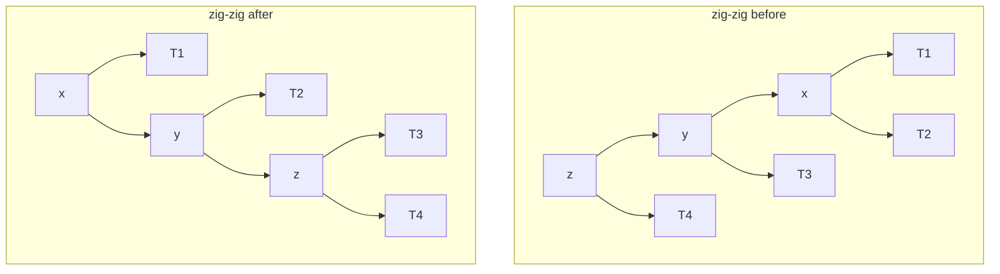

# Splay trees and amortised balance

AVL trees enforce an explicit balance rule with stored heights. **Splay trees** (Sleator and Tarjan,
1985) take a radically different approach: **no balance rule and no extra data at all**. Instead,
every time a node is accessed it is moved to the root by a specific sequence of rotations called
**splaying**. Individual operations can be slow, but any sequence of operations is fast *on
average* — an **amortised** $O(\log n)$ guarantee — and frequently accessed keys become very cheap.
It is the tree analogue of the move-to-front heuristic.

## 1. Splaying

To **splay** a position $x$ is to move it to the root through a sequence of restructurings. The
specific operation depends on the relative positions of $x$, its parent $y$ and (if it exists) its
grandparent $z$.

### 1.1 Zig-zig

$x$ and $y$ are both left children or both right children. **Promote $x$ to the top, with $y$ as its
child and $z$ as $y$'s child**: first rotate $y$ above $z$, then rotate $x$ above $y$.



> [!WARNING]
> The order matters. Rotating $x$ above $y$ and then $x$ above $z$ ("rotate to root", two plain
> single rotations of $x$) also brings $x$ up, but does **not** give the amortised bound. Zig-zig
> rotates the **parent first**. This is the single subtle point of splay trees.

### 1.2 Zig-zag

One of $x$, $y$ is a left child and the other a right child. **Promote $x$ with $y$ and $z$ as its
two children**: rotate $x$ above $y$, then $x$ above $z$ — exactly the AVL double rotation.

### 1.3 Zig

$x$ has no grandparent ($y$ is the root). Do a single rotation of $x$ above $y$.

### 1.4 The full splay

Repeat: apply zig-zig or zig-zag while $x$ has a grandparent, and a final zig if $x$ ends up as a
child of the root. Each double step moves $x$ **two levels up**; and, as a side effect, it roughly
**halves the depth of every node on the access path** — that is the hidden balancing mechanism.

```python-run
class SplayTree:
    class _Node:
        __slots__ = "key", "left", "right", "parent"
        def __init__(self, key, parent=None):
            self.key, self.parent, self.left, self.right = key, parent, None, None

    def __init__(self): self._root, self.rotations = None, 0

    def _rotate(self, x):
        """Rotate x above its parent y."""
        y, z = x.parent, x.parent.parent
        if z is None: self._root = x
        elif y is z.left: z.left = x
        else: z.right = x
        x.parent = z
        if x is y.left:
            y.left, x.right = x.right, y
            if y.left: y.left.parent = y
        else:
            y.right, x.left = x.left, y
            if y.right: y.right.parent = y
        y.parent = x
        self.rotations += 1

    def _splay(self, x):
        while x is not self._root:
            y = x.parent
            z = y.parent
            if z is None:
                self._rotate(x)                              # zig
            elif (x is y.left) == (y is z.left):
                self._rotate(y); self._rotate(x)             # zig-zig: parent first!
            else:
                self._rotate(x); self._rotate(x)             # zig-zag

    def _find(self, key):
        """Return the node with key, or the last node visited (None if empty)."""
        p, last = self._root, None
        while p is not None:
            last = p
            if key == p.key: return p
            p = p.left if key < p.key else p.right
        return last

    def search(self, key):
        p = self._find(key)
        if p is not None: self._splay(p)                     # splay even if unsuccessful
        return p is not None and p.key == key

    def insert(self, key):
        p = self._find(key)
        if p is None:
            self._root = self._Node(key); return
        if p.key != key:
            n = self._Node(key, p)
            if key < p.key: p.left = n
            else: p.right = n
            p = n
        self._splay(p)                                       # splay the new (or found) node

    def delete(self, key):
        p = self._find(key)
        if p is None or p.key != key:
            if p is not None: self._splay(p)
            return False
        if p.left is not None and p.right is not None:       # two children: use predecessor
            r = p.left
            while r.right is not None: r = r.right
            p.key = r.key
            p = r
        child = p.left if p.left is not None else p.right
        parent = p.parent
        if child is not None: child.parent = parent
        if parent is None: self._root = child
        elif p is parent.left: parent.left = child
        else: parent.right = child
        if parent is not None: self._splay(parent)           # splay the parent of the removed node
        return True

    def height(self):                                    # iterative: the tree may be a long chain
        h, level = -1, [self._root] if self._root else []
        while level:
            h += 1
            level = [c for n in level for c in (n.left, n.right) if c is not None]
        return h
    def depth_of(self, key):
        d, p = 0, self._root
        while p.key != key:
            p = p.left if key < p.key else p.right; d += 1
        return d

T = SplayTree()
for k in range(1, 1001):
    T.insert(k)                      # sorted insertions: each new key is splayed to the root
print("after sorted inserts: height", T.height(), "(a left chain!)  depth of key 1:", T.depth_of(1))
T.search(1)
print("after ONE search for key 1: height", T.height(), " depth of key 1:", T.depth_of(1))
T.search(500); T.search(500)
print("key 500 now at depth", T.depth_of(500))
```

Run it and note two things. First, sorted insertions build a **chain** — splay trees can be very
unbalanced. Second, a single access to the deepest node costs $\Theta(n)$ but **halves the height**
of the tree: the expensive operation pays for itself by improving the structure for everyone.

## 2. When to splay

The rules ensure every operation's cost is "charged" to a splay of the same depth:

- **Search for $k$:** if found at $p$, splay $p$. If not found, splay the **last position visited**
  (the leaf where the search ended).
- **Insert $k$:** splay the newly created node.
- **Delete $k$:** splay the **parent of the removed node** (after the standard BST deletion; with two
  children the node physically removed is the predecessor's old position, so splay *its* parent).

Splaying on unsuccessful searches matters: otherwise an adversary could repeatedly search for a
missing key down a long path at $\Theta(n)$ each, with the tree never improving.

## 3. Amortised analysis

The time for a splay from depth $d$ is $O(d)$: $\lfloor d/2 \rfloor$ zig-zig/zig-zag steps plus maybe
one zig. In the worst case $d = n - 1$, so single operations are $\Theta(n)$. The claim is about
sequences.

### 3.1 The accounting setup

Let $n(w)$ be the number of nodes in the subtree rooted at $w$, and define the **rank**
$r(w) = \log_2 n(w)$. The root has rank $\log n$; a leaf has rank 0. Use the potential (bank
account) invariant: **each node $w$ stores $r(w)$ cyber-dollars**. The total stored, $\Phi = \sum_w
r(w)$, is large for stringy trees (a chain has $\Phi \approx n\log n$) and small for balanced trees
($\Phi = O(n)$): unbalanced trees hold savings that pay for expensive splays.

### 3.2 The key lemma

> **Proposition.** Let $\delta$ be the variation of $\sum r$ caused by a single splaying substep at
> $x$, and let $r(x)$, $r'(x)$ be the rank of $x$ before and after. Then
> - $\delta \le 3(r'(x) - r(x)) - 2$ for a zig-zig or zig-zag;
> - $\delta \le 3(r'(x) - r(x))$ for a zig.

The proof uses the concavity of the logarithm: if $a + b \le c$ then
$\log a + \log b \le 2\log c - 2$. The "$-2$" is what pays for the two rotations of a double step.

### 3.3 Telescoping

Summing over the substeps of one splay of $x$ from depth $d$ to the root, the rank differences
telescope:

$$\text{payment needed} \le 3(r(\text{root}) - r(x)) - d + 2 \le 3\log n - d + 2.$$

So paying $3(r(\text{root}) - r(x)) + 2 = O(\log n)$ cyber-dollars per splay covers both the $d$
units of actual rotation work and the maintenance of the invariant. Insertions add a new leaf and
raise the ranks of its ancestors, but that increase is also bounded by $O(\log n)$.

> **Proposition.** Consider a sequence of $m$ operations on a splay tree, each a search, insertion or
> deletion, starting from an empty tree. If $n$ is the total number of insertions, the total running
> time is $O(m \log n)$.

So the **amortised** cost per operation is $O(\log n)$ — the same as an AVL or red-black tree, with
no balance information stored.

### 3.4 Better than balanced, sometimes

The analysis can be refined. If item $i$ is accessed $f(i)$ times out of $m$ total accesses, the
amortised time to access it is

$$O\!\left(\log \frac{m}{f(i)}\right).$$

An item accessed a constant fraction of the time costs $O(1)$ amortised. Splay trees automatically
adapt to skewed access distributions and to **locality of reference** — without knowing the
frequencies in advance — which no fixed balanced tree can do. This "static optimality" property is
why they are used in caches, memory allocators, network routers and data compression.

```python-run
import random
def access_cost_demo(n=2000, m=20000):
    # compare total path length for uniform vs skewed (90% of accesses to 10 hot keys) workloads
    import math
    class Node:
        __slots__ = "k", "l", "r", "p"
        def __init__(s, k, p=None): s.k, s.p, s.l, s.r = k, p, None, None
    root = None
    def rotate(x):
        nonlocal root
        y, z = x.p, x.p.p
        if z is None: root = x
        elif y is z.l: z.l = x
        else: z.r = x
        x.p = z
        if x is y.l:
            y.l, x.r = x.r, y
            if y.l: y.l.p = y
        else:
            y.r, x.l = x.l, y
            if y.r: y.r.p = y
        y.p = x
    def splay(x):
        while x.p is not None:
            y, z = x.p, x.p.p
            if z is None: rotate(x)
            elif (x is y.l) == (y is z.l): rotate(y); rotate(x)
            else: rotate(x); rotate(x)
    def access(k):
        p, steps = root, 1
        while p.k != k:
            p = p.l if k < p.k else p.r; steps += 1
        splay(p); return steps
    keys = list(range(n)); random.shuffle(keys)
    for k in keys:                                  # build by plain BST insertion + splay
        if root is None: root = Node(k); continue
        p = root
        while True:
            nxt = p.l if k < p.k else p.r
            if nxt is None: break
            p = nxt
        x = Node(k, p)
        if k < p.k: p.l = x
        else: p.r = x
        splay(x)
    uniform = sum(access(random.randrange(n)) for _ in range(m)) / m
    hot = random.sample(range(n), 10)
    skewed = sum(access(random.choice(hot) if random.random() < 0.9 else random.randrange(n)) for _ in range(m)) / m
    print(f"log2 n = {math.log2(n):.1f};  avg nodes visited per access: uniform {uniform:.1f}, skewed {skewed:.1f}")
access_cost_demo()
```

## 4. Splay trees versus AVL / red-black trees

| | AVL / red-black | Splay |
|---|---|---|
| Per-operation bound | $O(\log n)$ **worst case** | $O(\log n)$ **amortised**; single op can be $\Theta(n)$ |
| Extra data per node | height / colour | none |
| Skewed access patterns | no adaptation | adapts: hot keys near the root |
| Reads modify the tree | no | **yes** (every search splays) |
| Code complexity | many cases | one splay routine |

That reads restructure the tree is the main practical drawback: it is unfriendly to concurrency and
to read-mostly workloads on modern cache hierarchies, and unsuitable for hard real-time guarantees.

> [!INTERVIEW]
> You will rarely be asked to code a splay tree, but you may be asked to *explain* amortised
> analysis with it: "an expensive access to a deep node halves the depth of the nodes on its path, so
> the tree's potential drops and pays for the work". Tie it to move-to-front lists and dynamic-array
> doubling — same idea, three structures.

## 5. Pitfalls

- Implementing zig-zig as two rotations of $x$ (the "rotate-to-root" heuristic): no amortised bound.
- Not splaying after unsuccessful searches or after deletions.
- Recursing down a splay tree: it can be a chain of height $n$ — use loops.
- Assuming a search is read-only (thread safety!).

## 6. Summary

- Splaying moves the accessed node to the root by zig-zig, zig-zag and zig steps.
- Splay on every search (successful or not), insertion (new node) and deletion (parent of removed).
- Amortised $O(\log n)$ per operation via a rank-based potential argument; $O(\log(m/f(i)))$ for
  frequently accessed items.

> **Source:** Goodrich, Tamassia & Goldwasser, *Data Structures and Algorithms in Python*, ch. 11.4.

## Check yourself

```quiz
[
  {"q": "In a zig-zig step (x and its parent y are both left children), the rotations are...",
   "options": ["rotate x above y, then x above z", "rotate y above z, then x above y", "a single rotation of x", "rotate z above y"], "answer": 1,
   "explain": "The parent is rotated first; doing x twice is the weaker rotate-to-root heuristic."},
  {"q": "Which splay step is identical to an AVL double rotation?",
   "options": ["zig", "zig-zig", "zig-zag", "none"], "answer": 2,
   "explain": "x goes above y and then above z, ending with y and z as its children."},
  {"q": "After an unsuccessful search in a splay tree you should...",
   "options": ["do nothing", "splay the last node visited", "splay the root's left child", "rebuild the tree"], "answer": 1,
   "explain": "Otherwise repeated failed searches down a long path would each cost Theta(n) forever."},
  {"q": "The worst-case time of a single splay tree operation is...",
   "options": ["O(1)", "O(log n)", "Theta(n)", "O(n log n)"], "answer": 2,
   "explain": "The tree can be a chain; only the amortised cost is O(log n)."},
  {"q": "In the amortised analysis, the rank of a node is...",
   "options": ["its depth", "its height", "log2 of the number of nodes in its subtree", "its key"], "answer": 2,
   "explain": "The potential is the sum of ranks; stringy trees have high potential that pays for deep splays."},
  {"q": "An item accessed f times out of m total accesses has amortised access time...",
   "options": ["O(log n) regardless", "O(log(m / f))", "O(f)", "O(m)"], "answer": 1,
   "explain": "Frequently accessed items stay near the root: splay trees adapt to the access distribution."},
  {"q": "A practical drawback of splay trees is that...",
   "options": ["they need a colour bit", "searches modify the tree, complicating concurrency", "they cannot store duplicates", "they use O(n log n) space"], "answer": 1,
   "explain": "Every access restructures the tree, so even readers need exclusive access."}
]
```
