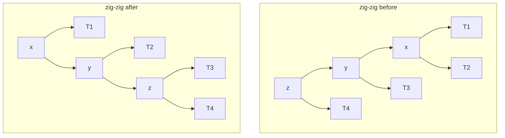

# Splay trees and amortised balance

> **Before this lesson:** You should know binary search trees
> ([Binary search trees](#/lesson/dsa-foundations/bst)), rotations and the zig-zig / zig-zag
> shapes ([Rotations and AVL trees](#/lesson/dsa-foundations/avl)), amortised analysis and the
> potential method ([Dynamic arrays](#/lesson/dsa-foundations/dynamic-arrays)), and the
> move-to-front heuristic ([Access frequencies](#/lesson/dsa-foundations/mtf-tradeoffs)).

## In plain words

An AVL tree keeps itself tidy with a strict rule and a height stored in every node. A **splay
tree** takes the opposite approach: no rule about shape and no extra information stored
anywhere. It has one habit instead. Every time a key is used, the tree rotates that key all
the way up to the root.

It is the spice shelf from the move-to-front lesson, in tree form. Whatever you used most
recently sits right at the top, where you will find it instantly next time, and things you
never touch sink towards the bottom. A splay tree is never guaranteed to look balanced at any
given moment, and a single operation can be slow. But the habit of moving things to the top
repairs the shape as it goes, so that any long run of operations is fast in total.

Why it matters for a job: splay trees are the cleanest example of a structure that is fast "on
average over time" instead of "every single time", and of a structure that adapts to how it is
used. Interviewers use them to check whether you understand amortised cost. In practice the
idea appears in caches and in software where a few items are requested far more often than
the rest.

## 1. Splaying

Splay trees were introduced by Sleator and Tarjan in 1985. To **splay** a node $x$ means to
move it to the root by a sequence of rotations. The rotations are applied in steps, and which
step is used depends on where $x$ sits relative to its parent $y$ and, if there is one, its
grandparent $z$. There are three kinds of step.

### 1.1 Zig-zig

$x$ and its parent $y$ are both left children, or both right children, so $z$, $y$, $x$ lie in
a straight line. The step **lifts $x$ to the top of the three, with $y$ as its child and $z$ as
$y$'s child**, reversing the line. It is done with two rotations: first rotate $y$ above $z$,
then rotate $x$ above $y$.



> [!WARNING]
> The order of the two rotations matters. Rotating $x$ above $y$ and then $x$ above $z$ (two
> plain rotations of $x$, a simpler idea known as "rotate to root") also brings $x$ up two
> levels, but it leaves the rest of the path as long as before and does **not** give the
> amortised bound. Zig-zig rotates the **parent first**. This is the one subtle point of splay
> trees.

### 1.2 Zig-zag

One of $x$ and $y$ is a left child and the other a right child, so $z$, $y$, $x$ form a bend.
The step **lifts $x$ to the top with $y$ and $z$ as its two children**: rotate $x$ above $y$,
then rotate $x$ above $z$. This is exactly the double rotation of the AVL lesson.

### 1.3 Zig

$x$ has no grandparent, because its parent $y$ is the root. Do one rotation of $x$ above $y$.
This can only be the last step of a splay.

### 1.4 The full splay

Repeat: while $x$ has a grandparent, apply a zig-zig or a zig-zag, whichever fits; if $x$ ends
up as a child of the root, finish with a zig. Each double step moves $x$ **two levels up**.
Along the way it has a valuable side effect: it roughly **halves the depth of every node on
the path** that $x$ travelled. That is the hidden balancing mechanism. A long, thin path gets
folded in half each time something at its far end is accessed.

The implementation below stores a `parent` reference in each node, so that `_rotate(x)` can
find the parent and grandparent. `_splay` is a direct transcription of the three steps, and
the test `(x is y.left) == (y is z.left)` asks "are $x$ and $y$ the same kind of child?", that
is, "is this a straight line?".

```python-run
class SplayTree:
    class _Node:
        __slots__ = "key", "left", "right", "parent"
        def __init__(self, key, parent=None):
            self.key, self.parent, self.left, self.right = key, parent, None, None

    def __init__(self): self._root, self.rotations = None, 0

    def _rotate(self, x):
        """Rotate x above its parent y."""
        y, z = x.parent, x.parent.parent
        if z is None: self._root = x
        elif y is z.left: z.left = x
        else: z.right = x
        x.parent = z
        if x is y.left:
            y.left, x.right = x.right, y
            if y.left: y.left.parent = y
        else:
            y.right, x.left = x.left, y
            if y.right: y.right.parent = y
        y.parent = x
        self.rotations += 1

    def _splay(self, x):
        while x is not self._root:
            y = x.parent
            z = y.parent
            if z is None:
                self._rotate(x)                              # zig
            elif (x is y.left) == (y is z.left):
                self._rotate(y); self._rotate(x)             # zig-zig: parent first!
            else:
                self._rotate(x); self._rotate(x)             # zig-zag

    def _find(self, key):
        """Return the node with key, or the last node visited (None if empty)."""
        p, last = self._root, None
        while p is not None:
            last = p
            if key == p.key: return p
            p = p.left if key < p.key else p.right
        return last

    def search(self, key):
        p = self._find(key)
        if p is not None: self._splay(p)                     # splay even if unsuccessful
        return p is not None and p.key == key

    def insert(self, key):
        p = self._find(key)
        if p is None:
            self._root = self._Node(key); return
        if p.key != key:
            n = self._Node(key, p)
            if key < p.key: p.left = n
            else: p.right = n
            p = n
        self._splay(p)                                       # splay the new (or found) node

    def delete(self, key):
        p = self._find(key)
        if p is None or p.key != key:
            if p is not None: self._splay(p)
            return False
        if p.left is not None and p.right is not None:       # two children: use predecessor
            r = p.left
            while r.right is not None: r = r.right
            p.key = r.key
            p = r
        child = p.left if p.left is not None else p.right
        parent = p.parent
        if child is not None: child.parent = parent
        if parent is None: self._root = child
        elif p is parent.left: parent.left = child
        else: parent.right = child
        if parent is not None: self._splay(parent)           # splay the parent of the removed node
        return True

    def height(self):                                    # iterative: the tree may be a long chain
        h, level = -1, [self._root] if self._root else []
        while level:
            h += 1
            level = [c for n in level for c in (n.left, n.right) if c is not None]
        return h
    def depth_of(self, key):
        d, p = 0, self._root
        while p.key != key:
            p = p.left if key < p.key else p.right; d += 1
        return d

T = SplayTree()
for k in range(1, 1001):
    T.insert(k)                      # sorted insertions: each new key is splayed to the root
print("after sorted inserts: height", T.height(), "(a left chain!)  depth of key 1:", T.depth_of(1))
T.search(1)
print("after ONE search for key 1: height", T.height(), " depth of key 1:", T.depth_of(1))
T.search(500); T.search(500)
print("key 500 now at depth", T.depth_of(500))
```

**Reading the output.** The demo inserts the keys 1 to 1000 in sorted order. Each new key is the
largest so far, is attached at the far right, and is splayed to the root, so the result is a
single chain leaning left, of height 999, with key 1 at the very bottom. A splay tree can be
as unbalanced as a tree can be. Then one search for key 1 walks the whole chain, an operation
costing $\Theta(n)$, and splays it. Afterwards the height has dropped to about 500: the one
expensive operation **halved the height** of the tree. The last line shows that a key searched
for twice in a row is at depth 0, the root, the second time.

## 2. When to splay

A splay is performed after every operation, so that the cost of the operation is matched by a
splay from the same depth:

- **Search for $k$.** If it is found at node $p$, splay $p$. If it is not found, splay the
  **last node visited**, where the search ran out.
- **Insert $k$.** Splay the newly created node.
- **Delete $k$.** Carry out the standard BST deletion, then splay the **parent of the node that
  was physically removed**. (With two children, the node physically removed is the one that
  held the predecessor, so splay *its* parent.)

Splaying after a *failed* search is not optional. Without it, someone could search over and
over for a missing key at the bottom of a long path, paying $\Theta(n)$ every time while the
tree never improved.

## 3. Amortised analysis

Splaying a node from depth $d$ takes $O(d)$ time: about $d/2$ double steps and perhaps one zig.
In the worst case $d = n - 1$, so one operation can cost $\Theta(n)$. The claim to prove is
about the *total* over a sequence of operations, and the tool is the potential method from the
dynamic-arrays lesson: describe the tree's "savings" by a formula, and show that expensive
operations are paid for by a drop in savings.

### 3.1 The accounting setup

For a node $w$, let $n(w)$ be the number of nodes in the subtree rooted at $w$ (counting $w$),
and define its **rank** as $r(w) = \log_2 n(w)$. The root has rank $\log n$; a leaf has rank 0.
Now imagine that **every node $w$ holds $r(w)$ cyber-dollars** in savings. The total,
$\Phi = \sum_w r(w)$, is the potential of the tree.

What makes this a good choice is how $\Phi$ depends on shape. In a chain, the subtrees have
sizes $n, n-1, n-2, \ldots$, almost all of them large, so $\Phi$ is about $n \log n$. In a
well-balanced tree most nodes are near the bottom with tiny subtrees, and $\Phi$ is only
$O(n)$. So a stringy, unbalanced tree is "rich", and that wealth is what pays for the long
splays that such a tree makes necessary. Splaying a deep node shortens the tree, the potential
falls, and the fall covers the cost.

### 3.2 The key lemma

> **Lemma.** Let $\delta$ be the change in $\sum r$ caused by one splaying step at $x$, and let
> $r(x)$ and $r'(x)$ be the rank of $x$ before and after the step. Then
> - $\delta \le 3(r'(x) - r(x)) - 2$ for a zig-zig or a zig-zag;
> - $\delta \le 3(r'(x) - r(x))$ for a zig.

The proof is a case-by-case calculation that rests on one property of logarithms: if
$a + b \le c$ then $\log a + \log b \le 2\log c - 2$. (Two numbers that add up to at most $c$
cannot both be close to $c$.) The "$-2$" in the first line is the point: it is exactly what
pays for the two rotations of a double step.

### 3.3 Telescoping

Add the lemma up over all the steps of one splay that brings $x$ from depth $d$ to the root.
The rank of $x$ after one step is its rank before the next, so the differences cancel in a
chain (this is called *telescoping*) and only the first and last ranks survive:

$$\text{payment needed} \le 3(r(\text{root}) - r(x)) - d + 2 \le 3\log n - d + 2.$$

Read it this way: if each splay is charged $3(r(\text{root}) - r(x)) + 2$ cyber-dollars, which
is $O(\log n)$, that covers both the $d$ units of real rotation work and keeping every node's
savings at the required level. Insertions add a new leaf, which raises the ranks of its
ancestors, but that increase is also bounded by $O(\log n)$.

> **Theorem.** Consider any sequence of $m$ operations on a splay tree, each a search, an
> insertion or a deletion, starting from an empty tree. If $n$ is the total number of
> insertions, the total running time is $O(m \log n)$.

So the **amortised** cost per operation is $O(\log n)$, the same as an AVL tree, with no
balance information stored at all.

### 3.4 Better than balanced, sometimes

The analysis can be sharpened. If item $i$ is accessed $f(i)$ times out of $m$ accesses in
total, the amortised time to access it is

$$O\!\left(\log \frac{m}{f(i)}\right).$$

An item that accounts for a fixed fraction of all accesses, say one access in ten, costs $O(1)$
amortised, because $m/f(i)$ is then a constant. Splay trees adapt automatically to uneven
access patterns and to locality of reference, without being told the frequencies in advance,
which no tree of fixed shape can do. This property is why they have been used in caches,
memory allocators and data compression.

The demo measures it. It builds a splay tree of 2,000 keys, then performs 20,000 accesses
twice: once choosing keys uniformly at random, and once with 90% of the accesses going to ten
"hot" keys. It reports the average number of nodes visited per access.

```python-run
import random
def access_cost_demo(n=2000, m=20000):
    # compare total path length for uniform vs skewed (90% of accesses to 10 hot keys) workloads
    import math
    class Node:
        __slots__ = "k", "l", "r", "p"
        def __init__(s, k, p=None): s.k, s.p, s.l, s.r = k, p, None, None
    root = None
    def rotate(x):
        nonlocal root
        y, z = x.p, x.p.p
        if z is None: root = x
        elif y is z.l: z.l = x
        else: z.r = x
        x.p = z
        if x is y.l:
            y.l, x.r = x.r, y
            if y.l: y.l.p = y
        else:
            y.r, x.l = x.l, y
            if y.r: y.r.p = y
        y.p = x
    def splay(x):
        while x.p is not None:
            y, z = x.p, x.p.p
            if z is None: rotate(x)
            elif (x is y.l) == (y is z.l): rotate(y); rotate(x)
            else: rotate(x); rotate(x)
    def access(k):
        p, steps = root, 1
        while p.k != k:
            p = p.l if k < p.k else p.r; steps += 1
        splay(p); return steps
    keys = list(range(n)); random.shuffle(keys)
    for k in keys:                                  # build by plain BST insertion + splay
        if root is None: root = Node(k); continue
        p = root
        while True:
            nxt = p.l if k < p.k else p.r
            if nxt is None: break
            p = nxt
        x = Node(k, p)
        if k < p.k: p.l = x
        else: p.r = x
        splay(x)
    uniform = sum(access(random.randrange(n)) for _ in range(m)) / m
    hot = random.sample(range(n), 10)
    skewed = sum(access(random.choice(hot) if random.random() < 0.9 else random.randrange(n)) for _ in range(m)) / m
    print(f"log2 n = {math.log2(n):.1f};  avg nodes visited per access: uniform {uniform:.1f}, skewed {skewed:.1f}")
access_cost_demo()
```

With uniform accesses the average is a little above $\log_2 n \approx 11$; with the skewed
workload it falls to a few nodes per access, because the hot keys are always near the root.

## 4. Splay trees versus AVL / red-black trees

| | AVL / red-black | Splay |
|---|---|---|
| Per-operation bound | $O(\log n)$ **worst case** | $O(\log n)$ **amortised**; single op can be $\Theta(n)$ |
| Extra data per node | height / colour | none |
| Skewed access patterns | no adaptation | adapts: hot keys near the root |
| Reads modify the tree | no | **yes** (every search splays) |
| Code complexity | many cases | one splay routine |

The main practical drawback is that *reading* changes the tree. Several parts of a program
cannot safely search it at the same time without coordination, searches write to memory, and
the occasional slow operation rules it out where every single operation must meet a deadline.

> [!INTERVIEW]
> You will rarely be asked to code a splay tree, but you may be asked to *explain* amortised
> analysis with one. A good answer: "an expensive access to a deep node halves the depth of the
> nodes on its path, so the tree's potential drops, and that drop pays for the work." Connect
> it to move-to-front lists and to the doubling of dynamic arrays: the same idea in three
> structures.

## 5. Pitfalls

- **Implementing zig-zig as two rotations of $x$.** That is the rotate-to-root heuristic, and it
  has no amortised bound; rotate the parent first.
- **Not splaying after a failed search or after a deletion.** The bound depends on every
  operation ending in a splay.
- **Recursing down a splay tree.** It can be a chain of height $n$, so use loops.
- **Assuming a search only reads.** In a splay tree it writes, which matters when the tree is
  shared.
- **Quoting the bound as a worst case.** One operation can take $\Theta(n)$; the $O(\log n)$ is
  amortised.

## 6. Summary

- Splaying moves an accessed node to the root by zig-zig, zig-zag and zig steps; in a zig-zig
  the parent is rotated first.
- Splay after every search (successful or not), insertion (the new node) and deletion (the
  parent of the removed node).
- A potential based on ranks shows an amortised cost of $O(\log n)$ per operation, and
  $O(\log(m/f(i)))$ for an item accessed $f(i)$ times out of $m$.
- No balance information is stored, and the tree adapts to its access pattern, at the price of
  occasional slow operations and searches that modify the tree.

> **Source:** Goodrich, Tamassia & Goldwasser, *Data Structures and Algorithms in Python*, ch. 11.4.

## Glossary

- **Splay tree**: a binary search tree that moves each accessed node to the root.
- **Splaying**: the sequence of rotation steps that brings a node to the root.
- **Zig**: a single rotation, used when the node's parent is the root.
- **Zig-zig**: the step for three nodes in a straight line; rotate the parent, then the node.
- **Zig-zag**: the step for three nodes forming a bend; rotate the node twice.
- **Rotate-to-root**: the weaker idea of rotating the node itself repeatedly; no amortised
  bound.
- **Rank**: the base-2 logarithm of the number of nodes in a node's subtree.
- **Potential ($\Phi$)**: here, the sum of all ranks; large for unbalanced trees.
- **Telescoping**: a sum in which consecutive terms cancel, leaving only the first and last.
- **Self-adjusting structure**: a structure that reorganises itself according to how it is
  used.

## Check yourself

```quiz
[
  {"q": "In a zig-zig step (x and its parent y are both left children), the rotations are...",
   "options": ["rotate x above y, then x above z", "rotate y above z, then x above y", "a single rotation of x", "rotate z above y"], "answer": 1,
   "explain": "The parent is rotated first; doing x twice is the weaker rotate-to-root heuristic."},
  {"q": "Which splay step is identical to an AVL double rotation?",
   "options": ["zig", "zig-zig", "zig-zag", "none"], "answer": 2,
   "explain": "x goes above y and then above z, ending with y and z as its children."},
  {"q": "After an unsuccessful search in a splay tree you should...",
   "options": ["do nothing", "splay the last node visited", "splay the root's left child", "rebuild the tree"], "answer": 1,
   "explain": "Otherwise repeated failed searches down a long path would each cost Theta(n) forever."},
  {"q": "The worst-case time of a single splay tree operation is...",
   "options": ["O(1)", "O(log n)", "Theta(n)", "O(n log n)"], "answer": 2,
   "explain": "The tree can be a chain; only the amortised cost is O(log n)."},
  {"q": "In the amortised analysis, the rank of a node is...",
   "options": ["its depth", "its height", "log2 of the number of nodes in its subtree", "its key"], "answer": 2,
   "explain": "The potential is the sum of ranks; stringy trees have high potential that pays for deep splays."},
  {"q": "An item accessed f times out of m total accesses has amortised access time...",
   "options": ["O(log n) regardless", "O(log(m / f))", "O(f)", "O(m)"], "answer": 1,
   "explain": "Frequently accessed items stay near the root: splay trees adapt to the access distribution."},
  {"q": "A practical drawback of splay trees is that...",
   "options": ["they need a colour bit", "searches modify the tree, complicating concurrency", "they cannot store duplicates", "they use O(n log n) space"], "answer": 1,
   "explain": "Every access restructures the tree, so even readers need exclusive access."}
]
```
