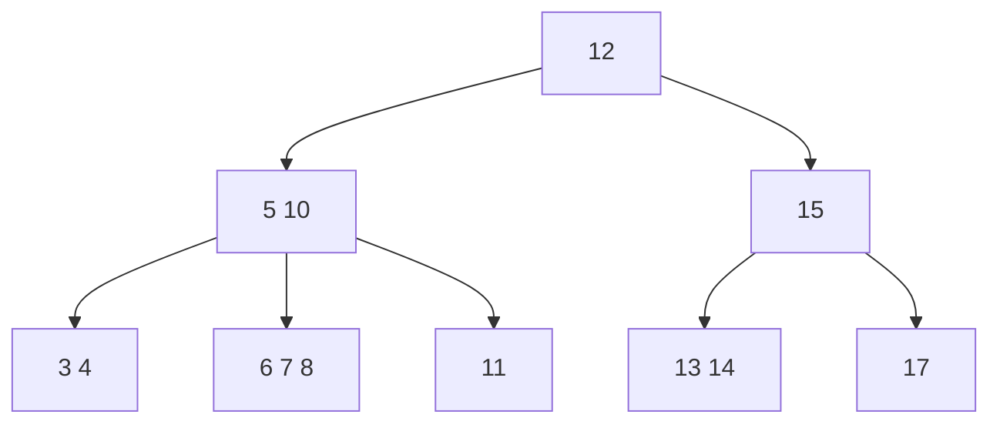
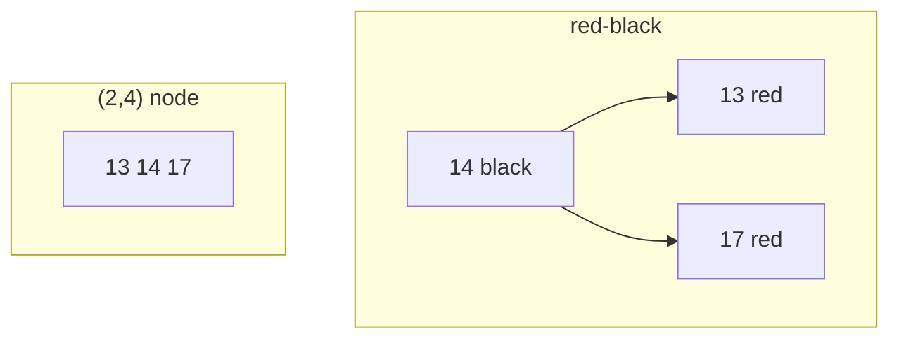

# (2,4) trees and red-black trees

This lesson presents the two remaining balanced trees of the chapter. The **(2,4) tree** leaves the
binary world: nodes may hold several keys, and the tree stays *perfectly* height-balanced by
splitting and merging nodes. The **red-black tree** is a binary search tree that encodes a (2,4)
tree using one colour bit per node; it is the balanced tree found in most standard libraries.
Understanding the first makes the second far less mysterious.

## 1. Multiway search trees

Let $w$ be a node of an ordered tree. $w$ is a **$d$-node** if it has $d$ children. A **multiway
search tree** is an ordered tree $T$ in which:

- each internal node has at least two children (is a $d$-node with $d \ge 2$);
- each $d$-node $w$ with children $c_1, \ldots, c_d$ stores an ordered set of $d - 1$ items with
  keys $k_1 \le \cdots \le k_{d-1}$;
- with $k_0 = -\infty$ and $k_d = +\infty$, every key $k$ stored in the subtree rooted at $c_i$
  satisfies $k_{i-1} \le k \le k_i$.

So the keys in a node act as **separators** for its children's subtrees. (For uniformity the book
treats the leaves as empty placeholders; an $n$-item multiway tree then has $n + 1$ external nodes.)

**Searching** generalises the BST search: at a $d$-node, compare $k$ with $k_1, \ldots, k_{d-1}$; if
it matches some $k_i$, done; otherwise continue in the child $c_i$ with $k_{i-1} < k < k_i$.

## 2. (2,4) trees

A **(2,4) tree** (also *2-4 tree* or *2-3-4 tree*) is a multiway search tree with:

- **Size property:** no internal node has more than **four children** (so 1, 2 or 3 keys);
- **Depth property:** all external nodes have the **same depth**.



Nodes are called 2-nodes, 3-nodes or 4-nodes by their number of children.

> **Proposition.** A (2,4) tree with $n$ items has logarithmic height; more precisely
> $\tfrac12 \log(n+1) \le h \le \log(n+1)$.

*Justification.* By the size property there are at most $4^h$ external nodes, and by the depth and
size properties (every internal node has at least 2 children) at least $2^h$. Since the number of
external nodes is $n + 1$: $2^h \le n + 1 \le 4^h$. ∎

Since each node holds at most 3 keys, the work per node is $O(1)$ and a search takes $O(\log n)$.

### 2.1 Insertion: overflow and split

Search for $k$; the search ends unsuccessfully at an external node $z$ with parent $w$. Add the new
item to **$w$** (the lowest internal node) — this keeps the depth property. But $w$ may now have
five children (4 keys): an **overflow**. Fix it with a **split**:

1. Let $w$ have children $c_1..c_5$ and keys $k_1..k_4$.
2. Replace $w$ by two nodes: $w'$ (a 3-node with keys $k_1, k_2$, children $c_1, c_2, c_3$) and $w''$
   (a 2-node with key $k_4$, children $c_4, c_5$).
3. Move the middle key $k_3$ **up** into the parent $u$ of $w$ (if $w$ was the root, create a new
   root holding $k_3$ — this is the only way the tree grows taller, and it grows **at the root**, so
   all leaves stay at the same depth).

The parent may overflow in turn; splits can cascade up to the root: $O(\log n)$ splits, each $O(1)$.

**Example.** Insert 4, 6, 12, 15, 3, 5, 10, 8 into an empty tree:

| insert | action | tree |
|---|---|---|
| 4, 6, 12 | fit in root | `[4 6 12]` |
| 15 | root overflows `[4 6 12 15]` → split, 12 moves up | `[12]` → `[4 6]`, `[15]` |
| 3 | goes into `[4 6]` | `[12]` → `[3 4 6]`, `[15]` |
| 5 | `[3 4 5 6]` overflows → split, 5 moves up | `[5 12]` → `[3 4]`, `[6]`, `[15]` |
| 10, 8 | go into `[6]` | `[5 12]` → `[3 4]`, `[6 8 10]`, `[15]` |

```python-run
class TwoFourTree:
    """(2,4) tree supporting insertion and search; each node = [keys, children]."""
    def __init__(self): self.root = [[], []]            # leaf: no children
    def search(self, k):
        node, visited = self.root, 0
        while True:
            visited += 1
            keys, kids = node
            i = 0
            while i < len(keys) and k > keys[i]: i += 1
            if i < len(keys) and keys[i] == k: return True, visited
            if not kids: return False, visited
            node = kids[i]
    def insert(self, k):
        result = self._insert(self.root, k)
        if result is not None:                           # root was split: tree grows at the top
            mid, right = result
            self.root = [[mid], [self.root, right]]
    def _insert(self, node, k):
        keys, kids = node
        i = 0
        while i < len(keys) and k > keys[i]: i += 1
        if i < len(keys) and keys[i] == k: return None   # already present
        if not kids:
            keys.insert(i, k)                            # add to the lowest internal node
        else:
            result = self._insert(kids[i], k)
            if result is None: return None
            mid, right = result                          # child split: absorb its middle key
            keys.insert(i, mid); kids.insert(i + 1, right)
        if len(keys) <= 3: return None
        # overflow: 4 keys -> split into [k1 k2] and [k4], pushing k3 up
        mid = keys[2]
        right = [keys[3:], kids[3:]]
        node[0], node[1] = keys[:2], kids[:3]
        return mid, right
    def show(self, node=None, depth=0):
        node = node or self.root
        print("    " * depth + str(node[0]))
        for c in node[1]: self.show(c, depth + 1)

T = TwoFourTree()
for k in [4, 6, 12, 15, 3, 5, 10, 8]:
    T.insert(k)
T.show()
for k in range(20, 60): T.insert(k)
print("search 37:", T.search(37), " search 99:", T.search(99))
```

### 2.2 Deletion: underflow, transfer and fusion

As in a BST, reduce to deleting from a node at the bottom: if the key $k_i$ to delete is in a
higher node, swap it with its inorder predecessor (the rightmost key in the subtree of $c_i$),
which lives in a bottom node. Removing a key from a bottom node $w$ may leave it with **no keys**
(one child): an **underflow**. Two remedies:

- **Transfer:** if an immediate sibling $s$ of $w$ is a 3-node or 4-node, shift one of $s$'s children over to
  $w$, send a key of $s$ up to the parent $u$, and a key of $u$ down to $w$ (a rotation through the
  parent). Done.
- **Fusion:** if the immediate siblings are 2-nodes, **merge** $w$ with a sibling into a new node and
  pull a key of the parent $u$ down into it. Now $u$ has one fewer key — it may underflow in turn,
  and the process repeats upward. If the root becomes empty, delete it: the tree shrinks **from the
  top**.

At most $O(\log n)$ fusions followed by at most one transfer.

| Operation | (2,4) tree |
|---|---|
| search, insert, delete | $O(\log n)$ |
| a split, transfer or fusion | $O(1)$ |

## 3. Red-black trees

AVL trees may need $O(\log n)$ restructurings per deletion; (2,4) trees may need $O(\log n)$ splits
or fusions. Red-black trees need only **$O(1)$ structural changes** per update, with $O(\log n)$
recolourings.

A **red-black tree** is a binary search tree whose nodes are coloured **red** or **black** such that:

1. **Root property:** the root is black.
2. **Red property:** a red node never has a red child — no two reds in a row.
3. **Depth property:** every node that lacks at least one child has the same **black depth** — the
   number of black ancestors (counting the node itself if black). Equivalently: every path from the
   root down to a missing child passes through the same number of black nodes.

### 3.1 The correspondence with (2,4) trees

Merge every red node into its black parent. Each black node together with its red children forms a
(2,4)-tree node:

- a black node with no red children ↔ a **2-node**;
- a black node with one red child ↔ a **3-node** (two possible orientations);
- a black node with two red children ↔ a **4-node**.



The depth property of the red-black tree is exactly the "all leaves at the same depth" property of
the (2,4) tree. Red-black trees are (2,4) trees wearing a binary costume.

> **Proposition.** A red-black tree with $n$ entries has height $O(\log n)$; precisely
> $\log(n+1) - 1 \le h \le 2\log(n+1) - 2$.

*Justification.* Let $d$ be the common black depth. The corresponding (2,4) tree has height $d$, so
$d \le \log(n+1)$... and by the red property at most every other node on a path is red, so the
height is at most about $2d$. ∎

### 3.2 Insertion

Insert as in a BST and colour the new node $x$ **red** (black if it is the root). Red preserves the
depth property; the only possible violation is a **double red**: $x$'s parent $y$ is also red. (Then
$y$ is not the root, so the grandparent $z$ exists and is black.) Let $s$ be the sibling of $y$ —
$x$'s "uncle".

**Case 1 — the uncle $s$ is black (or absent).** In (2,4) terms, we created a malformed 4-node.
Perform a **trinode restructuring** of $x, y, z$ (single or double rotation as in AVL), then colour
the new subtree root $b$ **black** and its children $a$ and $c$ **red**. The double red is gone, and
black depths are unchanged. **Done** — one restructuring.

**Case 2 — the uncle $s$ is red.** In (2,4) terms, an **overflow** (5-node). Perform the equivalent
of a split by **recolouring**: colour $y$ and $s$ black and $z$ red (unless $z$ is the root, which
stays black). Black depths are preserved, but $z$ is now red and may form a double red with *its*
parent — repeat the analysis at $z$. Recolouring can propagate up $O(\log n)$ levels, but it involves
no rotations.

So an insertion costs $O(\log n)$ recolourings and **at most one** restructuring.

```python-run
RED, BLACK = True, False
class RBNode:
    __slots__ = "key", "red", "left", "right", "parent"
    def __init__(self, key, parent=None):
        self.key, self.red, self.parent, self.left, self.right = key, RED, parent, None, None

class RedBlackTree:
    def __init__(self): self.root, self.rotations, self.recolorings = None, 0, 0
    def _rotate(self, x):                               # rotate x above its parent
        y, z = x.parent, x.parent.parent
        if z is None: self.root = x
        elif y is z.left: z.left = x
        else: z.right = x
        x.parent = z
        if x is y.left:
            y.left, x.right = x.right, y
            if y.left: y.left.parent = y
        else:
            y.right, x.left = x.left, y
            if y.right: y.right.parent = y
        y.parent = x
        self.rotations += 1
    def _restructure(self, x):
        y, z = x.parent, x.parent.parent
        if (x is y.right) == (y is z.right):
            self._rotate(y); return y                   # single rotation
        self._rotate(x); self._rotate(x); return x      # double rotation
    def insert(self, key):
        if self.root is None:
            self.root = RBNode(key); self.root.red = BLACK; return
        p = self.root
        while True:
            if key == p.key: return
            nxt = p.left if key < p.key else p.right
            if nxt is None: break
            p = nxt
        x = RBNode(key, p)
        if key < p.key: p.left = x
        else: p.right = x
        self._resolve_red(x)
    def _resolve_red(self, x):
        if x is self.root:
            x.red = BLACK; return
        y = x.parent
        if not y.red: return                            # no double red
        z = y.parent
        s = z.left if y is z.right else z.right         # uncle
        if s is None or not s.red:                      # Case 1: restructure
            b = self._restructure(x)
            b.red = BLACK
            b.left.red = b.right.red = RED
        else:                                           # Case 2: recolour and move up
            y.red = s.red = BLACK
            z.red = RED
            self.recolorings += 1
            self._resolve_red(z)
    def check(self):
        """Return black height if all red-black properties hold; raise otherwise."""
        assert not self.root.red, "root must be black"
        def rec(n, lo, hi):
            if n is None: return 1
            assert (lo is None or lo < n.key) and (hi is None or n.key < hi), "BST order"
            if n.red:
                assert not (n.left and n.left.red) and not (n.right and n.right.red), "double red"
            l, r = rec(n.left, lo, n.key), rec(n.right, n.key, hi)
            assert l == r, "black depth mismatch"
            return l + (0 if n.red else 1)
        return rec(self.root, None, None)
    def height(self, n="root"):
        if n == "root": n = self.root
        return 0 if n is None else 1 + max(self.height(n.left), self.height(n.right))

T = RedBlackTree()
for k in range(1, 2001): T.insert(k)                    # sorted input
print("n=2000 sorted inserts: height", T.height(), " black height", T.check(),
      " rotations", T.rotations, " recolour steps", T.recolorings)
```

### 3.3 Deletion (overview)

Delete as in a BST; the node physically removed has at most one child.

- If the removed node was **red**, nothing is violated.
- If it was black with a red child, promote the child and colour it **black**.
- If it was a black leaf, the path through its position is now one black node short. The book
  describes the fix in terms of the *heavier* sibling subtree $y$ of the deficient position, with
  parent $z$:
  - **Case 1: $y$ is black and has a red child $x$.** A trinode restructuring of $x, y, z$ plus
    recolouring (the new subtree root takes $z$'s old colour, its two children become black) —
    corresponds to a (2,4) **transfer**. Done.
  - **Case 2: $y$ is black with no red child.** Recolour $y$ red — corresponds to a **fusion**. If
    $z$ was red, colour it black and stop; if $z$ was black, the deficit moves up to $z$: repeat.
  - **Case 3: $y$ is red.** Rotate $y$ above $z$ and recolour ($y$ black, $z$ red); this
    re-orients a 3-node so that the sibling is black, after which Case 1 or Case 2 applies and
    terminates.

A deletion uses $O(\log n)$ recolourings and at most **two** restructurings.

### 3.4 Performance summary

| Operation | Red-black tree |
|---|---|
| search, `find_*` | $O(\log n)$ worst case |
| insert | $O(\log n)$; $O(1)$ structural changes |
| delete | $O(\log n)$; $O(1)$ structural changes |
| space | $O(n)$, one bit per node |

## 4. Comparing the balanced trees

| Tree | Balance rule | Height bound | Rotations per update | Notes |
|---|---|---|---|---|
| AVL | sibling heights differ ≤ 1 | $1.44\log n$ | insert ≤ 2, delete $O(\log n)$ | fastest lookups |
| Splay | none (move to root) | $n$ worst; amortised $\log n$ | amortised $O(\log n)$ | adapts to access pattern |
| (2,4) | all leaves same depth, ≤ 4 children | $\log n$ | splits/fusions $O(\log n)$ | basis of B-trees |
| Red-black | colour rules | $2\log n$ | $O(1)$ | library standard |

> [!INTERVIEW]
> Typical questions: state the red-black properties; why is the height at most $2\log(n+1)$ (black
> depth ≤ log(n+1), reds cannot be adjacent); what happens on insert (new node red; uncle red →
> recolour and move up; uncle black → rotate and recolour). You are rarely asked to code deletion.
> Mention where they are used: Java `TreeMap`/`TreeSet`, C++ `std::map`, the Linux kernel's
> scheduler and memory maps. Python's standard library has no balanced-tree map — use `bisect` on a
> list or the third-party `sortedcontainers`.

## 5. Pitfalls

- Inserting a new node as black (breaks the depth property immediately).
- Forgetting to keep the root black after recolouring propagates to it.
- In Case 1, recolouring before identifying $a$, $b$, $c$ (colour by position after restructuring).
- For (2,4) trees: adding the new key at an external position (creating a deeper leaf) rather than
  into the lowest internal node.

## 6. Summary

- (2,4) trees keep all leaves at one depth; insert → split on overflow (grow at the root),
  delete → transfer or fusion on underflow (shrink at the root).
- A red-black tree is a binary encoding of a (2,4) tree: black node + red children = one multi-key
  node.
- Red-black updates: $O(\log n)$ time, $O(1)$ rotations.

> **Source:** Goodrich, Tamassia & Goldwasser, *Data Structures and Algorithms in Python*, ch. 11.5–11.6.

## Check yourself

```quiz
[
  {"q": "How many keys can a node of a (2,4) tree hold?",
   "options": ["Exactly 2", "1, 2 or 3", "2, 3 or 4", "Up to 24"], "answer": 1,
   "explain": "A d-node has d children and d - 1 keys, with 2 <= d <= 4."},
  {"q": "How does a (2,4) tree grow in height?",
   "options": ["A new leaf level is added at the bottom", "The root splits and a new root is created above it", "It never grows", "By rotation"], "answer": 1,
   "explain": "Growth at the root keeps all external nodes at the same depth."},
  {"q": "An underflow at node w whose immediate sibling is a 3-node is fixed by...",
   "options": ["a split", "a transfer through the parent", "a fusion", "recolouring"], "answer": 1,
   "explain": "The sibling can spare a key: one key moves up to the parent and one down to w."},
  {"q": "In the red-black / (2,4) correspondence, a black node with two red children represents...",
   "options": ["a 2-node", "a 3-node", "a 4-node", "an overflow"], "answer": 2,
   "explain": "Three keys (the black node and its two red children) and four subtrees."},
  {"q": "A newly inserted red-black node (not the root) is coloured...",
   "options": ["black", "red", "the colour of its parent", "randomly"], "answer": 1,
   "explain": "Red does not change any black depth; only a possible double red must be fixed."},
  {"q": "Double red with a RED uncle is resolved by...",
   "options": ["a trinode restructuring", "recolouring parent and uncle black, grandparent red, and continuing upward", "deleting the node", "a fusion"], "answer": 1,
   "explain": "It is the binary image of a (2,4) split; the problem may move up to the grandparent."},
  {"q": "Maximum height of a red-black tree with n entries is about...",
   "options": ["log n", "2 log n", "sqrt n", "n / 2"], "answer": 1,
   "explain": "Black depth is at most log(n+1) and red nodes cannot be consecutive, so paths are at most twice that."}
]
```
