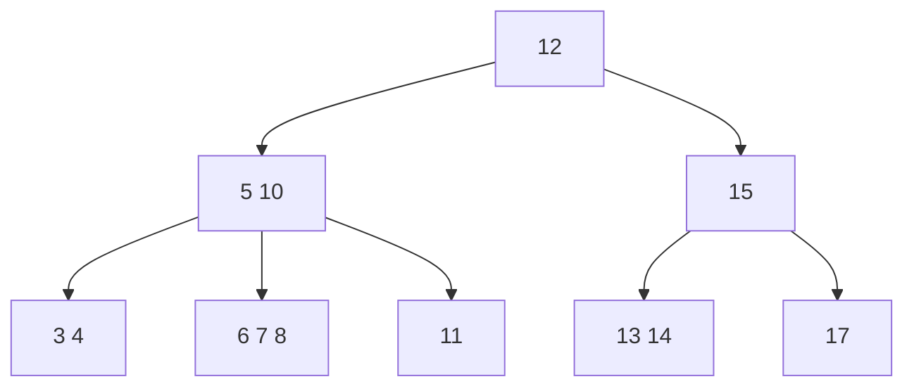
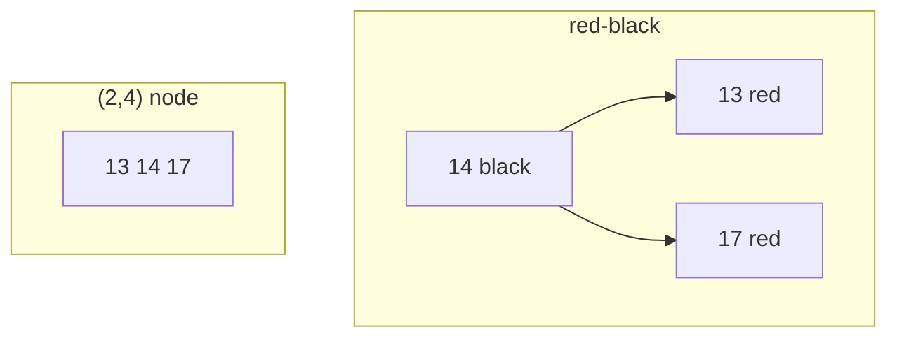

# (2,4) trees and red-black trees

> **Before this lesson:** You should know binary search trees
> ([Binary search trees](#/lesson/dsa-foundations/bst)) and rotations, trinode restructuring and
> AVL trees ([Rotations and AVL trees](#/lesson/dsa-foundations/avl)). Splay trees are mentioned
> only in the final comparison.

## In plain words

This lesson presents two more ways to keep a search tree balanced, and the surprise is that
they are the same idea in two outfits.

The first, the **(2,4) tree**, gives up the rule that a node holds one key. Its nodes are like
small drawers that can hold one, two or three keys in order. When a drawer gets a fourth key
it is too full, so it splits into two drawers and passes its middle key up to the drawer
above. Because the tree only ever grows by splitting at the top, every path from the top to the
bottom has exactly the same length: the tree is perfectly level at all times.

The second, the **red-black tree**, is an ordinary binary search tree with every node painted
red or black. The colours are a code. A black node together with its red children stands for
one drawer of a (2,4) tree. A few rules about colours are then enough to keep the binary tree
from becoming lopsided.

Why it matters for a job: the red-black tree is the balanced tree inside most standard
libraries (Java's `TreeMap`, C++'s `std::map`) and inside the Linux kernel. You will rarely be
asked to write one, but stating its rules and explaining why they keep the height logarithmic
is a classic interview question. The (2,4) tree also leads directly to the B-tree, the
structure behind database indexes, covered in the final lesson of this track.

## 1. Multiway search trees

A binary search tree node holds one key and has up to two children. A **multiway search tree**
generalises this: a node may hold several keys and have several children. A node with $d$
children is called a **$d$-node**. The rules are:

- every internal node has at least two children;
- a $d$-node with children $c_1, \ldots, c_d$ stores $d - 1$ items, with keys in order
  $k_1 \le \cdots \le k_{d-1}$;
- the keys act as dividers: everything in the subtree of the first child is at most $k_1$,
  everything in the subtree of child $c_i$ lies between $k_{i-1}$ and $k_i$, and everything in
  the subtree of the last child is at least $k_{d-1}$.

Think of the tabbed dividers in a filing drawer: a node's keys are the **separators**, and
between each pair of neighbouring separators hangs the subtree of keys that fall in that gap.
A binary search tree is the special case in which every node is a 2-node. (For neat
bookkeeping, the bottom of the tree is imagined to end in empty placeholder leaves, the
*external nodes*; a tree holding $n$ items has $n + 1$ of them, one for each gap between
consecutive keys.)

**Searching** extends the BST search: at a $d$-node, compare the target $k$ with the node's
keys; if it equals one of them, the search is done; otherwise continue into the child whose gap
contains $k$.

## 2. (2,4) trees

A **(2,4) tree** (also called a *2-4 tree* or *2-3-4 tree*) is a multiway search tree with two
extra rules:

- **Size property:** no node has more than **four children**, so a node holds 1, 2 or 3 keys;
- **Depth property:** all external nodes are at the **same depth**. The tree is perfectly
  level.



In the picture, the root `12` is a 2-node (one key, two children), `5 10` is a 3-node and
`6 7 8` holds three keys, the maximum. Every bottom node is at depth 2. To search for 7: at the
root, 7 is less than 12, go to the first child; at `5 10`, 7 lies between 5 and 10, go to the
middle child; there it is.

> **Claim.** A (2,4) tree with $n$ items has height $h$ with
> $\tfrac12 \log(n+1) \le h \le \log(n+1)$.

*Why.* Count the external nodes. Every internal node has at most 4 children, so after $h$
levels there are at most $4^h$ of them. Every internal node has at least 2 children and all
external nodes are at depth $h$, so there are at least $2^h$. And we know there are exactly
$n + 1$. So $2^h \le n + 1 \le 4^h$, which rearranges to the claim. ∎

Each node holds at most 3 keys, so the work at one node is $O(1)$, and a search, which visits
one node per level, takes $O(\log n)$.

### 2.1 Insertion: overflow and split

To insert a key $k$, search for it. The search fails at the bottom of the tree; let $w$ be the
lowest real node on the search path. Add the new key **into $w$**, in its sorted place. Adding
to an existing bottom node, instead of hanging a new node below it, is what preserves the depth
property. But $w$ may now hold 4 keys, one too many. This is an **overflow**, and it is
repaired by a **split**:

1. Say $w$ now holds keys $k_1, k_2, k_3, k_4$ (and, if it is not at the bottom, five children).
2. Replace $w$ by two nodes: one with keys $k_1, k_2$ (and the first three children) and one
   with the single key $k_4$ (and the last two children).
3. Move the middle key $k_3$ **up** into the parent of $w$, where it becomes the separator
   between the two new nodes. If $w$ was the root, create a new root holding only $k_3$.

Creating a new root is the only way the tree ever gets taller, and it gets taller **at the
top**, which lowers every leaf by one level at the same instant. That is why all leaves always
stay at the same depth.

Receiving a key may make the parent overflow in turn, so splits can ripple upwards as far as
the root: at most $O(\log n)$ splits, each $O(1)$.

**Example.** Insert 4, 6, 12, 15, 3, 5, 10, 8 into an empty tree:

| insert | action | tree |
|---|---|---|
| 4, 6, 12 | fit in root | `[4 6 12]` |
| 15 | root overflows `[4 6 12 15]` → split, 12 moves up | `[12]` → `[4 6]`, `[15]` |
| 3 | goes into `[4 6]` | `[12]` → `[3 4 6]`, `[15]` |
| 5 | `[3 4 5 6]` overflows → split, 5 moves up | `[5 12]` → `[3 4]`, `[6]`, `[15]` |
| 10, 8 | go into `[6]` | `[5 12]` → `[3 4]`, `[6 8 10]`, `[15]` |

```python-run
class TwoFourTree:
    """(2,4) tree supporting insertion and search; each node = [keys, children]."""
    def __init__(self): self.root = [[], []]            # leaf: no children
    def search(self, k):
        node, visited = self.root, 0
        while True:
            visited += 1
            keys, kids = node
            i = 0
            while i < len(keys) and k > keys[i]: i += 1
            if i < len(keys) and keys[i] == k: return True, visited
            if not kids: return False, visited
            node = kids[i]
    def insert(self, k):
        result = self._insert(self.root, k)
        if result is not None:                           # root was split: tree grows at the top
            mid, right = result
            self.root = [[mid], [self.root, right]]
    def _insert(self, node, k):
        keys, kids = node
        i = 0
        while i < len(keys) and k > keys[i]: i += 1
        if i < len(keys) and keys[i] == k: return None   # already present
        if not kids:
            keys.insert(i, k)                            # add to the lowest internal node
        else:
            result = self._insert(kids[i], k)
            if result is None: return None
            mid, right = result                          # child split: absorb its middle key
            keys.insert(i, mid); kids.insert(i + 1, right)
        if len(keys) <= 3: return None
        # overflow: 4 keys -> split into [k1 k2] and [k4], pushing k3 up
        mid = keys[2]
        right = [keys[3:], kids[3:]]
        node[0], node[1] = keys[:2], kids[:3]
        return mid, right
    def show(self, node=None, depth=0):
        node = node or self.root
        print("    " * depth + str(node[0]))
        for c in node[1]: self.show(c, depth + 1)

T = TwoFourTree()
for k in [4, 6, 12, 15, 3, 5, 10, 8]:
    T.insert(k)
T.show()
for k in range(20, 60): T.insert(k)
print("search 37:", T.search(37), " search 99:", T.search(99))
```

**Reading the code.** A node is a two-item list `[keys, children]`, and a bottom node has an
empty list of children. `_insert` goes down recursively to the right bottom node and adds the
key there. If a node ends up with more than 3 keys, the function splits it and *returns* the
middle key together with the new right-hand node, so that the caller (the parent) can absorb
them; `None` means "no split happened". `insert` handles the special case of the root
splitting. The printed tree matches the last row of the table: `[5, 12]` on top with `[3, 4]`,
`[6, 8, 10]` and `[15]` indented beneath it.

### 2.2 Deletion: underflow, transfer and fusion

As in a BST, deletion is first reduced to removing a key from a bottom node: if the key to
delete is higher up, replace it by its inorder predecessor (the largest key in the subtree to
its left, which is always in a bottom node) and delete that one instead. Removing a key from a
bottom node $w$ may leave $w$ with **no keys at all**. This is an **underflow**, and there are
two remedies, depending on $w$'s neighbours.

- **Transfer.** If a sibling next to $w$ has a key to spare (it holds 2 or 3 keys), borrow
  through the parent: one key of the sibling moves up into the parent, and the parent's
  separator key moves down into $w$. Everything is legal again, and the repair is finished.
- **Fusion.** If the neighbouring siblings hold only one key each, nobody can lend. Then
  **merge** $w$ with a sibling into one node, and pull the separator key down from the parent
  into it. The parent now has one key fewer, so it may underflow in turn, and the process
  repeats one level up. If the root is left with no keys, delete it: the tree gets shorter
  **from the top**, again keeping all leaves level.

A deletion needs at most $O(\log n)$ fusions, followed by at most one transfer.

| Operation | (2,4) tree |
|---|---|
| search, insert, delete | $O(\log n)$ |
| a split, transfer or fusion | $O(1)$ |

## 3. Red-black trees

A (2,4) tree is pleasant on paper but awkward to program, because its nodes come in three
sizes. The red-black tree stores the same structure using ordinary binary nodes. It also has a
practical edge over the other balanced trees: an AVL tree may need $O(\log n)$ restructurings
for one deletion, whereas a red-black tree needs only **$O(1)$ rotations** per update, plus up
to $O(\log n)$ changes of colour, which are much cheaper.

A **red-black tree** is a binary search tree in which every node carries a colour, **red** or
**black** (one bit of information), subject to three rules:

1. **Root property:** the root is black.
2. **Red property:** a red node never has a red child. There are never two reds in a row.
3. **Depth property:** every path from the root down to a missing child passes through the
   same number of black nodes. That number is the tree's **black depth** (also called its black
   height).

### 3.1 The correspondence with (2,4) trees

The rules look arbitrary until you see what the colours encode. Imagine sliding every red node
up into its black parent, so that they become one fat node. Each black node, together with its
red children, forms exactly one node of a (2,4) tree:

- a black node with no red children ↔ a **2-node**;
- a black node with one red child ↔ a **3-node** (two possible orientations);
- a black node with two red children ↔ a **4-node**.



Now the rules make sense. The red property says a red node always belongs to the black node
directly above it, so the fat nodes never have more than three keys. The depth property, read
through the code, says that every path crosses the same number of fat nodes: it is the (2,4)
tree's "all leaves at the same depth". A red-black tree is a (2,4) tree in binary dress.

> **Claim.** A red-black tree with $n$ entries has height $O(\log n)$; more precisely
> $\log(n+1) - 1 \le h \le 2\log(n+1) - 2$.

*Why.* Let $d$ be the black depth. The matching (2,4) tree has height $d$, and section 2 showed
that such a tree has height at most $\log(n+1)$. On any path in the red-black tree, reds can
never be adjacent, so at most every other node is red, and a path is at most about twice as
long as its count of black nodes. Hence the height is at most about $2\log(n+1)$. ∎

### 3.2 Insertion

Insert as in a plain BST, and colour the new node $x$ **red** (or black if it is the root). Why
red? A red node adds no black node to any path, so the depth property cannot be broken. The
only rule that can fail is the red property, when the parent $y$ of $x$ is red as well: a
**double red**. (In that case $y$ is not the root, so the grandparent $z$ exists, and $z$ must
be black.) Let $s$ be the sibling of $y$, the "uncle" of $x$. What to do depends on the uncle's
colour.

**Case 1: the uncle is black (or missing).** In (2,4) terms, the fat node around $z$ has room
for the new key, but its three keys are arranged in a line or bend instead of a triangle.
Perform a **trinode restructuring** of $x$, $y$, $z$ (a single or double rotation, exactly as
for AVL trees), then colour the node that ends up on top **black** and its two children
**red**. The double red is gone and no path has gained or lost a black node. **Finished**,
after one restructuring.

**Case 2: the uncle is red.** In (2,4) terms, the fat node already held three keys ($y$, $z$,
$s$), and $x$ is a fourth: an **overflow**. The (2,4) tree would split and send the middle key
up. The red-black version of a split involves no rotation at all, only **recolouring**: colour
$y$ and $s$ black and $z$ red (unless $z$ is the root, which stays black). Black depths are
unchanged. But $z$ is now red, and its own parent may be red too, so the same analysis is
repeated at $z$, two levels higher. This can continue up $O(\log n)$ levels, each step being a
constant-time change of three colours.

An insertion therefore costs $O(\log n)$ recolourings and **at most one** restructuring.

The implementation below follows the two cases in `_resolve_red`. Its `check` method verifies
all three red-black rules, as well as the BST ordering, and returns the black height.

```python-run
RED, BLACK = True, False
class RBNode:
    __slots__ = "key", "red", "left", "right", "parent"
    def __init__(self, key, parent=None):
        self.key, self.red, self.parent, self.left, self.right = key, RED, parent, None, None

class RedBlackTree:
    def __init__(self): self.root, self.rotations, self.recolorings = None, 0, 0
    def _rotate(self, x):                               # rotate x above its parent
        y, z = x.parent, x.parent.parent
        if z is None: self.root = x
        elif y is z.left: z.left = x
        else: z.right = x
        x.parent = z
        if x is y.left:
            y.left, x.right = x.right, y
            if y.left: y.left.parent = y
        else:
            y.right, x.left = x.left, y
            if y.right: y.right.parent = y
        y.parent = x
        self.rotations += 1
    def _restructure(self, x):
        y, z = x.parent, x.parent.parent
        if (x is y.right) == (y is z.right):
            self._rotate(y); return y                   # single rotation
        self._rotate(x); self._rotate(x); return x      # double rotation
    def insert(self, key):
        if self.root is None:
            self.root = RBNode(key); self.root.red = BLACK; return
        p = self.root
        while True:
            if key == p.key: return
            nxt = p.left if key < p.key else p.right
            if nxt is None: break
            p = nxt
        x = RBNode(key, p)
        if key < p.key: p.left = x
        else: p.right = x
        self._resolve_red(x)
    def _resolve_red(self, x):
        if x is self.root:
            x.red = BLACK; return
        y = x.parent
        if not y.red: return                            # no double red
        z = y.parent
        s = z.left if y is z.right else z.right         # uncle
        if s is None or not s.red:                      # Case 1: restructure
            b = self._restructure(x)
            b.red = BLACK
            b.left.red = b.right.red = RED
        else:                                           # Case 2: recolour and move up
            y.red = s.red = BLACK
            z.red = RED
            self.recolorings += 1
            self._resolve_red(z)
    def check(self):
        """Return black height if all red-black properties hold; raise otherwise."""
        assert not self.root.red, "root must be black"
        def rec(n, lo, hi):
            if n is None: return 1
            assert (lo is None or lo < n.key) and (hi is None or n.key < hi), "BST order"
            if n.red:
                assert not (n.left and n.left.red) and not (n.right and n.right.red), "double red"
            l, r = rec(n.left, lo, n.key), rec(n.right, n.key, hi)
            assert l == r, "black depth mismatch"
            return l + (0 if n.red else 1)
        return rec(self.root, None, None)
    def height(self, n="root"):
        if n == "root": n = self.root
        return 0 if n is None else 1 + max(self.height(n.left), self.height(n.right))

T = RedBlackTree()
for k in range(1, 2001): T.insert(k)                    # sorted input
print("n=2000 sorted inserts: height", T.height(), " black height", T.check(),
      " rotations", T.rotations, " recolour steps", T.recolorings)
```

The demo inserts 2,000 keys in sorted order, the worst input for a plain BST. The resulting
height is 19, comfortably inside the bound $2\log_2(2001) - 2 \approx 19.9$ and a long way from
the 1,999 a plain BST would reach, and `check` confirms that every rule holds.

### 3.3 Deletion (overview)

Deletion has more cases than insertion and is seldom asked for in full, so here is the outline.
Delete as in a BST; the node physically removed has at most one child.

- If the removed node was **red**, nothing is violated.
- If it was black with a red child, promote the child and colour it **black**.
- If it was a black leaf, the path through its position is now one black node short. The book
  describes the fix in terms of the *heavier* sibling subtree $y$ of the deficient position, with
  parent $z$:
  - **Case 1: $y$ is black and has a red child $x$.** A trinode restructuring of $x, y, z$ plus
    recolouring (the new subtree root takes $z$'s old colour, its two children become black) —
    corresponds to a (2,4) **transfer**. Done.
  - **Case 2: $y$ is black with no red child.** Recolour $y$ red — corresponds to a **fusion**. If
    $z$ was red, colour it black and stop; if $z$ was black, the deficit moves up to $z$: repeat.
  - **Case 3: $y$ is red.** Rotate $y$ above $z$ and recolour ($y$ black, $z$ red); this
    re-orients a 3-node so that the sibling is black, after which Case 1 or Case 2 applies and
    terminates.

A deletion uses $O(\log n)$ recolourings and at most **two** restructurings.

### 3.4 Performance summary

| Operation | Red-black tree |
|---|---|
| search, `find_*` | $O(\log n)$ worst case |
| insert | $O(\log n)$; $O(1)$ structural changes |
| delete | $O(\log n)$; $O(1)$ structural changes |
| space | $O(n)$, one bit per node |

## 4. Comparing the balanced trees

| Tree | Balance rule | Height bound | Rotations per update | Notes |
|---|---|---|---|---|
| AVL | sibling heights differ ≤ 1 | $1.44\log n$ | insert ≤ 2, delete $O(\log n)$ | fastest lookups |
| Splay | none (move to root) | $n$ worst; amortised $\log n$ | amortised $O(\log n)$ | adapts to access pattern |
| (2,4) | all leaves same depth, ≤ 4 children | $\log n$ | splits/fusions $O(\log n)$ | basis of B-trees |
| Red-black | colour rules | $2\log n$ | $O(1)$ | library standard |

> [!INTERVIEW]
> Typical questions: state the red-black properties; why is the height at most $2\log(n+1)$ (black
> depth ≤ log(n+1), reds cannot be adjacent); what happens on insert (new node red; uncle red →
> recolour and move up; uncle black → rotate and recolour). You are rarely asked to code deletion.
> Mention where they are used: Java `TreeMap`/`TreeSet`, C++ `std::map`, the Linux kernel's
> scheduler and memory maps. Python's standard library has no balanced-tree map — use `bisect` on a
> list or the third-party `sortedcontainers`.

## 5. Pitfalls

- **Inserting a new node as black.** That adds a black node to some paths and not others, which
  breaks the depth property at once. New nodes are red.
- **Letting the root turn red** when recolouring reaches it. Colour it black again; that adds
  one black node to *every* path, which is harmless.
- **Colouring before restructuring in Case 1.** Colours are assigned by position *after* the
  rotation: the top node black, its two children red.
- **Hanging a new node below the bottom of a (2,4) tree.** The new key goes *into* the lowest
  existing node; a new, deeper node would break the depth property.
- **Confusing the two bounds.** AVL height is at most about $1.44 \log n$; red-black height is
  at most about $2 \log n$.

## 6. Summary

- A (2,4) tree keeps all leaves at one depth. Insertion splits an overflowing node and sends a
  key up, growing the tree at the root; deletion repairs an underflow by transfer or fusion,
  shrinking the tree at the root.
- A red-black tree is a binary encoding of a (2,4) tree: a black node plus its red children is
  one multi-key node.
- A red-black insertion colours the new node red; a red uncle means recolour and move up, a
  black uncle means restructure once and stop.
- Red-black updates take $O(\log n)$ time with only $O(1)$ rotations, and the height is at most
  about $2\log(n+1)$.

> **Source:** Goodrich, Tamassia & Goldwasser, *Data Structures and Algorithms in Python*, ch. 11.5–11.6.

## Glossary

- **Multiway search tree**: a search tree whose nodes may hold several keys and have several
  children.
- **$d$-node**: a node with $d$ children and $d - 1$ keys.
- **External node**: an empty placeholder below the bottom of the tree.
- **(2,4) tree**: a multiway search tree with at most four children per node and all leaves at
  the same depth.
- **Overflow / split**: a node with too many keys / dividing it in two and moving its middle
  key up.
- **Underflow**: a node left with no keys after a deletion.
- **Transfer / fusion**: repairing an underflow by borrowing a key through the parent / by
  merging with a sibling.
- **Red-black tree**: a BST with red and black nodes obeying the root, red and depth
  properties.
- **Black depth (black height)**: the number of black nodes on any path from the root to a
  missing child.
- **Double red**: a red node with a red parent; the violation fixed after insertion.
- **Uncle**: the sibling of a node's parent.
- **Recolouring**: changing node colours without changing the tree's shape.

## Check yourself

```quiz
[
  {"q": "How many keys can a node of a (2,4) tree hold?",
   "options": ["Exactly 2", "1, 2 or 3", "2, 3 or 4", "Up to 24"], "answer": 1,
   "explain": "A d-node has d children and d - 1 keys, with 2 <= d <= 4."},
  {"q": "How does a (2,4) tree grow in height?",
   "options": ["A new leaf level is added at the bottom", "The root splits and a new root is created above it", "It never grows", "By rotation"], "answer": 1,
   "explain": "Growth at the root keeps all external nodes at the same depth."},
  {"q": "An underflow at node w whose immediate sibling is a 3-node is fixed by...",
   "options": ["a split", "a transfer through the parent", "a fusion", "recolouring"], "answer": 1,
   "explain": "The sibling can spare a key: one key moves up to the parent and one down to w."},
  {"q": "In the red-black / (2,4) correspondence, a black node with two red children represents...",
   "options": ["a 2-node", "a 3-node", "a 4-node", "an overflow"], "answer": 2,
   "explain": "Three keys (the black node and its two red children) and four subtrees."},
  {"q": "A newly inserted red-black node (not the root) is coloured...",
   "options": ["black", "red", "the colour of its parent", "randomly"], "answer": 1,
   "explain": "Red does not change any black depth; only a possible double red must be fixed."},
  {"q": "Double red with a RED uncle is resolved by...",
   "options": ["a trinode restructuring", "recolouring parent and uncle black, grandparent red, and continuing upward", "deleting the node", "a fusion"], "answer": 1,
   "explain": "It is the binary image of a (2,4) split; the problem may move up to the grandparent."},
  {"q": "Maximum height of a red-black tree with n entries is about...",
   "options": ["log n", "2 log n", "sqrt n", "n / 2"], "answer": 1,
   "explain": "Black depth is at most log(n+1) and red nodes cannot be consecutive, so paths are at most twice that."}
]
```
